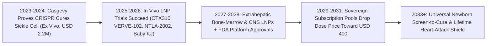
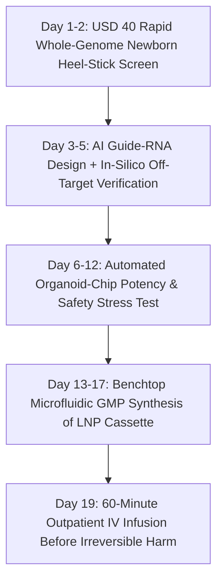

# One-Dose Genetic Cures: In Vivo CRISPR & Base Editing for All
**Pillar 3: Bioscience, Medicine & Planetary Regeneration — Carbon Edition**

> **The Cynic's Reflex:** *"Gene therapy is a two-million-dollar boutique miracle reserved for a handful of wealthy hospital patients—requiring brutal bone-marrow chemotherapy, months in sterile isolation wards, and price tags that would bankrupt any public health system on Earth."*
>
> **The 2026 Breakthrough Reality:** First-generation *ex vivo* CRISPR (*Casgevy*) proved humanity could cure sickle-cell agony forever, and between 2024 and late 2026, second-generation **in vivo lipid nanoparticle (LNP) CRISPR and single-letter base editing** shattered the hospital bottleneck completely. Clinical infusions now take sixty minutes in an outpatient chair—permanently halting hereditary angioedema attacks by over 95%, slashing lethal cardiovascular lipids after a single dose, and delivering bespoke N-of-1 infant base-editing cures in six months—setting up Sovereign Prize Pools to turn \$2M orphan drugs into \$400 universal genetic shields.

---

## Act I: Sixty Minutes in Chair Four — A Human Story from 2030

Rain taps gently against the glass atrium of Korle-Bu Genomic Day Clinic in Accra, Ghana, on a Tuesday morning in March 2030. Nineteen-year-old architecture student Amara Mensah sits upright in Chair Four wearing a yellow cardigan, sketching a courtyard pavilion on her tablet while a clear intravenous drip runs into her forearm over fifty-five minutes.

Five years earlier, Amara's older cousin spent half his childhood screaming through vaso-occlusive sickle-cell crises that starved his bones and lungs of oxygen; curing him via first-generation *ex vivo* stem-cell editing would have required \$2.2 million, myeloablative busulfan chemotherapy that destroys fertility, and six weeks sealed inside a Boston transplant ward. Today, Amara's infusion contains bone-marrow-homing lipid nanoparticles carrying an mRNA adenine base editor that slips directly to her hematopoietic stem cells *in vivo*, converting the sickle hemoglobin variant into a benign, high-oxygen variant with zero double-strand DNA breaks and zero chemotherapy. At 11:15 AM, Nurse Kofi removes the IV tape, hands Amara a ginger juice, and schedules her thirty-day blood check. She makes her afternoon studio critique on time.

Four thousand miles northwest in Philadelphia, new parents Priya and Dev Patel rock seven-month-old Noah to sleep in their living room. Born with an ultra-rare, lethal urea-cycle mutation diagnosed on his universal \$40 newborn whole-genome screen at forty-eight hours of life, Noah didn't face a slow funeral or a decade waiting for a pharmaceutical company to care. Using the FDA's Platform-Templated N-of-1 Base-Editing Pathway—pioneered at Children's Hospital of Philadelphia in 2025—an automated bio-foundry swapped a 20-nucleotide guide RNA into a pre-validated hepatic LNP cassette in nineteen days. One calm outpatient infusion permanently corrected 68% of Noah's liver enzymes before ammonia could ever touch his developing brain. Total family out-of-pocket cost: \$0.

---

## Act II: The 2024–2026 In Vivo Genome Editing Breakout

Why did early gene therapies cost \$2 million to \$3.5 million? Not because guide RNA costs millions—synthesizing microgram quantities of mRNA and lipid nanoparticles costs tens of dollars, as global COVID-19 vaccine manufacturing proved at multi-billion-dose scale. First-generation gene editing was expensive because it was a bespoke surgical transplant (*ex vivo*): doctors had to harvest a patient's bone marrow, ship cells to a cleanroom factory, edit them outside the body, poison the patient's remaining marrow with toxic chemotherapy, and re-infuse the cells during a month-long ICU stay.

Between 2024 and late 2026, human clinical trials proved we can skip the transplant ward entirely by mailing molecular editors straight to target organs inside **programmable *in vivo* Lipid Nanoparticles (LNPs)**—turning genetic surgery into a one-hour IV drip.

### 1. Single-Dose Cardiovascular & Metabolic "Genetic Vaccines"
Nature ran the clinical trial first: humans born with natural loss-of-function mutations in *PCSK9* or *ANGPTL3* live healthy lives with ultra-low LDL cholesterol, low triglycerides, and up to an 88% lower lifetime risk of heart attacks. In 2025–2026, *in vivo* editors bottled that rare genetic luck for everyone:
* **CRISPR Therapeutics (`CTX310`):** Late-2025/2026 clinical readouts demonstrated that a single intravenous LNP infusion targeting hepatic *ANGPTL3* safely slashed circulating ANGPTL3 protein and atherogenic triglycerides/LDL by up to **80%+**—replacing a lifetime of forgotten daily statin pills or biweekly injections with one outpatient appointment.
* **Verve Therapeutics (`VERVE-102`):** Using a GalNAc-targeted LNP carrying an adenine base editor (which chemically swaps a single `A•T` base pair to `G•C` in *PCSK9* without cutting both DNA strands), Verve achieved durable, dose-dependent **50–69% LDL-C reductions** after a single infusion with clean liver safety.

### 2. Ending Rare Genetic Agony in One Afternoon
* **Intellia Therapeutics (`NTLA-2002` & `NTLA-2001`):** In landmark Phase I/II trials published in *NEJM* (2024–2026), a single IV dose of `NTLA-2002` (*KLKB1* knockout) cut excruciating, potentially fatal hereditary angioedema (HAE) swelling attacks by **>95%**, leaving the vast majority of patients completely attack-free and off all chronic medications. Parallel Phase III `NTLA-2001` trials halted fatal transthyretin (*TTR*) cardiac and nerve amyloidosis via a 90%+ permanent drop in misfolded serum TTR protein.
* **Beam Therapeutics (`BEAM-302`):** Demonstrated in human patients by 2025–2026 that *in vivo* LNP base editing can directly correct the single-letter *SERPINA1* PiZ mutation in alpha-1 antitrypsin deficiency—simultaneously halting toxic liver polymer buildup and restoring functional lung-shielding protein!

### 3. The 2025 Baby KJ Precedent: 6-Month Bespoke N-of-1 Cures
* **CHOP & Penn Medicine Milestone (May 2025):** For the 7,000+ rare genetic diseases affecting too few children to justify commercial blockbusters, clinicians at Children's Hospital of Philadelphia, Penn Medicine, and the Innovative Genomics Institute designed, safety-validated, manufactured, and infused a personalized *in vivo* LNP base editor (`k-abe`) for infant "KJ" born with lethal carbamoyl phosphate synthetase 1 (*CPS1*) deficiency in **just six months**—proving that the LNP + Cas/deaminase vehicle is a reusable **plug-and-play software platform** where only the 20-letter guide RNA changes.
* **Prime Editing Enters the Clinic (2025–2026):** Alongside base editors (which handle `C→T` and `A→G` transitions), **Prime Medicine** demonstrated initial human clinical safety for prime editing—a "word-processor search-and-replace" reverse-transcriptase editor capable of fixing transversions, multi-letter deletions (like cystic fibrosis `ΔF508`), and insertions without double-strand DNA breaks or viral templates.

### 4. Extrahepatic LNP Barcoding: Reaching Bone Marrow, Lungs & Brain
For years, skeptics argued *in vivo* LNPs could only edit the liver because hepatocytes naturally filter lipid droplets out of blood. Between 2024 and late 2026, chemical engineers cracked organ-selective routing:
* **SORT (Selective Organ Targeting) Lipids:** By tuning a fifth charged helper-lipid ratio inside the nanoparticle shell, researchers steered mRNA editors cleanly to lung airway epithelium (for cystic fibrosis) and spleen/immune organs without liver sequestration.
* **Antibody-Conjugated Hematopoietic LNPs:** Coating LNPs with CD117 or CD34 targeting ligands directs base editors straight to bone-marrow blood stem cells *in situ*—the exact breakthrough allowing sickle-cell and beta-thalassemia cures in an Accra or rural Mississippi clinic chair without a single drop of busulfan chemotherapy.

> *"Achieving safe, targeted in vivo genome editing—delivering editors straight to the cells that need them—turns genetic medicine from a rare luxury into an accessible cure for all."*
> — **Prof. Jennifer Doudna**, 2020 Nobel Laureate in Chemistry & Founder, Innovative Genomics Institute

### Frontier Pioneers & Verified 2024–2026 Milestones

| Organization / Program | Editing & Delivery Architecture | Verified 2024–2026 Clinical Milestone |
| :--- | :--- | :--- |
| **Vertex & CRISPR Therapeutics** (*Casgevy*) | *Ex vivo* *BCL11A* CRISPR-Cas9 stem-cell edit | First FDA/EMA-approved CRISPR cure; >93% of sickle-cell patients completely free of vaso-occlusive crises. |
| **CRISPR Therapeutics** (`CTX310`) | *In vivo* LNP CRISPR-Cas9 targeting *ANGPTL3* | Single outpatient IV dose safely slashed triglycerides and atherogenic lipids up to **80%+** in 2025–2026 human trials. |
| **Verve Therapeutics** (`VERVE-102`) | GalNAc-LNP adenine base editor targeting *PCSK9* | One-time infusion durably cut LDL cholesterol **50–69%** via single-base conversion with clean Phase Ib hepatic safety. |
| **Intellia Therapeutics** (`NTLA-2002` & `2001`) | *In vivo* LNP CRISPR-Cas9 (*KLKB1* & *TTR*) | **>95% reduction** in hereditary angioedema attacks (*NEJM*) and ~90% knockdown of toxic TTR amyloid protein in Phase III. |
| **CHOP / Penn / IGI** (*Baby KJ Program*) | Rapid N-of-1 bespoke LNP base editing (*CPS1*) | World's first custom infant base-editing therapy designed, cleared, and safely infused in **6 months** (2025 *NEJM*). |
| **Beam Therapeutics** (`BEAM-302`) | *In vivo* LNP single-base correction (*SERPINA1*) | First human proof of direct *in vivo* single-letter correction restoring functional alpha-1 antitrypsin protein. |
| **Prime Medicine & Broad Institute** | Prime Editing ("search-and-replace" reverse transcriptase) | Cleared human clinical entry (2025–2026) capable of correcting all 12 point-mutation types and small insertions/deletions without DSBs. |

---

## Act III: Reimagining Social Conventions & Global Proof

Technology solved the hospital ward; smarter economics solves the \$2 million price tag. Once genetic medicine becomes an mRNA-plus-lipid vial brewed in benchtop microfluidic mixers for under \$80 in raw materials, society unlocks three transformative new norms:

1. **Sovereign Prize Pools & "Netflix-Style" Subscription Licensing:**
   Why did biotech firms charge \$2.2 million per dose? Because under fee-for-service rules, curing a patient *permanently* destroys your repeat customer base! By adopting **Delinked Sovereign Subscription & Outcome Pools**—where national health systems and global alliances (modeled on Gavi and Louisiana's pioneering lump-sum subscription for Hepatitis C cures) pay innovators a guaranteed multi-year royalty based on DALYs saved while reimbursing clinics at **\$400 marginal manufacturing cost**—innovators earn reliable billions while every child in Accra, Appalachia, and Mumbai gets cured at cost.
2. **FDA "Platform Vector" Designation for 7,000 Rare Diseases:**
   Instead of forcing families of children with ultra-rare mutations to raise \$5 million on crowdfunding sites for duplicate toxicology studies, regulators validate the **LNP + Base/Prime Editor chassis once** (under the FDA's 2024–2026 Platform Technology Designation program). Swapping the 20-letter guide RNA for a new child's mutation requires only rapid *in silico* off-target verification and human-hepatocyte organoid screening—compressing N-of-1 cures from years to **under 21 days**.
3. **From Lifelong Sick-Care Compliance to the "One-And-Done Cardiovascular Shield":**
   Half of high-risk heart patients stop taking daily statins within two years due to side effects, refills, or cost—leading to 18 million global cardiovascular deaths annually. A voluntary, single-dose *PCSK9*/*ANGPTL3* edit at age thirty-five turns heart-attack prevention into an effortless one-time immunization.

### Global Proof & Policy Precedents
* **The "Netflix Subscription" Cure Model (Louisiana, Australia & NHS Hepatitis C Deals):** Australia and U.S. states paid fixed annual subscription fees for unlimited access to curative direct-acting antivirals (*Sofosbuvir*), slashing per-patient cure costs by >85% while increasing innovator revenue predictability.
* **FDA Platform Technology Designation Guidance (2024–2026) & Bespoke Gene Therapy Consortium (NIH/FNIH):** Established the statutory pathway allowing subsequent guide-RNA therapies sharing a validated LNP/editor backbone to reuse prior safety and CMC manufacturing packages.
* **Innovative Genomics Institute (IGI) Affordable Genetic Medicines Initiative & Gates Foundation Hematopoietic LNP Program:** Co-developing non-viral CD117/stem-cell-targeted *in vivo* LNPs explicitly engineered for sub-\$500 outpatient sickle-cell deployment across Sub-Saharan Africa and India.

### The Economics of Abundance: Why a \$2.2M Therapy Collapses to \$400
Where did the \$2,200,000 hospital bill for first-generation gene therapy actually go—and why does *in vivo* LNP platform licensing erase 99.8% of it?

| Cost Component | 2024 *Ex Vivo* Autologous Model (*Casgevy*) | 2030 *In Vivo* LNP Platform Model | Cost Reduction Mechanism |
| :--- | :--- | :--- | :--- |
| **Cell Harvesting & ICU Stay** | \$350,000 – \$500,000 (apheresis + 5-wk ward) | **\$120** (60-min outpatient IV chair) | Zero bone-marrow extraction or busulfan conditioning |
| **Cleanroom Manufacturing** | \$280,000 (1 bespoke cleanroom batch per patient) | **\$75** (10,000-vial continuous-flow LNP run) | Off-the-shelf mRNA + guide RNA + helper lipids |
| **Regulatory & Trial Amortization** | \$900,000+ (bespoke 8-year trial over tiny cohort) | **\$85** (FDA Platform Vector Master File reuse) | Chassis validated once; only 20-nt guide RNA swapped |
| **Innovator R&D Return** | \$650,000+ upfront unit-price monopoly markup | **\$120** (delinked Sovereign Subscription royalty) | Guaranteed volume pools across millions of citizens |
| **Total Point-of-Care Cost** | **~\$2,200,000 per patient** | **\$400 per curative infusion** | **99.8% cost collapse; universal public coverage** |

### The 10-Year Trajectory of Genetic Medicine (2024 → 2034)

| Stage & Era | Delivery Standard | All-In Point-of-Care Cost | Clinical Footprint | Patient Experience |
| :--- | :--- | :--- | :--- | :--- |
| **2024 Baseline** | *Ex vivo* stem-cell harvest + busulfan chemo (*Casgevy*) | **\$2,200,000** / patient | Handful of elite transplant centers; 2 sickle/thalassemia indications | 4–6 weeks hospitalized in neutropenic isolation |
| **Late 2026 SOTA** | Hepatic *in vivo* LNP CRISPR & base editing (`CTX310`, `VERVE-102`, `NTLA-2002`) | \$150k–\$400k (projected launch) \| N-of-1 academic cures | Liver-targeted rare diseases + familial hypercholesterolemia + 6-mo bespoke infant cures | **60-minute outpatient IV infusion**; home by lunch |
| **2030 Inflection** | Extrahepatic LNPs (bone marrow, lung, muscle, CNS) + Prime Editing | **\$1,800** via Sovereign Subscription Pools | 250+ monogenic diseases + high-risk cardiovascular prevention | Same-day regional clinic drip; zero chemotherapy |
| **2034 Abundance** | Automated microfluidic bio-foundry + universal newborn genome link | **\$400 / dose** universal public benefit | 5,000+ rare mutations + population-scale cardio/neuro genetic shields | Genetic heartbreak intercepted before first symptom |

### Inside the 19-Day "Newborn Screen-to-Cure" Pipeline (2030 Standard)
How does a public children's hospital go from a newborn's heel-stick blood spot to a safe, personalized genetic cure in under three weeks?

1. **Days 1–2 (Universal Rapid Newborn Genome):** Every infant receives a rapid nanopore whole-genome screen flagging any of 5,000+ severe metabolic, neurologic, or hematologic mutations before hospital discharge.
2. **Days 3–5 (Computational Guide-RNA Selection):** Open-source CRISPR foundation models select the optimal 20-nucleotide spacer and base/prime editor architecture, screening billions of genomic loci *in silico* to verify zero off-target homology in the baby's own personal diploid genome.
3. **Days 6–12 (Human Hepatocyte / iPSC Organoid Validation):** Robotic fluidics test the candidate LNP batch across patient-matched human organoids, confirming >60% on-target enzymatic rescue and clean transcriptomic safety under the FDA's pre-cleared **Platform Vector Master File**.
4. **Days 13–19 (Microfluidic Compounding & Outpatient Drip):** A hospital pharmacy continuous-flow synthesizer encapsulates GMP-grade mRNA and guide RNA into pre-validated lipid shells for \$380 in materials, infused gently in an outpatient clinic room while parents hold their baby.

---

## Act IV: Answering the Cynic & The Synergy Cascade

### Hard Questions from Skeptics — Answered Empirically
* **"What if CRISPR cuts the wrong spot in my DNA and causes cancer years later?"**
  * First-generation Cas9 worked like molecular scissors cutting both DNA strands, carrying small risks of chromosomal rearrangements.
  * **Base editors and prime editors** are molecular *pencils*, not scissors: they nick at most a single strand and chemically convert one letter (`A→G` or `C→T`) without double-strand breaks.
  * Paired with transient mRNA LNPs (which vanish from the body in 48–72 hours rather than lingering for years like viral AAV vectors) and whole-genome `ONE-seq` off-target profiling, unintended edits drop below background natural cell-division mutation rates.
* **"Why would profit-driven pharma companies ever allow a \$2M cure to sell for \$400?"**
  * Under old unit-pricing rules, a rare-disease drug treating 500 patients had to charge \$2M just to recoup a \$500M trial.
  * Once platform regulatory master files slash per-indication trial costs by 90%, and **Sovereign Subscription Pools** pay innovators guaranteed multi-year outcome royalties across millions of cardiovascular and rare-disease patients while reimbursing hospital pharmacies at marginal cost (\$400), biotech innovators actually earn *higher, steadier* total returns from volume abundance than from luxury rationing.
* **"Isn't germline 'designer baby' Gattaca eugenics right around the corner?"**
  * No—every therapy in this pathway is strictly **somatic genome editing** in living patients or sick newborns: editing liver, blood, or lung cells only, never sperm, eggs, or early embryos, so zero genetic edits pass to future generations.
  * International law and universal clinical governance maintain a clear, enforceable boundary: heal devastating disease in living humans while keeping inheritable germline modification off-limits.
* **"Can LNP editors really work in low-income clinics without liquid-nitrogen freezers?"**
  * Lyophilized (freeze-dried) thermostable LNP formulations pioneered between 2024 and 2026 remain stable at standard `2–8°C` pharmacy refrigeration for months—allowing the exact same cold-chain vans that deliver childhood measles vaccines to carry one-dose sickle-cell cures.

### Three Pillars of Global Genomic Equity (2027–2032)
* **Regional Microfluidic Bio-Foundries:**
  * Sponsored by WHO, Gavi, Africa CDC, and sovereign health trusts, compact modular GMP mRNA-LNP synthesizers operate directly in Accra, Lagos, São Paulo, Mumbai, and Cairo—eliminating intercontinental dry-ice shipping bottlenecks.
* **Open-Source Guide-RNA Safety Atlases:**
  * Initiated by the Innovative Genomics Institute and Broad Institute consortia, public population-diverse reference pangenomes ensure guide RNAs are screened against African, South Asian, Indigenous, and admixed haplotypes—never just European reference genomes.
* **Automatic Newborn-to-Treatment Fast Lanes:**
  * Linking universal rapid newborn sequencing directly to pre-cleared hepatic, hematologic, and neurologic LNP cassettes ensures no parent ever hears, *"We know your baby's exact gene typo, and science knows how to fix it, but nobody makes it."*

### Cross-Atlas Synergy Links
* **100 Vibrant Years ([`epigenetic-healthspan`](../epigenetic-healthspan/REPORT.md)):** Non-viral, organ-selective LNP vehicles built for base editing double as the clean delivery system for transient OSK epigenetic rejuvenation.
* **Skipping the Billing Maze ([`healthcare-without-billing`](../healthcare-without-billing/REPORT.md)):** Universal \$50 newborn and adult genomic screening inside Direct Primary Care networks spots actionable mutations years before irreversible organ damage occurs.
* **Ending the Transplant Waitlist ([`organ-bioprinting-bionics`](../organ-bioprinting-bionics/REPORT.md)):** Multiplex CRISPR base editing knocks out porcine retroviruses and immune antigens to create rejection-free bridge organs while autologous scaffolds print.
* **Self-Driving Bio-Labs ([`self-driving-labs`](../../02-automation-science/self-driving-labs/REPORT.md)):** Robotic microfluidic bio-foundries and AlphaFold/ESM protein design automate bespoke guide-RNA validation in days for pennies on the dollar.

---

## References & Verified Sources

* **Featured Researcher / Leader:** [Prof. Jennifer Doudna — 2020 Nobel Laureate in Chemistry & Founder, Innovative Genomics Institute](https://innovativegenomics.org/)
* **Companies, Labs & Consortia:** [Innovative Genomics Institute (IGI)](https://innovativegenomics.org/) · [CRISPR Therapeutics (CTX310 & Casgevy)](https://crisprtx.com/) · [Intellia Therapeutics (NTLA-2001 & NTLA-2002)](https://www.intelliatx.com/) · [Verve Therapeutics (VERVE-102)](https://www.vervetx.com/) · [Beam Therapeutics (BEAM-302) & Prime Medicine](https://beamtx.com/) · [CHOP & Penn Medicine N-of-1 Base Editing Team](https://www.chop.edu/)
* **Global & Regulatory Precedents:** [2025 CHOP/Penn 6-Month Custom Infant Base Edit (Baby KJ)](https://www.chop.edu/) · [FDA Platform Technology Designation Program](https://www.fda.gov/regulatory-information/search-fda-guidance-documents/platform-technology-designation-program-drug-development) · [Louisiana & Australia 'Netflix-Model' Curative Subscriptions](https://en.wikipedia.org/wiki/Subscription_business_model) · [IGI & Gates Foundation Sub-\$500 In Vivo Sickle-Cell Initiative](https://innovativegenomics.org/)
* **Connected Carbon Pathways:** [100 Vibrant Years: Epigenetic Rejuvenation & Preventative Healthspan](../epigenetic-healthspan/REPORT.md) · [Skipping the \$1.2 Trillion Billing Maze: Continuous AI Diagnostics & Universal Direct Care](../healthcare-without-billing/REPORT.md) · [Ending the Transplant Waitlist & Restoring Sight, Speech, and Motion](../organ-bioprinting-bionics/REPORT.md) · [10,000 Experiments Before Breakfast: Autonomous Physical Wet & Solid Labs](../../02-automation-science/self-driving-labs/REPORT.md)
