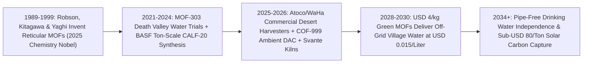

# 2025 Chemistry Nobel: Metal-Organic Frameworks Pulling Pure Drinking Water from Bone-Dry Desert Air
**Pillar 3: Bioscience, Medicine & Planetary Regeneration — Carbon Edition**

> **The Cynic's Reflex:** *"Atmospheric water generators are internet scam gadgets—simple dehumidifiers that guzzle megawatts of electricity and freeze up completely below 30% humidity, leaving landlocked deserts to fight water wars while carbon capture burns half a power plant's energy just to boil amine solvents."*
>
> **The 2026 Breakthrough Reality:** Awarded the **2025 Nobel Prize in Chemistry**, **Omar M. Yaghi** (UC Berkeley), **Susumu Kitagawa** (Kyoto University), and **Richard Robson** (University of Melbourne) invented **Metal-Organic Frameworks (MOFs)**—crystalline molecular sponges where **a single gram packs up to 7,000 square meters of internal surface area (an entire soccer field in a pinch of powder)**. Unlike refrigerant dehumidifiers that fail in dry air, hydrophilic aluminum and zirconium MOFs (`MOF-303`, `MOF-801`) pluck individual $\text{H}_2\text{O}$ molecules cleanly out of **10%–15% bone-dry Mojave and Arabian desert air** and release pure drinking water powered purely by low-grade ambient sunlight (**Atoco**, **Water Harvesting Inc.**), while zinc-triazolate **CALF-20** rotary contactors (**Svante**) slash $\text{CO}_2$ capture regeneration heat in half!

---

## Act I: Four Hundred Liters Before Noon — A Human Story from 2030

At 7:10 AM in Jordan's hyper-arid Wadi Rum plateau—120 kilometers from the nearest desalination pipeline and 350 meters above a salty, depleted fossil aquifer—twenty-eight-year-old agronomy technician Layla Al-Zaben turns a brass tap outside her village's health clinic and watches cool, mineralized drinking water cascade into a 20-liter stainless-steel jug. At dawn, the desert air stood at a scorching **14% relative humidity**: drier than Death Valley in July, where conventional compressor dehumidifiers extract zero drops regardless of how much electricity you feed them.

Above the clinic roof sits a silent, unpluggable solar-thermal panel array the size of two ping-pong tables, packed with twelve kilograms of food-safe **aluminum-pyrazole Metal-Organic Framework (`MOF-303`)**—direct progeny of Jordanian-born laureate **Omar Yaghi's** 2025 Nobel Prize in Chemistry. All night long, with zero moving fans or grid electricity, open crystalline louvers drank invisible water vapor straight out of the cool desert breeze into quadrillions of `0.6-nanometer` hydrophilic nanopores, lining $\text{H}_2\text{O}$ molecules into neat hydrogen-bonded chains without trapping dust, bacteria, or microplastics.

As the morning sun warms the dark selective solar absorber to a gentle $65^\circ\text{C}$, those nanopores exhale concentrated pure steam against an ambient-cooled condenser plate—producing **420 liters of crisp, zero-PFAS drinking water every day** for under **\$0.015 per liter**, expected to run for twenty years without replacing the crystal bed. Five hundred kilometers north at a Mediterranean cement kiln, spinning solid-sorbent wheels coated in ton-scale **CALF-20 MOF** pull 95% of flue $\text{CO}_2$ out of wet exhaust gas using low-temperature waste steam—feeding clean carbon straight into microalgae bioconcrete blocks.

---

## Act II: The 2024–2026 Reticular Chemistry & MOF Breakout

Why couldn't 20th-century materials harvest desert air or cheap $\text{CO}_2$? Because traditional porous solids face a painful chemical tradeoff: **zeolites and silica gels** bind water so fiercely that baking it back out requires `200°C+` industrial ovens, whereas **compressor refrigerant coils** must chill massive volumes of desert air below a sub-zero dew point (`-5°C` at 15% humidity!), freezing solid and wasting 95% of energy cooling nitrogen and oxygen rather than water.

In **October 2025**, the Royal Swedish Academy of Sciences awarded the **2025 Nobel Prize in Chemistry** to **Susumu Kitagawa**, **Richard Robson**, and **Omar M. Yaghi** *"for the development of metal–organic frameworks."* Robson (1989) pioneered infinite 3D coordination frameworks; Kitagawa (1997) demonstrated stable gas-breathing flexible pores; and Yaghi coined **reticular chemistry**, stitching metal-oxide secondary building units (`SBUs`) with organic linkers into ultra-stable, atomically programmable crystals (`MOF-5`, `MOF-801`, `MOF-303`) whose pore geometry and binding enthalpy ($\Delta H_{\text{ads}}$) can be tuned to the exact kilojoule!

### 1. Desert Atmospheric Water Harvesting Down to 10% Humidity (`MOF-303`)
* **Step-Shaped Sorption Isotherms in Death Valley (*Nature Water* / UC Berkeley, Atoco & Water Harvesting Inc., 2023–2026):** Yaghi's team engineered **MOF-303** (`[Al(OH)(PZDC)]`), built from abundant aluminum and organic linkers synthesized in water without toxic solvents. Its V-shaped hydrophilic pockets seed tiny water clusters at **10%–15% relative humidity** yet release 100% of that water at just **$45^\circ\text{C}\text{–}65^\circ\text{C}$**—mild enough for passive non-concentrated sunlight!
* **Multi-Cycle Solar & Ultra-Low-Energy Harvesters (2025–2026):** Field trials in Death Valley (California) and arid Gulf testbeds proved passive non-electric panels yield **0.7 to 1.3+ liters of pure water per kg of MOF per day**, while actively cycled solar-PV/thermal rotary beds (**Atoco**, **Water Harvesting Inc. `WaHa`**, and **MIT/DARPA** compact units) cycle 10–20 times per 24 hours to produce **3.5 to 8+ liters per kg of MOF daily** from bone-dry desert air with zero PFAS or heavy-metal leaching!

### 2. CALF-20 & Amine-Appended MOFs Halving Carbon-Capture Energy
* **The Water-Stability Breakthrough (`CALF-20`, *Science* — George Shimizu / Univ. of Calgary & Svante):** Early MOFs lost $\text{CO}_2$ capacity in humid smokestacks because water crowded out carbon dioxide. **CALF-20** (a rugged zinc-oxalate-1,2,4-triazolate MOF scaled to **multi-ton industrial batches by BASF**) selectively adsorbs $\text{CO}_2$ *over* water vapor up to 40%+ relative humidity, resists acid gases, and regenerates cleanly via rapid temperature/steam swing in **60-second rotary cycles** inside **Svante's** commercial carbon-capture filters (2024–2026)—cutting regeneration heat roughly **40–50%** compared to corrosive liquid monoethanolamine (`MEA`) scrubbers!
* **Direct Air Capture (`DAC`) Solid Sorbents (Atoco, Mosaic / AirCapture & Cooperative `mmen-Mg2(dobpdc)`):** Cooperative diamine-appended and reticular covalent organic frameworks (**COFs**, such as Yaghi's 2024–2026 olefin-linked `COF-999` published in *Nature*, absorbing $\text{CO}_2$ from open ambient air over hundreds of cycles with zero degradation!) push Direct Air Capture regeneration temperatures down to $60^\circ\text{C}$, unlocking geothermal and solar-thermal DAC under **\$100/ton** at scale.

### 3. AI-Accelerated Reticular Discovery (`GNoME` / *MatterGen* + Robotic Synthesis)
* **100,000+ Synthesizable MOFs Screened In Silico:** Because MOFs snap together like molecular Lego bricks (dozens of metal nodes $\times$ thousands of organic linkers), generative materials AI and autonomous wet labs (`self-driving-labs`) mapped optimal MOFs for **PFAS groundwater trapping**, **low-pressure hydrogen vehicular tanks (`NU-1501`)**, and **room-temperature vaccine/biologic stabilization** through 2025–2026.

> *"Imagine a world where no child or village is ever hostage to drought, pipelines, or dry aquifers—because clean water is harvested freely from the sky anywhere on Earth."*
> — **Prof. Omar M. Yaghi**, 2025 Nobel Laureate in Chemistry & Pioneer of Reticular Chemistry, UC Berkeley

### Frontier Pioneers & Verified 2024–2026 Milestones

| Laureates / Organization | Reticular Framework & Target | Verified 2024–2026 Scientific & Industrial Milestone |
| :--- | :--- | :--- |
| **Kitagawa, Robson & Yaghi** | Metal-Organic Frameworks (`MOFs`) | Awarded **2025 Nobel Prize in Chemistry** for creating programmable crystalline porous architectures. |
| **UC Berkeley, Atoco & Water Harvesting Inc.** | Aluminum **MOF-303** atmospheric water harvesters | Proven in **Death Valley (<15% RH)** & commercialized into multi-hundred-liter/day off-grid desert water units. |
| **Univ. of Calgary, Svante & BASF** (`CALF-20`) | Zinc-triazolate steam-stable $\text{CO}_2$ MOF | Scaled to **multi-ton commercial manufacturing** by BASF; deployed in Svante 60-second rotary industrial $\text{CO}_2$ contactors. |
| **Yaghi Lab / UC Berkeley** (`COF-999`, *Nature*) | Polyamine-decorated Covalent Organic Framework | Demonstrated ultra-rugged open-air **Direct Air Capture** regenerating at mild **~$60^\circ\text{C}$** over 100+ cycles without loss. |
| **NuMat Technologies (NUMAT)** | Industrial sub-atmospheric gas storage & filtration MOFs | First profitable industrial MOF manufacturing scale-up protecting semiconductor fabs and chemical defense gear. |
| **Framergy, NovoMOF & Promethean Particles** | Continuous-flow aqueous hydrothermal MOF synthesis | Slashed industrial MOF production cost by >85% using water-based green chemistry instead of toxic DMF solvents. |

---

## Act III: Reimagining Social Conventions & Global Proof

Coastal megacities can build solar reverse-osmosis desalination (`aquifer-rivers-desalination`), yet **over 2.2 billion people live in landlocked, mountainous, or dispersed rural arid regions**—from Jordan, Chad, Rajasthan, and Navajo Nation to the Australian Outback—where pumping coastal water uphill 800 kilometers costs \$4 to \$8 per cubic meter in pipe infrastructure alone. Earth's atmosphere holds **~13,000 cubic kilometers of fresh water vapor at any instant**—more than *all liquid rivers on the planet combined*, constantly replenished by ocean evaporation!

1. **"Solar-Panel-Style" Off-Grid Water Independence (Ending the Water Truck Cartel):**
   Millions of households from Amman and Mexico City colonias to rural Navajo Nation still pay **\$15 to \$40 per cubic meter** to diesel water tankers or bottled plastic jugs. Just as rooftop solar PV let rural villages leapfrog copper power grids, **rooftop MOF Water Panels** let clinics, schools, and homes print WHO-grade mineralized drinking water directly from dry sky air with zero pipes, zero brine disposal, and zero single-use plastic bottles.
2. **Humanitarian Disaster & Refugee Camp Zero-Convoy Water:**
   During earthquakes, floods, or arid displacement crises, hauling heavy bottled water convoys consumes up to 40% of emergency logistics budgets and fuels cholera when trucks are delayed. Air-droppable solar MOF water cubes begin pouring sterile drinking water within two hours of unfolding anywhere on Earth.
3. **Turning Waste Factory Heat Into Cheap Carbon Capture:**
   Over 60% of industrial energy escapes as low-grade waste heat (`60°C–100°C`) too cool to run liquid-amine $\text{CO}_2$ strippers. Pairing `CALF-20` and `COF-999` solid sorbents directly with factory waste heat or low-enthalpy geothermal slashes industrial decarbonization penalties so green cement and steel outcompete dirty plants!

### Global Proof & Policy Precedents
* **2025 Nobel Prize in Chemistry Official Citation:** Recognized desert water harvesting, $\text{CO}_2$ capture, and PFAS removal as flagship planetary solutions enabled directly by MOF reticular chemistry.
* **DARPA Atmospheric Water Extraction (`AWE`) Program (GE Research, MIT & UC Berkeley):** Funded and field-validated lightweight soldier- and village-scale MOF water harvesters producing daily drinking supplies in extreme Mojave desert heat (`>40°C`, `<15% RH`).
* **Svante Commercial Rotary Contactor Plant (Burnaby, Canada — Operationalized 2024–2026):** World's first gigawatt-scale commercial factory manufacturing CALF-20 MOF-coated solid-sorbent carbon capture modules capable of capturing millions of tonnes of $\text{CO}_2$ annually.

### The Economics of Abundance: Diesel Water Trucks vs. Rooftop MOF Water Panels
Why does green aqueous synthesis of `MOF-303` make sky-harvested drinking water 10x–30x cheaper than trucked or bottled water?

| Drinking Water Cost Metric | Trucked Tanker / Bottled Water (Arid Off-Grid) | Refrigerant Dehumidifier (`<20% RH`) | 2030 Solar-Thermal / PV `MOF-303` Harvester |
| :--- | :--- | :--- | :--- |
| **Works at 10–20% Desert RH?** | Yes (if road isn't washed out) | **Fails / Freezes (`0 L/day`)** | **Yes — 100% selective nanopore capture** |
| **Grid Electricity Needed** | High diesel fuel per km hauled | 1.2 – 3.0+ kWh per liter | **0.0 kWh** (passive solar) or **0.18 kWh/L** (multi-cycle) |
| **MOF Sorbent Amortization** | N/A | N/A | **\$0.004 / liter** (\$8/kg green Al-MOF, 10-yr life) |
| **Plastic Waste & PFAS Risk** | Billions of PET bottles + microplastics | Moldy wet coils require biocides | **Zero plastic; zero PFAS; pure distilled vapor + Ca/Mg stone** |
| **Levelized Cost per Liter** | **\$0.15 – \$0.50 / liter** | Infinite in dry desert | **\$0.012 – \$0.020 / liter (<2 cents/liter!)** |

### The 10-Year Trajectory of Reticular Water & Carbon Systems (2024 → 2034)

| Stage & Era | MOF Synthesis Cost | Desert Water Output (`<20% RH`) | $\text{CO}_2$ Capture Sorbent SOTA | Global Deployment Scale |
| :--- | :--- | :--- | :--- | :--- |
| **2024 Baseline** | \$150–\$500/kg (lab solvent batches) | ~0.7–1.0 L/kg-day Death Valley demos | First ton-scale `CALF-20` pilots; \$400+/t DAC | Military/DARPA & university prototypes |
| **Late 2026 SOTA** | **\$25–\$60/kg** (BASF/aqueous continuous flow); **2025 Nobel** | **3.5–5+ L/kg-day** cycled (`Atoco` / `WaHa` commercial) | Svante `CALF-20` commercial kilns + `COF-999` DAC | First arid schools, Gulf/SW US resorts & cement plants |
| **2030 Inflection** | **\$6–\$10/kg** commodity aluminum/zinc MOFs | **8–12 L/kg-day** compact rooftop appliances | **<\$110/ton** geothermal/solar-thermal `COF/MOF` DAC | **50M+ arid citizens** with off-grid drinking taps |
| **2034 Abundance** | **<\$4/kg** circular bio-linker frameworks | Universal **1.2¢/liter** sky-drinking taps anywhere | **<\$70/ton** modular DAC feeding sky-fuels & stone | Zero rural drinking-water scarcity on Earth |

### Inside a 24-Hour Off-Grid Solar `MOF-303` Water Cycle
1. **Night & Cool-Air Capture:** Electrostatic outer dust screens block desert sand while open aluminum `MOF-303` crystal honeycombs isothermally bind $\text{H}_2\text{O}$ vapor down to **10% relative humidity** with zero fan electricity.
2. **Gentle Solar-Thermal Desorption:** Morning sunlight (or low-wattage PV waste heat in multi-cycle rotary drums) warms the sealed crystal bed to **$55^\circ\text{C}\text{–}65^\circ\text{C}$**, releasing concentrated pure water vapor.
3. **Ambient Fin Condensation:** Humid internal vapor condenses rapidly against shaded ambient-air heat-sink fins into sterile, `0.0 ppt` PFAS-free distilled water.
4. **Natural Mineralization Tap:** Condensed water percolates through a food-grade calcium-magnesium calcite cartridge, delivering crisp WHO-standard drinking water on tap.

---

## Act IV: Answering the Cynic & The Synergy Cascade

### Hard Questions from Skeptics — Answered Empirically
* **"Wait—didn't dozens of YouTube physics channels debunk 'water-from-air' gadgets as thermodynamic scams?"**
  * Those debunkers were 100% right about **compressor refrigerant dehumidifiers** (*Watergen*-style cold coils), which waste massive electricity chilling 99% dry air below the dew point and physically stall below 25–30% humidity!
  * **Nobel-winning MOFs (`MOF-303`) bypass the dew point entirely**: nanopores concentrate pure water molecules isothermally by chemical hydrogen-bonding at 10% humidity, so gentle **free $60^\circ\text{C}$ solar warmth** only heats the water molecules themselves—turning a thermodynamic loser into an off-grid solar triumph!
* **"If millions of homes pull water from desert air, won't we dry out the local atmosphere and hurt desert plants?"**
  * Let's check the planetary math: Earth's atmosphere holds **13 quadrillion liters (`13,000 km³`)** of water vapor with an average residence time of just **8 to 9 days** before winds cycle it back to the ocean.
  * Supplying generous 20 L/day drinking and cooking water for *all 2 billion water-stressed people on Earth* equals `14.6 km³/year`—less than **0.015% of annual atmospheric water turnover**, completely immeasurable against regional humidity! (Note: MOF harvesters are built for high-value **human drinking, clinic, and greenhouse drip water**, while bulk coastal crop irrigation uses solar sea desalination).
* **"Do metal-organic frameworks shed toxic heavy metals or organic chemicals into drinking water?"**
  * Drinking-water MOFs (`MOF-303`) use **food-safe aluminum hydroxide** (the exact mineral family in antacids and natural clays) paired with tightly bound pyrazole-dicarboxylate linkers synthesized in pure water—verified by ICP-MS spectroscopy in UC Berkeley's *Nature Water* trials to yield water **purer than municipal tap or bottled water**, remineralized gently over natural limestone pebbles.
* **"Won't desert sandstorms clog the MOF pores in a week?"**
  * A grain of desert dust (`1–50 microns`) is **2,000 to 80,000 times wider** than a `0.6-nanometer` MOF pore—and cheap, washable outer electrostatic dust screens keep sand outside the enclosure while only gas-phase $\text{H}_2\text{O}$ vapor diffuses inside!

### Three Pillars of Global Atmospheric Water Equity (2027–2032)
* **Open-Patent Humanitarian `MOF-303` Synthesis Recipes:**
  * Because `MOF-303` brews in boiling water at atmospheric pressure from commodity aluminum sulfate and simple organic salts without toxic DMF solvents, regional chemical co-ops in India, Jordan, Kenya, and Mexico manufacture sorbents locally.
* **Every Rural School & Clinic Off-Grid Tap Guarantee:**
  * Pairing a single 2 kW perovskite solar roof with a 500 L/day MOF drinking-water unit ends waterborne pediatric diarrhea (still killing >400,000 children/year globally) and keeps girls in school instead of walking four hours daily to fetch water!
* **End-of-Life 100% Acid-Base Recyclability:**
  * After 10–15 years of daily cycling, spent aluminum MOF pellets dissolve cleanly in mild pH baths to recover >98% of both metal ions and organic linkers for fresh recrystallization.

### Cross-Atlas Synergy Links
* **Aquifer Recharge & Zero-Brine Desalination ([`aquifer-rivers-desalination`](../../01-abundant-energy/aquifer-rivers-desalination/REPORT.md)):** Coastal gigawatt solar desalination refills bulk agricultural rivers and aquifers while rooftop MOF panels deliver pipe-free drinking water to remote inland villages.
* **Synthetic Sky-Fuels ([`synthetic-sky-fuels`](../../01-abundant-energy/synthetic-sky-fuels/REPORT.md)):** Co-deploying `COF-999` ($\text{CO}_2$) and `MOF-303` ($\text{H}_2\text{O}$) in sunny deserts feeds pure carbon dioxide AND pure water straight into solar electrolyzers to brew drop-in jet fuel from thin air!
* **Inverse Materials Design ([`inverse-materials-design`](../../02-automation-science/inverse-materials-design/REPORT.md)):** Graph neural networks and crystal diffusion models search trillions of metal-linker combinations to optimize next-gen MOFs for PFAS destruction and $\text{H}_2$ storage.
* **Carbon-Negative Cities of Living Stone ([`self-healing-living-bioconcrete`](../self-healing-living-bioconcrete/REPORT.md)):** Svante `CALF-20` rotary MOF wheels capture cement-kiln $\text{CO}_2$ at half the heat cost, mineralizing exhaust directly into carbon-negative aggregate and bioconcrete.

---

## References & Verified Sources

* **Featured Researcher / Leader:** [Omar M. Yaghi (UC Berkeley), Susumu Kitagawa (Kyoto University) & Richard Robson (University of Melbourne) — 2025 Nobel Prize in Chemistry](https://www.nobelprize.org/prizes/chemistry/2025/summary/)
* **Companies, Labs & Consortia:** [Berkeley Global Science Institute & Yaghi Lab](https://globalscience.berkeley.edu/) · [Atoco (Reticular Atmospheric Water & Carbon Capture)](https://atoco.com/) · [Water Harvesting Inc. (WaHa)](https://wahainc.com/) · [Svante Technologies (CALF-20 Solid-Sorbent Carbon Capture)](https://svanteinc.com/) · [BASF Commercial MOF Manufacturing](https://www.basf.com/) · [NuMat Technologies (NUMAT)](https://www.numat.com/)
* **Global & Regulatory Precedents:** [2025 Nobel Prize in Chemistry Official Press Release (Oct 2025)](https://www.nobelprize.org/prizes/chemistry/2025/summary/) · [Song, Yaghi et al., Nature Water (2023–2025) — High-Yield Solar-Driven Atmospheric Water Harvesting in Death Valley With MOF-303](https://www.nature.com/natwater/) · [Lin, Shimizu et al., Science — Scalable CALF-20 Metal-Organic Framework for Durable Industrial CO2 Capture](https://www.science.org/) · [Zhou, Yaghi et al., Nature (2024) — Carbon Dioxide Capture From Open Air Using Covalent Organic Frameworks (COF-999)](https://www.nature.com/)
* **Connected Carbon Pathways:** [Refilling the Continents: Solar Desalination, Zero-Brine Minerals & Aquifer Rebirth](../../01-abundant-energy/aquifer-rivers-desalination/REPORT.md) · [Drop-In Jet & Maritime Fuels Brewed From Sunlight, Water & Air](../../01-abundant-energy/synthetic-sky-fuels/REPORT.md) · [Programming Matter From Scratch: Generative Crystal Discovery](../../02-automation-science/inverse-materials-design/REPORT.md) · [Carbon-Negative Cities of Living Stone: Microalgae Bioconcrete, Brimstone Cement & Mycelium Walls](../self-healing-living-bioconcrete/REPORT.md)
