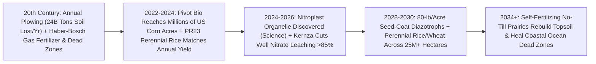

# Crops That Fertilize Themselves: Nitrogen-Fixing Root Microbes & Deep-Rooted Perennial Grains
**Pillar 3: Bioscience, Medicine & Planetary Regeneration — Carbon Edition**

> **The Cynic's Reflex:** *"Modern agriculture is trapped in a soil-destroying bargain: feeding eight billion people requires burning 2% of global natural gas in Haber-Bosch fertilizer plants, washing half that synthetic nitrogen into ocean dead zones, and plowing annual grain fields bare every autumn until our last meter of topsoil washes into the sea."*
>
> **The 2026 Breakthrough Reality:** Air is already **78% free nitrogen ($\text{N}_2$)**—every single hectare of farmland sits beneath 78,000 tonnes of atmospheric fertilizer! Between 2024 and late 2026, two living breakthroughs broke the synthetic-fertilizer and annual-plow addiction: (1) **Non-transgenic gene-edited root microbes** (**Pivot Bio *PROVEN 40***, deployed across **millions of U.S. corn, wheat, and sorghum acres**) colonize cereal roots to spoon-feed ammonia directly from thin air with **zero nitrate runoff or $\text{N}_2\text{O}$ greenhouse spikes**; and (2) **Deep-rooted perennial grains** (**Yunnan University's *PR23* perennial rice** and **The Land Institute's *Kernza***) harvest **4 to 8 consecutive seasons from a single planting**, growing **3-meter carbon-storing roots** that halt erosion and slash farmer seed, tillage, and tractor-diesel bills by **50%**!

---

## Act I: Year Four Without the Plow — A Human Story from 2030

Morning mist curls over terraced paddies in Menglian County, Yunnan, China, in October 2030 as fifty-two-year-old smallholder farmer Lin Mei walks along a firm, earthworm-rich dike carrying a lightweight electric harvesting sickle—leaving her family's diesel rototiller parked untouched under a tarp for the fourth straight autumn. Seven years ago, planting annual paddy rice meant four backbreaking weeks every spring and summer: flooding, plowing mud knee-deep, buying expensive urea fertilizer bags tied to volatile global gas prices, and transplanting millions of bent-back seedlings while monsoon rains washed precious red hillside clay into the Lancang River.

In spring 2027, Lin Mei planted **perennial rice (`PR23` / `PR25`)**—bred by crossing high-yielding Asian *Oryza sativa* with a rhizome-forming wild African cousin (*Oryza longistaminata*)—inoculated at planting with a seed-coat film of **nitrogen-fixing endophytic *Klebsiella/Kosakonia* root bacteria**. Just like mowed meadow grass or asparagus, after each golden harvest of **6.8 tonnes per hectare**, sturdy underground rhizomes sleep beneath the soil and resprout vigorously on their own each spring!

Four thousand miles away along the Des Moines River in Iowa, fourth-generation grain farmer Caleb Lindqvist pulls a single soil core from his no-till corn-and-**Kernza** strips: rich, dark crumb structure teeming with fungal hyphae down past two meters, while his tile-drain sensor reads **`<1.2 ppm` nitrate** entering the creek—down 88% from his grandfather's anhydrous-ammonia days, saving Caleb \$95 per acre in synthetic fertilizer and cutting Gulf of Mexico hypoxia at the source.

---

## Act II: The 2024–2026 Self-Fertilizing & Perennial Crop Breakout

Two 20th-century agricultural miracles saved billions from famine yet left behind a ticking ecological debt. First, the **Haber-Bosch process** ($450^\circ\text{C}$, `200 bar` fossil methane reforming) consumes ~2% of global energy and emits ~1.8% of global $\text{CO}_2$—worse, crops absorb **less than half** of applied synthetic urea/ammonia! Rain flushes the lost 50% into aquifers and rivers (fueling 500+ coastal **ocean dead zones**), while soil microbes convert excess fertilizer into **nitrous oxide ($\text{N}_2\text{O}$)—a greenhouse gas 273 times more potent than $\text{CO}_2$**! Second, because humans domesticated short-lived *annual* grasses (wheat, rice, corn) 10,000 years ago, **70% of global cropland is plowed or left bare every year**, losing ~24 billion tonnes of irreplaceable fertile topsoil annually.

Between 2024 and late 2026, synthetic microbiology and wide-hybridization genetics proved staple grains can **drink nitrogen from the sky and regrow from deep perennial roots**.

### 1. Unlocking Microbial Nitrogen Fixation for Cereals (*Pivot Bio*)
Soybeans and clover naturally host nitrogen-fixing *Rhizobia* nodules, whereas corn, wheat, and rice lacked that partnership—and wild soil diazotrophs (*Klebsiella variicola*, *Kosakonia sacchari*) normally **shut off their nitrogenase (`nif`) genes** whenever residual soil nitrate is present!
* **Pivot Bio (*PROVEN 40* & *RETURN*, >5 Million Cumulative U.S. Acres/Yr by 2024–2026):** Founded by Karsten Temme and Alvin Tamsir, Pivot Bio used **non-transgenic intragenomic gene editing** (remodeling native regulatory switches without inserting foreign species DNA) to unlock the microbial nitrogen-shutoff brake and link ammonia excretion directly to root exudates! Applied right in the furrow or as a **dry on-seed coating**, *PROVEN 40* microbes wrap around growing corn/wheat roots and spoon-feed steady daily nitrogen straight into plant cells—reliably replacing **40+ lbs/acre of synthetic nitrogen** (with next-gen strains pushing toward 80+ lbs/acre!) with **zero rain-washout leaching and zero $\text{N}_2\text{O}$ spikes**.
* **Nitroplast Discovery (*UC Santa Cruz / Berkeley Lab*, *Science*, April 2024–2026) & *nif* Organelle Engineering:** In a landmark 2024 *Science* discovery, Dr. Tyler Coale and Prof. Jonathan Zehr proved marine alga *Braarudosphaera bigelowii* evolved the first known **eukaryotic nitrogen-fixing organelle—the "nitroplast" (`UCYN-A`)**! Alongside John Innes Centre / Gates Foundation **ENSA** and ** Bayer/Ginkgo** nitrogen-fixation consortia, mapping the minimal nitroplast blueprint opened the direct path to crops with built-in solar-powered nitrogen organelles in the 2030s.

### 2. Perennial Rice (`PR23` / `Yunda 107`) Feeding Tens of Thousands of Farms
* **Yunnan University & BGI Breakthrough (*Nature Sustainability*, Prof. Fengyi Hu, 2023–2026):** Critics claimed perennial grains would always suffer pathetic yields because plants supposedly trade grain for roots. Across **44,000+ smallholder farms and >15,000–40,000 hectares** in southern China, Uganda, Côte d'Ivoire, and Laos through 2025–2026, **Perennial Rice 23 (`PR23`)** produced **6.8 tonnes/hectare per harvest—statistically matching elite annual rice yields for 8 consecutive harvests over 4 years from a single planting!**
* **Massive Labor, Cost & Soil Carbon Gains:** `PR23` slashed farmer labor inputs by **nearly 60%**, cut seed/tillage input expenses by **~49%**, boosted farmer net profits by **17% to 100%+**, and sequestered nearly **1 additional tonne of organic soil carbon per hectare per year** while virtually halting hillside soil erosion!

### 3. Deep-Rooted *Kernza*, Perennial Wheat & Silphium Oilseeds
* **The Land Institute (Salina, Kansas — *Kernza* Perennial Intermediate Wheatgrass):** Bred over two decades and commercialized across Minnesota, Kansas, and Europe (General Mills, Patagonia Provisions, municipal wellhead protection zones), **Kernza** sends dense perennial root networks **3+ meters (10+ feet) deep**—acting as a living biological sponge that cuts agricultural **nitrate groundwater leaching by 85% to 99%** while doubling yield per breeding cycle via genomic selection through 2025–2026!

> *"For ten thousand years, humanity fed itself by disturbing ecosystems every single spring. Perennial, self-fertilizing grain crops let farms work like native prairies—building deep soil while harvesting abundant grain."*
> — **Dr. Rachel Stroer & Dr. Lee DeHaan**, The Land Institute (*Kernza* Perennial Grain Program)

### Frontier Pioneers & Verified 2024–2026 Milestones

| Organization / Discovery | Biological / Genetic Mechanism | Verified 2024–2026 Field & Scientific Milestone |
| :--- | :--- | :--- |
| **Pivot Bio** (*PROVEN 40* & *On-Seed*) | Gene-edited root-colonizing diazotrophs (*K. variicola* / *K. sacchari*) | Deployed across **5M+ annual U.S. acres** replacing 40+ lbs/acre synthetic N with zero leaching or $\text{N}_2\text{O}$ emissions. |
| **Yunnan University** (*Prof. Fengyi Hu* — `PR23`) | *Oryza sativa × O. longistaminata* rhizomatous perennial rice | *Nature Sustainability*: **8 harvests over 4 years from 1 planting** matching **6.8 t/ha** annual yield; **-58% labor** across >40,000 farms. |
| **The Land Institute & Univ. of Minnesota** (*Kernza*) | Deep-rooted perennial intermediate wheatgrass (`Thinopyrum`) | **3-meter roots** proved **85–99% reduction in nitrate groundwater leaching** across municipal drinking-water buffer zones. |
| **UC Santa Cruz & Berkeley Lab** (*Nitroplast*) | Newly discovered eukaryotic $\text{N}_2$-fixing organelle (`UCYN-A`) | Published in *Science* (April 2024): proved endosymbiotic cyanobacteria evolved into a true host-integrated nitrogen organelle! |
| **ENSA Consortium** (*Cambridge / Oxford / Gates*) | Mycorrhizal & cereal root-nodulation signaling (`Sym` pathway) | Reprogrammed cereal root transcription factors (*SHR-SCR*) toward legume-like bacterial nodulation and arbuscular nutrient exchange. |
| **Kula Bio & Sound Agriculture** (*SOURCE*) | Bio-electrochemical *Xanthobacter* biofertilizer & microbiome activators | Stimulated native rhizosphere nitrogen and phosphorus solubilization on commercial corn and soybean acreage. |

---

## Act III: Reimagining Social Conventions & Global Proof

Farmers operate on razor-thin margins; asking a farm family to lose money "for the climate" always fails. Self-fertilizing microbes and multi-year perennial grains win at hyper-speed because **they make farmers wealthier on Day 1 while freeing rural villages from global fertilizer shocks**:

1. **Food Security Decoupled From Geopolitical Natural-Gas Shocks:**
   Whenever pipeline wars or energy spikes hit natural gas (as in 2022, when synthetic urea prices tripled overnight!), smallholder farmers across Africa, South Asia, and Latin America couldn't afford fertilizer—triggering acute local hunger. Freeze-dried **on-seed nitrogen-fixing microbial coatings** cost \$18–\$25 per hectare to brew in local fermentation tanks from sugar water, giving every nation **100% sovereign fertilizer independence from thin air**.
2. **Municipal "Clean-Well Buffers" Paying Farmers Instead of Building Water Plants:**
   In agricultural states like Minnesota and Iowa, small towns spend tens of millions building reverse-osmosis nitrate-removal plants because annual corn fertilizer contaminates town drinking wells (`>10 ppm` blue-baby nitrate limit). Under **Minnesota's Clean Water *Kernza* Wellhead Protection model**, municipal water utilities pay farmers a modest per-acre stewardship fee to plant deep-rooted *Kernza* over town aquifer recharge zones—eliminating nitrate contamination for **1/10th the cost of concrete water-treatment plants** while farmers still harvest profitable grain and forage!
3. **Giving Back Women's & Children's Lives in Paddy Farming:**
   In manual smallholder rice regions across Asia and Sub-Saharan Africa, exhausting mud transplanting falls disproportionately on women and teens. Yunnan University's field studies proved **perennial rice cuts 68–77 labor-days per hectare over a 4-year cycle**—freeing rural mothers for higher-income enterprises and keeping children in classroom desks during planting season!

### Global Proof & Policy Precedents
* **China Ministry of Agriculture Mainstreaming List (`PR23` / `Yunda 107`):** Officially recommended perennial rice varieties for multi-province expansion after verifying yield parity, soil carbon gains, and dramatic labor savings across tens of thousands of smallholder plots.
* **Minnesota Forever Green Initiative & Municipal Wellhead *Kernza* Compacts (2023–2026):** State-backed public-private supply-chain funding proving perennial grains simultaneously clean rural drinking aquifers and supply commercial bakeries/brewers.
* **USDA & EPA Streamlined Biostimulant / Non-Transgenic Microbial Pathways:** Because intragenomic edited native microbes (*Pivot Bio*) contain zero foreign transgenes and die back naturally after harvest without persisting in non-crop ecosystems, regulatory clearance scaled from lab to 5M+ farm acres in under five years.

### The Economics of Abundance: 4 Years of Annual Farming vs. Perennial + Bio-Nitrogen
How does combining perennial grain genetics with root-zone nitrogen microbes transform a 100-hectare farm ledger over four years?

| 4-Year Per-Hectare Farm Ledger | 2024 Annual Seed + Synthetic Urea Baseline | 2030 Perennial Grain + On-Seed Bio-Nitrogen | Farmer & Planetary Win |
| :--- | :--- | :--- | :--- |
| **Seed & Transplanting (Years 2–4)** | \$780 / ha (re-bought & re-planted every spring) | **\$0 / ha** (regrows from living rhizomes Years 2–4!) | **75% seed & planting savings** |
| **Tractor Tillage Fuel & Labor** | \$640 / ha (annual plowing, disking, pudding) | **\$140 / ha** (harvest + light surface management only) | **-58% labor & -50%+ diesel burned** |
| **Nitrogen Fertilizer Bill** | \$920 / ha (volatile fossil Haber-Bosch urea) | **\$260 / ha** (on-seed *nif* microbe + trace mineral top-up) | **Zero nitrate runoff; zero $\text{N}_2\text{O}$ penalty** |
| **Soil Carbon & Clean-Water Dividend** | `0` (net soil erosion ~10 t/ha/yr) | **+\$320 / ha** (+4 t/ha organic soil C + clean-well credit) | Rebuilds spongy drought-proof topsoil |
| **Net 4-Year Input Cost** | **\$2,340 / ha** | **\$400 / ha (after soil/water credit: +\$80 net!)** | **Higher farmer profit at lower food prices** |

### The 10-Year Trajectory of Regenerative Staple Crops (2024 → 2034)

| Stage & Era | Microbial $\text{N}_2$ Replacement | Perennial Grain Yield Parity | Global Acreage Footprint | Ocean & Climate Impact |
| :--- | :--- | :--- | :--- | :--- |
| **2024 Baseline** | ~35–40 lbs N/acre (*PROVEN 40*) | **100% in rice** (`PR23`); ~35–45% in *Kernza* wheatgrass | ~5M US microbial acres; ~45k ha `PR23` rice | Gulf & Baltic dead zones near peak |
| **Late 2026 SOTA** | **40–55 lbs N/acre** dry on-seed across corn, wheat, sorghum | `PR25` cold/disease-hardened rice; *Kernza* yield +100% vs. 2018 | **8M+ microbial acres**; Uganda/Asia perennial trials | First measurable wellhead nitrate drops |
| **2030 Inflection** | **80–110 lbs N/acre** + mycorrhizal phosphorus unlocked | Perennial wheat/sorghum hit **75–90% yield parity** | **80M+ hectares** globally across US, China, Africa, India | **-40% agricultural $\text{N}_2\text{O}$**; coastal hypoxia shrinking |
| **2034 Abundance** | **100% synthetic N-free cereals** (microbes + first *nitroplast* lines) | Full yield parity across rice, wheat, sorghum & oilseeds | **300M+ hectares** converted to no-till living prairies | **1.5+ Gt $\text{CO}_2\text{e}$/yr** soil sink + dead zones healed |

### Inside a 5-Year Self-Fertilizing Perennial Rotation (2030 Farm Playbook)
1. **Year 1 Spring (Single No-Till Planting with Dry Bio-Coat):** Perennial rice (`PR25`), *Kernza*, or perennial wheat seed arrives pre-coated with shelf-stable, gene-edited nitrogen-fixing *Kosakonia/Klebsiella* root endophytes—requiring zero extra sprayer passes.
2. **Years 1–4 Summer (Daily Rainproof Root Spoon-Feeding):** Endophytic microbes convert atmospheric $\text{N}_2$ straight into root-zone ammonia in sync with plant sugar exudates, while solar micro-rovers laser-weed rows without herbicides.
3. **Years 1–4 Autumn (Harvest Without the Plow):** Combine harvesters gather 6.5–7.5 tonnes/hectare of grain while living 3-meter roots and underground rhizomes remain undisturbed through winter, locking ~1 tonne/ha/year of soil carbon.
4. **Year 5 Break Crop & Clean-Water Dividend:** A one-season legume/oilseed break resets pest cycles before replanting, while tile-drain nitrate sensors verify municipal **Clean-Well Stewardship Dividends** for the farm family.

---

## Act IV: Answering the Cynic & The Synergy Cascade

### Hard Questions from Skeptics — Answered Empirically
* **"Wait—doesn't fixing nitrogen take cellular ATP energy? Won't microbes or nitroplasts steal sugar from the plant and cut grain yields?"**
  * Great biophysics check! Sunlight during peak summer days actually delivers *excess* photosynthetic sugar (`root exudates`—plants naturally pump **15–30% of all fixed carbon out of their roots** specifically to feed rhizosphere microbes!).
  * Across thousands of independent side-by-side strip trials on commercial Iowa and Nebraska farms, *Pivot Bio* corn matched or beat synthetic-urea bushels per acre because steady daily root ammonia eliminates early-season rain washout losses (where 40% of spring synthetic ammonia vanished before July!).
* **"If perennial crops stay in the ground for 4–5 years without plowing, won't weeds, fungi, and pests build up?"**
  * Agronomists built the exact rotation playbook in Yunnan (`PR23`) and Kansas (*Kernza*): farmers run a **4-to-5-year perennial phase** followed by a 1-to-2-year legume/oilseed break rotation, paired with **precision laser-weeding swarm robots (`specialized-swarm-robotics`, zero herbicide!)** and multi-line disease-resistance gene stacks (`Xa` / `Pi` blight genes). Dense perennial canopies actually shade out spring annual weeds far better than bare plowed dirt!
* **"Could gene-edited nitrogen-fixing bacteria spread into wild forests and over-fertilize native meadows?"**
  * Pivot Bio specifically edited **host-dependent obligate root colonizers** (*Kosakonia* / *Klebsiella* endophytes) tuned to corn and wheat root-exudate sugars; field persistence studies (`citizen-edna-groundwater-atlas`) verified that once the grain crop harvests, edited microbial populations drop rapidly back below detection within weeks and cannot outcompete wild microbes without crop root feeding.
* **"Why didn't Sri Lanka's sudden 2021 chemical-fertilizer ban work—and how is this completely different?"**
  * Sri Lanka banned synthetic fertilizer *overnight by decree with zero biological replacement*, starving annual crops of nitrogen! Our pathway **never bans inputs before biology outperforms them**: farmers dial down synthetic urea *pound-for-pound* only as proven on-seed diazotrophs and `PR23`-class perennial varieties deliver equal or higher harvests at half the cost!

### Three Pillars of Global Agrarian Equity (2027–2032)
* **Royalty-Free Sub-Saharan Perennial Rice & Sorghum (`PR23` Africa South-South Transfer):**
  * Yunnan University, AfricaRice, and the Land Institute partner directly with Ugandan, Nigerian, Malawian, and Ethiopian public breeders so smallholder women farmers access perennial rice and perennial sorghum seed at standard local grain prices.
* **Shelf-Stable Dry Seed Coatings (Zero Cold-Chain Liquid Jugs):**
  * Freeze-dried microbial spore coatings pre-applied directly at regional seed cooperatives survive hot $35^\circ\text{C}$ farm sheds—so farmers simply plant the seed as usual with zero extra sprayer passes.
* **Healing the Mississippi, Yangtze & Ganges Estuaries:**
  * Eliminating millions of tons of leached agricultural nitrate restores oxygen to coastal shrimp, oyster, and artisanal fisheries feeding hundreds of millions of coastal families.

### Cross-Atlas Synergy Links
* **The Billion-Hectare Rewilding ([`precision-fermentation-rewilding`](../precision-fermentation-rewilding/REPORT.md)):** While microbial solar proteins free up 75% of grazing/feedlot land for wild forests, perennial self-fertilizing grains turn the remaining 25% of human cropland into wildlife-friendly, deep-rooted carbon prairies!
* **Citizen eDNA & Groundwater Atlas ([`citizen-edna-groundwater-atlas`](../citizen-edna-groundwater-atlas/REPORT.md)):** Soil and borehole eDNA metabarcoding audits fungal-to-bacterial soil health and verifies nitrate-free aquifers for farmer Clean-Water Dividends.
* **Specialized Swarm Robotics ([`specialized-swarm-robotics`](../../02-automation-science/specialized-swarm-robotics/REPORT.md)):** Featherweight solar field rovers zap emergent weeds between perennial grain rows with millimeter blue lasers—enabling 5-year no-till harvests with **zero glyphosate or soil compaction**.
* **Healing a Toxified Planet ([`forever-chemical-cleanup`](../forever-chemical-cleanup/REPORT.md)):** Eliminating synthetic agrochemical runoff works alongside river plastic Interceptors and PFAS destruction to return every continental river to drinkable clarity.

---

## References & Verified Sources

* **Featured Researcher / Leader:** [Prof. Fengyi Hu — Yunnan University Perennial Rice Lead (`PR23`)](http://www.ynu.edu.cn/) · [Dr. Lee DeHaan & Dr. Rachel Stroer — The Land Institute (*Kernza* Perennial Grain)](https://landinstitute.org/) · [Dr. Karsten Temme — Co-Founder, Pivot Bio](https://www.pivotbio.com/) · [Prof. Jonathan Zehr & Dr. Tyler Coale — UC Santa Cruz (*Nitroplast* Discovery)](https://www.ucsc.edu/)
* **Companies, Labs & Consortia:** [Pivot Bio (*PROVEN 40* & On-Seed Nitrogen Microbes)](https://www.pivotbio.com/) · [The Land Institute (*Kernza* & Global Perennial Inventory)](https://landinstitute.org/) · [Yunnan University Perennial Rice Research Team](http://www.ynu.edu.cn/) · [ENSA — Engineering Nitrogen Symbiosis for Africa (Cambridge / Gates Foundation)](https://www.ensa.ac.uk/) · [University of Minnesota Forever Green Initiative](https://forevergreen.umn.edu/)
* **Global & Regulatory Precedents:** [Zhang, Huang, Hu et al., Nature Sustainability (2023–2025) — Sustained Productivity & Agronomic Potential of Perennial Rice Across 8 Consecutive Harvests](https://www.nature.com/natsustain/) · [Coale, Loconte, Turk-Kubo, Zehr et al., Science (April 2024) — Nitrogen-Fixing Organelle (Nitroplast) in a Marine Alga](https://www.science.org/) · [Minnesota Municipal Wellhead Protection Kernza Program](https://forevergreen.umn.edu/)
* **Connected Carbon Pathways:** [The Billion-Hectare Rewilding: Solar Proteins, Vertical Orchards & Returning Half the Earth to Wild Nature](../precision-fermentation-rewilding/REPORT.md) · [A Genome Lab in Every Backpack: Citizen eDNA Watershed Swabs & the Global Groundwater Biome Atlas](../citizen-edna-groundwater-atlas/REPORT.md) · [Featherweight Field & Construction Swarms: Millimeter Laser Weeding & Micro-Rovers](../../02-automation-science/specialized-swarm-robotics/REPORT.md) · [Healing a Toxified Planet: Supercritical PFAS Destruction, Plastic-Eating Enzymes & Clean Rivers](../forever-chemical-cleanup/REPORT.md)
