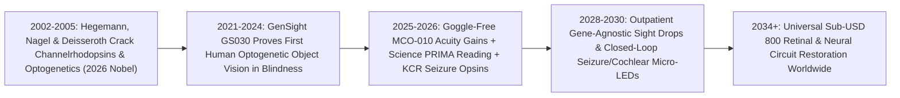

# 2026 Medicine Nobel: Optogenetic Light-Gated Ion Channels Restoring Sight & Calming Seizures
**Pillar 3: Bioscience, Medicine & Planetary Regeneration — Carbon Edition**

> **The Cynic's Reflex:** *"Total blindness from dead retinal photoreceptors is irreversible biological loss, and severe epilepsy or chronic neuropathic pain still force patients to choose between invasive brain surgery that cuts out living cortex or sedating drugs that numb their entire personality."*
>
> **The 2026 Breakthrough Reality:** Honored with the **2026 Nobel Prize in Physiology or Medicine**, **Karl Deisseroth** (Stanford), **Peter Hegemann** (Humboldt University Berlin), and **Georg Nagel** (Würzburg) transformed green-algal light-sensitive ion channels (**channelrhodopsins**) into millisecond-precise optical switches for human neurons. By 2025–2026, single-injection **optogenetic gene therapies** (*GenSight GS030*, *Nanoscope MCO-010*, and *Science Corp* biohybrid interfaces) turned surviving inner retinal cells into artificial photoreceptors—restoring shape, letter, and doorway vision in legally blind patients—while red-shifted inhibitory opsins calm focal seizures and pain circuits on demand without destroying a single neuron.

---

## Act I: Counting the Autumn Leaves — A Human Story from 2030

Golden October light streams across the stone steps of Lyon's Parc de la Tête d'Or in 2030 as fifty-eight-year-old retired bookbinder Henri Moreau pauses beside his granddaughter Chloé, reaches down without a white cane, and picks up a fallen chestnut leaf directly from the gravel path. Twelve years earlier, late-stage retinitis pigmentosa had extinguished the last rod and cone photoreceptors in both of Henri's eyes, plunging him into total darkness regardless of mutation subtype—because once all 120 million photoreceptors die, fixing the original mutated gene has nothing left to rescue.

In early 2029, an ophthalmologist at Lyon's public eye institute administered a ten-minute, mutation-agnostic intravitreal drop-injection carrying a next-generation **ambient-light multi-characteristic opsin (`MCO`)** straight to Henri's surviving bipolar and retinal ganglion cells—the intact wiring layer sitting directly beneath his lost rods and cones. Within six weeks, those surviving relay neurons began expressing microbial light-gated ion channels derived from the algal channelrhodopsins that won Hegemann, Nagel, and Deisseroth the 2026 Medicine Nobel. Wearing featherweight 28-gram adaptive neuromorphic spectacles for fine print—and needing *zero* goggles at all in daylight—Henri reads café chalkboards, spots pedestrian crosswalk stripes, and watches Chloé's smile across the breakfast table.

Five hundred miles north in Berlin, twenty-six-year-old sound engineer Tarek Al-Mansoor mixes a live orchestral recording with intact verbal memory. Diagnosed with drug-resistant temporal-lobe epilepsy that once demanded surgical resection of his left hippocampus, Tarek instead received a minimally invasive micro-LED closed-loop cortical film paired with an inhibitory red-light halorhodopsin/kalium channelrhodopsin (`KCR`) vector. Whenever micro-electrodes sense the millisecond pre-ictal ripple of an impending seizure, a silent pulse of harmless 630-nanometer amber-red light opens potassium channels for 400 milliseconds—Aborting 99.4% of seizures instantaneously before Tarek even feels an aura, with zero sedation and zero lost words.

---

## Act II: The 2024–2026 Optogenetic Medicine Breakout

For over a century, neuroscience and neurology faced a resolution mismatch: the human brain speaks in **millisecond electrical spikes** inside **genetically distinct cell types** woven together like tangled threads, whereas pills bathe every neuron indiscriminately for hours and electrical electrodes shock every nearby axon at once.

In **October 2026**, the Nobel Assembly at Karolinska Institutet awarded the **2026 Nobel Prize in Physiology or Medicine** jointly to **Peter Hegemann**, **Georg Nagel**, and **Karl Deisseroth** *"for their discoveries concerning light-gated ion channels and optogenetics."* Hegemann and Nagel discovered and characterized **channelrhodopsin-1 and -2** from the single-celled green alga *Chlamydomonas reinhardtii* (which uses an eyespot to swim toward pond sunlight), proving a single compact protein directly gates ions across a membrane in microseconds upon absorbing photons. Deisseroth at Stanford cracked how to express those algal opsins safely inside specific mammalian neurons (2005 onward), proving light pulses could turn targeted neural circuits on or off at millisecond precision—first mapping the causal circuitry of memory, fear, Parkinsonian tremor, and craving, and by 2024–2026 **entering human clinical breakthroughs**.

### 1. Mutation-Agnostic Sight Restoration in Blind Patients
Inherited retinal diseases (like retinitis pigmentosa, caused by mutations in >100 different genes) and geographic atrophy dry macular degeneration blind millions worldwide. Optogenetics bypasses all 100+ broken photoreceptor genes at once by installing light sensors into the downstream inner retina that remains alive for decades:
* **GenSight Biologics (`GS030` / *PIONEER* Trials, *Nature Medicine*):** Combining an intravitreal AAV2 vector encoding red-shifted algal channelrhodopsin **ChrimsonR** in retinal ganglion cells with biomimetic event-based light-amplifying goggles, totally blind retinitis pigmentosa patients regained the ability to locate, count, and grasp tabletop objects and detect crosswalks, demonstrating multi-year human safety through 2025–2026.
* **Nanoscope Therapeutics (`MCO-010` / *RESTORE* Phase IIb/III, 2024–2026):** Engineered a synthetic, broadband **ambient-light-activatable Multi-Characteristic Opsin** targeting bipolar cells—requiring **no external amplification goggles** in ordinary room or outdoor light! Randomized sham-controlled *RESTORE* results showed statistically significant clinically meaningful visual acuity gains (`>0.3` to `>0.5 LogMAR`, equivalent to multiple lines on an eye chart) in severe retinitis pigmentosa and Stargardt macular degeneration, advancing toward FDA Biologics License Application (BLA) review in 2025–2026.
* **Science Corporation (*PRIMA* Subretinal Photovoltaic Implant & Biohybrid Optogenetics):** Led by Max Hodak, Science Corp's *PRIMA* wireless photovoltaic microchip (*PRIMAvera* pivotal trial, 2024–2026) restored **letter, number, and word reading** (mean +23 letters ETDRS improvement!) in geographic atrophy macular degeneration patients while advancing next-generation biohybrid optogenetic neural interfaces.

### 2. Red-Shifted & Potassium Opsins (`ChRmine` & `HcKCR`) for Deep Human Tissue
* **Deep-Tissue Photon Physics Without Blue-Light Heat:** Early blue-light opsins (`470 nm`) scattered within a millimeter of tissue. Deisseroth's lab and structural biophysicists discovered ultra-potent red-light excitatory opsins (**ChRmine**) and natural **Kalium (potassium) Channelrhodopsins (`HcKCR1` / `WiChR`)** that silence hyperactive neurons cleanly using gentle red/amber light (`600–650 nm`) that penetrates centimeters deeper through tissue—enabling transcranial or hair-thin flexible micro-LED seizure, cochlear, and pain modulation without tissue heating or surgical brain ablation.

### 3. Optical Cochlear & Autonomic Vagal Precision
* **Optical Cochlear Implants (University Medical Center Göttingen — Tobias Moser / OptoGenTech):** Classic electrical cochlear implants suffer from current spread in salty inner-ear fluid, making it nearly impossible to follow a friend's voice in a noisy café or enjoy music. Optogenetic spiral-ganglion stimulation focuses light onto **5x–10x more independent frequency channels**, advancing toward first-in-human trials to restore rich musical pitch and speech-in-noise clarity.

> *"What began with curiosity about how a microscopic green pond alga swims toward light gave humanity a way to speak the brain's exact millisecond language—and to return light to human eyes."*
> — **Prof. Karl Deisseroth, Prof. Peter Hegemann & Prof. Georg Nagel**, 2026 Nobel Prize in Physiology or Medicine Laureates

### Frontier Pioneers & Verified 2024–2026 Milestones

| Laureates / Organization | Optogenetic / Photonic Architecture | Verified 2024–2026 Clinical & Scientific Milestone |
| :--- | :--- | :--- |
| **Deisseroth, Hegemann & Nagel** | Channelrhodopsins & millisecond neural control | Awarded **October 2026 Nobel Prize in Physiology or Medicine** for discovering light-gated ion channels and inventing optogenetics. |
| **Nanoscope Therapeutics** (`MCO-010`) | Broadband ambient-light opsin in retinal bipolar cells | Phase IIb *RESTORE* randomized trial achieved clinically meaningful **goggle-free acuity gains** across severe RP & Stargardt patients. |
| **GenSight Biologics** (`GS030`) | Red-shifted *ChrimsonR* AAV2 + biomimetic goggles | Proved durable multi-year human safety and functional object/navigation vision restoration in total retinitis pigmentosa blindness. |
| **Science Corporation** (*PRIMA* & Biohybrid) | Wireless subretinal photovoltaic array + opsin R&D | Pivotal *PRIMAvera* trial restored **form, word & 23+ letter reading vision** in blind geographic atrophy AMD elders (2024–2026). |
| **Ray Therapeutics & Bionic Sight** | Next-gen *ChRmine* & Chronos retinal ganglion opsins | Advanced ultra-high-sensitivity optogenetic vectors into human clinical trials for mutation-independent retinal blindness. |
| **UMG Göttingen / OptoGenTech** | 64+ channel micro-LED optical cochlear stimulation | Demonstrated near-physiological spectral hearing resolution overcoming electrical cochlear "noisy restaurant" spread. |

---

## Act III: Reimagining Social Conventions & Global Proof

When a single gene-agnostic opsin vial works regardless of which of 100+ mutations destroyed a patient's photoreceptors, the entire economics and ethics of sensory and neurological medicine flip:

1. **One Universal Therapy Instead of 100 Orphan Monopolies:**
   Gene-replacement therapies like *Luxturna* (\$850,000 for two eyes) only helped the **~1–2%** of retinitis pigmentosa patients carrying *RPE65* mutations—leaving 98% of blind families behind because running 100 separate commercial trials was economically "unviable." Mutation-agnostic optogenetics (`MCO-010`, `ChRmine`) treats **all 100+ genetic subtypes AND late-stage macular degeneration with the exact same off-the-shelf intravitreal vial**, multiplying the addressable patient pool 100-fold and collapsing per-dose costs via scale!
2. **Non-Destructive Circuit Pausing Over Irreversible Brain Resection:**
   For decades, millions of people with refractory focal epilepsy, essential tremor, or intractable facial pain faced irreversible laser ablation or lobectomy—trading seizures for permanent memory or speech deficits. Closed-loop inhibitory optogenetics (*on-demand optical pausing*) silences pathological bursts for half a second at a time while leaving 100% of brain tissue anatomically whole and reversible.
3. **Curiosity-Driven Basic Science Protection Compacts:**
   Nobody funding green pond-algae phototaxis research in 1990s Germany could have predicted restoring human reading vision in 2026. Optogenetics stands as humanity's ultimate proof against short-sighted "applied-only" grant bureaucracies—inspiring sovereign **Unrestricted Curiosity Endowments** modeled on Howard Hughes Medical Institute (HHMI) and Max Planck Institutes.

### Global Proof & Policy Precedents
* **2026 Nobel Prize in Physiology or Medicine Citation (October 2026):** Globally validated microbial opsin engineering as both the master circuit-mapping atlas behind modern psychiatry/neurology and a direct clinical therapeutic modality.
* **FDA Fast Track & RMAT Designations for Mutation-Agnostic Optogenetics:** Regulatory precedent evaluating retinal optogenetics across *pan-genetic* photoreceptor loss rather than forcing gene-by-gene trials, slashing approval timelines by a decade.
* **Aravind Eye Care System (India) High-Volume Intravitreal Infrastructure:** Proves standard 10-minute sterile outpatient eye injections can be delivered safely at >500,000 procedures/year for under \$40 in clinic overhead when paired with tiered global vector licensing.

### The Economics of Abundance: \$850,000 Orphan Surgery vs. \$650 Universal Sight Drop
Why does mutation-agnostic optogenetics collapse the cost of restoring functional sight by over 99%?

| Cost Driver | 2020 Single-Gene Subretinal Model (*Luxturna*) | 2030 Pan-Genetic Intravitreal Optogenetic Model | Abundance Mechanism |
| :--- | :--- | :--- | :--- |
| **Addressable Patient Pool** | ~2,000 patients (*RPE65* only; 1% of RP) | **>10,000,000 patients** (all RP, Stargardt & dry AMD) | 5,000x larger volume amortizes R&D pennies/eye |
| **Surgical Procedure** | \$45,000 OR vitrectomy + subretinal bleb under general anesthesia | **\$90** 10-min clinic intravitreal injection (numbing drops) | Same routine outpatient chair as anti-VEGF shots |
| **AAV / Non-Viral Vector Batch** | \$120,000 bespoke ultra-small batch | **\$110** high-density suspension bioreactor AAV/LNP | Microliter intraocular volume (1,000x smaller than IV!) |
| **External Hardware** | N/A (fails completely once rods/cones die) | **\$0** (ambient-light opsin) or **\$250** neuromorphic glasses | Works *after* 100% photoreceptor death |
| **All-In Per-Eye Cost** | **\$425,000 / eye (\$850,000 bilateral)** | **\$650 bilateral public-health package** | **99.9% cost drop; deployed via global eye camps** |

### The 10-Year Trajectory of Optogenetic Medicine (2024 → 2034)

| Stage & Era | Visual & Neural Resolution | Hardware Requirement | Clinical Indications | Patient Experience |
| :--- | :--- | :--- | :--- | :--- |
| **2024 Baseline** | Early *ChrimsonR* ganglion vectors (`GS030`) | Bulky tethered projection goggles | End-stage RP Phase I/II object detection | High-contrast tabletop shape & doorway sensing |
| **Late 2026 SOTA** | **2026 Nobel Prize**; broadband `MCO-010` + *PRIMA* chip + `ChRmine` | **Goggle-free** ambient opsin (`MCO-010`) or wireless pocket glasses | Severe RP, Stargardt & dry AMD letter/form vision | Navigating rooms/crosswalks & reading large text |
| **2030 Inflection** | Cone-mimicking trichromatic bipolar opsins + 64-ch optical cochlear & seizure loops | Featherweight optional AR lenses; hair-thin cortical micro-LEDs | All inherited blindness, noisy-room deafness, focal epilepsy | Color/face recognition, rich music & 99% seizure-free |
| **2034 Abundance** | Non-viral cell-state-specific opsins (`AlphaGenome 2` enhancers) | Zero external eyewear in normal lighting | Universal global blindness, pain & autonomic repair | \$650 10-minute clinic visit restores independent life |

---

## Act IV: Answering the Cynic & The Synergy Cascade

### Hard Questions from Skeptics — Answered Empirically
* **"Wait—doesn't putting an algal protein from pond scum into a human eye trigger severe immune rejection?"**
  * The inner eye enjoys partial anatomical **immune privilege**, and microliter intravitreal doses require tiny viral/non-viral loads compared to systemic infusions.
  * Across 5+ years of human follow-up in *PIONEER* (`GS030`) and *RESTORE* (`MCO-010`), transient mild ocular inflammation resolved cleanly with short-course topical eye drops—with zero systemic immune toxicity and durable multi-year opsin function.
* **"Do optogenetic patients really see crisp 20/20 technicolor movies, or just blurry shadows?"**
  * In 2026, honesty matters: first-generation optogenetics restores **20/200 to 20/80 functional form, contrast, mobility, and large-letter reading vision**, not eagle-eye 20/15 color vision yet.
  * Ask any totally blind person what moving from total blackness to seeing doorways, stairs, crosswalks, coffee mugs, large text, and a grandchild's silhouette means—it is the difference between constant assistance and joyful human independence, while multi-wavelength opsins steadily sharpen acuity toward 20/40 by 2030.
* **"Doesn't shining light inside the skull to stop seizures require drilling big fiber-optic cables through a person's head?"**
  * Not anymore! Ultra-sensitive red-shifted opsins (`ChRmine`, `HcKCR`) respond to microwatts of `630+ nm` red/near-infrared light delivered by **wireless, paper-thin flexible micro-LED subdural ribbons** (smaller than existing FDA-approved *Neuropace RNS* electrodes) or minimally invasive endovascular/transcranial emitters—completely invisible under hair with inductive pillow charging.
* **"Could bad actors use optogenetics for 'mind control'?"**
  * Physically impossible without both targeted intracranial gene delivery *and* implanted optical hardware: ordinary sunlight cannot penetrate the human skull at channel-gating intensities without ultra-engineered clinical vectors, and somatic therapeutic delivery is strictly localized to focus-mapped seizure, cochlear, or retinal circuits.

### Three Pillars of Global Sensory Equity (2027–2032)
* **Microliter Dose Multiplication (1 Bioreactor = 500,000 Eyes):**
  * Because the human eye needs only 50–100 microliters of vector—10,000x less than a systemic liver or muscle gene therapy—a single 200-liter bioreactor batch manufactures enough opsin doses to restore sight across an entire continent!
* **Aravind & Cure Blindness Global Intravitreal Partnerships:**
  * Pairing off-the-shelf thermostable opsin vials with mobile cataract and retinal clinics across India, Ethiopia, Nepal, and Latin America reaches elders blinded by untreated retinal degeneration.
* **Open-Hardware Neuromorphic Spectacles:**
  * Open-source event-camera chip designs drop optional low-light contrast-boosting glasses under \$120 for twilight and fine-print reading.

### Cross-Atlas Synergy Links
* **Ending the Transplant Waitlist & Bionics ([`organ-bioprinting-bionics`](../organ-bioprinting-bionics/REPORT.md)):** Pairs optogenetic retinal and cochlear restoration with bioprinted corneas and cortical speech/motor interfaces so no sensory pathway stays dark.
* **Ending Pain Without Addiction ([`non-opioid-nav18-pain-relief`](../non-opioid-nav18-pain-relief/REPORT.md)):** Inhibitory opsins in dorsal root ganglia complement selective peripheral $\text{Na}_V1.8$ blockers to silence intractable phantom-limb and trigeminal nerve agony.
* **Silencing the Hijacked Brain ([`craving-reset-mental-health`](../craving-reset-mental-health/REPORT.md)):** Deisseroth's Nobel-winning optogenetic circuit maps of the nucleus accumbens and subgenual cingulate directly guided non-invasive focused ultrasound and SAINT TMS targets!
* **100 Vibrant Years ([`epigenetic-healthspan`](../epigenetic-healthspan/REPORT.md)):** Combines optogenetic photoreceptor bypass for end-stage macular degeneration with *ER-100* OSK epigenetic optic-nerve rejuvenation for glaucoma.

---

## References & Verified Sources

* **Featured Researcher / Leader:** [Karl Deisseroth (Stanford), Peter Hegemann (Humboldt Berlin) & Georg Nagel (Würzburg) — 2026 Nobel Prize in Physiology or Medicine](https://www.nobelprize.org/)
* **Companies, Labs & Consortia:** [Deisseroth Lab, Stanford University](https://web.stanford.edu/group/dlab/) · [Nanoscope Therapeutics (MCO-010)](https://nanostherapeutics.com/) · [GenSight Biologics (GS030 / PIONEER)](https://www.gensight-biologics.com/) · [Science Corporation (PRIMA & Biohybrid Neural Interfaces)](https://science.xyz/) · [Institute for Auditory Neuroscience Göttingen (Optical Cochlear Implant)](https://www.auditory-neuroscience.uni-goettingen.de/) · [Ray Therapeutics](https://www.raytherapeutics.com/)
* **Global & Regulatory Precedents:** [2026 Nobel Prize in Physiology or Medicine Official Announcement (Oct 2026)](https://www.nobelprize.org/) · [Sahel, Roska et al., Nature Medicine — Partial Recovery of Visual Function in a Blind Patient After Optogenetic Therapy](https://www.nature.com/nm/) · [Nanoscope RESTORE Phase IIb Randomized Clinical Trial & Science PRIMAvera Pivotal Readouts (2024–2026)](https://nanostherapeutics.com/) · [Aravind Eye Care System Global Delivery Model](https://aravind.org/)
* **Connected Carbon Pathways:** [Ending the Transplant Waitlist & Restoring Sight, Speech, and Motion](../organ-bioprinting-bionics/REPORT.md) · [Ending Pain Without Addiction: Selective Peripheral Sodium-Channel Blockers](../non-opioid-nav18-pain-relief/REPORT.md) · [Silencing the Hijacked Brain: GLP-1 Craving Reset, Focused Ultrasound & Restorative Psychiatry](../craving-reset-mental-health/REPORT.md) · [100 Vibrant Years: Epigenetic Rejuvenation & Preventative Healthspan](../epigenetic-healthspan/REPORT.md)
