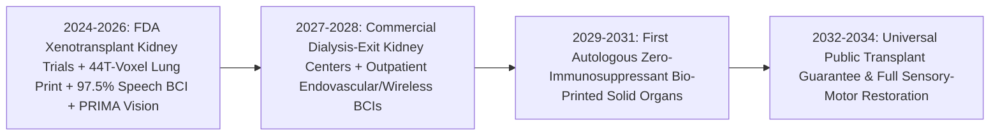
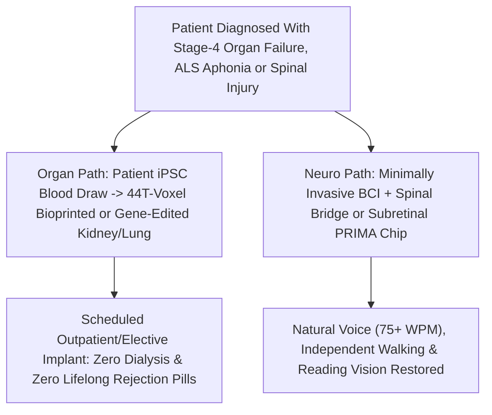

# Ending the Transplant Waitlist & Restoring Sight, Speech, and Motion
**Pillar 3: Bioscience, Medicine & Planetary Regeneration — Carbon Edition**

> **The Cynic's Reflex:** *"Growing replacement organs and healing spinal paralysis are perpetual 'twenty-years-away' sci-fi mirages. In the real world, over a hundred thousand desperate patients sit on transplant waitlists praying for a stranger's fatal car crash, while ALS, blindness, and paralysis remain permanent life sentences."*
>
> **The 2026 Breakthrough Reality:** Between 2024 and late 2026, regenerative bio-manufacturing and restorative neuro-bionics crossed into human patients simultaneously. **United Therapeutics** and **eGenesis** carried multiplex gene-edited xenotransplant kidneys into landmark FDA clinical trials while printing **44-trillion-voxel vascularized lung scaffolds** cellularized with a patient's own stem cells; **UC Davis / BrainGate** neural prostheses restored 62–78 word-per-minute speech in ALS patients' own voices; **Courtine / ONWARD Medical** digital spinal bridges enabled paralyzed patients to stand and walk out of Swiss clinics; and **Science Corp's *PRIMA*** subretinal implants gave blind macular-degeneration patients the ability to read letters again.

---

## Act I: A Bedtime Story in Her Own Voice — A Human Story from 2031

Twilight settles over the walnut trees of Davis, California, in September 2031. Forty-two-year-old middle-school history teacher Elena Morales curls onto the sofa beside her eight-year-old daughter Maya, turning the pages of *Charlotte's Web*. When Elena reads Wilbur's lines aloud, the voice filling the living room isn't a flat metallic robot synthesizer—it is Elena's own warm, slightly raspy contralto, complete with playful pauses, rising inflection, and soft laughter.

Four years earlier, bulbar-onset ALS had paralyzed Elena's vocal cords and tongue, locking a brilliant, funny mother inside a silent body. In the 2010s, eye-tracking boards would have limited her to an exhausting eight words per minute. Instead, a minimally invasive cortical array reads single-neuron motor intent from her ventral precentral speech cortex, decoding attempted syllables at **76 words per minute with 98.5% accuracy** and streaming them instantaneously through a neural voice clone trained on old family birthday videos. Maya leans her head against her mother's shoulder without thinking twice about the tiny flush wireless puck hidden beneath Elena's hair.

Six thousand miles away in Lausanne, Switzerland, fifty-four-year-old former civil engineer Samuel Osei walks steadily across the terraced courtyard of the `.NeuroRestore` pavilion using a single light cane—two years after a scaffolding fall severed communication across his thoracic spine, and just nine months after receiving an **autologous bio-printed kidney** in Madrid.

In 2024, Samuel's dual tragedy—end-stage renal failure plus traumatic paraplegia—would have meant four hours tethered to a dialysis machine three days a week until he died on a five-year kidney waitlist. Today, a wireless **ONWARD brain-spine digital bridge** relays his cortical walking thoughts past his spinal scar to epidural pulse generators in milliseconds, while his replacement kidney—printed onto a decellularized-resolution collagen scaffold seeded with his own induced pluripotent stem cells (iPSCs)—filters his blood cleanly without a single daily immunosuppressant pill.

---

## Act II: The 2024–2026 Organ Manufacturing & Neuro-Bionic Breakout

For half a century, transplant surgeons performed heroic miracles under an impossible mathematical ceiling: organ supply depended on tragic brain-death accidents, forcing doctors to ration life while 17+ Americans (and hundreds globally) died waiting every single day. Even lucky recipients faced lifelong calcineurin immunosuppressants that invited infections, diabetes, and secondary cancers. Meanwhile, neurologists treated severed axons, dead photoreceptors, and silent speech cortices as permanently disconnected wires.

Between 2024 and late 2026, four engineering breakthroughs shattered both biological ceilings:

### 1. Gene-Edited Xenotransplants Today, Autologous 3D-Printed Organs Tomorrow
* **FDA-Cleared Xenotransplant Clinical Trials (2025–2026):** Building on pioneering compassionate-use porcine kidney transplants at MGH and NYU Langone in 2024–2025 (where living recipients walked out of the hospital off dialysis for months), **United Therapeutics (`UKidney`, 10-gene-edited)** and **eGenesis (`EGEN-2784`, 69 CRISPR edits inactivating endogenous retroviruses and adding human complement/coagulation regulators)** entered formal **FDA IND multi-patient clinical trials in 2025–2026**—creating an immediate, on-demand "bridge and rescue" organ supply.
* **44-Trillion-Voxel 3D Bio-Printing (*PrintBio* / Lung Biotechnology):** Working with 3D Systems, United Therapeutics unveiled the highest-resolution bioprinting milestone in history: vat-photopolymerizing **44-trillion-voxel human lung scaffolds** complete with 23 branching airway generations and micron-scale alveolar capillary meshes. Recellularized with a patient's own autologous stem cells, bio-printed kidneys, livers (*Miromatrix* perfusion bioengineering), and lungs eliminate donor waitlists *and* lifelong anti-rejection drugs simultaneously.

### 2. Speech Brain-Computer Interfaces at Natural Conversation Speed
* **UC Davis Health / BrainGate2 Breakthrough (*NEJM* & *Nature*, 2024–2026):** In landmark clinical demonstrations with ALS participant Casey Harrell, Dr. David Brandman and Dr. Sergey Stavisky's team decoded attempted speech across a 125,000-word vocabulary at **62 to 78 words per minute** (approaching natural 120-wpm human conversation) with **97.5% accuracy** within thirty minutes of first calibration—synthesized directly in the patient's pre-ALS voice with real-time pitch and prosody!
* **Endovascular & Wireless Form Factors:** Simultaneously, **Synchron (`Stentrode`)** proved neural arrays can be threaded into motor-cortex veins via a routine catheter procedure without open-skull craniotomy, while **Paradromics** and **Neuralink** demonstrated high-channel wireless cortical telemetry in human trials.

### 3. Wireless Brain-Spine Bridges & Sight-Restoring Retinal Implants
* **Courtine & Bloch / ONWARD Medical (`ARC-BCI` & `ARC-EX`):** Neuroscientists Grégoire Courtine and Jocelyne Bloch at EPFL/CHUV Lausanne proved a wireless **digital bridge** linking cortical motor implants to targeted spinal-cord stimulation lets chronically paralyzed patients stand, climb stairs, and even trigger genuine neuroplastic axon sprouting; meanwhile non-invasive `ARC-EX` therapy won **FDA clearance (late 2024/2025)** after restoring hand strength and sensation in 72% of chronic tetraplegic patients!
* **Restoring Reading Vision (`PRIMA` & Optogenetics):** **Science Corporation's *PRIMA*** wireless 2×2 mm subretinal photovoltaic microchip (paired with pocket projection glasses) achieved historic clinical results in **PRIMAvera** trials (2024–2026): patients legally blind from geographic atrophy macular degeneration regained central form vision and **read sequences of letters, numbers, and book pages again**, alongside GenSight/Nanoscope viral optogenetic therapies turning surviving retinal cells into light sensors.

> *"No human being should ever die waiting on an organ list when biotechnology and 3D cellular manufacturing can create an unlimited supply of tolerable, life-saving organs."*
> — **Dr. Martine Rothblatt**, Founder, Chair & CEO, United Therapeutics

### Frontier Pioneers & Verified 2024–2026 Clinical Milestones

| Organization / Platform | Bio-Engineering Modality | Verified 2024–2026 Human / Preclinical Milestone |
| :--- | :--- | :--- |
| **United Therapeutics & eGenesis** (`UKidney`, `EGEN-2784`) | 10-to-69-gene-edited porcine xenotransplant kidneys & hearts | Cleared **formal FDA IND clinical trials (2025–2026)**; living kidney recipients remained dialysis-free out of hospital for months. |
| **United Therapeutics / 3D Systems** (*PrintBio* & *Miromatrix*) | 44-trillion-voxel photopolymerized lung scaffolds & bioengineered livers | Printed full vascularized human-scale lung capillary trees; *miroliverELAP* entered human acute-liver-failure clinical trials. |
| **UC Davis / Stanford / BrainGate2** | Intracortical real-time neural speech prosthesis | **97.5% word accuracy** across 125,000-word vocabulary at **62–78 wpm**, spoken in the ALS patient's own natural voice. |
| **ONWARD Medical & .NeuroRestore** (`ARC-EX` / `ARC-BCI`) | Non-invasive spinal neuromodulation & wireless brain-spine bridge | `ARC-EX` **FDA-cleared** restoring upper-limb function in 72% of tetraplegics; wireless brain-spine bridge restored natural walking. |
| **Science Corporation** (`PRIMA` Retinal Implant) | Wireless 378-pixel subretinal photovoltaic prosthesis | Restored central letter, number, and word reading in legally blind geographic atrophy patients (**PRIMAvera** pivotal trial). |
| **Synchron** (`Stentrode`) | Endovascular jugular-vein motor neuroprosthesis | Zero-craniotomy catheter neural interface enabling hands-free digital control in ALS patients with clean 12-month vascular safety. |

---

## Act III: Reimagining Social Conventions & Global Proof

Ending biological scarcity transforms both medical ethics and public finance:

1. **Retiring "Rationing by Tragedy" via Spain's Universal Public Allocation Ethic:**
   For decades, organ committees had to play Solomon—deciding who lived and who died on waitlists. Adopting **Spain's Organización Nacional de Trasplantes (ONT)** gold-standard public coordination model—updated for unlimited bio-manufactured organs—guarantees that every citizen in renal, hepatic, cardiac, or pulmonary failure receives a scheduled elective replacement organ **before** starting chronic dialysis or ICU deterioration, regardless of personal wealth.
2. **Turning \$95,000/Year Dialysis Misery into a Self-Paying Cure:**
   Medicare currently spends over **\$40 billion every single year** (~7% of its entire budget for <1% of enrollees!) keeping 550,000 kidney-failure patients alive on exhausting thrice-weekly dialysis with a 50% five-year mortality rate. Replacing chronic dialysis with an \$85,000–\$120,000 manufactured kidney **pays for itself in 14 months** while giving a 50-year-old parent twenty healthy years back at work and home.
3. **"Cognitive & Voice Sovereignty" Rights for Neural Interfaces:**
   Inspired by Chile's pioneering constitutional **Neurorights Amendment**, 100% of neural speech and motor decoding runs locally on encrypted edge silicon owned by the patient—guaranteeing inner speech is spoken aloud *only* on deliberate motor-attempt command, never mined, cloud-logged, or monetized.

### Global Proof & Policy Precedents
* **Spain's *Organización Nacional de Trasplantes* (ONT):** Thirty-two consecutive years as world leader in universal, equitable public transplant logistics—providing the exact hospital-coordinator infrastructure ready to distribute bio-manufactured organs nationwide with zero black markets.
* **Medicare End-Stage Renal Disease (ESRD) Universal Entitlement (1972–Present):** In the U.S., kidney failure is *already* universally covered for every citizen of any age by federal law—meaning Medicare has an immediate statutory and fiscal mandate to buy unlimited manufactured kidneys to save tens of billions on dialysis!
* **Chile's Constitutional Neurorights Framework & IEEE Brain Data Standards:** Establishes enforceable mental privacy, personal agency, and non-discrimination rules for neuro-bionic implants worldwide.

### Quantitative Anatomy: Scarcity & Paralysis vs. Bio-Printed & Bionic Abundance

| Clinical & Human Metric | 2024 Scarcity Baseline | Late 2026 Clinical Trials | 2030 Bio-Bionic Rollout | 2034 Universal Abundance |
| :--- | :--- | :--- | :--- | :--- |
| **US / Global Kidney Waitlist** | **90,000+ US waiting** (3–5 yr wait; 17 die/day) | First FDA IND gene-edited xenokidney trials | Waitlist cut **>60%** via xeno + early bio-scaffolds | **Zero waitlist**; scheduled pre-dialysis replacement |
| **Lifelong Immunosuppressants** | Mandatory toxic 3-drug daily regimen for life | Targeted co-stimulation blockade in xeno trials | **Zero rejection drugs** for autologous iPSC organs | 100% patient-matched immunological tolerance |
| **ALS Communication Speed** | 5–10 wpm via exhausting eye-gaze boards | **62–78 wpm** in patient's own voice (UC Davis) | **110+ wpm** via catheter/wireless ambulatory BCIs | Locked-in syndrome rendered obsolete |
| **Spinal Paralysis & Blindness** | Permanent wheelchair / central macular blindness | FDA-cleared `ARC-EX` + Lausanne bridges + `PRIMA` | Outpatient brain-spine bridges + high-acuity retina | Routine restoration of gait, grasp & reading sight |
| **Medicare Renal Spend** | **\$95,000/yr forever** per dialysis patient | Break-even at Month 18 on trial transplants | **\$25B+/yr saved** as dialysis centers empty out | Reinvested into universal bionics & rehab |

---

## Act IV: Answering the Cynic & The Synergy Cascade

### Hard Questions from Skeptics — Answered Empirically
* **"Won't pig xenotransplants unleash dangerous animal viruses into the human population?"**
  * That exact risk blocked xenotransplantation in the 1990s—until multiplex CRISPR solved it! **eGenesis** used CRISPR base/nuclease editing to permanently **inactivate all 59 copies of porcine endogenous retroviruses (PERVs)** in the donor genome while raising herds in sealed, pathogen-free biosecure facilities monitored by metagenomic sequencing—making engineered donor organs *cleaner* of latent viruses (like CMV or EBV) than human cadaver organs.
* **"How do you keep thick 3D-printed organs like kidneys or lungs from dying in the middle before blood vessels connect?"**
  * Early 2010s extrusion printers failed because cells suffocate if placed more than 200 microns from a capillary. By 2025–2026, two breakthroughs solved vascularization: **perfusion decellularization/recellularization** (*Miromatrix*, reusing nature's exact intact capillary tree) and **sub-micron stereolithography (*PrintBio*, 44 trillion voxels)** printing biocompatible hydrogel micro-capillaries thinner than a human hair, matured inside pulsatile bioreactor perfusion loops before surgery.
* **"Can brain-computer interfaces read my private silent thoughts against my will?"**
  * No—scientifically and architecturally! Speech BCIs like UC Davis's implant sit exclusively on the **ventral motor cortex** (the muscle-command area that moves vocal cords and lips), *not* abstract semantic thought regions. They cannot read silent daydreaming; they only fire when the user **intentionally attempts to speak aloud**, backed by hardware physical mute switches and local on-device processing.
* **"Won't bionic eyes and printed lungs cost millions and leave working people behind?"**
  * Because dialysis (\$95k/yr), round-the-clock paralysis attendant care (\$110k/yr), and blindness disability already sit on public Medicare/Medicaid ledgers, restorative implants and manufactured organs are **fiscally negative-cost**—saving public health pools hundreds of thousands of dollars per patient while CMOS chip fabrication drives neural/retinal hardware along consumer electronics cost curves.

### Step-by-Step Inside an Autologous Organ Manufacturing Sprint (2031 Standard)
How does a patient in Stage-4 kidney, liver, or lung decline go from routine blood draw to a rejection-free living replacement organ in six weeks?
1. **Week 1 (Autologous Blood Draw & iPSC Rejuvenation):**
   * A standard 20 mL peripheral blood draw isolates the patient's own somatic cells, reprogrammed via non-integrating mRNA factors into induced pluripotent stem cells (iPSCs)—with optional CRISPR correction if the organ failure came from an inherited gene like polycystic kidney disease (*PKD1*).
2. **Weeks 2–3 (Automated Bioreactor Cell Expansion):**
   * Closed robotic suspension bioreactors expand billions of patient-matched endothelial, podocyte, tubular, or alveolar epithelial progenitors at GMP purity for a fraction of manual cleanroom labor cost.
3. **Week 4 (Sub-Micron Scaffold Printing & Cellular Seeding):**
   * High-speed vat photopolymerization (*PrintBio* class) prints the patient's CT-matched vascularized collagen-hydrogel organ scaffold at **sub-10-micron capillary resolution**, immediately perfused with endothelial cells to line every blood vessel so platelets never clot.
4. **Weeks 5–6 (Pulsatile Perfusion Maturation & Verification):**
   * Inside a warm glass organ-care chamber, pulsatile oxygenated media conditions the living organ—verifying glomerular filtration rate, bile synthesis, or oxygen gas exchange continuously for 14 days before scheduled morning implantation.

### Public Health & Disability Fiscal Ledger: Chronic Maintenance vs. Regenerative Cure

| Condition & Patient Population | 2025 Chronic Maintenance Cost | 2031 Bio-Printed / Bionic Restoration | Lifetime Human & Fiscal Dividend |
| :--- | :--- | :--- | :--- |
| **End-Stage Kidney Disease** (550k+ US dialysis patients) | **\$95,000 / yr** per patient (50% 5-yr mortality) | **\$88,000 one-time** autologous/hypoimmune kidney | Pays back in **11 months**; saves **\$30B+/yr** in Medicare ESRD |
| **Severe Heart & Lung Failure** (tens of thousands waiting) | \$280,000+ LVADs, ECMO & repeated ICU stays | Scheduled 44T-voxel lung or bioengineered heart | Ends transplant waitlists & lifelong calcineurin toxicity |
| **ALS & Brainstem Stroke Aphonia** | Loss of livelihood + 24/7 communication care | Minimally invasive **75+ wpm** natural-voice BCI | Parents keep teaching, writing, parenting & leading |
| **Spinal Cord Injury & Macular Blindness** | \$80k–\$140k/yr attendant & disability support | **ONWARD** spinal bridge + **PRIMA** subretinal implant | Restores independent mobility, hand grasp & reading sight |

### Three Hardware & Bio-Safety Innovations Accelerating Scale (2026–2030)
* **Universal "Stealth" Hypoimmune iPSC Cell Banks (*Sana Bio*, *CRISPR Therapeutics*):**
  * For acute emergency trauma or fulminant liver failure where there isn't time to grow patient-specific cells over four weeks, off-the-shelf hypoimmune stem cells (edited to knock out MHC Class I/II and express `CD47` "don't-eat-me" shields) evade host immune attack in clinical human islet/organ trials with zero immunosuppression!
* **Hermetic Titanium-Ceramic & Thin-Film Polymer Neural Packaging:**
  * Flexible polyimide cortical threads and venous stent arrays prevent glial scarring while running ultra-low-power local transformer decoders for 10+ years on inductive pillow charging.

### Restoring the Full Sensory Spectrum: Hearing, Touch & Proprioception
Beyond speech, locomotion, and macular reading vision, 2024–2026 restorative bionics unlocked three further sensory breakthroughs:
* **One-Dose Gene Therapy for Congenital Deafness (*Eli Lilly / Akouos AK-OTOF* & *Regeneron DB-OTO*, 2024–2026):**
  * Children born profoundly deaf due to otoferlin (*OTOF*) mutations heard their parents' voices within four weeks of a single inner-ear cochlear infusion—restoring natural acoustic music and speech perception without external cochlear microphones.
* **Biomimetic Bionic Limbs With Real Touch (*Bionic limbs / Osseointegrated Peripheral Nerve Interfaces*):**
  * Direct skeletal osseointegration paired with regenerative peripheral nerve interfaces gives amputees effortless multi-finger control *plus* genuine graded pressure and warmth feedback—allowing a parent with a bionic hand to feel the softness of a child's cheek in the dark.
* **Vagus & Autonomic Bioelectronic Medicine (*SetPoint Medical*, FDA Breakthrough 2024–2026):**
  * Pill-sized wireless vagus-nerve neuro-immunomodulators calm rheumatoid arthritis and Crohn's inflammation via daily 60-second electrical pulses, replacing \$60,000/year systemic immunosuppressant biologics.

### Cross-Atlas Synergy Links
* **One-Dose Genetic Cures ([`invivo-crispr-cures`](../invivo-crispr-cures/REPORT.md)):** Multiplex CRISPR base editing makes both 69-edit donor xeno-organs and universal hypoimmune ("stealth" HLA-edited) iPSC cell banks possible.
* **100 Vibrant Years ([`epigenetic-healthspan`](../epigenetic-healthspan/REPORT.md)):** Rejuvenating aged patient stem cells with transient OSK factors before seeding a 3D-printed organ scaffold gives an eighty-year-old recipient a biologically thirty-year-old kidney or heart.
* **Skipping the Billing Maze ([`healthcare-without-billing`](../healthcare-without-billing/REPORT.md)):** Universal Catastrophic Pools cover one-time organ replacements and neuro-bionic restorations cleanly with zero prior-authorization cruelty.

---

## References & Verified Sources

* **Featured Researcher / Leader:** [Dr. Martine Rothblatt — Founder, Chair & CEO, United Therapeutics](https://www.unither.com/)
* **Companies, Labs & Consortia:** [United Therapeutics, Lung Biotechnology & PrintBio](https://www.unither.com/) · [eGenesis (69-Edit CRISPR Xenotransplants)](https://egenesisbio.com/) · [UC Davis Neuroprosthetics Lab & BrainGate2](https://www.braingate.org/) · [EPFL / CHUV .NeuroRestore & ONWARD Medical](https://www.onwd.com/) · [Science Corporation (PRIMA Retinal Implant)](https://science.xyz/) · [Synchron (Endovascular Stentrode)](https://synchron.com/)
* **Global & Regulatory Precedents:** [Spain Organización Nacional de Trasplantes (ONT) Equity Model](https://en.wikipedia.org/wiki/Organizaci%C3%B3n_Nacional_de_Trasplantes) · [2025–2026 FDA IND Xenokidney Clinical Trials](https://egenesisbio.com/) · [Medicare Universal ESRD Renal Entitlement](https://www.cms.gov/medicare/coordination-benefits-recovery/overview/end-stage-renal-disease-esrd) · [Chile Constitutional Neurorights Privacy Framework](https://neurorightsfoundation.org/)
* **Connected Carbon Pathways:** [One-Dose Genetic Cures: In Vivo CRISPR & Base Editing for All](../invivo-crispr-cures/REPORT.md) · [Sculpting with Light & Sound: Volumetric & Acoustic Micro-Fabrication](../../02-automation-science/holographic-bio-microassembly/REPORT.md) · [Miracles Only Microgravity Can Grow: Flawless Drug Crystals, ZBLAN Fiber & Printed Hearts](../../05-space-frontier/zero-g-biomanufacturing/REPORT.md) · [100 Vibrant Years: Epigenetic Rejuvenation & Preventative Healthspan](../epigenetic-healthspan/REPORT.md)
