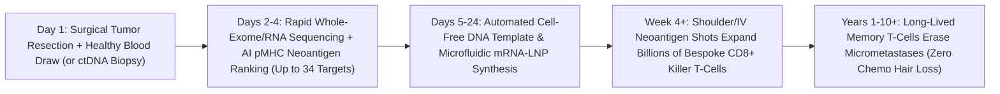

# Bespoke Tumor Assassins: 4-Week Neoantigen mRNA Cancer Vaccines & Solid-Tumor CARVac
**Pillar 3: Bioscience, Medicine & Planetary Regeneration — Carbon Edition**

> **The Cynic's Reflex:** *"Scientists have promised a 'cancer vaccine' for fifty years while solid tumors like pancreatic, colon, and metastatic melanoma keep mutating around every drug—forcing patients through hair-losing chemotherapy only for hidden micrometastases to roar back two years later."*
>
> **The 2026 Breakthrough Reality:** Cancer's greatest trick—its chaotic genetic mutations—became its fatal weakness. Between 2024 and late 2026, **AI-designed individualized neoantigen mRNA vaccines** proved they can sequence a patient's resected tumor, rank up to **34 unique mutant proteins**, and brew a custom mRNA shot in weeks: Moderna & Merck's **mRNA-4157 (`V940`)** slashed 3-year melanoma recurrence or death by **~49%** (and distant metastasis by **62%**), BioNTech & Genentech's **autogene cevumeran (`BNT122`)** induced durable multi-year killer T-cell memory in historically lethal **pancreatic cancer**, BioNTech's **CARVac** supercharged solid-tumor CAR-T cells, and the UK **NHS Cancer Vaccine Launch Pad** brought bespoke mRNA oncology into public hospitals at national scale.

---

## Act I: Barcode 34 on Ward Seven — A Human Story from 2030

Steam rises from a mug of Builders' tea in a bright kitchen in Leeds, England, on a crisp November morning in 2030 as fifty-four-year-old middle-school geography teacher Marcus Osei laces his muddy trail-running shoes. Four years earlier, a routine liquid-biopsy multi-cancer blood screen and abdominal CT caught a 2.1-centimeter **pancreatic ductal adenocarcinoma (PDAC)**—a diagnosis that in 2020 carried an 88% five-year death sentence even *after* clean surgery, because microscopic stray cancer cells almost always hid silently in the liver or lymph nodes waiting to relapse.

When NHS surgeons excised Marcus's tumor on a Wednesday morning in 2026 under the **NHS England Cancer Vaccine Launch Pad**, a pea-sized tumor core and a tube of his healthy blood went straight to a robotic nanopore sequencer down the corridor. Within forty-eight hours, an MHC-presentation deep-learning model compared Marcus's tumor genome against his healthy DNA, selecting **28 patient-unique neoantigens**—mutant peptide flags present *100% on his cancer cells and 0.0% anywhere else in his body*. Nineteen days later, a regional NHS microfluidic bio-foundry delivered nine personalized mRNA-lipid vials barcoded exclusively to Marcus's immune system.

Each five-second shoulder injection taught Marcus's dendritic cells to raise billions of cytotoxic `CD8+` T-cell assassins programmed to hunt those exact 28 mutant flags across every organ. Today, forty-eight months post-surgery, ultra-sensitive circulating tumor DNA (`ctDNA`) blood checks remain at `0.00%`, and persistent memory T-cells still patrol his bloodstream—for a total NHS manufacturing cost under \$1,100.

---

## Act II: The 2024–2026 Personalized mRNA Oncology Breakout

Why did "one-size-fits-all" cancer vaccines fail for forty years? Because unlike measles or polio—where every patient catches the identical virus—**no two human solid tumors share the same set of passenger and driver mutations**. Worse, early vaccines targeted "shared tumor-associated antigens" also found at low levels on healthy skin or gut cells, forcing the immune system's own tolerance brakes to ignore them.

The COVID-19 pandemic scaled two game-changing tools simultaneously: ultra-fast mRNA-lipid nanoparticle manufacturing and deep-learning protein-MHC binding models (derivations of *AlphaFold* and pMHC transformers). Instead of guessing one shared target, clinicians can now **print a bespoke "Most Wanted Poster" containing 20 to 34 mutant neoantigens unique to a single human being's tumor** in under four weeks.

### 1. Halving Melanoma Relapse & Death (`mRNA-4157 / V940`)
* **Moderna & Merck *KEYNOTE-942* 3-Year Landmark & Phase III (*INTerpath-001*):** In high-risk resected Stage III/IV melanoma patients followed for 3+ years (*Lancet* / ASCO 2024–2026 updates), adding individualized neoantigen therapy **mRNA-4157 (`V940`)**—encoding up to **34 bespoke patient neoantigens**—to checkpoint inhibitor pembrolizumab cut the risk of **recurrence or death by 49%** (`HR = 0.51`) and slashed **distant metastasis or death by 62%** (`HR = 0.38`) compared to pembrolizumab alone! Fully enrolled global Phase III trials expanded across melanoma, non-small-cell lung cancer (*INTerpath-002*), renal, and bladder cancers through 2025–2026.

### 2. Cracking the "Uncurable" Fortress: Pancreatic Cancer (`BNT122`)
* **BioNTech, Genentech & Memorial Sloan Kettering (*Nature*, Dr. Vinod Balachandran, 2023–2026):** Pancreatic ductal adenocarcinoma (PDAC) was long considered an "immunologically cold" graveyard with few mutations and near-universal lethality. In landmark Phase I/II follow-ups reported through 2025–2026 (`IMCODE003`), patients whose immune systems mounted neoantigen-specific `CD8+` T-cell responses to **autogene cevumeran (`BNT122`, encoding up to 20 uridine-mRNA neoantigens)** showed **dramatically prolonged recurrence-free survival** at 3+ years—with single-cell tracking proving vaccine-induced killer T-cells remained alive, polyfunctional, and patrolling years later with an estimated multi-year vaccine T-cell half-life!

### 3. Solid-Tumor *CARVac*: Teaching CAR-T Cells to Conquer Solid Masses
* **BioNTech `BNT211` (Claudin-6 CAR-T + *CARVac* mRNA Booster):** Blood CAR-T cured leukemias, yet solid tumors starved or exhausted CAR-T cells before they could penetrate dense masses. By pairing Claudin-6 (`CLDN6`)-targeted CAR-T cells with periodic intravenous doses of a **CLDN6-encoding mRNA vaccine (*CARVac*)** that stimulates T-cell expansion right inside lymph nodes, BioNTech achieved **45–59% objective response rates and deep tumor regressions** in refractory testicular, ovarian, and endometrial solid cancers through 2025–2026!

### 4. Off-the-Shelf "Dark Matter" & KRAS Vaccines for Prevention
* **Shared Driver & Cryptic Dark-Genome Vaccines (Elicio `ELI-002` & Transposon Antigens):** Complementing bespoke shots, lymph-node-targeting amphiphile **KRAS vaccines (`ELI-002`)** cleared minimal residual `ctDNA` in *KRAS*-mutant pancreatic and colorectal tumors (`84%` T-cell response rate), while 2025–2026 non-coding "dark genome" transposable-element maps uncovered shared cryptic antigens expressed across early pre-cancers—laying the groundwork for **preventative interception shots** in high-risk hereditary (*Lynch* / *BRCA*) carriers.

> *"Every tumor writes its own unique genetic fingerprint of mutations; personalized mRNA lets us read that exact fingerprint and train the patient's immune system to hunt down every remaining cancer cell."*
> — **Prof. Uğur Şahin & Dr. Özlem Türeci**, Co-Founders of BioNTech & Pioneers of Individualized mRNA Cancer Immunotherapy

### Frontier Pioneers & Verified 2024–2026 Milestones

| Organization / Trial | Vaccine & Target Architecture | Verified 2024–2026 Clinical Milestone |
| :--- | :--- | :--- |
| **Moderna & Merck** (`mRNA-4157` / `V940`) | Bespoke LNP-mRNA encoding up to **34 neoantigens** | **49% drop** in melanoma recurrence/death & **62% drop** in distant metastasis at 3 years (*KEYNOTE-942*); global Phase III across lung/skin. |
| **BioNTech, Genentech & MSKCC** (`BNT122`) | Autogene cevumeran (**20 neoantigens** lipoplex mRNA) | Induced multi-year durable `CD8+` T-cell clones dramatically delaying relapse in resected **pancreatic cancer** (*Nature*, 2024–2026). |
| **BioNTech** (`BNT211` CLDN6 + *CARVac*) | Solid-tumor CAR-T + **CAR-amplifying mRNA vaccine** | Controlled *in vivo* CAR-T expansion yielding deep solid-tumor shrinkage in refractory ovarian & germ-cell cancers. |
| **NHS England** (*Cancer Vaccine Launch Pad*) | National public-hospital tumor-to-vaccine fast lane | Enrolled thousands of everyday public NHS colorectal, melanoma, lung & head/neck patients into personalized mRNA trials (2024–2026). |
| **Elicio Therapeutics** (`ELI-002`) | Off-the-shelf lymph-node amphiphile *KRAS* vaccine | Elicited strong mutant-KRAS T-cell responses & `ctDNA` clearance in post-surgical pancreatic and colorectal cohorts. |
| **Gritstone, Mendus & University of Florida** | Personalized neoantigen & multi-lamellar RNA-LPs | Demonstrated rapid immune remodeling even in immunologically "cold" glioblastoma and microsatellite-stable colorectal tumors. |

---

## Act III: Reimagining Social Conventions & Global Proof

Turning bespoke oncology from a \$150,000 boutique experiment into a routine \$950 surgical follow-up rewrites three pillars of cancer care:

1. **The Public-Hospital "Biopsy-to-Booster" Standard (The NHS Precedent):**
   Cynics assumed custom N-of-1 cancer vaccines would only ever exist at Manhattan concierge clinics. Instead, **NHS England's Cancer Vaccine Launch Pad** (launched May 2024 and scaled nationwide across 30+ hospital trusts through 2026) proved a single-payer public health service can seamlessly route routine surgical pathology specimens straight into rapid personalized mRNA manufacturing—free at the point of care for bus drivers and schoolteachers alike.
2. **`ctDNA` "Intercept Before the Scan Sees It" Oncology:**
   Historically, oncologists waited passively after surgery until a relapsed tumor grew to `10+ millimeters` (~1 billion cancer cells) on a CT scan—when curing it is hardest. Pairing \$80 ultra-sensitive **circulating tumor DNA (`ctDNA`) minimal residual disease blood tests** with bespoke neoantigen mRNA catches molecular relapse when fewer than **10,000 cancer cells** exist in the body—wiping them out cleanly with a five-second outpatient shot instead of six months of nauseating adjuvant chemotherapy.
3. **Hospital Microfluidic "Print-on-Site" Bio-Printers:**
   Why ship frozen biopsies across oceans when DNA sequences travel over fiber-optic internet at the speed of light? By transmitting the 34-neoantigen digital sequence file from a surgical pathology lab in São Paulo, Nairobi, or Leeds to a compact **cell-free enzymatic DNA + microfluidic mRNA cartridge printer** (like BioNTech's modular *BioNTainer* containers in Kigali, Rwanda), turnaround shrinks from 6 weeks to **under 14 days** at <\$950 per full multi-dose patient course.

### Global Proof & Policy Precedents
* **UK NHS Cancer Vaccine Launch Pad (NHS England / Genomics England / BioNTech Partnership):** World's first national public-health pipeline aiming to deliver personalized mRNA cancer immunotherapies to **10,000 patients by 2030**, proving equitable public logistics work today.
* **BioNTech *BioNTainer* Modular mRNA Facility in Kigali, Rwanda (Operationalized 2024–2026):** Turnkey ISO-certified shipping-container cleanrooms built with Africa CDC and EMA guidance to manufacture mRNA vaccines locally on the African continent.
* **FDA Breakthrough Therapy & EMA PRIME Designations (`V940` / `mRNA-4157`):** Established regulatory consensus that an *individualized neoantigen algorithm + mRNA-LNP process* is approved as a **single standardized product**, even though every patient's RNA sequence is 100% unique!

### The Economics of Abundance: Why Personalized Doesn't Mean Million-Dollar
How does automated enzymatic synthesis collapse the cost of a 100% custom N-of-1 cancer vaccine?

| Cost Element (9-Dose Patient Course) | 2022 Early Clinical Pilot Batch | 2030 Automated Regional Bio-Foundry | Cost Collapse Driver |
| :--- | :--- | :--- | :--- |
| **Tumor/Blood Sequencing & AI Design** | \$6,500 (manual bioinformatics) | **\$85** (automated nanopore + pMHC cloud model) | Zero human curation bottleneck |
| **Custom DNA Template Synthesis** | \$28,000 (slow bacterial plasmid fermentation) | **\$140** (cell-free enzymatic `dbDNA` / PCR template) | Skips *E. coli* cloning; prints in 24 hours |
| **GMP Microfluidic mRNA + LNP Run** | \$65,000 (large cleanroom changeover) | **\$425** (closed single-use disposable cassette) | Microgram RNA doses (50–100 µg per shot!) |
| **QC Release & Cold-Chain Delivery** | \$25,000 (outsourced 3-week sterility wait) | **\$300** (inline rapid digital PCR/endotoxin chip) | Regional *BioNTainer* eliminates air freight |
| **Total Per-Patient 9-Dose Course** | **~\$124,500** | **\$950 all-in public hospital cost** | **Replaces \$180,000+ metastatic ICU/chemo relapse** |

### The 10-Year Trajectory of Personalized Cancer Vaccines (2024 → 2034)

| Stage & Era | Turnaround Time | Clinical Indications | Relapse Reduction / Efficacy | Access & Cost Footprint |
| :--- | :--- | :--- | :--- | :--- |
| **2024 Baseline** | 6–8 weeks (plasmid bottleneck) | Phase II melanoma & Phase I PDAC pilots | **49% melanoma RFS gain** (`V940`); initial PDAC proof | Trial centers only; >\$100k manufacturing cost |
| **Late 2026 SOTA** | **3–5 weeks** (automated GMP lines) | Phase III melanoma/NSCLC; Phase II pancreatic/colorectal + *CARVac* | **62% distant metastasis cut**; multi-year PDAC T-cell memory | UK NHS Launch Pad + global academic oncology hubs |
| **2030 Inflection** | **12–14 days** (cell-free `dbDNA` cassettes) | Standard adjuvant care across **15+ solid tumor types** + `ctDNA` intercept | **70%+ post-surgical relapse elimination**; chemo-sparing | **<\$1,200/course** via regional *BioNTainer* hubs |
| **2034 Abundance** | **7 days** hospital pharmacy print | Pan-solid-tumor `ctDNA` interception + hereditary (*BRCA/Lynch*) prevention | Metastatic relapse becomes a rare preventable event | Universal public benefit in every surgical hospital |

### Inside the 14-Day Hospital "Biopsy-to-Booster" Pipeline (2030 Standard)
1. **Days 1–2 (Surgical Core + Blood Pairing):** Routine surgical resection sends a pea-sized tumor core and 5 mL normal blood to an in-hospital rapid nanopore whole-exome and transcriptome sequencer.
2. **Days 3–4 (AI Neoantigen & Cryptic Splice Selection):** Validated pMHC deep-learning transformers rank up to **34 patient-unique somatic neoantigens** optimized for the patient's exact HLA class I and II alleles.
3. **Days 5–10 (Cell-Free `dbDNA` & Microfluidic LNP Print):** Enzymatic doggybone DNA synthesis skips slow *E. coli* cloning, feeding directly into a closed disposable microfluidic mRNA-LNP cartridge.
4. **Days 11–14 (Inline QC & Outpatient Shoulder Prime):** Automated endotoxin, sterility, and mRNA integrity chips clear the nine-vial barcoded course for standard outpatient injection alongside `ctDNA` tracking.

---

## Act IV: Answering the Cynic & The Synergy Cascade

### Hard Questions from Skeptics — Answered Empirically
* **"Wait—how can the FDA approve a drug when every single patient gets a completely different mRNA sequence?"**
  * That regulatory riddle was *already solved* between 2023 and 2026! Under FDA Breakthrough and EMA PRIME frameworks for `mRNA-4157` and `BNT122`, regulators approve **the deterministic AI selection algorithm + the fixed mRNA-LNP chemical process** as the drug product—just like approving a custom LASIK laser platform rather than running a separate trial for each patient's eyeball curvature.
* **"What if a tumor has 'low mutational burden' (like pancreatic or breast cancer) or hides its MHC flags?"**
  * MSKCC and BioNTech's *Nature* pancreatic cancer data directly refuted the dogma that low-mutation tumors can't be vaccinated: even pancreatic tumors harbor dozens of high-quality neoantigens plus **dark-genome cryptic peptides and RNA-splicing neoantigens** (discoverable via *AlphaGenome 2*!).
  * Pairing neoantigen mRNA with low-dose checkpoint inhibitors or cytokine mRNA restores MHC expression so tumors cannot turn invisible.
* **"Does an mRNA cancer vaccine alter my human DNA?"**
  * Zero chance: mRNA never enters the cell nucleus, carries zero reverse-transcriptase integrase machinery, and degrades naturally within days after showing dendritic immune cells the tumor's mutant "mugshot." Side effects are overwhelmingly 24–36 hours of flu-like fever and sore arm—worlds gentler than cytotoxic chemotherapy!
* **"What if someone's cancer is caught late and is already bulky Stage IV?"**
  * Bulky tumors build immunosuppressive walls that overwhelm solo vaccines—which is why **BioNTech's *CARVac* (`BNT211`)** pairs tumor-debulking CAR-T cells or antibody-drug conjugates (*ADCs*) with mRNA boosters, shrinking bulky Stage IV masses first and locking in T-cell memory second.

### Three Pillars of Global Oncology Equity (2027–2032)
* **Continental *BioNTainer* & Cell-Free Print Networks:**
  * Building on Rwanda's Kigali mRNA hub, WHO mRNA Tech Transfer nodes in South Africa, Brazil, India, Senegal, and Bangladesh upgrade from infectious-disease shots to plug-and-play oncology cartridges.
* **Ancestry-Unbiased HLA Binding Models:**
  * Because T-cells recognize neoantigens presented on HLA molecules that vary widely across African, Asian, Indigenous, and European populations, global HLA peptidomics atlases ensure AI neoantigen predictors achieve >90% precision for *every* human ancestry.
* **Liquid-Biopsy-to-Vaccine Rural Access:**
  * When surgical tumor tissue is tiny or inaccessible, deep cell-free tumor DNA/RNA sequencing from a **single 10 mL arm blood draw** reconstructs neoantigen targets non-invasively for rural hospitals.

### Cross-Atlas Synergy Links
* **Rebooting Rogue Immune Systems ([`autoimmune-cart-treg-reset`](../autoimmune-cart-treg-reset/REPORT.md)):** Two sides of the same precision mRNA-LNP coin—training killer T-cells to destroy 34 mutant cancer flags while teaching *FOXP3* Tregs to protect healthy self-tissues.
* **Conditional Single-Cell Genomics ([`alphagenome2-cellstate-genomics`](../alphagenome2-cellstate-genomics/REPORT.md)):** DeepMind's *AlphaGenome 2* predicts tumor-specific cryptic splice junctions and non-coding neoantigens, expanding targets for low-mutation pediatric and pancreatic cancers.
* **Just-Add-Water Rural Pharmacies ([`cell-free-on-demand-biomanufacturing`](../cell-free-on-demand-biomanufacturing/REPORT.md)):** Cell-free enzymatic DNA (`doggybone DNA`) replaces slow bacterial fermentation, cutting bespoke mRNA cancer vaccine turnaround from 6 weeks to 12 days.
* **Self-Driving Bio-Labs ([`self-driving-labs`](../../02-automation-science/self-driving-labs/REPORT.md)):** Closed-loop robotic microfluidics run 24/7 parallel synthesis of hundreds of barcoded patient neoantigen cassettes inside a single hospital room.

---

## References & Verified Sources

* **Featured Researcher / Leader:** [Prof. Uğur Şahin & Dr. Özlem Türeci — BioNTech](https://www.biontech.com/) · [Dr. Vinod Balachandran — Memorial Sloan Kettering Cancer Center Pancreatic mRNA Vaccine Lead](https://www.mskcc.org/)
* **Companies, Labs & Consortia:** [Moderna & Merck (mRNA-4157 / V940 INTerpath Program)](https://www.modernatx.com/) · [BioNTech & Genentech (Autogene Cevumeran / BNT122 & CARVac BNT211)](https://www.biontech.com/) · [NHS England Cancer Vaccine Launch Pad](https://www.england.nhs.uk/cancer/nhs-cancer-vaccine-launch-pad/) · [Memorial Sloan Kettering Olayan Center for Cancer Vaccines](https://www.mskcc.org/) · [Elicio Therapeutics (ELI-002 KRAS Vaccine)](https://elicio.com/)
* **Global & Regulatory Precedents:** [Weber et al., The Lancet (KEYNOTE-942 Individualised Neoantigen Therapy mRNA-4157 + Pembrolizumab)](https://www.thelancet.com/) · [Rojas, Sethna, Balachandran et al., Nature (2023–2026 Follow-Up: Personalized RNA Neoantigen Vaccines in Pancreatic Cancer)](https://www.nature.com/) · [BioNTech Kigali BioNTainer Modular African mRNA Manufacturing Hub](https://www.biontech.com/)
* **Connected Carbon Pathways:** [Rebooting Rogue Immune Systems: Single-Dose Autoimmune CAR-T & 2025 Nobel Regulatory T-Cell Therapies](../autoimmune-cart-treg-reset/REPORT.md) · [Conditional Single-Cell Genomics: DeepMind AlphaGenome 2 & Decoding the Non-Coding Dark Genome](../alphagenome2-cellstate-genomics/REPORT.md) · [Just-Add-Water Rural Pharmacies: Freeze-Dried Cell-Free Ribosomes & AI Universal Antivenoms](../cell-free-on-demand-biomanufacturing/REPORT.md) · [10,000 Experiments Before Breakfast: Autonomous Physical Wet & Solid Labs](../../02-automation-science/self-driving-labs/REPORT.md)
