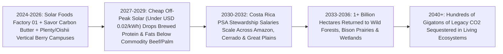
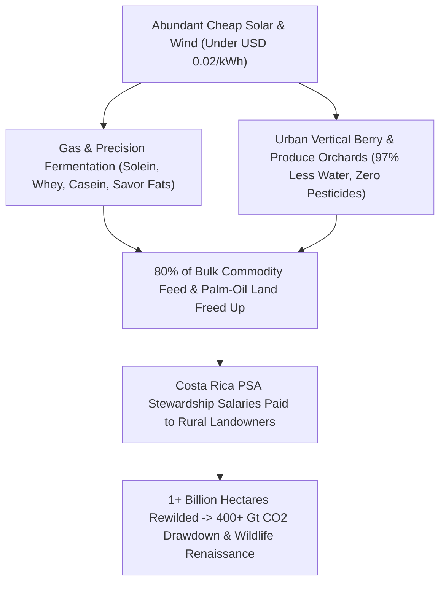

# The Billion-Hectare Rewilding: Solar Proteins, Vertical Orchards & Returning Half the Earth to Wild Nature
**Pillar 3: Bioscience, Medicine & Planetary Regeneration — Carbon Edition**

> **The Cynic's Reflex:** *"Feeding ten billion human beings means paving over the last rainforests, draining every river dry, and saturating soils with agrochemicals—unless everyone agrees to eat joyless gray mush. Humanity is an ecological locust swarm, and wild nature is doomed."*
>
> **The 2026 Breakthrough Reality:** Humanity currently uses **half of all habitable land on Earth (~4 billion hectares)** for agriculture—nearly 80% of it low-efficiency grazing pasture and feed crops driving tropical deforestation and wildlife collapse. Between 2024 and late 2026, food decoupled from acreage: **Solar Foods (*Solein*)** opened commercial biorefineries brewing rich protein straight from air CO₂, water, microbes, and solar electricity at **20× the solar-to-calorie efficiency of soybeans**; **precision fermentation & carbon-to-butter synthesis (*Perfect Day*, *Savor*)** recreated gourmet dairy and fats without cattle or palm plantations; and **AI vertical berry orchards (*Plenty*, *Oishii*)** cut water and land use by **95–99%**. Scaled alongside **Costa Rica's forest-doubling ecological payments**, humanity can eat better than ever while returning **over one billion hectares** back to wild forests, bison prairies, and migratory bird flyways!

---

## Act I: Jaguars in the Morning Mist — A Human Story from 2032

Howler monkeys roar across the emerald canopy of Guanacaste, Costa Rica, at sunrise in May 2032. Fifty-eight-year-old Mateo Solís sips dark volcanic coffee on his wooden porch while checking camera-trap alerts on his phone: at 4:12 AM, a mother jaguar and two spotted cubs padded silently beneath a giant *ceiba* tree standing exactly where Mateo's grandfather once ran eroded, drought-baked cattle pasture.

Mateo didn't go broke when low-cost precision dairy and brewed proteins undercut marginal beef export commodities in the late 2020s—in fact, his family earns **40% more net income** today than they ever made chasing skinny steers across parched hills. Through a global expansion of **Costa Rica's *Pagos por Servicios Ambientales* (PSA)** funded by sovereign biodiversity trusts and verified satellite carbon/watershed credits, Mateo and forty neighboring ranching families are paid steady, inflation-indexed **Wilderness Stewardship Salaries** to reconnect a 90,000-hectare biological corridor stretching from coastal mangroves up to Monteverde's cloud forests. Every stream on his land runs cold and clear year-round again; scarlet macaws nest in the upper branches.

That same evening in Helsinki, Finland, pastry chef Linnea Lindholm pulls golden, flaky laminated croissants from her bakery deck oven—layered with rich, cultured creamery butter whose triglycerides were synthesized directly from captured atmospheric CO₂ and green hydrogen (*Savor* process) blended with precision-fermented whey (*Perfect Day* / *Vivici*) and custard folded with **Solar Foods' *Solein***—brewed three kilometers away inside a clean steel fermentation hall powered by Nordic wind and solar. Topped with ruby-red, honey-sweet vertical-orchard strawberries grown forty minutes outside town with **zero pesticides and 97% less water**, the pastry wins blind taste tests against Normandy's finest—using **99% less land** than twentieth-century agriculture.

---

## Act II: The 2024–2026 Post-Land Food & Ecological Breakout

Why did feeding eight billion humans nearly break the biosphere? Because **photosynthesis plus ruminant digestion is stunningly inefficient thermodynamics**. A soybean leaf captures less than **0.5% to 1%** of incoming sunlight into edible calories, and feeding thirty kilograms of grain and forage to a steer to get one kilogram of beef throws away **96–97% of the calories and protein** along the way. As a result, livestock pasture and feed crops sprawled across **~3.2 billion hectares**—an area the size of North and South America combined—causing 80% of Amazon and Cerrado deforestation and leaving wild mammals as just **4% of mammalian biomass on Earth**.

Between 2024 and late 2026, four bioprocess and agricultural breakthroughs proved we can leapfrog photosynthesis bottlenecks on tiny urban footprints:

### 1. Air-and-Solar Microbial Proteins at 20× Soybean Efficiency (`Solein`)
* **Solar Foods Factory 01 (Vantaa, Finland, 2024–2026):** Commercializing natural, non-GMO *Xanthobacter* hydrogen-oxidizing microbes discovered in Finnish soil, Solar Foods opened **Factory 01** in 2024 and secured Singapore regulatory approval plus U.S. GRAS commercialization in 2024–2026. Inside clean stainless bioreactors, renewable electricity splits water into hydrogen and oxygen; the microbes consume H₂, captured CO₂, and trace minerals (ammonia, phosphorus, calcium) to grow **Solein**—a creamy, neutral-tasting whole-cell flour that is **65–70% complete protein** (all nine essential amino acids, iron, and B12).
* **Thermodynamic Miracles:** Because solar panels convert **22%+** of sunlight into electricity (versus <1% for field crops), solar-hydrogen microbial brewing achieves **~20× higher calorie/protein yield per hectare than soybeans and ~200× higher than beef**, using **99% less water** in any desert, Arctic town, or megacity regardless of drought or frost!

### 2. Precision-Fermented Dairy & Direct Carbon-to-Butter Synthesis
* **Real Milk Proteins Without the Cow (*Perfect Day*, *Vivici*, *Formo*, *Remilk*):** By inserting the exact bovine gene sequence for beta-lactoglobulin whey or casein into food-grade *Trichoderma* or yeast microflora (identical to how >90% of cheesemaking chymosin rennet has been brewed cleanly since 1990!), biorefineries produce pure, lactose-free, hormone-free dairy proteins for ice cream, cream cheese, and high-protein nutrition with **up to 97% lower greenhouse emissions and 90%+ less land**.
* **Thermochemical Fats Without Palm Oil (*Savor*):** Backed by breakthrough 2024–2026 catalytic chemistry (*Nature Sustainability*), **Savor** converts captured CO₂, green H₂, and oxygen directly into pure fatty-acid triglycerides chemically indistinguishable from rich dairy butter, cocoa butter, or tropical oils—eliminating the single biggest driver of Indonesian and Malaysian orangutan rainforest destruction (oil palm plantations).

### 3. Pesticide-Free Vertical Berry & Produce Orchards
* **Plenty (Richmond, Virginia Mega-Farm, 2024–2026) & Oishii (New Jersey Solar Facility):** Moving vertical farming beyond low-calorie lettuce, **Plenty** (partnered with Driscoll's) and **Oishii** mastered AI-pollinated, 30-foot vertical strawberry, tomato, and stone-fruit towers—delivering peak-summer Japanese heirloom sweetness 365 days a year next door to urban grocers with **zero chemical pesticides, zero agricultural runoff, 90% less land, and 95%+ less water**.

> *"Disconnect food production from weather and land use, and humanity can feed ten billion people deliciously while letting forests and wildlife reclaim half the planet."*
> — **Dr. Pasi Vainikka**, Co-Founder & CEO, Solar Foods

### Frontier Pioneers & Verified 2024–2026 Deployments

| Pioneer / Model | Core Technology / Ecological Mechanism | Verified 2024–2026 Performance & Footprint |
| :--- | :--- | :--- |
| **Solar Foods** (*Solein*, Factory 01, Finland) | Gas fermentation of CO₂ + H₂O + renewable electricity via *Xanthobacter* | Operational commercial factory (2024+); **20× soybean & 200× beef solar-to-protein land efficiency**; 65–70% complete protein. |
| **Savor** (California Commercial Pilot) | Direct thermochemical synthesis of real butter & tropical fats from CO₂ + H₂ | Produces authentic dairy butterfat & palm-oil replacements on **<0.001 ha/ton** with zero farmland, livestock, or deforestation. |
| **Perfect Day, Vivici & Formo** | Precision microbial fermentation of whey & casein dairy proteins | GRAS/novel-food clearances across US, Singapore & markets; **91–97% lower GHG** and **96–99% less water** than conventional dairy. |
| **Plenty & Oishii** (Virginia & New Jersey) | 30-ft vertical AI-climate & bee-pollinated berry/produce orchards | World's first commercial-scale indoor Driscoll's strawberry towers; **90%+ less land, 97% less water, zero pesticides**. |
| **Costa Rica *PSA* Rewilding Model** (*FONAFIFO*) | Direct Payments for Ecosystem Services to farmers & landowners | Reversed worst tropical deforestation in the Americas—**more than doubling national forest cover from ~26% to >57%**. |
| **Rewilding Europe & American Prairie** | Continental trophic rewilding (bison, European lynx, beaver wetlands) | Restored >10 major European landscapes & hundreds of thousands of acres of Montana shortgrass prairie with booming ecotourism. |

---

## Act III: Reimagining Social Conventions & Global Proof

 Cynics fear new food tech means "forcing ranchers into poverty while feeding citizens synthetic sludge." The real transition wins precisely because it respects **culinary pleasure** and **rural dignity** at the same time:

1. **Culinary Abundance, Never Eco-Austerity (Winning on Price, Taste & Purity):**
   Nobody gives up butter, cheese, pastries, or heirloom heritage meats because of scolding lectures. Precision-fermented whey, *Solein* pasta and gelato, *Savor* butter croissants, and vertical-orchard berries win the **80% bulk ingredient & institutional market** (bakeries, sauces, protein shakes, school lunches, chocolates) purely because they cost less, never spoil from droughts, contain zero microplastics or antibiotics, and taste extraordinary—while regenerative heritage grazing continues at sustainable boutique scale on natural grasslands!
2. **Paying Farmers & Ranchers as "Planetary Watershed & Forest Stewards":**
   Nearly half of global livestock grazing barely breaks even financially, surviving only on government agricultural subsidies. By redirecting \$500B+ in legacy distortionary farm subsidies into **Costa Rica-style Ecosystem Stewardship Contracts**, rural landowners earn *higher, guaranteed* multi-decade incomes restoring native oaks, tallgrass prairies, peatlands, and beaver-engineered floodplains—revitalizing rural towns through wildlife tourism, sustainable mass-timber harvest, and clean-water royalties.
3. **The Greatest Carbon Drawdown Machine Ever Built—Free With Wild Nature:**
   Rewilding **1.0 to 1.5 billion hectares** of former marginal pasture and feed-crop land back to native climax forests, mangroves, and deep-rooted perennial prairies naturally draws down **300 to 500+ gigatons of cumulative atmospheric CO₂** into living trunks and rich mycorrhizal topsoil—buying humanity massive climate breathing room while rescuing tens of thousands of threatened species from extinction.

### Global Proof & Policy Precedents
* **Costa Rica's *Pagos por Servicios Ambientales* (PSA, Law 7575):** Funded initially by a simple modest fuel fee and water-utility tariffs paid directly to smallholders per hectare of regenerating forest, Costa Rica doubled its rainforests while tripling GDP per capita and turning biodiversity ecotourism into a multibillion-dollar national engine.
* **Singapore Food Agency (SFA) "30 by 30" Novel Food Regulatory Gold Standard:** Became the first nation on Earth to establish science-rigorous, transparent 9-to-12-month safety clearances for *Solein*, precision dairy, and cultivated ingredients—enabling land-scarce cities to brew resilient sovereign food security.
* **EU Nature Restoration Law & UK "ELMS" (Environmental Land Management Schemes, 2024–2026):** Pivoting European and British public farm payments away from "subsidies per plowed acre" toward verified "public money for public ecological goods" (hedgerows, peatland rewetting, river buffers, and woodland recovery).

### Quantitative Anatomy: Land-Hungry Agriculture vs. The Billion-Hectare Rewilding

| Planetary & Food Metric | 2025 Status Quo (4B Hectare Footprint) | Late 2026 Commercial Inflection | 2031 Brewed + Vertical Scale | 2038 Billion-Hectare Equilibrium |
| :--- | :--- | :--- | :--- | :--- |
| **Global Agricultural Land Use** | **~4.0 Billion Hectares** (50% of habitable Earth) | Peak pasture plateauing in OECD & Brazil pilots | **3.3 Billion ha** (-700M ha returning to wild) | **<2.7 Billion ha** (**1.3B+ ha rewilded**) |
| **Solar-to-Protein Efficiency** | **<1%** (soy) to **0.04%** (feedlot beef) | **~15–20%** at Solar Foods Factory 01 | **22%+** at 100-MW Factory 02+ biorefineries | **200× less land** per kg of complete protein |
| **Freshwater & Pesticide Load** | 70% of global freshwater withdrawals; heavy runoff | 95–99% water cut in vertical & microbial plants | **-35% global aquifer depletion** & fertilizer nitrogen | Dead river deltas (Gulf of Mexico, Baltic) heal |
| **Brewed Protein Wholesale Cost** | \$6–\$12 / kg (early specialty pilot runs) | ~\$4.50 / kg as Factory 02 scales | **\$1.60 / kg** (undercuts commodity whey & beef) | **<\$1.10 / kg** drought-proof global staple |
| **Rural & Biodiversity Outcome** | Tropical deforestation & farmer debt squeezes | Costa Rica / UK ELMS ecosystem payments expand | **25M+ rural stewards** earning ecosystem salaries | Deforestation reversed; mega-corridors restored |

---

## Act IV: Answering the Cynic & The Synergy Cascade

### Hard Questions from Skeptics — Answered Empirically
* **"Isn't 'food from air and microbes' unnatural ultra-processed lab frankenfood?"**
  * Humans have joyfully brewed food with microbes for **ten thousand years**: sourdough bread, cheese, yogurt, miso, beer, wine, kimchi, and dark chocolate are all microbial fermentation!
  * *Solein* uses an unedited natural soil organism fed pure water, air CO₂, and minerals—zero pesticides, zero microplastics, zero slaughterhouse antibiotics, and zero industrial hexane seed-oil solvents. And precision fermentation brews the *exact* pure whey protein found in milk, just inside a clean stainless brewery tank like a craft Pilsner.
* **"Doesn't vertical farming and gas fermentation guzzle way too much electricity?"**
  * In 2018, expensive grid coal/gas power hurt vertical lettuce startups—which is why pairing food fermentation with **2026–2030 ultra-cheap solar PV (`<$0.02/kWh` daytime power)** changes everything!
  * Unlike data centers that need 24/7 uninterrupted power, hydrogen electrolysis for *Solein* and *Savor* fats acts as a **flexible sponge for curtailed midday solar and night wind surpluses**—soaking up free clean electricity that grids otherwise throw away and storing it as shelf-stable human nutrition!
* **"What happens to traditional family farmers and culinary culture?"**
  * Family farmers are liberated from brutal commodity price crashes: they can raise high-margin, pasture-regenerative heritage meats and orchard fruits on suitable local soils *while* getting paid generous Costa Rica-style ecosystem salaries on rewilded creek bottoms and hillsides. Nothing traditional is banned; destructive industrial feedlots and rainforest-clearing palm monocultures simply get outcompeted on cost and quality.

### Global Land & Carbon Ledger: Where the First Billion Rewilded Hectares Come From
How does humanity return over **one billion hectares** (ten million square kilometers—bigger than the entire United States or China!) to wild ecosystems while increasing per-capita gourmet protein and fruit nutrition?

| Agricultural Sector | 2025 Land Footprint | Brewed / Vertical / Agronomic Catalyst | Hectares Returned to Wild Nature by 2038 | Ecological & Climate Dividend |
| :--- | :--- | :--- | :--- | :--- |
| **Marginal Beef & Dairy Pasture** | ~2,500 Million ha | Precision whey/casein + *Solein* + *Savor* fats replace bulk commodity powders & tallow | **~720 Million Hectares** | Cloud forests, bison tallgrass prairies & wolf/jaguar corridors |
| **Livestock Feed Soy & Maize** | ~450 Million ha | Microbial single-cell protein replaces soymeal in aquaculture, poultry & pet nutrition | **~210 Million Hectares** | Stops Cerrado & Chaco clearing; restores Mississippi & Danube river basins |
| **Tropical Oil Palm & Sugar** | ~55 Million ha | Thermochemical & yeast-brewed palmitic/lauric oils (*Savor*, *C16 Bio*) | **~30 Million Hectares** | Protects Bornean orangutan, Sumatran tiger & tropical peat domes |
| **Biofuel Corn/Rapeseed Monocultures** | ~85 Million ha | Electrified EV transport + direct solar/grid storage retire 1%-efficient crop ethanol | **~75 Million Hectares** | Restores pollinator meadows, oak savannas & migratory bird wetlands |
| **Combined Planetary Shift** | **~3,090M ha Target Pool** | **Solar + Microbes + Vertical Orchards + PSA Salaries** | **>1.03 Billion Hectares Rewilded** | **350–500 Gt cumulative CO₂ drawdown + biodiversity rebound** |

### Four Steps Turning Rural Ranching Towns Into Conservation Boomtowns
1. **Redirecting \$540B/Year in Global Farm Subsidies to Verified Stewardship:**
   * Today, governments spend over \$540 billion annually subsidizing commodity overproduction and soil degradation. Shifting just half of existing farm budgets into **Costa Rica-style *PSA* contracts** pays landowners \$150–\$350 per hectare annually for verified canopy regrowth, soil carbon increase, and stream purity.
2. **Satellite + Bio-Acoustic Proof of Biodiversity (Zero Greenwashing):**
   * LiDAR canopy satellites paired with autonomous solar acoustic sensors (*Rainforest Connection*) and eDNA water samplers verify real frog, bird, insect, and mammal return automatically—releasing monthly direct-deposit stewardship payments to local families and Indigenous land trusts with near-zero bureaucratic overhead.
3. **Sustainable Selective Mass-Timber & Non-Timber Forest Harvests:**
   * Regenerating working forests thin selective cross-laminated mass timber (`CLT`) after Year 20 to build carbon-negative wooden cities, alongside wild cacao, Brazil nuts, mushrooms, and botanicals.
4. **Decentralized Municipal Food Resilience:**
   * Land-scarce or drought-hit nations from Singapore and the UAE to Sub-Saharan megacities pair desert solar arrays with modular *Solein* and precision-dairy breweries—ending famine vulnerability from El Niño crop shocks or shipping blockades forever.

### Ocean Rewilding Alongside Land: Kelp Forests & Brewed Omega-3s
The exact same precision-fermentation revolution rescuing tropical forests also rescues wild marine food webs:
* **Ending the Forage-Fish Plunder:**
  * Nearly 20 million tons of wild anchovies, menhaden, and Antarctic krill are netted out of the oceans every year—not for human plates, but ground into fishmeal and fish oil for farmed salmon and livestock, starving wild whales, penguins, and seabirds.
* **Algal Omega-3 (`DHA/EPA`) & *Solein* Aquafeed (*Veramaris*, *Corbion*):**
  * Brewing pure microalgae omega-3 oils and hydrogen-oxidizing microbial protein directly replaces wild fishmeal ton-for-ton—letting wild anchovy, sardine, cod, and whale populations surge back across Marine Protected Areas covering 30%+ of the high seas (*UN High Seas Treaty*, 2025–2026 ratification).
* **Nitrogen-Fixing Cereal Symbiosis (*Pivot Bio*):**
  * For the bread wheat, rice, and heritage grains we still grow outdoors, non-transgenic root-colonizing microbes fix atmospheric nitrogen directly at the root hair—slashing synthetic Haber-Bosch fertilizer runoff and nitrous-oxide emissions by >40%.

* **Urban Pollinator & Agroforestry Beltways:**
  * As suburban feed-corn rings around cities give way to compact vertical berry orchards and regional dairy breweries, metropolitan greenbelts transform into walkable public chestnut, hazelnut, and wildflower parks cooling summer urban heat islands by 3–4°C.
* **Zero-Antibiotic Pandemic Prevention:**
  * Moving bulk commodity protein out of crowded industrial animal confinements eliminates over 70% of global antibiotic overuse and shuts down the #1 zoonotic spillover incubator for avian and swine influenza pandemics.

### Cross-Atlas Synergy Links
* **Abundant Clean Solar, Geothermal & Fusion Energy:** Sub-two-cent renewable kilowatt-hours are the primary feedstock turning air CO₂ and water into \$1/kg complete protein and pure butterfat.
* **Saving Every Living Lineage ([`assisted-coral-cryobanks`](../assisted-coral-cryobanks/REPORT.md)):** Returning one billion hectares of connected forest and prairie habitat gives genetically rescued species—from black-footed ferrets to jaguars and monarch butterflies—vast wild homes to thrive in.
* **Healing a Toxified Planet ([`forever-chemical-cleanup`](../forever-chemical-cleanup/REPORT.md)):** Eliminating agricultural pesticide and synthetic nitrogen-phosphorus runoff across hundreds of millions of hectares lets rivers, lakes, and coastal estuaries recover crystal clarity alongside municipal cleanup.

---

## References & Verified Sources

* **Featured Researcher / Leader:** [Dr. Pasi Vainikka — Co-Founder & CEO, Solar Foods](https://solarfoods.com/)
* **Companies, Labs & Consortia:** [Solar Foods (Solein — Factory 01 Finland)](https://solarfoods.com/) · [Savor (Thermochemical Carbon-to-Butter)](https://www.savor.it/) · [Perfect Day, Vivici & Formo (Precision Dairy)](https://perfectday.com/) · [Plenty Unlimited & Oishii (Vertical Berry Orchards)](https://www.plenty.ag/) · [Pivot Bio & Veramaris (Algal Marine Omega-3s)](https://www.pivotbio.com/) · [Rewilding Europe & American Prairie](https://rewildingeurope.com/)
* **Global & Regulatory Precedents:** [Costa Rica Pagos por Servicios Ambientales (Forest Doubled to >57%)](https://www.fonafifo.go.cr/en/) · [Singapore Food Agency Novel-Food Approval Standard](https://www.sfa.gov.sg/) · [UK Environmental Land Management (Public Money for Public Goods)](https://www.gov.uk/government/publications/environmental-land-management-update-how-government-will-pay-for-land-based-environment-and-climate-goods-and-services) · [UN High Seas Treaty & Kunming-Montreal 30x30 Accord](https://www.cbd.int/gbf)
* **Connected Carbon Pathways:** [35.5% Perovskite-Silicon Tandems & Living Solar Skins](../../01-abundant-energy/perovskite-tandem-solar/REPORT.md) · [Saving Every Living Lineage: Heat-Evolved Coral Reefs, AI Bio-Acoustics & Living Biobanks](../assisted-coral-cryobanks/REPORT.md) · [Healing a Toxified Planet: Supercritical PFAS Destruction, Plastic-Eating Enzymes & Clean Rivers](../forever-chemical-cleanup/REPORT.md) · [Ending Drought Forever: Sub-Penny Desalination & Continental New Rivers](../../01-abundant-energy/aquifer-rivers-desalination/REPORT.md)
