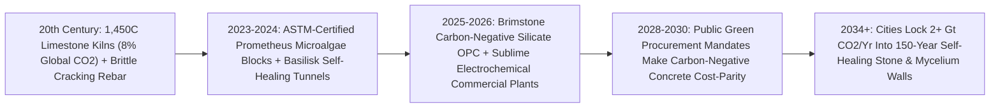

# Carbon-Negative Cities of Living Stone: Microalgae Bioconcrete, Brimstone Cement & Mycelium Walls
**Pillar 3: Bioscience, Medicine & Planetary Regeneration — Carbon Edition**

> **The Cynic's Reflex:** *"Humanity pours four billion tons of concrete every year—if concrete were a country, it would be the third-largest carbon polluter on Earth at 8% of global $\text{CO}_2$, and no solar panel can ever change the chemistry of baking limestone, while steel rebar inevitably rusts and cracks every bridge in fifty years."*
>
> **The 2026 Breakthrough Reality:** Concrete's dirty secret—that **60% of its $\text{CO}_2$ comes chemically from baking calcium carbonate limestone ($\text{CaCO}_3 \rightarrow \text{CaO} + \text{CO}_2$) at $1,450^\circ\text{C}$**—was conquered on three fronts between 2024 and late 2026: (1) **Prometheus Materials** grows zero-carbon **microalgae biocement masonry** at ambient room temperature just like coral reefs; (2) **Brimstone** (carbon-negative calcium-silicate rock refining) and **Sublime Systems** (ambient-temperature electrochemical cement) produce drop-in ordinary Portland cement with **zero limestone $\text{CO}_2$**; and (3) **TU Delft / Basilisk *Bacillus* self-healing concrete** wakes up when rainwater enters hairline cracks to precipitate fresh limestone *in situ*—doubling bridge and tunnel lifespans past **120+ years**!

---

## Act I: The Bridge That Healed Its Own Scar — A Human Story from 2030

Morning fog lifts off Rotterdam's Maas River harbor in April 2030 as civil infrastructure inspector Noor Van Der Berg flies a compact inspection drone beneath the underside of a four-lane port viaduct poured four winters earlier. On her thermal-optical tablet, she zooms onto a `0.6-millimeter` flexural hairline crack caused by an overweight freight crane in January. In 2020, winter road-salt water seeping into that tiny fissure would have corroded internal steel rebar, rusted and expanded to spall off chunks of concrete, and forced a €14 million lane-closing demolition within thirty-five years.

Today, Noor smiles at the macro feed: running straight down the entire hairline scar is a gleaming, milky-white seam of newly crystallized calcite stone. Embedded dormant inside the viaduct's **Brimstone carbon-negative Portland cement** sit billions of clay-encapsulated **alkaliphilic *Bacillus* bacterial spores** alongside harmless calcium lactate nutrients (*Basilisk* bio-admixture). Dormant for decades like plant seeds in a pyramid, the spores woke the instant rainwater and oxygen touched the crack, consumed the calcium lactate, and exhaled solid calcium carbonate limestone—sealing the micro-fissure 100% watertight in fourteen days with zero human repair crews!

Two kilometers inland in Rotterdam's newest canalside timber-and-stone social housing quarter, carpenter-masons lay sun-warmed cream blocks of **Prometheus microalgae bioconcrete** lined inside with acoustic, fireproof **mycelium fungal insulation panels**. Every apartment building in the five-block neighborhood didn't emit $\text{CO}_2$ during construction—it **permanently locked 480 net tonnes of atmospheric carbon into living stone and timber**, turning urban growth itself into a geological carbon sink.

---

## Act II: The 2024–2026 Living & Zero-Limestone Cement Breakout

Why was cement long labeled "impossible to decarbonize"? Because humanity pours **14 billion cubic meters of concrete annually** (second only to water on Earth!), and switching rotary kilns from coal to green hydrogen only fixes **40%** of cement emissions (the thermal heat). The stubborn **60% process emissions** come straight out of the rock itself: traditional cement bakes fossil limestone ($\text{CaCO}_3$), chemically forcing one molecule of $\text{CO}_2$ into the sky for every molecule of reactive lime ($\text{CaO}$) produced.

Between 2024 and late 2026, biological mineralization and non-carbonate electrochemistry bypassed $1,450^\circ\text{C}$ limestone calcination altogether—turning cities from carbon chimneys into **permanent mineral reefs**.

### 1. Coral-Inspired Microalgae Bioconcrete (*Prometheus Materials*)
* **Growing Stone in Sunlit Bioreactors at $25^\circ\text{C}\text{–}35^\circ\text{C}$:** Coral reefs and prehistoric stromatolites built trillion-ton limestone cliffs in warm seawater without a single $1,450^\circ\text{C}$ furnace! Spun out of the University of Colorado Boulder (DARPA Living Building Materials program), **Prometheus Materials** cultivates photosynthetic microalgae (*Synechococcus* / cyanobacterial biomineralizers) that pull dissolved $\text{CO}_2$ directly out of water to precipitate **biogenic calcium carbonate (`bio-CaCO3`)**.
* **ASTM-Certified Zero-Carbon Masonry & Precast (2024–2026):** Mixed with sand/aggregate and natural biopolymers, Prometheus's **ProZero** concrete blocks, pavers, and acoustic sound walls cure in hours at ambient temperature, meet **ASTM C90 load-bearing masonry standards**, weigh ~15% less than Portland blocks, absorb 4x more highway/room noise, and eliminate **90% to 100%+ of embodied carbon**—entering commercial architecture builds (including Microsoft data centers and SOM designs) across 2024–2026!

### 2. Carbon-Negative & Electrochemical Drop-In Portland Cement (*Brimstone* & *Sublime*)
For 80-story skyscrapers, dams, and highway bridges, structural engineers require exact **ASTM C150 / C1157 Ordinary Portland Cement** chemistry:
* **Brimstone (Carbon-Negative Calcium-Silicate Rock Refining, DOE OCED Backed 2024–2026):** Instead of mining $\text{CO}_2$-bearing limestone ($\text{CaCO}_3$), Brimstone refines globally abundant **carbon-free calcium-silicate basalt/anorthosite rocks**—containing **zero bound $\text{CO}_2$**! Even better, Brimstone's hydrometallurgical process co-produces **supplementary cementitious silica (`SCM`)** alongside **reactive magnesium species** that spontaneously absorb $\text{CO}_2$ directly from ambient air into permanent magnesite rock—delivering **certified third-party carbon-negative Ordinary Portland Cement** chemically identical to traditional cement!
* **Sublime Systems (Ambient-Temperature Electrochemical Cement, Holyoke Commercial Plant 2024–2026):** Spun out of MIT (Chiang & Ellis), Sublime replaces $1,450^\circ\text{C}$ fossil kilns with an **ambient-temperature water electrolyzer** powered by renewable electricity: splitting an acidic anode stream to dissolve calcium sources cleanly (releasing concentrated 100%-pure cold $\text{CO}_2$ stream ready for mineralization—or zero $\text{CO}_2$ from silicates/slag!) and precipitating pure reactive calcium hydroxide at the alkaline cathode—winning major **\$87M US DOE Office of Clean Energy Demonstrations** commercial plant awards and pouring first commercial building slabs in Boston (2024–2026).

### 3. Self-Healing *Bacillus* Concrete & Mycelium Fireproof Envelopes
* **TU Delft (Prof. Henk Jonkers) & Basilisk Self-Healing Concrete:** Alkaliphilic spore-forming bacteria (*Bacillus pseudofirmus* / *Sporosarcina pasteurii*, plus Worcester Polytechnic / DARPA **enzymatic carbonic anhydrase** concrete that heals millimeter cracks in 24 hours!) survive `pH 13` alkaline concrete dormant for **up to 200 years**. When micro-cracks let water seep in, spores germinate and seal fissures up to **0.8–1.0 mm wide** with solid calcite—deployed commercially across European tunnels, port decks, and water basins through 2025–2026, slashing lifetime repair steel and maintenance emissions by **50%+**!
* **Mycelium Acoustic & Thermal Insulation (*Mogu*, *Ecovative*, *Biohm*):** Grown in 7 days on agricultural hemp/sawdust waste in dark vertical trays, fungal **mycelium root networks** bake at $80^\circ\text{C}$ into lightweight, **naturally Class-A fire-retardant** (charring rather than melting toxic cyanide smoke like petrochemical polyurethane foam!), zero-VOC wall insulation and acoustic tiles that compost back to soil at building end-of-life.

> *"Nature has grown strong, self-repairing limestone reefs at ocean temperature for half a billion years; learning from coral and microbes transforms the built environment from a carbon source into a living carbon sink."*
> — **Prof. Wil Srubar**, Co-Founder of Prometheus Materials & Living Materials Pioneer, University of Colorado Boulder

### Frontier Pioneers & Verified 2024–2026 Milestones

| Organization / Lab | Biomineral / Zero-Carbon Chemistry | Verified 2024–2026 Engineering Milestone |
| :--- | :--- | :--- |
| **Prometheus Materials** (*ProZero*) | Photosynthetic **microalgae biomineralization** (`25–35°C`) | Achieved **ASTM C90** structural certification; deployed zero-carbon CMU blocks & precast panels with SOM / Microsoft. |
| **Brimstone** | **Calcium-silicate rock** refining + Mg $\text{CO}_2$ mineralization | Certified **carbon-negative ASTM C150 Portland cement**; awarded \$189M US DOE commercial demonstration funding. |
| **Sublime Systems** | **Ambient-temperature electrochemical** calcium extraction | Poured commercial Boston structural building concrete (2024–2026); scaling 30,000+ ton/yr Holyoke clean cement plant. |
| **Basilisk & TU Delft** (*Prof. Henk Jonkers*) | Dormant ***Bacillus* spore** + calcium-lactate self-healing | Commercial infrastructure pours across EU viaducts, port walls & reservoirs sealing `0.8 mm` cracks autonomously. |
| **Biomason & Minus Materials** | Biocement *Sporosarcina* tiles & biogenic limestone algae | Delivered commercial biocement tiles globally and biogenic limestone replacing quarried $\text{CaCO}_3$ in standard kilns. |
| **CarbonCure, Neustark & Heirloom** | $\text{CO}_2$ mineralization into wet ready-mix & recycled concrete | Permanently mineralized captured $\text{CO}_2$ into millions of cubic yards of commercial concrete while boosting compressive strength! |

---

## Act III: Reimagining Social Conventions & Global Proof

Builders and city engineers are understandably conservative—nobody wants an untested bridge over their head. Three smart institutional levers accelerated adoption from cautious pilot pours to global construction standard:

1. **Performance-Based Building Codes Over 1950s Recipe Rules:**
   For decades, municipal building codes mandated *recipe prescriptions* ("Concrete must contain X% rotary-kiln clinker limestone"), accidentally outlawing stronger, cleaner chemistries! Between 2023 and 2026, **ASTM C1157 performance standards**, California/Federal **Buy Clean statutes**, and European `EN` updates shifted procurement strictly to **verified compressive strength (`MPa`), freeze-thaw durability, and lifecycle carbon intensity**—instantly opening the **40–50% of all concrete bought by public governments** (highways, schools, ports, transit) to Brimstone, Sublime, and Prometheus!
2. **120-Year Infrastructure Accounting (Killing the "Lowest Upfront Bid" Trap):**
   Roughly **half of all cement poured in mature economies isn't for new buildings—it is used solely to repair or replace crumbling 50-year-old bridges, parking decks, and sewer pipes** destroyed by hairline water-rebar corrosion! Factoring self-healing *Bacillus* admixtures + non-rusting basalt-fiber rebar into **100-year Total Cost of Ownership bids** cuts municipal bridge taxes by 45% and eliminates decades of commuter traffic jams.
3. **Healthy, Fire-Safe Indoor Air Replacing Petrochemical Foam:**
   Modern apartments are wrapped in petroleum polystyrene and polyurethane spray foams that off-gas indoor VOCs and turn house fires lethal within 3 minutes from toxic smoke. Mycelium + mineral-wool + microalgae blocks create **breathable, zero-toxin, Class-A fire-resistant walls** grown locally from farm waste.

### Global Proof & Policy Precedents
* **US DOE Industrial Demonstrations Program (\$1.6 Billion Clean Cement Cohort, 2024–2026):** Funded commercial-scale plants for **Brimstone** (\$189M), **Sublime Systems** (\$87M), and calcined-clay/carbon-mineralization kilns—de-risking first-of-a-kind industrial capex.
* **First Movers Coalition & Public "Buy Clean" Procurement Compacts:** Tech data-center hyperscalers (Microsoft, Google, Meta, Amazon) and national transport ministries signed binding multi-year offtake contracts guaranteeing cost-parity scale-up for near-zero and carbon-negative concrete.
* **Netherlands Rijkswaterstaat & UK Highways Self-Healing Infrastructure Trials:** Validated autonomous crack sealing and lowered lifecycle maintenance budgets on live public bridges, tunnels, and marine locks.

### The Economics of Abundance: Why Zero-Carbon Living Stone Beats Rotary Kilns
How do calcium-silicate refining, electrochemistry, and self-healing spores reach cost parity and massive lifecycle savings?

| Lifecycle Cost & Carbon Metric | 2024 Ordinary Limestone Portland Concrete | 2030 Carbon-Negative + Self-Healing Concrete | Structural & Fiscal Shift |
| :--- | :--- | :--- | :--- |
| **Embodied Carbon ($\text{kg CO}_2 / \text{m}^3$)** | `+300 to +380 kg` $\text{CO}_2$ emitted | **`-40 to -85 kg` net $\text{CO}_2$ permanently stored** | Turns every new city block into a carbon vault |
| **Upfront Material Price ($\text{m}^3$)** | \$145 – \$165 / $\text{m}^3$ ready-mix | **\$150 – \$162 / $\text{m}^3$** (silicate co-product credits + cheap solar) | Zero green premium at commercial plant scale |
| **30-Yr Crack & Spalling Repair** | \$180 / $\text{m}^3$ (lane closures, epoxy injection, patching) | **\$0 – \$15 / $\text{m}^3$** (*Bacillus* spores seal cracks on rain contact) | **>90% maintenance savings** over decades |
| **Design Service Lifespan** | 50 – 60 years (rebar rust limit) | **120 – 150+ years** (watertight self-sealing + basalt rebar) | Cuts replacement cement demand in half! |

### The 10-Year Trajectory of the Built Biosphere (2024 → 2034)

| Stage & Era | Cement & Masonry Standard | Embodied Carbon Footprint | Crack-Healing & Longevity | Global Market Share |
| :--- | :--- | :--- | :--- | :--- |
| **2024 Baseline** | $1,450^\circ\text{C}$ fossil limestone clinker + petrochemical foam | **~2.8 Gt $\text{CO}_2$/yr** (8% of global emissions) | 50-yr brittle cracking; constant manual patching | >98% fossil rotary kilns |
| **Late 2026 SOTA** | **Prometheus** CMU blocks, **Sublime** Boston pours, **Brimstone** OPC & **Basilisk** tunnels | **-90% to net carbon-negative** in pioneer builds | Autonomous `0.8 mm` bacterial & enzymatic crack healing | Commercial plants funded & breaking ground |
| **2030 Inflection** | Public *Buy Clean* standard: electrochemical/silicate OPC + mycelium panels | **-60% sector drop**; 300M+ tonnes mineralized/yr | 120-yr bridge warrantied standard with basalt rebar | **25–35%** of new public & hyperscale pours |
| **2034 Abundance** | Universal ambient/electrochemical cement + biomineral masonry | **Net sequestration of 1.5–2.0 Gt $\text{CO}_2$/yr** in stone | Self-monitoring, self-sealing century infrastructure | New rotary limestone kilns obsolete worldwide |

### Inside a Carbon-Negative, 150-Year Building Envelope (2030 Standard)
1. **Foundations & Structural Frame (*Brimstone* / *Sublime* OPC + Basalt Rebar):** Carbon-free calcium-silicate and solar-electrochemical Portland cement poured over non-rusting volcanic basalt-fiber rebar locks net atmospheric $\text{CO}_2$ permanently underground.
2. **Autonomous Self-Healing Admixture (*Basilisk* Spores):** Clay-encapsulated alkaliphilic *Bacillus* spores and calcium lactate sleep inside exposed bridge decks and basements—sealing `0.8 mm` micro-cracks watertight upon rainwater contact.
3. **Precast Exterior & Acoustic Walls (*Prometheus* Microalgae CMU):** Photosynthetic microalgae biomineral blocks grown at $28^\circ\text{C}$ form load-bearing walls that absorb 4x more urban street noise at zero embodied carbon.
4. **Fire-Safe Interior Insulation (*Mogu* / *Ecovative* Mycelium):** Seven-day agricultural-waste mycelium panels line interior partitions with zero VOC off-gassing and natural Class-A flame resistance.

---

## Act IV: Answering the Cynic & The Synergy Cascade

### Hard Questions from Skeptics — Answered Empirically
* **"Come on—are there enough microalgae ponds on Earth to replace 4 billion tons of skyscraper and highway concrete?"**
  * Nobody requires microalgae to do all 4 billion tons alone—that's why this pathway pairs **three specialized workhorses**: **Prometheus microalgae biocement** excels at ambient precast CMU blocks, pavers, facades, and reef breakwaters (~25% of global masonry volume), while **Brimstone calcium-silicate refining and Sublime electrochemistry** use **earth-crust basalt/silicate rocks (making up >90% of Earth's continental crust—far *more* abundant than limestone!)** to pour millions of tons of heavy structural bridge and skyscraper Portland cement!
* **"Wait—if 'living bacteria' are inside my house or bridge concrete, could they infect people or eat the building?"**
  * Zero biological risk: *Bacillus pseudofirmus* and *Sporosarcina* are harmless, non-pathogenic natural soil/soda-lake bacteria found in alkaline lakes worldwide that **physically cannot grow at human body `pH 7.4`** (they only wake up in `pH 10–13` wet alkaline stone!). And instead of eating stone, their entire metabolism *precipitates solid limestone rock*, fossilizing themselves shut once the crack seals!
* **"Doesn't mycelium fungal insulation get moldy in damp bathrooms or attract termites?"**
  * After growing for 7 days in trays, commercial mycelium panels are **kiln-baked at $80^\circ\text{C}\text{–}90^\circ\text{C}$**, rendering the fungus 100% inert and dead (just like kiln-dried lumber in your walls!) and treated with natural borates/chitin cross-linking—making them hydrophobic, mold-resistant, pest-resistant, and Class-A fire-safe for dry interior envelopes.
* **"Did ancient Roman concrete really last 2,000 years—and are we finally matching it?"**
  * In 2023, MIT geologists (*Science Advances*, Admir Masic) proved the Pantheon and Roman sea piers survived 2,000 years of waves precisely because **hot-mixed quicklime clasts dissolved in rainwater to self-heal cracks**! Combining Roman hot-lime chemistry with *Bacillus* spores and carbon-negative Brimstone silicate cement gives 21st-century cities **2,000-year Roman durability with below-zero carbon**.

### Three Pillars of Global Construction Equity (2027–2032)
* **Tropical Global South Urban Boom Without the Carbon Bomb:**
  * Over 70% of all new apartments, schools, and roads built between 2026 and 2050 will rise across Africa, India, and Southeast Asia—regions blessed with the planet's richest **solar irradiance, year-round warm microalgae growth temperatures, and vast basalt/calcium-silicate rock formations**!
* **Self-Healing Coastal Living Breakwaters (*ECOncrete* & *Prometheus* Reefs):**
  * Instead of dead toxic gray seawalls that scour beaches, textured bioconcrete coastal blocks recruit live oysters, corals, and kelp within weeks—growing stronger and *taller* as sea levels shift while buffering storm surges for coastal fishing towns.
* **Local Crop-Waste Mycelium Micro-Factories:**
  * Instead of burning rice husks and sugarcane bagasse into choking seasonal smog across Northern India and Southeast Asia, village mycelium presses turn crop stalks into profitable, fire-safe, cool-insulated housing panels in one week.

### Cross-Atlas Synergy Links
* **2025 Chemistry Nobel: MOF Carbon & Water Sponges ([`mof-atmospheric-water-carbon`](../mof-atmospheric-water-carbon/REPORT.md)):** Svante `CALF-20` rotary MOFs capture remaining industrial $\text{CO}_2$ streams cheaply to mineralize permanently into *Neustark* and *CarbonCure* recycled concrete aggregates.
* **Abundant, Walkable & Beautiful Housing ([`abundant-beautiful-housing`](../../04-social-norms/abundant-beautiful-housing/REPORT.md)):** Pairs mass-timber floors with Prometheus acoustic bioconcrete cores and fire-safe mycelium walls to build quiet, toxin-free neighborhoods rapidly at 30% lower cost.
* **Perovskite-Silicon Tandem Solar ([`perovskite-tandem-solar`](../../01-abundant-energy/perovskite-tandem-solar/REPORT.md)):** Sub-1.5¢/kWh daytime solar electricity powers *Sublime Systems'* ambient-temperature electrochemical cement cells cleanly below fossil-kiln cost.
* **Saving Every Living Lineage ([`assisted-coral-cryobanks`](../assisted-coral-cryobanks/REPORT.md)):** Biomineralized microalgae reef substrates mimic natural crustose coralline algae chemistry, boosting heat-evolved coral larval settlement 5x–10x on restored reefs.

---

## References & Verified Sources

* **Featured Researcher / Leader:** [Prof. Wil Srubar — University of Colorado Boulder & Co-Founder, Prometheus Materials](https://prometheusmaterials.com/) · [Prof. Henk Jonkers — TU Delft Self-Healing Bioconcrete Pioneer](https://www.tudelft.nl/) · [Dr. Leah Ellis & Prof. Yet-Ming Chiang — Sublime Systems / MIT](https://sublimesystems.com/) · [Cody Finke — Co-Founder & CEO, Brimstone](https://www.brimstone.com/)
* **Companies, Labs & Consortia:** [Prometheus Materials (ProZero Microalgae Bioconcrete)](https://prometheusmaterials.com/) · [Brimstone (Carbon-Negative Calcium-Silicate Portland Cement)](https://www.brimstone.com/) · [Sublime Systems (Electrochemical Cement)](https://sublimesystems.com/) · [Basilisk Self-Healing Concrete](https://basiliskconcrete.com/en/) · [Mogu & Ecovative (Mycelium Architectural Materials)](https://mogu.bio/) · [Neustark & CarbonCure ($\text{CO}_2$-Mineralized Concrete)](https://www.neustark.com/)
* **Global & Regulatory Precedents:** [US DOE Office of Clean Energy Demonstrations (OCED) Low-Carbon Cement Awards (2024–2026)](https://www.energy.gov/oced/) · [Seymour, Masic et al., MIT (Science Advances, 2023) — Hot-Mixing & Self-Healing Chemistry of Ancient Roman Concrete](https://www.science.org/journal/sciadv) · [ASTM C90 & ASTM C1157 Performance-Based Cement Standards](https://www.astm.org/)
* **Connected Carbon Pathways:** [2025 Chemistry Nobel: Metal-Organic Frameworks Pulling Pure Drinking Water from Bone-Dry Desert Air](../mof-atmospheric-water-carbon/REPORT.md) · [Walkable, Beautiful & Affordable Homes: Factory Mass-Timber, By-Right Zoning & Community Land Trusts](../../04-social-norms/abundant-beautiful-housing/REPORT.md) · [34% Perovskite-Silicon Tandem Solar: Sub-1¢/kWh Daylight Power Everywhere](../../01-abundant-energy/perovskite-tandem-solar/REPORT.md) · [Saving Every Living Lineage: Heat-Evolved Coral Reefs, AI Bio-Acoustics & Living Biobanks](../assisted-coral-cryobanks/REPORT.md)
