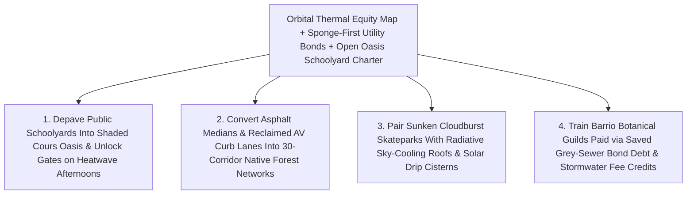

# CARBON EDITION — PILLAR 3: BEATING 115°F ASPHALT WITHOUT CONCRETE MEGAPIPES
## How Medellín's \$16.3M Green Corridors, Paris Open "Oasis" Schoolyards & Cloudburst Sponge Parks Cool Cities & Drink Floods

> **Executive Framing & Reimagining Urban Survival Beyond Sealed Air Conditioning & Concrete Tunnels:**
> * **The Cynic's Belief:** *"Fiercer urban heatwaves and violent 100-year cloudburst storms leave cities with only one grim survival playbook: seal families indoors behind roaring window air conditioners—pumping waste exhaust heat onto poorer, tree-starved apartment blocks—while spending tens of billions of public dollars blasting gigantic concrete storm sewers beneath gridlocked asphalt."*
> * **The Empirical Counter-Reality:** Across four pioneering cities on three continents, engineers and mayors proved that tearing up sterile asphalt for living botanical infrastructure cools neighborhoods *and* absorbs torrential floods at a fraction of grey-concrete cost. Starting in **2016** for just **~\$16.3 million**, **Medellín, Colombia** jackhammered sun-baked medians and concrete channels to weave **30 interconnected biodiverse *Corredores Verdes* (Green Corridors)** across **18 major roads and 12 waterways** while training **150+ disadvantaged local residents as municipal botanical gardeners**—dropping **citywide ambient temperatures by ~2 °C** (and corridor/surface temperatures by **3 °C–4.5 °C+**), slashing $PM_{2.5}$ respiratory hospitalizations, and winning the **Ashden Award for Cooling by Nature**. Simultaneously, **Paris** depaved **130+ heat-trapping asphalt schoolyards** into shaded, permeable ***Cours Oasis*** micro-forest plazas (**3 °C–8 °C cooler** during heatwaves) and enacted a civic rule **opening schoolyard gates free to elderly and walk-up neighbors on weekends and heatwave afternoons**. And when **Copenhagen** (*Skybrudsplan* / **Enghaveparken**) and **Philadelphia** (*Green City, Clean Waters*) priced underground concrete storm megapipes against sunken rain-drinking "sponge" skateparks and bioswales, living green sponges **saved billions of dollars in capital expenditure** while turning dead pavement into beloved neighborhood commons!
> * **The Social Norm Shift:** Cities enact a statutory **300-Meter Cool Green Refuge Guarantee** and **"Sponge-First" Infrastructure Procurement**—fusing open-gate Oasis schoolyards and barrio-tended forest corridors with **orbital thermal digital twins**, **passive radiative sky-cooling roofs**, **solar autonomous drip irrigation**, and **curb lanes reclaimed from surface parking by autonomous mobility**.
> * **Anchor Voice:** *"When we tore up bare concrete medians along Avenida Oriental and planted multi-layered native forest corridors tended by neighbors from our own barrios, the whole city exhaled—two degrees cooler, cleaner to breathe, and alive with birds again."* — **Alcaldía de Medellín & Joaquín Antonio Uribe Botanical Garden Team**, *Ashden Award Winners (Corredores Verdes)*

---

## ACT I: THE LIVED HUMAN REALITY — TUESDAY IN MEDELLÍN & BELLEVILLE, PARIS (2028)
### Why Tearing Up Six Inches of Blacktop Saves Lives That Air Conditioners Leave Behind

It is 2:15 PM on a scorching Tuesday afternoon in August along **Avenida Oriental** in downtown **Medellín**—and simultaneously 4:30 PM during a **39 °C (102 °F)** European summer heat alert in **Belleville**, in Paris's dense working-class 19th–20th Arrondissements. Fifty-one-year-old municipal master gardener **Luz Elena Morales**, who twelve years ago sold loose chewing gum at traffic lights in Comuna 8 to feed her children, kneels beneath a towering green vault of tropical guayacán trees, giant guadua bamboo, and scarlet heliconias to check a whisper-quiet solar soil-moisture probe.

Before Medellín launched *Corredores Verdes* in 2016, walking or cycling along Avenida Oriental at 2:15 PM felt like standing behind a jet engine: bare concrete traffic dividers radiated **45 °C+ (113 °F+)** thermal glare, diesel $PM_{2.5}$ soot hung trapped in the valley canyon, and lower-income hillside commuters arrived home drenched in heat exhaustion while wealthier high-rises hummed with split-unit air conditioners dumping **1.2 kW of waste heat** into the street for every **1 kW of indoor cooling**. Across the Atlantic in Paris during the catastrophic 2003 heatwave, thousands of seniors living alone under uninsulated zinc mansard roofs perished behind closed shutters because every courtyard within walking distance was either private or locked behind school gates paved in black bitumen that hit **58 °C (136 °F)** in the sun.

Watch how the **Sponge & Green Corridor** civic norm transforms Tuesday afternoon for both Luz Elena in Medellín and 83-year-old retired typesetter **Marcel Moreau** in Belleville:

1. **Barrio-Tended Tropical Forest Tunnels Cutting Heat 4 °C:**
   Trained by botanists at Medellín's **Joaquín Antonio Uribe Botanical Garden**, Luz Elena and 150+ fellow *jardineros ciudadanos* planted multi-story rainforest architecture—low shade ferns, mid-canopy flowering shrubs for native butterflies, and interlocking 15-meter tree crowns—linking hillside streams directly to downtown plazas. Stepping off a side street onto Avenida Oriental's shaded bicycle and pedestrian promenade, commuters feel an instant **3.5 °C to 4.5 °C air-temperature drop** (and a **10 °C–15 °C radiant surface-temperature drop**). Yellow-chevroned parakeets chatter overhead where bare concrete once baked, and automated **solar rainwater cisterns** tucked under pedestrian bridges pulse recycled greywater to tree roots strictly at 4:00 AM to eliminate evaporative waste.
2. **Unlocking the Neighborhood Schoolyard Gate (*Les Cours Oasis*):**
   In Belleville, Marcel receives an automatic heatwave chime on his landline from his arrondissement hall: the public elementary school ninety meters from his stairwell has unlocked its green *Cour Oasis* gate for neighbors from 4:00 PM to 9:00 PM. Where heat-blistered blacktop once trapped hot air, children from **[`phone-free-childhood-play-hoods`](../../04-social-norms/phone-free-childhood-play-hoods/REPORT.md)** splash barefoot through a shallow limestone rill fed by harvested rainwater while Marcel reads his newspaper on a shaded wooden bench beneath mulberry trees and light-colored permeable mineral stone—sitting comfortably in a microclimate **6 °C (11 °F) cooler** than the boulevard outside without burning a single watt of fossil peak-grid electricity!
3. **Sunken Cloudburst Plazas Drinking a 100-Year Storm by Midnight:**
   When a sudden warm-atmosphere thunderstorm dumps **75 mm (3 inches)** of rain in fifty minutes that evening—a cloudburst that once backed raw sewage into basements from Copenhagen to Philadelphia—neither street floods. Reclaimed curb lanes freed from parked cars by **[`autonomous-ground-mobility`](../../02-automation-science/autonomous-ground-mobility/REPORT.md)** channel street runoff through root-zone bioswales that filter tire microplastics and heavy metals, overflowing cleanly into a sunken neighborhood amphitheater modeled on Copenhagen's **Enghaveparken**—holding **22,600 $\text{m}^3$** of stormwater safely overnight before recharging the urban aquifer and morning tree canopy.

---

## ACT II: REIMAGINING THE RULES — MEDELLÍN, PARIS, COPENHAGEN & ORBITAL COOLING TECH
### Why Living Sponges Beat Concrete Megapipes & AC Exhaust Loops on Every Ledger

```mermaid
flowchart LR
    subgraph GreyTrap["Legacy Asphalt Heat-Island & Concrete Megapipe Trap"]
        G1["40%–60% Impervious Dark Asphalt + Locked Asphalt Schoolyards"]
        G2["AC Units Dump Waste Heat Outside; Poorer Blocks Bake +5°C–8°C Hotter"]
        G3["Multi-Billion USD Deep Concrete Storm Tunnels Sit Idle 98% of the Year"]
    end
    subgraph SpongeCommons["Green Corridors + Open Oasis Yards + Orbital/Radiative Tech"]
        S1["Medellín 16.3M USD Biodiverse Corridors + 150+ Paid Barrio Gardeners"]
        S2["Paris 130+ Depaved Oasis Schoolyards Open to Seniors + Sponge Parks"]
        S3["Orbital Thermal Twins + Radiative Sky-Cooling Skins + AV Curb Depaving"]
    end
    subgraph CivicDividend["Ashden, C40 & Municipal Water Audit Outcomes"]
        D1["-2°C Citywide & -3°C to -8°C Local Cooling + Lower PM2.5 Asthma"]
        D2["30%–60% Stormwater Capex Savings vs. Grey Tunnels (Billions Saved)"]
        D3["Universal 300m Cool Refuge Access, Flood Safety & Returning Wildlife"]
    end
    GreyTrap ==> SpongeCommons ==> CivicDividend
```

### 1. Medellín's \$16.3 Million Masterclass: Cooling a 2.5-Million-Person Metropolis by ~2 °C
In urban infrastructure, **\$16.3 million** barely buys half a mile of highway overpass—yet between **2016 and 2019**, Medellín used **\$16.3 million** (plus ~\$625,000/year maintenance) to re-engineer the thermal physics of an entire metropolitan valley:
* **Ecological Connectivity Over Cosmetic Street Trees:** Rather than planting isolated lollipop trees in tiny concrete pits where roots suffocate in three years, Medellín ripped out continuous strips of median asphalt across **18 major road arteries and 12 riparian waterways** (**30 *Corredores Verdes* totaling ~65+ hectares**), planting **~8,800+ large native trees, thousands of palms, and >350,000 shrubs and epiphytes** mimicking intact Andean-tropical forest strata.
* **Verified Thermal & Respiratory Dividend:** Municipal sensor networks audited for the **2019 Ashden Award** and **C40 Cities** documented an extraordinary **~2 °C drop in Medellín's average urban ambient temperature** within three years—with corridor surface and air microclimates cooling **3 °C to 4.5 °C+**—alongside measurable declines in $PM_{2.5}$ particulate matter, ozone precursors, and acute respiratory infections, while projecting an additional **1 °C–2 °C cooling** as crowns mature over decades!
* **Dignified Green Employment From Within Vulnerable Barrios:** Working with the **Joaquín Antonio Uribe Botanical Garden**, the city deliberately recruited **150+ residents from low-income neighborhoods**—single mothers, former informal street vendors, and displaced rural farmers—training them as certified municipal horticulturalists with living wages, pensions, and deep neighborhood pride so zero corridors suffered vandalism or neglect.

### 2. Civic Rule-Breaking in Paris, Copenhagen & Philadelphia: Opening Gates & Retiring Megapipes
Why don't dense historic cities say they "have no land left" for cooling forests or flood detention? Because **Paris**, **Copenhagen**, and **Philadelphia** discovered cities already own thousands of acres of public land—it was simply paved in asphalt or locked behind institutional fences:
1. **Paris's *Cours Oasis* & Open Neighborhood Heat-Refuge Rule:** Realizing no Parisian lives more than **200–300 meters** from one of the city's ~750 public schools, Paris launched ***Les Cours Oasis*** (backed by ERDF Urban Innovative Actions and Météo-France / LIED thermal monitoring), tearing up blacktop across **130+ schoolyards** (expanding toward universal school coverage by 2030–2040) to install permeable light-albedo pavings, rain gardens, shade pergolas, misting fountains, and dense fruit/forest canopies that measure **3 °C–8 °C cooler** on summer afternoons. Crucially, Paris paired depaving with a **convention-breaking municipal charter**: opening Oasis schoolyards free to **seniors, families, and walk-up tenants on weekends and heatwave alerts** without spending a euro on land acquisition!
2. **Copenhagen's *Skybrudsplan* & Enghaveparken Sponge Park:** After the July 2, 2011 cloudburst dumped 150 mm of rain in two hours and inflicted **>€800 million (\$1B+)** in insurance damage, Copenhagen audited two options: boring gigantic deep-rock concrete sewer tunnels alone, or building **300 surface cloudburst boulevards and sunken sponge parks**. Choosing the hybrid green-first **Cloudburst Management Plan** saved taxpayers **billions of kroner** in net socioeconomic cost. Inside historic **Enghaveparken** (designed with TREDJE NATUR), an underground perimeter dike and sunken multi-use sports/concert bowl store **22,600 $\text{m}^3$ of extreme cloudburst runoff**—functioning 355 days a year as a lively skatepark, rose garden, and fountain plaza!
3. **Philadelphia's *Green City, Clean Waters*:** Faced with an EPA Clean Water Act consent decree where traditional concrete deep-tunnel storage threatened **\$8B–\$10B+** in ratepayer debt, the **Philadelphia Water Department** negotiated America's landmark **25-year ~\$2.4 billion green-stormwater pact**—creating **2,800+ "Greened Acres"** of street bioswales, porous alleys, and depaved schoolyards that already prevent **>3 billion gallons of polluted sewer overflows per year** while cooling heat-stressed rowhouse blocks!

### 3. How Orbital Thermal Twins, Sky-Cooling Skins & Autonomous Mobility Multiply the Sponge Effect
Pairing these humane civic conventions with four abundant 2026–2030 technologies turns incremental urban greening into rapid citywide climate immunity:
* **Sub-5-Meter Orbital Thermal Digital Twins:** Feeding spaceborne thermal-infrared telemetry from **[`earth-digital-twin-canopy`](../../05-space-frontier/earth-digital-twin-canopy/REPORT.md)** into open municipal maps pinpoints the exact block-by-block nocturnal heat traps where low-income seniors live—directing the very first depaving crews to blocks with the highest heat-stroke ambulance risk rather than wealthy boulevard lobbies.
* **Passive Radiative Sky-Cooling Roofs & High-Albedo Pavements:** Coating surrounding school roofs, bus depots, and sunlit walls with **[`radiative-sky-cooling-skins`](../../01-abundant-energy/radiative-sky-cooling-skins/REPORT.md)** (emitting heat directly to 3 K outer space through the **8–13 $\mu\text{m}$ atmospheric window**) drops building roof temperatures **5 °C–10 °C below ambient air** with zero electricity, slashing indoor AC exhaust dumped into the green corridor below!
* **Curb Space Freed by Shared Autonomous Mobility:** Because private cars sit parked 95% of the time devouring **15%–30% of urban surface area**, transitioning curb parking lanes via **[`autonomous-ground-mobility`](../../02-automation-science/autonomous-ground-mobility/REPORT.md)** hands cities millions of linear meters of continuous right-of-way for Medellín-style cooling corridors and Copenhagen-style cloudburst bioswales—tended by ultra-efficient **solar-powered drip micro-irrigation**.

| Urban Resilience Metric | Asphalt Heat-Island + Grey Megapipe Status Quo | Green Corridors + Open Oasis Yards + Sponge Tech (Carbon Standard) | Verified Empirical Shift |
| :--- | :--- | :--- | :--- |
| **Summer Afternoon Street Cooling** | Dark asphalt hits **55 °C+**; AC exhaust raises night street temps +2 °C | **Medellín Corridors** + **Paris Oasis Yards** + **[`radiative-sky-cooling-skins`](../../01-abundant-energy/radiative-sky-cooling-skins/REPORT.md)** | **-2 °C citywide**; **-3 °C to -8 °C** inside corridors & Oasis yards |
| **Capital Cost of Cooling & Flood Control** | **\$5B–\$15B** deep concrete storm tunnels idle 355 days/year | **\$16.3M** Medellín corridors; **~\$2.4B** Philly greened acres vs. \$9B grey | **30%–60% lower stormwater capex** + zero land-purchase schoolyards |
| **Walkable Heat-Wave Senior Refuges** | Schoolyards Paved & Padlocked at 4:30 PM & All Summer | **Open *Cours Oasis* Charter** unlocks shaded cool yards within **<300m** | Universal free cool refuge for walk-up seniors & toddlers |
| **Air Quality & Urban Biodiversity** | Trapped $PM_{2.5}$ soot, sterile grass strips & dead concrete channels | Multi-strata native trees/shrubs filter $PM_{2.5}$ & restore bird/pollinator webs | Measurable **drop in respiratory morbidity** & native wildlife return |
| **Neighborhood Jobs & Equity Targeting** | Out-of-town heavy-tunnel contractors; poorer barrios left hottest | **150+ barrio botanical gardeners** + **[`earth-digital-twin-canopy`](../../05-space-frontier/earth-digital-twin-canopy/REPORT.md)** equity maps | Living-wage local green jobs & hottest blocks cooled first |

---

## ACT III: GLOBAL ADAPTATION & PHASED ROLLOUT ROADMAP (2026–2032)
### Financing Every City's Sponge & Cooling Transformation Out of Existing Stormwater & Road Resurfacing Budgets

Mayors rarely need a brand-new tax to copy Medellín, Paris, and Philadelphia—because cities *already* spend tens of billions every year repaving asphalt roads on 12-year cycles and servicing EPA/EU stormwater compliance bonds! By passing two municipal ordinances—a **"Sponge-First" Capital Budget Rule** (requiring water and transportation utilities to allocate ≥35% of stormwater/resurfacing capital to green bioswales and corridor depaving whenever lifecycle cost beats grey concrete) and an **Impervious-Surface Stormwater Fee Credit** (modeled directly on Philadelphia's parcel-area water billing reform, giving shopping centers, schools, and logistics yards up to **80% stormwater-fee discounts** when they depave parking lots into shaded rain gardens)—every metro can cool its hottest neighborhoods within five summers.

| Implementation Horizon | Municipal Ordinance & Utility Finance Unlock | Botanical, Civic & Technical Deployment | Audited Thermal, Flood & Health Outcome |
| :--- | :--- | :--- | :--- |
| **Phase 1 (Months 1–12): Thermal Equity Mapping & Open Oasis Schoolyards** | City council adopts **300-Meter Cool Refuge Ordinance** & joint School-Board liability/caretaker pact opening depaved schoolyards on weekends & ≥32 °C heat alerts. | Ingest **[`earth-digital-twin-canopy`](../../05-space-frontier/earth-digital-twin-canopy/REPORT.md)** 5m thermal maps; depave first **50 hottest-ward schoolyards**; coat roofs with **[`radiative-sky-cooling-skins`](../../01-abundant-energy/radiative-sky-cooling-skins/REPORT.md)**. | **3 °C–8 °C cooler** micro-forest refuges open within a 5-minute walk for 250,000+ heat-vulnerable residents in Year 1. |
| **Phase 2 (Years 1–3): 30 Green Corridors & Barrio Gardener Guilds** | Water & DOT utilities shift **35% of grey-pipe & median-repaving bonds** into **Medellín-style *Corredores Verdes*** + parcel impervious-area stormwater fee credits. | Rip up concrete medians & surplus curb parking freed by **[`autonomous-ground-mobility`](../../02-automation-science/autonomous-ground-mobility/REPORT.md)**; hire **200+ local botanical gardeners**; add solar greywater drip lines. | Corridor temperatures fall **3 °C–4.5 °C**; peak summer AC grid load drops **10%–18%**; $PM_{2.5}$ asthma ER visits decline. |
| **Phase 3 (Years 3–6): Cloudburst Boulevards & Sponge-Park Network** | National water regulators make **Philadelphia / Copenhagen Sponge Accounting** the mandatory baseline before permitting any >\$250M concrete storm tunnel. | Construct sunken **Enghaveparken-style cloudburst parks** & **[`phone-free-childhood-play-hoods`](../../04-social-norms/phone-free-childhood-play-hoods/REPORT.md)** green play streets across every watershed. | Citywide ambient heat drops **~2 °C+**; absorbs **100-year cloudbursts** at **30%–60% lower cost** than concrete megapipes. |

---

## ACT IV: ANSWERING THE SKEPTIC & THE HUMANE HORIZON
### Practical Answers on Arid Water Scarcity, School Security & Mosquito Control

### Addressing the Top 3 Municipal Engineering Objections
1. **"How can drought-prone cities like Phoenix, Madrid, or Santiago water 30 green corridors without draining scarce drinking-water reservoirs?"**
   * *Empirical Answer:* Thirsty ornamental turfgrass wastes potable water—**climate-adapted native multi-strata corridors coupled with stormwater harvesting actually *increase* net groundwater recharge**! By capturing winter/monsoon street runoff in subterranean gravel sponge cells, routing treated municipal greywater through **solar-powered subsurface drip lines** at 4:00 AM, and selecting deep-rooted regional shade species (mesquite and palo verde in arid basins; holm oak and hackberry in Mediterranean climates; guadua and guayacán in the tropics), cities achieve **3 °C–5 °C shade and evapotranspiration cooling** using **zero net potable drinking water**.
2. **"Won't opening schoolyards on weekends invite vandalism, litter, or safety headaches for principals?"**
   * *Empirical Answer:* **Paris tested this across 130+ *Cours Oasis* schoolyards** and solved it cleanly through physical design and civic stewardship: school classroom buildings remain securely locked while only the fenced courtyard gate opens, supervised lightly by municipal civic hosts, neighborhood senior associations, or local gardening clubs. Just as Medellín saw virtually zero vandalism because barrio residents themselves were the paid *jardineros*, neighborhoods fiercely protect cool oases where their own grandparents sit every Saturday!
3. **"Don't sunken rain gardens and retention parks breed mosquitoes in warm climates?"**
   * *Empirical Answer:* Mosquito larvae require **7 to 10 days of stagnant standing water** to hatch. Engineered sponge bioswales and **Enghaveparken-style cloudburst basins** are designed with engineered sandy-loam infiltration beds and slow underdrains that empty surface water completely within **24 to 48 hours**—far faster than puddles trapped in clogged concrete storm grates—while restoring dragonflies, bats, and insectivorous birds that naturally suppress mosquito populations!

### Fast-Track Mayor & Water-Utility Activation Checklist

| Sprint Reform Step | Proven Real-World Precedent | Months to Launch | Equity & Engineering Guardrail |
| :--- | :--- | :--- | :--- |
| **1. Orbital Thermal Heat-Equity Audit** | C40 Cool Cities + Orbital Thermal Twins | **1 Month** | Mandate hottest low-income senior tracts receive first 50% of trees |
| **2. Open *Cours Oasis* Schoolyard Pact** | Ville de Paris (130+ Depaved Schoolyards) | **4 Months** | Lock classroom doors separately; open shaded yard on weekends & heatwaves |
| **3. Charter Barrio Botanical Guild** | Medellín Botanical Garden (150+ Gardeners) | **3 Months** | Living-wage civil-service pathway for residents of heat-island barrios |
| **4. Impervious-Area Stormwater Credit** | Philadelphia *Green City, Clean Waters* | **6 Months** | Bill stormwater by paved area; up to 80% fee discount for depaving |
| **5. Sunken Cloudburst Park Procurement** | Copenhagen *Skybrudsplan* / Enghaveparken | **9 Months** | Require 24–48 hr drain-down engineered soils & everyday skate/park utility |

### Why Fiscal Hawks, Climate Engineers & Working-Class Families Unite Behind Sponge Cities
* **Why Working Families & Seniors Love It:** Delivers free **3 °C–8 °C cooler** green refuges within a three-minute walk, lowers summer electric bills, cleans diesel soot from children's lungs, and creates dignified local arboriculture careers.
* **Why Municipal CFOs & Insurers Love It:** Costs **\$16.3M instead of billions** for citywide cooling, cuts grey stormwater tunnel debt **30%–60%**, slashes basement flood claims, and shaves utility peak-load transformer blowouts.

### Cross-Pillar Synergies & The Bottom Line
Woven together with **[`radiative-sky-cooling-skins`](../../01-abundant-energy/radiative-sky-cooling-skins/REPORT.md)**, **[`earth-digital-twin-canopy`](../../05-space-frontier/earth-digital-twin-canopy/REPORT.md)**, **[`phone-free-childhood-play-hoods`](../../04-social-norms/phone-free-childhood-play-hoods/REPORT.md)**, and **[`autonomous-ground-mobility`](../../02-automation-science/autonomous-ground-mobility/REPORT.md)**, **Sponge Cities & Cooling Green Corridors** prove that **cities never had to seal human beings inside air-conditioned concrete bunkers to survive a warming century**. Tear up the excess blacktop, unlock the schoolyard gate, hire neighbors to tend native shade canopies, and let the living earth drink the rain. *(See companion visual production guide: [`STORYBOARD.md`](./STORYBOARD.md).)*

---

## References & Verified Sources

* **Medellín Green Corridors (*Corredores Verdes*):** [Ashden Award Winner Case Study — Alcaldía de Medellín: *Cooling by Nature Through 30 Urban Green Corridors & Citizen Botanical Gardeners*](https://ashden.org/winners/alcaldia-de-medellin/) · [C40 Cities Knowledge Hub — *Urban Cooling, Nature-Based Corridors & Cloudburst Adaptation Guides*](https://www.c40knowledgehub.org/)
* **Paris Open Oasis Schoolyards (*Les Cours Oasis*):** [Ville de Paris Official Program — *Les Cours Oasis: Des Cours d'École Plus Fraîches et Ouvertes aux Habitants*](https://www.paris.fr/pages/les-cours-oasis-7389)
* **Cloudburst Sponge Parks & Green Stormwater Economics:** [State of Green Denmark — *Climate Adaptation of Enghaveparken (22,600 m³ Cloudburst Sponge Park, Copenhagen Skybrudsplan)*](https://stateofgreen.com/en/solutions/climate-adaptation-of-enghaveparken/) · [Philadelphia Water Department — *Green City, Clean Waters: 25-Year Green Stormwater Infrastructure Plan*](https://water.phila.gov/green-city/)
* **Connected Carbon Pathways:** [Zero-Watt Air Conditioning: Passive Radiative Sky-Cooling Skins & Photonic Roofs](../../01-abundant-energy/radiative-sky-cooling-skins/REPORT.md) · [Planetary Nervous System: Earth Digital Twin Canopy & High-Resolution Thermal Telemetry](../../05-space-frontier/earth-digital-twin-canopy/REPORT.md) · [Reclaiming Outdoor Childhood: Phone-Free Schools & Car-Light Play Neighborhoods](../../04-social-norms/phone-free-childhood-play-hoods/REPORT.md) · [Safe Streets & Freed Land: Autonomous Ground Mobility & Parking Liberation](../../02-automation-science/autonomous-ground-mobility/REPORT.md)
