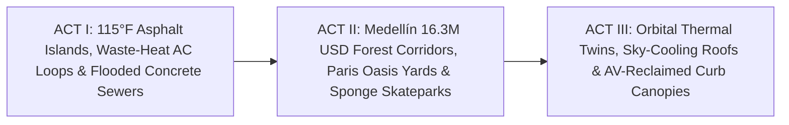

# STORYBOARD & CREATIVE PRODUCTION GUIDE: SPONGE CITIES & COOLING GREEN CORRIDORS ([`sponge-cities-cooling-green-corridors`](./REPORT.md))
## *"Tear Up the Blacktop, Unlock the Schoolyard — How Medellín's \$16.3M Forest Corridors, Paris Oasis Yards & Sponge Parks Beat 115°F Heat & Floods"*

> **Production Purpose:** This vivid 3-act visual storyboard equips urban filmmakers, mayors, and water utilities to shatter the fatalistic myth that hotter summers and violent cloudbursts require sealing citizens behind heat-dumping air conditioners and boring **\$10 billion** concrete storm tunnels—showing how **Medellín's \$16.3M Green Corridors**, **Paris's 130+ open *Cours Oasis* schoolyards**, and **Copenhagen & Philadelphia's sponge parks** cool cities **2 °C–8 °C** and drink extreme floods at a fraction of grey-concrete cost.

---

## PART 1: THREE ALTERNATIVE NARRATIVE OPENINGS (DIRECTOR'S OPTIONS)

### Option A: "Thermal Camera on Avenida Oriental: 2015 Concrete Furnace vs. 2028 Rainforest Promenade" *(Infrared Miracle Reveal)*
* **Visual Hook:** Dual-mode camera (half natural 35mm cinema, half live **FLIR thermal infrared**) gliding down **Avenida Oriental in Medellín**. Left (`2015 Archive`): Glowing white-hot **48 °C (118 °F)** bare concrete median strips choking pedestrians in diesel haze. Right (`Today`): Deep indigo-blue **26 °C** shade beneath towering guadua bamboo, guayacán blossoms, and green parrots tended by former street vendor turned municipal gardener **Luz Elena Morales**—all built for just **\$16.3 million**.
* **Voiceover Core:** *"For sixteen million dollars—less than the price of half a highway interchange—Medellín tore up bare concrete across thirty road and river corridors, hired neighbors from working-class barrios as botanical gardeners, and cooled an entire city of two and a half million people by two degrees Celsius."*
* **Best For:** Global climate documentaries, civic design festivals, and mainstream streaming audiences.

### Option B: "4:30 PM in Belleville: The Padlocked Asphalt Gate vs. The Open *Cour Oasis*" *(Intimate Human Empathy Hook)*
* **Visual Hook:** During a **39 °C** August heatwave in **Paris**, 83-year-old **Marcel Moreau** descends from his sweltering walk-up apartment. Instead of walking past a padlocked blacktop schoolyard radiating **56 °C**, a neighborhood host swings open the iron gate of a depaved ***Cour Oasis*** micro-forest—where Marcel sits beside splashing limestone water rills and mulberry shade **6 °C cooler** than the boulevard outside.
* **Voiceover Core:** *"Every city already owns hundreds of neighborhood refuges within a three-minute walk of almost every grandparent—they were simply paved in blacktop and locked at four-thirty PM. Paris ripped up the asphalt and unlocked the schoolyard gate."*
* **Best For:** Public health agencies, mayors, school boards, and neighborhood resilience coalitions.

### Option C: "The \$9 Billion Underground Concrete Pipe vs. The Skatepark That Drinks a Cloudburst" *(Infrastructure Plot Twist)*
* **Visual Hook:** Animated underground cutaway comparing a dark, **\$9 billion** concrete megapipe sitting empty 355 days a year against **Copenhagen's Enghaveparken**—where teenagers skate inside a sunlit sunken bowl at 2:00 PM, and by 8:00 PM during a torrential cloudburst, the exact same amphitheater safely holds **22,600 $\text{m}^3$** of rainwater like a calm reflecting pool, keeping every basement dry.
* **Voiceover Core:** *"Why bury ten billion dollars in dead concrete tunnels under gridlocked streets when living sponge parks and bioswales can drink a hundred-year cloudburst for half the price—and give kids a park every sunny day?"*
* **Best For:** Municipal finance directors, water-utility engineers, insurers, and urban planners.

---

## PART 2: VISUAL NARRATIVE ARCHITECTURE & MODULAR 3-ACT STORYBOARD (12 SCENES)

| Act / Beat | Visual & Camera Concept | Data & Metric Callout Overlay | Sample Narration / Voiceover Script |
| :--- | :--- | :--- | :--- |
| **ACT I — Beat 1:** The Air-Conditioning Inequality Trap | Thermal drone shot rising up a summer apartment block: luxury split-AC condensers blast hot exhaust plumes directly onto unshaded bus stops and walk-up windows below. | `Urban Heat Island: +5°C–8°C Hotter on Tree-Starved Working Blocks` | "Every window air conditioner cools one room by pumping waste heat out onto the street—turning concrete neighborhoods into ovens for everyone else." |
| **ACT I — Beat 2:** Concrete Flash Flood | Slow-motion street-level shot: a 60-minute summer cloudburst sheets off sealed asphalt parking lots, overwhelming storm grates and backing sewage into ground-floor shops. | `Impervious Asphalt: 85% Runoff \| Billions in Urban Flood Damage` | "And when a warmer sky dumps two months of rain in an hour, sealed asphalt turns gentle rain into a destructive concrete river." |
| **ACT I — Beat 3:** Medellín's Jackhammer Turning Point | Energetic montage in **Medellín (2016)**: pneumatic jackhammers crack open sun-baked median concrete along Avenida Oriental as **Botanical Garden** trucks unload rich dark soil. | `Medellín Corredores Verdes: 16.3M USD Total Across 30 Corridors` | "In 2016, Medellín stopped pouring more concrete—jackhammering thirty road medians and canal banks to bring the Andean forest back downtown." |
| **ACT II — Beat 4:** 150 Barrio Botanical Gardeners | Intimate portrait of **Luz Elena Morales** in Comuna 8 pruning multi-story native heliconias and guadua bamboo as yellow-chevroned parrots land above commuter cyclists. | `150+ Disadvantaged Residents Trained \| -2°C Citywide Cooling` | "Trained by the city's Botanical Garden, over one hundred fifty residents from low-income barrios dropped corridor heat four degrees and cut soot asthma." |
| **ACT II — Beat 5:** Paris *Cours Oasis* Gate Opens | Warm afternoon light in **Belleville, Paris**: schoolchildren head home, the *Cour Oasis* placard flips to `Ouvert au Quartier`, and seniors stroll into shaded, mist-cooled trees. | `130+ Depaved Paris Schoolyards \| 3°C–8°C Cooler Micro-Forests` | "In Paris, tearing up asphalt across over one hundred thirty schoolyards—and unlocking the gates on heatwave weekends—put cool shade steps from every senior." |
| **ACT II — Beat 6:** Copenhagen's *Enghaveparken* Sponge | Split time-lapse in **Copenhagen**: sunny afternoon concerts in the sunken park bowl seamlessly transition into a controlled **22,600 $\text{m}^3$** cloudburst reservoir during a storm. | `Copenhagen Skybrudsplan: Billions Saved vs. Deep Storm Tunnels` | "In Copenhagen's Enghaveparken, an underground perimeter dike turns a beloved skate and concert park into a twenty-two-thousand-cubic-meter flood sponge." |
| **ACT II — Beat 7:** Philadelphia's 2,800+ Greened Acres | Street-level shot of **Philadelphia** rowhouse curb bioswales drinking rainwater off brick streets, filtering oil and tire dust through deep native switchgrass roots. | `Philly Green City, Clean Waters: ~2.4B USD Green vs. ~9B USD Grey` | "And Philadelphia replaced a nine-billion-dollar concrete tunnel mandate with twenty-eight hundred greened acres—stopping three billion gallons of sewer overflow a year." |
| **ACT III — Beat 8:** Orbital Thermal Digital Twins | Crisp space-to-street zoom: **5-meter orbital thermal telemetry** lights up the exact ten apartment blocks staying hottest at midnight so tree crews strike there first. | `Orbital Thermal Equity Mapping: Hottest Senior Blocks Cooled First` | "High-resolution orbital thermal twins end guesswork—directing the very first depaving crews to the exact blocks where seniors suffer heatstroke." |
| **ACT III — Beat 9:** Radiative Sky-Cooling Roofs | Animated photon graphic on surrounding school roofs: **radiative sky-cooling coatings** beam heat straight through the **8–13 $\mu\text{m}$** sky window to outer space at zero watts. | `Passive Sky-Cooling Roofs: 5°C–10°C Sub-Ambient With Zero Power` | "Above the canopy, passive radiative sky-cooling roofs beam building heat straight to deep space—slashing air-conditioning exhaust into the street." |
| **ACT III — Beat 10:** Curb Parking Reborn as Forest | Seamless street transformation: two lanes of bumper-to-bumper parked cars liberated by **shared autonomous shuttles** morph into continuous shaded bioswale bike corridors. | `AV Curb Liberation + 4:00 AM Solar Greywater Drip Irrigation` | "As shared autonomous transit frees curb lanes from parked cars, cities unlock thousands of miles for self-watering green corridors." |
| **ACT III — Beat 11:** Zero Mosquitoes & Zero Thirst | Macro soil cross-section: engineered sandy-loam sponge cells drain completely in **36 hours** (stopping mosquitoes cold) while recharging deep drought cisterns below. | `24–48 Hr Engineered Drain-Down \| Zero Net Potable Water Needed` | "Engineered sponge soils drain in thirty-six hours—starving mosquitoes while storing storm runoff to carry native shade trees through summer drought." |
| **ACT III — Beat 12:** Closing Bookend — Dusk Breeze | Golden dusk across Medellín and Paris: Marcel chats with neighbors beside the Oasis rill while Luz Elena rides her bicycle home beneath glowing fireflies and cool bamboo. | `A Cool, Flood-Proof City Costs Billions Less Than Sealed Concrete` | "The antidote to scorching asphalt wasn't sealing ourselves indoors—it was letting living forests and open courtyards reclaim the street." |

---

## PART 3: VISUAL METAPHOR BANK & CINEMATOGRAPHY CUES

### 1. "The Split-Screen FLIR Thermal Curtain"
* **Visual Concept:** A vertical wipe slides across a busy boulevard—turning blinding white-orange **55 °C** asphalt radiation into soothing cobalt-blue **27 °C** botanical canopy shade in real time.
* **Camera / Animation Cue:** Synchronized dual-rig 35mm optical + calibrated radiometric thermal camera walking from bare pavement under a Green Corridor arch.
* **Emotional Takeaway:** Makes invisible urban heat physics instantly visceral to every viewer and city councilor.

### 2. "The Unlocking Brass Schoolyard Padlock"
* **Visual Concept:** Extreme close-up on a heavy rusted padlock clicking open on an iron school gate at 4:30 PM, revealing laughing grandchildren and elderly walk-up neighbors stepping onto cool permeable stone and clover.
* **Camera / Animation Cue:** Shallow depth-of-field rack focus paired with a gentle drop in ambient traffic roar.
* **Emotional Takeaway:** Proves a single humane civic rule unlocks hundreds of neighborhood parks overnight without buying a square foot of land.

### 3. "The Breathing Sponge Street Cross-Section"
* **Visual Concept:** Glass-walled architectural slice through a neighborhood street: black storm runoff enters root-zone gravel cells, traps dark tire soot at the top, and emerges crystal-clear into deep tree roots and aquifer sand below.
* **Camera / Animation Cue:** Clean macro time-lapse + subtle fluid-dynamics callouts.
* **Emotional Takeaway:** Shows taxpayers why living soil beats dead concrete sewers every day of the year.

---

## PART 4: SOUND DESIGN, COLOR ARC & MUNICIPAL SPONGE CALCULATOR

* **Color, Lighting & Foley Progression:**
  * *Act I (Asphalt Heat Trap):* Harsh bleached midday glare, shimmering heat waves, droning AC compressors, sirens, and roaring gutter floodwater.
  * *Acts II–III (Corridors & Oasis Yards):* Dappled emerald canopy shade, limestone courtyard blues, rustling bamboo, trickling rills, parakeet calls, and evening café chatter.
* **Casting & Documentary Voices:**
  * Feature **Medellín *jardineros ciudadanos*** and Botanical Garden engineers, **Paris *Cours Oasis*** school principals and senior neighbors, and **Copenhagen / Philadelphia** green-stormwater planners.
* **Interactive Documentary Companion ("Rebalance Your City's Heat & Stormwater Budget"):**

| Urban Infrastructure Strategy | Capital Cost Benchmark | Afternoon Heat Impact | Flood & Neighborhood Co-Benefits |
| :--- | :--- | :--- | :--- |
| **Asphalt Streets + Grey Storm Megapipe** | **\$5B–\$15B** tunnel debt | **+5 °C–8 °C** heat island | Zero shade; idle 98% of year; high AC peak bills |
| **+ Medellín Corridors + Open Oasis Yards** | **\$16.3M** corridors; **\$0 land** yards | **-2 °C city / -3 °C to -8 °C local** | Universal <300m senior cool refuge & barrio jobs |
| **+ Sponge Parks + Thermal Twins + Sky Skins** | **30%–60% cheaper** than grey pipes | **-5 °C–10 °C roof** sub-ambient | Drinks 100-yr cloudbursts; cuts $PM_{2.5}$ & peak grid load |

* **Director's Closing Frame On-Screen Text:**
  > *"Sixteen million dollars in trees cooled a city of two and a half million people. Unlock the schoolyard, depave the street, and let the city breathe."*
