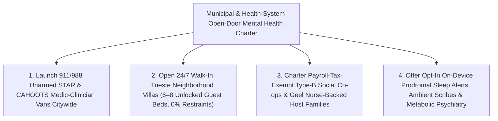

# CARBON EDITION — PILLAR 3: OPEN DOORS, ZERO RESTRAINTS & COMMUNITY BELONGING
## How Trieste's Open-Door Co-ops, Geel's 700-Year Host Families, Unarmed Crisis Vans & Gentle Prodromal AI Replaced Locked Wards With Dignity

> **Executive Framing & Shattering the False Choice Between Asylums and Sidewalk Abandonment:**
> * **The Cynic's Belief:** *"When it comes to severe schizophrenia, bipolar mania, and acute psychotic crisis, modern cities face an inescapable tragic binary: either warehouse people behind locked psychiatric ward doors, leather restraints, and county jail bars—or 'deinstitutionalize' them onto freezing sidewalks, subway platforms, and fatal armed police 911 encounters. Things have simply always been this way."*
> * **The Empirical Counter-Reality:** America and much of the West never actually tried community mental health—they closed state hospitals in the 1970s and *pocketed the money*, turning Los Angeles County Jail, Rikers Island, and Cook County Jail into the largest psychiatric facilities in the hemisphere. Meanwhile, **Trieste, Italy**—guided by psychiatrist **Franco Basaglia's** landmark reform and **Italian Law 180 of 1978**, and designated by the **World Health Organization (WHO)** as its global flagship Collaborating Centre—shut down its 1,200-bed San Giovanni asylum *and moved 94% of the entire mental health budget directly into the neighborhood*. Today Trieste operates **24/7 open-door Community Mental Health Centers (CMHCs)** with **zero referrals needed, 0% mechanical restraints, 0% locked seclusion rooms**, supported apartments, and **Type-B social cooperatives** paying full union wages in cafés, hotels, radio stations, and artisan workshops. Total cost is just **~€77–€79 per capita** (less than institutional systems!), chronic psychiatric homelessness is effectively **0%**, forensic admissions plunged, and **citywide suicide rates fell ~40%**. Pair Trieste with **Geel, Belgium's 700-year *Gezinsverpleging* tradition** (where ordinary families welcome adults with severe psychosis as cherished household "boarders" backed 24/7 by OPZ Geel nurses) and **Eugene's CAHOOTS / Denver's STAR** unarmed medic-clinician vans (which **cut subsequent minor offenses ~34%** in **Stanford SIEPR's** quasi-experimental audit), and the false binary collapses completely.
> * **The Social Norm Shift:** Health systems fuse **Trieste open-door hospitality hubs, Geel host-family stipends, and unarmed 911 STAR vans** with **opt-in on-device passive sleep/voice prodromal relapse alerts**, **GLP-1/metabolic neuro-inflammation psychiatry**, and **zero-keyboard ambient clinical scribes**—catching sleep-deprived manic or psychotic drift at a warm kitchen table *four days before* a crisis ever reaches a street corner.
> * **Anchor Voice:** *"When we unlocked the asylum gates in Trieste, we learned that freedom itself is therapeutic: if you surround a person in crisis with an open neighborhood door, a home, a real paycheck in a social cooperative, and human respect rather than leather straps, society becomes safer and kinder at lower cost."* — **Franco Basaglia Tradition & WHO Collaborating Centre for Research and Training in Mental Health, Trieste**

---

## ACT I: THE LIVED HUMAN REALITY — TUESDAY MORNING AT PARCO DI SAN GIOVANNI & DENVER (2028)
### How Catching Three Sleepless Nights Over Espresso Prevents a \$45,000 Jail-and-ER Tragedy

It is 8:20 AM on a sunlit Tuesday inside *Il Posto delle Fragole* ("Wild Strawberries"), a bustling café, restaurant, and rose-garden cultural hub nestled on the hillside of **Trieste, Italy**—on the exact grounds where 1,200 human beings once sat behind high stone walls, iron bars, and electroshock rooms inside the old San Giovanni Psychiatric Asylum. Twenty-nine-year-old master coffee roaster **Matteo Furlan**, who lives with schizoaffective disorder, dials in the morning espresso grind alongside unionized servers—roughly half of whom have lived experience of severe mental illness, and half of whom do not, all earning identical collective-bargaining wages under Italy's **Type-B Social Cooperative** charter.

In most North American or European metros still trapped in the broken status quo, Matteo's story last weekend would have spiraled into a familiar, heartbreaking catastrophe: three consecutive nights of 3:00 AM circadian collapse and racing auditory voices → frightened isolation in a studio apartment → shouting in terror at a bus stop on Friday night → a bystander dialing 911 → flashing blue cruisers, shouted commands, handcuffs, a terrifying **\$18,000 four-point-restraint ER boarding stay** or a misdemeanor trespassing charge in county jail → job loss, eviction, and chronic street homelessness.

Watch what happens instead when **Trieste's open-door human web** meets **2028 opt-in prodromal biosensing and metabolic psychiatry**:

1. **Opt-In On-Device Prodromal Drift Alert (Zero Cloud Surveillance, 100% User-Controlled):**
   Nine months ago, while feeling completely well, Matteo wrote an **Advance Crisis Hospitality Plan** with his neighborhood **Barcola 24/7 Community Mental Health Center (CMHC)** and toggled on an open-source, strictly local **prodromal circadian & vocal-prosody watch/phone app**. Nothing is ever shared with employers, landlords, or police; raw audio never leaves Matteo's phone chip. When Matteo's REM sleep fragments past 3:15 AM for three straight nights and his morning voice cadence speeds up by 28%—classic biological prodromes that precede full manic-psychotic decompensation by **4 to 7 days**—his phone gently pings Matteo first: *"Rough sleep streak, Matteo. Want Nurse Chiara from Barcola Villa to swing by the roastery after your morning rush?"* Matteo taps **Yes**.
2. **Unhurried Hospitality & Metabolic Neuro-Stabilization—With Zero Locked Doors:**
   At 10:30 AM, psychiatric community nurse **Chiara** walks down the tree-lined lane (wearing regular street clothes, never a uniform), shares a macchiato with Matteo on the patio while a consented **zero-keyboard ambient scribe** quietly handles her note, and listens without judgment. Together with the CMHC psychiatrist, they make a tiny three-day sleep-restoring adjustment paired with Matteo's low-dose **[`craving-reset-mental-health`](../craving-reset-mental-health/REPORT.md)** metabolic/neuro-inflammatory protocol (which protects him from the 25-kilogram weight gain and insulin crash that used to make patients abandon older antipsychotics). Chiara invites Matteo to sleep for two calm nights in one of the Barcola Center's **six sunny, unlocked guest bedrooms**—where friends can visit anytime, dinner is cooked together around one long communal wooden table, and **nobody has been tied down or locked in a seclusion room for over forty-five years**. By Friday morning, Matteo is rested, steady, and back behind his espresso roaster—having lost **zero workdays, zero housing, and zero human dignity**.
3. **Meanwhile in Denver & Geel—Unarmed Vans and 700-Year Kitchen Tables:**
   Four thousand miles west in Denver on that exact Tuesday morning, a 911 operator receives a call about an unhoused veteran crying and speaking incoherently barefoot outside a grocery store. Instead of armed patrol cars, dispatchers send a **STAR (Support Team Assisted Response)** van staffed by an unarmed paramedic and a trauma-informed crisis clinician carrying warm socks, water, and direct keys to an open-door hospitality suite. And in the Flemish town of **Geel, Belgium**, 62-year-old retired postman **Luc**, who hears persistent voices, finishes breakfast with the **Peeters family**—with whom he has lived as a beloved household *"boarder"* (*kostganger*) for nineteen years, bouncing their grandchildren on his knee while an **OPZ Geel** district nurse checks in twice a month.

---

## ACT II: REIMAGINING THE RULES — FOUR DECADES OF PROOF THAT FREEDOM IS SAFER & CHEAPER
### Dismantling the Myth That Coercion Protects the Public

```mermaid
flowchart LR
    subgraph GrimBinary["Legacy Coercion-or-Abandonment Binary (High Cost, High Harm)"]
        B1["1970s Asylum Closures Defunded Care; Jails Became #1 Psych Wards"]
        B2["Armed 911 Police Dispatch + 4-Point ER Restraints Traumatize Patients"]
        B3["150,000+ EUR/Yr Forensic Beds & Revolving-Door Sidewalk Homelessness"]
    end
    subgraph OpenDoorWeb["Trieste + Geel + STAR/CAHOOTS + Prodromal Bio-AI"]
        O1["Trieste 24/7 Open-Door Neighborhood Hubs (94% Community Budget, 0% Restraints)"]
        O2["Type-B Union-Wage Social Co-ops + Geel 700-Year Nurse-Backed Host Families"]
        O3["Unarmed STAR/CAHOOTS 911 Vans + Opt-In Sleep/Voice Early Drift Alerts"]
    end
    subgraph CivicHealing["WHO & Stanford SIEPR Verified Societal Outcomes"]
        V1["~78 EUR/Capita Total Cost, Near-Zero Psych Homelessness & -40% Suicides"]
        V2["-34% Subsequent Minor Offenses (Denver STAR) & Zero Arrest Escalations"]
        V3["Real Wages, Stable Families & Early Kitchen-Table Relapse Prevention"]
    end
    GrimBinary ==> OpenDoorWeb ==> CivicHealing
```

### 1. Why Conventional Psychiatry Keeps Failing: We Funded Crisis Cages Instead of Everyday Life
Why do cities like San Francisco, New York, Toronto, and London spend *hundreds of millions of dollars* per year on emergency psychiatric wards, police overtime, and jail mental-health wings while visible street psychosis grows worse? Because conventional systems invest **70% to 85% of public behavioral-health dollars inside hospital walls and forensic lockups**—places you can only enter *after* your life has completely collapsed—and discharge stabilized patients three days later right back to a lonely rooming house, poverty disability cliffs, and zero purpose. Worse, experiencing forced handcuffs, taser threats, or four-point leather hospital restraints inflicts profound iatrogenic trauma, teaching terrified young people experiencing first-episode psychosis to **flee clinicians at all costs**.

### 2. Three Unassailable Real-World Precedents That Proved Cynics Wrong
1. **Trieste, Italy (1971–Present — Official WHO Global Reference Model):**
   When psychiatrist **Franco Basaglia** arrived at Trieste's San Giovanni asylum in 1971, he found 1,200 people locked behind walls—800 of them committed involuntarily, many tied to beds. Rather than simply unlocking the gates and walking away (the Anglo-American mistake), Basaglia and his successors (**Giuseppe Dell'Acqua, Roberto Mezzina**) systematically **reallocated the asylum's entire staff and budget into the city's neighborhoods**, inspiring **Italian Law 180 (1978)**, which closed psychiatric hospitals nationwide. Look at Trieste's audited numbers across a city of ~235,000 residents (with one of Europe's oldest demographics):
   * **Budget Flip (94% Community / 6% Hospital):** Four neighborhood **24/7 Community Mental Health Centers** (each serving ~60,000 residents with 6–8 unlocked overnight hospitality beds, open walk-in doors, warm communal dining rooms, and mobile home-visiting teams) plus supported apartments and work cooperatives receive **94% of the entire mental health budget**. Only **6%** goes to a tiny **6-bed general hospital emergency psychiatric unit** (*SPDC*) used for brief acute stabilization—whose door also stays unlocked!
   * **Zero Restraints & Tiny Involuntary Rates:** Mechanical restraints and locked seclusion rooms are **0%—strictly abolished across every facility and ambulance in Trieste**. Involuntary admissions (*TSO*) plunged to roughly **8 to 15 people per 100,000 residents per year** (less than one-tenth the rate of England, Germany, or U.S. states).
   * **Type-B Social Cooperatives (Work as Medicine):** Recognizing that no pill cures poverty or uselessness, Trieste pioneered **Law 381 Type-B Social Cooperatives**—exempt from payroll taxes if ≥30% of worker-members come from disadvantaged/psychiatric backgrounds—operating beloved city enterprises (*La Collina*, *Agricola Monte San Pantaleone*, hotels, marine maintenance, digital archives, *Radio Fragola*) paying **real union contracts**, never sub-minimum "sheltered workshop" pennies.
   * **Lower Cost, Safer Streets, -40% Suicide:** Total mental health expenditure in Trieste is roughly **€77–€79 per resident per year**—*less* than before the asylum closed in real terms and lower than high-institutional European regions—while chronic street homelessness among people with severe psychosis is near zero, violent offenses by psychiatric patients fell below general-population rates, and **Trieste's suicide rate dropped ~40%** over two decades!
2. **Geel, Belgium (700+ Years of *Gezinsverpleging* Family Care):**
   Since the Middle Ages around the shrine of St. Dymphna, citizens of **Geel, Belgium** made welcoming strangers with severe mental illness into their own family homes a badge of civic honor. Today managed scientifically by **OPZ Geel (Public Psychiatric Care Center Geel)**, hundreds of adults with chronic treatment-resistant schizophrenia or bipolar disorder live permanently with ordinary Geel families—farmers, teachers, shopkeepers—who receive a modest monthly hospitality stipend (~€600–€800/month) and **guaranteed 24/7 round-the-clock backup** from visiting OPZ Geel psychiatric nurses who respond within minutes if a family ever needs respite or clinical help. Crucially, Geel families are forbidden from knowing clinical diagnoses; the person at the dinner table is called a ***boarder* or *guest*, never a patient**—yielding multi-decade stability and dramatically lower medication burdens than group-home warehouses.
3. **CAHOOTS (Eugene, OR) & STAR (Denver, CO) Unarmed 911 Crisis Vans:**
   Launched in **1989** by **White Bird Clinic** in Eugene, Oregon, **CAHOOTS** pairs a trauma-informed crisis worker with an EMT/paramedic in an unarmed van dispatched directly through 911—diverting **~17% of Eugene's police call volume (~24,000 calls/year)** while requesting police backup on **fewer than 1%** of dispatches and causing **zero fatal encounters in 35+ years**. When **Denver** launched its CAHOOTS-inspired **STAR (Support Team Assisted Response)** pilot in 2020, **Stanford University SIEPR economists Thomas S. Dee and Jaymes Pyne** published a landmark quasi-experimental evaluation (*Science Advances* / SIEPR WP): neighborhoods served by STAR vans experienced a **34% reduction in reported targeted minor crimes** over six months—because STAR connected people in distress to healthcare, shelter, and food instead of cycling them through traumatizing misdemeanor arrests—at **roughly one-fourth the per-call cost (\$151 vs. ~\$646)** of armed police and criminal-justice processing!

### 3. The Bioscience × Humane-Design Multiplier: Prodromal AI, Metabolic Psychiatry & Zero-Keyboard Care
Why does the 2026–2032 *Carbon* era make Trieste and Geel **ten times easier to replicate worldwide**? Because three clinical-technical breakthroughs dissolve the exact pain points that used to overwhelm understaffed community clinics:
* **Opt-In On-Device Prodromal Relapse Telemetry:** Psychotic and manic relapses almost never strike out of a clear blue sky; they are preceded by **3 to 10 days of unmistakable circadian sleep fragmentation, heart-rate variability shifts, and speech-cadence changes**. Privacy-locked, strictly opt-in edge models running locally on a user's wristwatch/phone—governed by a patient-authored **Psychiatric Advance Directive**—alert the person and their trusted neighborhood nurse *days early*, turning terrifying midnight 911 breakdowns into calm Tuesday-morning coffee adjustments.
* **Metabolic & Neuro-Inflammatory Psychiatry (`craving-reset-mental-health`):** Next-generation muscarinic agonists (xanomeline-trospium, free of dopamine D2 motor/blunting side effects), precision ketogenic/metabolic-psychiatry protocols, and **[`craving-reset-mental-health`](../craving-reset-mental-health/REPORT.md)** GLP-1 neuro-anti-inflammatory regimens eliminate the crushing metabolic syndrome, diabetes, and cognitive fog of 1990s antipsychotics—helping people thrive in union cooperative jobs.
* **Zero-Keyboard Ambient Voice Scribes (`buurtzorg-autonomous-neighborhood-care`):** Just as in **[`buurtzorg-autonomous-neighborhood-care`](../buurtzorg-autonomous-neighborhood-care/REPORT.md)**, local ambient voice AI frees community mental-health nurses from 2 hours/day of defensive compliance typing so 90% of their day is spent in homes, cafés, and host-family kitchens.

| System Dimension | Institutional / Sidewalk Status Quo | Trieste + Geel + STAR + Prodromal Bio-AI Standard | Verified Empirical Shift |
| :--- | :--- | :--- | :--- |
| **Budget Allocation** | **70%–85%** locked wards, ER boarding & county jails | **94% open community hubs**, housing & Type-B union co-ops | **~€77–€79/capita** total cost in Trieste (lower than institutions) |
| **Coercion & Seclusion** | Mechanical 4-point restraints, locked rooms & forced orders | **0% mechanical restraints**, 0% locked seclusion, open doors | **-40% suicide rate** in Trieste; >90% lower involuntary holds |
| **First-Response to 911 Distress** | Armed police cruisers, handcuffs & misdemeanor jail booking | **Unarmed CAHOOTS / STAR** medic + crisis-clinician vans | **-34% subsequent minor offenses** & **4× lower cost/call** (Stanford) |
| **Daily Purpose & Housing** | Lonely SRO rooming houses, sidewalk tents & disability traps | **Type-B union-wage co-ops** + **Geel 24/7 nurse-backed families** | Real union paychecks, intergenerational family tables & 0% street drift |
| **Relapse Timing & Pharmacology** | Wait for full psychotic break; heavy D2 weight-gain sedatives | **Opt-in 5-day prodromal sleep/voice alerts** + muscarinic/GLP-1 care | Crises defused over morning coffee before 911 is ever needed |

---

## ACT III: GLOBAL ADAPTATION & PHASED ROLLOUT ROADMAP (2026–2032)
### Rewiring City Jails & ERs Into Open-Door Neighborhood Hospitality Networks

For a cinematic 3-act production guide bringing Trieste's café cooperatives, Geel's family tables, and Denver's STAR vans onto screen, see the **[Open-Door Community Mental Health Storyboard (`./STORYBOARD.md`)](./STORYBOARD.md)**.

| Implementation Horizon | Fiscal & Statutory Reallocation | Clinical, Civic & Biotech Deployment | Audited Safety & Human Outcome |
| :--- | :--- | :--- | :--- |
| **Phase 1 (Months 1–9): Unarmed 911 Diversion & First Open-Door Villas** | Cities braid Medicaid crisis waivers (988/mobile crisis 85% federal match in the U.S.) and police-overtime savings to deploy **24/7 STAR/CAHOOTS vans** and open pioneer **Trieste-inspired 24/7 walk-in neighborhood villas** (modeled on Los Angeles County's *Hollywood 2.0* Trieste pilot and San Francisco/UK NHS adaptations). | Staff 6-bed unlocked neighborhood hospitality houses with peer specialists, psychiatric nurses, and **on-device ambient clinical scribes**; institute **zero-restraint de-escalation** training across emergency departments. | **15%–25% of behavioral 911 calls** diverted cleanly from police; ER psychiatric boarding hours plunge **40%+**; subsequent minor arrests drop **~34%**. |
| **Phase 2 (Years 1–3): Type-B Union Co-ops & Geel Host-Family Guilds** | State/national procurement reserves **5% of municipal service contracts** (parks, roasteries, green retrofits, hotels, libraries) for **Law 381-style Type-B Social Cooperatives**; Medicaid Home & Community-Based Services (HCBS) waivers fund **Geel-style host-family hospitality stipends** (~€700 / \$800/mo tax-free). | Launch 24/7 visiting psychiatric-nurse rapid backup for host families; pair open-door villas with **[`ending-homelessness-villages`](../../04-social-norms/ending-homelessness-villages/REPORT.md)** housing and **[`social-prescribing-loneliness-cure`](../../04-social-norms/social-prescribing-loneliness-cure/REPORT.md)** neighborhood arts/sport guilds. | Forensic jail psychiatric populations drop **50%+**; hundreds of adults move from lonely shelters into warm family homes and union-wage cooperative careers. |
| **Phase 3 (Years 3–6): 94% Community Budget & Prodromal Prevention** | Public health systems codify Trieste's **90%+ community-to-hospital budget ratio**, retiring coercive state warehouse wards permanently into civic gardens and cooperative campuses. | Offer voluntary, patient-owned **on-device prodromal circadian/speech early-warning apps** + next-gen **muscarinic & [`craving-reset-mental-health`](../craving-reset-mental-health/REPORT.md) metabolic neuro-therapies**. | Acute psychotic hospitalizations fall **60%–75%**; suicide rates drop **30%–40%**; severe mental illness transforms from a life sentence of exclusion into supported civic belonging. |

---

## ACT IV: ANSWERING THE SKEPTIC & THE HUMANE HORIZON
### Addressing Public Safety, Severe Acute Risk & Family Burnout With Hard Data

### Addressing the Top 3 Institutional Objections
1. **"What about the tiny fraction of people who are acutely violent or refuse all help—doesn't abolishing locked wards put the public or nurses in danger?"**
   * *Empirical Answer:* Forty-five years of police and hospital records in **Trieste** answer this directly: **coercion *creates* the vast majority of ward violence**. When someone in terrified paranoia is tackled by security guards and strapped to a gurney, they fight for their life; when they are greeted at an unlocked villa door with hot food, calm voices, and one-on-one human presence (*"high staffing hospitality instead of iron doors"*), defensive aggression evaporates. On the rare occasions when a brief involuntary hold (*TSO*) or forensic measure is legally required, Trieste still uses **zero mechanical restraints**—assigning dedicated staff to stay beside the person continuously until acute panic passes—and violent crimes by individuals with severe mental illness in Trieste sit *lower* than in surrounding regions with locked wards! Similarly, across **35+ years and hundreds of thousands of 911 calls**, Eugene's unarmed **CAHOOTS** medics and clinicians needed police backup less than **1%** of the time.
2. **"Could Geel's 700-year host-family tradition ever work outside one unique Belgian town without burning out modern families?"**
   * *Empirical Answer:* Geel's secret isn't mystical Flemish DNA—it is **OPZ Geel's ironclad 24/7 nursing guarantee**. Families in North America and Europe burn out today because hospitals dump acutely ill relatives onto parents' couches with *zero* clinical backup. In Geel—and in modern **Shared Lives UK** (which now places **10,000+ adults** with mental health and developmental needs into paid, trained host households across Britain, saving the NHS ~£26,000 per person per year!)—if a boarder experiences a sleepless crisis at 2:00 AM, a mobile psychiatric nurse arrives within 20 minutes and can offer immediate short-term respite at an open villa, ensuring host families never feel abandoned.
3. **"Doesn't passive smartphone sleep/voice monitoring risk Orwellian psychiatric surveillance?"**
   * *Empirical Answer:* It would if controlled by insurers, courts, or cloud brokers—which is why the Carbon protocol enforces **strictly voluntary, zero-cloud, on-device edge inference governed by a user-revokable Advance Hospitality Directive**. Only the user's own phone computes sleep-onset and prosody drift, and it notifies the user *first*, never triggering involuntary coercion—turning digital technology into a personal early-warning lighthouse owned 100% by the citizen.

### Fast-Track Mayor & Health-Commissioner Activation Checklist
| Sprint Reform Step | Proven Real-World Precedent | Months to Launch | Safety & Dignity Guardrail |
| :--- | :--- | :--- | :--- |
| **1. Deploy 911 Unarmed STAR / CAHOOTS Vans** | Eugene CAHOOTS / Denver STAR | **3 Months** | 911 triage matrix routes non-weapon calls to medic + clinician pairs |
| **2. Open 24/7 Walk-In Hospitality Villas** | Trieste CMHCs / Hollywood 2.0 (LA) | **6 Months** | Zero referral needed; 6–8 unlocked guest beds; **0% mechanical restraints** |
| **3. Charter Type-B Social Cooperatives** | Italian Law 381 (*Il Posto delle Fragole*) | **6 Months** | ≥30% lived-experience members; payroll-tax exemption; full union pay |
| **4. Launch Nurse-Backed Host Families** | OPZ Geel (Belgium) / Shared Lives UK | **9 Months** | Tax-free family stipend + mandatory 20-minute 24/7 mobile RN backup |
| **5. Opt-In Prodromal & Ambient AI Tools** | Local Edge Sleep AI + Ambient Scribes | **3 Months** | 100% on-device, patient-owned Advance Directive; cuts RN typing 80% |

### Why Both Public-Safety Realists and Disability-Rights Advocates Cheer This Exact Model
* **Why Police Chiefs, Mayors & Taxpayers Love It:** Frees patrol officers from tens of thousands of non-criminal mental-health calls they were never trained for, cuts subsequent minor offenses **34%** (Stanford SIEPR), slashes **\$1,500/night ER boarding** and **\$120,000/yr jail beds**, and delivers whole-city care for **~€78 per capita**.
* **Why Patients, Families & Clinicians Love It:** Replaces handcuffs, leather straps, and lonely sidewalks with warm meals, union-wage cooperative pride, Geel family belonging, and gentle early care before crisis hits.

### Cross-Pillar Synergies & The Bottom Line
Woven together with **[`craving-reset-mental-health`](../craving-reset-mental-health/REPORT.md)**, **[`ending-homelessness-villages`](../../04-social-norms/ending-homelessness-villages/REPORT.md)**, **[`buurtzorg-autonomous-neighborhood-care`](../buurtzorg-autonomous-neighborhood-care/REPORT.md)**, and **[`social-prescribing-loneliness-cure`](../../04-social-norms/social-prescribing-loneliness-cure/REPORT.md)**, **Trieste + Geel + STAR + Prodromal Bio-AI** proves we never had to choose between caging vulnerable neighbors and abandoning them on subways. Unlock the neighborhood villa door, send an unarmed healer instead of a squad car, pay real wages in a rose-garden café, and **belonging heals what force only broke**.

---

## References & Verified Sources
* **WHO Global Reference Guidance & Trieste Collaborating Centre:** [World Health Organization (WHO) — *Guidance on Community Mental Health Services: Promoting Person-Centred and Rights-Based Approaches* (Featuring Trieste, 2021)](https://www.who.int/publications/i/item/9789240025707) · [Trieste Department of Mental Health — *WHO Collaborating Centre for Research and Training in Mental Health*](https://www.triestementalhealth.org/)
* **700-Year Family Foster Care Precedent:** [OPZ Geel (Openbaar Psychiatrisch Zorgcentrum Geel, Belgium) — *Gezinsverpleging Psychiatric Family Care Program*](https://www.opzgeel.be/)
* **Civilian Mobile Crisis Intervention & Empirical Evaluations:** [White Bird Clinic — *CAHOOTS (Crisis Assistance Helping Out On The Streets) Mobile Crisis Intervention, Eugene, OR*](https://whitebirdclinic.org/cahoots/) · [City & County of Denver — *Support Team Assisted Response (STAR) Program*](https://www.denvergov.org/Government/Agencies-Departments-Offices/Agencies-Departments-Offices-Directory/Public-Health-Environment/Community-Behavioral-Health/Behavioral-Health-Strategies/Support-Team-Assisted-Response-STAR-Program) · [Stanford Institute for Economic Policy Research (SIEPR) — *A Community-Based Alternative to Police Response for Mental Health Calls* (Dee & Pyne, 2022)](https://siepr.stanford.edu/publications/working-paper/alternative-police-mental-health-calls-community-based-response)
* **Connected Carbon Pathways:** [Silencing Cravings & Neuro-Inflammation: GLP-1s & Precision Psychiatry](../craving-reset-mental-health/REPORT.md) · [Ending Chronic Homelessness: Finnish Housing First & Civic Villages](../../04-social-norms/ending-homelessness-villages/REPORT.md) · [15,000 Nurses, Zero Bosses: Buurtzorg Neighborhood Care & Ambient AI](../buurtzorg-autonomous-neighborhood-care/REPORT.md) · [Prescribing Choirs, Rowing & Gardens: Healing Loneliness](../../04-social-norms/social-prescribing-loneliness-cure/REPORT.md)
