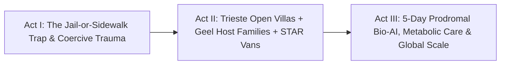

# STORYBOARD & CREATIVE PRODUCTION GUIDE: OPEN-DOOR COMMUNITY MENTAL HEALTH ([`trieste-geel-community-mental-health`](./REPORT.md))
## *"Freedom Is Therapeutic — How Trieste's Rose-Garden Co-ops, Geel's 700-Year Families & Unarmed Crisis Vans Replaced Locked Wards With Belonging"*

> **Production Purpose:** This deeply empathetic documentary storyboard equips filmmakers, mayors, police chiefs, psychiatrists, and families to shatter the cruel lie that cities must choose between locked psychiatric jails and sidewalk abandonment—showing how **Trieste's 24/7 open-door hubs (0% restraints, -40% suicides)**, **Geel's 700-year host families**, **Denver STAR / Eugene CAHOOTS unarmed vans**, and **opt-in prodromal sleep AI** heal crises at lower cost.

---

## PART 1: THREE ALTERNATIVE NARRATIVE OPENINGS (DIRECTOR'S OPTIONS)

### Option A: "The Asylum That Became a Rose Garden & Union Café" *(Poetic Historical Reveal)*
* **Visual Hook:** Black-and-white 1971 archival photographs of rusted iron gates and locked wards at **Trieste's San Giovanni Asylum** dissolve in a single sweeping camera match-cut into vibrant sunlit morning life on the *exact same hillside* today: **5,000 blooming roses**, university students laughing beside **Matteo Furlan** pulling espresso shots at *Il Posto delle Fragole* Type-B cooperative café, and a brass plaque reading **`FREEDOM IS THERAPEUTIC — 0% RESTRAINTS SINCE 1978`**.
* **Voiceover Core:** *"Fifty years ago, twelve hundred people were locked behind bars on this hillside in Trieste, Italy. Then one psychiatrist tore down the walls, moved ninety-four percent of the budget into open neighborhood villas and union cafés—and watched homelessness vanish and suicides drop forty percent."*
* **Best For:** Feature documentaries, general audiences, and international health summits.

### Option B: "Two 911 Dispatches at Dusk: Flashing Cruisers vs. The Warm STAR Van" *(Urban Safety Contrast)*
* **Visual Hook:** Split-screen at 8:45 PM outside two identical grocery stores. Left (`Legacy 911 Escalation`): Three sirens wail, blinding spotlights hit a terrified young man in auditory psychosis, leading to handcuffs, ER leather straps, and a **\$18,000 bill**. Right (`Denver STAR / Eugene CAHOOTS`): A quiet white van pulls up with hazard lights off; an unarmed paramedic and clinician kneel at eye level offering a warm fleece jacket and hot tea—cutting subsequent minor offenses **34%** at one-fourth the cost.
* **Voiceover Core:** *"Sending armed squad cars to a mental-health breakdown hurts patients, exhausts police, and fails taxpayers. When Eugene and Denver sent unarmed medics and clinicians instead, crime dropped thirty-four percent without a single pair of handcuffs."*
* **Best For:** Mayors, city councils, police chiefs, and U.S./Canadian municipal reformers.

### Option C: "Seven Hundred Years at the Dinner Table in Geel, Belgium" *(Timeless Human Wonder)*
* **Visual Hook:** Warm candlelit Flemish kitchen in **Geel, Belgium**: 62-year-old **Luc** helps set porcelain soup bowls with the **Peeters family** and reads a bedtime picture book to their six-year-old granddaughter—part of an unbroken **700-year civic tradition** where people with severe schizophrenia are welcomed not as "patients," but as cherished family *boarders* backed 24/7 by visiting nurses.
* **Voiceover Core:** *"What if the greatest breakthrough in severe mental illness wasn't a locked hospital at all, but a Belgian town that has invited people hearing voices to join ordinary family dinner tables for seven hundred years?"*
* **Best For:** Prestige cultural broadcasting, caregiver networks, and human-rights festivals.

---

## PART 2: MODULAR 3-ACT STORYBOARD TABLE (12 SCENES) & VISUAL FLOW

| Act / Beat | Visual & Camera Concept | Data & Metric Callout Overlay | Sample Narration / Voiceover Script |
| :--- | :--- | :--- | :--- |
| **ACT I — Beat 1:** The False Binary on City Streets | Montage of cold subway grates at dawn juxtaposed with county jail cellblocks—America's three largest de facto psychiatric facilities. | **70%–85% of Funds** Trapped in Crisis Wards, ERs & County Jails | "We were told cities only have two grim choices: abandon sick neighbors to freezing sidewalks, or lock them inside wards and county jails." |
| **ACT I — Beat 2:** The Trauma of Four-Point Straps | Subjective blurred POV on a hospital gurney under harsh fluorescent lights as leather wrist cuffs tighten; heart-monitor alarm spikes to 145 BPM. | **Coercive ER Boarding:** **\$1,500+/Night** \| Drives Care Avoidance | "When crisis care feels like an ambush with handcuffs and leather straps, terrified young people run *away* from doctors until tragedy strikes." |
| **ACT I — Beat 3:** Franco Basaglia Unlocks San Giovanni | 1970s Trieste archival footage: **Franco Basaglia** and citizens parade a giant blue papier-mâché horse (*Marco Cavallo*) out through the smashed asylum gate. | **1978 Italian Law 180:** 1,200-Bed Asylum Closed; Budget Kept in Community | "In Trieste, Franco Basaglia proved deinstitutionalization only failed elsewhere because governments stole the money instead of funding neighborhoods." |
| **ACT II — Beat 4:** Inside Barcola's 24/7 Open Villa | Steadicam walks straight off a Trieste street through an unlocked garden door into a sunny neighborhood CMHC: zero plexiglass, shared pasta lunch table. | **Trieste WHO Model:** **94% Community Budget** \| **0% Restraints** | "Walk into any of Trieste's four neighborhood centers at two PM or two AM: there is no referral barrier, no plexiglass cage, and zero restraints." |
| **ACT II — Beat 5:** Union Paychecks at *Il Posto delle Fragole* | **Matteo** roasts espresso beans and laughs with co-workers at a bustling hillside Type-B social cooperative paying full Italian union wages. | **Law 381 Type-B Co-ops:** ≥30% Lived-Experience Staff \| **Full Union Pay** | "Because no pill cures loneliness or poverty, Trieste built social cooperatives—cafés, hotels, and workshops paying real union wages, never charity." |
| **ACT II — Beat 6:** Geel's 700-Year Family Table | Intimate golden-hour portrait in **Geel, Belgium**: **Luc** gardens alongside his host family while an **OPZ Geel** nurse waves warmly from her bicycle. | **OPZ Geel (*Gezinsverpleging*):** **700+ Years** \| 24/7 Nurse Backup | "And in Geel, Belgium, ordinary families have welcomed boarders with schizophrenia for seven centuries—knowing a nurse is twenty minutes away 24/7." |
| **ACT II — Beat 7:** Eugene CAHOOTS & Denver STAR Vans | Nighttime ride-along inside a **Denver STAR** van: medic checks vitals while a crisis clinician reconnects an unhoused veteran with a warm unlocked guest bed. | **Stanford SIEPR Audit:** **-34% Minor Offenses** \| **4× Cheaper** Than Police | "In Eugene and Denver, unarmed medic-clinician vans answer thousands of 911 calls—cutting subsequent minor crimes thirty-four percent at a quarter the cost." |
| **ACT III — Beat 8:** Opt-In 5-Day Prodromal Sleep Alert | Close-up on Matteo's wristwatch at 8:00 AM: a private on-device sleep/prosody tracker gently asks if he wants Nurse Chiara to stop by for morning coffee. | **On-Device Prodromal AI:** Spots Drift **4–7 Days Before Crisis** (Zero Cloud) | "Now add 2028 bioscience: an opt-in, strictly private watch spots three nights of manic sleep drift—inviting Matteo's nurse over *days before* a crisis." |
| **ACT III — Beat 9:** Metabolic Psychiatry & Ambient Scribe | Chiara and Matteo chat on the café patio; an ambient lapel scribe files her note silently while metabolic care prevents old antipsychotic side effects. | **Muscarinic + GLP-1 Neuro-Care** + **Zero-Keyboard** Ambient Scribe | "New metabolic and muscarinic medicines protect Matteo's body and clarity, while ambient voice AI keeps laptops out of human conversation." |
| **ACT III — Beat 10:** Opening the Fiscal Ledger | Crisp animated ledger comparing **\$150,000/yr forensic beds** against **Trieste's ~€78 per-capita** citywide ecosystem and **-40% suicide drop**. | **~€78/Capita Total Cost** \| **Near-0% Psych Homelessness** \| **-40% Suicides** | "Here is the ultimate shock for budget hawks: Trieste's entire citywide system costs seventy-eight euros per citizen—less than locking people up." |
| **ACT III — Beat 11:** Global Replication From LA to London | Map lighting up **Hollywood 2.0 (Los Angeles)**, **Shared Lives UK (10,000+ host homes)**, **Denver STAR**, and **WHO rights-based city networks**. | **WHO Global Blueprint:** Replicating Across U.S., UK, Europe & Latin America | "From Los Angeles's Trieste-inspired Hollywood pilot to ten thousand Shared Lives host homes across Britain, cities are finally building the open door." |
| **ACT III — Beat 12:** Closing Bookend — Marco Cavallo & Morning Espresso | Sunlit wide shot of Parco di San Giovanni's roses as Matteo hands a cappuccino to a neighbor and steps onto the sunlit piazza—free, rooted, and home. | **Belonging Isn't Soft — It's Safer, Kinder & Cheaper Than Any Cage** | "We never had to choose between locked cages and cold sidewalks. Open the villa door, pay a real wage, set an extra plate—and watch human beings heal." |

---

## PART 3: VISUAL METAPHOR BANK & CINEMATIC SIGNATURES

### 1. "Marco Cavallo & The Dissolving Iron Gate"
* **Visual Concept:** Inspired by Trieste's famous 1973 blue wooden horse built by San Giovanni patients—too tall to fit through the narrow asylum doorway until Basaglia's team literally knocked down the iron lintel—an iron hospital gate melts into rose trellises framing an open café patio.
* **Camera / Animation Cue:** Smooth anamorphic push-through from cold grey interior shadow into warm Adriatic coastal sunlight.
* **Emotional Takeaway:** Anchors abstract policy reform in one of modern medicine's most unforgettable true liberation images.

### 2. "The Extra Porcelain Plate vs. The Plastic Hospital Wristband"
* **Visual Concept:** Match-cut from a barcoded plastic ER restraint wristband being snipped off in a trash bin to a warm porcelain dinner plate being set down beside three others on a Geel family oak table.
* **Camera / Animation Cue:** Tactile 50mm macro lens with warm natural kitchen acoustics.
* **Emotional Takeaway:** Crystallizes OPZ Geel's 700-year rule: *"Guest and boarder—never patient."*

---

## PART 4: SOUND DESIGN, COLOR ARC & MUNICIPAL CRISIS REALLOCATION SIMULATOR

* **Color & Lighting Progression:**
  * *Act I (The Jail-or-Sidewalk Binary):* Harsh strobing red-and-blue cruiser reflections, sterile institutional green-grey fluorescents, wet concrete blues.
  * *Acts II–III (Trieste, Geel & STAR):* Adriatic limestone gold, San Giovanni rose-garden crimsons, warm espresso amber, and cozy Flemish candlelit wood tones.
* **Casting & Documentary Voices:**
  * Feature **Trieste CMHC** nurses and Type-B cooperative worker-owners, **OPZ Geel** host families and boarders, **Eugene CAHOOTS / Denver STAR** medic-clinician pairs, and **Stanford SIEPR** empirical researchers.
* **Musical & Foley Architecture:**
  * Evolves from piercing police sirens, clanking cell doors, and heart-monitor beeps to steaming espresso wands, clinking dinner plates, quiet bicycle tires on Belgian cobbles, and warm cello-and-mandolin ensemble swells.
* **Interactive Documentary Companion ("Rebalance Your City's Behavioral Health & 911 Budget"):**

| City Mental Health Architecture | Budget Split & Coercion | 911 Response & Arrests | Total Cost & Community Outcome |
| :--- | :--- | :--- | :--- |
| **Locked Ward & Jail Status Quo** | **80% institutional** \| Frequent restraints | Armed police cruisers (~**\$646/call**) | High per-capita spend \| Revolving-door street crisis |
| **+ STAR / CAHOOTS + Trieste Villas** | **94% community** \| **0% restraints** | Unarmed medic + clinician (~**\$151/call**) | **~€78/capita** \| **-34% minor offenses** & **-40% suicides** |
| **+ Geel Families + Prodromal AI** | Host-home stipends + 5-day sleep alerts | Crises caught over coffee pre-911 | Union co-op wages, zero street drift & lifelong dignity |

* **Director's Closing Frame On-Screen Text:**
  > *"Force traumatizes at high cost. Open doors, unarmed healers, host families, and real work heal communities for less."*
