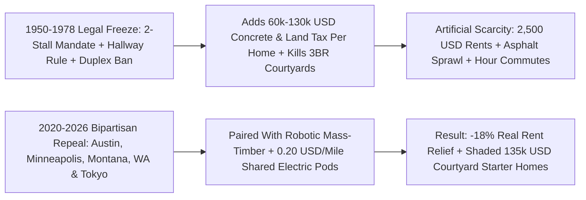
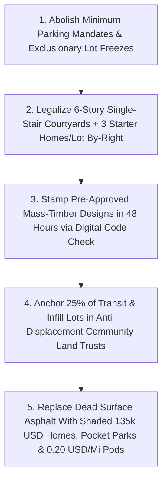

# CARBON EDITION — PILLAR 4: UNFREEZING THE NEIGHBORHOOD COMMONS
## Unfreezing the 1970s Street: How Austin, Minneapolis & the "Montana Miracle" Proved Building Drops Rents 18%

> **Executive Framing & Reimagining Neighborhood Rules:**
> * **The Cynic's Belief:** *"Runaway \$2,500 monthly rents, \$500,000 starter houses, and scorching four-lane asphalt strip malls are just inevitable laws of modern capitalism—things have always worked this way, and building new homes in our town only invites luxury developers who drive neighborhood rents up even faster."*
> * **The Empirical Counter-Reality:** Almost nothing about the expensive, lonely North American suburb or \$2,500 studio apartment is a "natural market outcome." Between **1950 and 1978**, nearly every U.S. city quietly rewrote its municipal code to **legally outlaw** the exact walkable Main Streets, backyard cottages, corner groceries, starter duplexes, and sunlit courtyard buildings our grandparents grew up in—forcing builders to pour **two asphalt or concrete parking stalls per apartment at \$30,000 to \$75,000 per stall** even for non-driving seniors and transit riders! Between 2019 and 2026, a joyful cross-tribal alliance across progressive **Minneapolis**, booming **Austin**, and conservative **Montana** repealed those mandates and legalized starter homes by-right: **Austin rents plunged 14% to 22% in real terms** from peak (~18% median real relief), while **Minneapolis held cumulative six-year rent growth to ~1%** as local wages climbed past 20%.
> * **The Social Norm Shift:** Property-rights conservatives, climate environmentalists, Habitat for Humanity chapters, carpenters, and young parents unite to abolish minimum parking mandates, legalize **6-story single-stair courtyard homes** and **3 starter homes per lot** by-right, and combine flexible Tokyo-style zoning with **robotic mass-timber modules** and **autonomous electric pods**—turning dead asphalt craters into shaded **\$135,000 courtyard neighborhoods**.
> * **Anchor Voice:** *"Minimum parking requirements subsidize cars, punish people who cannot afford cars, drive up the cost of every apartment, and pave over the very neighborhoods people love."* — **Prof. Donald Shoup**, Distinguished Research Professor of Urban Planning, UCLA & Author of *The High Cost of Free Parking*

---

## ACT I: THE LIVED HUMAN REALITY — THE RENEWAL LETTER THAT ACTUALLY WENT DOWN
### From South Austin's Former Asphalt Craters to Kalispell's Backyard Cottages

In October 2025, **Elena Reyes** (29)—a neonatal ICU nurse at Dell Seton Medical Center who plays fiddle on Tuesday nights in South Austin, Texas—opened an email from her property manager with a knot in her stomach. Between 2020 and 2022, Elena had watched her 1-bedroom rent jump from \$1,280 to \$1,890 a month, forcing two of her closest nursing colleagues and half her bandmates to pack U-Hauls for distant exurbs an hour outside town. Friends told her with weary resignation that booming tech cities simply devour working people forever—that once rents go up, they never come down.

Instead, Elena read the letter twice to make sure it wasn't a typo: **if she signed a twelve-month renewal, her rent was dropping by \$310 a month—down to \$1,580, plus six weeks free**. Why were landlords suddenly competing politely for nurses, baristas, and line cooks instead of raising rents 12% a year?

Because between late 2023 and 2026, Austin did something decades of fatalism claimed was impossible: the city **abolished citywide minimum parking mandates**, passed the **HOME Initiative** legalizing up to three starter homes on a single residential lot, reformed arbitrary height setbacks, and permitted roughly **50,000 new apartments**. When tens of thousands of sunlit new homes opened simultaneously, the game of musical chairs flipped overnight—wealthier newcomers stopped bidding up older 1980s garden apartments, evictions slowed sharply, and real inflation-adjusted rents fell **14% to 22% across the metro**.

Even better, watch what happened three blocks from Elena's hospital by **2031**, once Austin's legal reforms intertwined with **Pillar 2** factory automation and **Pillar 4** trust financing:

1. **Turning an 18-Car Baking Asphalt Lot Into Nine Shaded Courtyard Homes:**
   * *Old 1970s Asphalt Trap:* Under Austin's legacy code, a small corner parcel near South Congress was forced to dedicate **62% of its footprint and \$540,000 of concrete** to mandatory car storage—killing any chance of starter homes.
   * *Unfrozen Mass-Timber Reality:* Freed from parking minimums and double-stair hallway rules, a local builder assembled nine **3-bedroom Cross-Laminated Timber (CLT) single-stair courtyard townhomes** fabricated in four weeks at a Texas robotic mill, centered around a heritage live-oak patio, e-bike pavilion, and two curb bays for **\$0.20/mile shared autonomous electric pods** ([`autonomous-ground-mobility`](../../02-automation-science/autonomous-ground-mobility/REPORT.md)).
2. **Buying In at \$168,000 Instead of Renting Forever:**
   * *Permanent Trust Anchor:* Anchored partly in a municipal **[`community-land-trusts-permanence`](../community-land-trusts-permanence/REPORT.md)** ground lease with zero concrete-garage tax, Elena bought her sunlit cross-ventilated home—windows on three sides, zero hotel hallway—for **\$168,000** (\$1,040/month total payment).
   * *Seven-Minute Walk to Work:* Instead of a 55-minute highway commute from an exurb, she walks seven minutes to her NICU shift under mature pecan shade.
3. **1,600 Miles North in Kalispell, Montana — The Exact Same Freedom Across Party Lines:**
   * *Before the Montana Miracle:* For decades, local zoning outlawed **Caleb Miller** (32, a fourth-generation HVAC technician and mass-timber carpenter) from putting a cottage on his own paid-off land for his 67-year-old widowed mother, Ruth, while seniors sat on three-year waitlists.
   * *By-Right Backyard Dignity:* Under Montana's **SB 528** and **SB 323** plus **48-hour pre-approved timber plans** ([`forty-eight-hour-governance`](../forty-eight-hour-governance/REPORT.md)), Caleb paid a flat ministerial fee on Monday, bolted down solar-roofed timber panels in six weeks for **\$84,000**, and gave Ruth grandchildren ten steps from her porch with zero Assisted Living bankruptcy.

---

## ACT II: UNMASKING THE 1950–1978 ILLUSION — HOW WE ACCIDENTALLY OUTLAWED AFFORDABILITY
### Three Bureaucratic Bugs Mistaken for "Human Nature"

Ask ten frustrated citizens why American towns look like seas of scorching asphalt surrounding unaffordable houses, and nine will blame either "greedy markets" or "human selfishness." Urban historians and UCLA economist **Prof. Donald Shoup** uncovered a far more hopeful truth: **we didn't lose affordable neighborhoods to physics or human nature—we outlawed them on paper during a thirty-year regulatory experiment between 1950 and 1978, and forgot we wrote the rules.**

Look at the three hidden legal mandates that froze almost every North American town in amber:

* **1. The Pseudoscience of Mandatory Parking Minimums (\$30,000–\$75,000 Per Stall):**
  Before 1947, almost no city on Earth forced builders to construct predetermined ratios of private car storage. In the 1950s and 1960s, municipal planners began copying tiny, statistically junk samples from suburban strip malls (*ITE Parking Generation* manuals—sometimes based on four suburban sites on a Saturday afternoon!) into binding criminal city codes: *"Every 1-bedroom apartment must build 1.5 to 2.0 off-street stalls; every restaurant must pave 10 stalls per 1,000 square feet."*
  Because a single structured garage stall costs **\$30,000 above ground and \$50,000 to \$75,000 underground**, a two-stall mandate silently tacks **\$60,000 to \$130,000 of concrete** onto the price of a modest apartment—forcing working renters who ride buses, walk, or share one family car to pay **\$250 to \$450 extra every month** for concrete boxes they never asked for!
* **2. The North American Single-Stair ("Point-Access Block") Ban:**
  Have you ever wondered why apartments in Paris, Vienna, Barcelona, Amsterdam, and Tokyo feel like sunny, quiet 3-bedroom family homes wrapped around leafy courtyards, whereas modern U.S. apartment buildings look like full-block cruise ships with dark hotel corridors?
  Legacy U.S. building codes required **two separate stairwells connected by a long central hallway** above three stories—a rule written before modern fire sprinklers, non-combustible mass timber, and pressurized stair shafts existed. That hallway swallows **25% to 32% of the floorplate**, blocks cross-breeze windows, requires assembling six lots into corporate megablocks, and makes 3-bedroom family apartments unprofitable compared to windowless studio boxes!
* **3. Exclusionary Single-Family Downzoning (1960s–1978):**
  From Boston and San Francisco to Bozeman and Charlotte, 1970s downzoning waves locked **75% to 85% of residential land** against starter duplexes, triplexes, corner bakeries, and backyard cottages—creating an artificial land cartel where every nurse, teacher, and retiree had to bid against millionaire households for the exact same scarce 6,000-square-foot lots.

---

## ACT III: WHAT ALREADY BROKE THROUGH ACROSS LEFT & RIGHT (2019–2026 RECEIPTS)
### Cross-Tribal Proof That Supply & Liberation Drop Rents in the Real World

The most energizing civic story of the 2020s is that unfreezing neighborhood housing isn't "left-wing" or "right-wing"—it is winning supermajorities in America's bluest cities and reddest legislatures alike because **every parent wants their twenty-something kids and local nurses to afford a home near family**:

| Jurisdiction & Political Coalition | Concrete Legal Reforms Enacted | Verified Empirical Housing & Rent Outcome |
| :--- | :--- | :--- |
| **Austin, Texas (2023–2026)** — *City Council + Urbanists + Labor + Pro-Homes Advocates* | Repealed **100% of citywide minimum parking mandates** (Nov 2023); enacted **HOME Initiative Phases 1 & 2** cutting minimum lots to 1,800 sq ft and legalizing **3 starter homes per lot**; permitted ~50,000 homes. | **Verified -14% to -22% real rent drop** from peak (~18% median real relief across Zillow/Apartment List); musicians and hospital staff regained bargaining power; builders pivoted garage budgets into bedrooms and shade trees. |
| **Minneapolis, Minnesota (2019–2026)** — *Minneapolis 2040 Plan + Neighbors for More Neighbors* | Ended exclusive single-family zoning citywide; **abolished all off-street parking minimums** (2021); legalized 3-to-6-story apartments by-right along transit and commercial corridors. | **Pew Charitable Trusts Audit:** Cumulative Minneapolis rent grew just **~1% between 2017 and 2023** (vs. **+31% U.S. average** and +14% rest of Minnesota!) while local median household wages rose **>20%** and chronic homelessness fell **12%**. |
| **State of Montana (2023–2025)** — *"The Montana Miracle": GOP Gov. Greg Gianforte + Frontier Institute + Greens + Habitat for Humanity* | Passed **SB 323** (duplexes by-right in cities), **SB 528** (backyard ADUs by-right without parking traps), **SB 382** (upfront planning replacing parcel-by-parcel environmental veto suits with ministerial permits), plus commercial-to-home conversions. | Bridged freedom conservatives ("property rights on my own land!") and conservationists ("save ranchland & trout rivers from sprawl!"); unlocked thousands of starter homes and backyard cottages across Bozeman, Kalispell, Billings, and Missoula. |
| **Washington, California, Colorado & Spokane** — *Bipartisan Pacific & Mountain Wave* | **Spokane** legalized fourplexes citywide (*Building Opportunity and Choices for All*); **Washington** passed **HB 1110** (4-to-6 plexes) + landmark **SB 5491** (**6-story single-stair courtyards**); **California** permitted **25,000+ ADUs/yr** + **AB 2097**; **Colorado** repealed metro parking mandates. | Proved middle-housing and single-stair reforms work seamlessly from inland Spokane to coastal metros—cutting family-sized 3-bedroom construction costs **18% to 28%** per square foot. |
| **Tokyo, Japan (National 12-Zone Standard)** — *Multi-Decade National Benchmark* | Zoning set nationally across 12 simple nuisance tiers; **zero municipal minimum parking mandates** for small/mid buildings; ministerial by-right permitting with zero neighbor-veto hearings. | Greater Tokyo (37 million residents) builds **140,000+ homes/year**—more than California and New York State combined—keeping clean, transit-adjacent starter studios around **\$650–\$800/month** for twenty-five straight years! |

---

## ACT IV: WHEN CIVIC LIBERATION MEETS ROBOTIC TIMBER & SHARED PODS (2026–2035)
### How Technical Abundance & Humane Street Rules Multiply Each Other

Notice why neither technology alone nor zoning reform alone finishes the job—and why **intertwining them creates an urban renaissance**:

### How Clean Energy, Robotics & Shared Mobility Multiply Street Liberation

* **Sub-Penny Clean Power Drops Timber Milling & Home Heating Near Zero:**
  * Solar-powered regional timber kilns (`01-abundant-energy`) dry and press Cross-Laminated Timber panels with zero fossil natural gas, while rooftop perovskite solar tiles and heat pumps keep Elena's and Ruth's monthly electric and heating bills under **\$18/month**.
* **Why Factory Robotics Needed Legal Unfreezing First:**
  * Modular housing startups struggled for decades not because robots couldn't mill wood accurately, but because **18,000 fragmented town codes** demanded bespoke underground garages, weird setback notches, and two-year hearings on every lot—destroying factory batch economics!
  * Once Montana, Washington, Austin, and Minneapolis standardize **by-right single-stair mass-timber envelopes with zero parking minimums**, robotic mills ([`abundant-beautiful-housing`](../abundant-beautiful-housing/REPORT.md)) run 24/7 turning sustainable timber into **\$135,000 sunlit 3-bedroom homes** erected in five quiet days.
* **Why Autonomous Electric Mobility Melts the Remaining Asphalt:**
  * Even after repealing legal parking mandates, families hesitated to drop a second parked car when buses ran once an hour.
  * When **\$0.20/mile shared autonomous electric pods** ([`autonomous-ground-mobility`](../../02-automation-science/autonomous-ground-mobility/REPORT.md)) and protected family e-bike lanes arrive alongside parking liberation, **80% of urban surface parking lots become voluntarily obsolete**—freeing **millions of infill acres** right next to existing schools, water mains, and Main Streets without bulldozing an acre of wild forest or farmland!

### Answering the Three Most Common Neighborhood Worries With Empathy

1. **"If we build market-rate apartments without price caps, doesn't 'induced demand' just attract rich outsiders and gentrify our block?"**
   * *Moving-Chain Tracking:* Peer-reviewed studies by Evan Mast (Upjohn Institute), Xiaodi Li (NYU Furman Center), Cristina Bratu (Helsinki), and Pew's Minneapolis/Austin audits tracked the actual moving vans: when 100 new market-rate apartments open, **100 high-earning households vacate existing mid-priced homes**, freeing **45 to 70 affordable units inside moderate-income blocks within 24 months**.
   * *Permanence Pairing:* High earners move to job hubs *whether you build or not*; banning new homes simply forces them to outbid nurses for older bungalows. Pairing by-right supply with a **25% permanent Community Land Trust anchor** ([`community-land-trusts-permanence`](../community-land-trusts-permanence/REPORT.md)) delivers *both* falling rents *and* zero displacement!
2. **"If you repeal parking minimums, won't builders build zero parking and clog my residential street so Grandma can't park?"**
   * *Voluntary Right-Sizing:* Repealing *government mandates* doesn't ban parking—in Buffalo, Minneapolis, and Austin audits after repeal, car-heavy sites still voluntarily built 0.7–1.1 spaces while transit and senior apartments cut unneeded concrete stalls by 50%.
   * *Curb Benefit Districts:* Pairing repeal with **Shoup's "Parking Benefit Districts"** dedicates 100% of modest smart curb fees to **sidewalk repairs, street trees, and free resident passes** on that very block!
3. **"Are 6-story single-stair buildings genuinely fire-safe for families?"**
   * *Verified Safety Record:* Pew Charitable Trusts and Sightline safety audits across Seattle (which has allowed 6-story single-stair buildings since 1977!) and Western Europe found **fire fatality rates equal to or lower than U.S. double-stair buildings**.
   * *Modern Engineering:* Residential NFPA 13 sprinklers, heavy charred mass-timber ratings, smoke-pressurized stair cores, and neighborly 4-unit-per-floor layouts protect families without dark hotel corridors.

---

### Fast-Track Municipal & State Unfreezing Checklist (2026–2029)

| Actionable Reform Step | Proven Real-World Model | Time to Enact | Immediate Kitchen-Table & Street Benefit |
| :--- | :--- | :--- | :--- |
| **1. Citywide / Statewide Parking Mandate Repeal** | Austin TX, Minneapolis MN, Buffalo NY | **3 Months** | Cuts **\$30,000–\$75,000 per stall** off new apartments & unlocks small Main Street cafés |
| **2. "Three Starter Homes + ADU By-Right" Act** | Austin *HOME* + Montana **SB 323 / SB 528** | **6 Months** | Legalizes backyard cottages for grandparents & \$165k starter townhomes on standard lots |
| **3. 6-Story Single-Stair Courtyard Code** | Washington **SB 5491** + Seattle 1977 Rule | **6 Months** | Raises floorplate livability to **88%**, unlocking sunny cross-breeze 3-bedroom family homes |
| **4. Upfront Environmental Review (No Veto Suits)** | Montana **SB 382** + Tokyo 12-Zone Standard | **9 Months** | Moves environmental planning upfront to the city map so compliant homes get **48-hr permits** |
| **5. Dead Strip-Mall & Asphalt Lot Overlay** | California **AB 2011** + Houston CLT Corridors | **6 Months** | Converts baking commercial parking craters into shaded mass-timber villages + 25% CLT homes |
| **6. Neighborhood Curb Benefit Districts** | Prof. Donald Shoup / Pasadena Old Town | **4 Months** | Dedicates 100% of smart curb revenue to block trees, undergrounded wires, and sidewalks |

### The Bottom Line

* **What Looked Permanent Was Just Paper:** The \$2,500 rent trap and the baking six-lane strip mall were never human destiny—they were bureaucratic mandates written between 1950 and 1978.
* **Cross-Tribal Proof Is Live Today:** Progressive Minneapolis, booming Austin, and Republican-led Montana already proved in real life that repealing parking mandates and legalizing starter homes drops real rents and steadies working families.
* **Technology Completes the Miracle:** Pairing unfrozen streets with clean solar power, robotic mass-timber modules, shared electric pods, and 25% Community Land Trust anchors brings back shaded porches and **\$135,000 starter homes** where our kids and nurses actually get to stay.

---

## References & Verified Sources

* **Featured Scholar & Mandate Trackers:** [Prof. Donald Shoup — UCLA Luskin School of Public Affairs (*The High Cost of Free Parking*)](https://luskin.ucla.edu/person/donald-shoup) · [Parking Reform Network — Live Global Mandate Abolition Map](https://parkingreform.org/)
* **Bipartisan Empirical Audits & Precedents:** [Pew Charitable Trusts Housing Policy Initiative — *Minneapolis Land-Use Reforms Offer a Blueprint for Housing Affordability*](https://www.pewtrusts.org/en/research-and-analysis/articles/2024/01/04/minneapolis-land-use-reforms-offer-a-blueprint-for-housing-affordability) · [City of Austin — HOME Initiative (3 Homes Per Lot & Parking Liberation)](https://www.austintexas.gov/department/home-initiative) · [Frontier Institute — *The Montana Miracle* Bipartisan Zoning Reform Archive](https://frontierinstitute.org/) · [Sightline Institute — *Point-Access Blocks (Single-Stair Courtyards) & Middle Housing*](https://www.sightline.org/) · [Minneapolis 2040 Comprehensive Plan](https://minneapolis2040.com/) · [YIMBY Action — Cross-Partisan Pro-Housing Chapters](https://yimbyaction.org/)
* **Connected Carbon Pathways:** [Ending the Housing Shortage: Robotic Mass-Timber Homes + Vienna, Singapore & Tokyo Norms](../abundant-beautiful-housing/REPORT.md) · [Permanent Affordability & Family Wealth via Community Land Trusts](../community-land-trusts-permanence/REPORT.md) · [Autonomous Electric Ground Mobility & Shared \$0.20/Mile Pods](../../02-automation-science/autonomous-ground-mobility/REPORT.md) · [48-Hour Digital Permits & Pre-Approved Civic Governance](../forty-eight-hour-governance/REPORT.md)
