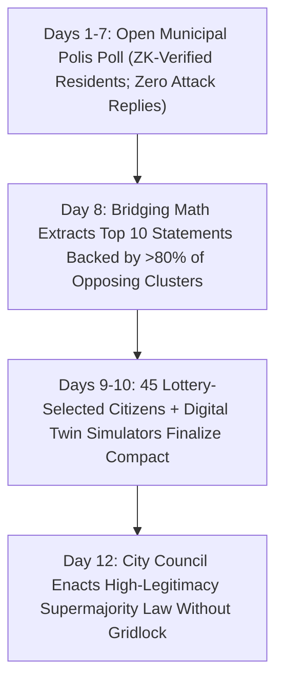

# CARBON EDITION (2026–2035): SOCIAL NORMS & HUMAN FLOURISHING
## Algorithms That Reward Common Ground Instead of Outrage

> **The Cynic's Myth vs. The Empirical Reality:** Cynics insist that social media, partisan cable news, and generative AI deepfakes have permanently shattered shared truth—dooming democracies to tribal rage-bait forever. Yet **Taiwan proved the exact opposite at national scale**: by replacing toxic "reply-button dunking" with open-source **Polis bridging algorithms**, **vTaiwan** resolved more than two dozen explosive national controversies with **over 80% cross-party legislative consensus**! Paired with **X Community Notes'** cross-ideological matrix, hardware-signed **C2PA camera provenance**, and **Ireland's Citizens' Assemblies**, we already possess the exact tools to make common ground go viral.

> *"When we design digital spaces without reply buttons for outrage and instead reward ideas that bridge divides, we discover people agree on eighty percent of what matters. The superintelligence we are looking for is already here—it's us."*
> — **Audrey Tang**, Taiwan's First Minister of Digital Affairs & Civic Technologist

---

## 1. Why Neighbors Seem Crazy Online (Even When They Agree Offline)

Here is one of the most hopeful empirical findings in political psychology—documented across dozens of studies by More in Common (*The Perception Gap*) and Stanford's Strengthening Democracy Challenge: **everyday citizens are nowhere near as extreme or hateful as their feeds make them look**. Across issues from clean energy and child safety to healthcare billing and tech accountability, quiet majorities of 70% to 85% actually share remarkably humane, practical instincts.

Why, then, did public life in the early 2020s feel like a knife fight? Because first-generation engagement algorithms (2009–2025) optimized a single metric—**raw attention minutes**—using two structural defects:
1. **The Outrage Multiplier:** NYU researchers demonstrated that each moral-emotional attack word in a social post boosted algorithmic amplification by **15% to 20%**. Roughly **6% of hyper-partisan accounts generated over 70% of political hostility**, drowning out the thoughtful, nuanced 85% who simply muted their phones and walked away.
2. **Asymmetric Deepfake Flood:** By 2026, generative video and voice synthesis reduced the cost of fabricating a fake crisis clip or synthetic bot swarm to pennies, threatening citizens with what information theorists call the *Liar's Dividend*—where people stop trusting *everything*, even real neighborhood journalism.

Notice the crucial insight: **polarization was not caused by "the internet" or "human villainy." It was caused by ranking math that rewarded tribal dunking over cross-group agreement, paired with unsigned media files.** Change those two engineering layers—and pair them with deliberative citizen assemblies—and democratic trust rebounds with astonishing speed.

---

## 2. Working on Earth Today: Four Proven Engines of Shared Truth & Consensus

Every piece of a high-trust, depolarized public square is already battle-tested across millions of real users and toughest-case geopolitical environments:

| Epistemic Challenge | Real-World Working Model (Nov 2026 SOTA) | How the Mechanism Works Under the Hood | Verified Empirical Outcome |
| :--- | :--- | :--- | :--- |
| **Algorithmic Outrage & Reply-Thread Wars** | **Taiwan's *vTaiwan* & Open-Source *Polis*** (Championed by Audrey Tang & g0v) | Citizens submit short policy proposals and click *Agree / Disagree / Pass*—**with zero reply buttons for personal attacks**. Principal Component Analysis (PCA) maps opinion clusters live and **ranks highest only those statements that win simultaneous agreement across opposing camps**. | Resolved **26+ deadlocked national disputes** (Uber regulation, online alcohol sales, fintech sandboxes, AI rules) with **>80% cross-party parliamentary enactment**; made Taiwan #1 in Asia for resilience against foreign disinfo. |
| **Partisan "Fact-Checkers" Nobody Trusts** | **Bridging-Based Matrix Factorization** (*Community Notes* open-source algorithm, Wojcik et al.) | A context note is **never shown** simply because one political tribe upvotes it in huge numbers; the matrix-factorization math requires **raters who historically disagreed with each other** to rate the note *Helpful* before it surfaces publicly. | Independent PNAS & JAMA studies found **96%+ clinical/factual accuracy** and cut viral spread of misleading posts by **50%–60%** across partisan lines once a bridged note attached. |
| **AI Deepfakes & Synthetic Bot Floods** | **C2PA Hardware Provenance Standard** (Coalition for Content Provenance & Authenticity — Sony, Nikon, Leica, Canon, BBC, Adobe, Qualcomm) | Camera image sensors cryptographically sign light-capture hashes inside secure silicon enclaves at the **millisecond photons hit the lens**, creating tamper-evident nutrition labels for real journalism vs. AI synthesis. | Adopted across flagship photojournalism cameras, mobile chips, and global news wires by 2026; any pixel splice breaks the cryptographic signature instantly. |
| **Polarized Soundbite Politics** | **Ireland's Citizens' Assemblies** & **Ostbelgien Permanent Citizens' Council** (Belgium) | **99 everyday citizens chosen by civic lottery** (matching national demographics: nurses, farmers, mechanics, retirees) meet over weekends with neutral scientists, affected families, and facilitated small-table dialogue—zero TV cameras or party whips. | Peacefully broke **decades-long constitutional gridlock** in Ireland on marriage, family law, biodiversity, and climate—producing nuanced recommendations backed by **65%+ national referenda**. |

---

## 3. How Riverbend Solved Its Fiercest Zoning Fight in Ten Days (2030)

Step into the civic atrium of **Riverbend, Michigan** (pop. 140,000), on a snowy Saturday afternoon in **February 2030**.

Three years earlier, in 2026, a proposal to redevelop an old riverfront rail yard into housing and solar storage had ended in a screaming city-council meltdown. Viral rage clips circulated on neighborhood Facebook groups claiming out-of-state speculators were bulldozing Little League fields; angry commenters doxxed planning commissioners; the council tabled everything in exhaustion.

In January 2030, Riverbend tried the **Bridged Civic Deliberation Protocol** instead:
1. **Days 1–7 (Open *Polis* Town Square):** Every resident with a privacy-preserving zero-knowledge municipal voter token was invited onto **Riverbend Polis**. Within 72 hours, 14,200 residents voted on 310 neighbor-written ideas. Initially, the live cluster map showed two familiar islands: *Group A* (young renters & union builders demanding affordable homes) and *Group B* (longtime homeowners worried about river park trees, traffic, and Little League diamonds).
2. **The Gamified Bridging Shift:** Because Riverbend Polis had **no reply button to insult strangers**, smart teenagers, retirees, and shop owners started competing to draft **bridge statements** that could turn *both* clusters green on the live map. On Day 5, a local Little League coach named **Darnell** submitted Proposal #184: *"Approve four-story mass-timber starter homes (`04-social-norms`) on the paved east rail lot ONLY IF 100% of units are owner-occupied/cooperative (zero Wall Street landlords), the city builds FOUR new lit Little League diamonds along the west river park, and construction trucks stay off Elm Street."*
3. **89% Cross-Cluster Consensus:** Within twelve hours, Darnell's proposal hit **91% agreement in Group A and 87% agreement in Group B**—soaring to #1 on the city dashboard.
4. **Weekend Citizens' Lottery Assembly:** On Saturday morning, **45 demographically drawn Riverbend citizens**—including a retired school bus driver, an ER nurse, a Conservative church deacon, and a 22-year-old apprentice electrician—sat around five round tables eating cinnamon rolls, reviewing 48-hour digital-twin shadow and traffic simulations (`04-social-norms/forty-eight-hour-governance`), and stress-testing the top ten Polis bridge items with municipal engineers.

By Sunday at 4:00 PM, the Citizens' Assembly delivered a unified **Riverfront Compact** endorsed 42-to-3. When the City Council voted Tuesday night, nobody screamed into a microphone—because fourteen thousand neighbors had watched their own best common ground write the law. Darnell threw out the first pitch on the new riverfront diamond sixteen months later.

---

## 4. Architecture of the Bridged Epistemic Commons

```mermaid
flowchart LR
    subgraph Rage["2020-2025 Outrage Feed"]
        O1["Engagement Math (+20% Reach per Attack Word)"]
        O2["Unsigned Deepfakes + Bot Swarms"]
        O3["6% Extremes Drown Out 80% Practical Majority"]
    end

    subgraph Stack["The 3-Layer Epistemic & Consensus Stack"]
        S1["Layer 1: C2PA Silicon Camera Signatures + ZK-Human Proof"]
        S2["Layer 2: Algorithmic Choice + Bridging Matrix Ranking (Polis)"]
        S3["Layer 3: Civic-Lottery Citizens' Assemblies (Ireland Model)"]
    end

    subgraph Trust["2032 High-Trust Democratic Norm"]
        T1["Deepfakes Flagged Instantly Without Censorship Boards"]
        T2["80%+ Cross-Tribe Solutions Rise to Top of Feeds"]
        T3["Calm, Fast Legislative Action with Deep Legitimacy"]
    end

    Rage --> Stack --> Trust
```

### Quantitative Trajectory: From Outrage Feeds to Bridged Superintelligence

| Information & Civic Trust Metric | Late 2026 Baseline | 2028 Bridging Rollouts | 2031 Open Protocol Norm | 2035 Mature Civic Culture |
| :--- | :--- | :--- | :--- | :--- |
| **Default Feed Ranking Objective** | **Raw outrage/dwell clicks** | **User-chosen middleware feeds** | **Bridging-weighted common ground** | **100% citizen-stewarded algorithms** |
| **Real Photo/Video Cryptographic Provenance** | **<15% C2PA signed** | **55% cameras & newsrooms** | **95%+ hardware-signed at lens** | **Universal provenance (fakes obvious)** |
| **Bot-Farm Amplification in Civic Polls** | **High synthetic astroturfing** | **ZK-Proof-of-Personhood pilots** | **0% bot weight in civic Polis** | **1 human = 1 private verified voice** |
| **Municipal & State Policy Consensus Rate** | **Gridlock / 51-49 whiplash** | **250+ cities using Polis** | **>80% cross-group bridge compacts** | **Routine deliberative supermajorities** |
| **Perceived Partisan Hostility ("Perception Gap")** | **$2.5\times$ exaggerated fear** | **Drops 35% in Polis cities** | **Calibrated mutual neighbor trust** | **High civic warmth & participation** |

### Cross-Pillar Synergies Across the Carbon Atlas
* **48-Hour Digital Governance (`04-social-norms/forty-eight-hour-governance`):** Pairing Taiwan's *Polis* consensus gathering with Estonia-style digital twins lets citizens see exact physics simulations (sunlight, traffic, tax cost) of every bridge proposal in real time.
* **2-Sigma Rhetoric & Civics Guilds (`04-social-norms/two-sigma-guild-education`):** Teenagers practice live face-to-face deliberation and bridge-statement crafting every week in Afternoon Guilds, immunizing the next generation against rage-bait manipulation.
* **High-Trust Civic Norms (`04-social-norms/high-trust-civic-norms`):** Restoring shared neighborhood third places and phone-free youth norms shrinks the online "Perception Gap" by reminding citizens daily that their neighbors are decent human beings.
* **Antidote to Doomerism (`06-synergy-horizons/cynicism-to-agency`):** Nothing cures political cynicism faster than watching an ordinary neighbor's nuanced bridge idea win 89% cross-partisan support and become real park trees and starter homes.

---

## 5. Under the Hood: How Bridging Math & Provenance Defeat Rage Without Censorship

Why did 2026 civic technology succeed where a decade of heavy-handed "content moderation" backfired? Because it operates on **structural incentives and cryptographic math**, never partisan speech policing:

1. **How Bridging Matrix Factorization Works (Polis & Community Notes):**
   * Imagine 1,000 citizens voting on statements. Standard algorithms sort by raw volume (`Likes + Angry Replies`), allowing a 52% faction—or a 5% rage mob—to dominate the screen.
   * Bridging math instead runs dimensionality reduction (PCA / matrix factorization) to locate the primary axis of disagreement first, and then computes a **Bridge Score** rewarding only statements with high approval probabilities *on both sides of the divide simultaneously*.
   * Suddenly, performative cruelty earns **zero distribution**, while thoughtful synthesis—acknowledging *both* housing affordability for young families *and* green space for existing neighbors—shoots to #1.
2. **How Silicon-to-Screen C2PA Provenance Exposes Deepfakes:**
   * Inside modern Sony, Nikon, Leica, Canon, and smartphone camera sensors, a hardware root-of-trust chip signs an encrypted SHA-256 manifest of raw pixel values, GPS/clock optional bounds, and lens optics **before the file ever touches editable memory**.
   * News readers and social apps display a quiet green **Verified Lens Capture** badge—leaving memes, cinema, and AI art 100% legal, while stripping malicious crisis deepfakes of their ability to impersonate real eyewitness video.
3. **How Civic-Lottery Assemblies Turn Consensus into Law:**
   * Digital *Polis* maps discover the 80% common ground across tens of thousands of residents in days; **Lottery Citizens' Assemblies** (modeled on Ireland and Belgium's permanent *Ostbelgien* council) bring 45 to 99 everyday neighbors together in person to refine statutory trade-offs with engineers—combining mass participation with calm, face-to-face wisdom.

---

## 6. Answering the Hardest Skeptical Questions

1. **"Doesn't filtering misinformation require a 'Ministry of Truth' that censors dissenting views?"**
   * **Never—and that is the breakthrough.** Neither **C2PA provenance**, **Community Notes bridging math**, nor **Polis** ever deletes speech or appoints partisan censors! C2PA simply proves *whether photons hit a real physical camera lens at a real time and place* (leaving art and satire completely free while making fake "leaked footage" impossible to pass off as raw camera truth). And bridging matrix math never lets a 51% majority silence a minority; it simply surfaces context and proposals that *both* sides acknowledge as fair and accurate.
2. **"How do you prove online participants are real local humans without creating a surveillance database?"**
   * Through **Zero-Knowledge Proof-of-Personhood (ZK-ID)** already pioneered in Taiwan's *Wallet* and European eIDAS 2.0 standards: your municipal smartcard or passport chip proves mathematically *"I am one unique resident of Riverbend who hasn't voted yet on this topic"* **without revealing your name, identity, or vote** to the server! Bot farms drop to zero while citizen privacy stays 100% intact.
3. **"Why would big social platforms ever let users switch away from outrage algorithms?"**
   * Because open protocols (*AT Protocol / Bluesky* custom feeds) and interoperable **Algorithmic Middleware Choice** laws let users pick their own feed lens in one tap—just like choosing a water filter. Given a clean toggle between *"Outrage Slop"* and *"Bridged Insights & Verified Neighbors,"* millions of exhausted citizens gladly flip the switch.

### How Your City, Campus, or Organization Starts Next Week (The Action Playbook)
* **Step 1 — Spin Up a Free 7-Day *Polis* Poll Before Your Next Contested Meeting:**
  * **Polis (`pol.is`) is 100% open-source and free today.** Before your school board, neighborhood association, university senate, or city council holds a contentious three-hour microphone hearing—where five angry voices drown out everyone else—invite every resident to submit and vote on bridge ideas for seven days.
* **Step 2 — Pair Digital Bridging with a Saturday Lottery Roundtable:**
  * Draw 25 to 45 demographically representative neighbors by civic lottery (paying a modest \$150/day stipend plus childcare and coffee, just like jury duty—except joyful!) to turn the top *Polis* bridge statements into an actionable recommendation.
* **Step 3 — Adopt C2PA Provenance & Bridging Feeds Locally:**
  * Local newspapers, municipal emergency channels, and school districts can enable C2PA cryptographic signing on official announcements today, while citizens switch social apps to open middleware feeds that rank bridged insight over rage.

### Real-World *vTaiwan* & Citizens' Assembly Casebook (Verified Track Record)
To appreciate why civic technologists around the world copy Taiwan and Ireland rather than inventing untested theories, examine four real-world deadlocks resolved peacefully using this exact stack:
* **Case 1 — Taiwan's Uber & Taxi Standoff (2015):** Street protests raged between traditional taxi unions and Uber drivers. Within four weeks on **Polis**, 4,000+ stakeholders converged on **seven cross-camp consensus rules** (equal insurance, transparent dynamic pricing, cooperative fleet dispatch)—enacted into law with applause from both sides.
* **Case 2 — Online Alcohol Sales & Youth Protection:** Rival retail lobbies and child-safety groups deadlocked for years; **vTaiwan Polis** surfaced a creative package (strict ID-verified convenience-store pickup only, zero doorstep drop-offs to minors) winning **>85% agreement** in days.
* **Case 3 — Ireland's Citizens' Assembly on Biodiversity & Constitutional Reform:** Ninety-nine lottery-drawn everyday citizens listened calmly to scientists and farmers across five weekends, crafting supermajority reforms where thirty years of partisan soundbites had stalled.
* **Case 4 — Ostbelgien's Permanent Citizens' Council (Belgium, est. 2019):** The German-speaking community of Belgium institutionalized a **permanent lottery-selected third chamber** alongside its elected parliament—setting the agenda and commissioning citizen panels year-round without partisan gridlock.

### The Five Design Rules of a Healthy Epistemic Public Square
1. **Zero Reply-Button Dunking in Deliberation Spaces:** Allow citizens to submit clear proposals and vote *Agree / Disagree / Pass*, depriving status trolls of the performance stage they crave.
2. **Rank Cross-Cluster Bridges Above Factional Pile-Ons:** Surface statements and context notes only when historic ideological opponents rate them fair and helpful simultaneously.
3. **Hardware-Signed Photons at Capture (C2PA):** Give real eyewitness cameras cryptographic provenance inside the silicon sensor—exposing deepfakes without appointing government speech censors.
4. **Zero-Knowledge Human Uniqueness (ZK-ID):** Prove mathematically *"one real local citizen, one voice"* while keeping every person's identity and ballot 100% private.
5. **Pair Digital Scale with Lottery Roundtables:** Let tens of thousands map the 80% common ground online via *Polis*, then invite 45 to 99 everyday lottery-selected neighbors to finalize actionable law over coffee.

### Further Reading & Open-Source Civic Toolkits
* **Audrey Tang & E. Glen Weyl (2024–2026):** *Plurality: The Future of Collaborative Technology and Democracy* (open-access blueprint documenting Taiwan's *vTaiwan* and *g0v* civic architecture).
* **The Computational Democracy Project (`pol.is`):** Open-source PCA/clustering deliberation engine deployed by national ministries, municipal councils, and citizens' assemblies worldwide.
* **Wojcik et al. & JAMA / PNAS Evaluations:** Empirical accuracy and cross-partisan depolarization benchmarks of open-source bridging-based matrix factorization.
* **Coalition for Content Provenance and Authenticity (C2PA v2.1):** Hardware-to-publish cryptographic media signing specifications across camera silicon and newsrooms.

> **The Bottom Line for the Skeptic:** Taiwan didn't wait for human nature to become angelic—they simply stopped rewarding digital outrage and started rewarding common ground. When we upgrade our ranking math, verify real cameras in silicon, and trust everyday neighbors around a table, we rediscover that we agree on eighty percent of the future we want to build.

---

## References & Verified Sources

* **Featured Researcher / Leader:** [Audrey Tang — Taiwan's First Minister of Digital Affairs & Civic Technologist](https://www.plurality.net/)
* **Companies, Labs & Consortia:** [Computational Democracy Project (Polis Open Source)](https://compdemocracy.org/) · [vTaiwan & g0v Civic Tech Community](https://info.vtaiwan.tw/) · [Coalition for Content Provenance & Authenticity (C2PA)](https://c2pa.org/) · [Plurality Institute (Audrey Tang & Glen Weyl)](https://www.plurality.net/) · [Open-Source Bridging Matrix Contributors](https://communitynotes.x.com/guide/en/under-the-hood/ranking-notes) · [More in Common (Perception Gap Research)](https://www.moreincommon.com/)
* **Global & Regulatory Precedents:** [Taiwan vTaiwan / Polis (26+ National Disputes, >80% Consensus)](https://info.vtaiwan.tw/) · [Ireland's Citizens' Assemblies (99 Lottery Citizens Solving Gridlock)](https://citizensassembly.ie/) · [Ostbelgien Permanent Citizens' Council (Belgium, Est. 2019)](https://www.buergerdialog.be/en) · [C2PA v2.1 Silicon Sensor Signing (Sony, Nikon, Leica, BBC, Qualcomm)](https://c2pa.org/)
* **Connected Carbon Pathways:** [The 48-Hour Digital State: Estonia X-Road, Physics Permits & 5-Minute Justice](../forty-eight-hour-governance/REPORT.md) · [From Cynical Atomization to High-Trust Joy: Everyday Norms That Change Everything](../high-trust-civic-norms/REPORT.md) · [2-Sigma AI Mastery in the Morning, Hands-On Human Guilds in the Afternoon](../two-sigma-guild-education/REPORT.md) · [The Antidote to Doomerism: Why Cynicism Feels Smart, Why It's Empirically Wrong, and How We Build](../../06-synergy-horizons/cynicism-to-agency/REPORT.md)
