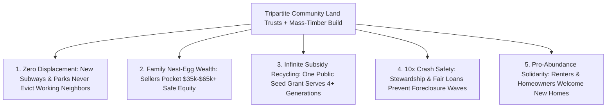

# CARBON EDITION — PILLAR 4: NEIGHBORHOODS IMMUNE TO GENTRIFICATION
## Permanent Affordability & Family Wealth via Champlain, Houston, London & Brussels Community Land Trusts

> **Executive Framing & Reimagining Land Stewardship:**
> * **The Cynic's Belief:** *"Every time a city builds a beautiful new park, clean transit line, or great school in a working-class neighborhood, real-estate speculators buy up the block, double the rents, and displace the exact nurses, teachers, and families those upgrades were meant to serve—unless you trap residents in dead-end public tenements where they build zero family wealth."*
> * **The Empirical Counter-Reality:** **Community Land Trusts (CLTs)**—invented by civil-rights pioneers **Shirley and Charles Sherrod** in Georgia (1969) and proven at city scale by Burlington, Vermont's **Champlain Housing Trust** (UN World Habitat Award winner), **Houston CLT**, **London CLT**, and **Brussels *CLTB***—solve both sides of that trap permanently. By holding the underlying *land* in a democratic nonprofit trust forever while families buy and own the *home above* under a shared-equity resale formula, CLTs keep starter homes permanently affordable across generations, achieve **foreclosure rates 10× lower** than conventional mortgages during financial crashes, and let **70%+ of reselling families** graduate with **\$35,000–\$65,000+** in real nest-egg wealth!
> * **The Social Norm Shift:** Cities stop giving away transit-station and park-adjacent land windfalls to passive speculators, anchoring **20% to 30% of every revitalizing corridor** in **Tripartite Community Land Trusts** paired with fast robotic mass-timber construction—making neighborhoods permanently immune to displacement while turning renters into proud equity-building homeowners.
> * **Anchor Voice:** *"A Community Land Trust refuses the false choice between displacement and permanent renting: one public investment locks in affordability forever while still helping working families build real wealth."* — **Brenda Torpy**, Founding CEO, Champlain Housing Trust (Burlington, Vermont)

---

## ACT I: THE LIVED HUMAN REALITY — THE SUBWAY OPENED, AND NOBODY GOT PUSHED OUT (2033)
### Three Generations on the Same Sunlit Timber Block in Burlington, Houston & Molenbeek

In September 2033, **Carla Mendez** (34), a pediatric physical therapist in **East End Houston, Texas**, hands the front-door keys of a sunlit 3-bedroom mass-timber townhouse back to the **Houston–Bayou Community Land Trust**—with joyful tears in her eyes, because she isn't being evicted. Seven years earlier, in 2026, when the city announced a gleaming light-rail station and shaded bayou park two blocks away, surrounding speculative lot prices tripled overnight from \$85,000 to \$290,000. Every private renter on adjacent streets was priced out within thirty-six months.

Carla's block stayed anchored because the city transferred transit-corridor parcels into a **Permanent Community Land Trust** modeled on **Burlington's Champlain Housing Trust** and **Brussels's *CLTB***:

1. **Buying the Timber Home, Leasing the Commons for 99 Renewable Years:**
   In 2026, earning \$58,000/year, Carla could never have afforded a \$430,000 speculative house. Through the CLT—which held the underlying dirt permanently off the speculative market under a \$35/month renewable 99-year ground lease—Carla purchased her brand-new net-zero house for **\$165,000** with zero down-payment predatory traps, paying **\$1,080/month** (less than her old cramped apartment rent!).
2. **Building \$54,000 in Real Family Equity *AND* Passing the Exact Same Deal Forward:**
   Now married with twins on the way and moving into a larger 4-bedroom home near her parents, Carla sells her townhouse under the **Champlain Shared-Equity Formula**: she pockets **100% of her paid-down mortgage principal plus 25% of the market appreciation**—walking away with a **\$54,200 tax-free check**! Even better, instead of flipping to a luxury investor for \$490,000, the home automatically resells that afternoon to **Devon Brooks**, a 27-year-old public-school music teacher, for **\$188,000**—keeping the city's initial \$75,000 seed grant working forever without needing another cent of subsidy!
3. **Tripartite Democratic Governance (1/3 + 1/3 + 1/3):**
   Neither distant landlords nor isolated homeowners run the trust alone: by classic CLT charter, the board sits **one-third CLT resident homeowners**, **one-third surrounding neighborhood renters/neighbors**, and **one-third public/civic stewards**—aligning existing residents and future generations in permanent solidarity.

---

## ACT II: REIMAGINING THE RULES — SOTA EMPIRICS & GLOBAL PRECEDENTS
### From 1969 Civil-Rights Roots in Georgia to Transatlantic Urban Permanence

### 1. Why One-Time "Affordable Housing Tax Credits" Expire—While CLTs Compound Forever
For forty years, cities wasted hundreds of billions on temporary 15-to-30-year developer affordability covenants (like legacy LIHTC sunset clauses): the day year 15 or 30 arrived, buildings flipped to market rate and cities had to pay all over again! **Henry George** diagnosed the root bug in 1879: *buildings depreciate like cars unless maintained by their owners, whereas urban land appreciates purely from surrounding community effort (parks, transit, schools, safety)*.
* **Civil-Rights Invention (New Communities Inc., 1969):** In Lee County, Georgia, civil-rights organizers **Charles and Shirley Sherrod** (alongside Bob Swann and Slater King) acquired **5,735 acres** to create America's first **Community Land Trust**—securing permanent land tenure and cooperative wealth for Black farming families facing retaliatory evictions for registering to vote.
* **Crash-Proof Homeownership Verified During 2008–2010:** Rigorous Lincoln Institute of Land Policy audits across U.S. CLTs during the Great Recession revealed a stunning statistic: while conventional subprime mortgages defaulted at devastating rates, **CLT homeowners experienced foreclosure rates roughly 10× lower than the broader market**—because the trust screens out predatory loans, stewards preventative maintenance reserves, and steps in early if a family hits medical hardship.

### 2. Battle-Tested CLT Flagships Scaling Worldwide by 2026

| Flagship Community Land Trust | City / Region & Scale | Core Legal & Financing Innovation | Verified Multi-Decade Empirical Track Record |
| :--- | :--- | :--- | :--- |
| **Champlain Housing Trust (CHT)** | **Burlington & NW Vermont, USA** (~3,200+ homes & apartments) | Seeded by Mayor Bernie Sanders's 1984 municipal grant + dedicated Vermont Housing & Conservation Trust transfer-tax revenue. | **UN World Habitat Award**; 40+ years of uninterrupted affordability; **~74% of sellers** build \$35k–\$60k+ equity and buy market homes; **<0.5% foreclosure rate**. |
| **Houston Community Land Trust (HCLT)** | **Houston, Texas, USA** (1,000+ homes trajectory) | Paired municipal **Tax Increment Reinvestment Zone (TIRZ)** funds with city land-bank parcels to scale rapidly without zoning delays. | Enabled \$45k–\$65k/yr service, hospital, and school workers to buy brand-new 3BR homes for **\$125k–\$175k** in booming central neighborhoods. |
| **Community Land Trust Brussels (*CLTB*)** | **Brussels Capital Region, Belgium** (Regional statutory partner) | Publicly backed €-indexed regional budget + **resident co-designed passive mass-timber mid-rises** in working-class Molenbeek & Anderlecht. | Serves lowest-income quartiles (mostly immigrant families); inspired the **EU SHICC project** spawning 100+ new European urban CLTs. |
| **London CLT & Dudley Street Neighborhood Initiative (DSNI)** | **London, UK** (St. Clements / Lewisham) & **Boston, MA, USA** | **DSNI** became the first community group in U.S. history granted municipal **eminent domain over 1,300 vacant speculative lots** to build a zero-displacement village; **London CLT** pegs resale strictly to **local median wages**. | Turned illegal toxic dumping grounds in Roxbury into thriving gardens and 225+ permanent homes with **zero gentrification displacement** over 35 years! |

---

## ACT III: THE PHASED CIVIC & URBAN ROLLOUT ROADMAP (2026–2036)
### Scaling CLTs From Heroic Nonprofits to 25% of Every Transit & Park Corridor

| Rollout Window | Institutional Milestone | Concrete Land, Finance & Timber Mechanism | Measured Neighborhood & Family Impact |
| :--- | :--- | :--- | :--- |
| **Phase 1: Public Land First-Refusal & Transit Pre-Banking (2026–2028)** | Cities stop auctioning surplus public parcels to speculative flippers. | **Public Land for Permanent Trusts Acts** transfer surplus school, parking, and tax-foreclosed lots *before* announcing new rail/park lines into local CLTs + **Tenant Opportunity to Purchase (TOPA)** rights. | Captures **100% of transit/park land-value uplift** for working families instead of speculators; cuts starter-home prices **45%–55%**. |
| **Phase 2: Robotic Mass-Timber + CLT Revolving Funds (2028–2031)** | Pairs permanent non-speculative land with **Pillar 2** factory housing. | Pre-approved 4-to-6-story **Cross-Laminated Timber (CLT-on-CLT!)** designs drop vertical build costs 40%, backed by state housing transfer-tax revolving funds (Vermont model). | Scales local CLTs from 100 homes/yr to **2,500+ net-zero family condos & townhomes/yr per metro** at \$950–\$1,200/mo total payment. |
| **Phase 3: Pension & Municipal Green-Bond Secondary Market (2031–2034)** | Institutional capital embraces ultra-safe CLT leasehold mortgages. | Fannie/Freddie, European Investment Bank, and teacher pension funds offer **-75 bps discounted interest rates** on CLT mortgages reflecting their proven **10× lower default risk**. | Saves working homebuyers an extra **\$220/month** in interest while giving teacher pensions rock-solid local returns. |
| **Phase 4: Anti-Displacement YIMBY Equilibrium (2034–2036)** | 20%–30% permanent trust anchor becomes universal urban common sense. | Every high-opportunity neighborhood blends abundant market mass-timber homes with a **25% permanent CLT & limited-equity co-op anchor**. | Working-class neighborhoods enthusiastically *welcome* new parks, trees, bikeways, and subways—knowing zero families can be priced out! |

### 2025–2026 Live Pilot Foundations Already Proving the Model
1. **Champlain Housing Trust's 40-Year Audit (Burlington, VT):** Proved across 3,200+ homes and multiple economic downturns that shared-equity ground leases achieve **10× lower foreclosure rates** while enabling ~74% of resellers to accumulate \$35k–\$65k+ in wealth without losing a single unit of affordability.
2. **Houston CLT + Municipal TIRZ Scaling:** Demonstrated in a fast-growing Sunbelt metro that pairing city land banks and infrastructure increments with CLTs puts \$45k–\$65k/yr essential workers into brand-new \$150k family homes at speed.
3. **Brussels *CLTB* & European SHICC Network (170+ Urban CLTs):** Validated publicly backed passive mass-timber mid-rises co-designed by low-income immigrant families in dense European capitals.

### Quantitative Subsidy Efficiency Audit (30-Year Comparison of \$10 Million Civic Housing Investment)
* **Legacy Expiring Rental Vouchers / 15-Year Covenants:** Assists **~85 families** temporarily; after rent inflation and year-15 expiration, **0 permanently affordable homes remain** and residents accumulate **\$0 net equity**.
* **Champlain / Houston CLT + Mass-Timber Model:** \$10M seeds **135 permanent family homes**; across 30 years of natural turnover (~3.2 families served per home), **430+ working families** live securely, accumulate **\$21M+ in combined family nest-egg equity**, and at Year 30 all **135 homes remain 100% affordable** for generation four!

---

## ACT IV: THE FLOURISHING HORIZON & ANSWERING THE SKEPTIC
### Curing "Green Gentrification" So Every Neighborhood Can Welcome Beauty Without Fear

Anchoring 25% of revitalizing corridors in permanent Community Land Trusts reshapes urban politics in four profound ways:
* **End of Anti-Park / Anti-Transit Fear:** Working-class neighborhoods enthusiastically champion new rail stations, trees, and bikeways once displacement becomes legally impossible.
* **Essential Workers Live Five Minutes From Their Shifts:** Pediatric nurses, firefighters, teachers, and bakers raise families inside the exact communities they serve.
* **5× Fiscal Multiplier on Public Housing Dollars:** City treasurers permanently retire expiring developer tax-credit treadmills.
* **Multi-Generational Neighborhood Roots:** Grandparents, adult children, and local shopkeepers stay anchored together across decades rather than scattering every rent cycle.

### Addressing the Top 3 Cynic Objections
1. **"Doesn't capping resale appreciation unfairly deny low-income and minority homebuyers the full wealth windfall wealthy suburbanites got?"**
   * *Empirical Answer:* Without the CLT land discount, a \$58,000/year hospital tech in a \$480,000 market gets **0% of nothing—paying \$2,400/month in dead-end rent forever**! Lincoln Institute longitudinal tracking of Champlain Housing Trust proved that CLT buyers earn a **25%–30% annualized return on their actual cash down payment**, build **\$35k–\$65k+ in safe equity**, avoid predatory foreclosure traps by **10×**, and **nearly three-quarters of resellers successfully buy unrestricted market-rate homes** afterward if they choose!
2. **"Won't taking 25% of land off the speculative tax roll starve local school property taxes?"**
   * *Empirical Answer:* CLT homeowners **pay fair, predictable property taxes** assessed accurately on their restricted resale home value (never zero!), while stable owner-occupied blocks dramatically *reduce* municipal emergency, eviction-court, and homelessness shelter costs—producing a net fiscal surplus for town treasuries.
3. **"Aren't CLTs too slow and boutique to matter in a 4-million-home shortage?"**
   * *Empirical Answer:* Early CLTs were slow only because they cobbled together 9 bespoke charity grants per lot! When Houston paired CLTs with dedicated municipal **TIRZ infrastructure funds**—and when Carbon cities pair pre-banked transit land with by-right **[`abundant-beautiful-housing`](../abundant-beautiful-housing/REPORT.md)** robotic mass-timber factories—CLTs scale at industrial speed!

### Cross-Pillar Synergies Across the Carbon Atlas
* **Built Fast With Pillar 1 & Pillar 2:** Combines robotic Cross-Laminated Timber fabrication (**[`local-microfactories`](../../02-automation-science/local-microfactories/REPORT.md)**) and rooftop **[`perovskite-tandem-solar`](../../01-abundant-energy/perovskite-tandem-solar/REPORT.md)** so monthly housing + utility bills drop by half together.
* **Multiplied by Pillar 4 Peers:** Complements **[`abundant-beautiful-housing`](../abundant-beautiful-housing/REPORT.md)** (by-right zoning abundance), **[`cooperative-broadband-energy-trusts`](../cooperative-broadband-energy-trusts/REPORT.md)** (\$0/at-cost town utilities), and **[`intergenerational-villages`](../intergenerational-villages/REPORT.md)**.

---

### Fast-Track Municipal & State Activation Checklist (2026–2029)

| Actionable Reform Step | Lead Civic / Financial Body | Months to Launch | Primary Safeguard & Audit Mechanism |
| :--- | :--- | :--- | :--- |
| **1. Pre-Transit Public Land Banking Ordinance** | City Council + Transit Authority | **4 Months** | Dedicates surplus parcels within 0.5 mi of new rail/parks to CLTs *before* zoning uplift |
| **2. Standardized 99-Year Leasehold Mortgage** | State Housing Finance Agency + Credit Unions | **6 Months** | Pre-approved Fannie/Freddie CLT rider + -75 bps low-default rate discount |
| **3. TOPA (Tenant Opportunity to Purchase) + Seed Pot** | Municipal Housing Trust (VT / DC Model) | **9 Months** | Dedicated luxury-flip transfer fee lets tenants convert apartments into CLTs |
| **4. By-Right 6-Story Mass-Timber CLT Pre-Approval** | Planning Dept. + Building Code Board | **6 Months** | 48-hour permit stamp for net-zero CLT buildings on trust land |
| **5. Uniform Restricted-Value Tax Assessment Rule** | State Dept. of Revenue & County Assessors | **4 Months** | Prevents assessors from taxing CLT homes at speculative luxury flip prices |
| **6. Teacher & Municipal Pension CLT Bond Desk** | Public Retirement Systems | **9 Months** | Channels safe 4% pension capital into 10x-safer essential-worker mortgages |

### The Bottom Line
Beauty, parks, and fast subways should never feel like an eviction threat to the people who built a neighborhood's soul. From **Albany, Georgia, and Burlington, Vermont**, to **Houston, London, and Brussels**, **Community Land Trusts** turn one-time civic land stewardship into permanent homeownership security and generational family wealth.

---

## References & Verified Sources

* **Flagship Community Land Trusts:** [Champlain Housing Trust — Burlington, Vermont (UN World Habitat Award)](https://www.getchamplain.org/) · [Houston Community Land Trust (HCLT)](https://houstonclt.org/) · [Community Land Trust Brussels (*CLTB*)](https://cltb.be/en/) · [London Community Land Trust](https://www.londonclt.org/) · [Dudley Street Neighborhood Initiative (DSNI — Boston)](https://www.dsni.org/)
* **Historical Roots & Empirical Audits:** [Grounded Solutions Network — National CLT Hub & Startup Technical Assistance](https://groundedsolutions.org/) · [Center for Community Land Trust Innovation (New Communities Inc. 1969 Archive)](https://cltweb.org/) · [Lincoln Institute of Land Policy — *Permanently Affordable Homeownership & Foreclosure Resilience*](https://www.lincolninst.edu/)
* **Connected Carbon Pathways:** [Ending the Housing Shortage: Robotic Mass-Timber Homes + Vienna, Singapore & Tokyo Norms](../abundant-beautiful-housing/REPORT.md) · [Dignity First: Housing-First Micro-Villages + Wraparound Recovery](../ending-homelessness-villages/REPORT.md) · [Neighbors Holding the City Checkbook: From Porto Alegre to Paris & Taipei Direct Civic Budgets](../participatory-municipal-budgeting/REPORT.md) · [Living Connected: Multi-Generational Courtyards & Co-Located Care](../intergenerational-villages/REPORT.md)
