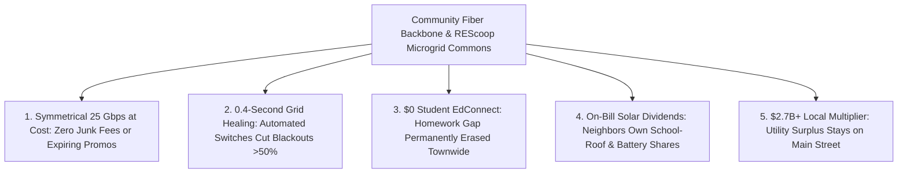

# CARBON EDITION — PILLAR 4: 25-GIGABIT FIBER & MICROGRIDS OWNED BY THE TOWN
## Chattanooga's \$2.7B EPB Blueprint, Longmont NextLight & 2,200+ Citizen Utility Cooperatives

> **Executive Framing & Reimagining Essential Local Monopolies:**
> * **The Cynic's Belief:** *"Small towns and working-class neighborhoods are stuck forever with predatory private telecom and utility monopolies—charging \$120/month for laggy internet and hiking power bills after blackouts—because municipal utilities are supposedly slow and inefficient."*
> * **The Empirical Counter-Reality:** **Chattanooga, Tennessee's community-owned EPB** shattered that myth completely: building America's first citywide gigabit network and upgrading in 2022–2026 to symmetrical **25-Gigabit (25,000 Mbps) community fiber** paired with an automated smart grid—generating **over \$2.7 billion in independently audited local economic benefit**, cutting power-outage durations by **>50%**, and delivering **free fiber internet (*HCS EdConnect*)** to 28,000+ low-income public school children with zero tax subsidy! Meanwhile, **Longmont, Colorado's *NextLight*** consistently ranks as America's #1 ISP at **\$50–\$70/month**, and across Europe **2,200+ REScoop citizen energy cooperatives** pay clean rooftop-solar and wind dividends directly back to **1.5 million+ member-owners**.
> * **The Social Norm Shift:** Communities treat fiber-optic dark glass and neighborhood solar-battery microgrids as **non-extractive public or member-owned commons**—just like local roads and water—retiring Wall Street natural-monopoly rent extraction so every household enjoys symmetrical multi-gigabit speed and blackout-proof power at cost.
> * **Anchor Voice:** *"We didn't build community fiber to maximize quarterly shareholder extraction—we built infrastructure for the next fifty years so every child, manufacturer, and family in Chattanooga can compete with anywhere on Earth."* — **David Wade**, CEO, EPB of Chattanooga

---

## ACT I: THE LIVED HUMAN REALITY — THE STORM NIGHT WHEN THE LIGHTS & FIBER NEVER BLINKED (2032)
### Inside a Member-Owned Utility Town in Appalachian Tennessee & Rural Colorado

On a stormy Tuesday evening in November 2032, tornado-force gusts snap a century-old oak across a feeder line three blocks from **Marcus and Keisha Reynolds's** home in East Chattanooga, Tennessee. Inside, 13-year-old **Jayden** is streaming a real-time 3D robotics CAD collab over **HCS EdConnect** while Keisha runs diagnostics for a regional telehealth clinic from her home study:

1. **Sub-Second Self-Healing Grid Switches Instead of Three-Day Blackouts:**
   Because Chattanooga's municipal utility **EPB** wired **1,200+ automated IntelliRupter smart switches** directly onto its own citywide fiber-optic backbone—now reinforced by neighborhood sodium-iron battery microgrids—the fault is isolated and rerouted in **0.4 seconds**. The Reynolds family's kitchen lights don't even flicker, saving local grocers, machine shops, and insulin-dependent seniors millions in outage losses while neighboring counties served by legacy investor-owned monopolies sit in the dark for 36 hours.
2. **Symmetrical 10-to-25 Gbps At Cost—With Zero Junk Fees or Price Hikes:**
   The Reynolds family pays a flat, never-expiring **\$58/month** for symmetrical multi-gigabit fiber (and during the years they qualified for school meal assistance, **HCS EdConnect** wired their home at **\$0.00/month** permanently closing the homework gap). Nobody ever wastes two hours on hold haggling over a "promotional rate expiration"—because as citizens and coop members, *they are the shareholders*.
3. **Solar Roof Dividends Credited Straight to Monthly Bills (The REScoop Layer):**
   Inspired by Europe's **REScoop** model and U.S. rural electric co-ops, Marcus owns four \$250 citizen shares in the **East Ridge School-Roof Solar & Battery Trust**, automatically crediting **-\$44/month** onto his winter heat-pump bill from sunny community array surpluses.

---

## ACT II: REIMAGINING THE RULES — SOTA EMPIRICS & GLOBAL PRECEDENTS
### Why Natural-Monopoly Wires Belong to the People Who Live Under Them

```mermaid
flowchart LR
    subgraph MonopolyTrap["Private Natural-Monopoly Extraction"]
        M1["15%-30% Wall Street EBITDA Margins on Captive Wires"]
        M2["Redlining of Rural & Low-Income Blocks + Promotional Traps"]
        M3["State Lobbyist Laws Banning Towns From Building Own Fiber"]
    end
    subgraph CivicUtility["Municipal & Cooperative Utility Stack"]
        C1["EPB Dual-Use Backbone: Smart Grid Pays for Fiber Glass"]
        C2["Open-Access Dark Fiber or At-Cost Municipal ISP"]
        C3["REScoop Member-Owned Solar + Battery Microgrid Shares"]
    end
    subgraph LocalWealth["Compounding Community Abundance"]
        L1["$2.7B+ Audited Local GDP & 9,500+ Jobs (Chattanooga)"]
        L2["50%+ Faster Outage Recovery & $0 Student EdConnect"]
        L3["$600-$1,400/Yr Saved Per Family Kept on Main Street"]
    end
    MonopolyTrap ==> CivicUtility ==> LocalWealth
```

### 1. Adam Smith's Natural-Monopoly Truth Applied to Glass and Electrons
Why do private cable and power monopolies routinely rank at the very bottom of American consumer satisfaction surveys while charging **2× to 3× European or municipal prices**? Because digging trenches and stringing poles down every residential street is a textbook **natural monopoly**: no rational company digs up a street four times to lay four competing sets of power poles. Handing a captive single-wire monopoly to a distant private-equity or Wall Street firm guarantees underinvestment in rural/low-income blocks and relentless fee extraction.
* **The Chattanooga Dual-Use Genius:** When EPB issued revenue bonds to build its smart electric grid, engineers realized stringing high-strand-count fiber-optic glass alongside every electric pole paid for itself **purely through smart-grid outage reductions and avoided peak-power waste**! Once that glass reached every meter in Hamilton County, upgrading from 1 Gbps (2010) to **10 Gbps (2015)** and **25 Gbps (2022–2026)** required only swapping optical line cards at the ends—never re-digging a single street!
* **Audited \$2.7 Billion Return on a \$220M Grid-Fiber Build:** Independent studies by Prof. Bento Lobo at the **University of Tennessee at Chattanooga** documented **\$2.69 billion+** in cumulative community value over its first decade alone (plus **9,500+ local jobs created**), returning more than **10× its capital cost** without raising a cent of local property tax.

### 2. Battle-Tested Municipal & Cooperative Precedents Live by 2026

| Community Utility / Co-op | Ownership & Governance Structure | Speed, Price & Reliability SOTA (2026) | Verified Social & Economic Dividend |
| :--- | :--- | :--- | :--- |
| **EPB of Chattanooga** (Tennessee, USA — 180,000+ homes/firms) | Independent municipal electric & telecom board; revenue-bond self-financed. | **Symmetrical 25 Gbps** available to every address; 300 Mbps at ~\$58/mo; **>50% outage reduction**. | **\$2.7B+ audited local economic benefit**; **HCS EdConnect** gives 28,000+ low-income students free fiber for life of K–12. |
| **NextLight — Longmont Power & Communications** (Colorado, USA) | Voter-approved municipal fiber utility (citizens defeated telecom ad blitz 2-to-1). | Symmetrical multi-gigabit starting ~\$50–\$70/mo (**\$49.95 Charter Member price locked for a decade!**). | Repeatedly voted **#1 ISP in the United States** (*PCMag* / *Consumer Reports*); **>60% citywide market share** voluntarily chosen. |
| **UTOPIA Fiber & Ammon Model** (Utah & Idaho, USA — 20+ cities) | **Open-Access Municipal Fiber Ring**: cities own the glass; 15+ private ISPs compete on top in 60 seconds! | Software-defined instant ISP switching in Ammon, Idaho; symmetrical 1–10 Gbps for **\$40–\$65/mo**. | Proves cities can own neutral "digital asphalt" while letting nimble private providers compete fiercely on service! |
| **REScoop.eu Federation & U.S. Rural Electric Co-ops** (Europe & Rural USA) | **2,200+ European citizen energy cooperatives** (1.5M+ members) + **800+ New Deal U.S. rural co-ops**. | One-member-one-vote democratic ownership of wind turbines, school solar roofs, heat networks, and rural fiber (e.g., Co-Mo Connect). | Keeps **3× more energy euro/dollar value circulating locally**; eliminates NIMBY wind/solar opposition via neighbor dividends. |

---

## ACT III: THE PHASED CIVIC ROLLOUT ROADMAP (2026–2036)
### Ending State Preemption Bans and Scaling Citizen Fiber-Microgrid Trusts Nationwide

| Rollout Window | Institutional Milestone | Concrete Legal, Financial & Engineering Step | Measured Household & Town Impact |
| :--- | :--- | :--- | :--- |
| **Phase 1: Repeal Monopoly Preemption Laws (2026–2028)** | Remaining U.S. states repeal telecom-lobby bans blocking towns from building community fiber (following Colorado, Washington & Arkansas bipartisan repeals). | Enactment of **Local Utility Self-Determination Acts** + federal BEAD/RUS low-interest credit guarantees for municipal & rural co-op dual-use smart-grid fiber. | Unlocks **1,500+ counties and mid-sized cities** to issue self-liquidating EPB/UTOPIA revenue bonds with zero tax hikes. |
| **Phase 2: Universal Dual-Use Grid + EdConnect (2028–2031)** | Every public distribution upgrade pairs fiber glass with automated switches. | Municipal utilities and rural co-ops bundle **IntelliRupter self-healing switches + 25G-ready PON glass** and statutory **\$0 EdConnect student access**. | Cuts extreme-weather blackout hours by **60%**; eliminates the rural/low-income K–12 homework gap permanently. |
| **Phase 3: Neighborhood Solar-Sodium Co-ops (2031–2034)** | Parking lots, schools, and substations become REScoop microgrid hubs. | Citizens buy **\$100–\$1,000 fractional microgrid shares** (or earn sweat/bill credits) in sodium-ion substation batteries + rooftop solar managed via EPB fiber telemetry. | Slashes peak-demand wholesale power spikes by **45%**; cuts average family electric + internet combined bill by **\$1,200/yr**. |
| **Phase 4: 100-Gbps Open Civic Commons (2034–2036)** | Multi-gigabit connectivity and islandable clean microgrids become universal rights. | Open-access municipal glass swaps optical cards to **50–100 Gbps** at marginal cost; virtual power plants pay homeowners automatically for EV/battery grid balancing. | Rural towns enjoy identical latency and lower power prices than coastal capitals, fueling a heartland small-business renaissance. |

### 2025–2026 Live Pilot Foundations Already Proving the Model
1. **Chattanooga EPB 25-Gbps Fiber + *HCS EdConnect* Equity Model:** Proved community-owned dual-use smart-grid glass delivers symmetrical 25,000 Mbps everywhere, generates \$2.7B+ in audited local economic gains, and wires 28,000+ low-income students permanently for \$0 without property-tax subsidies.
2. **Longmont *NextLight* & Utah *UTOPIA* Open-Access Fiber:** Confirmed both direct municipal retail (#1 U.S. customer satisfaction at ~\$50–\$70/mo) and public-glass/private-ISP open competition outperform captive cable monopolies across suburban and conservative towns alike.
3. **REScoop.eu's 2,200+ Citizen Energy Cooperatives (1.5M+ Members):** Demonstrated across Europe that democratic member shares turn neighborhood solar roofs, district heat, and battery substations into popular household bill-reducers.

### Quantitative Household & Town Ledger (Captive Private Monopoly vs. EPB / NextLight / REScoop Commons)
* **Annual Family Broadband + Power Outlay:** **\$1,320/yr** laggy asymmetric cable + **\$2,400/yr** blackout-prone power (**\$3,720/yr**) $\rightarrow$ **\$600/yr** symmetrical multi-gigabit fiber (**\$0** for EdConnect families) + **\$1,450/yr** net co-op solar-microgrid power (**\$2,050/yr** — saving **\$1,670/yr** every year!).
* **Capital Leakage Out of Town:** **70%+ of monopoly profits** wired out to distant holding companies $\rightarrow$ **100% of net surplus** reinvested into lower local rates, undergrounding lines, and main-street jobs.

---

## ACT IV: THE FLOURISHING HORIZON & ANSWERING THE SKEPTIC
### Why Conservative Rural Co-ops and Progressive Cities Agree on Local Ownership

Treating fiber glass and neighborhood microgrids as member-owned civic infrastructure unlocks four lasting shifts:
* **End of Geographic Digital Redlining:** Farm lanes and working-class blocks receive the exact same symmetrical multi-gigabit glass as corporate downtowns.
* **Pro-Solar Neighbor Enthusiasm:** Instead of fighting substation upgrades, residents line up to buy fractional REScoop shares that shrink their own winter heating bills.
* **Heartland Talent & Manufacturing Magnet:** Precision robotics shops, telehealth hubs, and creative studios thrive in affordable mid-sized towns with sub-2ms optical links.
* **Bipartisan New-Deal Pride Reborn:** Updates the beloved 1936 Rural Electrification cooperative tradition for the 21st-century compute and clean-storage era.

### Addressing the Top 3 Cynic Objections
1. **"What if a city council mismanages a municipal ISP and sticks taxpayers with a failed bond?"**
   * *Empirical Answer:* Two proven guardrails eliminate taxpayer risk: first, finance strictly through **ring-fenced utility revenue bonds** backed by smart-grid outage/line-loss savings (as Chattanooga EPB did, paying off faster than scheduled with **zero property tax dollars**); second, cities nervous about running retail customer support can adopt the **Utah UTOPIA / Ammon Open-Access Model**, where the town owns only the passive underground glass and **15+ private ISPs** compete for subscribers on top!
2. **"Won't Starlink or 5G wireless make fiber-to-the-home obsolete?"**
   * *Empirical Answer:* Physics says the exact opposite: every 5G/6G tower and Wi-Fi 7 router *depends* on fiber backhaul, and orbital spectrum shares finite bandwidth per cell whereas buried glass scales from **1 Gbps to 25 Gbps to 100 Gbps** simply by swapping endpoint lasers for **50+ years** with sub-2-millisecond latency!
3. **"Isn't community ownership 'anti-business'?"**
   * *Empirical Answer:* Ask Chattanooga's Chamber of Commerce or Conservative rural farmers in Missouri and Idaho! Cheap, rock-solid public roads don't hurt private trucking firms—they let thousands of local businesses thrive. Chattanooga's 25-gigabit municipal glass became the #1 magnet attracting **Volkswagen expansions, logistics startups, quantum testbeds, and \$2.7B in private business growth**.

### Cross-Pillar Synergies Across the Carbon Atlas
* **Physically Powered by Pillar 1:** Pairs municipal fiber telemetry directly with **[`iron-sodium-storage`](../../01-abundant-energy/iron-sodium-storage/REPORT.md)** 100-hour batteries and **[`perovskite-tandem-solar`](../../01-abundant-energy/perovskite-tandem-solar/REPORT.md)** school/warehouse canopies.
* **Multiplied by Pillar 4 Peers:** Reinforces **[`two-sigma-guild-education`](../two-sigma-guild-education/REPORT.md)** (universal \$0 student fiber), **[`community-land-trusts-permanence`](../community-land-trusts-permanence/REPORT.md)** (net-zero utility + housing permanence), and **[`fab-commons-wealth`](../fab-commons-wealth/REPORT.md)**.

---

### Fast-Track Municipal & Co-op Activation Checklist (2026–2029)

| Actionable Reform Step | Lead Local / State Body | Months to Launch | Primary Safeguard & Audit Mechanism |
| :--- | :--- | :--- | :--- |
| **1. Repeal State Municipal Broadband Bans** | Bipartisan Rural-Urban Legislative Caucus | **6 Months** | Restores home-rule voter referendum right (Colorado NextLight model) |
| **2. Dual-Use Smart-Grid Fiber Bond Issue** | Municipal Utility / Rural Electric Co-op | **9 Months** | Self-liquidating via verified grid outage & peak-shaving savings |
| **3. Open-Access or EdConnect Equity Charter** | Utility Board + Public School District | **6 Months** | Automatic \$0 symmetrical fiber for every free/reduced-lunch household |
| **4. REScoop Fractional Microgrid Ordinance** | State Public Utility Commission + Co-ops | **9 Months** | One-member-one-vote on-bill solar & sodium-battery dividend credits |
| **5. Dig-Once Conduit Municipal Mandate** | City Public Works & DOT | **3 Months** | Every road/water trench lays open-access dark fiber conduit automatically |
| **6. Ammon-Style Software ISP Switching Portal** | Open-Access Fiber Authorities | **6 Months** | Lets households switch retail ISPs in 60 seconds with zero truck rolls |

### The Bottom Line
Essential wires running past every front porch should enrich the families living inside those homes—not distant rent-seekers. From **Chattanooga's 25-Gbps EPB** and **Longmont's NextLight** to **Europe's 2,200+ REScoops**, community-owned fiber and microgrids prove towns can build world-beating infrastructure themselves.

---

## References & Verified Sources

* **Flagship Municipal & Co-op Utilities:** [EPB of Chattanooga — 25 Gbps Fiber & Smart Grid](https://epb.com/) · [NextLight Municipal Fiber — Longmont, Colorado](https://mynextlight.com/) · [UTOPIA Fiber Open-Access Municipal Network (Utah)](https://www.utopiafiber.com/) · [REScoop.eu — European Federation of Citizen Energy Cooperatives (2,200+ Co-ops)](https://www.rescoop.eu/)
* **Empirical Studies & Policy Research:** [UTC Study: \$2.69B+ Ten-Year Economic Impact of Chattanooga EPB Fiber](https://epb.com/newsroom/press-releases/ten-years-of-epbs-community-wide-fiber-optic-network-generates-269-billion-in-economic-benefit/) · [Institute for Local Self-Reliance (ILSR) — Community Broadband Networks Map](https://muninetworks.org/) · [HCS EdConnect Digital Equity Partnership (Hamilton County, TN)](https://epb.com/about/community/edconnect/) · [National Rural Electric Cooperative Association (NRECA)](https://www.electric.coop/)
* **Connected Carbon Pathways:** [100-Hour Iron-Air & Sodium-Ion Grid Storage](../../01-abundant-energy/iron-sodium-storage/REPORT.md) · [35.5% Perovskite-Silicon Tandems & Living Solar Skins](../../01-abundant-energy/perovskite-tandem-solar/REPORT.md) · [Neighborhoods Immune to Gentrification: Champlain, Brussels & London Community Land Trusts](../community-land-trusts-permanence/REPORT.md) · [Everyone an Owner: Sovereign AI/Compute Wealth Funds & Universal Baby Bonds](../universal-capital-dividends/REPORT.md)
