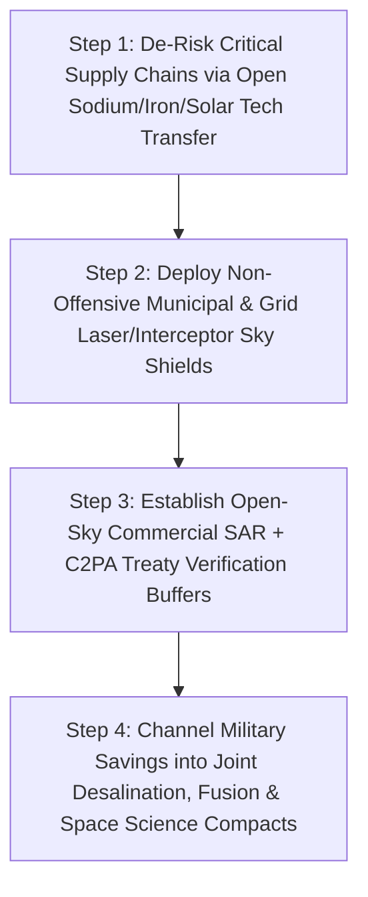

# CARBON EDITION (2026–2035): SOCIAL NORMS & HUMAN FLOURISHING
## Making Conquest Obsolete: Resource Sovereignty & Asymmetric Defensive Shields

> **The Cynic's Myth vs. The Empirical Reality:** Cynics recite the grim aphorism that war is hardwired into human DNA and that the 21st century is doomed to bloody resource wars over oil straits, river headwaters, Taiwan fabs, and rare-earth mines. Yet late-2026 physics and defense breakthroughs are quietly shattering the **two 5,000-year pillars of territorial aggression**: first, **technological resource autarky** (compact fusion, 35.5% tandem solar, sodium/iron batteries, iron-nitride magnets, graphene desalination, and precision fermentation) gives every nation unlimited energy, water, food, and critical materials inside its own borders; second, **\$1.50-per-shot solid-state laser shields** (*DragonFire*, *Iron Beam*) and real-time **sub-meter orbital SAR transparency** invert the offense-defense balance overwhelmingly in favor of peaceful borders.

> *"When trade, transparent verification, and domestic technological abundance make live neighbors vastly more valuable than conquered territory, war shifts from an inevitability to an obsolete folly."*
> — **Steven Pinker**, Johnstone Family Professor of Psychology, Harvard University

---

## 1. Why Empires Fought for Five Millennia—And What Just Changed (Late 2026)

For five thousand years—from Bronze Age tin routes and Roman grain provinces to 1941 oil embargoes, 1990 Kuwait oil fields, and 21st-century anxieties over lithium brines, Nile/Indus river dams, and Black Sea wheat—conquest followed a cold material equation. Whenever vital inputs were **geographically monopolized in someone else's dirt**, states faced terrible security dilemmas, and autocrats could promise looted wealth from seizing neighboring provinces.

Meanwhile, military physics periodically favored the **surprise blitzkrieg attacker**: an aggressor who massed armored columns under cloud cover or fired salvos of \$50,000 drones and cruise missiles could force defenders to bankrupt themselves firing **\$2,000,000 Patriot or Aster-30 missiles** in a losing cost-exchange ratio.

Between 2024 and November 2026, **both sides of that ancient war equation flipped upside down simultaneously**:

1. **The End of Geographic Resource Chokepoints:**
   * Why send a generation of young men to die for a foreign oil strait when **35.5% perovskite-silicon solar + 100-hour iron-air batteries + everywhere superhot geothermal + 20-Tesla compact fusion** (`01-abundant-energy`) generate limitless domestic power from sunlight, hot granite, and seawater?
   * Why fight upstream "water wars" when solar-powered **desalination** turns any coastline or brackish aquifer into an inexhaustible freshwater river for pennies per cubic meter?
   * Why invade neighbors for rare-earth neodymium or cobalt when AI-discovered **iron-nitride ($\alpha''\text{-Fe}_{16}\text{N}_2$) magnets** and **sodium-ion batteries** (`02-automation-science`) build world-class motors and grids out of common iron, nitrogen, and table salt?
2. **The Inversion of the Cost-Exchange Ratio (From \$2M Missiles to \$1.50 Photons):**
   * Solid-state fiber lasers finally crossed the 50–100+ kW battlefield threshold, intercepting rockets, mortars, and drone swarms at the **speed of light ($300,000\text{ km/s}$)** with an unlimited magazine for **less than the price of a cup of tea per shot**.
3. **Zero-Surprise Planetary Transparency:**
   * Commercial synthetic-aperture radar (**SAR**) and optical satellite constellations now image every square kilometer of Earth day and night—right through thick clouds, smoke, and camouflage—making secret tank massing physically impossible.

---

## 2. Working on Earth Today: Four Verified Pillars of Defensive Peace

Every technology shifting geopolitics from zero-sum plunder to secure sovereignty is already deployed or field-proven in late 2026:

| Historical War Trigger | Late-2026 SOTA Breakthrough | How It Changes Strategic Math | Verified Empirical Receipt |
| :--- | :--- | :--- | :--- |
| **\$2M Interceptor Depletion vs. Cheap Munitions** | **UK *DragonFire* & Israel *Iron Beam* Solid-State High-Energy Lasers (HEL)** | Combines dozens of phase-locked fiber lasers with adaptive atmospheric optics to burn through incoming drones, artillery shells, and missiles in seconds from grid/battery power. | UK Ministry of Defence verified *DragonFire* hitting a **£1 coin from 1 km away** at **<£10 (\$13) per shot** (entering Royal Navy service 2027); *Iron Beam* (100 kW class) operational at **~\$1.50–\$3.00 electricity per intercept**. |
| **Surprise Armored Invasions Under Cloud Cover** | **Commercial SAR & Optical Constellations** (*Capella Space*, *Umbra*, *ICEYE*, *Planet Labs*) | X-band Synthetic Aperture Radar bounces microwave pulses through storm clouds, foliage, and pitch darkness at **16–25 cm resolution** with sub-hour revisit rates accessible to any peaceful state and global press. | Publicly exposed massed armor columns days before kinetic action in recent conflicts; eliminates strategic surprise and verifies demilitarized zones automatically without human spy planes. |
| **Oil, Gas & Rare-Earth Supply Coercion** | **Domestic Clean Autarky Stack** (*Fervo* EGS, *Form Energy* Iron-Air, *Niron Magnetics* $\text{Fe}_{16}\text{N}_2$, *CATL* Sodium-Ion) | Replaces imported hydrocarbons, rare earths, and cobalt with universally distributed **sun, deep rock heat, iron, salt, and atmospheric nitrogen**. | Energy embargoes lose coercive leverage within a single grid modernization cycle; every landlocked or island nation becomes energy- and mineral-sovereign. |
| **Upstream River Dam & Grain Starvation Threats** | **Sub-\$0.40/$\text{m}^3$ Solar Desalination** (*IDE Technologies*) + **Precision Fermentation / Controlled Ag** (`03-bioscience-regeneration`) | Coastal and brackish desalination + indoor climate-immune staple reserves decouple national survival from monsoon failure or upstream hydro-politics. | Israel already produces **85%+ of municipal water from the sea** and exports surplus freshwater uphill into Jordan under cooperative water-for-solar pacts. |

---

## 3. Along the Jordan & Baltic Horizons: When Neighbors Become Partners (2033)

Visit two places on Earth in **May 2033** that cynics in 2026 swore could never know calm security:

### Scene A: An Aqaba–Amman Water & Solar Engineer's Morning
**Tariq (38)**, a Jordanian hydrological engineer whose father spent thirty years warning that shrinking Jordan River flows would trigger a catastrophic regional water war, stands atop a sunlit ridge overlooking the Gulf of Aqaba.

Below him hums a modular **Tandem-Solar & Desalination Commons**, pumping 600 million cubic meters of crisp, mineralized drinking water every year into Amman's reservoirs and drip-irrigated olive groves—powered by \$0.008/kWh desert solar and 100-hour iron-air batteries (`01-abundant-energy`). Neither drought nor upstream river politics can ever hold Tariq's children hostage again. Across the valley, Jordanian, Emirati, and neighboring engineers co-manage an open-telemetry watershed dashboard—because when clean water and electricity cost less than pennies to manufacture at home, **trading electrons and desalination membranes enriches everyone ten times more than fighting over a drying creek**.

### Scene B: A Quiet Baltic Border Under the Photonic Dome
Two thousand miles north in **Tartu, Estonia**, reserve civil-defense technician **Maarja (31)** monitors the **Nordic–Baltic Cooperative Sky Shield** during one of her two monthly guild shifts:

* Overhead, open-access **commercial SAR satellites** publish live, cryptographically signed C2PA radar maps (`04-social-norms/bridging-consensus-trust`) of a 300-kilometer border buffer every twelve minutes—any movement of heavy bridging equipment or mobile launchers triggers automatic diplomatic transparency alerts before an engine even warms up.
* Along the wooded frontier sit non-provocative, purely defensive **250-kW containerized solid-state laser nodes** paired with autonomous acoustic-and-optical micro-interceptors. They cannot invade a neighbor's city—a fixed grid-tied laser shield has **zero offensive conquest range**—yet any salvo of glide bombs, cruise missiles, or 5,000 attack drones crossing sovereign airspace hits a speed-of-light photonic wall costing **\$1.20 per neutralized target**.

Because conquest is simultaneously **profitless** (there is no scarce oil or mineral monopoly to loot, and wealth lives in open AI/human guilds that evaporate under occupation) and **militarily futile** (massed armor and missile salvos fail against cheap defensive shields), Baltic families invest their booming **Peace Dividend** into mass-timber villages, cancer cures, and dark-sky forest parks instead of endless mobilization panic.

---

## 4. How Abundance + Defensive Physics Flip Geopolitics

### Quantitative Trajectory: Inverting the Economics of Aggression

| Geopolitical & Defense Metric | Late 2026 Baseline | 2028 Early Shield Rollout | 2031 Regional Autarky | 2035 Defensive Equilibrium |
| :--- | :--- | :--- | :--- | :--- |
| **Air-Defense Cost-Exchange Ratio (Defender : Attacker)** | **40 : 1 disadvantage** (\$2M missile vs. \$50k drone) | **1 : 1 parity** (first 100kW HELs + micro-interceptors) | **1 : 500 defender advantage** (\$2 laser vs. \$50k threat) | **1 : 2,000+ speed-of-light shield dominance** |
| **Nations Vulnerable to Imported Fuel Cutoffs** | **~140 net fossil importers** | **95** (rapid solar + LFP/Na-ion) | **<35** (domestic EGS + storage) | **0** (universal domestic energy sovereignty) |
| **All-Weather Border Surveillance Revisit Lag** | **4–12 hours** (classified gaps) | **45 minutes** (commercial SAR) | **<10 minutes** (open C2PA treaty feeds) | **Real-time transparent verification** |
| **Critical Motor/Battery Reliance on Conflict Minerals** | **High** (rare earths, cobalt) | **Falling** (LFP + Na-ion surge) | **<15%** ($\text{Fe}_{16}\text{N}_2$ iron magnets scale) | **Near-zero** (iron, salt, silicon, carbon) |
| **Global Share of GDP Freed via Peace Dividend** | **Rising rearmament pressure** | **Stabilized via cheap shields** | **+\$800B/yr redirected** | **+\$1.5T+/yr into health, climate & space** |

### Cross-Pillar Synergies Across the Carbon Atlas
* **Abundant Clean Energy & Desalination (`01-abundant-energy`):** Every megawatt of domestic geothermal, solar, and iron-air storage installed in Tokyo, Warsaw, Amman, or Nairobi directly defuses a geopolitical flashpoint over oil tankers or river dams.
* **Inverse Materials Science (`02-automation-science`):** Self-driving materials labs replacing scarce neodymium, iridium, and cobalt with abundant iron-nitride and sodium compounds erase "new resource war" doomerism before it starts.
* **Orbital Stewardship (`05-space-frontier`):** The exact same low-latency satellite constellations that spot nascent forest fires in three minutes provide open-source treaty verification so peaceful nations sleep soundly without hair-trigger paranoia.

---

## 5. Why Purely Defensive Shields Calm—Rather Than Escalate—Arms Races

Political scientists since Robert Jervis (1978) have distinguished between *offensive weapons* (which destabilize peace because both sides fear a first strike) and **distinguishable defensive shields** (which *stabilize* peace because a bolted-down city laser dome cannot roll across a border to conquer a neighbor!):

### Answering the Three Hardest Skeptical Questions

1. **"Aren't wars often fought over wounded pride, ideology, or rogue autocrats—not just oil and water?"**
   * Absolutely—ideology and hubris start wars when leaders believe an invasion will be **cheap, fast, surprise-enabled, and rewarded with strategic leverage**! Notice how asymmetric defensive shields + 24/7 SAR transparency defeat ideological aggression too: when an autocrat knows months in advance that every tank column is livestreamed through clouds on Day 0 and every missile salvo hits a \$1.50/shot photonic wall, **quick "fait accompli" conquests become mathematically impossible**, empowering domestic moderates and deterrence without firing an offensive shot.
2. **"Can attackers defeat high-energy lasers simply by waiting for heavy fog or polishing missile nosecones?"**
   * That is why modern sky shields are **layered multi-modal meshes**, never single-mode gadgets: high-energy fiber lasers handle clear/hazy mass saturation at \$1.50/shot, while AI-guided **\$3,000 kinetic micro-interceptors** (like autonomous hit-to-kill quadcopters and millimeter-wave radar shells) handle heavy rain/fog layers—still preserving a **15-to-1 cost advantage for the defender** over expensive long-range offensive missiles.
3. **"Won't wealthy powers hoard energy, desalination, and defensive shield tech?"**
   * Solar panels, sodium-ion batteries, and desalination membranes are **manufactured commodities on steep learning curves**, not rare mines—and peaceful democracies actually maximize their *own* security when every developing nation becomes energy-, water-, and food-secure at home (preventing state collapse, famine, and proxy instability).

### Practical Steps Democratic Alliances & Citizens Can Champion Today

1. **Treat Clean Energy & Iron/Sodium Materials as Premier Peace Policy:**
   * Every dollar invested in open-licensing **sodium-ion batteries**, **iron-nitride ($\alpha''\text{-Fe}_{16}\text{N}_2$) magnets**, **35.5% tandem solar**, and **superhot geothermal** (`01-abundant-energy`) permanently deletes a future pretext for resource coercion or sea-lane blockades.
   * When nations manufacture batteries from salt and magnets from common iron and air, "rare-earth war" scenarios collapse overnight.
2. **Establish an Open-Source "Treaty Verification Sky Trust":**
   * Pool sub-meter commercial Synthetic Aperture Radar (**SAR**) and C2PA-signed optical imagery into a neutral, publicly auditable **Open Skies Peace Commons** (modeled on the Swiss/UN meteorological data-sharing pacts).
   * Give every peaceful small nation free, 10-minute all-weather visibility along its borders—eliminating the fog of surprise mobilization and false-flag provocations.
3. **Prioritize Distinguishable Point-Defense Over Offensive Escalation:**
   * Direct public defense R&D strictly toward **non-offensive, grid-tied municipal photonic shields**, hospital/substation protection, and autonomous sea-mine and unexploded-ordnance clearing robots (already clearing millions of legacy landmines across Cambodia, Angola, and Eastern Europe!).
4. **Build Cooperative "Water-for-Solar" Cross-Border Compacts:**
   * Expand working models like the **Jordan–Mediterranean Solar-for-Desalination Exchange**, turning historically contested river basins (Nile, Indus, Jordan, Tigris–Euphrates, Mekong) into positive-sum clean-water and clean-electron partnerships.

### Four Historical Drivers of War—And Their 2026 Technological Antidotes
* **Hydrocarbon & Mineral Chokepoints** $\rightarrow$ Solved by universally distributed **solar, deep rock heat, seawater fusion, table-salt batteries, and iron-nitride magnets**.
* **Upstream River & Grain Famine Leverage** $\rightarrow$ Solved by **<\$0.40/$\text{m}^3$ solar desalination** and climate-immune precision fermentation (`03-bioscience-regeneration`).
* **Surprise Blitzkrieg & Cheap Drone Salvos** $\rightarrow$ Solved by **24/7 cloud-piercing commercial SAR constellations** + **\$1.50/shot speed-of-light solid-state laser shields**.
* **Territorial Tax/Serf Plunder** $\rightarrow$ Obsoleted because 21st-century wealth lives in **free human guilds, open science, and domestic compute** that vanish under coercion.

### Verified Technical & Strategic Benchmarks (2025–2026 SOTA)
* **UK Ministry of Defence / Dstl *DragonFire* Program:** Precision solid-state fiber laser trials demonstrating £1-coin accuracy at 1 km range for under £10 per shot, accelerated for Royal Navy deployment.
* **Rafael *Iron Beam* High-Energy Laser Air Defense:** 100-kW-class solid-state directed-energy shield neutralizing rockets, mortars, and UAV swarms at ~\$1.50–\$3.00 of electrical draw per intercept.
* **Commercial All-Weather SAR Constellations (*Capella Space*, *Umbra*, *ICEYE*):** Sub-25-cm X-band radar imaging through cloud cover and night darkness with rapid revisit transparency.
* **Post-Rare-Earth Material Sovereignty (*Niron Magnetics* & *Natron / CATL*):** Clean-iron nitride ($\alpha''\text{-Fe}_{16}\text{N}_2$) permanent magnets and Prussian-blue / layered-oxide sodium-ion cells eliminating geographic mineral chokepoints.
* **Steven Pinker (*The Better Angels of Our Nature*) & Robert Jervis (*Cooperation Under the Security Dilemma*):** Empirical theory of why positive-sum trade + distinguishable defensive dominance pacifies borders.

> **The Bottom Line for the Skeptic:** War is not a mystical curse in human blood—for five millennia it paid material dividends whenever scarce oil, water, and metals sat trapped in someone else's soil and surprise attack beat defense. By making every nation resource-sovereign at home while giving peaceful borders \$1.50-per-shot photonic shields and transparent skies overhead, late-2026 physics turns conquest into an obsolete folly.

---

## References & Verified Sources

* **Featured Researcher / Leader:** [Steven Pinker — Johnstone Family Professor of Psychology, Harvard University](https://stevenpinker.com/)
* **Companies, Labs & Consortia:** [UK Ministry of Defence Dstl (DragonFire Laser)](https://www.gov.uk/government/news/advanced-future-military-laser-achieves-uk-first) · [Rafael Advanced Defense Systems (Iron Beam 100kW HEL)](https://www.rafael.co.il/) · [Capella Space, Umbra & ICEYE (Sub-Meter SAR)](https://www.capellaspace.com/) · [Planet Labs](https://www.planet.com/) · [Niron Magnetics (Clean Iron-Nitride Magnets)](https://www.nironmagnetics.com/) · [IDE Technologies (Solar Desalination)](https://www.ide-tech.com/)
* **Global & Regulatory Precedents:** [UK DragonFire Trials (£1-Coin Precision at 1 km for <\$13/Shot)](https://www.gov.uk/government/news/advanced-future-military-laser-achieves-uk-first) · [Iron Beam Operational Solid-State Air Defense (~\$1.50–\$3.00/Intercept)](https://www.rafael.co.il/) · [Israel–Jordan Cooperative Desalination-for-Solar Water Exchanges](https://en.wikipedia.org/wiki/Water_supply_and_sanitation_in_Israel) · [Commercial Sub-25cm All-Weather SAR Exposing Surprise Armor Massing](https://www.capellaspace.com/)
* **Connected Carbon Pathways:** [Compact Commercial Fusion](../../01-abundant-energy/fusion-power/REPORT.md) · [Ending Drought Forever: Sub-Penny Desalination & Continental New Rivers](../../01-abundant-energy/aquifer-rivers-desalination/REPORT.md) · [Designing Matter Backwards: AI Super-Materials Without Rare-Earth Scars](../../02-automation-science/inverse-materials-design/REPORT.md) · [Earth's Protective Canopy: Catching Wildfires in 3 Minutes & Plugging Methane Leaks from Orbit](../../05-space-frontier/earth-digital-twin-canopy/REPORT.md)
