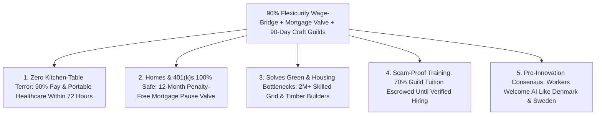

# CARBON EDITION — PILLAR 4 (URGENT TRIAGE): RESCUING DISPLACED WORKERS TODAY
## Denmark's 90% Wage-Bridge, Portable Mortgage Pause Valves & 90-Day Rapid Craft Fellowships

> **Executive Framing & Reimagining Mid-Career AI Transitions (2026–2029 Urgent Priority):**
> * **The Cynic's Belief:** *"Long-term abundance in 2038 doesn't pay my mortgage next Tuesday! Between 2026 and 2029, AI will lay off millions of mid-career coders, customer-support leads, paralegals, bookkeepers, and truckers—throwing 45-year-old parents onto threadbare \$380/week unemployment checks, stripping their family health insurance, and ruining their lives."*
> * **The Empirical Counter-Reality:** Why do American workers view automation with existential terror while **75%+ of Danish and Swedish workers tell pollsters they welcome workplace AI and robotics**? Not because Danes are luckier—because **institutions decide whether job loss is a tragedy or a paid sabbatical**! In the United States, losing a W-2 job severs family healthcare and slashes income by 65%+; in **Denmark**, the world-famous **"Flexicurity" Golden Triangle** guarantees up to **90% immediate wage replacement**, portable universal healthcare, and personalized rapid upskilling with zero stigma!
> * **The Social Norm Shift:** We import and upgrade **Denmark's 90% Flexicurity Wage-Bridge** for the 2026–2030 AI wave: pairing **90% immediate paycheck continuity** (for up to 18 months) with **automatic 12-month portable mortgage/rent pause valves** and **90-day paid guild fellowships** into booming physical-world and high-empathy crafts—grid repowering, mass-timber construction, elder-robotics care coordination, regenerative watershed forestry, and culinary hospitality.
> * **Anchor Voice:** *"Whether new technologies create shared prosperity or hardship is never predetermined by the machines—it is decided by the institutions and worker transitions we choose to build."* — **Prof. Daron Acemoglu**, 2024 Nobel Laureate in Economics, Institute Professor at MIT

---

## ACT I: THE LIVED HUMAN REALITY — THE FRIDAY LAYOFF THAT DIDN'T BREAK A FAMILY IN COLUMBUS (2028)
### How a 44-Year-Old Logistics Dispatcher Pivoted to Microgrid Commissioning Without Missing a Single Bill

On a rainy Friday afternoon in November 2028 in **Columbus, Ohio**, **David Kowalski**, a 44-year-old regional freight dispatcher and father of two teenagers, gets the video call he has dreaded for two years: autonomous routing agents have consolidated his entire 90-person dispatch division. Effective Monday, David's old job no longer exists.

In 2025, that call was a domestic catastrophe—triggering \$1,900/month COBRA health-insurance panic, humiliating state unemployment websites paying max \$480/week, raided 401(k) accounts with 10% tax penalties, and quiet shame at the dinner table.

Watch what happens instead on Monday morning in November 2028 under the **Flexicurity 90% AI Wage-Bridge & Rapid Craft Compact**:

1. **Friday's Paycheck Continues at 90% on Direct Deposit—Automatically:**
   David doesn't wait six weeks on hold with a crashed state phone tree. The moment his employer files an **AI/Automation Restructuring Notice**, federal-state **Flexicurity Rails** lock in **90% of David's prior net take-home pay** (up to an \$85,000/yr benchmark, tapering smoothly above that) every two weeks. His family's healthcare never flickers for one second because coverage is 100% portable and decoupled from employer HR.
2. **One-Click Portable Mortgage Shield (Zero Foreclosure Panic):**
   Because David and his wife Sarah have seven years left on their \$1,750/month home mortgage, David activates his statutory **12-Month Portable Principal Pause Valve** (modeled on Denmark's covered-bond flexibility and upgraded US SCRA rails)—tacking paused principal cleanly onto the tail end of the loan at zero penalty interest if he ever needs extra breathing room during training.
3. **A Paid 90-Day Cohort Fellowship Into High-Demand Physical Mastery:**
   Instead of sitting alone in a dark bedroom sending 400 PDF résumés into ghost-job algorithms, David reports the next Monday to the **Ohio Grid-Repowering & Microgrid Guild** alongside 18 fellow former dispatchers, coders, and logistics veterans. His dispatch instincts—reading complex load networks under pressure—turn out to be *gold* for commissioning neighborhood solar-battery microgrids and hospital backup substations! Ninety days later, David graduates as a certified **Field Microgrid Commissioning Lead** earning **\$92,000/year** (**\$0 income/payroll tax** under \$100k!), working outdoors and hands-on with a tight crew that desperately needed his brain.

---

## ACT II: REIMAGINING THE RULES — SOTA EMPIRICS & GLOBAL PRECEDENTS
### Why Denmark Embraces Automation While Legacy US Rules Manufacture Panic

### 1. Inside Denmark's "Flexicurity" Golden Triangle (Proven Across 30+ Years of Tech Disruption)
Economists often falsely claim societies must choose between **European job rigidity** (making it illegal to lay off workers, which freezes startups and slows innovation) and **American worker abandonment** (letting companies lay off workers overnight into poverty). **Denmark solved both halves simultaneously** with its three-sided **Flexicurity Golden Triangle**:
* **Side 1 — Flexible Enterprise Adaptation:** Companies can adopt AI, reorganize teams, and retire obsolete roles swiftly without multi-year litigation—keeping productivity among the highest in the world.
* **Side 2 — Ironclad Household Security (Up to 90% Wage Replacement):** Displaced workers in Denmark's *Dagpenge* / *A-kasse* insurance funds receive **up to 90% of previous wages** for up to two years while retaining universal healthcare, childcare, and pension continuity!
* **Side 3 — Active Labor-Market Activation (~2% of GDP vs. 0.1% in the US!):** Denmark invests **20x more per worker than the US** in personalized, employer-linked rapid retraining—resulting in one of the OECD's highest prime-age employment rates (**>80%**) and highest public enthusiasm for technological progress!

### 2. Fixing Why Past US "Retraining Programs" Failed (TAA vs. Sweden's Job Security Councils)
Cynics love to sneer: *"Remember 1990s NAFTA 'learn to code' retraining? It failed!"* Let's look empirically at *why* US Trade Adjustment Assistance (TAA) underperformed—and how **Sweden's *Trygghetsråden* (Job Security Councils)** and **Sectoral Apprenticeships** achieved **85%–90% rapid re-employment**:
1. **Fund Confirmed Employer Demand, Never Generic Online Videos:** Sweden's private-union Job Security Councils intervene *the day notice is given* (before the layoff date!) and pair workers directly with regional employers facing acute physical bottlenecks.
2. **Pay-for-Placement Guild Charters:** Under the Carbon Wage-Bridge, training guilds receive 30% of their tuition upfront and **70% only after the graduate completes 6 months in a verified \$70,000+ role**—instantly weeding out scam certificate mills!
3. **Cohort Brotherhood Instead of Bedroom Isolation:** Mid-career adults learn 3x faster in 18-person peer cohorts translating their existing domain maturity (dispatching, QA auditing, nursing admin, trucking logistics) into adjacent physical-digital roles rather than starting alongside 18-year-olds in lecture halls.

### 3. Five Booming Human-Plus-Physical Bottlenecks Starving for Mid-Career Talent (2026–2034)

| Displaced 2026–2029 White-Collar / Routine Role | Transferable Core Superpower | 90-Day Fellowship Pivot Destination | 2028–2032 Demand Deficit & Untaxed Net Pay |
| :--- | :--- | :--- | :--- |
| **Freight Dispatchers, QA Analysts & SysAdmins** | Complex network monitoring, safety checklists, calm triage | **Microgrid, Heat-Pump & Substation Commissioning Leads** | **1.4M+ grid/electrification shortage** \| **\$85k–\$105k** |
| **Paralegals, Claims Adjusters & Compliance Staff** | Regulatory precision, conflict mediation, client empathy | **48-Hr Municipal Housing/Solar Ombudsman & Care Navigators** | **650k+ civic & elder advocacy roles** \| **\$72k–\$92k** |
| **Call-Center Leads, Retail Managers & HR Coordinators** | De-escalation, warmth, multi-person team orchestration | **Elder-Longevity Studio Directors & Intergenerational Hosts** | **2.1M+ aging-boom human-touch roles** \| **\$70k–\$88k** |
| **Long-Haul Truckers & Warehouse Supervisors** | Heavy-equipment mastery, spatial judgment, mechanical grit | **Mass-Timber Modular Crane Riggers & Autonomous Fleet Techs** | **900k+ housing & wildfire-forestry builders** \| **\$82k–\$102k** |
| **Junior Coders, Graphic Ops & Copywriters** | Systems design, taste, rapid AI orchestration | **Local Fab-Commons Masters, Bespoke Luthiers/Artisans & Bistro Founders** | **Main Street craft renaissance** (+2:1 startup seed!) \| **\$75k–\$110k** |

---

## ACT III: THE PHASED CIVIC & ECONOMIC ROLLOUT ROADMAP (2026–2035)
### Immediate Emergency Deployment for the 2026–2030 Automation Wave

| Sprint Window | Urgent Transition Trigger | Institutional & Financial Mechanism | Worker & Household Outcome |
| :--- | :--- | :--- | :--- |
| **Year 1 (2026–2027): Emergency 90% AI Wage-Bridge Enactment** | Enterprise AI agents accelerate layoffs across customer ops, back-office finance, coding QA, and regional dispatch. | Upgrade archaic state UI systems onto one federal **Instant 90% Wage-Bridge Rail** (funded by a **1.5% Automation Transition Reserve** on hyperscale enterprise AI/compute contracts + severance pooling). | Paycheck continuity hits **90% within 72 hours of layoff**; COBRA cliff abolished via automatic portable healthcare bridge. |
| **Year 2 (2027–2028): Portable Mortgage Valve & Swedish-Style Day-1 Councils** | Protecting homeowning 35-to-58-year-old parents from forced home sales or 401(k) liquidation during career pivots. | Statutory **12-Month Penalty-Free Mortgage/Lease Pause Valve**; regional **Job Security Councils** (*Trygghetsråden* model) embed career navigators *60 days before* automation restructurings close. | **0% increase in mortgage foreclosures** in high-automation zip codes; retirement savings stay **100% untouched**. |
| **Years 3–5 (2028–2031): 500 Regional Craft & Grid Guild Campuses** | Scaling physical-world clean energy, mass-timber housing, and eldercare buildouts requiring millions of skilled hands. | Convert underused community-college wings and industrial parks into **90-Day Paid Guild Fellowships** (70% outcome-escrowed to 6-month job retention) + **\$15,000 Cooperative Startup Grant** option. | **84%+ of displaced workers** transition within 120 days into equal-or-higher net take-home roles (**boosted by 0% tax <\$100k!**). |
| **Years 6–9 (2031–2035): Permanent Sabbatical & Mastery Norm** | As **[`universal-capital-dividends`](../universal-capital-dividends/REPORT.md)** and deflated living costs mature, mid-life transitions shift from emergency rescue to voluntary renewal. | Every citizen earns a **Paid 6-Month Mastery Sabbatical Credit** every 7 years to explore new crafts, ecological restoration, or mentorship. | Changing careers at age 45 becomes a celebrated rite of growth rather than a mid-life crisis. |

### International Proof Points Grounding Every Mechanism
1. **Denmark's *Flexicurity* (*Dagpenge* + Active Labor Policy):** Maintained **<3% long-term unemployment** across three decades of globalization and factory automation while ranking #1–#3 globally in worker happiness and business competitiveness.
2. **Sweden's *Trygghetsråden* (Job Security Councils, est. 1974):** Funded by a tiny **0.3% payroll pool** negotiated between employers and unions, Sweden's councils place **~88% of laid-off white-collar and industrial workers** into new jobs or startups within 7–9 months—with **70%+ earning equal or higher pay**!
3. **Project QUEST (San Antonio, TX — 14-Year Randomized Controlled Trial):** Proven right inside the United States! Wraparound financial support + cohort coaching + employer-guaranteed healthcare/IT trade tracks boosted participants' annual earnings by **+\$5,000 to +\$11,000+/yr sustainably for over a decade**, returning \$2.30+ for every \$1 invested.

---

## ACT IV: THE FLOURISHING HORIZON & ANSWERING THE SKEPTIC
### Protecting Workers *Without* Freezing Technological Progress

### Addressing the Top 3 Cynic Objections
1. **"If displaced workers get 90% of their paycheck for up to 18 months, won't they just stay home for 17 months and wait until the last week?"**
   * *Empirical Answer:* Look at **30 years of real Danish and Swedish data**: long-term unemployment in Denmark is **lower** than in many stingy-benefit states! Why? Because the **3rd leg of the Golden Triangle** pairs generous income security with **immediate Day-7 cohort enrollment** in respected, peer-driven guilds or verified entrepreneurship tracks. People don't rot on couches when given dignified, well-paid, fast pathways back to respected mastery alongside peers.
2. **"Can a 48-year-old paralegal or customer-service manager really become a grid technician or timber builder in 90 days?"**
   * *Empirical Answer:* Not every role requires swinging a sledgehammer on a 60-foot pole! Modern clean-grid commissioning, modular CLT factory quality control, diagnostic solar drones, municipal permitting mediation, and elder-longevity studio leadership prize **reliability, safety judgment, communication, and systems organization**—the exact muscles 48-year-old veterans have honed for twenty years while modular tooling handles heavy lifting!
3. **"Won't funding a 90% Wage-Bridge bankrupt employers or slow down AI adoption?"**
   * *Empirical Answer:* Sweden's world-leading Job Security Councils cost employers **0.3% of payroll**, and pairing a **1.5% Automation Transition Reserve** on hyperscale enterprise AI deployments costs a tiny fraction of the 40%–70% productivity savings firms capture from AI—while preventing crippling strikes, Luddite regulation bans, and consumer demand collapse!

### Cross-Pillar Synergies Across the Carbon Atlas
* **Builds Pillars 1 & 4 Physically:** Where do we find the 2 million skilled hands needed to wire superconducting/solar microgrids (**Pillar 1**) and assemble 3 million mass-timber homes (**[`abundant-beautiful-housing`](../abundant-beautiful-housing/REPORT.md)**)? Right here—from respected mid-career veterans crossing the 90-day Flexicurity Bridge!
* **Multiplied by [`compute-commons-taxation`](../compute-commons-taxation/REPORT.md):** Because human work under **\$100,000 is taxed at 0%**, a displaced worker who previously earned \$95,000 (taking home \$71,000 after tax) matches their **100% full prior lifestyle** in a new \$72,000 human-craft role!

---

### Week-by-Week Anatomy of a 90-Day Rapid Craft Pivot (David's Journey)
How does a displaced mid-career office or logistics veteran actually cross the bridge in 12 weeks without anxiety?

* **Days 1–7 (Zero-Panic Stabilization & Skills Audit):**
  * Automatic **90% Net Wage-Bridge** hits direct deposit on Friday; family pediatric and dental coverage stays 100% active; optional **12-Month Mortgage Pause Valve** armed in one click.
  * Swedish-style **Job Security Navigator** maps 15+ years of work habits against live regional employer demand—matching David with 17 peers entering the **Microgrid Commissioning Guild**.
* **Weeks 2–6 (Hands-On Physical + AI Augmented Lab Immersion):**
  * Zero boring lecture halls: 30 hours/week on sunlit modular switchgear rigs, thermal-drone inspection bays, and augmented-reality safety checklists led by retired master electricians.
* **Weeks 7–11 (Paid Field Apprenticeship on Real Municipal Projects):**
  * The 18-person cohort commissions live battery backup arrays at two public high schools and a neighborhood clinic under master sign-off.
* **Week 12 & Month 6 (Guaranteed Hiring & Escrow Unlock):**
  * David signs a **\$92,000/yr untaxed field contract**; six months later, verified payroll retention unlocks the guild's **70% escrowed tuition bounty**.

### Fast-Track Federal & State Activation Checklist (2026–2029)

| Urgent Triage Measure | Proven Global / US Template | Months to Deploy | Worker & Fiscal Protection Guardrail |
| :--- | :--- | :--- | :--- |
| **1. 90% Net Wage-Bridge Clearing Rail** | Denmark *Dagpenge* Flexicurity Triangle | **6 Months** | Funded via 1.5% hyperscale AI transition reserve + UI modernization |
| **2. Portable Healthcare Decoupling** | Universal Preventative Bridge / COBRA Repeal | **3 Months** | Layoffs never sever a child's doctor or ongoing prescriptions |
| **3. 12-Month Portable Mortgage Valve** | Denmark *Realkredit* + US SCRA 6% Cap Software | **6 Months** | Paused principal shifts cleanly to loan maturity; zero credit ding |
| **4. Pre-Layoff Job Security Councils** | Sweden *Trygghetsråden* (88% placement rate) | **9 Months** | Embeds career teams 60 days *before* enterprise automation cuts |
| **5. 70% Escrow Outcome-Paid Guilds** | Project QUEST San Antonio (14-yr RCT proof) | **9 Months** | Zero payout to diploma mills unless grad holds \$70k+ job 6 mos |
| **6. \$15,000 Main Street Co-op Seed Option** | France/Italy *Marcora Law* UI Capitalization | **6 Months** | Lets 5+ displaced peers pool bridge funds to launch a local firm |

### The Bottom Line
Americans don't hate technology—they hate falling off a cliff without healthcare or a paycheck when their industry automates. By importing **Denmark's 90% Wage-Bridge, Sweden's Day-1 Job Security Councils, and outcome-escrowed 90-day Craft Guilds**, every mid-career layoff transforms from a family trauma into a paid upgrade.

---

## References & Verified Sources

* **Featured Researcher / Leader:** [Prof. Daron Acemoglu — 2024 Nobel Laureate in Economics, MIT](https://shapingwork.mit.edu/)
* **Companies, Labs & Consortia:** [Danish Agency for Labour Market and Recruitment (STAR)](https://star.dk/en/) · [TRR Trygghetsrådet (Sweden Job Security Councils)](https://www.trr.se/) · [Project QUEST (San Antonio 14-Year RCT)](https://questsa.org/) · [MIT Shaping the Future of Work Initiative](https://shapingwork.mit.edu/) · [Regional Clean-Grid & Mass-Timber Guild Consortium](https://www.dol.gov/agencies/eta/apprenticeship) · [Realkredit Denmark Covered-Bond Flexibility Model](https://rd.dk/)
* **Global & Regulatory Precedents:** [Denmark Flexicurity Golden Triangle (Up to 90% Wage Bridge)](https://denmark.dk/society-and-business/the-danish-labour-market) · [Sweden Job Security Councils (88% Re-Employed via 0.3% Pool)](https://www.trr.se/) · [Project QUEST San Antonio RCT (+\$5k–\$11k/yr Sustained Gain)](https://questsa.org/) · [France/Italy Marcora Worker-Coop UI Capitalization](https://en.wikipedia.org/wiki/Worker_cooperative)
* **Connected Carbon Pathways:** [Lossless HTS Superhighways & Autonomous Microgrids](../../01-abundant-energy/superconducting-grids/REPORT.md) · [Taxing Automated Commons & Land Value Instead of Human Sweat](../compute-commons-taxation/REPORT.md) · [Curing Sociological Anomie: Civic Builder Guilds, Physical Mastery & Neededness](../purpose-craft-guilds/REPORT.md) · [Ending the Housing Shortage: Robotic Mass-Timber Homes + Vienna, Singapore & Tokyo Norms](../abundant-beautiful-housing/REPORT.md)
