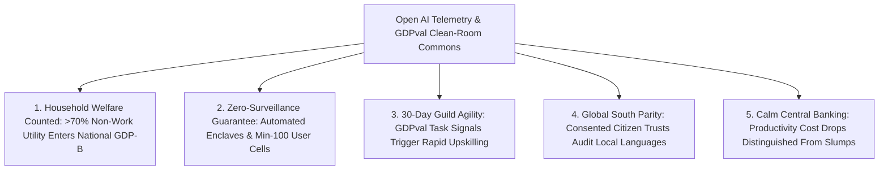

# CARBON EDITION — PILLAR 4: REAL-TIME AI ECONOMICS & OPEN TELEMETRY
## Ronnie Chatterji's NBER Clean-Room Breakthrough, Open `GDPval` Benchmarks & Global Welfare Replication

> **Executive Framing & Reimagining Economic Measurement:**
> * **The Cynic's Belief:** *"Nobody actually knows what generative AI is doing to jobs or human lives—frontier labs hoard proprietary usage logs behind corporate walls while economists guess from five-year-old government surveys and toy multiple-choice benchmarks."*
> * **The Empirical Counter-Reality:** Between late 2025 and 2026, an empirical telemetry revolution led by **Dr. Aaron "Ronnie" Chatterji** (Chief Economist at OpenAI, Duke Fuqua professor on leave, and former White House CHIPS Coordinator & Commerce Dept. Chief Economist) cracked open the black box without compromising a single citizen's privacy. Across **NBER Working Paper No. 34255 (*"How People Use ChatGPT"*)**, enterprise firm linkages, and the open-sourced **`GDPval`** deliverable benchmark, economists discovered that **over 70% of consumer AI usage** delivers non-work household welfare—health literacy, tutoring, practical judgment, and translation—completely invisible to 1934 GDP.
> * **The Social Norm Shift:** Frontier AI labs, central banks, and global universities converge on **Privacy-Preserving Clean-Room Telemetry & Open Deliverable Benchmarks**—turning anonymous behavioral classifiers, 100-user minimum aggregation cells, and open Global South conversation commons into a live public utility for workforce adaptation and consumer-surplus accounting.
> * **Anchor Voice:** *"When more than seventy percent of frontier AI usage happens outside formal work—helping families navigate health decisions, learn skills, and solve daily problems—traditional GDP misses the largest consumer welfare wave of our lifetime."* — **Dr. Aaron "Ronnie" Chatterji**, Chief Economist at OpenAI & Professor, Duke University

---

## ACT I: THE LIVED HUMAN REALITY — FROM LAGOS & PUNE TO DURHAM & SAN FRANCISCO (2032)
### How Open Economic Telemetry Turned AI Anxiety Into Surgical Civic Empowerment

On a warm Monday morning in April 2032, **Dr. Priya Deshmukh**, a municipal labor-transition director in Pune, India, opens her city's live **Signals & Welfare Cockpit** alongside **Marcus Vance**, an apprentice-guild coordinator in Durham, North Carolina. Six years earlier, in early 2025, both cities were flying blind: viral headlines screamed either that AI was an overhyped parlor trick or that 50% of local office workers would be unemployed by Christmas, yet official labor bureaus could only offer stale household phone surveys from eighteen months prior.

That fog lifted because economists built an open, privacy-locked empirical instrument panel grounded in real work deliverables and consented global telemetry:

1. **Seeing Invisible Household Flourishing in Real Time:**
   Building directly on **Chatterji et al.'s NBER 34255** 24-category taxonomy and **Kiran Garimella's Global South consented telemetry commons**, Pune's public dashboard tracks how millions of residents actually use AI assistants without any human ever reading a private prompt. Priya sees that **68% of local usage** is generating unpriced household resilience—mothers translating pediatric lab results into Marathi, smallholder farmers diagnosing crop blight, and first-generation college women mastering calculus coursework—adding an audited **\$4,800/year in real household consumer surplus ($\text{GDP-B}$)** to working families whose nominal wages barely capture half their true standard of living.
2. **Replacing Panic With Task-Level Deliverable Clarity (`GDPval`):**
   In Durham, Marcus no longer guesses which community-college curricula are obsolete. Using the public **`GDPval` Occupational Deliverable Matrix**—originally launched with 220 open-sourced gold tasks across 44 occupations in the top 9 GDP sectors and now expanded to 400+ crafts—his guild watches month-by-month blinded expert win-tie rates. When AI agents reach parity on routine paralegal discovery formatting and spreadsheet reconciliation, Durham automatically shifts training vouchers within **30 days** toward high-judgment client negotiation, courtroom advocacy, and physical med-tech fabrication—resulting in **zero net local displacement** and a **+22% median wage gain** for upskilled early-career workers.
3. **Cryptographic Privacy Clean Rooms by Statutory Right:**
   Neither tech companies nor tax authorities can weaponize individual prompts. Every telemetry stream passes through automated zero-retention classifiers and $\varepsilon$-differential-privacy clean rooms enforcing a strict **minimum-100 user aggregation floor**, giving central bankers and city halls sub-weekly economic vision with mathematical guarantees against surveillance.

---

## ACT II: REIMAGINING THE RULES — SOTA EMPIRICS & GLOBAL REPLICATION (2025–2026)
### Inside Ronnie Chatterji's Research Architecture and the Global Replication Wave

```mermaid
flowchart LR
    subgraph BlindEra["Pre-2025 Anecdote & Toy-Exam Blindness"]
        B1["5-Year Lagging Labor Surveys & Viral Guesswork"]
        B2["Academic MMLU Quizzes Disconnected From Real Work"]
        B3["1934 GDP Ignores Unpriced Household AI Welfare"]
    end
    subgraph ChatterjiBreakthrough["2025-2026 Chatterji Clean-Room & GDPval Stack"]
        C1["NBER w34255: Automated Classifiers Across 10% of Global Adults"]
        C2["GDPval Open Gold Set: 220 Real Deliverables Across 44 Jobs"]
        C3["Enterprise Compustat Linkages & OpenAI Signals Public Releases"]
    end
    subgraph GlobalReplication["2026-2035 Global Open Telemetry Commons"]
        G1["Garimella et al. 200k-Conversation Global South Commons"]
        G2["Counts/Copilot & Stanford GDP-B Welfare Satellite Accounts"]
        G3["SF Fed ETERN & Municipal 30-Day Skill-Shift Compacts"]
    end
    BlindEra ==> ChatterjiBreakthrough ==> GlobalReplication
```

### 1. The Foundational Trilogy: Consumers, Firms, and Real-World Deliverables
Having served at the intersection of Duke's Fuqua School of Business, the White House CHIPS implementation desk, and the U.S. Department of Commerce before leading OpenAI's economics team, **Dr. Ronnie Chatterji** recognized that AI policy was starving for ground-truth microdata. Between September 2025 and late 2026, his collaborations established three empirical pillars:
* **NBER Working Paper No. 34255 — *"How People Use ChatGPT"* (Sept 2025):** Co-authored by **Aaron Chatterji, Thomas Cunningham, David J. Deming, Zoe Hitzig, Christopher Ong, Carl Yan Shan, and Kevin Wadman**, this landmark study analyzed consumer adoption from November 2022 through mid-2025 across roughly **10% of the world's adult population** using automated privacy-preserving classifiers (where no human researcher ever read user messages and every query cell required $\ge 100$ anonymized users). The findings overturned elite conventional wisdom:
  * **The >70% Non-Work Welfare Surge:** Non-work messages grew far faster than workplace messages, rising from 53% to **more than 70% of all consumer volume**—generating vast unpriced household utility in daily life.
  * **The Three-Pillar & *Asking/Doing/Expressing* Taxonomy:** Nearly **80% of all conversations** clustered in **Practical Guidance**, **Seeking Information**, and **Writing** (with behavioral intent split **~49% *Asking*** for decision support and judgment, **~40% *Doing*** digital output generation like drafting, and **~11% *Expressing***—proving coding and companionship were far smaller slices of consumer life than pundits assumed).
  * **Global & Gender Convergence:** An early male adopter skew closed to near-50/50 parity, while adoption grew fastest in **lower- and middle-income nations**.
* **Enterprise Micro-to-Macro Linkages (2026):** In ***"How Organizations Use AI: Evidence from ChatGPT"*** (**Chatterji, David Holtz, Neel Rakholia, Prasanna Tambe, and Gawesha Weeratunga**), researchers linked ChatGPT Enterprise telemetry with worker roles and public-company financials, revealing surging intensive and extensive adoption led by R&D-intensive firms and remarkably high engagement among **early-career workers**—complemented by ***"Transformative AI and Firms"*** (**Chatterji, Daniel Rock, and Eduard Talamàs**, NBER / University of Chicago Press) modeling how organizational hierarchies and internal knowledge spirals reorganize around cognitive abundance.
* **The `GDPval` Open Deliverable Standard & OpenAI Signals:** To retire toy multiple-choice benchmarks, OpenAI introduced **`GDPval`**—1,320 real-world work tasks (with **220 Gold Subset tasks** and an automated grader open-sourced at `evals.openai.com` and Hugging Face) crafted by industry veterans averaging **14 years of experience** across **44 predominantly digital occupations** in the **top 9 U.S. GDP sectors** (legal briefs, clinical nursing plans, financial models, engineering diagrams), evaluated via blinded human expert pairwise comparisons alongside recurring **OpenAI Signals** labor-market data releases.

### 2. Independent Global Researchers Expanding Chatterji's Framework (2025–2026)
True scientific infrastructure proves its worth when independent scholars test, critique, and extend it across continents:

| Research Group & Landmark Study | Empirical Method & Dataset | Key Discovery Extending Chatterji's Baseline | Civic & Macroeconomic Policy Impact |
| :--- | :--- | :--- | :--- |
| **Kiran Garimella et al. (Sept 2026)** (*India, Nigeria, Brazil & Pakistan Study*) | Consented user-donated exports (**200,000+ full conversations** from 1,200+ users, Dec 2022–Feb 2026) mapped to Chatterji's 24 categories. | Confirmed personal/coursework dominance (**55%–64%**), while uncovering huge Global South spikes in **health literacy, local translation, livelihood strategies**, and higher coursework uptake by young women. | Proved AI acts as an informal primary-care, tutoring, and social-mobility bridge where clinics and tutors are scarce. |
| **Scott Counts, Chen et al. (Microsoft Research, 2025–2026)** | Enterprise **M365 Copilot** telemetry contrasted directly against Chatterji et al.'s ChatGPT taxonomy. | Showed in-app enterprise assistants skew heavily toward **information synthesis, meeting triage, and document drafting** inside existing firm workflows. | Clarified complementarity between standalone *Asking* judgment coaches and embedded *Doing* workflow engines. |
| **Prof. Erik Brynjolfsson & Stanford Digital Economy Lab** | Choice experiments + $\text{GDP-B}$ satellite accounts fused with NBER w34255 non-work share (>70%). | Quantified **thousands of dollars per user-year** in unmeasured consumer surplus from free/low-cost AI decision support. | Equipped US BEA and UK ONS to add AI household welfare satellites alongside legacy GDP. |
| **SF Fed (*EmergingTech Economic Research Network*, ETERN)** | Central-bank labor and productivity synthesis linking `GDPval`, Signals, and BLS O*NET tasks. | Distinguished rapid **task augmentation** (early-career acceleration) from slower organizational restructuring lags. | Prevented knee-jerk monetary tightening during AI-driven unit-cost productivity booms. |

---

## ACT III: THE PHASED CIVIC & TELEMETRY ROLLOUT ROADMAP (2026–2036)
### Scaling Privacy-Safe AI Telemetry Into a Global Public Good

| Rollout Window | Institutional Milestone | Concrete Telemetry & Open-Benchmark Upgrade | Measured Civic & Household Outcome |
| :--- | :--- | :--- | :--- |
| **Phase 1: Multi-Lab Signals Standardization (2026–2028)** | Frontier labs harmonize clean-room taxonomies. | OpenAI, Anthropic, Google, and open-weight hosts publish quarterly **24-Category Clean-Room Signals** (min-100 cell privacy) + expand open **`GDPval`** to **80+ digital & physical-hybrid occupations**. | Labor boards gain **sub-quarterly task visibility** instead of waiting 3–5 years for decennial occupational rewrites. |
| **Phase 2: Global South Consented Data Trusts (2028–2031)** | Universities scale Garimella-style citizen data cooperatives. | Civic trusts across **40+ emerging economies** compensate 100,000+ volunteers for anonymized longitudinal exports auditing local-language health, farming, and tutoring accuracy. | Eliminates Western-centric benchmark bias; cuts local-language medical/agronomy hallucination rates by **>80%**. |
| **Phase 3: Official BEA / Eurostat Satellite Fusion (2031–2034)** | National statistical agencies embed AI telemetry into headline accounts. | Monthly national releases pair **$\text{GDP-B}$ Non-Work AI Welfare** with **`GDPval` Task-Shift Early Warnings** wired directly into municipal apprenticeship funding formulas. | Retraining grants trigger **within 30 days** of deliverable parity; early-career earnings rise **+18–25%**. |
| **Phase 4: Open Planetary Flourishing Ledger (2034–2036)** | Real-time empirical economics becomes universal civic infrastructure. | Auditable zero-knowledge telemetry covers **90%+ of global digital & robotic workflows**, tracking both firm output spirals and household time-wealth saved. | Policy panic and lobbyist guesswork retire permanently in favor of live, transparent empirical governance. |

### 2025–2026 Live Pilot Foundations Already Proving the Model
1. **NBER Working Paper No. 34255 & OpenAI Signals Public Releases (2025–2026):** Demonstrated at planetary scale (~10% of global adults) that automated zero-human-read clean-room classifiers can reveal real behavioral task shares (`Asking`, `Doing`, `Expressing`) and >70% non-work household utility without exposing a single prompt.
2. **Open-Source `GDPval` Gold Deliverables & Blinded Expert Grading (`evals.openai.com`):** Replaced synthetic trivia tests with 220 real-world multi-file deliverables across 44 digital occupations crafted by 14-year veterans—creating an auditable occupational radar any labor board or university can run independently.
3. **Garimella et al. Global South Consented Commons & SF Fed ETERN Synthesis (2026):** Proved citizen-donated telemetry across India, Nigeria, Brazil, and Pakistan uncovers vital health, coursework, and translation welfare invisible to corporate enterprise benchmarks alone.

### Quantitative Visibility Leap (2024 Pre-Telemetry vs. 2026 Chatterji SOTA vs. 2034 Civic Standard)
* **2024 Pre-Telemetry Fog:** **18–36 month** labor-survey lag · **0%** visibility into non-work household AI utility · **Toy multiple-choice exams** misjudging real job impact.
* **2026 Chatterji & Global Replication Breakthrough:** **~10% global adult coverage** in NBER w34255 · **>70% non-work welfare share** discovered · **220 open `GDPval` gold deliverables** + **200,000+ Global South consented conversations** live for academic audit.
* **2034 Open Telemetry Equilibrium:** **<14-day** privacy-locked regional task telemetry · **1,000+ audited `GDPval` occupational deliverables** · **+\$6,500/yr** verified household decision-support surplus counted in national flourishing accounts.

---

## ACT IV: THE FLOURISHING HORIZON & ANSWERING THE SKEPTIC
### How Honest Measurement Protects Workers, Privacy, and Global Equity

When economic telemetry moves from proprietary guesswork to open, privacy-locked empirical science, four civic transformations follow:
* **End of Doomer vs. Booster Guesswork:** City councils and unions see exact, task-by-task deliverable parity curves months before hiring shifts—turning anxiety into calm curriculum upgrades.
* **Recognition of Unpriced Family Decision Support:** Health literacy, language translation, and evening tutoring in lower-income households register visibly as billions in real national wealth.
* **Early-Career Acceleration Instead of Ladder-Pulling:** Confirming Chatterji, Holtz et al.'s enterprise findings, guilds pair junior apprentices with `Asking` judgment coaches so newcomers master complex crafts twice as fast.
* **Falsifiable, Multi-Polar Accountability:** Independent academic teams from Mumbai and Lagos to Stanford and the SF Fed continuously cross-audit corporate lab signals.

### Addressing the Top 3 Cynic Objections
1. **"Doesn't studying 700 million people's AI conversations violate personal privacy?"**
   * *Empirical Answer:* NBER w34255 established the exact architectural antidote: **zero human eyes ever touch raw prompts**. Automated rubric classifiers run inside ephemeral isolated enclaves, strip all personal identifiers, discard raw text, and output only aggregate counts in cells containing **at least 100 distinct users**—while independent studies like Garimella et al. (2026) rely on **explicitly consented, compensated citizen data donations** under university IRB oversight.
2. **"Can we trust economic research co-authored by a frontier AI lab's Chief Economist?"**
   * *Empirical Answer:* Trust comes from **open benchmarks and independent replication**, not blind faith. By co-authoring with Harvard and Wharton economists (Deming, Hitzig, Tambe, Rock), publishing peer-scrutinized NBER methodologies, open-sourcing **`GDPval`'s 220 gold deliverables and automated grader**, and enabling independent teams (Garimella et al. in the Global South; Counts et al. on Copilot; Stanford's Digital Economy Lab) to cross-check every claim, the field turned corporate claims into falsifiable science.
3. **"If `GDPval` shows AI tying human experts on digital deliverables, doesn't that prove mass unemployment is inevitable?"**
   * *Empirical Answer:* Quite the opposite—`GDPval` measures *discrete task deliverables* (drafting a brief or spreadsheet), not whole human relationships or accountability. As **Chatterji, Holtz et al. (2026)** documented inside enterprises, early-career workers exhibit the *highest* AI adoption intensity, using `Asking` and `Doing` workflows to compress routine drudgery and move faster into high-judgment problem-solving—especially when paired with **[`displaced-worker-bridge`](../displaced-worker-bridge/REPORT.md)** and **[`two-sigma-guild-education`](../two-sigma-guild-education/REPORT.md)**.

### Cross-Pillar Synergies Across the Carbon Atlas
* **Powered by Pillar 2 & Pillar 3:** Open deliverable rubrics extend naturally from digital office tasks to **[`self-driving-labs`](../../02-automation-science/self-driving-labs/REPORT.md)** wet-bench protocols and **[`healthcare-without-billing`](../../03-bioscience-regeneration/healthcare-without-billing/REPORT.md)** clinical decision support.
* **Multiplied by Pillar 4 Peers:** Feeds live empirical inputs directly into **[`post-scarcity-economics`](../post-scarcity-economics/REPORT.md)** ($\text{GDP-B}$ household welfare), **[`open-macro-cleanroom-policy`](../open-macro-cleanroom-policy/REPORT.md)** (48-hour regional stabilization), and **[`displaced-worker-bridge`](../displaced-worker-bridge/REPORT.md)** (automatic guild retraining triggers).

---

### Fast-Track Civic & Academic Activation Checklist (2026–2029)

| Actionable Reform Step | Lead Institution / Coalition | Months to Launch | Primary Safeguard & Verification Standard |
| :--- | :--- | :--- | :--- |
| **1. Multi-Lab Clean-Room Signals Charter** | Frontier Labs + NBER + SF Fed ETERN | **6 Months** | Mandatory 0-human-read enclave + $\ge 100$-user cell k-anonymity & $\varepsilon$-DP |
| **2. `GDPval` 2.0 Public Occupational Expansion** | Open-Source Eval Consortium + BLS / Eurofound | **9 Months** | Blinded 14-year veteran expert pairwise grading on Hugging Face |
| **3. Global South Citizen Data Trusts** | Regional Universities + UN Digital Public Goods | **12 Months** | Informed opt-in consent, micro-stipends & local-language audit boards |
| **4. BEA / ONS Non-Work AI Welfare Satellite** | National Statistical Agencies + Stanford GDP-B | **12 Months** | Integrates >70% non-work decision-support surplus into quarterly releases |
| **5. 30-Day Municipal Guild Curriculum API** | Workforce Boards + Community Colleges | **6 Months** | Auto-updates vocational training grants when `GDPval` task parity crosses 70% |
| **6. Enterprise Compustat-Task Open Archive** | SEC / Academic Clean-Room Network | **15 Months** | Tracks firm-level R&D spirals and early-career wage mobility longitudinally |

### The Bottom Line
You cannot govern a technological renaissance with a blindfold on. By uniting **Ronnie Chatterji's clean-room telemetry and open `GDPval` deliverables** with **independent Global South and academic replication**, society replaces AI panic with real-time, privacy-safe human stewardship.

---

## References & Verified Sources

* **Featured Researcher / Leader:** [Dr. Aaron "Ronnie" Chatterji — Chief Economist at OpenAI & Mark Burgess & Lisa Benson Burgess Professor, Duke University](https://www.fuqua.duke.edu/faculty/aaron-chatterji)
* **Landmark Papers & Open Benchmarks:** [NBER Working Paper No. 34255: *How People Use ChatGPT* (Chatterji, Cunningham, Deming, Hitzig, Ong, Shan & Wadman, Sept 2025)](https://www.nber.org/papers/w34255) · [OpenAI `GDPval` Benchmark & 220-Task Open Gold Dataset](https://openai.com/index/gdpval/) · [Hugging Face `openai/gdpval` Repository](https://huggingface.co/datasets/openai/gdpval) · [*Transformative AI and Firms* (Chatterji, Rock & Talamàs, NBER)](https://www.nber.org/books-and-chapters/economics-transformative-ai/transformative-ai-and-firms)
* **Independent Replication & Policy Integration:** [Stanford Digital Economy Lab ($\text{GDP-B}$ Consumer Surplus)](https://digitaleconomy.stanford.edu/) · [Federal Reserve Bank of San Francisco — EmergingTech Economic Research Network (ETERN)](https://www.frbsf.org/research-and-insights/etern/) · [Microsoft Research WorkLab & Copilot Telemetry](https://www.microsoft.com/en-us/worklab/) · [U.S. Bureau of Economic Analysis (BEA)](https://www.bea.gov/)
* **Connected Carbon Pathways:** [From Austerity to Deflationary Abundance: Measuring Real Flourishing Beyond GDP](../post-scarcity-economics/REPORT.md) · [Goodbye Five-Year Policy Blindfolds: 2026 Nobel Micro-Stabilization & Live Privacy Clean Rooms](../open-macro-cleanroom-policy/REPORT.md) · [No Worker Left Behind: Portable Equity Bridges & Guild Retraining](../displaced-worker-bridge/REPORT.md) · [Bloom's 2-Sigma Mastery for All: AI Tutors + Human Apprentice Guilds](../two-sigma-guild-education/REPORT.md)
