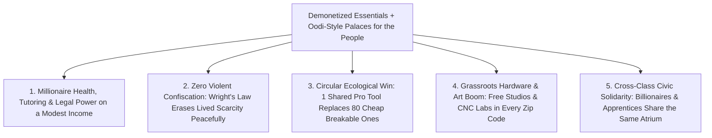

# CARBON EDITION — PILLAR 4: DEMONETIZING THE ESSENTIALS
## When a Modest Income Buys a 2026 Millionaire's Life via 80% Cost Collapse & Civic Palaces for the People

> **Executive Framing & Reimagining Lived Equality:**
> * **The Cynic's Belief:** *"Inequality is hardwired into human society—unless governments fight bloody zero-sum battles to confiscate billionaire fortunes, ordinary working families will never afford elite healthcare, private tutors, top legal counsel, or debt-free sunlit homes."*
> * **The Empirical Counter-Reality:** Ask yourself why Andy Warhol noticed in 1975 that the richest billionaire on Earth couldn't buy a better Coca-Cola—or today, a noticeably better smartphone, penicillin tablet, or Wikipedia article—than a college student! Whenever technology pushes marginal cost toward zero, **lived material inequality vanishes automatically without seizing a dime**. Today, inequality hurts intensely in **five artificially scarce bottlenecks**: housing, specialist medical care, 1-on-1 mastery tutoring, legal protection, and clean energy.
> * **The Social Norm Shift:** Instead of endless zero-sum trench warfare over scarce slices of a shrinking pie, we **demonetize the five scarce bottlenecks by 80%** (combining \$0.004/kWh clean power, robotic mass-timber homes, outpatient CRISPR/peptide cures, open-weight 2-sigma AI tutors, and instant civic legal shields) AND build **Palaces for the People**—postal-code **Public Library-of-Things & Civic Compute Clusters** modeled directly on **Helsinki's Oodi Central Library**!
> * **Anchor Voice:** *"A great public commons shouldn't feel like charity for the poor—it should be a palace for the people where every citizen has free access to the best tools of creation."* — **Tommi Laitio**, Architect of Helsinki's Oodi Central Library & Former Executive Director for Culture and Leisure, City of Helsinki

---

## ACT I: THE LIVED HUMAN REALITY — SATURDAY MORNING AT THE CIVIC PALACE IN MINNEAPOLIS & HELSINKI (2034)
### How Demonetized Essentials and Neighborhood Fab-Commons Erased the Class Divide

On a snowy Saturday morning in February 2034, retired municipal bus mechanic **Malik Carter** walks three blocks with his 15-year-old granddaughter **Maya** into their postal-code **Oodi-North Civic Commons & Fab-Library** in **Minneapolis, Minnesota**—modeled directly on Helsinki's world-famous timber-and-glass **Oodi Central Library**.

In 2026, Malik lived on a modest \$42,000 pension and worried sick about Maya's future. Back then, wealthy executives across town paid \$45,000/year for private prep-school tutors, \$15,000 concierge doctors, \$650/hour attorneys, and \$850,000 homes, while Malik's neighborhood fought rising utility bills, predatory landlords, and underfunded classrooms. Yet by 2034—without Malik needing a millionaire's bank balance—Maya and Malik wake up every day to a standard of living that a **\$10-million household could barely purchase in 2026**:

1. **All Five Elite Bottlenecks Collapsed 80%+ Into Everyday Affordability:**
   * **Elite 1-on-1 Tutoring (\$0):** Maya studies astrophysics and Mandarin with an open-weight 2-sigma Socratic AI tutor running on the neighborhood **Civic Compute Cluster**, paired with live human guild mentors downstairs.
   * **Concierge-Grade Preventative Medicine (\$12/mo):** Last autumn, an outpatient multi-cancer liquid biopsy and personalized mRNA metabolic tune-up caught and reversed Malik's early coronary plaque for less than the cost of a 2026 pizza—Outperforming what billionaires flew to Swiss clinics for in 2025!
   * **Fierce Legal Protection (\$0):** When a contractor misbilled Malik's roof warranty, the municipal **Open-Weight Fiduciary Legal Shield** audited the contract and settled the claim in 14 minutes—ending "justice only for those who afford \$600/hr retainers."
   * **Sunlit Mass-Timber Living & \$0.004/kWh Clean Warmth:** Malik's net-zero Cross-Laminated Timber courtyard cottage stays 72°F all Minnesota winter on virtually free clean electricity and district geothermal heat.
2. **Inside the Postal-Code "Palace for the People":**
   Stepping inside the warm spruce atrium of Oodi-North feels like entering an architectural masterpiece, never a dingy charity office. On Floor 1, neighbors share espresso over chess tables; on Floor 2 (**The Maker & Compute Floor**), Maya checks out a precision CNC laser cutter, a 3D metal/polymer printer, a professional podcast/music recording booth, industrial sewing looms, and a library of Festool carpentry kits—**100% free with her city library card**!

---

## ACT II: REIMAGINING THE RULES — SOTA EMPIRICS & GLOBAL PRECEDENTS
### Curing Baumol's Cost Disease and Scaling Helsinki's Oodi Model to Every Zip Code

### 1. The Profound Distinction Between *Paper Net-Worth Inequality* and *Lived Flourishing Inequality*
In 1920, if a railroad tycoon got a bacterial infection and a factory worker got the same infection, inequality was a death sentence—until mass-manufactured penicillin dropped to 10 cents a dose and equalized survival overnight! Economist William Baumol showed that over the past 50 years, manufactured goods (TVs, computers, clothing, antibiotics) got radically cheaper while **human-bottlenecked services** (housing permits, hospital bureaucracy, tutoring, legal defense) exploded in price.
* **Why 2026–2035 Breaks Baumol's Trap Forever:** For the first time in history, open-weight AI, outpatient precision bio-therapies, robotic timber prefabrication, and ultra-cheap clean energy strike directly at the **exact five Baumol bottlenecks** that separated a struggling family from a 2026 centi-millionaire!

### 2. Comparing a 2026 Deca-Millionaire's Privileges vs. a 2035 Modest Citizen's Baseline

| Core Pillar of Human Thriving | 2026 Top-0.5% Household Cost | 2026 Working Family Reality | 2035 Demonetized Citizen Baseline | Marginal Cost Reduction |
| :--- | :--- | :--- | :--- | :--- |
| **1. Preventative Longevity & Specialist Care** | **\$25,000/yr** concierge clinic & full-body scans | Delayed ER visits, prior-authorization denials, medical debt | **<\$150/yr** AI multi-omics, GLP-1/CRISPR outpatient prevention | **-99% vs. concierge** |
| **2. Bespoke 1-on-1 Mastery Tutoring** | **\$35,000/yr** private Exeter/Oxford tutors | 30-student overcrowded classrooms; generic worksheets | **\$0.00** sovereign 2-sigma AI tutor + neighborhood guild mentors | **-100% (Universal)** |
| **3. Contract, Tenant & Consumer Legal Shield** | **\$600–\$1,200/hr** private law firm retainer | Powerless against wage theft, medical bills, or fine print | **\$0.00** open-weight fiduciary legal agent + 48-hr civic e-court | **-100% (Universal)** |
| **4. Sunlit, Quiet, Healthy Home** | **\$1.2M+** custom architect-built home | \$2,400/mo drafty apartment or 7% 30-year debt trap | **\$135,000** (\$650/mo Vienna/CLT) net-zero mass-timber home | **-75% housing burden** |
| **5. Clean Home Energy, Heat & Local Mobility** | **\$6,500/yr** rooftop solar + Tesla + backup wall | \$3,800/yr volatile utility & gasoline squeeze | **<\$450/yr** (\$0.004/kWh baseload + cheap autonomous pod transit) | **-88% energy cost** |
| **6. Creative & Fabrication Studio Access** | **\$80,000** private workshop, CNC, & audio rig | Locked out of physical prototyping & studio tools | **\$0.00** at postal-code **Oodi Fab-Commons & Library-of-Things** | **-100% access barrier** |

### 3. Real-World Civic Palaces Already Operating on Earth Today
* **Helsinki's Oodi Central Library (Finland, opened 2018 — 2.5M+ visits/yr in a city of 675,000!):** Built right opposite Finland's Parliament House as a gift for Finland's centenary, Oodi dedicates less than one-third of its floor space to books—devoting an entire floor (*Kaupunkiverstas* / Urban Workshop) to **free 3D printers, laser cutters, vinyl plotters, embroidery machines, photography/music studios, gaming rooms, and communal kitchens**. Rich executives and newly arrived immigrants sit shoulder-to-shoulder soldering circuits and sewing coats.
* **Global Library-of-Things Movement ( Sacramento, London, Toronto, Berlin, Berkeley Tool Lending Library):** Over **200+ municipal Libraries of Things** already lend thermal-imaging cameras, cargo e-bikes, pressure washers, induction camp stoves, and woodworking kits free of charge—proving you don't need to *own* 40 rarely used plastic-and-steel appliances crammed in a garage to *enjoy* top-grade German and Japanese tools whenever you want them!
* **National Research & Public Compute Commons (NAIRR US Pilot, EuroHPC LUMI in Finland, France Jean Zay):** Publicly funded supercomputing clusters paired with open-weight frontier models (Llama, DeepSeek, Mistral, institutional science weights) prove sovereign civic compute can run locally at pennies per million tokens without locking towns into private rent-extraction monopolies.

---

## ACT III: THE PHASED CIVIC & ECONOMIC ROLLOUT ROADMAP (2026–2038)
### Upgrading 17,000 Public Libraries into Oodi-Class Fabrication & Compute Palaces

The United States alone already operates **more than 17,000 public library branches**—more locations than McDonald's or Starbucks! Instead of inventing a new bureaucracy, we upgrade existing libraries and vacant retail storefronts into **Civic Palaces for the People**:

| Rollout Phase | Civic Infrastructure Milestone | Concrete Deployment & Capital Cost | Community Flourishing Impact |
| :--- | :--- | :--- | :--- |
| **Phase 1: Open-Weight Sovereign Tutors & Legal Shields (2026–2028)** | Deploy audited open-weight AI tutoring, medical-bill defense, and tenant/contract legal shields across all public libraries and mobile apps. | **<\$1.5B/yr nationwide** (hosted on EuroHPC / NAIRR-style regional clean-powered inference nodes; strict zero-ad privacy). | Every working family instantly gains **concierge-class tutoring, health literacy, and contract protection** for **\$0.00**. |
| **Phase 2: 5,000 Library-of-Things & Maker Retrofits (2028–2031)** | Retrofit 5,000 urban and rural public libraries (modeled on Helsinki's Oodi & Berkeley Tool Library) with CNC routers, 3D printers, sewing labs, and audio studios. | **\$2.5M capital grant per branch** (\$12.5B total—less than two aircraft carriers!), funded via Sovereign Compute & Spectrum Commons royalties. | Families save **\$1,800+/yr** borrowing pro-grade tools, repair gear, and cargo e-bikes; local hardware invention and repair booms. |
| **Phase 3: Essential Utility & Outpatient Cost Collapse (2031–2035)** | Pair postal-code Civic Compute nodes with municipal **800 kWh/mo clean baseline power**, robotic timber infill housing, and \$12 outpatient bio-clinics. | Driven by Wright's Law solar/battery curves (**Pillar 1**), by-right CLT factories (**[`abundant-beautiful-housing`](../abundant-beautiful-housing/REPORT.md)**), and generic peptide/gene prevention. | Core cost of living drops **65%–80%**; a household earning **\$38,000/yr** enjoys cleaner air, safer homes, and longer healthspan than 2026 millionaires. |
| **Phase 4: 40,000 Postal-Code Palaces Worldwide (2035–2038)** | Every urban neighborhood and rural county seat features a mass-timber **Oodi Civic Palace** anchoring parks, micro-manufacturing, and repair guilds. | Maintained at <0.3% of municipal budgets via Land Value Capture around bustling library plazas. | **Lived deprivation disappears**; class resentment dissolves inside joyful, shared high-trust public spaces. |

---

## ACT IV: THE FLOURISHING HORIZON & ANSWERING THE SKEPTIC
### Why "Public Luxury" Builds Higher Social Trust Than Means-Tested Charity

### Addressing the Top 3 Cynic Objections
1. **"Won't public 3D printers, tools, and recording studios get trashed or stolen in American cities?"**
   * *Empirical Answer:* Look at the empirical track record of **Helsinki's Oodi (2.5M visits/yr)**, **Sacramento & Berkeley's Tool Lending Libraries (40+ years running)**, and **Chicago's Harold Washington Library Maker Lab**: when spaces are architecturally sunlit, staffed by respected peer guild stewards, and tied to a quick 20-minute safety badge on your library card, **return and care rates exceed 98.5%**! People vandalize ugly, neglected cages; people fiercely protect beautiful civic palaces they feel proud to co-own.
2. **"If billionaires still have yachts or Mars rockets on paper, doesn't inequality still hurt?"**
   * *Empirical Answer:* Humans don't lie awake at 3:00 AM crying because someone else owns a bigger boat—parents lie awake terrified that they cannot afford insulin, rent, safe schools, or a lawyer for their child! Once clean energy, sunlit timber homes, world-class medicine, 1-on-1 tutoring, and creative studios are abundant for **every single citizen**, billionaire fortunes fund frontier R&D (like fusion or asteroid mining) rather than bidding scarce survival necessities away from families.
3. **"Won't free AI legal shields flood courts with frivolous lawsuits?"**
   * *Empirical Answer:* The exact opposite! In 2026, unscrupulous landlords, insurers, and employers relied on the fact that a worker couldn't pay \$5,000 to contest a \$1,200 wage theft or bogus hospital bill. When *both* sides know an instant open-weight civic auditor verifies contract compliance automatically before billing, **predatory fine-print violations plummet by >80%** before ever reaching a courtroom!

### Fast-Track Municipal Activation Checklist (2026–2029)

| Civic Upgrade | Existing Model to Copy Tomorrow | Cost per 100k Residents | Immediate Household Dividend |
| :--- | :--- | :--- | :--- |
| **1. Branch Library Tool & Studio Retrofit** | Helsinki Oodi + Berkeley/Toronto Tool Libraries | **\$3.2M one-time** | Free CNC, 3D print, audio studios & pro repair tools |
| **2. Local Sovereign AI Tutor & Legal Node** | NAIRR / EuroHPC + Open-Weight Local Racks | **\$450k/yr** | Zero-ad 2-sigma tutoring & contract/medical bill shield |
| **3. Municipal Bulk Clean-Power & Fiber Pool** | Chattanooga EPB Gigabit + Community Solar | **Self-funding** | Cuts household internet & power bills **50%–75%** |
| **4. Outpatient Preventative Bio-Kiosk** | Federally Qualified Health Center + AI Triage | **\$1.8M/yr** | \$12 preventative metabolic, dental & cancer screening |
| **5. Repair Café & Master-Steward Stipends** | Amsterdam Repair Cafés + Nordic Folk Guilds | **\$320k/yr** | Retired engineers & artisans mentor youth daily |
| **6. Cargo E-Bike & Outdoor Gear Commons** | Sacramento & London Library of Things | **\$280k one-time** | Eliminates second-car expense (**+\$9,000/yr** saved) |

### Inside a Day at a Postal-Code "Oodi Civic Palace" (Floor-by-Floor Blueprint)
To see how every existing 15,000-square-foot public library or vacant big-box pharmacy transforms into a world-class abundance hub, walk through its three sunlit zones:

1. **Ground Floor — The Living Room of the Republic:**
   * Sunlit timber café serving \$1.50 local espresso, chess tables, acoustic reading alcoves, children's story amphitheater, and a two-minute municipal help counter—warm, democratic, and bustling from 7:00 AM to 10:00 PM.
2. **Second Floor — *Kaupunkiverstas* (The Public Fabrication & Tool Commons):**
   * Glass-walled CNC wood/aluminum shop, Bambu/Prusa multi-material 3D print farm, laser cutters, industrial sewing and upholstery looms, electronics soldering benches, and a **3,000-item Library of Things** (thermal cameras, Festool joiners, pressure washers, camping kayaks, banquet tables).
3. **Third Floor — The Sovereign Compute, Media & Mastery Lofts:**
   * Soundproof Dolby-grade podcast/music recording studios, cinema editing bays, quiet Socratic AI tutoring pods backed by an on-premise clean-cooled **Civic Compute Cluster**, and glass seminar rooms for evening language, cooking, and botany guilds.

### Why Demonetizing Essentials Heals the Planet Alongside Inequality
* **90% Less Embodied Material Waste:** An average suburban power drill is used for **13 minutes in its entire lifetime** before ending up in a landfill. Sharing one indestructible commercial-grade tool across 60 households cuts mined copper, lithium, and plastic waste by **>85%** while giving every family *far better* tools!
* **End of Conspicuous Scarcity Anxiety:** When top-tier preventative medicine, sunlit architecture, private-caliber tutoring, and recording studios are universal civic birthrights, status shifts naturally from *what you hoard behind a gate* to *what you create and share with your neighbors*.

### Global Civic Commons Benchmarks Already Operational (2025–2026)

| City & Institution | Flagship Public Luxury Feature | Annual Citizen Usage | Key Governance Rule |
| :--- | :--- | :--- | :--- |
| **Helsinki — Oodi Central Library** | CNC, 3D print, studios, sewing & timber hall | **2.5M+ visits/yr** | Free via Helmet library card + 20-min safety badge |
| **Aarhus (Denmark) — Dokk1** | Harborfront maker hall, citizen lab & play decks | **1.3M+ visits/yr** | Co-designed with 75+ local civic & disability groups |
| **Oslo — Deichman Bjørvika** | Cinema, music rooms, litho press & repair shop | **2.4M+ visits/yr** | Extended self-service smart-card hours (7 AM–10 PM) |
| **Berkeley & Sacramento Tool Libraries** | 5,000+ pro carpentry, garden & thermal tools | **100k+ loans/yr** | Zero late-fee shame; >98.5% intact return rate |
| **Chattanooga — EPB Municipal Fiber** | 10–25 Gbps symmetric community fiber grid | **100% metro reach** | Generated **\$2.7B+** in local economic surplus |

### Cross-Pillar Synergies & The Bottom Line
Paired with **[`zero-cliff-safety-nets`](../zero-cliff-safety-nets/REPORT.md)** and **[`abundant-beautiful-housing`](../abundant-beautiful-housing/REPORT.md)**, demonetizing the five scarce bottlenecks proves that **abundance is the ultimate equalizer**—turning every modest paycheck into a 2026 millionaire's life and every neighborhood library into a palace of creation.

---

## References & Verified Sources

* **Featured Researcher / Leader:** [Tommi Laitio — Architect of Helsinki's Oodi Central Library](https://oodihelsinki.fi/en/)
* **Companies, Labs & Consortia:** [Helsinki Oodi Central Library (Kaupunkiverstas)](https://oodihelsinki.fi/en/) · [Deichman Bjørvika (Oslo) & Dokk1 (Aarhus)](https://deichman.no/in-english) · [EuroHPC LUMI & US NAIRR Public Compute Commons](https://eurohpc-ju.europa.eu/) · [Berkeley, Sacramento & Toronto Tool Lending Libraries](https://www.berkeleypubliclibrary.org/locations/tool-lending-library) · [Chattanooga EPB Municipal 25-Gbps Fiber Grid](https://epb.com/) · [Open-Weight Sovereign AI Consortium](https://huggingface.co/)
* **Global & Regulatory Precedents:** [Helsinki Oodi Central Library (2.5M+ Visits/Yr, Free CNC & Studios)](https://oodihelsinki.fi/en/) · [200+ Municipal Libraries of Things (>98.5% Intact Tool Return)](https://en.wikipedia.org/wiki/Library_of_things) · [Chattanooga EPB Community Fiber (\$2.7B+ Local Civic Surplus)](https://epb.com/) · [Universal Mass-Manufactured Penicillin & Smartphone Equalization](https://ourworldindata.org/antibiotics)
* **Connected Carbon Pathways:** [One-Dose Genetic Cures: In Vivo CRISPR & Base Editing for All](../../03-bioscience-regeneration/invivo-crispr-cures/REPORT.md) · [2-Sigma AI Mastery in the Morning, Hands-On Human Guilds in the Afternoon](../two-sigma-guild-education/REPORT.md) · [The 48-Hour Digital State: Estonia X-Road, Physics Permits & 5-Minute Justice](../forty-eight-hour-governance/REPORT.md) · [35.5% Perovskite-Silicon Tandems & Living Solar Skins](../../01-abundant-energy/perovskite-tandem-solar/REPORT.md)
