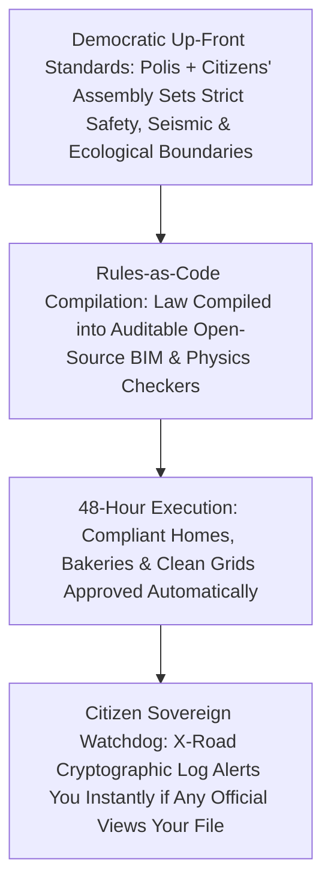

# CARBON EDITION (2026–2035): SOCIAL NORMS & HUMAN FLOURISHING
## The 48-Hour Digital State: Estonia X-Road, Physics Permits & 5-Minute Justice

> **The Cynic's Myth vs. The Empirical Reality:** Cynics groan that government is inherently slow, adversarial, and trapped in paper binders—that building a clean bus lane, opening a corner bakery, or resolving a tenant dispute *must* take years of red tape and \$500-an-hour lawyers. Yet **Estonia's X-Road e-State** has already run **99%+ of public services online 24/7** for years (3-minute taxes, 15-minute business incorporation, citizen-owned audit logs, saving **2% of GDP annually**), while **NREL's SolarAPP+** issues zero-second solar permits across U.S. cities and **British Columbia's Civil Resolution Tribunal** settles everyday legal disputes from a smartphone in days.

> *"A proactive digital state should be invisible—citizens shouldn't spend their precious lives standing in government lines carrying pieces of paper from one desk to another."*
> — **Kersti Kaljulaid**, Former President of Estonia

---

## 1. The Paperwork & Billable-Hour Chokehold (Late 2026)

Ask a young baker trying to open a neighborhood sourdough shop, a geothermal engineer permitting a clean district heating well (`01-abundant-energy`), or a working parent trying to recover a \$2,200 withheld security deposit why modern life feels rigged. None of them will blame the laws of physics. They will point to **19th-century procedural sludge**:

* **Four Years of PDF Binders to Build Clean Infrastructure:** In many Western cities in 2026, permitting a zero-emission bus lane, an infill mass-timber apartment building, or a grid battery facility takes **30 to 54 months** of sequential, manual PDF reviews across eight siloed municipal departments—adding **30% to 40% in soft carrying costs** before a single shovel touches dirt.
* **The "Human Courier" Indignity:** Citizens spend billions of hours annually taking unpaid mornings off work to stand under DMV or county-clerk fluorescent lights, typing their own name, address, and birth date onto seventeen separate forms because Agency A cannot talk to Agency B.
* **Justice Priced at \$500 an Hour:** According to the Legal Services Corporation, **over 85% of civil legal problems faced by low- and moderate-income families receive zero or inadequate legal help**—because hiring an attorney to contest an unfair medical bill, contractor dispute, or probate filing costs \$5,000 to \$15,000, turning the rule of law into a luxury good.

Here is the liberating truth: **none of this friction protects safety, nature, or fairness.** In fact, opaque, multi-year discretionary red tape favors giant incumbents who employ lobbyists while crushing small builders, families, and climate solutions. And three working jurisdictions have already built the exact digital replacement.

---

## 2. Working on Earth Today: Three Living Pillars of Frictionless Civic Trust

Every piece of the 48-hour proactive state is operating cleanly, securely, and democratically today:

| Bureaucratic Bottleneck | Real-World Working Model (Nov 2026 SOTA) | How the Architecture Works | Verified Empirical Outcome |
| :--- | :--- | :--- | :--- |
| **Siloed Agencies & Endless Government Lines** | **Estonia's *X-Road* & Proactive e-State** (Open-source via NIIS; adopted in Finland, Iceland, Japan pilots) | **Once-Only Legal Principle:** It is *illegal* for an Estonian agency to ask a citizen for data the state already holds. Decentralized encrypted **X-Road** links databases without a central honeypot, and **every citizen sees a cryptographic log of who viewed their record**—unauthorized snooping by an official or police officer triggers instant alerts and prosecution. | **99%+ of public services online 24/7**; taxes take **3 minutes**; starting a company takes **15 minutes**; newborn child benefits activate automatically from the hospital crib without a single parent form; saves **2% of national GDP** in citizen hours every year. |
| **Multi-Year Manual Building & Energy Permits** | **U.S. DOE / NREL *SolarAPP+*** + **Singapore *CORENET X* BIM Auto-Checking** | Builders upload standardized digital architectural/electrical models (**IFC / BIM**); deterministic rule-checkers and physics engines verify structural loads, fire egress, seismic shear, and electrical code compliance automatically—flagging exact fixes in minutes instead of waiting 9 months for a manual clipboard slot. | **SolarAPP+** already operates across **hundreds of U.S. municipalities**, cutting residential solar/battery permit wait times from **4 weeks to 0 seconds** while *reducing* field inspection failure rates by **29%**. Singapore's CORENET X unifies 7 agencies into one BIM portal. |
| **\$15,000 Small-Claims & Civil Court Backlogs** | **British Columbia's *Civil Resolution Tribunal (CRT)*** (Canada, public online court since 2016) | Canada's first statutory online public tribunal resolves small claims, condo/housing disputes, and minor injury claims **24/7 via plain-language guided negotiation, neutral facilitation, and binding adjudication**—explicitly designed for everyday citizens **without lawyers**. | **85%+ user satisfaction**, average resolution in **weeks instead of 18–24 months**, filing fees near \$75–\$125 instead of \$10,000 legal retainers, and ~80% settled amicably before needing a judge's order. |

---

## 3. Forty-Eight Hours in Cedar Falls: A Bakery, A Duplex & A Handshake (2031)

Step onto Main Street in **Cedar Falls** on a sunny Wednesday morning in **April 2031**, and follow two neighbors experiencing what an **invisible, high-integrity digital state** feels like in real human time:

### Story A: Samira's Corner Sourdough Bakery & Upstairs Duplex (41 Hours Total)
In 2025, when **Samira (29)** watched her uncle try to open a neighborhood café and convert the empty second floor into two family apartments, the city's paper permitting maze dragged on for **nineteen months**—bleeding \$68,000 in dead rent until he gave up.

In April 2031, Samira sits down with her local architect on Monday at 2:00 PM. Together, they upload the building's **Open-BIM 3D Digital Twin** into the **Cedar Falls 48-Hour Physics & Code Portal** (formalized in **Lean 4** machine-checked municipal code, `02-automation-science`):
* **2:04 PM (4 Minutes Later):** The deterministic physics checker flags two exact items in bright amber on the 3D model: *Stairwell B needs a 15-centimeter wider fire-egress landing*, and *the bakery induction oven circuit needs a 200-amp heat-pump load balancer*. Zero vague discretionary guesswork; zero waiting six months to hear back from a grumpy desk queue.
* **Tuesday Morning:** Samira's architect widens the stair landing in CAD, re-uploads the BIM file, and every structural, seismic, fire-egress, health-ventilation, acoustic, and solar-roof rule turns **100% mathematically verified green**.
* **Wednesday, 7:15 AM (41 Hours Elapsed):** The stamped building permit, state bakery license (via **Once-Only X-Road**), and inspection schedule land on Samira's phone. Municipal human inspectors—freed from mind-numbing PDF cross-checking—visit on-site Friday morning with friendly coffee in hand to verify physical craftsmanship. Samira bakes her first cinnamon loaves six weeks later.

### Story B: Leo's Security Deposit Resolved Over Lunch (\$0 Lawyer Fees)
Down the block, graphic designer **Leo (25)** had a dispute with a former property manager over \$1,850 of alleged carpet wear. Instead of swallowing the loss or paying a lawyer \$3,000, Leo opened the **State Online Civil Tribunal** (modeled on British Columbia's CRT) on Tuesday night:
* Both Leo and the landlord uploaded C2PA-signed move-in and move-out photos (`04-social-norms/bridging-consensus-trust`).
* An AI-assisted neutral intake tool showed both parties the exact depreciation table from 4,000 prior state housing rulings (8-year-old carpet carries \$0 tenant replacement liability).
* By Thursday lunch, a human tribunal mediator finalized a friendly, binding **\$1,750 instant FedNow refund**—total cost \$25, zero courtroom terror, zero lost workdays.

---

## 4. System Architecture of the 48-Hour Proactive State

```mermaid
flowchart LR
    subgraph Sludge["2026 Paper & Lawyer Maze"]
        P1["17 Siloed Forms (Citizen as Human Courier)"]
        P2["18-48 Month Manual PDF Permitting"]
        P3["$500/Hr Legal Gatekeeping for Basic Rights"]
    end

    subgraph Engine["The Cryptographic & Physics Civic Stack"]
        E1["Estonia X-Road Once-Only Bus + Citizen Audit Log"]
        E2["Rules-as-Code (Lean 4) + BIM Physics Auto-Permits"]
        E3["BC-Style 24/7 Online Civil Resolution Tribunal"]
    end

    subgraph Joy["2032 Invisible, High-Trust Governance"]
        J1["3-Min Taxes, Auto Life-Event Benefits, Zero Snooping"]
        J2["48-Hour Clean Energy, Housing & Small-Biz Permits"]
        J3["48-Hour to 14-Day Plain-Language Civil Justice"]
    end

    Sludge --> Engine --> Joy
```

### Quantitative Trajectory: Giving Citizens Back Billions of Hours

| Civic & Regulatory Metric | Late 2026 Status Quo | 2028 Early Adopter Cities | 2031 X-Road + BIM Standard | 2035 Mature Proactive State |
| :--- | :--- | :--- | :--- | :--- |
| **Infill Housing / Clean Energy Permit Time** | **9 to 36 months** | **14 days** (SolarAPP+ / BIM pilots) | **<48 hours** (Physics-verified) | **Instant deterministic check** |
| **Small Business Incorporation & Licensing** | **6–16 weeks** across 6 offices | **48 hours** unified portal | **15 minutes** (Estonia standard) | **15 minutes (Once-Only)** |
| **Annual Citizen Tax & Benefits Paperwork** | **13+ hours + \$280 prep fees** | **15 mins pre-filled Direct File** | **3 minutes** (1-click verify) | **Proactive auto-settlement** |
| **Small Civil / Housing Dispute Resolution** | **14 months / unaffordable** | **30 days** online CRT pilots | **7–14 days** (\$25 fee, 0 lawyers) | **90% settled amicably in days** |
| **Citizen Visibility Into Gov Data Access** | **0% (opaque agency silos)** | **Medical/tax audit logs** | **100% real-time cryptographic log** | **Strict citizen data sovereignty** |

### Cross-Pillar Synergies Across the Carbon Atlas
* **Lean 4 Formal Verification (`02-automation-science`):** Translating contradictory, 4,000-page municipal building and tax codes into formally verified **Rules-as-Code** eliminates loopholes and guarantees deterministic 48-hour permits cannot hallucinate safety rules.
* **Abundant Clean Energy & Housing (`01-abundant-energy` & `04-social-norms`):** Cutting soft permitting delays from three years to 48 hours slashes U.S. residential solar installation costs by **50%** (matching Australia's \$0.90/watt installed rooftop solar!) and removes 30% of new starter-home costs overnight.
* **Bridging Consensus (`04-social-norms/bridging-consensus-trust`):** Citizens debate *values and neighborhood vision* democratically up front via *Polis* and Citizens' Assemblies—then once the law is passed, individual compliant projects get permitted in **48 hours** without NIMBY ambush lawsuits.

---

## 5. Why Privacy & Environmental Protection Actually Get Stronger

Skeptics naturally ask two vital questions when they hear "48-hour digital state":

### Answering the Three Hardest Skeptical Questions

1. **"Doesn't a unified digital state like Estonia's X-Road create an Orwellian central database ripe for hacking or surveillance?"**
   * **Estonia designed X-Road to do the exact opposite.** First, there is *zero central mega-database*—data stays distributed at source registries connected only via end-to-end encrypted query pipes. Second, and most revolutionary, **citizens watch the watchers**: every single time a doctor, clerk, or police officer queries your record, an immutable blockchain-anchored timestamp appears on your personal citizens' dashboard. In Estonia, officials who look up an ex-spouse's or celebrity's record without an active case number are **automatically flagged and fired**. Citizens have * vastly more* privacy protection than under today's unaccountable paper and data-broker chaos!
2. **"Won't 48-hour permitting gut environmental protection and building safety?"**
   * Paper binders never stopped floods or fires—physics did! When **NREL's SolarAPP+** automated solar electrical checks across U.S. cities, **on-site inspection failures actually dropped by 29%** because software never gets sleepy at 4:30 PM on a Friday and checks 100% of wire-gauge, wind-uplift, and fire-setback equations every single time. Meanwhile, genuinely sensitive wildlands and watersheds are mapped up front as strict **No-Go Ecological Sanctuaries**, while urban greyfields (`04-social-norms/intergenerational-villages`) enjoy instant green-light infill.
3. **"What about elderly or offline citizens who aren't tech-savvy?"**
   * Because 95% of routine clicks vanish online, municipal employees are freed from data-entry cubicles to staff warm, walk-in **Neighborhood Hospitality Desks** inside every public library and post office—offering unhurried, human tea-and-chair assistance with zero lines!

### How Any City or State Starts in 90 Days (The Civic Reboot Playbook)

* **Day 1 — Adopt Free Federal *SolarAPP+* for Zero-Second Clean Energy Permits:**
  * Any U.S. mayor or county building director can activate NREL's free **SolarAPP+** platform next month—dropping residential rooftop solar, heat-pump, and home-battery permit queues from four weeks to **zero seconds** at \$0 software cost to local taxpayers while cutting inspection errors by 29%.
* **Day 30 — Publish 10 Pre-Approved Mass-Timber BIM Home Designs:**
  * Follow the lead of **South Bend (Indiana)**, **Raleigh (North Carolina)**, and **Seattle** by releasing an open architectural pattern book of 10 pre-checked backyard cottages, duplexes, and four-story courtyard buildings—guaranteeing **48-hour over-the-counter permits** and saving small local builders \$25,000+ in soft architectural and delay fees per building.
* **Day 60 — Enact a Municipal "Once-Only & Citizen Audit Log" Ordinance:**
  * Ban city departments from ever asking residents or small bakeries to re-submit a birth certificate, business registration, or tax receipt already on file in another municipal office.
  * Deploy open-source **X-Road** connectors (maintained free by the Nordic Institute for Interoperability Solutions) with a mandatory citizen-facing **Data Access Log** so every resident sees exactly who accessed their file and why.
* **Day 90 — Charter a 24/7 Online Small-Claims & Housing Tribunal:**
  * State supreme courts and county civil divisions can launch a **British Columbia–style Civil Resolution Tribunal (CRT)** under existing administrative court rules for claims under \$15,000—giving renters, tradespeople, and consumers plain-language resolution in days for \$25 instead of pricing 85% of citizens out of justice.

### What Public Servants Do When the Paperwork Disappears
A crucial human reassurance for municipal unions and civil servants: **Estonia and British Columbia did not fire public workers into precarity—they rescued them from robotic clerical misery:**
* Building inspectors spend mornings out in the sunshine helping local carpenters get seismic joinery right on the first try instead of squinting at 600-page PDF uploads.
* Social-service clerks become **Proactive Family Navigators** inside neighborhood libraries—reaching out warmly when a senior loses a spouse or a veteran needs housing, instead of guarding clipboards behind bulletproof glass.
* Judges focus full attention on complex constitutional and human-stakes cases once 80% of small-dollar security-deposit and fender-bender disputes settle amicably online in 72 hours.

### Anatomy of a 48-Hour Physics & Code Permit (Minute-by-Minute)
To see why deterministic digital-twin permitting is both **100x faster** and **measurably safer** than manual paper review, trace what happens inside the open-source engine during those 48 hours:

* **Hour 00:01 — Standardized Open-BIM Ingestion:**
  * The builder or homeowner uploads an open `.ifc` architectural model alongside site LiDAR coordinates.
* **Hour 00:05 — Structural, Wind & Seismic Finite-Element Pass:**
  * Automated physics solvers stress-test every mass-timber beam, shear wall, and foundation anchor against 500-year earthquake and hurricane loads—catching load-path oversights human eyes routinely miss on flat 2D blueprints.
* **Hour 00:12 — Fire Egress, Acoustic & Solar Setback Verification:**
  * Multi-agent egress simulators verify that 100% of occupants can exit safely in under 120 seconds, while electrical load-flow solvers check rooftop solar, battery storage, and heat-pump panel amperage (`SolarAPP+` core).
* **Hour 00:20 — Machine-Checked Zoning & Ecological Overlay (Lean 4):**
  * Verifies zero encroachment on protected wetlands, floodplains, or tree canopies, and confirms instant by-right eligibility.
* **Hours 01:00 to 48:00 — Human Craft & Utility Sign-Off Window:**
  * Municipal utility engineers receive a clean one-page green dashboard confirming grid/water transformer capacity, stamping the final permit within two business days—cutting \$40,000+ of dead holding costs out of every starter home!

### Open-Source Civic Infrastructure Ready to Deploy Today
* **Nordic Institute for Interoperability Solutions (`NIIS / X-Road`):** Free, open-source distributed data-exchange layer powering Estonia, Finland, and Iceland with built-in citizen data-access logs.
* **U.S. Department of Energy / NREL `SolarAPP+`:** Free automated code-compliance platform issuing instant residential solar, storage, and EV-charger permits across hundreds of U.S. jurisdictions.
* **British Columbia Civil Resolution Tribunal (`CRT`):** Statutory blueprint and plain-language Guided Pathway architecture for 24/7 lawyer-free small-claims and housing dispute resolution.
* **South Bend & Raleigh Pre-Approved Housing Pattern Books:** Public-domain architectural plans pre-cleared for rapid infill permitting.

> **The Bottom Line for the Skeptic:** Slow, opaque bureaucracy does not protect safety or democracy—it only protects lobbyists who bill by the year. Estonia proved for two decades that a 99%-online state with citizen-owned cryptographic audit logs increases *both* privacy and trust; NREL proved zero-second physics permits are *safer* than manual queues; and British Columbia proved civil justice never needed \$500-an-hour gatekeepers.

---

## References & Verified Sources

* **Featured Researcher / Leader:** [Kersti Kaljulaid — Former President of Estonia](https://e-estonia.com/)
* **Companies, Labs & Consortia:** [e-Estonia & Nordic Institute for Interoperability Solutions (X-Road)](https://e-estonia.com/) · [U.S. DOE / NREL SolarAPP+ Consortium](https://www.energy.gov/eere/solar/solar-energy-technologies-office) · [British Columbia Civil Resolution Tribunal (CRT)](https://civilresolutionbc.ca/) · [Singapore BCA CORENET X BIM Auto-Checking](https://www1.bca.gov.sg/) · [Lean 4 Formal Rules-as-Code Initiative](https://lean-lang.org/) · [South Bend & Raleigh Pre-Approved Housing Studios](https://southbendin.gov/)
* **Global & Regulatory Precedents:** [Estonia X-Road (99%+ Online Services, 2% GDP Saved, Citizen Audit Log)](https://e-estonia.com/solutions/interoperability-services/x-road/) · [NREL SolarAPP+ (Hundreds of U.S. Cities: 0-Sec Permits, -29% Errors)](https://www.energy.gov/eere/solar/solar-energy-technologies-office) · [British Columbia Civil Resolution Tribunal (85%+ Satisfaction, 0 Lawyers)](https://civilresolutionbc.ca/) · [Singapore CORENET X Unified 7-Agency BIM Submission](https://www1.bca.gov.sg/)
* **Connected Carbon Pathways:** [Hallucination-Free Genius: Lean 4, AlphaProof & Co-Pilot Discovery](../../02-automation-science/ai-formal-mathematics/REPORT.md) · [35.5% Perovskite-Silicon Tandems & Living Solar Skins](../../01-abundant-energy/perovskite-tandem-solar/REPORT.md) · [Ending the Housing Shortage: Robotic Mass-Timber Homes + Vienna, Singapore & Tokyo Norms](../abundant-beautiful-housing/REPORT.md) · [Algorithms That Reward Common Ground Instead of Outrage](../bridging-consensus-trust/REPORT.md)
