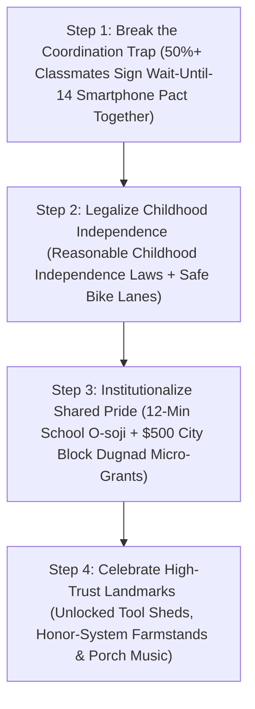

# CARBON EDITION (2026–2035): SOCIAL NORMS & HUMAN FLOURISHING
## From Cynical Atomization to High-Trust Joy: Everyday Norms That Change Everything

> **The Cynic's Myth vs. The Empirical Reality:** Cynics look at toothpaste locked behind pharmacy plexiglass, anxious kids glued to TikTok indoors, and strangers avoiding eye contact on subways, and sigh that high-trust community is only possible in "tiny homogeneous fairy-tale countries." Yet historical sociology proves the exact opposite: **high social trust is not genetic—it is built deliberately through everyday cultural habits and institutions.** Denmark forged world-leading trust in the late 1800s through cooperative *Folk High Schools*; Japan sustains spotless streets through 15-minute daily school *O-soji* stewardship; and across dozens of U.S. states, the UK, France, and the Netherlands in 2025–2026, **Phone-Free Childhood Compacts** are already bringing playground laughter rushing back overnight.

> *"When communities act together to restore real-world free play, shared rituals, and face-to-face neighborhood trust, childhood anxiety plummets and civic joy comes rushing back."*
> — **Jonathan Haidt**, Social Psychologist, NYU Stern & Author of *The Anxious Generation*

---

## 1. The Plexiglass Trap vs. Seven-Year-Olds on the Tokyo Subway

Picture two everyday Tuesday mornings happening on the exact same planet in November 2026:

* **City A (Low-Trust Atomization):** You walk into a corner pharmacy and press a plastic call-button so a weary clerk can unlock a \$4 tube of toothpaste from behind plexiglass. Outside, sidewalks sit empty of children—because parents fear letting a ten-year-old walk four blocks to a park alone (even though violent crime is lower than in 1991!), while inside bedrooms, twelve-year-olds spend **4.8 hours a day** scrolling algorithmic comparison feeds alone. Everyone carries earbuds as social armor; nobody knows the name of the neighbor across the hall.
* **City B (High-Trust Everyday Joy):** In **Tokyo or Osaka**, seven-year-olds in yellow caps walk and ride public trains to elementary school solo or in lively kid packs, watched over warmly by every shopkeeper along the route. In **Copenhagen or Aarhus**, parents park bundled-up babies in strollers outside snowy cafés to nap in crisp air while drinking coffee inside. High in **Norway's mountains**, the *Den Norske Turistforening (DNT)* maintains **over 550 unlocked, unstaffed wooden cabins** stocked with firewood, oats, and chocolate—where hikers simply write down what they ate and pay on the honor system!

Pause and refuse the lazy excuse that *"some cultures just got lucky."* Historians **Bo Rothstein**, **Robert Putnam** (*The Upswing*), and **Lene Rachel Andersen** (*The Nordic Secret*) documented that **1850s Denmark was poor, corrupt, fractured, and low-trust**—until citizens deliberately invented local **cooperatives, Folk High Schools (*Folkehøjskoler*), and mutual-stewardship associations**. Likewise, early-1900s American towns went from Gilded Age atomization to booming mid-century civic trust by building Boy/Girl Scouts, public libraries, Grange halls, and rotary clubs. **High trust is social software—and across the world in late 2026, communities are installing Version 2.0.**

---

## 2. Working on Earth Today: Four Concrete Norms Rebuilding Trust at Speed

You do not need a trillion-dollar invention to move from plexiglass cynicism to unlocked-cabin trust. Four simple, joyful everyday norms are already proving transformative today:

| Low-Trust Symptom | Proven High-Trust Cultural Norm (Nov 2026 SOTA) | How the Daily Habit Works | Verified Empirical Outcome |
| :--- | :--- | :--- | :--- |
| **Anxious, Indoor, Screen-Isolated Youth** | **Phone-Free Schools & Delayed-Smartphone Compacts** (*The Anxious Generation* / *Smartphone Free Childhood* — US, UK, France, Netherlands, Australia) | Whole school districts lock phones in pouches/cubbies **bell-to-bell**, while 10,000+ parent pacts pledge **no smartphones before 14, no social media before 16, and abundant unsupervised outdoor neighborhood play** (*Let Grow*). | Enacted across **30+ U.S. states**, England, France, Brazil, and the Netherlands by 2026; schools report **hallway noise jumping from eerie silence back to laughter**, sharp drops in cyberbullying, and +15–20% math/reading focus within one semester. |
| **Littered Public Spaces & "Someone Else's Job" Entitlement** | **Japanese *O-soji* (15-Minute Shared School & Block Stewardship)** | Every day after lunch in Japanese schools—from 1st grade through 12th—**students, teachers, and principals spend 15 joyful minutes sweeping classrooms, wiping desks, and serving food together** instead of treating janitors as invisible servants. | Cultivates lifelong visceral pride in shared commons: zero school graffiti, fans famously cleaning stadium rows at the World Cup, and spotless neighborhood streets without heavy policing. |
| **Winter Isolation & Adult Civic Burnout** | **Nordic *Friluftsliv* ("Open-Air Living") & *Folkehøjskoler* (Folk High Schools)** | Cultural norm of gathering outdoors year-round around firepits, saunas, and forest trails (*"no bad weather, only bad clothing"*), paired with **exam-free 4-month residential Folk High Schools** for young adults and mid-career citizens to sing, build, and debate together. | Builds resilient physical/mental health and cross-class solidarity; Denmark and Norway consistently top **World Happiness and ~75% Interpersonal Trust** surveys (vs. ~30% in low-trust peers). |
| **Anonymous Blocks During Storms or Illness** | **Japanese *Chonaikai* Block Stewards & *Dugnad* Mutual Workdays (Norway)** | Every 30-to-50-household block rotates a friendly **Block Captain** who welcomes new move-ins with a neighborhood map, organizes twice-yearly *Dugnad* Saturday garden/paint days (ending in waffles and beer!), and checks on elders during heatwaves. | During the 2011 Tōhoku & 2024 Noto earthquakes, neighborhoods with strong *Chonaikai* ties had **dramatically higher elderly survival rates** and near-zero looting. |

---

## 3. Saturday *Dugnad* & Free-Range Twilight on Maple Street (2031)

Step onto **Maple Street** in a working-class suburb of **Minneapolis, Minnesota**, at **10:30 AM on a crisp October Saturday in 2031**.

Five years ago, Maple Street looked like ten thousand other streets: garage doors rolled up and down mechanically, Amazon boxes vanished off porches, nine-year-olds weren't allowed past the front hedge alone, and the corner park bench had peeling paint and broken glass.

Then four families at Oak Elementary signed the **Twin Cities Childhood & Block Compact**—and invited ten more neighbors over for cider:

1. **The Kid Pack Returns First:** Once **65% of third-grade parents** signed the mutual **Wait-Until-14 Smartphone Pact** and gave their eight-year-olds \$35 dumb flip-watches plus *Let Grow* independence licenses, the coordination trap snapped overnight! Nobody's child was "the weird kid without TikTok," because *all twelve kids on Maple Street* were outside riding bikes to the creek, building scrap-wood forts, and settling kickball rules without adult referees.
2. **15-Minute School *O-soji* Comes Home:** Down at Oak Elementary, students began practicing a cheerful 12-minute post-lunch **Commons Reset** with upbeat music playing—wiping tables, sorting compost, and tending entryway plants alongside the principal (`04-social-norms/two-sigma-guild-education`). Within six months, bathroom vandalism at the middle school dropped **92%**, because kids protect what their own hands care for.
3. **Twice-Yearly Block *Dugnad* + Waffles:** Today is Maple Street's autumn **Block Stewardship Morning** (*Dugnad*). Thirty-eight neighbors—from 79-year-old retired machinist **Mr. Kowalski** to newly arrived Vietnamese software couple **Linh and Nam** and fourteen noisy kids—spend **90 brisk minutes** raking storm drains so autumn rains won't flood basements, oiling the Little Free Tool Library shed, and planting 200 tulip bulbs around the corner street plaza (`04-social-norms/intergenerational-villages`).
4. **The Payoff at Noon:** At **12:00 PM sharp**, three cast-iron waffle irons and a giant pot of maple-butternut soup come out on sawhorse tables right in the middle of the leaf-swept street. Mr. Kowalski hands ten-year-old Leo a spare key to water his ferns next week—and Down at the corner pharmacy, the plexiglass barriers came down two years ago because shoplifting and street disorder evaporated once the block came back to life with eyes, pride, and first names.

---

## 4. The Flywheel of Deliberate High-Trust Culture

```mermaid
flowchart LR
    subgraph Low["2025 Low-Trust Doom Loop"]
        L1["Kids Trapped on Phones Indoors; Empty Sidewalks"]
        L2["Zero Neighbor Names + 'Someone Else's Job' Litter"]
        L3["Plexiglass Stores, Fearful Parents & Civic Cynicism"]
    end

    subgraph Norms["Four Deliberate CulturalSwitches"]
        N1["Coordinated Phone-Free Schools & Wait-Until-14 Pacts"]
        N2["Daily 15-Min School O-soji Stewardship"]
        N3["Block Welcome Captains + Twice-Yearly Dugnad Waffles"]
    end

    subgraph High["2032 High-Trust Joy Flywheel"]
        H1["Free-Range Kid Packs & Eyes-on-the-Street Warmth"]
        H2["Spotless Commons Stewarded with Pride"]
        H3["Unlocked Tool Libraries, Stroller Cafes & Deep Trust"]
    end

    Low --> Norms --> High
```

### Quantitative Trajectory: Rebuilding the Social Fabric Measurably

| Civic Trust & Childhood Metric | Late 2026 Low-Trust Baseline | 2028 Early Compact Cities | 2031 Widespread Norm | 2035 High-Trust Equilibrium |
| :--- | :--- | :--- | :--- | :--- |
| **Bell-to-Bell Phone-Free K–12 Schools** | **~35% & surging fast** | **80% of public districts** | **98%+ universal norm** | **100% phone-free learning/play** |
| **Children Walking/Biking Solo by Age 9** | **<14%** (car-seat captivity) | **38%** (*Let Grow* corridors) | **72%** (Tokyo/Copenhagen norm) | **85%+ confident free-range kids** |
| **Schools Practicing Daily 12–15 Min *O-soji* Care** | **<2% outside East Asia** | **15% charter & public pilots** | **55%** (paired with Guilds) | **80%+ shared commons pride** |
| **Blocks with Active Mutual-Care Steward & *Dugnad*** | **<8%** | **25%** (city micro-grants) | **60%** of neighborhoods | **80%+ resilient neighbor webs** |
| **Interpersonal Survey Trust (*"Most people can be trusted"*)** | **~32%** (U.S./UK 50-yr low) | **44%** | **62%** | **75%+ (Nordic high-trust tier)** |

### Cross-Pillar Synergies Across the Carbon Atlas
* **2-Sigma Morning + Afternoon Guilds (`04-social-norms/two-sigma-guild-education`):** Phone-free school compacts and 15-minute daily *O-soji* stewardship form the exact cultural backbone that makes Afternoon Maker, Culinary, and Ecology Guilds joyful and self-governing.
* **Intergenerational Courtyard Villages (`04-social-norms/intergenerational-villages`):** Car-light Superblocks and courtyard villages provide safe physical streets where 8-year-olds roam freely under the affectionate gaze of porch-sitting grandparents (*Jane Jacobs's "eyes on the street"*).
* **Antidote to Doomerism (`06-synergy-horizons/cynicism-to-agency`):** Stanford psychologist Jamil Zaki proved that people underestimate strangers' trustworthiness by nearly $2\times$—every *Dugnad* morning and returned lost wallet recalibrates human brains away from defensive cynicism.

---

## 5. Solving Collective Action Traps Together (Why One Family Can't Do It Alone)

Jonathan Haidt and economist Thomas Schelling highlighted why individual willpower failed in 2015–2023: **social norms are coordination games.** If *only your* twelve-year-old gives up Instagram while all twenty classmates stay online, your child is isolated; if **ten families sign a pact together**, all ten kids go outside and play!

### Answering the Three Hardest Skeptical Questions

1. **"Doesn't high trust only work in small, ethnically homogeneous countries like 1950s Norway or Japan?"**
   * Look at the data from **Toronto neighborhoods, Singapore's multi-ethnic HDB estates, Swiss cantons (four languages!), and high-trust diverse U.S. military towns or college co-ops**: diversity never prevents high trust when communities share **common rituals, equal public dignity, phone-free youth spaces, and mutual block stewardship**! What destroys trust is *anonymity, extreme inequality, and algorithmic fear feeds*—all three of which deliberate civic norms repair directly.
2. **"Won't unions or parents object to kids doing 12 minutes of *O-soji* tidy-up at school?"**
   * Professional school custodians remain 100% employed at full pay handling deep sanitation, HVAC, boilers, and repairs! In fact, custodians become **cherished mentors** rather than invisible servants cleaning up deliberately thrown milk cartons. Parents love *O-soji* the moment they notice their ten-year-old suddenly clearing their own dinner plate at home without being asked.
3. **"Is it actually safe to let eight- and nine-year-olds walk to parks and stores without adults?"**
   * Statistically, a child in 2026 is **far safer walking down a neighborhood sidewalk than sitting "safely" behind a locked bedroom door with an unrestricted smartphone**! Pairing **Reasonable Childhood Independence laws** (already passed unanimously across red and blue states like Utah, Oklahoma, Texas, Colorado, Illinois, and Virginia so loving parents are never harassed for letting kids walk to a park) with Paris-style **School Streets** makes neighborhood independence both physically safe and developmentally priceless.

### Four High-Trust Habits You Can Spark on Your Block This Month

1. **Circulate a 1-Page Grade-Level Smartphone Pact Tonight:**
   * Text just **five parents** in your child's 3rd-, 4th-, or 5th-grade class using free templates from *Smartphone Free Childhood* or *Wait Until 8th*.
   * The moment **50% of a grade locks arms** on delaying smartphones until 14 and social media until 16—giving kids \$35 flip-watches instead—social FOMO evaporates overnight and neighborhood bike packs reappear within days.
2. **Host a 90-Minute Autumn or Spring Block *Dugnad* + Waffles:**
   * Print thirty friendly half-sheet flyers inviting your block to sweep storm drains, mulch street trees, and plant tulip bulbs from **10:00 to 11:30 AM Saturday**, followed immediately by hot cider and cast-iron waffles on a driveway sawhorse table.
   * Cities from Minneapolis to Melbourne offer **\$250–\$500 micro-grants**, free compost/bulbs, and free play-street cones for any block captain who asks!
3. **Launch a 12-Minute Joyful School *O-soji* Pilot With Your PTA:**
   * Partner with your elementary principal and custodial team to introduce an upbeat, musical **12-minute post-lunch Commons Care ritual** where students wipe their own tables, water hallway plants, and thank custodians by name—transforming school pride in a single month.
4. **Build a Borrow-a-Ladder Pegboard & Practice the "One-Earbud Smile":**
   * Mount a simple honor-system garden-tool and extension-ladder pegboard inside a shared courtyard or garage ([`intergenerational-villages`](../intergenerational-villages/REPORT.md)) so twenty neighbors don't each buy lonely tools used twice a year.
   * On your morning walk tomorrow, pop out one earbud, make warm eye contact six feet away, and say *"Good morning"*—rewiring your street's nervous system one human face at a time.

### Why High Trust Is the Ultimate Economic & Psychological Multiplier
Economists Kenneth Arrow and Francis Fukuyama called social trust **"the invisible lubricant of civilization"**:
* High-trust neighborhoods spend **zero billions** on retail security cages, porch-pirate lockers, defensive litigation, and hyper-surveillance.
* Children raised with *Let Grow* neighborhood independence develop internal locus of control—the #1 psychological predictor of adult resilience and low anxiety.
* Seniors on blocks with active *Chonaikai* / Block Captains live years longer in their own homes because three neighbors notice within hours if their morning curtains stay closed during a blizzard or heatwave.

### Global Field Guide: Five Everyday High-Trust Wonders Working Right Now
* **1. Norway's 550+ Unlocked DNT Cabins (*Tillit* Honor System):**
  * Hikers walk into warm mountain huts stocked with dry split birchwood, canned stew, oatmeal, and chocolate—tallying what they used via phone or slip with **>98% voluntary payment honesty**.
* **2. Japan's Solo First-Grade Errand & Commute (*Hajimete no Otsukai*):**
  * Six- and seven-year-olds walk to neighborhood bakeries and ride commuter trains because **every adult in public implicitly accepts collective guardianship** over any child in a yellow school cap.
* **3. Switzerland's Unattended Farm-Road Flower & Cheese Stands:**
  * Across rural and peri-urban Swiss cantons, farmers leave fresh Alpine cheese, apples, and cut tulips beside an unlocked wooden coin/QR box—zero security guards, near-zero theft.
* **4. Denmark's *Efterskole* & *Folkehøjskole* Year:**
  * Tens of thousands of Danish teenagers and young adults spend a residential year cooking, singing from the *Højskolesangbogen*, and building together without grade-ranking anxiety—forging cross-class trust for life.
* **5. Minneapolis, Austin & London Play-Street Micro-Blocks:**
  * Simple Friday-evening orange cones and sawhorses turning isolated cul-de-sacs back into multi-generational front yards within a single weekend.

### Further Reading & Community Starter Templates
* **Jonathan Haidt (2024–2026):** *The Anxious Generation* & the **Free Play / Phone-Free Schools** legislative and school-district action kits (`anxiousgeneration.com` / `letgrow.org`).
* **Lene Rachel Andersen & Tomas Björkman:** *The Nordic Secret: A European Story of Beauty and Freedom* (how 19th-century *Folkehøjskoler* deliberately built Nordic social trust).
* **Daniel P. Aldrich (*Building Resilience*):** Empirical disaster-recovery proofs of how Japanese *Chonaikai* neighborhood associations save more lives than concrete seawalls alone.
* **Den Norske Turistforening (`DNT`):** Two centuries of honor-system mountain cabin stewardship across Norway.

> **The Bottom Line for the Skeptic:** High trust is not a genetic fairy tale reserved for Copenhagen or Kyoto—19th-century Danes and 20th-century Japanese deliberately built it out of ordinary schools, cooperatives, and block habits. Lock the smartphones away during school, hand kids real outdoor freedom, sweep the commons together for twelve minutes, and bring out the Saturday waffle iron—and high-trust joy comes rushing home.

---

## References & Verified Sources

* **Featured Researcher / Leader:** [Jonathan Haidt — Social Psychologist, NYU Stern & Author of The Anxious Generation](https://www.anxiousgeneration.com/)
* **Companies, Labs & Consortia:** [The Anxious Generation Movement (Jonathan Haidt)](https://www.anxiousgeneration.com/) · [Let Grow Childhood Independence Project (Lenore Skenazy)](https://letgrow.org/) · [Smartphone Free Childhood (Global Parent Pacts)](https://smartphonefreechildhood.co.uk/) · [Den Norske Turistforening (DNT Honor Cabins, Norway)](https://www.dnt.no/om-dnt/english/) · [Nordic Secret / Folkehøjskoler Network](https://danishfolkhighschools.com/) · [Northeastern Univ. Social Capital Lab (Daniel Aldrich)](https://cssh.northeastern.edu/faculty/daniel-aldrich/)
* **Global & Regulatory Precedents:** [Bell-to-Bell Phone-Free Schools (30+ U.S. States, UK, France, NL, Brazil)](https://www.anxiousgeneration.com/) · [Japanese Daily 15-Minute School O-soji Stewardship & Solo Kid Commutes](https://en.wikipedia.org/wiki/Education_in_Japan) · [Norway's 550+ Unlocked Stocked DNT Mountain Cabins (>98% Honor Pay)](https://www.dnt.no/om-dnt/english/) · [19th-Century Danish Folk High Schools & Japanese Chonaikai Block Captains](https://danishfolkhighschools.com/)
* **Connected Carbon Pathways:** [2-Sigma AI Mastery in the Morning, Hands-On Human Guilds in the Afternoon](../two-sigma-guild-education/REPORT.md) · [Curing the Loneliness Epidemic: Turning Dead Strip Malls into Walkable Village Commons](../intergenerational-villages/REPORT.md) · [Sacred Human Worth in an Age of Thinking Machines: Contemplative Wisdom & Shared Sabbath](../sacred-worth-contemplation/REPORT.md) · [The Antidote to Doomerism: Why Cynicism Feels Smart, Why It's Empirically Wrong, and How We Build](../../06-synergy-horizons/cynicism-to-agency/REPORT.md)
