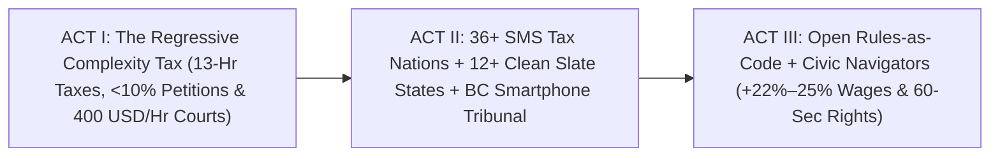

# STORYBOARD & CREATIVE PRODUCTION GUIDE: LAWYER-FREE CIVIC JUSTICE & CLEAN SLATE ([`lawyer-free-civic-justice-clean-slate`](./REPORT.md))
## *"Sixty Seconds Instead of \$400 an Hour — How SMS Pre-Filled Taxes, Automated Clean Slate Sealing & Smartphone Tribunals End the Poverty 'Complexity Tax'"*

> **Production Purpose:** This crisp, deeply empathetic visual storyboard equips documentary filmmakers, state legislators, chief justices, and civic technologists to expose and abolish the regressive **"Complexity Tax"**—showing how **36+ pre-filled tax nations**, **12+ bipartisan U.S. Clean Slate states** (+22%–25% wage surge per *Harvard Law Review*), and **British Columbia's 24/7 Smartphone Civil Resolution Tribunal** replace soul-crushing paperwork with 60-second public utilities.

---

## PART 1: THREE ALTERNATIVE NARRATIVE OPENINGS (DIRECTOR'S OPTIONS)

### Option A: "Two April Kitchen Tables: Stockholm's 55-Second Text vs. America's 13-Hour Paper Pile" *(Sharp Global Contrast)*
* **Visual Hook:** Split-screen at 8:00 PM in April. Left (`Legacy U.S. Complexity Trap`): Exhausted mechanic **Marcus** surrounded by crumpled `W-2` envelopes, confusing instructions, and a strip-mall receipt charging **\$290** just to claim his own Earned Income Credit—clock lapses `13 hours, 10 minutes`. Right (`Stockholm, Sweden`): A working dad sips tea, glances at his pre-populated *Skatteverket* return on his phone, verifies one line, texts `APPROVE`, and smiles—clock stops at `00:54` and `\$0.00`.
* **Voiceover Core:** *"In thirty-six countries, filing your taxes takes less time than toasting bread—because the government doesn't force you to pay three hundred dollars to guess numbers it already knows."*
* **Best For:** Mainstream working-family audiences, economic-populism features, and viral openers.

### Option B: "Midnight in the Courthouse Server Room — Dissolving the Paper Prison" *(Bipartisan Breakthrough)*
* **Visual Hook:** Quiet midnight shot of a Michigan state court server rack pulsing softly as **Code for America's** open-source **Clean Slate** script runs. On screen, 12-year-old non-violent misdemeanor barriers—which cost **\$1,500 in lawyer fees** and blocked **93.5% of eligible citizens**—seal automatically at **\$0**. Cut to dawn: **Marcus** pulls on a fresh **\$34.50/hr** municipal electric-bus technician uniform and hugs his seven-year-old daughter.
* **Voiceover Core:** *"Ninety percent of Americans who legally earned a clean slate never got one—because freedom required a fifteen-hundred-dollar petition. When twelve bipartisan states automated the courthouse clock, wages jumped twenty-four percent in a single year."*
* **Best For:** Bipartisan policy summits, Chamber of Commerce workforce forums, and justice documentaries.

### Option C: "Mei-Ling's Stolen \$1,650 Deposit vs. BC's \$100 Smartphone Court" *(Everyday David-and-Goliath Justice)*
* **Visual Hook:** Close-up on 26-year-old Vancouver baker **Mei-Ling** reading a smug landlord email withholding her **\$1,650** security deposit—knowing a lawyer costs **\$400/hour**. Instead of giving up, she taps **British Columbia's Civil Resolution Tribunal (`civilresolutionbc.ca`)** on her phone during dough rise, uploads timestamped apartment photos at 9:30 PM, and receives a binding refund order 26 days later with **zero lawyers**.
* **Voiceover Core:** *"A right that costs four hundred dollars an hour to defend isn't a right—it's a luxury product. British Columbia put public court on every renter's smartphone for a hundred bucks, no lawyers allowed."*
* **Best For:** Housing advocates, small-business owners, bar-association reformers, and youth audiences.

---

## PART 2: VISUAL ARC DIAGRAM & MODULAR 3-ACT STORYBOARD TABLE (12 SCENES)

| Act / Beat | Visual & Camera Concept | Data & Metric Callout Overlay | Sample Narration / Voiceover Script |
| :--- | :--- | :--- | :--- |
| **ACT I — Beat 1:** The 1.7-Billion-Hour Tax Maze | Overhead shot zooming out from one kitchen table buried in tax worksheets to millions of glowing midnight apartment windows across America. | `~13 Hrs & \$250+/Yr Per Filer \| \$7B–\$10B Unclaimed EITC Credits Yearly` | "Every spring, working families lose nearly two billion hours and billions in unclaimed child credits—just re-typing wages the government already has." |
| **ACT I — Beat 2:** The "Paper Prison" Obstacle Course | Graphic tracking an eligible worker trying to clear an 11-year-old misdemeanor: county clerk lines, notary stamps, missed shifts, \$1,500 lawyer bill. | `Harvard Law Review Audit: <6.5% Eligible Uptake Under Petition Rules` | "Even when state law promised a second chance, fewer than one in ten eligible workers ever escaped the paper prison." |
| **ACT I — Beat 3:** The \$400/Hour Courthouse Door | Mei-Ling stares up at imposing granite courthouse steps at 9:00 AM Tuesday while a bakery oven timer rings—forced to choose between her job and her deposit. | `>80% of Low/Moderate-Income Civil Disputes Go Unrepresented` | "And in civil court, four-hundred-dollar-an-hour legal fees meant landlords and bad actors could pocket a thousand-dollar deposit with impunity." |
| **ACT II — Beat 4:** Sweden, Estonia & 25-State Direct File | Joyful brisk montage from Stockholm and Tallinn to Austin: citizens review pre-filled returns on phones and tap `Approve` in under sixty seconds. | `36+ Pre-Filled Tax Nations \| >90% IRS Direct File User Satisfaction` | "From Sweden and Estonia to twenty-five U.S. Direct File states, pre-populated mobile returns proved taxes can be free, transparent, and sixty seconds." |
| **ACT II — Beat 5:** Strange Bedfellows Pass Clean Slate | Archival capitol handshake: criminal-justice organizers, **Republican governors**, and **JPMorgan / Chamber of Commerce** executives sign Clean Slate bills together. | `12+ Bipartisan Clean Slate States \| 45M+ Records Sealed in PA Alone` | "Then came an unstoppable alliance: justice reformers and Chamber of Commerce employers realized automated Clean Slate helps families and businesses alike." |
| **ACT II — Beat 6:** Prescott & Starr Open the Data | Clean motion-chart from **Prescott & Starr's *Harvard Law Review*** study: earnings curve rockets upward the quarter after expungement while crime stays near zero. | `+22% to +25% Verified 1-Yr Wage Jump \| 99% Felony-Free Over 5 Years` | "When University of Michigan scholars audited actual payroll data, wages surged over twenty-two percent within one year—and ninety-nine percent stayed felony-free." |
| **ACT II — Beat 7:** Marcus's Tuesday Morning Breakthrough | Warm handheld scene: Marcus packs his daughter's lunch, sees his automated Clean Slate confirmation + \$3,420 pre-filled EITC deposit, and starts his EV-bus tech shift. | `\$0 Petition Cost \| +24% Career Wage Unlock + 55-Sec Tax Refund` | "Zero lawyers. Zero missed shifts. One midnight script turned an eleven-year-old mistake into a thirty-four-dollar-an-hour transit career." |
| **ACT II — Beat 8:** Inside BC's Smartphone Tribunal | Screen-capture + live kitchen-couch scene: Mei-Ling walks through **BC CRT's *Solution Explorer***, uploads move-out photos, and wins her \$1,650 refund order. | `BC Civil Resolution Tribunal: 24/7 Online \| ~\$75–\$125 \| >70% Early Triage` | "In Vancouver, Mei-Ling never steps inside a courtroom—settling her deposit claim from her phone in twenty-six days with lawyers barred from bullying." |
| **ACT III — Beat 9:** Deterministic "Rules-as-Code" vs. Black-Box AI | Crisp two-layer diagram: bottom glass layer shows **100% deterministic statutory boolean code**; top layer shows friendly **100-language plain-English Navigator**. | `Zero AI Hallucination in Eligibility \| 100% Open Auditable Statutory Code` | "Crucially, no black-box AI ever decides your rights: deterministic open-source statutory code computes eligibility, while friendly language tools translate legalese." |
| **ACT III — Beat 10:** Universal Non-Digital Ramps | Inside a rural branch library and telephone helpline: an 80-year-old widower completes a CRT housing claim smoothly via toll-free human voice helper. | `Phone, Library & Paper Accommodations + Automatic Low-Income Fee Waiver` | "And toll-free human voice helpers and library kiosks ensure seniors without smartphones gain ten times easier access than old weekday courts." |
| **ACT III — Beat 11:** Estonia's *Once-Only* Civic Horizon | Animated citizen wallet: one verified life event (new baby or job shift) updates childcare, health, and tax credits seamlessly without asking twice. | `Once-Only Statutory Rule: >1.5 Billion Annual Paperwork Hours Saved` | "Under the Once-Only rule, government is legally forbidden from forcing you to re-type facts you already proved." |
| **ACT III — Beat 12:** Closing Bookend — Equal Under Law | Split final frame: Mei-Ling pulls golden sourdough loaves from her oven smiling at her refunded deposit; Marcus lifts his daughter at the bus depot gate. | `60-Sec Taxes + Clean Slate + \$100 Smartphone Court = Justice for Everyone` | "Paperwork was never destiny—it was just un-refactored code. Make rights automatic, and the law finally serves the baker and mechanic as fast as the billionaire." |

---

## PART 3: VISUAL METAPHOR BANK

### 1. "The Towering Paper Wall Dissolving Into a Single Green Checkmark"
* **Visual Concept:** A six-foot stack of notarized courthouse docket binders and commercial tax booklets blows away into warm light, leaving a single 55-second mobile confirmation chime.
* **Camera / Animation Cue:** Slow-motion practical paper scatter transitioning seamlessly into a clean smartphone screen in a sunlit kitchen.
* **Emotional Takeaway:** Makes the abolition of 1.7 billion hours of annual administrative "sludge" viscerally tangible.

### 2. "David's Smartphone Leveling Goliath's Marble Courtroom"
* **Visual Concept:** Camera tilts down from intimidating granite courthouse pillars into a warm Vancouver bakery kitchen where corporate landlord and hourly baker appear in equal-sized plain-language **BC CRT** chat bubbles—zero \$400/hour legal armor allowed.
* **Camera / Animation Cue:** Match-cut vertical tilt from cold stone steps to flour-dusted wooden counter.
* **Emotional Takeaway:** Shows how statutory lawyer-free online tribunals restore real equality before the law.

### 3. "Glass-Box Statutory Code"
* **Visual Concept:** Transparent interlocking crystal gears etched directly with public bipartisan bill numbers (`PA Clean Slate / MCL 780.621g`), contrasting sharply against a smoky opaque "black box."
* **Camera / Animation Cue:** Clean macro motion graphic highlighting deterministic `Rules-as-Code` boolean gates.
* **Emotional Takeaway:** Reassures viewers that auditable open statutory logic—never hallucinating black-box AI—computes citizen rights.

---

## PART 4: SOUND DESIGN, COLOR ARC & INTERACTIVE COMPLEXITY CALCULATOR

* **Color & Lighting Progression:**
  * *Act I (Bureaucratic Sludge):* Flickering DMV fluorescent greens, midnight tax-table shadows, cold granite greys.
  * *Acts II–III (60-Second Civic Utility):* Morning Grand Rapids kitchen sunlight, warm Vancouver bakery amber, crisp Scandinavian daylight.
* **Casting & Documentary Voices:**
  * Feature *Harvard Law Review* empirical authors **Prof. J.J. Prescott & Prof. Sonja Starr**, **Clean Slate Initiative** & Chamber of Commerce bipartisan partners, **Code for America** engineers, and **BC Civil Resolution Tribunal** facilitators.
* **Musical & Foley Architecture:**
  * Shifts from harsh rubber-stamp slams, hold-music static, and anxious clock ticks to a single gentle confirmation chime, quiet electric-bus depot hum, fresh bread crust crackle, and uplifting piano with warm strings.
* **Interactive Documentary Companion ("Calculate Your Family's Complexity Tax"):**

| Everyday Civic Need | Legacy "Complexity Tax" Cost | Carbon 60-Sec / Automated Standard | Verified Citizen Gain |
| :--- | :--- | :--- | :--- |
| **Annual Income Tax & EITC/CTC Return** | **13 hours + \$250–\$290 fees** | **60-second pre-filled SMS / 1-click (\$0)** | **\$250+/yr saved** + 100% earned credit uptake |
| **Clearing 10-Yr-Old Non-Violent Record** | **\$1,200–\$2,500** (<10% succeed) | **Automatic Clean Slate batch seal (\$0)** | **+22% to +25% 1-year wage jump** (*HLR*) |
| **Recovering Stolen \$1,650 Deposit** | **\$400/hr lawyer** + lost workdays | **BC Smartphone Tribunal (~\$75–\$125)** | Settled in weeks from home, zero lawyers |

* **Director's Closing Frame On-Screen Text:**
  > *"When a right requires thirteen hours of forms or a four-hundred-dollar-an-hour lawyer, it isn't a right yet. Make taxes sixty seconds, make earned second chances automatic, and put public justice in every pocket."*
