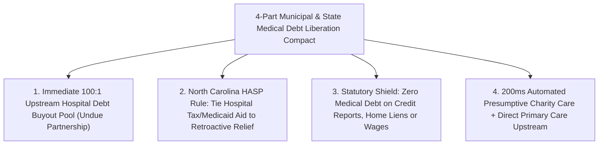

# CARBON EDITION — PILLAR 4: ERASING BILLIONS FOR PENNIES
## How Cities, States, Hospital Compacts & Civic Pools Are Abolishing Medical Debt Right Now—While Upstream Tech Stops It at the Root

> **Executive Framing & Reimagining Household Freedom From Sickness Debt:**
> * **The Cynic's Belief:** *"Medical bankruptcy is an untouchable iron law of American life—until gridlocked national politics passes a once-in-a-century healthcare overhaul, cities, states, congregations, and neighbors are completely powerless to rescue the 100 million adults hounded over unpaid emergency-room and cancer bills."*
> * **The Empirical Counter-Reality:** In **2014**, two veteran debt-collection executives—**Craig Antico** and **Jerry Ashton**—turned their industry's best-kept secret inside out: when working families cannot pay inflated hospital bills, providers bundle and sell aged unpaid accounts on secondary debt markets for **less than 1 cent on the dollar (~\$0.005–\$0.01 per \$1.00)**, where predatory buyers hound terrified patients for 100 cents plus interest and wage garnishments! Founding **Undue Medical Debt** (formerly *RIP Medical Debt*, led today by CEO **Allison Sesso**), they stepped into that exact secondary market to buy and **abolish \$20+ billion in medical debt for 14+ million families**—mailing bright yellow envelopes declaring *"Your medical debt has been abolished—no strings attached, zero tax owed."* By 2024–2026, local and state governments supercharged this 100-to-1 lever: **Cook County (Chicago)**, **Toledo**, **New Orleans**, **New York City**, **Connecticut**, **Arizona**, and **New Jersey** launched public buyout pools, while **North Carolina** used federal Medicaid leverage to get **all 99 eligible acute hospitals** to erase **\$4 billion in debt back to 2014 for 2 million residents**!
> * **The Social Norm Shift:** Every city and state pairs **100-to-1 Upstream Hospital Debt Abolition Pools** and **statutory bans on medical-debt credit reporting** with **automated zero-paperwork presumptive charity care**, **\$75/month Direct Primary Care**, and **one-dose genetic/diagnostic cures**—wiping out yesterday's cruel debt overhang for pennies while making tomorrow's medical debt extinct at the root.
> * **Anchor Voice:** *"No one chooses to get sick, be in an accident, or have a baby arrive early. Medical debt is not a moral failing—it is a structural artifact that communities can erase for pennies on the dollar while we fix healthcare at the root."* — **Allison Sesso (CEO) & Founders Craig Antico & Jerry Ashton**, *Undue Medical Debt*

---

## ACT I: THE LIVED HUMAN REALITY — THE YELLOW ENVELOPE ON TUESDAY MORNING (2027)
### From Silencing Unknown Callers in Toledo & Charlotte to Breathing Free Without a Single Form

It is 10:20 AM on a breezy Tuesday in **Toledo, Ohio**—and across sister neighborhoods from **South Side Chicago** to **Charlotte, North Carolina**. Thirty-four-year-old bakery shift manager **Elena Morales** pulls a stack of mail from her porch box and freezes when she spots an unfamiliar business envelope.

For thirty-eight straight months—ever since her son Mateo arrived five weeks premature and spent nine days in a neonatal intensive-care unit while Elena was between employer insurance plans—opening the mail or hearing an unknown phone number ring made Elena's stomach knot. Even after her family scraped together **\$4,200** in exhausting monthly installments, **\$19,400** in out-of-network hospital and neonatology facility charges lingered in collections—blocking Elena and her husband from qualifying for a modest starter-home mortgage and making Elena quietly skip her own follow-up thyroid ultrasound out of dread of adding another bill.

Watch what happens when a city and state decide that **getting sick should never carry a ten-year financial prison sentence**:

1. **The Bright Yellow Abolition Letter—Zero Applications, Zero Shame, Zero IRS Tax:**
   Elena tears open the bright yellow-and-white **Undue Medical Debt** letter co-sealed by the **City of Toledo & Lucas County**. Inside, three plainspoken sentences lift nearly twenty thousand dollars off her chest in five seconds: *her entire \$19,400 hospital balance was purchased directly from the health system's distressed-receivables portfolio for less than \$190 out of Toledo's municipal relief pool and permanently abolished*. Elena never had to beg before a charity board, upload pay stubs, or navigate a broken web portal—and because forgiveness arrived as an unconditional detached charitable gift from a 501(c)(3) nonprofit, she owes **\$0.00 in federal or state cancellation-of-debt income tax**!
2. **Statewide Hospital Leverage Wipes the Ledger Upstream in North Carolina:**
   Four hundred miles south in **Charlotte, North Carolina**, auto machinist **Marcus Greene** experiences the next structural evolution on the exact same Tuesday morning. Under North Carolina's landmark **CMS-approved Healthcare Access and Stabilization Program (HASP)** compact signed by **all 99 acute-care hospitals statewide**, a **\$14,800** emergency gallbladder surgery debt from 2019 vanishes automatically from his hospital ledger and credit history—alongside two million fellow North Carolinians—without a debt collector ever touching his name!
3. **Never Falling Back Into the Trap Next Year:**
   Even better, when Marcus brings his daughter to a clinic six months later, North Carolina's **automated presumptive financial-assistance check** plus his shop's new **[`healthcare-without-billing`](../../03-bioscience-regeneration/healthcare-without-billing/REPORT.md)** \$75/month Direct Care membership and statutory **State Credit-Report Medical Debt Ban** guarantee that no surprise facility bill will ever haunt his family's mailbox again.

---

## ACT II: REIMAGINING THE RULES — EXPOSING THE 1-CENT SECRET & MOVING UPSTREAM
### How Two Former Debt Collectors & Courageous Governors Turned a Predatory Market Inside Out

```mermaid
flowchart LR
    subgraph PredatoryLoop["Legacy Predatory Medical Collection Machine"]
        P1["Inflated Hospital Chargemaster Bills Hit 100M U.S. Adults"]
        P2["Hospitals Sell Aged Unpaid Portfolios for <$0.01 on the Dollar"]
        P3["Debt Buyers Hound Sick Families for 100 Cents, Wrecking Credit & Care"]
    end
    subgraph CivicJubilee["2014–2026 Civic Abolition Pools + Medicaid Leverage"]
        J1["Undue Medical Debt + City/State Pools Buy Direct Upstream (<1¢/$1)"]
        J2["NC HASP Model Ties Hospital Medicaid Funds to 100% Debt Erasure"]
        J3["State Laws Ban Medical Bills From Credit Scores, Liens & Garnishment"]
    end
    subgraph RootCure["Permanent Debt-Free Healthcare Equilibrium"]
        R1["$20B+ Abolished by Undue + $4B Across All 99 NC Hospitals"]
        R2["Automated Zero-Form Presumptive Charity Care at Hospital Intake"]
        R3["Direct Care + $50 Liquid Biopsies + CRISPR Prevent Bills Upstream"]
    end
    PredatoryLoop ==> CivicJubilee ==> RootCure
```

### 1. The Open Accounting Secret That Changed Everything: \$10,000 of Misery Sold for \$80
Why did Americans spend decades assuming erasing \$100 billion in household medical debt would cost taxpayers \$100 billion? Because almost nobody outside hospital revenue-cycle suites and debt-buyer conventions knew **what unpaid medical bills actually trade for in the real market**!

When an uninsured or high-deductible patient receives a **\$20,000 hospital bill**—often priced off an arbitrary internal *chargemaster* three to five times higher than Medicare's actual cost of care—the hospital already records massive accounting allowances knowing cash-strapped families (<400% of the Federal Poverty Level, or facing bills exceeding 5% of annual income) mathematically cannot pay. After initial billing statements go unanswered, hospitals and physician groups routinely bundle thousands of aged accounts and sell them on secondary debt markets for **half a cent to one cent on the dollar**—receiving **\$80 to \$200 in cash** for a \$20,000 bill while washing their hands of the optics, leaving third-party collection agencies to spend years squeezing grieving widows and cancer survivors via robo-calls, courthouse default judgments, paycheck garnishments, and home liens!

When **Craig Antico** and **Jerry Ashton** left the debt-collection industry in **2014** to launch **RIP Medical Debt** (now **Undue Medical Debt**), they built a surgical data-analytics engine that screens debt portfolios across entire zip codes, counties, or hospital systems to isolate households earning **under 4× the poverty line (~ \$120,000 for a family of four)** or carrying medical debt **≥5% of income**, buys the entire qualifying tranche directly, and **destroys the legal obligation forever**. Every **\$1 million** from a church, philanthropist, city council, or state legislature erases **\$100 million or more** in family debt!

### 2. Learning From Rigorous Science: Moving Upstream From Collectors Directly to Hospitals
Good social policy welcomes hard empirical scrutiny. In **2024**, economists **Raymond Kluender, Neale Mahoney, Francis Wong, and Wesley Yin (NBER Working Paper 32315)** published a landmark randomized study evaluating early waves of late-stage secondary-market debt buyouts. Their crucial finding: when debt was bought *years late* from third-party debt collectors—after credit damage had already occurred, small under-\$500 bills had already been dropped by credit bureaus, and patients had already stopped going to doctors—late-stage relief alone wasn't enough to automatically repair credit scores or trauma!

Instead of retreating, **Allison Sesso at Undue Medical Debt**, **Cook County Board President Toni Preckwinkle**, and **North Carolina Governor Roy Cooper & DHHS Secretary Kody Kinsley** used that exact insight to **move the entire intervention upstream**:
* **Buying Directly From Hospitals *Before* Predatory Collection:** Municipal and state partnerships (Cook County, Toledo, NYC, Connecticut, Arizona, New Jersey) shifted to acquiring qualifying bad-debt accounts **directly out of nonprofit hospital and multi-specialty physician ledgers** before accounts are ever sold to predatory collectors or litigated in small-claims court!
* **North Carolina's \$4 Billion / 99-Hospital Structural Masterstroke (2024–2025):** Approved by the U.S. Centers for Medicare & Medicaid Services (CMS) in July 2024 and joined by **100% of North Carolina's 99 eligible acute-care hospitals** by August 2024, North Carolina tied enhanced federal Medicaid **HASP** hospital reimbursements to two ironclad conditions: **(1)** hospitals must automatically wipe out **\$4 billion in existing medical debt dating back to January 1, 2014** for ~2 million low- and middle-income residents, and **(2)** hospitals must implement **automatic presumptive charity-care discounts** (anyone enrolled in SNAP, WIC, or housing assistance gets automatic 100% bill relief at check-in with zero forms!), cap payment-plan interest, and halt medical credit reporting!
* **Statutory Credit-Score & Home-Lien Firewalls:** States across the political spectrum and regions—led by **Colorado, New York, Minnesota, Connecticut, California, Illinois, Virginia, and Rhode Island**—passed clean laws barring medical debt from consumer credit scores, banning foreclosure liens on primary family homes, and capping wage garnishment.

### 3. The Technical × Biological Endgame: Making Medical Debt Obsolete Upstream
Abolishing yesterday's bills clears the rubble; **2026 technology + humane care rules stop new rubble from falling**:
1. **Estonia-Style Presumptive Eligibility APIs (*Dollar For* + Automated Intake):** Nonprofit hospitals receive tens of billions in annual tax exemptions on the legal promise of providing *Charity Care*, yet millions of eligible patients still get billed because hospitals bury 18-page paper applications! Automated intake APIs verify income/SNAP/Medicaid thresholds in **200 milliseconds** at hospital check-in—applying 50%–100% charity discounts *before Bill #1 ever prints* (pioneered by grassroots hero **Jared Walker's *Dollar For***, which has already crushed \$65M+ in active hospital bills directly under IRS 501(r) rules!).
2. **Preventative Biotech & Zero-Billing Direct Care:** Paired with **[`healthcare-without-billing`](../../03-bioscience-regeneration/healthcare-without-billing/REPORT.md)** (\$75/month Direct Primary Care + \$50 early liquid biopsies + wholesale generic drugs + Universal Catastrophic Shield) and **[`invivo-crispr-cures`](../../03-bioscience-regeneration/invivo-crispr-cures/REPORT.md)** (turning \$3M lifelong sickle-cell or cardiovascular ICU cascades into single outpatient infusions), acute surprise medical debt shrinks toward **zero**.

| Real-World Abolition Model | Lead Pioneer Jurisdiction / Body | Verified Empirical Scale (2022–2026) | Key Structural Innovation |
| :--- | :--- | :--- | :--- |
| **Municipal & County Upstream Pools** | **Cook County, IL**; **Toledo/Lucas County, OH**; **NYC**; **New Orleans** | Cook County erased **\$400M+ toward \$1B**; Toledo **\$200M+**; NYC **\$2B target** for 500k residents | Uses tiny civic appropriations (**\$1 -> \$100+**) to buy debt *directly from local hospitals* with zero forms! |
| **Statewide Public Abolition Trusts** | **Connecticut**, **Arizona**, **New Jersey**, **Illinois** | CT erasing **~\$650M**; AZ up to **\$2B** for ~1M residents; NJ **Louisa Carman Act** | Pairs statewide portfolio abolition with tough anti-collection & credit-shield statutes! |
| **Medicaid Reimbursement Conditioning** | **North Carolina DHHS (*HASP* Compact)** | **100% of 99 hospitals** erasing **\$4 Billion** back to 2014 for **2 million people** | Conditions enhanced federal hospital payments on retroactive debt wipeout + automatic charity care! |
| **IRS 501(r) Charity-Care Automation** | ***Dollar For*** (**Jared Walker**) + State Mandate Laws | **\$65M+ active recent bills** zeroed; millions protected via presumptive SNAP/WIC screening | Forces tax-exempt hospitals to honor their own legally required free/discounted care before billing! |

---

## ACT III: THE 36-MONTH CITY & STATE PLAYBOOK (2026–2029)
### How Any Mayor, County Board, or Governor Clears Every Resident's Medical Debt Overhang

| Sprint Horizon | Concrete Civic / Legislative Action | Fiscal Cost & Leverage Math | Immediate Household Impact |
| :--- | :--- | :--- | :--- |
| **Months 1–6: Municipal / County Upstream Pool** | City council or county commission appropriates **\$1M–\$10M** (general fund, hospital community-benefit, or settlement dollars) with **Undue Medical Debt** targeting direct local hospital portfolios. | **\$2M civic appropriation abolishes ~\$150M–\$200M** in face-value local medical bills (<\$0.01/\$1). | **50,000–150,000 working households** receive yellow abolition envelopes automatically with \$0 tax owed. |
| **Months 6–15: Credit, Lien & Lawsuit Shield Act** | State legislature passes clean **Medical Debt Protection Act** modeled on CO/NY/MN/CT + **IRS 501(r) Automated Presumptive Charity Care** at hospital admission. | **\$0 taxpayer budget cost**; eliminates predatory courthouse collection dockets. | Credit scores jump **+20 to +45 points** for affected borrowers, unlocking apartment leases, car loans & mortgages. |
| **Months 12–24: North Carolina CMS *HASP* Replication** | State Medicaid agency submits CMS Section 1115 / directed-payment compact conditioning enhanced hospital funding on **10-year retroactive debt erasure + future fee caps**. | Federal Medicaid match funds hospital stability while wiping **\$2B–\$8B per state** off family backs! | 100% of acute hospitals stop suing low/moderate-income patients and automate point-of-registration discounts. |
| **Years 2–4: Upstream Zero-Billing Equilibrium** | Pair Medicaid/employer portable **[`healthcare-without-billing`](../../03-bioscience-regeneration/healthcare-without-billing/REPORT.md)** Direct Care + **[`zero-cliff-safety-nets`](../zero-cliff-safety-nets/REPORT.md)** income floors. | Prevents **90%+ of routine & chronic surprise bills** before they ever originate. | Medical bankruptcy—formerly linked to ~60%+ of personal bankruptcies—becomes a relic of history. |

---

## ACT IV: ANSWERING THE SKEPTIC & THE DIGNITY HORIZON
### Why Both Fiscal Pragmatists and Moral Humanitarians Champion Medical Debt Abolition

### Addressing the Top 3 Skeptic Objections
1. **"Doesn't forgiving medical debt create 'moral hazard'—encouraging people to skip paying bills they could easily afford?"**
   * *Empirical Answer:* Nobody breaks their femur or chooses Stage III breast cancer to score a free ambulance ride! Unlike luxury credit-card spending, **acute illness is an involuntary biological shock**, and Undue Medical Debt / state compacts strictly filter portfolios for **verified financial hardship (<400% FPL or debt ≥5% of income)** on accounts hospitals have *already* written down as uncollectible pennies. There is zero moral hazard—only ending pointless cruelty after the hospital has already moved on.
2. **"Won't forcing hospitals to erase debt push struggling rural and safety-net hospitals into closure?"**
   * *Empirical Answer:* **The exact opposite!** In **North Carolina's \$4 billion HASP compact**, rural and safety-net hospitals *enthusiastically signed on (99 out of 99!)* because tying retroactive debt forgiveness to enhanced federal Medicaid directed payments injected **billions in real cash liquidity** into rural hospitals—whereas selling aged bills to debt collectors previously yielded hospitals less than 1 penny per dollar while poisoning trust with their own rural patients!
3. **"Didn't the 2024 NBER study show buying old collection debt alone isn't a silver bullet?"**
   * *Empirical Answer:* Yes—and that exact study is *why* the movement upgraded from **Version 1.0 (buying 5-year-old post-collector scraps)** to **Version 2.0 (North Carolina's 99-hospital direct compact + upstream pre-collection hospital buyouts + statutory credit-report bans + *Dollar For* automated charity care)**! Combining upstream abolition with credit-reporting bans and zero-billing care solves both the emotional anxiety *and* the structural financial balance sheet.

### Fast-Track Mayor, County & Governor Medical Debt Checklist

| Immediate Policy Lever | Proven Real-World Model | Days to Activate | Taxpayer & Patient Protection |
| :--- | :--- | :--- | :--- |
| **1. Upstream Local Hospital Buyout Pool** | Cook County, Toledo, NYC & Undue | **60–90 Days** | 100:1 leverage (<\$0.01/\$1); zero forms; \$0 IRS tax liability |
| **2. Credit-Report & Home-Lien Ban** | CO, NY, MN, CT, CA & IL Statutes | **1 Legislative Session** | Bars medical bills from credit bureaus, foreclosures & wage seizures |
| **3. Medicaid *HASP* Debt-Erasure Compact** | North Carolina (99/99 Hospitals, \$4B) | **180 Days (CMS)** | Injects rural hospital stability while erasing 10 years of family debt |
| **4. 200ms Presumptive Charity-Care API** | *Dollar For* + NC/WA IRS 501(r) Rules | **90 Days** | Auto-zeros hospital bills at check-in via SNAP/WIC/income match |
| **5. Direct Care + Catastrophic Shield** | Singapore 3M / RosenCare Direct Model | **12 Months** | Eliminates surprise outpatient & chronic billing upstream |

### Why Red States, Blue Cities, Faith Groups & Rural Hospitals All Win Together
* **Why Working Families & Congregations Love It:** Lifts decades of shame in a single yellow envelope with zero bureaucratic humiliation, unlocks mortgages and car loans, and lets neighbors seek early medical care without fear.
* **Why Fiscal Hawks & Rural Hospital Boards Love It:** Delivers **\$100 of household balance-sheet relief per \$1 spent**, clears uncollectible pennies off hospital books, and—via North Carolina's HASP blueprint—keeps rural hospitals open and thriving.

### Cross-Pillar Synergies & Final Takeaway
Reinforced by **[`healthcare-without-billing`](../../03-bioscience-regeneration/healthcare-without-billing/REPORT.md)**, **[`sovereign-debt-jubilee`](../sovereign-debt-jubilee/REPORT.md)**, **[`invivo-crispr-cures`](../../03-bioscience-regeneration/invivo-crispr-cures/REPORT.md)**, and **[`zero-cliff-safety-nets`](../zero-cliff-safety-nets/REPORT.md)**, **Civic Medical Debt Abolition Pools** prove we do not have to wait decades for Washington gridlock to rescue sick neighbors. When two former debt collectors, local mayors, faith congregations, and governors turned a 1-cent predatory market into a **\$24+ billion engine of grace**, they proved a timeless civic truth: **a society that heals your body should never break your life for surviving**.

---

## References & Verified Sources

* **Pioneering Abolition & Charity-Care Organizations:** [Undue Medical Debt (Formerly RIP Medical Debt — Founded by Craig Antico & Jerry Ashton; CEO Allison Sesso)](https://unduemedicaldebt.org/) · [Undue Medical Debt Municipal & State Government Partnerships Hub](https://unduemedicaldebt.org/government-partnerships/) · [Dollar For — Enforcing Hospital IRS 501(r) Charity Care (Founded by Jared Walker)](https://dollarfor.org/)
* **Landmark State & Federal Precedents:** [U.S. CMS Approval — *North Carolina Innovative Medicaid HASP Plan Relieving \$4B in Medical Debt Across 99 Hospitals*](https://www.cms.gov/newsroom/press-releases/cms-approves-north-carolinas-innovative-plan-help-relieve-medical-debt-and-improve-access-care) · [NC Department of Health and Human Services — *Medical Debt Relief Initiative*](https://www.ncdhhs.gov/medical-debt-relief) · [Cook County, Illinois Medical Debt Relief Initiative](https://www.cookcountyil.gov/service/medical-debt-relief-initiative)
* **Empirical Research & Legal Policy Trackers:** [KFF — *The Burden of Medical Debt in the United States*](https://www.kff.org/health-costs/issue-brief/the-burden-of-medical-debt-in-the-united-states/) · [The Commonwealth Fund — *State Protections Against Medical Debt Across the U.S.*](https://www.commonwealthfund.org/publications/fund-reports/2024/feb/state-protections-against-medical-debt-look-policies-across-us) · [Kluender, Mahoney, Wong & Yin (2024), *NBER Working Paper 32315* — *The Effects of Medical Debt Relief: Evidence from Two Randomized Experiments*](https://www.nber.org/papers/w32315)
* **Connected Carbon Pathways:** [Skipping the \$1.2 Trillion Billing Maze: Continuous AI Diagnostics & Universal Direct Care](../../03-bioscience-regeneration/healthcare-without-billing/REPORT.md) · [Breaking the Debt Trap: Predatory Lending Bans, Civic Jubilee & Fair Credit](../sovereign-debt-jubilee/REPORT.md) · [One-Dose Genetic Cures: In Vivo CRISPR & Democratized Biomanufacturing](../../03-bioscience-regeneration/invivo-crispr-cures/REPORT.md) · [Never Punished for Working: Dignified Zero-Cliff Universal Floors](../zero-cliff-safety-nets/REPORT.md)
