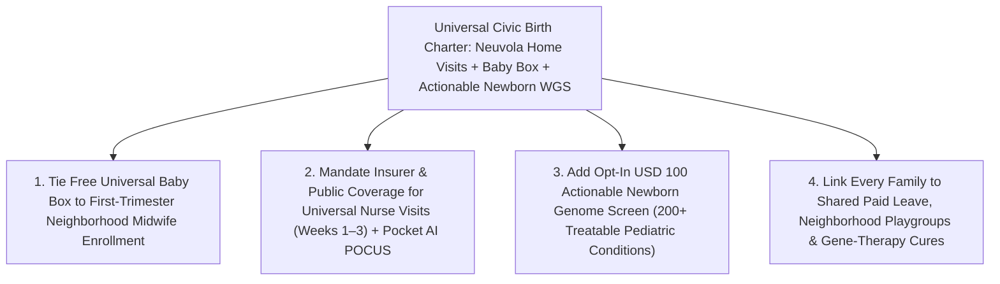

# CARBON EDITION — PILLAR 4: EVERY BABY WELCOMED EQUAL
## Finland's "Neuvola" Baby Box, Universal Nurse Home Visits, Pocket AI Ultrasound & \$100 Newborn Genomes

> **Executive Framing & Reimagining the First 1,000 Days of Human Life:**
> * **The Cynic's Belief:** *"Welcoming a baby in the modern economy inevitably plunges young families into hospital-bill terror, sleepless postpartum isolation, two-year childcare waitlists, and a multi-year 'diagnostic odyssey' if a rare genetic condition appears—which is why fertility rates and young-adult family optimism have collapsed irreversibly across the developed world."*
> * **The Empirical Counter-Reality:** In **1938**, **Finland** was a poor agrarian nation losing **~65 to 90 infants out of every 1,000 births**. Instead of leaving young parents to fend for themselves, Parliament enacted the Maternity Grants Act—and in **1949** made the **Kela Maternity Package ("Baby Box")** **100% universal for every mother regardless of income**, on one gentle condition: enroll in a free neighborhood ***Neuvola*** (*"place of advice"*) maternal-child health clinic before the fourth month of pregnancy. Paired with **~14 months of shared paid parental leave**, that heirloom-grade starter kit—whose sturdy cardboard box and fitted breathable mattress double as every Finnish baby's safe first crib—helped drive Finland's infant mortality below **2.0 per 1,000 live births** (among the lowest on Earth) and inspired **Scotland's Universal Baby Box**, **New Jersey's *Family Connects NJ* universal nurse home visits**, and **60+ global programs**. Meanwhile, **Prof. David Olds's Nurse-Family Partnership** proved across multi-decade U.S. randomized controlled trials in **Elmira, Memphis, and Denver** that pairing first-time parents with a trusted visiting public-health nurse cuts **verified child abuse and neglect by 48%**, slashes **infant emergency-room visits by 35%–50%**, and returns **~\$5.70 for every \$1 invested** (RAND audit)!
> * **The Social Norm Shift:** Communities transform childbirth from lonely financial dread into a supported civic celebration—weaving universal stigma-free *Neuvola* home visits, heirloom Baby Boxes, and shared paid parental leave together with **pocket handheld AI point-of-care ultrasound** at the kitchen table and **opt-in rapid ~\$100 newborn whole-genome screening** modeled on the **UK NHS & Genomics England *Generation Study* (sequencing 100,000 newborns for 200+ treatable childhood genetic conditions before a single symptom appears)**.
> * **Anchor Voice:** *"When every baby in a country sleeps in the exact same first bed—whether born to a factory worker or a cabinet minister—society makes a visible promise before the first breath: you belong here, your parents are not alone, and every child starts equal."* — **Finnish Kela / *Neuvola* Maternal Health Architects & Prof. David Olds**, Founder of *Nurse-Family Partnership* ([Visual Storyboard](./STORYBOARD.md))

---

## ACT I: THE LIVED HUMAN REALITY — TUESDAY MORNING AT 10:15 AM IN TAMPERE & NEWARK (2028)
### Why an Heirloom Box, a Kitchen-Table Midwife, and a Six-Day Genome Shield Erase Postpartum Panic

It is 10:15 AM on a frosty Tuesday morning in **Tampere, Finland**—and simultaneously in a sunlit two-bedroom apartment in **Newark, New Jersey**, six days after 28-year-old middle-school teacher **Maya Alvarez** and her husband **Jordan**, a transit electrician, brought home their first daughter, **Lucia**.

Under the fragmented status quo that exhausted young American and European parents through the early 2020s, Day 6 at home was often the loneliest week of an adult's life: a **\$4,800 to \$14,000 out-of-pocket hospital delivery bill** sitting unopened on the counter, Jordan forced back onto shift work after five unpaid days, Maya crying alone at 3:00 AM over painful latching and healing stitches with six weeks until her single 15-minute obstetric checkup, and—for the **1 in 200 families** whose newborn carries a silent, treatable metabolic or neuromuscular disorder—a terrifying five-year **"diagnostic odyssey"** bouncing between emergency rooms only after irreversible developmental damage has already struck.

Watch how the **Universal *Neuvola* + Newborn Genome Standard** catches Maya, Jordan, and baby Lucia at their kitchen table instead:

1. **The Stigma-Free Civic Welcome Box & Zero-Bill Birth:**
   In the corner of their bedroom sits Lucia's **Universal Baby Box**—modeled directly on **Kela Finland's 1949 Maternity Package** and **Scotland's Universal Baby Box**—delivered free during month six of Maya's pregnancy after her neighborhood prenatal checkup. Inside its Nordic-illustrated bassinet and firm, safe-sleep breathable mattress came **50+ heirloom-quality essentials**: merino-wool and organic cotton bodysuits sized 0–12 months, a hooded snowsuit, sleep sack, bath thermometer, cloth picture book, nursing pads, and infant nail scissors—saving Maya and Jordan **~\$1,100 in panicked retail markups** while signaling that **every child in the state sleeps in the exact same dignified first bed**, zero means-testing or poverty stigma attached.
2. **Unhurried Kitchen-Table Midwife Care + Pocket AI Point-of-Care Ultrasound:**
   At 10:15 AM, **Clara Mensah, RN**—their neighborhood visiting nurse under expanded **Family Connects New Jersey**—knocks gently, slips off her shoes, and sits with both parents (Jordan is home on paid shared parental leave) over chamomile tea. Instead of making Maya haul a six-day-old newborn onto a winter bus to an urgent-care waiting room over blood-pressure and uterine-healing worries, Clara pairs a cuffless maternal vital check with a **4-ounce handheld AI point-of-care ultrasound probe** connected to her encrypted tablet. Guided by real-time neural anatomical overlays, Clara confirms clean postpartum involution in ninety seconds right on the sofa, coaches Maya through a pain-free nursing latch, screens both parents warmly for postpartum mood strain, and links them to their walkable neighborhood *Neuvola* playgroup two blocks away.
3. **The Day-6 Pre-Symptomatic Genome Rescue (*Generation Study* Protocol):**
   Before leaving, Clara shares the calmest medical miracle of the 2020s. At birth, Maya and Jordan opted Lucia into rapid, **~\$100 clinical newborn whole-genome screening**—modeled on the **UK NHS & Genomics England *Generation Study***, which strictly filters *only* for **200+ childhood-onset genetic conditions that have proven, immediately actionable treatments**. Lucia's heel-prick sequence flags **profound biotinidase deficiency** on Day 6, weeks before seizures, hearing loss, or coma could ever appear. The prescribed cure? **A simple, pennies-a-day oral biotin vitamin drop** started that very afternoon with a pediatric geneticist on video—turning what used to be a lifelong tragedy and a **\$1.5 million ICU odyssey** into an ordinary, healthy childhood!

---

## ACT II: REIMAGINING THE RULES — HOW FINLAND, DAVID OLDS & GENOMICS ENGLAND PROVED IT WORKS
### Why Universal Early Warmth + Precision Prevention Beats Means-Tested Crisis Medicine Every Time

```mermaid
flowchart LR
    subgraph LegacyTrap["Legacy Fragmented Postpartum Reality"]
        L1["Surprise Delivery Bills + Unpaid Leave + 6-Week Maternal Care Desert"]
        L2["Isolated 3 AM Panic + Preventable Infant ER Visits & Safe-Sleep Risks"]
        L3["5-Year Rare-Disease Diagnostic Odyssey After Irreversible Symptoms"]
    end
    subgraph NeuvolaEngine["Universal Neuvola + Baby Box + Newborn Genomics"]
        N1["Universal Neuvola Clinic Enrollment + Kela Heirloom Crib Box (Zero Stigma)"]
        N2["Trusted Nurse Home Visits + Pocket Handheld AI Ultrasound at Kitchen Table"]
        N3["Opt-In USD 100 Rapid Newborn Genome Screen (200+ Treatable Conditions)"]
    end
    subgraph CivicDividend["Verified Multi-Decade Health & Fiscal Outcomes"]
        D1["Finland Infant Mortality Driven From ~68 Down Below 2.0 per 1,000 Births"]
        D2["Nurse-Family Partnership RCTs: -48% Abuse/Neglect, -35%–50% ER, 5.7x ROI"]
        D3["Pre-Symptomatic Cures Unlocked From Day 6 + Confident Young Families"]
    end
    LegacyTrap ==> NeuvolaEngine ==> CivicDividend
```

### 1. The Genius of Finland's 1949 Bargain: Why Universalism Is the Secret Engine of Prevention
When visitors photograph **Kela's Finnish Maternity Package**, they usually marvel at the adorable baby snowsuits and the clever cardboard crib. Yet Finnish epidemiologists point out that **the box itself was actually a brilliant behavioral-trust magnet**. In 1938, low-income rural mothers often reached childbirth without ever seeing a midwife or doctor, driving infant mortality to **65–90 per 1,000 live births**. By making the coveted Baby Box **100% universal across all social classes in 1949**—while tying receipt of the box (or a smaller cash grant, though **~95% of first-time Finnish parents choose the box!**) to visiting a free municipal ***Neuvola*** clinic before the end of the fourth month of pregnancy—Finland achieved **>99.5% early prenatal and pediatric care continuity** overnight without hiring a single welfare-fraud investigator!

Inside a Finnish *Neuvola*, the exact same public-health nurse (*terveydenhoitaja*) follows the family from early pregnancy through childbirth and **15+ scheduled holistic checkups until age six**, including a warm home visit right after birth. When **Scotland** launched its **Universal Baby Box** nationwide in 2017 via **Parent Club** (now past **250,000+ boxes delivered**, with **85%+ parent uptake**) and **New Jersey** enacted **Family Connects NJ** (offering every newborn family statewide—regardless of income or insurance—free in-home registered-nurse visits within two to three weeks of birth), both jurisdictions rediscovered the exact same sociological law: **programs built only for poor people become stigmatized, underfunded bureaucratic hurdles; programs welcoming every baby equally become beloved national treasures**.

### 2. David Olds's 45-Year Gold Standard: The \$5.70-per-\$1 RCT Proof of Nurse Home Visiting
Skeptical budget directors sometimes ask whether sending skilled public-health nurses into ordinary living rooms is merely a "feel-good Nordic perk." That question was settled with unprecedented scientific rigor in the United States by pediatrician and prevention scientist **Prof. David Olds** through the **Nurse-Family Partnership (NFP)**. Across **three landmark multi-decade randomized controlled trials** in **Elmira, New York (1977)**, **Memphis, Tennessee (1988)**, and **Denver, Colorado (1994)**—tracking mothers and children for up to **20+ years**—pairing first-time mothers with a consistent registered nurse from pregnancy through the child's second birthday delivered astonishing, replicated impacts:
* **-48% reduction** in state-verified child abuse and neglect (Elmira 15-year follow-up);
* **-35% to -50% reduction** in infant emergency-department visits for injuries and ingestions, plus **-56% hospital days** for preventable early trauma;
* **-67% reduction** in behavioral and intellectual problems at age six, higher maternal employment, fewer closely spaced high-risk pregnancies, and **-59% child arrests** by age fifteen;
* **~\$5.70 in verified public and societal return for every \$1 invested** for higher-need families (and **~\$2.88+ across broader cohorts**) in independent **RAND Corporation** and Washington State Institute for Public Policy cost-benefit audits!

### 3. Intertwining Technological Abundance With Humane Rules: Pocket AI Ultrasound + \$100 Newborn Genomes
What happens when we fuse 1949 Finnish civic tenderness with 2026–2030 clinical and genomic abundance? Instead of forcing recovering mothers and tiny newborns into sterile hospital corridors, **high technology shrinks into the nurse's canvas bag**:
1. **Handheld AI Point-of-Care Ultrasound (POCUS) at Home:** Solid-state ultrasound-on-a-chip probes (costing **<\$2,000** vs. **\$120,000** rolling hospital carts) paired with FDA/CE-cleared **real-time AI guidance** allow community midwives and *Neuvola* nurses to verify fetal breech/cephalic presentation in week 36 (preventing emergency surprise C-sections), check amniotic fluid and placental flow, and spot postpartum hemorrhage or preeclampsia warning signs right at the kitchen table—slashing preventable maternal morbidity across urban apartments and rural towns alike.
2. **The UK NHS *Generation Study* Blueprint for Ethical, Actionable \$100 Newborn Genomes:** For sixty years, standard heel-prick biochemical screening caught only **9 to 35 metabolic conditions** in most countries, missing hundreds of devastating genetic disorders until a toddler stopped walking or suffered catastrophic organ damage. Launched across NHS hospitals by **Genomics England**, **The Generation Study** is sequencing **100,000 newborns** using whole-genome sequencing whose raw laboratory cost has plunged from **\$100,000,000 (2001)** to **~\$100–\$200**. Crucially, its **humane ethical rulebook** solves every bioethical fear: participation is **100% opt-in**, DNA data sits inside a **strict privacy-locked research/clinical vault** banned from insurers or employers, and clinical reports return **ONLY the 200+ childhood-onset conditions where early vitamin therapy, dietary enzymes, targeted drugs, or [`invivo-crispr-cures`](../../03-bioscience-regeneration/invivo-crispr-cures/REPORT.md) dramatically alter survival before age five**—never dumping unactionable adult-onset anxiety onto new parents!

| First-1,000-Days Dimension | Fragmented Market Birth Status Quo | Universal *Neuvola* + Baby Box + AI POCUS + Newborn WGS (Carbon Standard) | Verified Empirical Outcome |
| :--- | :--- | :--- | :--- |
| **Material Welcome & Safe Sleep** | Parents spend **\$1,000–\$2,500** retail; unsafe co-sleeping spikes SIDS risk | **Universal Kela / Scottish-style Baby Box** (crib mattress + 50+ essentials) | **<2.0 / 1,000 infant mortality** in Finland (from ~68 in 1938) |
| **Postpartum Weeks 1–8 Support** | Single rushed **15-min OB check at Week 6**; high maternal depression & ER panic | **In-home RN/midwife visits** (*Neuvola* / *Family Connects* / *NFP*) + **Pocket AI POCUS** | **-35% to -50% infant ER visits** & **-48% abuse/neglect** (NFP RCTs) |
| **Parental Time & Household Security** | 25% of U.S. moms back at work within **14 days**; **\$4,800+ delivery bills** | **Zero-bill birth** + **6–14 months shared paid leave** + Baby Bond seed trust | **~\$5.70 societal return per \$1** invested in nurse home visiting |
| **Rare Genetic Disease Detection** | Standard heel-prick catches **9–35 disorders**; 5-yr diagnostic odyssey for others | **Opt-in ~\$100 Newborn WGS** (*Generation Study*: **200+ treatable conditions**) | Pre-symptomatic cures on **Day 6–14** before irreversible harm |

---

## ACT III: GLOBAL ADAPTATION & PHASED ROLLOUT ROADMAP (2026–2032)
### Scaling From New Jersey, Scotland & Tampere to Every County Hospital and Rural Midwife Hub

Policy leaders don't need to pass a fifty-year Nordic tax code to launch this tomorrow morning: **New Jersey (*Family Connects NJ*, signed into law to reach 100,000+ annual births statewide)**, **Oregon (*Family Connects Oregon*, mandated across commercial and Medicaid insurers alike)**, **Scotland (*Parent Club Baby Box*)**, and **35+ UK NHS *Generation Study* maternity trusts** have already drafted the exact statutory, Medicaid/insurer, and clinical templates!

| Implementation Horizon | Statutory & Payer Unlock | Clinical & Technical Deployment | Audited Family & Fiscal Outcome |
| :--- | :--- | :--- | :--- |
| **Phase 1 (Months 1–9): Universal Baby Box + *Family Connects* Launch** | States/regions enact **Oregon/NJ-style universal postpartum nurse-visit parity** (Medicaid + commercial plans, zero copay) paired with bulk-procured **\$160 wholesale Baby Boxes**. | Train hospital maternity wards and community midwives; equip visiting nurses with **pocket AI POCUS probes** and postpartum hypertension cuffs. | **85%+ family enrollment** with zero stigma; postpartum maternal ER readmissions for preeclampsia/infection fall **30%–40%** in Year 1. |
| **Phase 2 (Years 1–3): Neighborhood *Neuvola* Continuity + Actionable WGS** | Expand **Nurse-Family Partnership** for high-need first-time parents through age 2 while opening **UK *Generation Study*-modeled opt-in newborn genome screening** across public birthing hubs. | Integrate **[`alphagenome2-cellstate-genomics`](../../03-bioscience-regeneration/alphagenome2-cellstate-genomics/REPORT.md)** variant interpretation pipelines strictly filtered to **200+ treatable childhood conditions** (<10-day turnaround). | Infant ER visits drop **35%–50%**; **~1 in 200 newborns** rescued pre-symptomatically from preventable metabolic, immune, or neurological harm. |
| **Phase 3 (Years 3–6): Full First-1,000-Days Abundance Compact** | Pair **[`healthcare-without-billing`](../../03-bioscience-regeneration/healthcare-without-billing/REPORT.md)** zero-bill maternity care with **6–12+ months shared paid family leave** and **[`universal-capital-dividends`](../universal-capital-dividends/REPORT.md)** newborn seed accounts. | Connect Day-6 genomic flags directly to one-time **[`invivo-crispr-cures`](../../03-bioscience-regeneration/invivo-crispr-cures/REPORT.md)** and enzyme/gene therapies before symptoms ever begin. | Infant mortality converges toward **<2.0 per 1,000** across all zip codes; young adults regain realistic confidence to welcome the children they want. |

---

## ACT IV: ANSWERING THE SKEPTIC & THE HUMANE HORIZON
### Protecting Genomic Privacy, Avoiding Gimmicks, and Centering Human Relationship

### Addressing the Top 3 Institutional Objections
1. **"Didn't critics warn that giving away cardboard 'Baby Boxes' as standalone PR stunts in North America without Finland's clinical infrastructure misses the whole point?"**
   * *Empirical Answer:* **100% yes—and that distinction is the heart of this pathway!** Handing an isolated mother a cardboard box at a hospital exit without paid leave or a visiting nurse is mere theater. In Finland since 1949, **the box is inseparable from *Neuvola* relationship continuity**: the box draws 99.5% of families into first-trimester care, and the visiting nurse checks safe-sleep setup, maternal blood pressure, feeding, and family well-being in the living room. Always fund **the box + the nurse + the leave** as one indivisible bundle.
2. **"Won't sequencing newborn genomes create 'patients-in-waiting,' false-positive panic, or insurance discrimination?"**
   * *Empirical Answer:* That is why the **UK NHS & Genomics England *Generation Study*** co-designed strict guardrails with thousands of parents, geneticists, and ethicists: **(a)** screening is **100% voluntary opt-in**; **(b)** raw sequence data is legally walled off from insurers, marketers, and police under ironclad genetic non-discrimination statutes; and **(c)** automated bioinformatic filters report **only high-penetrance, childhood-onset variants with proven, available treatments** (strictly excluding adult-onset Alzheimer's/BRCA risk or variants of uncertain significance during infancy)—keeping false-positive anxiety near zero while saving hundreds of babies a year from sudden metabolic crisis, spinal muscular atrophy, or curable immunodeficiencies.
3. **"Can strained state or municipal budgets afford universal nurse home visits for rich and poor families alike?"**
   * *Empirical Answer:* Randomized trials of Durham/New Jersey **Family Connects** (~1 to 3 universal triage visits for every birth, seamlessly stepping up intensive 2-year **Nurse-Family Partnership** coaching for families who need deeper support) cost just **~\$500–\$700 per birth**—and generate **>\$3.00 in emergency-room and inpatient hospital savings within the baby's very first 6 months alone**, paying for themselves inside the *same fiscal year*!

### Fast-Track Governor, Health Minister & Hospital Chief Activation Checklist

| Sprint Reform Step | Proven Real-World Precedent | Months to Launch | Quality & Privacy Guardrail |
| :--- | :--- | :--- | :--- |
| **1. Universal Postpartum Nurse Mandate** | *Family Connects NJ* & Oregon Statewide | **4 Months** | Zero copay across Medicaid & private plans; steps up to 2-yr *NFP* |
| **2. Bulk Civic Baby Box Procurement** | Kela Finland (1949) & Scotland *Parent Club* | **3 Months** | Certified breathable mattress + 50 essentials tied to prenatal care |
| **3. Midwife Pocket AI POCUS Rollout** | Solid-State Handheld Maternal Ultrasound | **3 Months** | FDA/CE-cleared AI breech, placental & postpartum checks at home |
| **4. Actionable Newborn WGS Pilot** | UK NHS / Genomics England *Generation Study* | **6 Months** | 100% opt-in; strict 200+ treatable childhood list; zero insurer access |
| **5. Zero-Bill Birth & Shared Leave Link** | Finnish 14-Mo Shared Parental Allowance | **9 Months** | Abolishes delivery deductibles & protects bonding across both parents |

### Why Both Pro-Family Conservatives and Public-Health Progressives Champion This Together
* **Why Pro-Family & Fiscal Leaders Love It:** Celebrates marriage, parenthood, and newborn life tangibly instead of punishing young families with surprise **\$10,000 hospital bills**, while delivering a RAND-verified **\$5.70-per-\$1 taxpayer return** and cutting emergency hospital spending within months.
* **Why Equity Advocates, Midwives & Pediatricians Love It:** Replaces humiliating means-tested welfare lines with universal solidarity, slashes maternal mortality disparities through in-home blood-pressure and AI ultrasound checks, and ends the five-year rare-disease diagnostic odyssey for working-class children.

### Cross-Pillar Synergies & The Bottom Line
Woven together with **[`invivo-crispr-cures`](../../03-bioscience-regeneration/invivo-crispr-cures/REPORT.md)**, **[`alphagenome2-cellstate-genomics`](../../03-bioscience-regeneration/alphagenome2-cellstate-genomics/REPORT.md)**, **[`universal-capital-dividends`](../universal-capital-dividends/REPORT.md)**, and **[`healthcare-without-billing`](../../03-bioscience-regeneration/healthcare-without-billing/REPORT.md)**, **Finland's *Neuvola* Baby Box + Nurse Home Visits + \$100 Newborn Genomes** proves that welcoming a child never had to feel like stepping off a financial and emotional cliff alone. When every newborn sleeps in an equal first bed, a warm neighborhood nurse brings pocket AI diagnostics to the kitchen table, and rapid genomics catches silent disorders before a tear is shed, **society keeps its oldest sacred promise: every baby starts life cherished, safe, and whole**.

---

## References & Verified Sources

* **Universal Maternity Package & *Neuvola* Architecture:** [Kela Finland — Official Maternity Package (*Äitiyspakkaus* / Baby Box History Since 1938 & 1949 Universalization)](https://www.kela.fi/maternity-package) · [Scottish Government *Parent Club* — Scotland's Universal Baby Box Program](https://www.parentclub.scot/baby-box)
* **Randomized Nurse Home-Visiting Trials & Statewide Universal Rollouts:** [Nurse-Family Partnership (Prof. David Olds) — Elmira, Memphis & Denver Multi-Decade RCT Evidence & RAND ROI Audits](https://www.nursefamilypartnership.org/) · [Family Connects New Jersey — Universal Statewide Newborn Nurse Home Visiting](https://www.familyconnectsnj.org/)
* **Pre-Symptomatic Newborn Whole-Genome Screening:** [Genomics England & UK NHS — *The Generation Study* (100,000 Newborns Screened for 200+ Treatable Genetic Conditions)](https://www.genomicsengland.co.uk/initiatives/newborns)
* **Connected Carbon Pathways:** [One-Shot Genetic Cures: In Vivo CRISPR & Base Editing for Rare & Common Disease](../../03-bioscience-regeneration/invivo-crispr-cures/REPORT.md) · [Decoding the Dark Genome: AlphaGenome 2 & Single-Cell Regulatory Medicine](../../03-bioscience-regeneration/alphagenome2-cellstate-genomics/REPORT.md) · [Universal Capital Dividends, Baby Bonds & Citizen Wealth Funds](../universal-capital-dividends/REPORT.md) · [Skipping the \$1.2 Trillion Billing Maze: Continuous AI Diagnostics & Universal Direct Care](../../03-bioscience-regeneration/healthcare-without-billing/REPORT.md)
