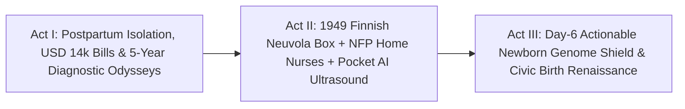

# STORYBOARD & CREATIVE PRODUCTION GUIDE: EVERY BABY WELCOMED EQUAL ([`neuvola-baby-box-parental-start`](./REPORT.md))
## *"One Heirloom First Bed, One Trusted Kitchen-Table Midwife, and a \$100 Genome Shield Before the First Symptom"*

> **Production Purpose:** This warm 4-minute documentary storyboard dismantles the fatalistic myth that having a baby in the modern world must mean \$14,000 hospital bills, lonely 3:00 AM tears, and rare-disease terror—bringing viewers inside **Finland's 1949 Universal *Neuvola* & Kela Baby Box** (<2.0/1,000 infant mortality), **David Olds's Nurse-Family Partnership** (\$5.70 ROI per \$1), **Family Connects New Jersey**, and the **UK NHS *Generation Study*** (100,000 newborns screened for 200+ treatable genetic conditions).

---

## PART 1: THREE ALTERNATIVE NARRATIVE OPENINGS (DIRECTOR'S OPTIONS)

### Option A: "The Cardboard Crib Shared by Prime Ministers and Factory Workers" *(Iconic Cultural Wonder)*
* **Visual Hook:** Overhead match-cut across eight decades in Tampere, Finland: a 1949 postwar mother lifting a newborn onto a crisp white mattress inside a sturdy cardboard **Kela Baby Box**, dissolving through 1975 and 2005 into a sunlit 2028 apartment in **Newark, New Jersey**, where teacher **Maya** and electrician **Jordan** unbox 50+ merino and organic-cotton essentials for six-day-old **Lucia**—zero hospital bill on the table.
* **Voiceover Core:** *"In 1938, Finland lost nearly seventy babies out of every thousand births. So they made a radical promise: every newborn—rich or poor—would receive the exact same first bed, free neighborhood midwife care, and paid time to bond. Today, fewer than two per thousand die—and the next chapter fits in a nurse's coat pocket."*
* **Best For:** Mainstream family audiences, public-broadcast flagship films, and cross-generational civic campaigns.

### Option B: "3:00 AM Alone vs. 10:15 AM Chamomile Tea" *(Intimate Emotional Contrast)*
* **Visual Hook:** Split-screen six days after birth. Left (`Legacy Postpartum Desert`): Exhausted new mom weeping alone under blue phone light at 3:12 AM beside an unopened **\$12,400 delivery invoice**, six weeks away from her first 15-minute clinic slot. Right (`Family Connects + Neuvola Standard`): Visiting nurse **Clara** sits knee-to-knee with Maya and Jordan over morning tea, checking uterine recovery in 90 seconds with a **4-ounce pocket AI ultrasound probe**.
* **Voiceover Core:** *"We spend fortunes inside hospital delivery rooms and then abandon young parents at the curb for six weeks. Watch what happens when a trusted public-health nurse walks through the front door instead."*
* **Best For:** Maternal-health summits, nursing organizations, and young-adult family audiences.

### Option C: "The Penny-a-Day Vitamin That Beat a Five-Year Odyssey" *(Medical Breakthrough Hook)*
* **Visual Hook:** Macro close-up of a tiny amber dropper bottle of oral biotin landing gently on a sunlit kitchen table beside smiling six-day-old Lucia—cutting to a clean **Genomics England *Generation Study*** graphic filtering 3 billion DNA letters strictly for **200+ treatable childhood conditions**.
* **Voiceover Core:** *"Five years ago, Lucia's silent metabolic gene wouldn't have been caught until seizures struck in toddlerhood. With an opt-in hundred-dollar newborn genome screen, her visiting nurse brought the cure on Day Six: a simple daily vitamin."*
* **Best For:** Bioscience forums, pediatric hospitals, and rare-disease family coalitions.

---

## PART 2: VISUAL NARRATIVE ARC & MODULAR 3-ACT STORYBOARD TABLE (12 SCENES)

| Act / Beat | Visual & Camera Concept | Data & Metric Callout Overlay | Sample Narration / Voiceover Script |
| :--- | :--- | :--- | :--- |
| **ACT I — Beat 1:** The \$14,000 Welcome Home | Young parents carry a car seat into a quiet walk-up apartment; camera pans past diapers to a stack of hospital EOB bills and Jordan's Monday 6:00 AM work boots. | **Legacy U.S. Birth Reality:** **\$4,800–\$14,000 Out-of-Pocket** \| 6-Week Postpartum Care Gap | "For millions of young couples, welcoming a baby starts with surprise hospital bills, unpaid leave, and six lonely weeks without a single medical check-in." |
| **ACT I — Beat 2:** The Hidden Rare-Disease Clock | Subtle dramatic montage of worried parents bouncing between four specialist waiting rooms with a toddler while a calendar flips across five agonizing years. | **Rare Pediatric Conditions:** **~5-Year Average Diagnostic Odyssey** After Symptoms Hit | "And for the one in two hundred babies born with a silent, treatable genetic disorder, answers often arrive years too late." |
| **ACT I — Beat 3:** Finland's 1938–1949 Turning Point | Warm archival black-and-white footage of Finnish mothers walking through birch snow into a cheerful neighborhood ***Neuvola*** clinic to claim the universal **Kela Box**. | **Finland 1949 Universal Kela Box:** Tied to Prenatal *Neuvola* Visit Before Month 4 | "Postwar Finland chose another path—offering every mother on every income rung an heirloom starter box and crib, tied gently to early neighborhood midwife care." |
| **ACT II — Beat 4:** Unboxing Dignity Without Stigma | Overhead knolling shot: 50+ colorful bodysuits, wool mittens, bath thermometer, picture book, and breathable safe-sleep mattress fanning out from one Nordic box. | **Infant Mortality Collapse:** **~65–90 per 1,000 (1938)** Down to **<2.0 per 1,000** Today | "No welfare stigma, no forms to prove poverty—just fifty essentials and a safe first bed that helped drive infant mortality below two per thousand." |
| **ACT II — Beat 5:** David Olds's 45-Year RCT Proof | Crisp documentary portrait of **Prof. David Olds** alongside multi-decade cohort charts from **Elmira, Memphis, and Denver** showing plummeting trauma and ER lines. | **Nurse-Family Partnership RCTs:** **-48% Abuse/Neglect** \| **-35%–50% ER** \| **~\$5.70 per \$1 ROI** | "In America, David Olds proved across three randomized trials that visiting nurses cut infant ER trips in half and return nearly six dollars for every dollar spent." |
| **ACT II — Beat 6:** Scotland & New Jersey Scale Up | Joyful split-screen: Glasgow parents unfolding **Scotland's Universal Baby Box** (250,000+ delivered) alongside **Family Connects NJ** nurses arriving on Newark porches. | **60+ Global Replications:** Scotland *Parent Club* + *Family Connects NJ* & Oregon | "From Scotland's quarter-million Baby Boxes to New Jersey's statewide nurse visits, universal welcome works in every culture that tries it." |
| **ACT II — Beat 7:** Kitchen-Table Pocket AI Ultrasound | Intimate 35mm handheld shot: Nurse Clara glides a **4-ounce wireless AI ultrasound probe** across Maya's abdomen on the living-room sofa, confirming healthy recovery. | **Pocket AI POCUS (<\$2,000):** Instant Breech, Preeclampsia & Postpartum Checks at Home | "Now high technology shrinks into the midwife's bag: a pocket AI ultrasound checks recovery right on the couch—no winter bus ride required." |
| **ACT II — Beat 8:** Unhurried Tea & Shared Leave | Jordan brings two mugs of chamomile tea while Clara helps Maya adjust Lucia's nursing pillow and invites them both to Thursday's walkable *Neuvola* parent circle. | **Finland ~14-Mo Shared Paid Leave** + Neighborhood Peer Playgroups = Zero Isolation | "With both parents home on paid leave and a neighborhood parent group two blocks away, the terrifying 3:00 AM silence disappears." |
| **ACT III — Beat 9:** Inside the *Generation Study* Vault | Clean architectural visualization of **UK NHS & Genomics England** sequencing a heel-prick drop for **~\$100**, locking non-clinical DNA away while checking **200+ treatable genes**. | **UK NHS Generation Study:** **100,000 Newborns** \| Strictly Actionable **200+ Pediatric List** | "Meanwhile in Britain's Generation Study, an opt-in hundred-dollar genome screen checks strictly for over two hundred conditions doctors can treat immediately." |
| **ACT III — Beat 10:** Day-6 Biotin Rescue | Close-up on Clara and a smiling video-linked pediatric geneticist showing Maya and Jordan how five drops of oral biotin prevent biotinidase symptoms 100% before Day 7. | **Day-6 Pre-Symptomatic Catch:** Pennies-a-Day Vitamin Replaces **\$1.5M ICU Odyssey** | "On Day Six, Lucia's screen catches biotinidase deficiency weeks before a single symptom—cured for life by simple daily vitamin drops." |
| **ACT III — Beat 11:** One-Shot Gene Cures When Needed | Hopeful cross-cut to pediatricians pairing early newborn flags with next-generation **[`invivo-crispr-cures`](../../03-bioscience-regeneration/invivo-crispr-cures/REPORT.md)** and newborn Baby Bond seed accounts. | **First-1,000-Days Stack:** Zero-Bill Birth + Nurse + Genome + Baby Bond Seed Trust | "And when a rarer flag needs deeper medicine, catching it in Week One unlocks one-shot genetic therapies while every neuron is still healthy." |
| **ACT III — Beat 12:** Closing Bookend — Sleeping Safe | Golden afternoon light: baby Lucia sleeps peacefully inside her illustrated Baby Box crib while Maya and Jordan laugh quietly on the sunlit living-room rug. | **Every Baby Welcomed Equal:** Lower Costs, Healthier Infants, Fearless Young Families | "When every child sleeps in an equal first bed and no parent walks home alone, welcoming new life stops feeling scary—and starts feeling like joy." |

---

## PART 3: VISUAL METAPHOR BANK & PRODUCTION DESIGN

* **1. "The Equal First Bed" Overhead Kaleidoscope:**
  * *Visual:* Top-down symmetrical grid of 16 sleeping newborns across Tampere, Glasgow, Newark, and rural Oregon—every baby tucked safely on a firm mattress inside an illustrated civic Baby Box regardless of the apartment walls around them.
  * *Emotional Takeaway:* Visualizes universal dignity and zero poverty stigma in three silent seconds.
* **2. "The Shrinking Hospital Cart Into the Canvas Midwife Bag":**
  * *Visual:* A hulking **\$120,000** clinic ultrasound tower and a five-year stack of medical-debt binders dissolve into a **4-ounce pocket AI probe** and a tiny heel-prick card tucked beside chamomile tea bags in Clara's canvas tote.
  * *Emotional Takeaway:* Shows technology serving domestic peace rather than institutional bureaucracy.
* **3. "The Vaulted Genome Filter":**
  * *Visual:* Three billion glowing DNA base pairs pass through a warm golden clinical sieve labeled `ONLY 200+ TREATABLE CHILDHOOD CONDITIONS — ZERO INSURER ACCESS`, illuminating a single actionable vitamin drop.
  * *Emotional Takeaway:* Answers privacy and "patient-in-waiting" fears instantly and honestly.

---

## PART 4: SOUND DESIGN, INTERACTIVE COUNTY CALCULATOR & VERIFIED CONTINUITY

* **Color & Acoustic Arc:** Shifts from cold fluorescent hospital billing corridors and anxious 3:00 AM phone buzzes (Act I) to warm Nordic birchwood, soft merino textures, kettle steam, gentle infant breathing, and acoustic cello-and-piano lullaby motifs (Acts II–III).
* **Interactive Documentary Companion ("Build Your State's Universal First-1,000-Days Bundle"):**

| Policy & Clinical Layer | Per-Birth Public Cost | Verified Clinical & Family Impact | Fiscal Payback Window |
| :--- | :--- | :--- | :--- |
| **1. Universal Civic Baby Box** | **~\$160** wholesale | Safe-sleep crib + 50 essentials; **99%+ prenatal clinic pull** | Immediate family savings (**~\$1,100**) |
| **2. *Family Connects* + *NFP* Nurses** | **~\$500–\$700** triage | **-35%–50% infant ER visits** \| **-48% abuse/neglect** (NFP) | **<6 months** ER payback; **\$5.70/\$1** long-run |
| **3. Pocket AI POCUS + ~\$100 WGS** | **~\$115** marginal | Home preeclampsia/breech catch + **200+ pre-symptom cures** | Eliminates **\$500k–\$1.5M** late ICU crises |

* **Verified Sources & Connected Carbon Pathways:** Anchored in [Kela Finland](https://www.kela.fi/maternity-package), [Nurse-Family Partnership](https://www.nursefamilypartnership.org/), [Scotland's Baby Box](https://www.parentclub.scot/baby-box), [Family Connects NJ](https://www.familyconnectsnj.org/), and [Genomics England's *Generation Study*](https://www.genomicsengland.co.uk/initiatives/newborns); pairs directly with [`invivo-crispr-cures`](../../03-bioscience-regeneration/invivo-crispr-cures/REPORT.md), [`alphagenome2-cellstate-genomics`](../../03-bioscience-regeneration/alphagenome2-cellstate-genomics/REPORT.md), [`universal-capital-dividends`](../universal-capital-dividends/REPORT.md), and [`healthcare-without-billing`](../../03-bioscience-regeneration/healthcare-without-billing/REPORT.md).
