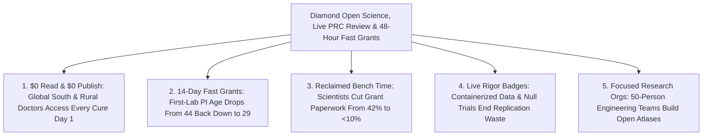

# CARBON EDITION — PILLAR 4: TEARING DOWN THE \$40 PAYWALL
## Diamond Open Access, *eLife* Live Peer Review, OSTP Zero-Embargo & 48-Hour Fast Grants

> **Executive Framing & Reimagining How Humanity Shares Discovery:**
> * **The Cynic's Belief:** *"Scientific publishing and grantmaking are inherently slow—it will always take eighteen months of 80-page bureaucracy for young scientists to win lab funding, and another fourteen months for legacy journals to lock taxpayer-funded cures behind \$40 PDF paywalls or \$11,000 publishing fees."*
> * **The Empirical Counter-Reality:** Between 2025 and 2026, science's century-old rent-extraction bottleneck cracked wide open. The **Gates Foundation's 2025 Open Access Policy** ended subsidies for predatory journal Article Processing Charges (APCs) while mandating immediate verified preprints; the **U.S. White House OSTP Nelson Memo** took full effect in 2026, banning paywall embargoes on *all* federally funded papers and underlying data; **cOAlition S and the European Union** championed **Diamond Open Access** (free to read *and* free to publish); **eLife** replaced binary gatekeeping with **live public Reviewed Preprints**; and **Fast Grants** + **Convergent Research Focused Research Organizations (FROs)** proved bold breakthroughs can be funded in **48 hours to 14 days** instead of 18 months!
> * **The Social Norm Shift:** Publicly and philanthropically funded knowledge belongs immediately to every doctor, patient, AI synthesizer, and student on Earth—retiring 38%-margin paywall tollbooths and 500-day grant queues for **Diamond Preprint Commons**, **Transparent Signed Peer Review**, and **Two-Page Fast Grants + Time-Bounded FROs**.
> * **Anchor Voice:** *"In a crisis—and every day for a family waiting on a medical cure is a crisis—waiting eighteen months to fund an experiment and another year to read the result is an unforgivable institutional choice."* — **Prof. Tyler Cowen & Patrick Collison**, Co-Creators of *Fast Grants* (Mercatus Center / Arc Institute)

---

## ACT I: THE LIVED HUMAN REALITY — FROM RARE-DISEASE PARENTS IN NAIROBI TO A 27-YEAR-OLD PI IN BOSTON (2032)
### When Every Cure, Dataset, and Peer Review Goes Live the Afternoon It Replicates

On a Thursday evening in March 2032, **Dr. Wanjiku Mwangi**, a pediatric neurologist at Kenyatta National Hospital in Nairobi, treats a 4-year-old boy presenting with an ultra-rare channelopathy seizure disorder. Eight years earlier, in 2024, clicking five relevant oncology and neurology papers would have hit Dr. Mwangi with **\$195 in legacy publisher paywalls**—and the underlying genomic assay scripts wouldn't have been published at all, sitting trapped in a Boston postdoc's laptop while the postdoc waited **14 months** through three rounds of secret journal rejections to pad a tenure dossier.

Under the **2032 Diamond Open Science & Fast-Grant Commons**, three transformed norms save the boy's sight and motor function before Monday morning:

1. **Zero-Embargo Executable Papers & Diamond Open Access (\$0 Read, \$0 Publish):**
   Under global **OSTP / EU / Gates Diamond Commons** rules, the exact afternoon a **27-year-old independent investigator** in Boston (**Dr. Maya Lin**) completed her channel-blocker screen, her full paper, raw single-cell tensors, and containerized replication code went live on **bioRxiv / OpenAlex Diamond** at **\$0 cost to Dr. Mwangi AND \$0 APC fee to Maya's lab**.
2. **Live Continuous Peer Review (*eLife* / *PREreview* Standard) Instead of Secret Gatekeeping:**
   Instead of one anonymous rival blocking publication for a year while demanding unrelated mouse experiments, three named biophysicists and an automated formal-statistics verifier posted **public, citable Peer Assessment Badges** within **11 days** (`Methodology: Rigorous` · `Independent Lab Replication: Confirmed in Zurich`). Dr. Mwangi reads both the paper and the transparent expert debate—adapting an existing off-patent sodium-channel drug safely within 48 hours!
3. **48-Hour Two-Page Fast Grants & Focused Research Organizations (FROs):**
   How did 27-year-old Maya run her own lab at all, when back in 2024 the average age of a first-time NIH R01 grant winner had crept up to **44 years old** and scientists wasted **42% of their research hours** writing bureaucratic grant renewals? Maya submitted a **2-page *Fast Grant* / Arc proposal** on a Tuesday and received **\$400,000 wired by Thursday afternoon**—while the protein-channel atlas she used was built by a 5-year, \$50M **Focused Research Organization (FRO)** engineered strictly to produce public-domain datasets too big for one grad student!

---

## ACT II: REIMAGINING THE RULES — SOTA EMPIRICS & GLOBAL PRECEDENTS
### Dismantling Robert Maxwell's 38%-Margin Tollbooth and the 18-Month Grant Freeze

```mermaid
flowchart LR
    subgraph PaywallTax["Legacy Tollbooth & Bureaucracy Trap"]
        P1["Taxpayers Fund $200B+ Science; Peers Review for $0"]
        P2["Oligopoly Publishers Charge $40/PDF or $11,000 APCs (38% Margin)"]
        P3["18-Month NIH/ERC Grant Queues; Avg First-Grant Age = 44"]
    end
    subgraph OpenBreakthrough["2025-2026 Open Science & Fast-Funding Wave"]
        O1["2026 OSTP Nelson Memo + Gates 2025 Zero-APC Preprint Rule"]
        O2["EU/cOAlition S Diamond OA + eLife Publish-Review-Curate"]
        O3["Fast Grants (<14 Days) + Convergent Research FROs + Arc"]
    end
    subgraph DiscoveryFlywheel["2030s High-Velocity Open Commons"]
        D1["100% Day-One Free Papers, Code & Raw Experimental Data"]
        D2["AI & Global South Labs Synthesize Live Verified Preprints"]
        D3["Scientists Reclaim 40%+ Lab Time; Discovery Speed Doubles"]
    end
    PaywallTax ==> OpenBreakthrough ==> DiscoveryFlywheel
```

### 1. Exposing the Most Extractive Business Model on Earth
In the 1950s, media tycoon **Robert Maxwell** (Pergamon Press) realized universities could be locked into a surreal triple-dip: (1) governments pay scientists' salaries and lab equipment, (2) other scientists donate peer review and editing for free, and (3) publishers copyright the resulting PDF and sell subscriptions back to university libraries for **billions per year**—generating **35%–40% operating profit margins** higher than Apple or Google! When libraries rebelled, legacy publishers pivoted to "Gold Open Access" **Article Processing Charges (APCs)** charging labs **\$3,000 to \$12,000 per paper**—pricing Global South and early-career scientists out of publishing!
* **The Diamond Open Access Cure:** Supported by **UNESCO, cOAlition S, CNRS France, and the EU Council**, **Diamond Open Access** treats scholarly publishing as lightweight public infrastructure (like **arXiv**—which delivers 2.4M+ physics/CS/math papers at an operating cost under **~\$10–\$15 per paper**, 500× cheaper than legacy APCs!).
* **eLife's "Publish, Review, Curate" (PRC) Revolution:** Led by Nobel laureate Randy Schekman and Michael Eisen's reform lineage, **eLife** ended accept/reject gatekeeping entirely: every refereed preprint is published alongside **detailed public expert reviews and standardized strength-of-evidence assessments**, turning peer review from a binary bouncer into a living scientific conversation.

### 2. Battle-Tested Open-Science & Fast-Funding Precedents Live by 2026

| Reform Pillar | Institution / Policy Mandate | Concrete Rule Change | Verified Empirical Track Record |
| :--- | :--- | :--- | :--- |
| **Zero-Embargo Federal Mandate (Nelson Memo)** | **U.S. White House OSTP**, **NIH**, **NSF**, **DOE** (Full implementation Jan 2026) | Eliminated the legacy 12-month publisher paywall embargo; **100% of federally funded peer-reviewed papers + underlying datasets** go free in public repositories on Day 1. | Unlocked **~200,000+ U.S.-funded papers/year** immediately for patients, doctors, startups, and community colleges. |
| **Zero-APC Preprint-First Policy** | **Bill & Melinda Gates Foundation** (Effective Jan 2025) & **Wellcome / HHMI** | Stopped paying millions in individual journal APC fees; requires **mandatory verified preprints (`VeriXiv`)** and open data sharing upon manuscript completion. | Redirected **tens of millions/yr** from publisher profit margins directly back into malaria, TB, and maternal-health bench science. |
| **Diamond Open Access & OpenAlex** | **EU Council Conclusions**, **cOAlition S**, **AmeliCA / SciELO** (Latin America) & **OpenAlex** | Public/consortium-funded journals charging **\$0 to read and \$0 to author**; **OpenAlex** replaced proprietary Scopus/Web of Science citation cartels with a free 250M-work open graph! | Latin America's **SciELO / Redalyc** proved Diamond OA works at continental scale for 25+ years; OpenAlex powers open global bibliometrics. |
| **Fast Grants, Arc Institute & Focused Research Orgs (FROs)** | **Mercatus *Fast Grants***, **Arc Institute** & **Convergent Research** (Adam Marblestone & Anastasia Gamick) | **Fast Grants** funded 260+ biomedical labs via **<30-minute applications decided in 48 hrs–14 days**; **FROs** fund 50-person startup-style engineering teams for 5–7 years to build public tools (e.g., *Evo*, connectomics). | Fast Grants accelerated saliva COVID testing & viral sequencing months ahead of NIH; **78% of surveyed PIs** said they would instantly change research direction toward bolder problems with unconstrained fast funding! |

---

## ACT III: THE PHASED OPEN-SCIENCE ROLLOUT ROADMAP (2026–2036)
### Freeing Scientists to Discover—Not Beg for Grants or Reformat Citations

| Rollout Window | Institutional Milestone | Concrete Publishing, Review & Funding Upgrade | Measured Scientific & Societal Impact |
| :--- | :--- | :--- | :--- |
| **Phase 1: Universal Preprint-First + APC Sunset (2026–2028)** | G7/G20 science ministries and philanthropies adopt the Gates/OSTP parity rule. | Public grant funds **prohibited from paying >\$500 legacy APCs**; 1% of library subscription budgets shifts to **Diamond OA infrastructure (*arXiv, bioRxiv, SciPost, OpenAlex*)** saving libraries **80%+**. | Saves global universities **\$8B+/yr** in publisher rents; 100% of new biomedical & climate papers readable free on Day 1. |
| **Phase 2: Reforming Tenure Around Open Data & PRC (2028–2031)** | Universities sign **DORA 2.0 (Declaration on Research Assessment)** ending Journal Impact Factor worship. | Hiring and promotion committees evaluate **3 core open outputs** (datasets, replicated code/protocols, and *eLife*-style public review assessments)—plus **mandatory publication of null/negative trials**! | Eliminates the "file-drawer bias" hiding failed drug trials (saving billions in duplicated dead-end lab animal/clinical runs). |
| **Phase 3: 25% Fast-Grant Lottery & FRO Portfolio (2031–2034)** | NIH, NSF, ERC, and UKRI allocate **25% of budgets** to low-overhead fast tracks. | **14-Day Two-Page Fast Grants** + **Modified Partial Lotteries** (New Zealand Health Research Council / Volkswagen Foundation model) for bold under-35 investigators + **50 active global FROs**. | Drops average age of independent first-grant lab leadership from **44 back down to 29**; cuts PI grant-paperwork time from **42% down to <10%**. |
| **Phase 4: Executable Planetary Knowledge Graph (2034–2036)** | Papers evolve from static 1665 PDFs into live, machine-verifiable **Executable Research Compendia**. | Every published claim links directly to containerized raw lab telemetry (**Pillar 2** self-driving labs) and micro-cited Replication Bounties. | Clinical bench-to-bedside translation compresses from **12–15 years down to <3 years**. |

### 2025–2026 Live Pilot Foundations Already Proving the Model
1. **Gates Foundation 2025 Zero-APC Policy & 2026 U.S. OSTP Nelson Memo:** Proved major funders and federal agencies can simultaneously end 12-month paywall embargoes and stop subsidizing \$10,000 journal APCs in favor of Day-1 verified preprints and open data.
2. ***eLife* Publish-Review-Curate & *OpenAlex* 250M-Work Open Graph:** Demonstrated that live signed expert reviews + open bibliometrics outperform secret 2-reviewer gatekeeping and proprietary citation cartels at a fraction of legacy cost.
3. ***Fast Grants*, Arc Institute & Convergent Research FROs:** Verified that 48-hour to 14-day two-page grants and 5-year engineering FROs unlock non-consensus breakthroughs and public-domain biological atlases years ahead of bureaucratic study sections.

### Quantitative Research Velocity Audit (Legacy 2020 System vs. 2034 Diamond + Fast-Grant Commons)
* **Grant Application-to-Bench Cash:** **9–18 months** (80-page bureaucracy) $\rightarrow$ **48 hours to 14 days** (2-page Fast Grant / Arc / FRO track).
* **Discovery-to-Public Readability:** **11–18 months** behind a **\$40 PDF / \$9,500 APC** $\rightarrow$ **Day 0 live verified preprint** at **~\$12 infrastructure cost** (**\$0** to reader & author).
* **Replication & Negative-Result Visibility:** **<20%** of biomedical protocols immediately reproducible $\rightarrow$ **>85%** containerized code/reagent reproducibility + indexed null trials preventing wasted human trials.

---

## ACT IV: THE FLOURISHING HORIZON & ANSWERING THE SKEPTIC
### Why Openness Multiplies Discovery Speed Without Lowering Rigor

Liberating scientific communication and funding from mid-20th-century monopolies triggers four civilization-wide upgrades:
* **Planetary Clinical Equality:** A pediatric neurologist in Nairobi, Lima, or rural Appalachia reads the exact same Day-1 executable protocols as Harvard Medical School.
* **Youthful Scientific Audacity Restored:** Twenty-seven-year-old investigators test bold mRNA, fusion, and materials hypotheses in their prime creative decade rather than waiting in postdoc queues until forty-four.
* **AI-Ready Verified Tensors:** Instead of scraping locked PDF screenshots, scientific foundation models train directly on clean, containerized raw lab telemetry—including honest negative results.
* **\$8B+/Year Returned to Campuses:** University libraries redirect billions from 38%-margin publisher rents back into student scholarships and wet-lab instruments.

### Addressing the Top 3 Cynic Objections
1. **"If everyone posts preprints on Day 1 without a traditional journal veto, won't junk science flood doctors and journalists?"**
   * *Empirical Answer:* Look closely: slow, secret 2-reviewer gatekeeping *failed* to catch thousands of retracted fraudulent papers (from Surgisphere to manipulated Alzheimer's blots), whereas **open preprints with raw data exposed errors within 72 hours** on PubPeer and *eLife*! Under **Publish-Review-Curate (PRC)**, preprints carry prominent, machine-readable **Verification Tier Badges** (`Unreviewed Draft` vs. `3 Signed Peer Assessments + Automated Data Check` vs. `Independently Replicated`)—giving journalists and clinicians *more* rigor signal than an opaque journal logo ever did!
2. **"Who pays for server hosting, plagiarism checks, and copy-editing under Diamond Open Access?"**
   * *Empirical Answer:* University libraries *already* spend **\$10B–\$12B/year** globally on legacy subscriptions and APCs! Redirecting **just 15% of existing library budgets** into shared non-profit Diamond infrastructure (modeled on **arXiv, SciELO, Open Library of Humanities, and CERN's SCOAP3**) funds world-class hosting, persistent DOIs, statistical screening, and professional curation—returning the other **85% (\$8B+/yr)** straight to scholarships and laboratories!
3. **"Can 2-page 14-day Fast Grants really pick good science as well as 6-month NIH study sections?"**
   * *Empirical Answer:* Empirical studies of NIH percentile scores show that once proposals pass a quality threshold, **panel rankings barely outperform random chance**—and systematically penalize non-consensus breakthroughs (like Katalin Karikó's mRNA proposals, repeatedly rejected by study sections before winning the Nobel Prize!). Allocating 25% of public science budgets to **Fast Grants, person-based Arc fellowships, and partial lotteries** catches the next Karikó in 14 days instead of starving her lab!

### Cross-Pillar Synergies Across the Carbon Atlas
* **Turbocharges Pillar 2 & Pillar 3 Discovery:** Feeds open, machine-readable assay data straight into **[`self-driving-labs`](../../02-automation-science/self-driving-labs/REPORT.md)**, **[`ai-formal-mathematics`](../../02-automation-science/ai-formal-mathematics/REPORT.md)**, and **[`invivo-crispr-cures`](../../03-bioscience-regeneration/invivo-crispr-cures/REPORT.md)**.
* **Multiplied by Pillar 4 Peers:** Extends the exact same open-benchmark ethos as **[`empirical-ai-economics-telemetry`](../empirical-ai-economics-telemetry/REPORT.md)** (`GDPval` open tasks) and **[`fab-commons-wealth`](../fab-commons-wealth/REPORT.md)** (open hardware commons).

---

### Fast-Track Science & University Activation Checklist (2026–2029)

| Actionable Reform Step | Lead Funder / Academic Body | Months to Launch | Primary Safeguard & Audit Mechanism |
| :--- | :--- | :--- | :--- |
| **1. End Public Grant Subsidies for High APCs** | Public Science Agencies + Philanthropies (Gates Model) | **6 Months** | Redirects 15% of library spend to Diamond OA + OpenAlex open graph |
| **2. Adopt *eLife* Publish-Review-Curate Badges** | Scholarly Societies & Preprint Servers | **6 Months** | Citable signed expert reviews + automated statistical/image integrity checks |
| **3. Launch 14-Day Two-Page Fast-Grant Track (15%)** | NIH / NSF / ERC / Wellcome | **9 Months** | Dedicated under-35 & high-variance track audited on 5-year breakthrough output |
| **4. Scale Focused Research Organizations (FROs)** | Science Ministries + Philanthropic Consortia | **12 Months** | 5-year milestone charters releasing 100% public-domain datasets & tools |
| **5. DORA 2.0 Tenure & Null-Result Credit** | University Faculty Senates & Deans | **6 Months** | Replaces journal impact factors with open datasets, code & registered trials |
| **6. Micro-Bounties for Independent Replication** | Open Science Endowments + Self-Driving Labs | **9 Months** | Automated \$15k–\$50k replication checks on top-cited clinical preprints |

### The Bottom Line
Locking taxpayer-funded cures behind \$40 paywalls while making brilliant 28-year-olds spend half their youth formatting grant paperwork was a self-inflicted wound on human survival. With **Diamond Open Access, live peer review, FROs, and 48-hour Fast Grants**, humanity sets discovery free at the speed of thought.

---

## References & Verified Sources

* **Pioneering Funding & Research Models:** [Fast Grants — Rapid Biomedical Science Funding (Mercatus Center)](https://fastgrants.org/) · [Convergent Research — Focused Research Organizations (FROs)](https://www.convergentresearch.org/) · [Arc Institute — Curiosity-Driven No-Strings Biomedical Science](https://arcinstitute.org/) · [eLife — Publish, Review, Curate (PRC) Model](https://elifesciences.org/about/peer-review)
* **Global Open-Access Mandates & Infrastructure:** [Gates Foundation 2025 Open Access Policy Refresh (Zero APCs + Preprints)](https://openaccess.gatesfoundation.org/) · [White House OSTP Nelson Memo — Immediate Public Access to Federally Funded Research](https://www.whitehouse.gov/ostp/) · [cOAlition S & Action Plan for Diamond Open Access](https://www.coalition-s.org/) · [OpenAlex — Free Open Global Catalog of 250M+ Scholarly Works](https://openalex.org/) · [SciELO — Latin American Diamond Open Access Network](https://scielo.org/)
* **Connected Carbon Pathways:** [Autonomous Self-Driving Labs & Closed-Loop Materials Discovery](../../02-automation-science/self-driving-labs/REPORT.md) · [AI + Lean 4 Formal Mathematics & Verified Proof Engines](../../02-automation-science/ai-formal-mathematics/REPORT.md) · [In-Vivo Single-Shot CRISPR & Programmable mRNA Cures](../../03-bioscience-regeneration/invivo-crispr-cures/REPORT.md) · [Real-Time AI Economics: Ronnie Chatterji's NBER Telemetry, Open GDPval Data & Global Welfare Replication](../empirical-ai-economics-telemetry/REPORT.md)
