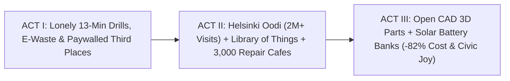

# STORYBOARD & CREATIVE PRODUCTION GUIDE: PALACES FOR THE PEOPLE & TOOL LIBRARIES ([`palaces-for-the-people-tool-libraries`](./REPORT.md))
## *"The 13-Minute Drill vs. The Civic Palace — How Helsinki's Oodi, Libraries of Things & 3,000 Repair Cafés Turn Stuff Into Friendship"*

> **Production Purpose:** This warm, tactile visual storyboard equips documentary filmmakers, library directors, mayors, and circular-economy advocates to dismantle the myth of lonely disposable consumerism—bringing to life **Eric Klinenberg's *Palaces for the People***, **Helsinki's 2M-visit Oodi Library**, **London/Berkeley/Toronto Tool Libraries**, and **Martine Postma's 3,000+ global Repair Cafés** supercharged by **open CAD 3D spare parts and rooftop-solar battery banks**.

---

## PART 1: THREE ALTERNATIVE NARRATIVE OPENINGS (DIRECTOR'S OPTIONS)

### Option A: "X-Ray Through 40 Apartment Closets: Forty Identical 13-Minute Drills" *(Playful Architectural Reveal)*
* **Visual Hook:** Wes Anderson-style cross-section camera glides horizontally through forty cramped city apartments in one building: inside every dark hallway closet sits a dusty, cheap \$79 plastic power drill with a dead lithium battery. On-screen counter tallies lifetime motor spin: `13 minutes, 12 seconds`. Then the camera glides across the street into a glowing timber **Library of Things** kiosk where one gleaming commercial **Festool drill** clicks out of a solar-charged locker into **Sanna's** hands for **€0**.
* **Voiceover Core:** *"The average household power drill spins for thirteen minutes in its entire life before hitting a landfill. What happens when a neighborhood shares fifty indestructible craftsman tools instead of hoarding ten thousand plastic toys?"*
* **Best For:** Broad audiences, urban sustainability festivals, and viral short-form openers.

### Option B: "1995 Chicago Heatwave — Two Identical Blocks, Tenfold Survival Difference" *(Life-or-Death Mystery)*
* **Visual Hook:** Archival summer heat-shimmer footage of Chicago's South Side, 1995, paired with sociologist **Eric Klinenberg** laying two maps side by side: **Englewood** (`33 deaths / 100k`) versus right-next-door **Auburn Gresham** (`3 deaths / 100k`), cutting to seniors laughing inside a cool, bustling branch library where librarians know every regular by first name.
* **Voiceover Core:** *"Same income. Same age. Same blistering hundred-and-six-degree heat. Yet one neighborhood suffered ten times fewer deaths—because a free, welcoming public library kept neighbors connected."*
* **Best For:** Public-health leaders, civic philanthropists, and municipal budget hearings.

### Option C: "Grandmother's 1994 Stand Mixer Meets Pentti & a 22-Minute Nylon Gear" *(Heartwarming Craft Hook)*
* **Visual Hook:** Extreme macro shot inside a stripped 1994 stand mixer: worn white plastic shavings around a broken gear. Cut to 73-year-old retired machinist **Pentti** smiling across a **Repair Café** workbench at 27-year-old **Sanna** as an overhead **AI diagnostic camera** pulls up the open-source `.STEP` file and a desktop printer sinters a fresh carbon-nylon gear beside two steaming mugs of coffee and cardamom buns.
* **Voiceover Core:** *"Appliance corporations told Sanna to throw her grandmother's mixer in the dump. At Saturday's library Repair Café, forty cents of nylon and a retired machinist brought it back to life in twenty-two minutes."*
* **Best For:** Right-to-Repair advocates, intergenerational-community stories, and maker audiences.

---

## PART 2: VISUAL ARC DIAGRAM & MODULAR 3-ACT STORYBOARD TABLE (12 SCENES)

| Act / Beat | Visual & Camera Concept | Data & Metric Callout Overlay | Sample Narration / Voiceover Script |
| :--- | :--- | :--- | :--- |
| **ACT I — Beat 1:** The \$6.50 Seat Tax & Closet Clutter | Montage: young renter buys a \$6.50 latte just to sit somewhere warm with Wi-Fi, then trips over broken appliances in a 400-sq-ft studio. | `Legacy Consumer Trap: \$4,800 / Decade on Infrequent Gear & Storage` | "Modern cities quietly priced out belonging—charging six dollars just to sit indoors while every tiny apartment drowns in cheap, unfixable plastic." |
| **ACT I — Beat 2:** The E-Waste Dumpster Tragedy | Slow-motion dump of working-motor vacuum cleaners, mixers, and lamps crushed at a transfer station because a \$1.50 plastic latch snapped. | `62M Tons Global E-Waste/Yr \| \$150 Minimum Repair Shop Bench Fee` | "Millions of sturdy motors go straight to the crusher every week—not because they died, but because a fifty-cent plastic clip is out of stock." |
| **ACT I — Beat 3:** Klinenberg's *Palaces for the People* | Interview with **Prof. Eric Klinenberg** walking past Carnegie's stone engraving *"Free to the People"* into a lively modern branch library. | `1995 Chicago Proof: 10x Lower Mortality in High-Library Neighborhoods` | "Sociologist Eric Klinenberg proved that free social infrastructure isn't a nice-to-have—it is life-saving civic hardware." |
| **ACT II — Beat 4:** Stepping Inside Helsinki's Oodi | Sweeping Steadicam glide into **Oodi Central Library's** soaring Finnish-spruce atrium opposite Parliament: chess tables, strollers, zero turnstiles. | `Helsinki Oodi: 2M+ Visits/Yr in a City of ~675k \| 0 EUR Entry or Gear Fee` | "To celebrate a century of independence, Finland built Oodi—a palace opposite Parliament where only one-third of the building holds books." |
| **ACT II — Beat 5:** Floor 2 *Kaupunkiverstas* (Urban Workshop) | Kinetic montage across Oodi's 2nd floor: teens mixing tracks in a podcast studio, grandmothers using laser cutters, immigrants sewing winter coats. | `2/3 Space = Free 3D Printers, Laser Cutters, Sewing, Studios & Kitchens` | "Two-thirds of Oodi is a free civic workshop and living room: laser cutters, sewing machines, recording booths, and kitchens unlocked by a library card." |
| **ACT II — Beat 6:** London's *Library of Things* Kiosk | In South London, a dad taps his card at a bright yellow library locker to borrow a Kärcher carpet cleaner and a FLIR thermal heat-leak camera. | `Library of Things + Berkeley/Toronto Tool Libraries: -80%–90% Tool Cost` | "Inside neighborhood branches from London to Berkeley and Toronto, self-serve kiosks lend commercial Bosch, Festool, and thermal cameras for pennies." |
| **ACT II — Beat 7:** Martine Postma & 3,000+ Repair Cafés | Warm handheld footage from Amsterdam to Tokyo: volunteers and neighbors huddled side by side over open toasters, bicycles, and wool coats. | `3,000+ Global Repair Cafés \| ~50,000 Fixes/Mo \| 65%–70% Success Rate` | "And at three thousand Repair Cafés founded by Martine Postma, you don't drop off broken things—you pull up a chair and learn beside a neighbor." |
| **ACT II — Beat 8:** Sanna & Pentti Fix the 1994 Mixer | Intimate scene: Pentti guides Sanna's hand as they grease the freshly printed nylon worm gear and the 30-year-old mixer roars smoothly to life. | `Intergenerational Magic: Retired Machinists + 20-Somethings Over Coffee` | "Pentti thought nobody needed his forty years of machining skill after retirement. Every Saturday morning, twenty neighbors line up for his wisdom." |
| **ACT III — Beat 9:** AI Thermal Vision + Open CAD Commons | Overhead bench display highlights a glowing shorted capacitor via **FLIR thermal overlay** while pulling a verified `.STEP` latch from open commons. | `AI Bench Diagnostics + Open CAD Spare Parts Push Fix Rates Past 85%` | "Pair volunteer hands with benchtop thermal AI and open-source 3D spare-part files, and 'discontinued part' disappears from the dictionary." |
| **ACT III — Beat 10:** Acoustic Zoning Harmony | Vertical architectural slice of Oodi: lively Ground Plaza -> insulated Floor 2 Workshop -> whisper-quiet sunlit Floor 3 *Book Heaven*. | `>98.5% Tool Return Rate \| Book Circulation Rises Alongside Maker Visits` | "Smart acoustic zoning keeps quiet reading sanctuaries serene upstairs while workshops buzz below—and ninety-eight-point-five percent of tools return on time." |
| **ACT III — Beat 11:** Rooftop-Solar Battery Resilience Bank | Storm-cloud cut: neighborhood power flickers, while the branch library's **rooftop solar + 200-pack LFP battery wall** lends emergency lanterns and power packs. | `Dual-Use Resilience: Daily Tool Charging + 72-Hr Storm/Heatwave Shelter` | "Powered by rooftop solar and standardized battery banks, every branch doubles as a neighborhood lighthouse whenever storms or heatwaves strike." |
| **ACT III — Beat 12:** Closing Bookend — Sanna's Birch Shelves | Sunday afternoon: Sanna drills her final birch shelf cleanly with the borrowed Festool, slices fresh bread from the revived mixer, and texts Pentti her poster sketch. | `1 Library Card = \$50,000 Workshop + Zero E-Waste + Real Neighbors` | "Why buy a lonely thirteen-minute drill when your library card unlocks a fifty-thousand-dollar workshop—and introduces you to the people next door?" |

---

## PART 3: VISUAL METAPHOR BANK

### 1. "Forty Dusty Closet Drills Dissolving Into One Sunlit Timber Wall"
* **Visual Concept:** Forty dark apartment closets holding identical cheap plastic drills dissolve in a single match-cut into one glowing timber **Library of Things** locker wall stocked with commercial Festool and Bosch kits.
* **Camera / Animation Cue:** Symmetrical cross-section dolly glide transitioning from cramped grey drywall to warm Finnish spruce.
* **Emotional Takeaway:** Visualizes >95% raw-material savings and apartment clutter liberation in three seconds flat.

### 2. "The €0.40 Nylon Gear Saving the 20-Pound Steel Heirloom"
* **Visual Concept:** Extreme close-up weighing a feather-light 3D-printed carbon-nylon worm gear in one palm against a gleaming 20-pound 1994 stand mixer saved from the crusher in the other.
* **Camera / Animation Cue:** Shallow-depth-of-field 50mm tabletop shot bathed in warm morning Repair Café window light.
* **Emotional Takeaway:** Exposes planned obsolescence and celebrates the magic of open-source CAD spare parts.

### 3. "Three Floors of Democratic Light"
* **Visual Concept:** Camera rising up **Oodi's** iconic double-helix staircase from bustling civic coffee square through whirring Urban Workshop up into tranquil cloud-lit *Book Heaven*.
* **Camera / Animation Cue:** Continuous 20-second vertical gimbal ascent with acoustic cross-fade from lively chatter to peaceful hush.
* **Emotional Takeaway:** Proves active makerspaces and serene reading sanctuaries thrive together under one roof.

---

## PART 4: SOUND DESIGN, COLOR ARC & INTERACTIVE HOUSEHOLD CALCULATOR

* **Color & Lighting Progression:**
  * *Act I (Disposable Isolation):* Cluttered closet shadows, harsh big-box fluorescent glare, cold blue solo smartphone scroll.
  * *Acts II–III (Oodi & Repair Palaces):* Warm Nordic spruce honey tones, crisp snow-reflected daylight, golden coffee-table warmth.
* **Casting & Documentary Voices:**
  * Feature NYU sociologist **Prof. Eric Klinenberg**, Helsinki **Oodi** librarians, **Martine Postma** (Repair Café founder), **London *Library of Things*** co-founders, and retired volunteer machinists alongside young renters.
* **Musical & Foley Architecture:**
  * Shifts from landfill crusher metal groans and lonely café register beeps to precision brushless-motor purrs, clinking porcelain coffee spoons, multi-generational laughter, and warm acoustic folk strings.
* **Interactive Documentary Companion ("What Does Your Library Card Unlock?"):**

| Household Scenario (10-Year Horizon) | Private Disposable Buying | Neighborhood Palace + Tool Library + Repair Café | Net Household & Planet Gain |
| :--- | :--- | :--- | :--- |
| **Drills, Washers, Saws, Tents & Thermal Cam** | **\$3,200** cheap consumer tier | **\$0–\$250** shared commercial Festool/Bosch/FLIR | **~\$3,000 saved** + zero closet clutter |
| **Broken Mixers, Vacuums, Bikes & Coats** | **\$1,600** replacement outlays | **\$40** open-CAD 3D parts + Saturday Repair Café | **80%+ saved from landfill** + hands-on skill |
| **Third-Place Studio, Sewing & Podcast Access** | \$150/mo coworking/studio fees | **€0 / \$0 public Urban Workshop** | Cross-class friendship & elder mentorship |

* **Director's Closing Frame On-Screen Text:**
  > *"Nobody asks for your credit card at the library door. Stock it with craftsman tools, 3D spare parts, and Saturday coffee—and watch strangers turn back into a neighborhood."*
