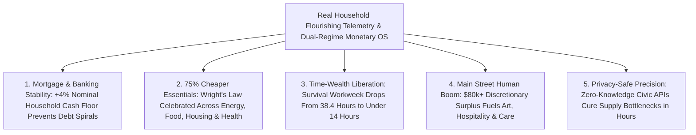

# CARBON EDITION — PILLAR 4: FROM AUSTERITY TO DEFLATIONARY ABUNDANCE
## Measuring Real Flourishing Beyond GDP as Clean Energy and Robotics Collapse the Cost of Thriving

> **Executive Framing & Reimagining Macroeconomic Conventions:**
> * **The Cynic's Belief:** *"Even if AI, robotics, and solar energy make goods radically cheaper, falling prices will trigger a 1930s deflationary crash, shrink tax revenues, bankrupt homeowners with fixed mortgages, and trap governments in permanent austerity."*
> * **The Empirical Counter-Reality:** Twentieth-century GDP accounting ($\text{GDP} = \sum P \times Q$, designed by Simon Kuznets in 1934 to measure factory output) suffers from a fatal blind spot: when Wikipedia replaced \$1,500 encyclopedias with free global knowledge, GDP *shrank*! When solar photovoltaic modules plummeted 99.6% in cost since 1976, crude price-times-quantity metrics missed trillions in consumer surplus. Technological supply deflation is not an economic disease—it is the physical signature of human liberation.
> * **The Social Norm Shift:** We retire 1934 GDP fetishism and upgrade national economic cockpits to **Real Household Flourishing Telemetry**—combining Stanford's $\text{GDP-B}$ consumer surplus accounting, **New Zealand's Well-Being Budget**, the **OECD Better Life Index**, and a **Dual-Regime Monetary Rule** that keeps nominal household cash inflows growing steadily at +4%/year while letting clean energy and robotics collapse the marginal cost of housing, food, water, energy, and medicine by 60–80%.
> * **Anchor Voice:** *"GDP measures market transactions, not human well-being—when technology makes vital goods nearly free, our true prosperity soars even if traditional price gauges miss the miracle."* — **Prof. Erik Brynjolfsson**, Director, Stanford Digital Economy Lab

---

## ACT I: THE LIVED HUMAN REALITY — THE KITCHEN LEDGER IN WELLINGTON & DENVER (2034)
### How a 70% Drop in Living Costs Freed Families Without Breaking a Single Mortgage

On a crisp Tuesday afternoon in October 2034, **Elena Vance**, a public-school cello teacher and mother of two in Denver, Colorado, sits at her sunlit kitchen table reviewing her family's annual **Household Flourishing & Time-Wealth Statement** alongside a sister classroom exchange in Wellington, New Zealand.

Eight years earlier, in 2026, Elena and her husband Sam worked a combined **82 hours per week** yet felt perpetually one car repair away from panic. Their gross household income was \$84,000, yet rent, health insurance, groceries, childcare, utilities, and taxes devoured **\$81,200**—leaving barely \$230 a month of breathing room. Financial pundits in 2026 warned that if AI and robotics pushed prices down, families like the Vances would suffer wage cuts and default on their \$2,100 monthly mortgage.

Instead, three upgraded macroeconomic norms turned technological deflation into the happiest decade of their lives:

1. **Nominal Household Cash Inflows Rose Steadily While Bills Collapsed by 72%:**
   Under the **Dual-Regime Abundance Monetary Framework**, central banks stopped treating cheap solar power, robotic timber housing, and open-weight AI medicine as "dangerous deflation." Instead, productivity-indexed **Sovereign Abundance Credits** and untaxed teaching wages kept the Vance family's nominal dollar inflows rising at **+4.2% per year** (reaching **\$116,500/year** in 2034). Paying their fixed \$2,100 legacy mortgage became effortless—dropping from 30% of their budget to just 21%—even as their annual bill for energy, food, preventative healthcare, connectivity, and transport plunged from **\$56,000 down to \$15,400**!
2. **The Headline Evening News Metric Is Now "Time-Wealth":**
   Neither Denver nor Wellington mayors boast about raw corporate billing volume anymore. Every public dashboard tracks the **Thriving Basket Workweek**—how many hours of median human work are required to purchase a dignified, secure family life. Between 2026 and 2034, that number dropped from **38.4 hours/week to 14.2 hours/week**. Sam stepped back from exhausting night-shift logistics to coach youth robotics and bake sourdough for neighbors, reclaiming **1,100 hours a year** with their kids.
3. **Free Digital & Civic Goods Count as Real National Wealth ($\text{GDP-B}$):**
   When Elena's son uses an open-weight 2-sigma AI language tutor and a \$4 outpatient diagnostic scan, the **National Flourishing Ledger** records **+\$18,000 in verified household consumer surplus** rather than crying "recession" because a hospital didn't send a \$12,000 invoice.

---

## ACT II: REIMAGINING THE RULES — SOTA EMPIRICS & GLOBAL PRECEDENTS
### Curing the 1934 Kuznets Blind Spot and Irving Fisher's Debt-Deflation Trap

```mermaid
flowchart LR
    subgraph Scarcity2026["2026 Scarcity Accounting Bug"]
        S1["1934 GDP Counts Expensive Crises as Growth"]
        S2["Wikipedia & Cheap Solar Register Near Zero in GDP"]
        S3["Central Banks Fear Good Supply Deflation"]
    end

    subgraph Upgrade2028["2028 Flourishing Telemetry & Dual-Regime Rule"]
        U1["Stanford GDP-B Tracks Free & Deflated Consumer Surplus"]
        U2["NZ & OECD Well-Being Dashboards Measure Time-Wealth"]
        U3["Productivity-Matched Dividends Lock +4% Nominal Cash Floor"]
    end

    subgraph Abundance2035["2035 Deflationary Abundance Equilibrium"]
        A1["Essential Thriving Basket Drops 70% in Cost"]
        A2["Zero Debt-Deflation Spiral on Legacy Mortgages"]
        A3["Survival Workweek Falls From 38.4 hrs to 14.2 hrs"]
    end

    Scarcity2026 ==> Upgrade2028 ==> Abundance2035
```

### 1. Why 20th-Century GDP Panics in the Presence of Miracles
Even Simon Kuznets warned Congress in 1934 that *"the welfare of a nation can scarcely be inferred from a measurement of national income."* Under $\text{GDP} = \sum(P_i \times Q_i)$, price ($P$) and quantity ($Q$) are multiplied blindly:
* **The Encyclopedia & Smartphone Paradox:** In 1990, buying *Encyclopædia Britannica* cost **\$1,500** and added \$1,500 to GDP. When Wikipedia delivered 60 million verified articles in 300 languages for **\$0**, GDP lost \$1,500—yet Prof. Erik Brynjolfsson's ** Stanford Digital Economy Lab ($\text{GDP-B}$)** proved via massive choice experiments that free digital goods already generate **trillions of dollars per year** in uncounted consumer welfare!
* **The Healthcare & Energy Inversion:** Under legacy GDP, a traffic jam burning \$4/gallon gasoline and a \$150,000 avoidable heart bypass surgery *increase* GDP, while a walkable town powered by \$0.008/kWh solar and a \$3 preventative peptide cure *shrink* medical and fuel GDP. Keeping 1934 GDP as our sole compass during an AI and clean-energy revolution is like flying an orbital shuttle using a 1920s coal-boiler pressure gauge.

### 2. Solving Irving Fisher's Debt-Deflation Paradox Without Inflation
Skeptics rightly ask: *"Wait—in 1933, Irving Fisher proved that falling prices bankrupt borrowers whose debts are fixed in dollars! Won't 70% cheaper housing and goods crash the banking system?"*
* **Separating Bad Demand Deflation from Good Supply Deflation:** The Bank for International Settlements (BIS) studied over a century of international price drops and found that **supply-driven deflation** (driven by technological productivity booms, like the late-19th-century electricity/railroad boom or modern electronics) *raises* real output rather than depressing it—**provided nominal household cash flows do not collapse**.
* **The Productivity-Matched Household Liquidity Rule:** Instead of pumping Quantitative Easing (QE) into Wall Street bond desks when AI lowers unit prices, Treasury and central-bank rails deposit **Debt-Free Sovereign Abundance Credits** directly into citizen wallets strictly proportional to verified domestic physical output growth ($Q$). Result: **median nominal household dollar inflows grow steadily at +4.0% to +4.5%/year**, keeping every legacy dollar mortgage and municipal bond 100% solvent while unit prices of food, power, housing, and medicine glide downward by 60–80%!

### 3. Battle-Tested International Precedents Live by 2026

| Flourishing Upgrade | Global Precedent & Institution | Verified Empirical Track Record (2026 SOTA) | Scaled Carbon Abundance Norm (2028–2036) |
| :--- | :--- | :--- | :--- |
| **Well-Being Budget & Living Standards Framework** | **New Zealand Treasury** (*Well-Being Budgets*, 2019–2026) | Evaluates every treasury appropriation across **human, social, natural, and financial capital** rather than raw GDP growth alone. | Statutory requirement that tax and central-bank policy optimize **Median Household Time-Wealth & Thriving Affordability**. |
| **Gross Consumer Surplus ($\text{GDP-B}$)** | **Stanford Digital Economy Lab** & **UK ONS / US BEA Satellite Accounts** | Quantified **\$2,500–\$30,000+/yr per user** in hidden surplus from free search, maps, open-source code, and AI assistants. | Elevated from an academic footnote to **Headline National Metric #1** alongside real physical resource throughput. |
| **Multidimensional Thriving Telemetry** | **OECD Better Life Index** & **Bhutan Gross National Happiness (GNH)** | Tracks **11 core flourishing dimensions** across 40+ nations, including work-life time balance, housing burden, and civic trust. | Real-time anonymized **Differential-Privacy Civic APIs** replacing 90-day lagging phone surveys with sub-hour regional clarity. |
| **Dual-Basket Supply-Deflation Monetary Policy** | **Bank for International Settlements (BIS)** & **Swiss National Bank** | Switzerland maintained high living standards, ultra-low interest rates, and strong currency stability despite persistent import/tech deflation. | Central bank separates the **Wright's Law Tech-Abundance Basket** (allowed to fall -15%/yr) from the **Nominal Household Cash Floor (+4%/yr)**. |

### 4. Deep Dive: How the Five Pillars of Living Costs Collapse by 60–80%
Why do mainstream 2026 inflation forecasts miss the coming household cost collapse? Because Baumol's "cost disease" historically trapped housing, healthcare, education, energy, and food in high-friction manual bottlenecks—and all five bottlenecks are breaking simultaneously:
* **Clean Energy & Water (-75%):** Terrestrial solar-plus-sodium batteries and deep geothermal slash wholesale electricity toward **\$0.006–\$0.012/kWh**, pulling home heating, EV charging, and desalination costs down with it.
* **Housing Construction (-60%):** Robotic Cross-Laminated Timber (CLT) factories + Tokyo/Vienna by-right zoning cut starter home production from \$450,000 to **\$140,000** in 30 days.
* **Preventative Medicine (-80%):** Outpatient AI diagnostics, generic GLP-1s, and single-shot CRISPR/mRNA therapies replace \$120,000 ICU emergencies with **\$15 outpatient prevention**.
* **Nutritious Food (-55%):** Autonomous precision weeding, solar vertical greenhouses, and automated cold-chain micro-hubs slash farm-to-kitchen waste by half.
* **Mastery Education & Legal Protection (-90%):** Open-weight 2-sigma AI tutors and automated municipal contract clearing give every family tools once reserved for centi-millionaires.

---

## ACT III: THE PHASED CIVIC & ECONOMIC ROLLOUT ROADMAP (2026–2038)
### Upgrading the Macroeconomic Dashboard Without Disrupting Markets

| Rollout Window | Institutional Milestone | Concrete Policy & Telemetry Upgrade | Measured Household Impact |
| :--- | :--- | :--- | :--- |
| **Phase 1: Parallel Scoreboards (2026–2028)** | Statistical agencies end GDP's monopoly over fiscal scoring. | US BEA, Eurostat, and OECD publish monthly **$\text{GDP-B}$ Consumer Surplus** and **Basket-of-Thriving Workweek** alongside legacy GDP; Harvard Opportunity Insights-style privacy APIs replace 90-day phone polls. | Stops bond-market "phantom recession" panics when open-weight AI slashes enterprise software and diagnostic billing costs by 35%. |
| **Phase 2: Dual-Regime Central Banking (2028–2031)** | Central banks update 1970s 2%-inflation dogma for the robotics era. | Enactment of the **Dual-Regime Monetary Charter**: interest rates no longer hike to punish productivity booms; **Sovereign Abundance Credits** keep median nominal household dollar inflows rising +4%/yr. | Legacy mortgages experience **record-low default rates (<0.6%)** while modular housing, solar power, and automated groceries fall 40% in price. |
| **Phase 3: Thriving-Indexed Budgets (2031–2035)** | National and municipal budgets adopt New Zealand-style Well-Being scoring. | Every infrastructure bill is scored on **hours of survival labor saved per family** and **ecological regeneration per dollar**; regional micro-supply credits clear local grid or material bottlenecks in hours. | Median family's core survival basket drops from **\$76,000/yr (2026) to \$21,500/yr**, unlocking **\$75,000+/yr** in discretionary family cash. |
| **Phase 4: Post-Austerity Equilibrium (2035–2038)** | Time-Wealth and Flourishing Telemetry become universal civic common sense. | Full convergence of cheap baseload energy (\$0.006/kWh), robotic timber homes, and preventative bio-cures collapses essential living costs by **75%+** across OECD and leapfrogging nations. | **Thriving Basket Workweek settles below 14 hours/week**; human craft, care, arts, and local hospitality flourish with zero austerity panic. |

### 2025–2026 Live Pilot Foundations Already Proving the Model
1. **US Bureau of Economic Analysis (BEA) & UK Office for National Statistics (ONS) "Beyond GDP" Accounts (2025–2026):** Both statistical agencies launched official distributional national accounts and free-digital-welfare experimental satellites—proving governments can track real bottom-50% purchasing power without waiting decades.
2. **New Zealand's Living Standards Dashboard & Wales's Future Generations Commissioner:** Demonstrated that legally binding treasury reviews around intergenerational health, housing affordability, and ecological resilience prevents short-term austerity cuts that cost 5x more down the road.
3. **Opportunity Insights & PIX/FedNow Real-Time Clearing Telemetry:** Proved that anonymized high-frequency transaction indices detect regional supply crunches **8 weeks faster** than traditional Bureau of Labor Statistics telephone surveys while preserving strict differential privacy.

### Quantitative Household Ledger Transformation (Median Two-Adult Family, 2026 vs. 2036)
* **2026 Scarcity Squeeze:** **\$84,000** nominal income $-$ **\$81,200** essential bills & payroll taxes $=$ **\$2,800/yr** fragile leftover (**38.4 hrs/wk** survival grind).
* **2030 Mid-Transition:** **\$98,500** nominal cash inflow $-$ **\$44,000** partially deflated essentials $=$ **\$54,500/yr** discretionary cushion (**24.0 hrs/wk** survival threshold).
* **2036 Abundance Reality:** **\$121,000** nominal cash inflow (untaxed human work + capital/abundance dividends) $-$ **\$19,400** deflated thriving basket (net-zero timber housing, solar transit, outpatient bio-care, local automated produce) $=$ **\$101,600/yr** in discretionary freedom (**13.8 hrs/wk** to cover every survival need!).

---

## ACT IV: THE FLOURISHING HORIZON & ANSWERING THE SKEPTIC
### Why Measuring What Matters Unlocks a Human Renaissance

When a civilization stops worshipping raw billing volume and starts measuring real household time-wealth and consumer surplus, four cultural shifts follow naturally:
* **End of Artificial Scarcity Lobbying:** Trade associations can no longer defend bloated hospital billing codes or restrictive housing monopolies by claiming "cutting costs hurts GDP."
* **Dignity for Unpaid Human Care & Civic Craft:** Parenting, elder companionship, community theater, ecological stewardship, and neighborhood coaching register visibly in national Time-Wealth and Well-Being accounts rather than being treated as invisible "zero-GDP leisure."
* **A Stronger, Supply-Backed Currency:** Foreign investors flock to currencies backed by the lowest energy, compute, and living costs per unit—making deflationary abundance a geopolitical magnet.
* **Calm, Non-Partisan Economic Governance:** Clear physical ratios (hours worked per thriving basket) replace ideological shouting matches with transparent civic engineering.

### Addressing the Top 3 Cynic Objections
1. **"Isn't issuing Sovereign Abundance Credits to keep nominal household cash rising just inflationary money-printing?"**
   * *Empirical Answer:* Fiat inflation happens when excess money chases *scarce* goods. Under the **Productivity-Matched Rule**, household credits are minted *strictly when verified domestic supply output ($Q$) expands faster than aggregate wages*—and automatically pause if core prices rise above 1.5%. Because physical energy, compute, housing, and food output surge faster than credit creation, unit consumer prices continue *falling* while the currency's real purchasing power strengthens!
2. **"Won't governments go broke if falling prices shrink sales-tax and income-tax receipts?"**
   * *Empirical Answer:* Two things happen simultaneously: first, public budgets benefit from the exact same **60–80% cost collapse** in healthcare, construction, energy, and administrative software (saving trillions in Medicare and infrastructure outlays); second, paired with **[`compute-commons-taxation`](../compute-commons-taxation/REPORT.md)**, public revenue shifts smoothly from taxing human sweat to light, stable land-value and automated energy/compute royalties.
3. **"Can 'well-being' and 'time-wealth' really be measured objectively without political manipulation?"**
   * *Empirical Answer:* Yes! Unlike subjective happiness polls alone, the **Thriving Basket Workweek** and **$\text{GDP-B}$** are rigorous, auditable physical ratios: *median net hourly household income divided by the real market price of 2,200 kcal/day nutritious food, 1,000 sq ft net-zero housing, full preventative healthcare, 1,000 kWh clean electricity, and high-speed connectivity.* Any citizen can verify the math on an open-source ledger.

### Cross-Pillar Synergies Across the Carbon Atlas
* **Powered by Pillars 1–3:** Ultra-cheap solar, geothermal, and fusion baseload (**Pillar 1**), robotic fabrication and autonomous freight (**Pillar 2**), and preventative outpatient gene/metabolic medicine (**Pillar 3**) supply the physical **60–80% marginal cost collapse**.
* **Multiplied by Pillar 4 Peers:** Works hand-in-glove with **[`universal-capital-dividends`](../universal-capital-dividends/REPORT.md)** (household equity income), **[`compute-commons-taxation`](../compute-commons-taxation/REPORT.md)** (0% payroll tax on the first \$100k of human craft), and **[`abundant-beautiful-housing`](../abundant-beautiful-housing/REPORT.md)** (\$140k mass-timber homes)—proving that when we upgrade our 1934 scoreboard, technological abundance becomes universal human freedom.

---

### Fast-Track Civic & Macroeconomic Activation Checklist (2026–2029)

| Actionable Reform Step | Lead Civic / Statistical Body | Months to Launch | Primary Safeguard & Audit Mechanism |
| :--- | :--- | :--- | :--- |
| **1. Official Monthly $\text{GDP-B}$ Satellite Release** | BEA / Eurostat / National Stats Offices | **6 Months** | Open-source choice-experiment weights audited by academic consortium |
| **2. Thriving Basket Workweek Headline Ticker** | Labor & Treasury Well-Being Desks | **4 Months** | Fixed physical quality benchmarks (housing, kcal, kWh, outpatient care) |
| **3. Differential-Privacy High-Frequency APIs** | Central Bank + Clearinghouse Nodes | **9 Months** | Hardware cryptographic zero-knowledge aggregation; zero personal IDs |
| **4. Dual-Basket Supply-Deflation Charter** | Monetary Policy Committees (Fed/ECB/RBNZ) | **12 Months** | Separates Wright's Law tech price drops from core demand overheating |
| **5. Productivity-Matched Abundance Credit Rail** | Treasury Direct + Instant Payment Rails | **15 Months** | Hard statutory circuit-breaker tied 1:1 to verified domestic output ($Q$) |
| **6. Municipal Well-Being Capital Scoring** | State & City Budget Offices (NZ Model) | **12 Months** | Scores every permit and bond by family hours and dollars saved per year |

### The Bottom Line
Scarcity was never an eternal law of economics—it was merely the temporary condition of a pre-solar, pre-robotic world measured through a 1934 lens. When we retire GDP obsession for **Real Household Flourishing Telemetry**, every solar panel, robot, and medical cure translates directly into debt-free security and human time.

---

## References & Verified Sources

* **Featured Researcher / Leader:** [Prof. Erik Brynjolfsson — Director, Stanford Digital Economy Lab](https://digitaleconomy.stanford.edu/)
* **Companies, Labs & Consortia:** [Stanford Digital Economy Lab (GDP-B)](https://digitaleconomy.stanford.edu/) · [Harvard Opportunity Insights](https://opportunityinsights.org/) · [New Zealand Treasury Living Standards Desk](https://www.treasury.govt.nz/information-and-services/nz-economy/higher-living-standards) · [Bank for International Settlements (BIS)](https://www.bis.org/) · [US BEA & UK ONS Beyond-GDP Accounts](https://www.bea.gov/) · [OECD Better Life Initiative](https://www.oecdbetterlifeindex.org/)
* **Global & Regulatory Precedents:** [New Zealand Well-Being Budgets (2019–2026)](https://www.treasury.govt.nz/information-and-services/nz-economy/higher-living-standards) · [OECD Better Life Index & Bhutan Gross National Happiness](https://www.oecdbetterlifeindex.org/) · [Swiss National Bank Supply-Deflation Stability](https://www.snb.ch/en/) · [Wikipedia & 99.6% Solar PV Consumer Surplus Boom](https://ourworldindata.org/cheap-renewables-growth)
* **Connected Carbon Pathways:** [35.5% Perovskite-Silicon Tandems & Living Solar Skins](../../01-abundant-energy/perovskite-tandem-solar/REPORT.md) · [Everyone an Owner: Sovereign AI/Compute Wealth Funds & Universal Baby Bonds](../universal-capital-dividends/REPORT.md) · [Ending the Housing Shortage: Robotic Mass-Timber Homes + Vienna, Singapore & Tokyo Norms](../abundant-beautiful-housing/REPORT.md) · [The Household Abundance Dividend: How Energy × Robotics × Bio Slashes Family Costs 70%](../../06-synergy-horizons/cost-of-living-collapse/REPORT.md)
