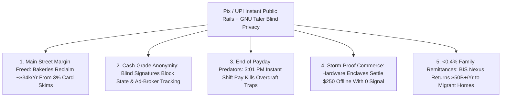

# CARBON EDITION — PILLAR 4: INSTANT ZERO-FEE CIVIC MONEY
## Brazil's *Pix*, India's *UPI* & Swiss/Taler Zero-Knowledge Public Payment Rails

> **Executive Framing & Reimagining Everyday Money Rails:**
> * **The Cynic's Belief:** *"Fast digital payments require either letting private credit-card duopolies skim 3% off every loaf of bread and street-vendor taco forever, or surrendering cash privacy to an Orwellian central-bank panopticon that tracks every cup of coffee you buy."*
> * **The Empirical Counter-Reality:** Two continental-scale public payment rails demolished the credit-card tollbooth myth: the **Central Bank of Brazil's *Pix*** (adopted by **165M+ Brazilians—over 90% of adults**, settling in **`<2 seconds` 24/7/365 at \$0.00 fee** for individuals and micro-vendors while bringing **70M+ people** into financial inclusion) and **India's *UPI*** (**16 billion+ monthly transactions** across an open interoperable protocol). And between 2024 and 2026, the **Swiss National Bank + BIS Innovation Hub (*Project Tourbillon*)** and **GNU Taler** proved **Chaumian blind-signature zero-knowledge e-cash**—delivering instant \$0-fee digital & offline tap settlement where **payers enjoy 100% cash-like mathematical anonymity**!
> * **The Social Norm Shift:** Moving your own money between citizens and Main Street merchants becomes a **zero-fee, instant, open-protocol public utility**—like sending an email or handing over a \$20 bill—retiring 3% interchange taxes, 3-day payroll clearing delays, and 300%-APR payday check-cashers while hard-coding **cash-equivalent cryptographic payer privacy**.
> * **Anchor Voice:** *"Public digital infrastructure like Pix proved a central bank doesn't displace private innovation—by providing open, instant, zero-cost settlement rails, it unleashes competition and brings tens of millions of excluded citizens into the economy."* — **Roberto Campos Neto**, Architect of *Pix* & Former Governor, Central Bank of Brazil

---

## ACT I: THE LIVED HUMAN REALITY — ZERO SWIPE TAX ON MAIN STREET & CASH PRIVACY IN YOUR POCKET (2032)
### Friday Afternoon From Recife Beach Carts & Bengaluru Markets to Zurich & Chicago Bakeries

On a bustling Friday afternoon in July 2032, **Mateus Silva** sells grilled *queijo coalho* and coconut water from his solar beach cart in **Recife, Brazil**, while 5,000 miles north in **Chicago**, neighborhood baker **Hannah Kowalski** closes out her week's sourdough and pastry ledger:

1. **\$0.00 Swipe Skim = An Extra Month's Profit Stayed in Hannah's Bakery:**
   Back in 2025, private card-network interchange and terminal middlemen skimmed **2.9% + \$0.30** off every \$5.50 croissant Hannah sold—bleeding **\$34,000/year** straight out of her thin-margin neighborhood shop (more than her entire annual flour bill!) while inflating grocery prices **\$1,100+/year** for the average American family. On the open **Public Instant Rail (Pix / FedNow-Open / Euro-Taler)**, customers tap NFC or scan a universal interoperable QR code; settlement hits Hannah's credit-union account **irrevocably in 1.1 seconds on Saturday night at 0.00% consumer fee and \$0.01 flat wholesale clearing**—putting **\$33,400/year** back into baker wages!
2. **Instant Daily Earned-Wage Settlement Kills the Payday Loan Shark:**
   When Hannah's 22-year-old apprentice finishes his Friday shift at 3:00 PM, his wages don't sit frozen in a 1970s ACH batch queue over a three-day bank holiday forcing him to pay a \$45 check-cashing or overdraft penalty to fix a flat bike tire—his exact earned hours settle **instantly at 3:01 PM for \$0.00**.
3. **Chaumian Zero-Knowledge Privacy + Offline Storm Tap (*GNU Taler* / *Tourbillon* Standard):**
   When a Chicago resident buys a sensitive medical paperback or donates to a local union, their wallet uses **cryptographic blind signatures**: the bank verifies the \$15 left a valid balance, **mathematically cannot see where or on what the \$15 was spent** (100% payer anonymity identical to paper cash!), while the merchant's receipt remains auditable against corporate tax fraud—and hardware secure elements settle up to **\$200 completely offline** even if a blizzard knocks out cell towers!

---

## ACT II: REIMAGINING THE RULES — SOTA EMPIRICS & GLOBAL PRECEDENTS
### Replacing 1970s Batch Mainframes and 3% Card Duopolies With Open Civic Protocols

```mermaid
flowchart LR
    subgraph SwipeDuopoly["Legacy 3% Card Cartel & 3-Day ACH Lag"]
        S1["2.5%-3.5% + $0.30 Interchange Skim on Every Loaf of Bread"]
        S2["$1,100+/Yr Hidden Retail Price Tax on Working Families"]
        S3["3-Day Payroll Holds Fuel $30B+ Overdraft & Payday Predators"]
    end
    subgraph PublicRails["2020-2026 Public Rail + Privacy Proof"]
        P1["Brazil Pix: 165M+ Users (>90% Adults), <2s, $0 Citizen Fee"]
        P2["India UPI: 16B+ Monthly Txns on Open Interoperable Protocol"]
        P3["SNB Project Tourbillon & GNU Taler: Blind-Signature Privacy"]
    end
    subgraph CivicMoneyNorm["2030s Zero-Fee, Cash-Private Civic Rail"]
        C1["Instant 24/7/365 Settlement at $0 Citizen / ~0.05% Cap Merchant"]
        C2["Mathematical Payer Anonymity + Offline NFC Resilience"]
        C3["Universal Financial Inclusion & Cross-Border Remittances <0.3%"]
    end
    SwipeDuopoly ==> PublicRails ==> CivicMoneyNorm
```

### 1. Why Private Card Networks Charged 100× Actual Compute Cost
Moving 256 bytes of encrypted settlement instructions between two bank ledgers in 2026 costs **less than one-hundredth of one cent (\$0.0001)** in cloud compute and fiber bandwidth. Why, then, did merchants in North America pay **\$170+ billion/year** in card swipe fees (**2.5%–3.5%**), prohibited for decades by anti-steering rules from even offering clean cash discounts—forcing low-income cash/debit shoppers to subsidize affluent airline-miles rewards cards? Because payment networks exhibit two-sided network lock-in: no single coffee shop can refuse Visa/Mastercard alone.
* **How Brazil's *Pix* Broke the Lock-In in 24 Months:** Launched by the **Central Bank of Brazil (BCB)** in November 2020 for an initial engineering build cost of **under \$10 million**, the central bank mandated that every large commercial bank expose the open, instant **Pix API** inside its existing mobile app at **R\$0.00 fee for individuals** (and ~0.22% average for merchants vs. 2.5%–4% on cards!). Result: **>165 million adults (>90% of adult Brazilians)** adopted Pix faster than smartphones; **70+ million previously unbanked citizens** gained digital wallets; street vendors, babysitters, and beach hawkers stopped carrying robbery-prone cash; and IMF economists verified that Pix *increased* competitive private banking deposits and small-business formation!
* **India's *UPI* Digital Public Infrastructure (DPI) Stack:** Built by the non-profit **National Payments Corporation of India (NPCI)**, **UPI** separated the *open settlement rail* from *competing private apps*—surpassing **16 billion transactions per month** (over 80% of India's retail digital volume) down to ₹5 (\$0.06) roadside chai stalls, including feature-phone voice/IVR payments (`UPI 123PAY`) for citizens without smartphones!

### 2. Solving the Privacy Imperative: Why Public Rails Are *Not* Surveillance CBDCs
Critics rightly reject programmable "Central Bank Digital Currencies" that could let politicians track or freeze peaceful citizens' grocery choices. **Cryptographic e-cash solved this exact problem in 1982 (David Chaum)** and reached central-bank production readiness in 2024–2026:

| Public Payment Architecture | Lead Central Bank / Open Consortium | Speed, Cost & Inclusion SOTA (2026) | Privacy & Offline Resilience Architecture |
| :--- | :--- | :--- | :--- |
| **Pix Instant Payment Ecosystem** | **Central Bank of Brazil (BCB)** | **`<2 seconds`** 24/7/365; **\$0** individual fee; **>165M users**; recurring *Pix Automático* & NFC *Pix por Aproximação*. | Commercial-bank account layer protected by Brazilian **LGPD data-privacy law**; central bank operates neutral settlement switch. |
| **Unified Payments Interface (*UPI*)** | **NPCI / Reserve Bank of India** (+ Singapore *PayNow*, UAE & France links) | **16B+ txns/month**; \$0 MDR on standard P2P/small-merchant QR; `UPI Lite X` **offline NFC tap**. | Open API interoperability across 600+ banks; strict app-to-bank tokenization prevents merchant card-number leaks. |
| **SNB *Project Tourbillon* & *GNU Taler*** | **Swiss National Bank + BIS Innovation Hub** & **GNU Taler AG** (Open-Source EU/Swiss pilots) | Sub-second cryptographic token redemption; free open-source protocol (`taler.net`) live in Swiss/EU university & municipal pilots. | **One-Way Payer Anonymity**: blind signatures guarantee **neither the bank nor the state can see what a citizen buys**, while merchants remain tax-auditable! |
| **Nexus Cross-Border Instant Link** | **BIS Innovation Hub + ASEAN / India / Brazil Bridges** | Links domestic instant rails (*Pix, UPI, PromptPay, PayNow, SEPA Instant*) across borders in **`<60 seconds`**. | Slashes migrant worker remittance fees from predatory **6.5% Western Union averages down below 0.5%**! |

---

## ACT III: THE PHASED CIVIC MONETARY ROLLOUT ROADMAP (2026–2036)
### Upgrading FedNow, SEPA Instant, Pix, and UPI Into Privacy-Locked Global Commons

| Rollout Window | Institutional Milestone | Concrete Protocol, Legal & Privacy Upgrade | Measured Household & Main Street Impact |
| :--- | :--- | :--- | :--- |
| **Phase 1: Open Consumer Overlay on FedNow / SEPA Instant (2026–2028)** | U.S. and EU mandate universal QR/NFC interoperability on public instant rails (ending bank slow-walking). | Every licensed bank >\$10B must expose **\$0-fee consumer P2P & QR/NFC merchant pay** on FedNow/SEPA Instant (capped at **\$0.02 flat** merchant clearing, following EU Instant Payments Regulation & Brazil Pix). | Saves small businesses **\$100B+/yr** in swipe fees; cuts average household retail markup burden by **~\$900/yr**. |
| **Phase 2: Chaumian Blind-Signature Privacy Layer (2028–2031)** | Statutory enactment of the **Digital Cash Privacy Equivalence Act**. | Public payment wallets integrate **SNB *Tourbillon* / *GNU Taler* blind-signature tokens** by default for everyday retail purchases under \$1,000 + **offline hardware-enclave NFC tap** up to \$250. | Citizens gain **100% mathematical paper-cash anonymity** online and in-store—banning purchase-profile resale to ad brokers! |
| **Phase 3: Same-Hour Payroll & Zero-Leakage Civic Credits (2031–2034)** | Retires 3-day ACH holds and 2-week paper government benefit checks permanently. | Employers offer optional **end-of-shift \$0-fee earned-wage settlement**; disaster relief, tax refunds, and **[`universal-capital-dividends`](../universal-capital-dividends/REPORT.md)** clear in `<2 seconds`. | Bankrupts 400%-APR payday lenders and bank overdraft traps—saving low-income households **\$25B+/yr** in junk penalties. |
| **Phase 4: Sub-0.3% Global Instant Remittance Mesh (2034–2036)** | **Project Nexus** bridges 100+ national instant rails via competitive FX liquidity pools. | A nurse in London or Houston sends \$200 home to Manila, Lagos, or Recife in **3 seconds** for **\$0.40 total FX spread** instead of \$14 in wire fees. | Returns **\$50B+/yr** in hard-earned migrant family remittances directly to Global South households, schools, and farms! |

### 2025–2026 Live Pilot Foundations Already Proving the Model
1. **Central Bank of Brazil's *Pix* (>165M Users, >90% Adult Adoption):** Proved a <\$10M public open-protocol build can settle 24/7/365 in under 2 seconds at \$0 citizen fee, bring 70M+ citizens into banking, and boost private fintech competition.
2. **India's *UPI* Open Stack (16B+ Monthly Transactions + Offline *UPI Lite X*):** Demonstrated planetary throughput across 600+ banks down to \$0.06 street-vendor QR codes and button-phone voice rails.
3. **Swiss National Bank *Project Tourbillon* & Open-Source *GNU Taler* (2024–2026):** Verified production-speed Chaumian blind-signature cryptography giving everyday digital spenders 100% paper-cash payer anonymity while keeping merchants tax-auditable.

### Quantitative Main-Street & Household Ledger (Legacy 3% Card Duopoly vs. Pix + GNU Taler Civic Rail)
* **Neighborhood Restaurant / Bakery (\$1.2M Annual Sales, 6% Net Margin):** Pays **\$34,800/yr** in card swipe fees (**~48% of the owner's entire net take-home profit!**) $\rightarrow$ **\$480/yr** flat public-rail clearing (**+\$34,320/yr** kept for staff wages & lower menu prices!).
* **Low-Income Working Family:** Pays **\$420/yr** in overdraft/check-cashing fees + **\$850/yr** in swipe-inflated grocery prices + **6.4%** on family remittances $\rightarrow$ **\$0** payment/overdraft fees + instant shift pay + `<0.4%` remittances (**>\$1,400/yr saved**).

---

## ACT IV: THE FLOURISHING HORIZON & ANSWERING THE SKEPTIC
### Why Public Rails + Blind Cryptography Beat Both Wall Street Tollbooths and Surveillance States

Upgrading money's plumbing to an instant, zero-fee, privacy-locked civic protocol transforms everyday life in four ways:
* **End of Regressive Checkout Cross-Subsidies:** Working-class debit shoppers stop paying 3% higher grocery bills just to fund elite credit-card airport lounges.
* **Street-Vendor Safety & Inclusion:** Farmers'-market growers, beach hawkers, and teenagers mowing lawns settle instantly into interest-bearing wallets without carrying robbery-prone cash.
* **True Digital Cash Privacy Restored:** Citizens buy books, medicine, and gifts online without data brokers or officials logging personal profiles.
* **Frictionless Civic Dividends:** Disaster relief, tax rebates, and universal capital dividends arrive in 1.2 seconds with zero lost paper checks.

### Addressing the Top 3 Cynic Objections
1. **"Won't a public payment rail let future governments spy on or censor citizens' purchases?"**
   * *Empirical Answer:* Look at what *already* happens today: private credit-card networks and data brokers log **100% of your purchases by name** and sell profiles commercially! By contrast, pairing **commercial-bank Pix/UPI frontends** with **Swiss National Bank *Tourbillon* / *GNU Taler* blind signatures** and a constitutional **Non-Programmability Charter** makes payer tracking *mathematically impossible*—restoring the exact privacy of physical paper cash to the digital age!
2. **"If instant payments are irrevocable like cash, won't scams and fraud explode?"**
   * *Empirical Answer:* Brazil's Central Bank pioneered the **MED (*Mecanismo Especial de Devolução*)** and AI Mule-Account Graph Freeze alongside optional **escrow-protected merchant purchase modes** (GNU Taler digitally signed contracts + 24-hour buyer dispute windows on shipped goods)—giving shoppers one-click refund protection on unknown web stores while keeping in-person coffee/grocery taps \$0 and instant!
3. **"Won't banks stop innovating if they lose 3% interchange windfalls?"**
   * *Empirical Answer:* Brazil proved the opposite: after Pix launched, **fintech startups (Nubank, Mercado Pago, Stone) boomed to record profitability**—competing honestly on fair credit underwriting, small-business inventory software, and yield-bearing savings rather than taxing every loaf of bread at checkout!

### Cross-Pillar Synergies Across the Carbon Atlas
* **Resilient Over Pillar 1 & Pillar 5 Networks:** Pairs offline hardware-enclave NFC with community fiber (**[`cooperative-broadband-energy-trusts`](../cooperative-broadband-energy-trusts/REPORT.md)**) and **[`orbital-laser-mesh`](../../05-space-frontier/orbital-laser-mesh/REPORT.md)** disaster connectivity.
* **Multiplied by Pillar 4 Peers:** Provides the instant \$0-leakage pipe for **[`universal-capital-dividends`](../universal-capital-dividends/REPORT.md)**, **[`zero-cliff-safety-nets`](../zero-cliff-safety-nets/REPORT.md)**, and **[`open-macro-cleanroom-policy`](../open-macro-cleanroom-policy/REPORT.md)** aggregate clean-room velocity telemetry.

---

### Fast-Track Central-Bank & Legislative Activation Checklist (2026–2029)

| Actionable Reform Step | Lead Monetary / Legislative Body | Months to Launch | Primary Safeguard & Audit Mechanism |
| :--- | :--- | :--- | :--- |
| **1. Mandatory \$0 Citizen QR/NFC on FedNow/SEPA** | Fed / ECB / Banking Regulators | **6 Months** | Mirrors Brazil Pix & EU Instant Payments Regulation; caps merchant fee at \$0.02 |
| **2. Statutory Non-Programmability & Privacy Law** | Congress / Parliament + Civil Liberties Boards | **9 Months** | Bans state/bank category blocking; mandates blind-signature retail option |
| **3. Integrate *GNU Taler* / *Tourbillon* E-Cash** | Central Bank Tech Labs + Open-Source Audits | **12 Months** | Publicly verifiable Chaumian blind-signature cryptography + \$250 offline NFC |
| **4. Join BIS *Project Nexus* Remittance Bridge** | Treasury & Central Bank FX Desks | **9 Months** | Sub-60-second cross-border instant settlement at <0.5% transparent FX spread |
| **5. End-of-Shift Instant Payroll Option** | Labor Ministries + Payroll Clearinghouses | **6 Months** | Zero-fee optional daily wage settlement retiring check-cashing & overdrafts |
| **6. Repeal Card-Network Anti-Steering Rules** | Competition / Antitrust Authorities | **4 Months** | Lets merchants immediately pass 2.5%–3% instant-rail savings to shoppers |

### The Bottom Line
Handing a \$10 bill across a bakery counter never cost thirty-five cents or handed your diary to a data broker—and digital money shouldn't either. By uniting **Brazil's *Pix* and India's *UPI* scale** with **Swiss *Tourbillon* / *GNU Taler* cryptographic privacy**, society unlocks instant, zero-fee, private civic money for every human on Earth.

---

## References & Verified Sources

* **Flagship Public Payment Rails:** [Central Bank of Brazil — *Pix* Instant Payment Ecosystem Official Portal](https://www.bcb.gov.br/en/financialstability/pix_en) · [National Payments Corporation of India (NPCI) — *UPI* Unified Payments Interface](https://www.npci.org.in/what-we-do/upi/product-overview) · [European Central Bank — SEPA Instant Credit Transfer Mandate](https://www.ecb.europa.eu/paym/integration/retail/instant_payments/html/index.en.html)
* **Cryptographic Privacy & Cross-Border Research:** [BIS Innovation Hub & Swiss National Bank — *Project Tourbillon* (Cash-Like Payer Anonymity)](https://www.bis.org/about/bisih/topics/cbdc/tourbillon.htm) · [GNU Taler — Free Open-Source Privacy-Preserving Electronic Payment System](https://taler.net/en/) · [BIS *Project Nexus* — Connecting Global Instant Payment Systems](https://www.bis.org/about/bisih/topics/fmis/nexus.htm) · [IMF Fintech Note — *Pix: Brazil's Successful Instant Payment System*](https://www.imf.org/en/Publications/fintech-notes)
* **Connected Carbon Pathways:** [Goodbye Five-Year Policy Blindfolds: 2026 Nobel Micro-Stabilization & Live Privacy Clean Rooms](../open-macro-cleanroom-policy/REPORT.md) · [Everyone an Owner: Sovereign AI/Compute Wealth Funds & Universal Baby Bonds](../universal-capital-dividends/REPORT.md) · [Zero-Cliff Safety Nets: Negative Income Tax & Smooth Work Rewards](../zero-cliff-safety-nets/REPORT.md) · [From Austerity to Deflationary Abundance: Measuring Real Flourishing Beyond GDP](../post-scarcity-economics/REPORT.md)
