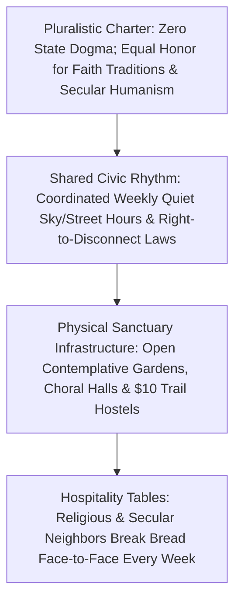

# CARBON EDITION (2026–2035): SOCIAL NORMS & HUMAN FLOURISHING
## Sacred Human Worth in an Age of Thinking Machines: Contemplative Wisdom & Shared Sabbath

> **The Cynic's Myth vs. The Empirical Reality:** Cynics—and anxious technocrats alike—whisper that once artificial intelligence out-calculates us and embodied robots out-lift us, human beings will become "useless," drifting into nihilism, status despair, or digital sedation. Yet that fear rests on a 200-year industrial category mistake that confused **market output** with **human worth**. Every enduring spiritual, philosophical, and indigenous wisdom tradition on Earth—from Jewish **Shabbat** and Christian *Imago Dei* to Buddhist mindfulness, Ubuntu, Stoic virtue, and secular cosmic awe—has proved for millennia that human beings possess **irreplaceable sacred dignity completely independent of GDP**, and communities reviving shared weekly Sabbath sanctuaries and pilgrimages today are experiencing a breathtaking renaissance of meaning.

> *"Technology gives us power, but wisdom and sacred community tell us how to use that power to honor the irreplaceable dignity of every human face."*
> — **Rabbi Jonathan Sacks**, Philosopher & Author of *The Home We Build Together*

---

## 1. Unmasking the 200-Year "Economic Utility" Illusion (Late 2026)

Why does the rise of superhuman AI trigger such a quiet existential ache in so many modern chests, even when we hear that energy, food, and medicine will become abundant?

Because for roughly eight generations since the steam engine (1780–2026), industrial civilization subtly rewired our moral vocabulary until **"What do you do?"** became synonymous with **"Why do you deserve to exist?"** When a person's sense of dignity is bolted 100% to selling cognitive or manual hours on a spot labor market, watching a machine draft legal briefs in four seconds or fold laundry deftly feels like watching one's own soul get depreciated.

Pause and step outside that brief industrial parenthesis. Ask a simple, clarifying question:
* What is the quarterly GDP output of a **six-day-old newborn asleep on her father's chest**? Zero.
* What is the productivity metric of a **ninety-year-old grandmother holding her granddaughter's hand in hospice**, or two friends weeping at a symphony, or a hiker standing silent beneath ancient redwoods? Zero.

Yet every sane human heart knows instantly that **those moments are not side-quests to economic production—economic production was only ever supposed to clear space for those moments!** Thinkers like Abraham Joshua Heschel, Josef Pieper (*Leisure: The Basis of Culture*), and Byung-Chul Han warned that a 24/7 hyper-optimized achievement society starves the human spirit. Artificial intelligence does not threaten human worth; **it exposes the lie of utilitarianism**—inviting humanity home to a much older, deeper truth about who we are.

---

## 2. Three Millennia of Receipts: Wisdom Traditions Ready for the Post-Labor Era

Far from collapsing in an age of intelligent machines, humanity's diverse spiritual, contemplative, and humanistic traditions turn out to hold the **exact operating manual for post-scarcity flourishing**:

| Existential Question in the AI Era | Living Wisdom & Civic Tradition | Core Practice & Social Architecture | Verified Psychological & Communal Proof |
| :--- | :--- | :--- | :--- |
| **"How do we stop 24/7 digital & status striving?"** | **Jewish *Shabbat* ("A Palace in Time")** & **Secular *National Day of Unplugging* / *Tech Shabbat* (Tiffany Shlain)** | For **25 continuous hours every week** (sundown to sundown), phones, commerce, email, and bosses vanish completely; nobody is an employer or employee—families and guests light candles, bake challah, sing, walk slowly, and savor creation as equals. | Longitudinal health studies (Harvard T.H. Chan School of Public Health — Tyler VanderWeele) show weekly communal Sabbath/worship participation lowers **deaths of despair by 33%–68%** and boosts longevity by **4+ years**. |
| **"What is my worth if a machine is smarter?"** | **Abrahamic *Imago Dei* / *Karamah***, **Ubuntu (*"I am because we are"*)**, & **Kantian / Humanist Dignity** | Anchors infinite worth in **conscious relational presence, moral love, vulnerability, and witnessing**—qualities a non-mortal silicon matrix cannot embody. A machine can simulate a lullaby; it cannot *be* a mother risking her heart for a child. | Restores unconditional dignity to children, elders, neurodivergent neighbors, caregivers, and displaced workers alike. |
| **"How do we heal anxious, fragmented attention?"** | **Buddhist *Vipassanā* / Zen**, **Christian Contemplative Prayer**, **Sufi *Dhikr***, & **Secular Cosmic Awe (Dacher Keltner)** | Structured silence, breath mastery, choral singing, and immersion in "vastness" (night skies, cathedrals, wild mountains) quiet the egoic default-mode network and awaken gratitude and compassion. | UC Berkeley awe studies (Keltner et al.) & contemplative neuroscience (Richard Davidson, UW–Madison) document **marked drops in inflammatory cytokines (IL-6)** and surges in prosocial generosity after shared awe and meditation. |
| **"Where do young adults find rite-of-passage meaning?"** | **The *Camino de Santiago* (Spain — ~500,000 pilgrims/yr in 2025–2026)** & **Shikoku 88-Temple Pilgrimage (Japan)** | Religious believers, agnostics, and seekers alike walk **500 miles on foot** with one light pack, staying in \$10 hospitality hostels (*albergues*), sharing blisters and bread with strangers from 100 nations without status titles. | Record post-pandemic surge to **half a million annual Camino pilgrims** proves modern humans hunger deeply for embodied, phone-light pilgrimage and fellowship. |

---

## 3. Sundown to Sundown: An "Unplugged Sunday" in Asheville (2032)

Step onto a maple-shaded neighborhood street in **Asheville, North Carolina**, at **6:30 PM on a golden October Saturday in 2032**, as the city's voluntary **Shared Sanctuary & Unplugged Sunday Compact** begins.

Four years ago, **Caleb (42)**—a former logistics scheduler whose routing job was automated in 2027—went through six dark months. Thanks to universal capital dividends and debt relief (`04-social-norms/sovereign-debt-jubilee`), his bills were paid, yet he felt ghostlike at 10:00 AM on Tuesdays, haunted by the industrial voice in his head asking what he was *producing*.

What healed Caleb was not another hustle app. It was joining the **Blue Ridge Interfaith & Humanist Sanctuary Commons**—a coalition of neighborhood churches, synagogues, mosques, Zen centers, and secular "Sunday Assembly" halls that partnered with the city to reclaim **one 24-hour Palace in Time every week**:

* **Saturday Sundown / Sunday Morning:** Across 70% of Asheville households—religious and secular alike—families place phones, AI earpieces, and work tablets inside a carved wooden **Sabbath Box** on the mantel. City streets along park corridors quiet down into pedestrian promenades (`04-social-norms/intergenerational-villages`); non-emergency commercial drone deliveries pause so the sky belongs solely to hawks and autumn clouds.
* **9:30 AM — The Choir & Contemplative Hour:** Some neighbors walk to historic brick sanctuaries for liturgy, gospel choirs, or Shabbat/Jummah/Sunday fellowship; Caleb, a thoughtful agnostic raised Baptist, walks with his teenage daughter to the **Cedar Timber Contemplative Hall**, where 150 neighbors sit in twenty minutes of pin-drop sunlit silence looking out at mountain mist, sing four-part folk harmonies together (proven to synchronize heart-rate variability across strangers!), and listen to a local hospice nurse reflect on courage and mortality.
* **12:30 PM — The Long Hospitality Table:** Outside under the oaks, six congregations and secular humanist chapters set one quarter-mile linen table. Nobody asks *"What's your job title?"* or *"What's your net worth?"* Caleb—who now spends three days a week maintaining footbridges on the **Appalachian Trail Pilgrimage Conservancy** and sitting beside lonely veterans—breaks warm cornbread beside a retired physicist, a Somali baker, and three twenty-two-year-olds just back from walking a 300-mile **Blue Ridge Youth Pilgrimage**.

For twenty-four unhurried hours every week, nobody optimizes anything, nobody sells anything, and nobody checks a notification. On Monday morning, when Caleb picks up his trail axe or opens his AI design tools, he uses technology as a free human master—never as an anxious servant begging a machine for permission to matter.

---

## 4. Re-Centering Civilization: From Utility Treadmill to Sacred Flourishing

### Quantitative & Cultural Trajectory: The Return of Deep Time

| Flourishing & Cultural Metric | Late 2026 Baseline | 2028 Early Sanctuary Compacts | 2031 Widespread Civic Norm | 2035 Post-Scarcity Culture |
| :--- | :--- | :--- | :--- | :--- |
| **Households Practicing a Weekly 24-Hr Screen Sabbath** | **<6%** (mostly observant niches) | **18%** (coordinated city/school pacts) | **48%** (pluralistic cultural norm) | **70%+** (cherished weekly sanctuary) |
| **Young Adults Completing a Multi-Week Foot Pilgrimage** | **Rare** (~500k globally on Camino) | **1.5M/yr** (national trail hostels) | **40% of 18-to-24-year-olds** | **Universal rite-of-passage norm** |
| **Weekly Face-to-Face Sanctuary / Choral / Contemplative Gathering** | **28% & declining** (bowling alone) | **38%** (secular + faith revival) | **58%** (pluralistic third-place halls) | **72%+ anchored in moral community** |
| **Self-Worth Tied Primarily to Wage Rank** | **Dominant cultural script** | **Rapidly decoupling** | **Minority holdover** | **Replaced by presence, craft & care** |
| **Adolescent & Midlife "Meaninglessness" Index** | **All-time survey high** | **Drops 25% in Sabbath cohorts** | **Drops 55%** | **High sustained awe & belonging** |

### Cross-Pillar Synergies Across the Carbon Atlas
* **Space & Cosmic Stewardship (`05-space-frontier`):** Far from flattening mystery, dark-sky preserves and orbital views of Earth's thin blue biosphere (*the Overview Effect*) deepen shared reverence for life as a precious oasis in the cosmos.
* **Rewilded Forests & Pilgrimage Corridors (`03-bioscience-regeneration`):** As precision fermentation and vertical farms return a billion hectares of marginal pasture back to wild forests, continents weave connected **Camino-style hut-to-hut walking trails** accessible from every city.
* **High-Trust Civic Norms (`04-social-norms/high-trust-civic-norms`):** A weekly Unplugged Sabbath only works effortlessly when *whole friend groups and neighborhoods unplug on the same day*—eliminating fear of missing out (`FOMO`) because nobody is texting without you!

---

## 5. Pluralism Without Coercion: How Believers and Non-Believers Build Together

### Answering the Three Hardest Skeptical Questions

1. **"Wait—I'm an atheist or secular humanist! Is 'sacred worth and Sabbath' trying to push state religion on people?"**
   * **Never—coerced belief destroys both conscience and genuine spirituality.** What makes this movement so joyful in 2026–2035 is its **radical pluralism**: observant Jews keeping *Shabbat*, Christians gathering on Sunday, Muslims at *Jummah*, Buddhists in *Sangha* meditation, and completely secular families celebrating **Tech-Free Nature & Music Sundays** all protect the exact same **human right to uncommodified time and intrinsic dignity**. France and Belgium's **Right-to-Disconnect laws** and Norway's quiet Sunday commons show how secular democracies protect shared rest with 100% freedom of conscience.
2. **"Why won't people just slip into passive VR pleasure machines (*Brave New World*) once work is optional?"**
   * Look at what affluent retirees and half a million *Camino de Santiago* walkers actually choose when survival is secure: brief passive bingeing gets boring within three weeks! Humans are meaning-seeking creatures wired for **effortful beauty, real blisters on mountain trails, singing in harmony, cooking for neighbors, and comforting those who grieve**—experiences synthetic pleasure loops can never satisfy because **vulnerability and mortality are what make love real**.
3. **"Can machines ever replace spiritual care, grief counseling, or friendship?"**
   * An AI can summarize theology brilliantly, just as sheet music maps a concerto—but a chatbot cannot *weep with you because it too will one day die*, nor hold your hand with warm skin when a parent passes. The smarter machines become at calculation, the more priceless **authentic, mortal human presence** becomes in every community.

### How Any Family, Congregation, or Neighborhood Starts This Weekend

1. **Build a Carved "Sabbath Box" With Three Neighbor Families This Weekend:**
   * Invite just **three friend households** (so your kids' closest playmates unplug on the exact same 24-hour window!) to drop every phone, smartwatch, and work tablet into a wooden box on the mantel from Saturday sundown to Sunday sundown.
   * Light two candles over homemade soup, leave earbuds behind on a slow morning walk under neighborhood trees, pull out board games or acoustic instruments, and marvel at how twenty-four unfragmented hours feel longer and richer than an entire month of hurried scrolling.
2. **Open a Monthly "Long Hospitality Table" Across Faith & Secular Lines:**
   * Partner one local church, synagogue, mosque, Buddhist sangha, Hindu mandir, and secular humanist library chapter to set one shared potluck table in a public park or fellowship hall on the first Sunday of every month.
   * Keep one gentle, liberating house covenant at the table: **zero job-title status talk and zero partisan cable-news talking points**—only personal stories, four-part group singing, and asking which neighbor on the block needs meals after surgery or company after bereavement.
3. **Map a Local 3-Day Foot Pilgrimage Greenway:**
   * You don't have to fly to northern Spain to experience the transformative grace of the *Camino de Santiago*.
   * Civic trail conservancies, parks departments, and congregations can link existing river paths, state forests, and \$15 parish/community bunkhouses into a **35-to-60-mile Regional Pilgrimage Loop**—giving high-school graduates, midlife career changers, and retirees a phone-free rite of passage right outside their own city.
4. **Champion Municipal "Quiet Sky & Right-to-Disconnect" Covenants:**
   * Follow France, Belgium, and European town traditions by protecting workers from after-hours boss/AI pings and designating **Sunday Sanctuary Corridors** across parks and residential avenues where non-essential commercial drone deliveries and leaf-blowers pause for birdsong and human conversation.

### Five Timeless Truths No Superintelligence Will Ever Obsolete
* **Calculation is not consciousness; simulation is not love.** A silicon cluster can model grief or compose a lullaby in milliseconds, yet only a mortal human being risks a real heart when loving a child or standing beside a friend.
* **Rest is the crown of creation, not laziness.** In Genesis and contemplative philosophy alike, creation culminates not in a factory, but in *Shabbat*—savoring existence rather than endlessly conquering it.
* **Every face carries infinite intrinsic worth.** From newborn infant to frail centenarian, dignity belongs to *who we are*, never to how many widgets or tokens we out-compute.
* **Awe heals the lonely ego.** Standing beneath dark starry skies, ancient redwoods, or four-part human song shrinks anxious self-absorption and reconnects us to the living whole.
* **Shared rest requires community coordination.** Nobody can sustain an island of peace alone against a 24/7 ping storm—when whole blocks and friend circles unplug together, rest becomes effortless joy.

### Architecture of a Neighborhood Sanctuary Commons (Design Pattern)
As cities retrofit dead commercial strips into walkable villages (`04-social-norms/intergenerational-villages`), urban designers are weaving **pluralistic contemplative spaces** back into daily walking reach:

* **The Acoustic Timber Silence Hall:**
  * Open free from dawn to dusk—no tickets, no Wi-Fi routers, no coffee-shop blender noise—framed in warm cedar and glass overlooking garden water and trees, welcoming silent prayer, secular meditation, or quiet grief.
* **The Community Choral & Hearth Amphitheater:**
  * Built specifically for unamplified human voices singing together once a week—reviving the Welsh choral hall, African-American spiritual, shape-note singing, and Nordic songbook traditions.
* **The Quarter-Mile Shade Pergola & Commons Kitchen:**
  * Equipped with communal bread ovens and long oak trestle tables where rotating faith congregations and secular humanist clubs host free Sunday afternoon hospitality suppers for 200+ neighbors.
* **The Pilgrimage Trailhead Stone:**
  * Marking the 0-mile start of regional foot-pilgrimage greenways leading straight from the city center into rewilded forests and \$10 hut-to-hut hostels.

### Enduring Voices & Empirical Anchors on Contemplative Flourishing
* **Rabbi Jonathan Sacks (*Morality* & *The Home We Build Together*):** Why covenantal community and face-to-face responsibility anchor human dignity beyond market contracts.
* **Abraham Joshua Heschel (*The Sabbath*):** The classic philosophical portrait of *Shabbat* as a "Palace in Time" liberating human beings from technical domination.
* **Tyler VanderWeele (Harvard Human Flourishing Program):** Longitudinal epidemiological evidence linking weekly communal sanctuary participation to longevity and sharply lower despair.
* **Dacher Keltner (*Awe: The New Science of Everyday Wonder*):** Clinical proof that collective music, nature vastness, and moral beauty quiet egoic inflammation and awaken generosity.

> **The Bottom Line for the Skeptic:** Thinking machines only threaten our meaning if we cling to the 19th-century lie that human beings are merely biological computers hired to crank out GDP. Reclaim shared Sabbath rest, embodied pilgrimage, choral awe, and neighborly love—and the age of abundant machines becomes the greatest spiritual homecoming in human history.

---

## References & Verified Sources

* **Featured Researcher / Leader:** [Rabbi Jonathan Sacks — Philosopher & Author of The Home We Build Together](https://rabbisacks.org/)
* **Companies, Labs & Consortia:** [Harvard Human Flourishing Program (Tyler VanderWeele)](https://hfh.fas.harvard.edu/) · [UC Berkeley Greater Good Science Center (Dacher Keltner)](https://greatergood.berkeley.edu/) · [Center for Healthy Minds (UW–Madison, Richard Davidson)](https://centerhealthyminds.org/) · [Shabbat Manifesto / Tech Shabbat Movement](https://en.wikipedia.org/wiki/Shabbat) · [Oficina del Peregrino (Camino de Santiago)](https://oficinadelperegrino.com/en/) · [Sunday Assembly & Interfaith Hospitality Networks](https://www.sundayassembly.com/)
* **Global & Regulatory Precedents:** [Jewish Shabbat ('A Palace in Time' — 25 Weekly Uncommodified Hours)](https://en.wikipedia.org/wiki/Shabbat) · [Camino de Santiago (~500,000 Annual Believer & Secular Foot Pilgrims)](https://oficinadelperegrino.com/en/) · [Ubuntu ('I Am Because We Are') & Contemplative Sangha / Monastic Hospitality](https://en.wikipedia.org/wiki/Ubuntu_philosophy) · [French & Belgian Statutory Right-to-Disconnect & Quiet Sunday Commons](https://en.wikipedia.org/wiki/Right_to_disconnect)
* **Connected Carbon Pathways:** [The Great Uncoupling: Flourishing in a 24-Hour Workweek & Post-Drudgery World](../post-labor-meaning/REPORT.md) · [From Cynical Atomization to High-Trust Joy: Everyday Norms That Change Everything](../high-trust-civic-norms/REPORT.md) · [The Billion-Hectare Rewilding: Solar Proteins, Vertical Orchards & Returning Half the Earth to Wild Nature](../../03-bioscience-regeneration/precision-fermentation-rewilding/REPORT.md) · [Sunlight, Cedar & 1-G Spin: From Vast Haven to Tethered Orbital Villages](../../05-space-frontier/spinning-orbital-gardens/REPORT.md)
