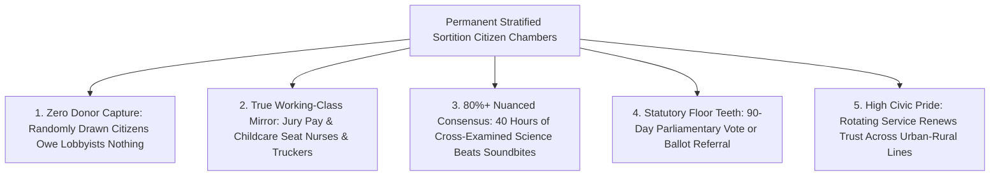

# CARBON EDITION — PILLAR 4: DEMOCRACY WITHOUT LOBBYISTS
## Permanent Sortition Citizen Juries Solving Polarized Deadlocks From Ireland to Ostbelgien & Paris

> **Executive Framing & Reimagining Democratic Deliberation:**
> * **The Cynic's Belief:** *"Modern democracies are permanently paralyzed—ordinary voters are too tribal and misinformed to solve hard trade-offs, while elected politicians are trapped by campaign donors, lobbyists, and two-year outrage cycles."*
> * **The Empirical Counter-Reality:** Across **700+ documented deliberative waves tracked by the OECD**, ancient Athenian **sortition** (civic lottery) reborn with stratified demographic sampling and neutral expert cross-examination has repeatedly broken 40-year partisan deadlocks. **Ireland's Citizens' Assemblies** forged peaceful supermajorities on constitutional issues politicians feared to touch; **Belgium's permanent Ostbelgien Citizens' Council** and **Brussels Climate Assembly** institutionalized lottery chambers with statutory parliamentary reply mandates; **Paris established a permanent 100-citizen Assembly**; and Stanford Prof. **James Fishkin's *Deliberative Polling*** proved across 50+ countries that ordinary nurses, truckers, and teachers reach **75–85%+ nuanced consensus** once freed from cable-TV soundbites and lobbyist capture.
> * **The Social Norm Shift:** Every city, state, and national legislature pairs elected representatives with a **Permanent Sortition Citizens' House**—paid like jury duty, given childcare and travel stipends, shielded from lobbyists, and empowered to hear cross-examined scientists and put consensus solutions directly onto parliamentary calendars or public ballots.
> * **Anchor Voice:** *"When you bring a random microcosm of the public together under good conditions—with balanced facts, small-group moderation, and zero campaign donors in the room—people don't polarize; they listen, learn, and solve their hardest shared problems."* — **Prof. James Fishkin**, Director, Stanford Deliberative Democracy Lab

---

## ACT I: THE LIVED HUMAN REALITY — WHEN THE TRUCKER AND THE NURSE FIXED THE GRID (2032)
### Inside Four Weekends at the Ohio–Pennsylvania Regional Citizens' Chamber

In October 2032, **Dale Whittaker** (54), a long-haul diesel-turned-electric freight driver from rural Mahoning County, receives a gold-embossed **Civic Sortition Summons** in the mail—just like jury duty, except paying **\$320/day tax-free** plus full hotel, transit, and eldercare coverage. Out of 20,000 randomly mailed household invitations, a stratified open-source lottery selected **125 everyday residents** matching the exact age, gender, income, education, urban-rural, and political mix of the region to resolve a ten-year political war over **high-voltage superconducting grid corridors, geothermal siting, and water-table royalties**.

For a decade, fossil lobbyists and NIMBY litigation groups had paralyzed state senators with attack ads. Over **four weekends** inside a sunlit circular hall in Pittsburgh, Dale sits at Table 7 beside **Amina Hassan** (a pediatric ER nurse), **Mrs. Petrovic** (a retired elementary principal), and a 21-year-old apprentice welder:

1. **Zero Lobbyists, Cross-Examined Evidence, and Rotating Small Tables:**
   Lobbyists are barred by felony statute from contacting assembly members. Instead, an independent **Citizen-Vetted Witness Panel** presents competing hydrological, ratepayer, and engineering models under oath—and the 125 citizens write the follow-up questions themselves in rotating 8-person roundtables facilitated by neutral moderators (never politicians).
2. **Discovering the 84% Win-Win Nobody Put on Cable TV:**
   By Weekend 3, Dale and Amina realize the televised screaming match was fake: rural landowners didn't hate clean power—they hated getting zero local benefit while distant cities took the electricity. Together, the citizens draft the **Shared Corridor Royalty Compact**: burying HVDC lines along existing highway rights-of-way while automatically depositing **3% of gross wheeling revenue** into permanent rural property-tax cuts and fire-station trusts.
3. **Statutory Teeth That Break Legislative Cowardice:**
   On Sunday of Weekend 4, the proposal passes the 125-citizen secret ballot by **84% to 16%**. Under the region's **Ostbelgien-Irish Statutory Mandate**, the state legislature must hold an up-or-down public floor vote within **90 days** or send the Citizens' Compact directly to voters on the November ballot. Relieved of lobbyist blackmail—*"the citizen jury wrote it, and 84% of folks just like you backed it"*—lawmakers pass the bill **89–11**, unlocking **\$14 billion** in clean baseload infrastructure in four months!

---

## ACT II: REIMAGINING THE RULES — SOTA EMPIRICS & GLOBAL PRECEDENTS
### Why Stratified Civic Lotteries Outperform Donor-Driven Partisanship on Long-Horizon Choices

### 1. Solving the Structural Bug of Elections Alone
Elections are indispensable for kicking out corrupt rulers, yet Aristotle and Montesquieu noted millennia ago that *elections alone naturally select for wealth, celebrity, and faction*, whereas *sortition selects for true representation*. Modern elections suffer from a brutal structural incentive: **any politician who compromises on a complex 20-year issue gets punished in next Tuesday's primary by a well-funded 3% single-issue lobby**.
* **Why Citizen Juries Are Unbribable:** Randomly selected citizens do **not** run for re-election, raise **\$0** in campaign donations, owe zero favors to party whips, and return to their hospital shifts and farms when their 12-month rotation ends.
* **The Fishkin Deliberative Shift:** Across **150+ Stanford Deliberative Polls in 50+ nations** (from Texas utility grids in the 1990s—which launched Texas's historic wind-energy boom after ordinary Texans deliberated for a weekend!—to South Korea's nuclear energy jury and Mongolia's constitutional amendments), up to **70% of participants significantly update their initial knee-jerk positions** once they examine trade-offs face-to-face with fellow citizens across class lines.

### 2. Battle-Tested Institutional Precedents Live Worldwide by 2026

| Permanent / Landmark Model | Jurisdiction & Scale | Institutional Design & Legal Teeth | Verified Empirical Outcome |
| :--- | :--- | :--- | :--- |
| **Irish Citizens' Assemblies** (2012–2026) | **Republic of Ireland** (99 citizens + Chair) | Stratified random lottery + live-streamed expert hearings feeding national referendums & Oireachtas committees. | Unblocked **marriage equality, constitutional modernization, biodiversity, and climate policy** with peaceful 62–66% national referendum wins. |
| **Ostbelgien Model (Permanent Citizens' Council)** | **German-Speaking Community of Belgium** (2019–present) | **Permanent 24-citizen sortition council** sets the agenda and convenes 25–50 citizen assemblies; parliament *must* debate & respond publicly to every recommendation. | Over **80% of citizen recommendations** adopted into healthcare, education, and housing law; replicated in Brussels & Wallonia. |
| **Assemblée Citoyenne de Paris** | **City of Paris, France** (2021–present) | **100 randomly drawn Parisians** (ages 16+, including non-citizen residents) serving 1-year terms with right to submit binding *voeux* (bills) directly to City Council + launch participatory budgets. | Authored Paris street-cooling, homelessness dignity, and youth mental-health laws directly onto the municipal docket. |
| **Oregon Citizens' Initiative Review (CIR) & Texas Grid Polls** | **U.S. States (Oregon, Texas, California, Michigan pilots)** | 24 randomly selected voters spend 5 days cross-examining ballot-measure proponents/opponents to write the 1-page **Citizen Statement** mailed in every official state voter pamphlet. | Boosted voter factual accuracy by **+15–25%** and inoculated the electorate against \$50M deceptive ad blitzes. |

---

## ACT III: THE PHASED CIVIC ROLLOUT ROADMAP (2026–2036)
### Scaling Permanent Citizen Chambers From City Halls to National Bicameralism

| Rollout Window | Institutional Milestone | Concrete Sortition & Legal Mechanism | Measured Democratic Impact |
| :--- | :--- | :--- | :--- |
| **Phase 1: Municipal & Utility Assemblies (2026–2028)** | Cities and grid operators replace performative "public hearings" (dominated by retired angry insiders) with paid lotteries. | Every metro >100k adopts a **Paris/Ostbelgien Permanent 100-Citizen Council** (\$250/day stipend + childcare) for zoning, transit, and clean-energy siting; **Oregon CIR** expands to 25+ state ballot pamphlets. | Cuts clean-grid and mass-timber housing permitting litigation by **>60%** while doubling working-class participation. |
| **Phase 2: Statutory Legislative Referral Right (2028–2031)** | State and national parliaments enact the "Gridlock Breaker Trigger." | Any issue stalled for >24 months—or petitioned by 1% of voters—automatically convenes a **150-Citizen Stratified Assembly** whose >75% supermajority draft triggers a mandatory 90-day floor vote. | Breaks partisan hostage-taking on AI safety/governance, healthcare billing, pensions, and tax simplification. |
| **Phase 3: AI-Assisted Bridged Deliberation at Scale (2031–2034)** | Stanford Deliberative Polling + Habermas Machine / Polis bridging scale to 100,000s simultaneously. | Rotating 8-person video/in-person tables connect **50,000+ compensated citizens** on major national compacts, surfacing consensus clauses endorsed across every demographic decile. | Public trust in enacted long-term laws rises from **~22% (2025 Congress baseline) to >72%**. |
| **Phase 4: Co-Equal Civic House Norm (2034–2036)** | Constitutional democracies institutionalize *Electoral + Sortition* bicameralism. | Permanent rotating **House of Citizens** holds formal co-review power over lobbying ethics, redistricting, intergenerational budgets, and constitutional amendments. | Ends gerrymandering and lobbyist vetoes permanently; everyday civic service becomes a proud rite of adulthood. |

### 2025–2026 Live Pilot Foundations Already Proving the Model
1. **OECD Database of 700+ Representative Deliberative Processes:** Verified across continents that stratified citizen lotteries consistently reach 75%–85%+ supermajority agreements on infrastructure, health, climate, and tech ethics where partisan legislatures stalled.
2. **Ostbelgien, Brussels & Paris Permanent Civic Chambers:** Proved sortition can graduate from one-off advisory panels into permanent statutory institutions with direct agenda-setting and parliamentary floor-reply rights.
3. **Stanford Deliberative Polling & AI-Assisted Small-Group Scaling:** Demonstrated that structured small-group moderation works identically well in person and across thousands of compensated online video roundtables without losing working-class voices.

### Quantitative Legitimacy & Speed Comparison (Legacy Public Hearing vs. Stratified Citizen Jury)
* **Who Shows Up:** Legacy Tuesday 2:00 PM zoning hearing = **88% affluent homeowners >60 yrs old + paid lobbyists** $\rightarrow$ Paid Sortition Jury = **100% proportional mirror** of renters, shift nurses, young parents, rural tradespeople, and seniors.
* **Consensus Rate on Hard Trade-Offs:** Partisan committee = **51–49 party-line deadlock** $\rightarrow$ 4-Weekend Stratified Citizen Jury = **76%–86% informed supermajority** (OECD 700-case empirical range).
* **Cost Efficiency:** A single contested highway/grid lawsuit or deceptive ballot ad war wastes **\$80M–\$400M**; running a gold-standard 125-person 4-weekend Citizens' Assembly costs **\$1.2M–\$2.4M total**—less than 1% of the gridlock it unlocks!

---

## ACT IV: THE FLOURISHING HORIZON & ANSWERING THE SKEPTIC
### Why Everyday Citizens Are Smarter Together Than Any Cable-News Pundit Believes

Pairing elected parliaments with permanent sortition chambers unlocks four cultural shifts across democratic life:
* **Freedom for Honest Legislators:** Elected representatives can back generational housing, grid, and fiscal reforms without getting ambushed by 3% extremist primary lobbies.
* **Death of Performative Soundbite Hearings:** Witness cross-examination shifts from five-minute cable-TV grandstanding to calm, problem-solving roundtables.
* **Urban–Rural Mutual Respect:** When rural freight drivers and urban nurses spend four weekends eating together and writing law together, caricatures evaporate permanently.
* **Inoculation Against Dark-Money Ballot Blitzes:** One-page Oregon CIR citizen fact sheets in every mailbox neutralize deceptive \$50M ad campaigns.

### Addressing the Top 3 Cynic Objections
1. **"Ordinary citizens aren't policy PhDs—won't bureaucrats or slick experts manipulate the assembly by cherry-picking witnesses?"**
   * *Empirical Answer:* The **Ostbelgien and Irish Governance Rule** prevents witness rigging structurally: the witness list is co-approved by an **all-party + independent academic + citizen oversight board** requiring adversarial balance, *plus* the citizens themselves hold an unrestricted budget to summon any independent scientist, auditor, or dissenting voice they want to cross-examine!
2. **"Won't busy working parents and low-income shift workers decline the lottery invitation, leaving only political junkies?"**
   * *Empirical Answer:* That happens only in unpaid volunteer panels. Modern **Two-Stage Stratified Sortition** (run by nonprofits like **Sortition Foundation** and **DemocracyNext**) pays **\$250–\$350/day**, legally protects jobs just like courtroom jury duty, and reimburses **100% of childcare, eldercare, and travel**, then applies combinatorial demographic matching so the final seated room mirrors census education, income, and non-voter rates within **$\pm 1\%$**.
3. **"Does sortition abolish elected parliaments or constitutional courts?"**
   * *Empirical Answer:* Never—just as criminal trial juries complement professional judges rather than replacing them, **Citizens' Assemblies complement elected lawmakers** (and remain 100% bound by constitutional rights review). In fact, honest legislators *love* sortition on thorny issues because it shields them from extremist primary blackmail!

### Cross-Pillar Synergies Across the Carbon Atlas
* **Unblocks Pillar 1 & Pillar 2 Siting:** Shared-royalty compacts drafted by regional citizen juries accelerate **[`superconducting-grids`](../../01-abundant-energy/superconducting-grids/REPORT.md)**, **[`advanced-fission`](../../01-abundant-energy/advanced-fission/REPORT.md)**, and **[`abundant-beautiful-housing`](../abundant-beautiful-housing/REPORT.md)** years faster than courtroom trench warfare.
* **Multiplied by Pillar 4 Peers:** Works seamlessly alongside **[`bridging-consensus-trust`](../bridging-consensus-trust/REPORT.md)** (Polis/Habermas digital bridging), **[`participatory-municipal-budgeting`](../participatory-municipal-budgeting/REPORT.md)** (citizen capital checkbooks), and **[`forty-eight-hour-governance`](../forty-eight-hour-governance/REPORT.md)**.

---

### Fast-Track Civic Activation Checklist (2026–2029)

| Actionable Reform Step | Lead Civic / Legal Body | Months to Launch | Primary Safeguard & Audit Mechanism |
| :--- | :--- | :--- | :--- |
| **1. Replace Zoning Hearings With Paid Lotteries** | City Councils & Regional Planning Boards | **4 Months** | Open-source Sortition Foundation algorithm + full childcare/shift pay |
| **2. Statewide Citizens' Initiative Review (CIR)** | Secretaries of State / Election Commissions | **6 Months** | 24-citizen 1-page fact sheet printed first in every official voter guide |
| **3. Permanent Ostbelgien-Style Agenda Council** | State Legislatures & Metro Charters | **12 Months** | Statutory 90-day public parliamentary vote or automatic ballot referral |
| **4. Felony Anti-Lobbying Shield for Jurors** | Ethics Commissions & Attorneys General | **6 Months** | Strict criminal penalties for undisclosed donor contact with seated jurors |
| **5. Employer Civic-Jury Leave Parity** | Labor Ministries & State Codes | **6 Months** | Extends courtroom jury-duty job protection to accredited sortition service |
| **6. All-Party + Citizen Witness Balance Board** | Nonpartisan Legislative Audit Desks | **4 Months** | Guarantees adversarial expert cross-examination + open juror witness budget |

### The Bottom Line
Polarization is not human nature—it is the predictable product of an outrage-for-profit electoral bottleneck. When democracies put **paid, demographically representative Citizen Juries** in a room with honest facts and zero lobbyists, ordinary neighbors rediscover extraordinary wisdom.

---

## References & Verified Sources

* **Featured Researcher / Leader:** [Prof. James Fishkin — Director, Stanford Deliberative Democracy Lab](https://deliberation.stanford.edu/)
* **Pioneering Organizations & Platforms:** [OECD Innovative Citizen Participation & Deliberative Database](https://www.oecd.org/governance/innovative-citizen-participation/) · [DemocracyNext (Claudia Chwalisz)](https://www.democracynext.org/) · [Sortition Foundation (Stratified Civic Lotteries)](https://www.sortitionfoundation.org/) · [Healthy Democracy (Oregon Citizens' Initiative Review)](https://healthydemocracy.org/) · [Stanford Deliberative Democracy Lab](https://deliberation.stanford.edu/)
* **Global Statutory Precedents:** [The Citizens' Assembly of Ireland](https://citizensassembly.ie/) · [Ostbelgien Permanent Citizens' Dialogue (Bürgerdialog, Belgium)](https://buergerdialog.be/) · [Assemblée Citoyenne de Paris](https://www.paris.fr/pages/l-assemblee-citoyenne-de-paris-20018)
* **Connected Carbon Pathways:** [From Outrage Algorithms to Bridging Consensus: Polis, Community Notes & Digital Taiwan](../bridging-consensus-trust/REPORT.md) · [Neighbors Holding the City Checkbook: From Porto Alegre to Paris & Taipei Direct Civic Budgets](../participatory-municipal-budgeting/REPORT.md) · [48-Hour Permitting & Agile Civic Governance](../forty-eight-hour-governance/REPORT.md) · [From Cynical Atomization to High-Trust Joy: Everyday Norms That Change Everything](../high-trust-civic-norms/REPORT.md)
