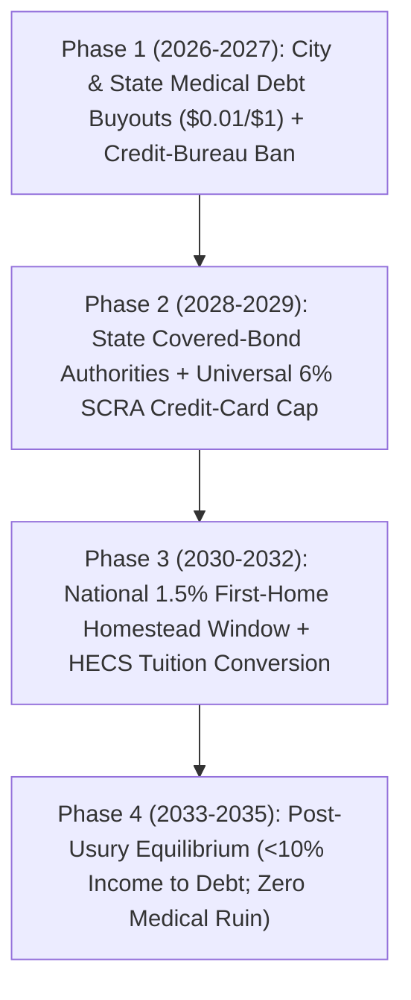

# CARBON EDITION (2026–2035): SOCIAL NORMS & HUMAN FLOURISHING
## Defusing the Household Debt Trap: 1.5% Homestead Mortgages & Medical Debt Abolition

> **The Cynic's Myth vs. The Empirical Reality:** Modern cynicism whispers that drowning in 29% credit-card interest, 7% starter mortgages, and hospital collection letters is simply the immutable price of adult life—and that relieving household debt would crash the banking system. Yet empirical evidence across four continents proves the exact opposite: **Denmark's 200-year covered-bond mortgage system**, **Australia's income-contingent HECS university loans**, and **Undue Medical Debt's** municipal buyouts across Cook County, New Jersey, North Carolina, and Toledo are already liberating millions of families without breaking a single bank.

> *"No family should face financial ruin simply because someone got sick—abolishing predatory medical debt for pennies on the dollar liberates whole communities overnight."*
> — **Allison Sesso**, President & CEO, Undue Medical Debt

---

## 1. Why Hardworking Families Feel Underwater Today (Late 2026)

Walk into almost any suburban kitchen on the first night of the month in late 2026, and you will witness a quiet, unnecessary tragedy. Two people working seventy or eighty combined hours—teaching school, repairing HVAC lines, tending hospital wards—sit beside a glowing laptop watching **55% of their take-home pay evaporate before buying a single bag of groceries**.

The culprit is not laziness or personal extravagance. It is an institutional ledger trap built from four compounding extraction engines:
1. **The 7% Starter-Home Wall:** A modest \$380,000 family home financed at 6.8%–7.2% demands nearly **\$2,950/month** in principal, interest, and escrow, paying the bank more than **\$510,000 in pure interest** over thirty years before the family owns their own front door.
2. **Medical Billing Roulette:** In the United States alone, over **100 million adults** carry healthcare debt. A child's ruptured appendix or an out-of-network ambulance ride turns a clinical recovery into five years of collection calls, credit-score sabotage, and skipped prescriptions.
3. **29% Revolving Usury:** When grocery or childcare spikes push a family onto revolving credit cards, **24%–29.9% compounding APRs** trap them on an arithmetic treadmill where \$750 monthly minimum payments barely touch the principal.
4. **Fixed-Payment Tuition Debt in an AI Labor Market:** Young adults carry fixed monthly loan bills for university credentials right as AI reshapes entry-level cognitive work, punishing curiosity with compounding interest when early wages dip.

Macroeconomist Irving Fisher warned in 1933 that when technological productivity lowers production costs while nominal household debts remain frozen at peak interest rates, **debt-deflation crushes families and banks alike**. The joyful news of late 2026 is that we do not have to invent theoretical remedies from scratch. Every single piece of a fair, resilient, post-usury household ledger is already operating at national or state scale on Earth today.

---

## 2. Working on Earth Today: Four Proven Models of Balance-Sheet Sanity

Cynics treat predatory interest and medical bankruptcy like gravity. Look across the Atlantic, the Pacific, and the American Midwest, and gravity disappears:

| Debt Trap Today | Real-World Working Model (Nov 2026 SOTA) | How the Mechanism Works in Practice | Verified Empirical Outcome |
| :--- | :--- | :--- | :--- |
| **Opaque 7% Mortgages & Refi Fees** | **Denmark's 200-Year Covered-Bond Model** (*Realkredit*, est. 1797) | Every homeowner borrows directly via transparent pass-through covered bonds matched 1-to-1 with institutional savers; borrowers can **refinance down when rates fall or buy back their own bond at market discount when rates rise**—with zero prepayment penalties. | Survived Napoleonic wars, 1930s Depression, and 2008 crisis with **<0.15% mortgage default rates** and zero taxpayer bank bailouts in two centuries. |
| **Hospital Collection Ruin** | **Undue Medical Debt + State/City Compacts** (Cook County IL, Toledo OH, NJ, NC, AZ) | Cities and states partner with nonprofit clearinghouse *Undue Medical Debt* (formerly *RIP Medical Debt*)—or tie Medicaid hospital reimbursements directly to debt relief, as **North Carolina** did across all 99 acute-care hospitals—buying bundled debt for **~1 cent on the dollar**. | **\$15B+ in real patient medical debt permanently abolished** across millions of families; North Carolina alone cleared **\$4B for 2 million residents** overnight. |
| **Compounding Student Loan Stress** | **Australia's Income-Contingent HECS-HELP System** (35+ years proven) | University tuition loans carry **zero real interest** (indexed strictly to mild CPI caps) and require **\$0.00 monthly repayment** whenever a graduate's income sits below the national median threshold (~A\$67,000), scaling gently via payroll only when thriving. | Eliminates student-loan default panic completely; graduates can pause work to raise children, retrain for AI guilds, or launch small businesses with **zero collection harassment**. |
| **29% Credit-Card Usury** | **U.S. Servicemembers Civil Relief Act (SCRA)** & **Postal / Credit-Union Caps** | Under federal SCRA law, commercial banks must slash interest rates on mortgages and credit cards to **6.0% APR within 24 hours** for active-duty families—proving major banks already run instant rate-reset software at scale. | Millions of accounts capped cleanly with **zero banking instability**, providing the exact statutory template for a **Universal 6% Anti-Usury Ceiling**. |

---

## 3. Kitchen-Table Morning After the Reset: Toledo & Beyond (2031)

Step into the sunlit bungalow of **Marcus (36, a municipal water-grid technician)** and **Elena (34, an early-childhood guild educator)** in Toledo, Ohio, on a crisp October morning in **2031**.

Four years earlier, in 2026, Marcus and Elena kept a shoebox of unopened white envelopes on top of the refrigerator. Elena's emergency C-section had left **\$11,400 in out-of-network hospital bills**; two winter furnace repairs sat on a **28.4% credit card** costing \$640/month; and they were locked out of buying the brick duplex they rented because a 7.1% mortgage would have swallowed \$2,700 a month. They argued in whispers after their toddler fell asleep, convinced they had failed some invisible test of adulthood.

Then came the **Toledo–Ohio Medical Debt Abolition Compact**, followed by the national **Sovereign Homestead & Fair Ledger Act**.

First, a bright yellow envelope arrived in their mailbox—not from a debt collector, but from *Undue Medical Debt* and the City of Toledo. For less than **\$115 of municipal funds**, Elena's entire \$11,400 hospital balance had been purchased on the secondary market and **extinguished forever**, with medical bills banned from consumer credit reports nationwide. Overnight, their credit score jumped 68 points.

Six months later, Marcus and Elena bought a newly built mass-timber courtyard home three blocks from Elena's school using the **1.5% Sovereign Homestead Direct Facility**—pairing Denmark's transparent covered-bond architecture with a first-generation **Sovereign Homestead Reserve**. Because the facility is strictly locked to **one primary residence per household** (completely barring Wall Street single-family speculators and vacation flips) and paired with abundant \$155,000 factory-built modular supply, sellers could not bid up land prices.

On this October morning in 2031, Marcus pours coffee while Elena packs apple slices—not bills—on the oak counter:
* Their **40-year, 1.5% Homestead Mortgage** on their sunlit three-bedroom home is **\$740/month**, building real family equity from day one.
* Their legacy 28% credit card was refinanced through the **2% Sovereign Rescue Window** into a calm \$95/month amortizing line that will hit zero before Christmas, while predatory 29% cards are relics of history under a permanent **6% statutory usury cap**.
* Elena's old university balance was converted into an **Australian-style HECS civic ledger**, automatically forgiving 25% of principal each year she mentors in her neighborhood childhood guild.

Instead of working overtime shifts on Saturdays to feed compounding interest, Marcus coaches their daughter's six-year-old soccer team at the neighborhood park—and stays afterward for street tacos with neighbors who finally have time to linger.

---

## 4. Architecture of the Fair Household Ledger (2026–2035)

```mermaid
flowchart LR
    subgraph Trap["2026 Extraction Ledger"]
        T1["7% Mortgages + Wall Street Home Speculation"]
        T2["$220B Medical Debt Sold to Collectors at $0.01/$1"]
        T3["29% Credit-Card APRs + Fixed Tuition Debt"]
    end

    subgraph Engine["Proven Sovereign & Cooperative Reset"]
        E1["1.5% Homestead Covered Bonds (Primary Homes Only)"]
        E2["1-Cent/$1 Public Medical Debt Buyout + Credit Ban"]
        E3["6% Statutory Usury Cap + HECS Income-Contingent Loans"]
    end

    subgraph Flourish["2032 High-Security Family Balance Sheet"]
        F1["Monthly Fixed Debt Service Cut by 68%"]
        F2["Zero Medical Bankruptcies Nationwide"]
        F3["Local Banks 100% Liquid via Covered Par Swaps"]
    end

    Trap --> Engine --> Flourish
```

### Quantitative Trajectory: From Usury Stress to Family Breathing Room

| Household Balance-Sheet Metric | Late 2026 Baseline | 2028 Early Compacts | 2031 National Standard | 2035 Mature Equilibrium |
| :--- | :--- | :--- | :--- | :--- |
| **First-Home Mortgage Rate (Primary Residence)** | **6.8%–7.2% APR** | **3.2%** (Covered-Bond Pilots) | **1.5% Sovereign Homestead** | **1.5% Fixed Pass-Through** |
| **Typical Monthly Housing Debt Service** | **\$2,850/month** | **\$1,620/month** | **\$740–\$980/month** | **\$620/month** (with modular homes) |
| **Outstanding Patient Medical Collection Debt** | **\$220 Billion** (U.S.) | **\$65 Billion** (State Buyouts) | **\$0.00 (100% Extinguished)** | **\$0.00** (Direct preventative care) |
| **Revolving Consumer Credit APR Ceiling** | **24.5%–29.9% APR** | **12.0% Transitional Cap** | **6.0% SCRA Universal Cap** | **3.5% Credit-Union Co-op Lines** |
| **Share of Take-Home Income Lost to Debt Service** | **42%–55% (Stressed Median)** | **26%** | **14%** | **<10% of Household Income** |

### Cross-Pillar Synergies Across the Carbon Atlas
* **Robotic Mass-Timber Construction (`02-automation-science` & `04-social-norms`):** Pairing 1.5% Homestead Covered Bonds with factory-built mass-timber homes prevents low interest rates from inflating scarce housing prices—abundant physical supply and transparent pass-through financing arrive hand-in-hand.
* **Billing-Free AI Direct Care & One-Dose Cures (`03-bioscience-regeneration`):** Buying out legacy medical debt for a penny on the dollar cleans up yesterday's wreckage, while preventative diagnostics and single-dose therapies ensure no new medical debt is ever generated tomorrow.
* **Universal Capital Dividends (`04-social-norms`):** Once households stop bleeding \$2,000+ a month in compounding usury to absentee creditors, sovereign equity dividends flow straight into family wealth creation and local Main Street cafés, music schools, and workshops.
* **70% Cost-of-Living Collapse (`06-synergy-horizons/cost-of-living-collapse`):** Housing and debt service represent the single largest line item in the family budget; cutting fixed monthly debt service by two-thirds anchors the broader household abundance dividend.

---

## 5. The Citizen Homestead Portal & Phased Rollout Roadmap (2026–2035)

How does a family, renter, or municipal treasurer actually experience this transition without bureaucratic red tape? Borrowing Estonia's one-click digital state architecture (`04-social-norms/forty-eight-hour-governance`), the entire household balance-sheet reset executes through a five-minute **Homestead & Fair Ledger Portal**:

1. **Step 1 — Automatic Medical Debt Zero-Out (Zero Paperwork):**
   * Municipal and state treasuries pool public health funds with *Undue Medical Debt* clearinghouses and Medicaid hospital compacts (the North Carolina 99-hospital template).
   * Families never fill out humiliating means-testing forms; legacy hospital and ambulance collection accounts are purchased in bulk at ~\$0.01 on the dollar, permanently extinguished, and stripped from credit bureaus automatically.
2. **Step 2 — The 1.5% Primary Homestead Covered-Bond Window:**
   * Verified one-per-household owner-occupants refinance high-rate 6.5%–7.5% mortgages—or finance a price-capped modular starter home—into a transparent **40-year, 1.5% Covered Homestead Bond**.
   * Just like Denmark's *Realkredit* system, if rates shift or a family moves, the bond is portable or callable at par with zero predatory refinancing fees.
3. **Step 3 — The Renter Pass-Through Covenant & Equity Seed:**
   * What about the 44 million American households (and hundreds of millions globally) who rent? Multifamily apartment owners who refinance 7% commercial debt into **1.75% Homestead Multifamily Covered Bonds** sign an auditable smart-lease covenant passing **100% of the interest savings directly to tenants** (-25% to -35% monthly rent) while crediting \$250/month into each tenant's portable first-home down-payment account.
4. **Step 4 — The 6% Revolving Usury Shield & HECS Tuition Conversion:**
   * Existing 24%–29% credit-card balances convert one-time into a **2.0% amortizing 10-year rescue line**, while all future consumer credit cards are capped at **6.0% APR** (expanding the U.S. military SCRA statutory cap to every household).
   * Legacy university loans convert automatically into **zero-real-interest HECS ledgers** where monthly payments drop to \$0 whenever income dips below median thriving thresholds—or cancel at 25% per year during civic, caregiving, or builder-guild service.
5. **Step 5 — The Debt-Free Saver Fairness Dividend:**
   * Households that scrimped and sacrificed to pay off tuition or credit cards early are honored, never penalized: verified debt-free primary households receive a **\$12,000 Sovereign Homestead & Energy-Retrofit Equity Credit** toward rooftop solar, heat pumps, or their Citizen Wealth Account.

---

## 6. Answering the Hardest Skeptical Questions

1. **"Won't 1.5% mortgages just cause house prices to skyrocket as buyers bid up the same scarce homes?"**
   * Only if you repeat the mistake of subsidizing investor speculation alongside constrained zoning! The **Sovereign Homestead Facility** enforces two iron guardrails: first, **strictly one TIN/SSN-verified owner-occupied primary residence per household** (zero investor LLCs, zero second homes); second, loans are indexed to **Fair Construction Cost Valuation Caps** anchored by by-right modular and courtyard infill housing. Sellers pricing above regional replacement bounds cannot access the 1.5% facility.
2. **"If you slash 29% credit-card rates and buy out mortgages, won't community banks and pension funds lose money?"**
   * Not a dime. Under the **Danish Covered-Bond + HOLC Par-Swap** model, community banks originate and service local Homestead bonds for clean fee income without carrying toxic interest-rate mismatch on their balance sheets (the exact mismatch that sank Silicon Valley Bank in 2023). Pension funds hold AAA-rated sovereign-backed Homestead bonds backed by real owner-occupied homes with **<0.2% default rates** and sovereign AI productivity royalties.
3. **"Is buying \$220 billion of medical debt for pennies really realistic, or do hospitals lose needed revenue?"**
   * Hospitals have *already* written off those uncollectible bills and routinely sell them to predatory debt collectors for **0.8 to 1.5 cents on the dollar**. When Cook County, Toledo, or North Carolina steps in as the buyer instead of a collection agency—or pairs Medicaid supplemental hospital funding with mandatory charity-care relief—hospitals receive the exact same or *higher* predictable revenue while millions of families are freed from lifelong harassment overnight.

### How Citizens & Cities Start Right Now (The 90-Day Civic Playbook)
You do not have to wait for national legislation to begin liberating your neighbors from predatory debt traps:

* **Month 1 — Pass a Municipal Medical Debt Abolition Resolution:**
  * Any city council, county commission, congregation network, or local philanthropy can partner directly with **Undue Medical Debt** this quarter.
  * Because secondary-market hospital portfolios trade near **\$0.01 per dollar**, a modest **\$50,000 municipal appropriation** permanently extinguishes roughly **\$5,000,000** in neighbors' medical collection debt—with zero means-testing bureaucracy and instant credit-report relief.
* **Month 2 — Charter a State or Credit-Union Covered-Bond Homestead Pilot:**
  * State housing finance agencies and local credit unions can pool municipal pension reserves into a **Denmark-style Covered Homestead Facility** strictly reserved for first-generation and owner-occupied primary homes.
  * Pair every Homestead mortgage zone with by-right mass-timber courtyard infill permits so lower interest rates translate directly into lower monthly payments rather than higher land prices.
* **Month 3 — Enact State Medical Credit-Reporting Bans & 6% Transition Lines:**
  * Over a dozen U.S. states have already banned medical bills from appearing on consumer credit reports (following Colorado, New York, Minnesota, and California).
  * Municipal credit unions can pair credit-bureau protection with **low-rate Payday & Revolving Rescue Swaps**, turning the first day of every month from an anxious math puzzle back into an ordinary, peaceful family morning.

> **The Bottom Line for the Skeptic:** Debt contracts are not laws of physics—they are human accounting rules. Denmark proved for 200 years that transparent pass-through mortgages work without bank bailouts; Australia proved university loans never need compounding usury; and American cities are already erasing billions in medical debt for pennies on the dollar. Free the household ledger, and family flourishing follows overnight.

---

## References & Verified Sources

* **Featured Researcher / Leader:** [Allison Sesso — President & CEO, Undue Medical Debt](https://unduemedicaldebt.org/)
* **Companies, Labs & Consortia:** [Undue Medical Debt (formerly RIP Medical Debt)](https://unduemedicaldebt.org/) · [Realkredit Danmark & Nykredit Covered Bonds](https://rd.dk/) · [North Carolina DHHS Medical Debt Compact](https://www.ncdhhs.gov/) · [Australian Taxation Office HECS-HELP](https://en.wikipedia.org/wiki/Tertiary_education_fees_in_Australia) · [National Consumer Law Center (NCLC)](https://www.nclc.org/) · [Credit Union National Homestead Pilots](https://americascreditunions.org/)
* **Global & Regulatory Precedents:** [Denmark's 200-Year Covered-Bond System (Est. 1797)](https://en.wikipedia.org/wiki/Mortgage_industry_of_Denmark) · [Cook County, Toledo, NJ & NC Medical Debt Buyouts (\$15B+)](https://unduemedicaldebt.org/) · [Australia's 35-Year Income-Contingent HECS-HELP Loans](https://en.wikipedia.org/wiki/Tertiary_education_fees_in_Australia) · [U.S. Military SCRA 6.0% Statutory Interest Cap & 1933 HOLC](https://www.justice.gov/servicemembers/servicemembers-civil-relief-act-scra)
* **Connected Carbon Pathways:** [Ending the Housing Shortage: Robotic Mass-Timber Homes + Vienna, Singapore & Tokyo Norms](../abundant-beautiful-housing/REPORT.md) · [Skipping the \$1.2 Trillion Billing Maze: Continuous AI Diagnostics & Universal Direct Care](../../03-bioscience-regeneration/healthcare-without-billing/REPORT.md) · [Everyone an Owner: Sovereign AI/Compute Wealth Funds & Universal Baby Bonds](../universal-capital-dividends/REPORT.md) · [The Household Abundance Dividend: How Energy × Robotics × Bio Slashes Family Costs 70%](../../06-synergy-horizons/cost-of-living-collapse/REPORT.md)
