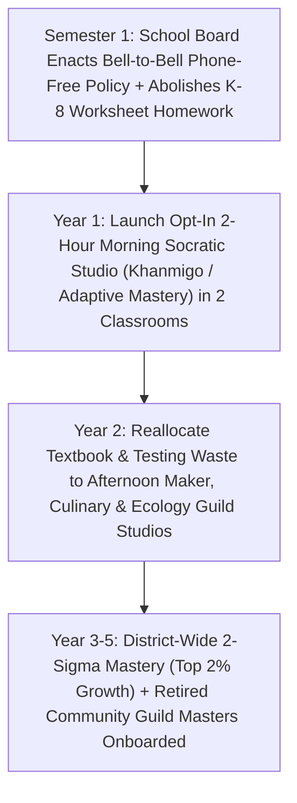

# CARBON EDITION (2026–2035): SOCIAL NORMS & HUMAN FLOURISHING
## 2-Sigma AI Mastery in the Morning, Hands-On Human Guilds in the Afternoon

> **The Cynic's Myth vs. The Empirical Reality:** Cynics warn that artificial intelligence in schools will turn childhood into a dystopian wall of glowing screens, rampant cheating, and isolated kids who forget how to speak or think. Yet real classrooms in late 2026 prove the exact inverse: by using patient, Socratic 1-on-1 AI tutors to solve Benjamin Bloom's famous **2-Sigma Problem** in just **two energized morning hours**, innovative schools are liberating the entire **afternoon for 100% phone-free human magic**—woodworking, wilderness ecology, theater, music ensembles, robotics, cooking, and resilient friendships.

> *"For the first time in history, we can give every child on Earth a patient, world-class personal tutor—freeing human teachers to mentor, inspire, and connect."*
> — **Sal Khan**, Founder & CEO, Khan Academy

---

## 1. The 1890s Prussian Factory Trap vs. Bloom's 2-Sigma Discovery

In 1984, University of Chicago educational psychologist **Benjamin Bloom** published one of the most staggering findings in social science: *The 2-Sigma Problem*. Bloom demonstrated empirically that when an "average" student is given **1-on-1 mastery tutoring**—never moving forward until a foundational concept clicks, and never sitting bored once they grasp it—that student performs **two full standard deviations ($2\sigma$) higher** than peers in a standard lecture classroom. An ordinary 50th-percentile child rises to the **98th percentile**.

For forty years, educators knew this secret and wept, because society could not afford thirty-two private Oxford tutors for every thirty-two second-graders. Instead, we kept children locked inside the **1893 Prussian factory-bell model**:
* One exhausted, heroic teacher forced to lecture thirty-two unique minds at a single conveyor-belt speed—leaving the top third restless and disengaged, the bottom third quietly ashamed because they missed fractions in October, and the teacher buried until 10:00 PM grading worksheets instead of mentoring souls.
* **Seven hours of indoor sedentary sitting**, followed by two more hours of evening homework that steals family dinners, outdoor play, and sleep—while smartphones turn hallways into anxious comparison traps.

Then, between 2024 and late 2026, two revolutions converged: **verified Socratic AI mastery tutors** capable of infinite patience without giving away answers, and a global parent-and-educator movement reclaiming **phone-free, play-rich, hands-on human childhood**. Paradoxically, *smarter AI in the morning* became the key that unlocked *zero screens in the afternoon*.

---

## 2. Working on Earth Today: Verified Proofs of the Morning/Afternoon Flip

This model is not a futuristic thought experiment. Every element is operating with rigorous psychometric receipts across public districts, micro-schools, and national education systems right now:

| Educational Breakthrough | Real-World Working Model (Nov 2026 SOTA) | How It Operates Every Day | Verified Empirical Outcome |
| :--- | :--- | :--- | :--- |
| **2-Hour Morning Core Mastery** | **Alpha School Network** (Austin, Brownsville, Miami & expanding campuses) | Students spend **strictly 2 focused morning hours** (8:30–10:30 AM) on adaptive, mastery-gated AI learning apps across reading, math, science, and coding—with **zero homework** ever sent home. | Students consistently score in the **top 1%–2% nationally on NWEA MAP growth assessments** (learning $2.2\times$ to $2.6\times$ faster than standard classrooms), including low-income cohorts in Brownsville, TX. |
| **Socratic AI Tutoring for Public Schools** | **Khanmigo (Khan Academy)** + **Synthesis Tutor** (Math/Problem Solving) | Rather than acting as a cheat-machine, Socratic AI asks guiding questions (*"Wait—check your denominator in step two; why did that change?"*), adapting metaphors to a child's love of dinosaurs, baseball, or music while giving teachers live heatmaps of who needs a human hug or whiteboard huddle. | Deployed across **hundreds of U.S. public school districts**; cuts teacher lesson-prep and grading admin by **5–7 hours/week** while closing multi-year math gaps in a single semester. |
| **Play-Rich, Low-Stress Childhood** | **Finland's National Primary Model** + **Forest Schools (*Skovbørnehaver*, Denmark)** | Short, high-trust academic mornings paired with mandatory **15-minute outdoor recess every hour** in all weather, hot shared meals, woodworking (*Slöjd*), textiles, music, and **zero high-stakes standardized bubble-test mania** in childhood. | Consistently ranks near the **top of OECD youth life-satisfaction, civic trust, and creative problem-solving**, with minimal teacher burnout. |
| **Afternoon Guild Apprenticeships** | **Switzerland's Dual VET Guilds** & **High Tech High** (San Diego) | Teens spend afternoons in real-world **Maker, Ecology, Civic, Culinary, and Engineering Guilds**, building solar microgrids, staging original plays, restoring wetlands, and shipping real community projects alongside master craftspeople. | Switzerland maintains **<3% youth unemployment** and sky-high adolescent purpose because teenagers master tangible craft and teamwork, not just test-taking. |

---

## 3. A Tuesday at Oak Creek Commons School (2031)

Step inside **Oak Creek Public Commons School** in suburban Raleigh, North Carolina, at **8:45 AM on a crisp Tuesday in 2031**.

First, notice what is missing at the front door: there are **zero smartphones**. Every child drops their simple family voice-watch into a cedar cubby upon arrival. Inside the sunlit **Morning Mastery Studio**, eleven-year-old **Mateo**—who two years ago hated math because he had quietly missed multiplication fluency in third grade—is grinning into a voice-and-stylus tablet with his personal Socratic tutor.

Because Mateo loves building skateboards, his tutor frames algebraic ratios around polyurethane wheel durometers and ramp angles. When Mateo rushes and guesses wrong, the AI never flashes a humiliating red `X` or hands him the answer; it sketches a quick animated ramp and asks, *"If that truck axle widens by half an inch, watch what happens to the turn radius—want to try the ratio one more time?"* Across the room, **Ms. Alvarez**, his Master Guide—who used to spend Sundays drowning in 140 ungraded essays—receives a gentle chime on her pad: Mateo and two classmates just unlocked proportional reasoning, while nine-year-old Priya is stuck on fractions. Ms. Alvarez kneels beside Priya with wooden fraction blocks and warm human encouragement for ten unhurried minutes.

At **10:45 AM**, a brass ship's bell rings. **Every screen in the building closes for the rest of the day.**

After forty-five minutes of loud, muddy capture-the-flag under oak trees and a family-style lunch that seventh-graders helped harvest and cook in the **Culinary Guild**, the afternoon **Human Guilds (12:15 PM – 3:30 PM)** come alive:
* In the **Timber & Robotics Barn**, Mateo's six-student crew—mixed across ages 10 to 13—wires solar moisture sensors and mortise-and-tenon cedar planter boxes for an elderly neighbor's courtyard down the street. They argue, negotiate roles, make mistakes with real saws, and beam with pride when the pump hums to life.
* Next door in the **Rhetoric & Theater Amphitheater**, twenty kids rehearse *Antigone* and hold lively, face-to-face Socratic debates on ethics—learning to disagree warmly while looking another human being in the eye.
* Down by the creek, the **Watershed Ecology Guild** wades in rubber boots testing dissolved oxygen and counting salamanders with a retired marine biologist from the neighborhood intergenerational village.

At **3:30 PM**, Mateo walks home with **zero backpack homework**. He mastered 1.8 grade levels of math and writing before lunch, built something real with his hands after lunch, and spends Tuesday evening eating enchiladas with his parents and playing guitar on the porch.

---

## 4. How the Two-Part Day Transforms Learning & Human Connection

```mermaid
flowchart LR
    subgraph Old["1893 Prussian Factory Day"]
        O1["6.5 Hours One-Pace Lecture (32 Kids, 1 Teacher)"]
        O2["Top Third Bored, Bottom Third Left Behind"]
        O3["2 Hours Nightly Homework + Smartphone Isolation"]
    end

    subgraph Morning["Morning: 2-Hour Socratic AI Mastery"]
        M1["1-on-1 Adaptive Mastery (Bloom 2-Sigma)"]
        M2["Zero Gaps, 2.2x Learning Velocity, Zero Homework"]
        M3["Teacher Freed from Grading to Coach 1-on-1"]
    end

    subgraph Afternoon["Afternoon: 100% Phone-Free Human Guilds"]
        A1["Maker, Robotics, Culinary & Wilderness Guilds"]
        A2["Theater, Music, Debate & Emotional Resilience"]
        A3["98th-Percentile Academics + Joyful Human Agency"]
    end

    Old --> Morning --> Afternoon
```

### Quantitative Trajectory: From Seat-Time Drudgery to 2-Sigma Flourishing

| Childhood & School Metric | Late 2026 Factory Baseline | 2028 District Pilots | 2031 Public Commons Standard | 2035 Universal Norm |
| :--- | :--- | :--- | :--- | :--- |
| **Daily Core Screen / Seat-Time Required** | **6.0+ hrs lecture/worksheets** | **3.0 hrs hybrid block** | **2.0 hrs Socratic Mastery** | **1.5–2.0 hrs Morning Studio** |
| **Median Academic Mastery Growth Rate** | **$1.0\times$ (50th Percentile; wide gaps)** | **$1.6\times$ NWEA MAP velocity** | **$2.2\times$ (95th+ Percentile Mastery)** | **$2.5\times$ (Universal Bloom $2\sigma$)** |
| **Daily Phone-Free Hands-On Guild & Play Time** | **<35 mins** (squeezed recess/art) | **2.5 hours/day** | **4.0+ hours/day** | **4.5 hours/day** (Guilds + Outdoors) |
| **Nightly Homework Burden (Grades K–8)** | **60–120 mins/night** (family stress) | **<20 mins reading** | **0 mins** (pleasure reading & family evenings) | **0 mins** (100% restored family time) |
| **Teacher Weekly Admin & Grading Load** | **15–20 hrs/week unpaid evenings** | **6 hrs/week** | **<2 hrs/week** (90% time spent mentoring) | **Near-zero clerical drudgery** |

### Cross-Pillar Synergies Across the Carbon Atlas
* **High-Trust Civic Norms (`04-social-norms/high-trust-civic-norms`):** Combining phone-free school compacts with shared daily kitchen and workshop stewardship (*O-soji*) cures adolescent social-media anxiety at the root.
* **Intergenerational Villages (`04-social-norms/intergenerational-villages`):** Afternoon Guilds invite retired engineers, carpenters, musicians, and master gardeners from nearby co-villages in as salaried or volunteer **Guild Masters**, turning retirement loneliness into cherished mentorship.
* **Embodied AI & Self-Driving Labs (`02-automation-science`):** Kids who master calculus at age 13 in the morning and build physical mechatronics in the afternoon grow into fearless, ethical co-pilots of automated laboratories and civic infrastructure.
* **Household Abundance Dividend (`06-synergy-horizons/cost-of-living-collapse`):** Publicly funded all-day Morning Mastery + Afternoon Guilds eliminate the \$1,200/month after-school care and private tutoring squeeze on working parents.

---

## 5. Inside the Afternoon Guild Curriculum: Six Pillars of Human Craft

What actually fills the **four phone-free hours** freed every single day once reading, math, coding, and factual fluency compress into the morning studio? Schools organize mixed-age crews (8 to 12 students per Guild Master) rotating seasonally through six deeply human domains that no algorithm can ever live on a child's behalf:

1. **The Maker, Timber & Mechatronics Guild:**
   * Inspired by Nordic *Slöjd* woodworking and Swiss polytechnic workshops, ten-to-sixteen-year-olds learn safe mastery of hand planes, joinery, soldering irons, 3D printers, solar micro-inverters, and bicycle mechanics—discovering the lifelong confidence of fixing and building physical things.
2. **The Wilderness Ecology & Regenerative Soil Guild:**
   * Borrowing from Denmark's all-weather *Skovbørnehaver* (forest schools), children spend two afternoons a week outdoors rain or shine—restoring urban creeks, tending school food forests, tracking migratory birds, and building physical grit and calm nervous systems.
3. **The Culinary, Fermentation & Hospitality Guild:**
   * Modeled on Japan's *Shokuiku* food-education tradition, students harvest vegetables, bake sourdough, balance nutrition budgets, and cook hot communal lunches for younger grades—ending ultra-processed cafeteria mystery trays forever.
4. **The Rhetoric, Civics & Socratic Debate Guild:**
   * Face-to-face deliberation where students argue both sides of real municipal questions without notes or screens, learning active listening, intellectual humility, and Taiwan/Ireland-style consensus building (`04-social-norms/bridging-consensus-trust`).
5. **The Ensemble Music, Theater & Visual Arts Guild:**
   * Brass bands, choirs, clay throwing, mural painting, and full dramatic productions where adolescents experience collective flow state, stage courage, and embodied joy.
6. **The Civic Apprenticeship & Care Guild (Ages 14–18):**
   * High schoolers spend two afternoons a week apprenticing directly inside local hospitals, architecture studios, botanical gardens, municipal microgrids, and senior courtyards—graduating at 18 with real references, practical competence, and zero existential drift.

---

## 6. Answering the Hardest Skeptical Questions

1. **"Won't putting kids on AI tutors for two hours in the morning just increase screen addiction?"**
   * Look closely at today's status quo: the average teenager in 2026 already stares at school Chromebooks and personal smartphones for **8 to 9 hours a day**, mostly scrolling passively! The **2-Hour Morning Studio + Phone-Free Afternoon Guild** cuts total daily screen exposure by **over 70%**. Morning software has zero social feeds, zero algorithmic dopamine slots, and closes at 10:45 AM sharp so the rest of childhood happens in mud, timber, music halls, and sunlight.
2. **"Does AI replace public school teachers or cut their pay?"**
   * Never—it rescues teachers from clerical burnout and **elevates teaching into an honored, high-autonomy mentorship profession**. When teachers no longer spend evenings grading 150 identical worksheets, they become **Master Guides and Guild Directors**—coaching small Socratic seminars, diagnosing emotional hurdles early, and earning **\$95,000–\$130,000 professional salaries** funded by redirecting bloated textbook and administrative testing bureaucracies.
3. **"Does self-paced mastery only work for wealthy private-school prodigies?"**
   * Empirical results prove the largest gains go to **working-class and previously underserved kids**. Why? Wealthy families already paid \$120/hour for private Kumon and math tutors after school. When Brownsville, Texas students or Title I public districts gain a patient 1-on-1 Socratic tutor that never shames them for missing third-grade fractions—and pairs that morning confidence with joyful afternoon robotics and culinary guilds—multi-year achievement gaps vanish in eighteen months.

### How Parents, Teachers & School Boards Start Next Semester (The Pilot Playbook)
You do not need a federal mandate or a billion-dollar bond issue to give children this gift. Any public elementary or middle school can launch an **Opt-In "2-Sigma + Guild" Studio** inside an existing school building next semester using current per-pupil funds:

* **Step 1 — Enact a Bell-to-Bell Cedar-Cubby Phone Compact:**
  * Partner with your PTA and neighbor families to clear smartphones and social feeds out of school hours completely, restoring hallway eye contact and playground laughter on Day 1.
* **Step 2 — Launch Two Opt-In Morning Mastery Classrooms (8:30–10:30 AM):**
  * Pair two enthusiastic public-school Master Guides with verified Socratic tutoring software (*Khanmigo*, adaptive NWEA-aligned math and literacy studios).
  * Guarantee parents **zero K–8 worksheet homework**—replacing nightly kitchen-table battles with thirty minutes of joyful family pleasure reading or outdoor play.
* **Step 3 — Recruit Local Guild Mentors for the 1:00–3:30 PM Block:**
  * Partner with municipal parks naturalists, community theater troupes, local culinary co-ops, robotics clubs, and background-checked retired master craftspeople from the neighborhood.
  * Measure both **NWEA MAP mastery velocity** and **student/teacher joy surveys** after sixteen weeks—and watch waiting lists fill across the district.

### Quick-Reference Schedule: A Child's Day Reimagined
* **08:30 – 08:45 AM:** Cedar-cubby phone drop, morning circle, and physical warm-up stretch with Master Guide.
* **08:45 – 10:45 AM:** **2-Sigma Morning Mastery Studio** (adaptive 1-on-1 Socratic math, reading, coding, and writing; human teacher coaches small huddles).
* **10:45 – 11:30 AM:** Brass ship's bell—**100% screen shutdown**; 45 minutes of all-weather outdoor free play under trees.
* **11:30 – 12:20 PM:** **Culinary Guild Hot Lunch** cooked and served family-style + 12-minute joyful *O-soji* commons reset.
* **12:20 – 03:30 PM:** **Hands-On Afternoon Human Guilds** (Maker/Robotics, Wilderness Ecology, Rhetoric/Theater, Music Ensemble, Civic Apprenticeships).
* **03:30 PM Onward:** **Zero worksheet homework**—pleasure reading, porch music, neighborhood bikes, family dinner, and 9.5 hours of childhood sleep.

> **The Bottom Line for the Skeptic:** Benjamin Bloom proved forty years ago that virtually every child is capable of 98th-percentile mastery when taught one-on-one at their own pace. By letting patient Socratic AI carry the two-hour morning tutoring load—and locking screens away at 10:45 AM—we give teachers back their calling and give children back muddy boots, real craft, and unhurried human childhood.

---

## References & Verified Sources

* **Featured Researcher / Leader:** [Sal Khan — Founder & CEO, Khan Academy](https://www.khanacademy.org/)
* **Companies, Labs & Consortia:** [Khan Academy (Khanmigo Socratic Tutor)](https://www.khanacademy.org/) · [Alpha School 2-Hour Mastery Campuses](https://alpha.school/) · [Synthesis Tutor](https://www.synthesis.com/) · [High Tech High Project Studios](https://www.hightechhigh.org/) · [NWEA MAP Growth Psychometrics](https://www.nwea.org/) · [Finnish National Agency for Education](https://www.oph.fi/en)
* **Global & Regulatory Precedents:** [Benjamin Bloom's 1984 2-Sigma Mastery Findings (Univ. of Chicago)](https://en.wikipedia.org/wiki/Bloom%27s_2_sigma_problem) · [Finland's Play-Rich, Low-Stress Primary Model & Nordic Slöjd](https://www.oph.fi/en) · [Alpha School Brownsville & Austin Top-1% NWEA Growth Cohorts](https://alpha.school/) · [Switzerland's Dual Apprenticeship Guild System (<3% Youth Joblessness)](https://www.sbfi.admin.ch/)
* **Connected Carbon Pathways:** [From Cynical Atomization to High-Trust Joy: Everyday Norms That Change Everything](../high-trust-civic-norms/REPORT.md) · [Curing the Loneliness Epidemic: Turning Dead Strip Malls into Walkable Village Commons](../intergenerational-villages/REPORT.md) · [Curing Sociological Anomie: Civic Builder Guilds, Physical Mastery & Neededness](../purpose-craft-guilds/REPORT.md) · [Zero Dead Zones on Earth: Direct-to-Cell & Vacuum Optical Laser Backbones](../../05-space-frontier/orbital-laser-mesh/REPORT.md)
