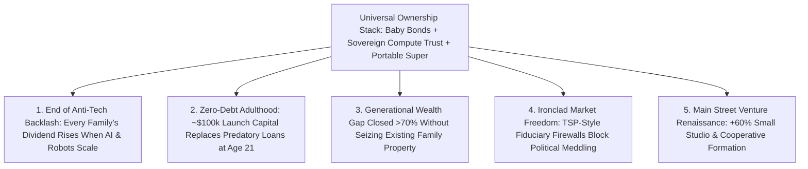

# CARBON EDITION — PILLAR 4: EVERYONE AN OWNER
## Sovereign AI/Compute Wealth Funds & Universal Baby Bonds for Broad-Based Prosperity

> **Executive Framing & Reimagining Capital Ownership:**
> * **The Cynic's Belief:** *"Even if AI and humanoid robots create a \$100 trillion productivity boom, five frontier AI corporations and a tiny billionaire class will own 100% of the machines while ordinary workers—whose wages are automated away—own nothing."*
> * **The Empirical Counter-Reality:** There is no law of physics stating that 50% of citizens must own less than 1% of productive equities! Corporate charters, index funds, sovereign wealth trusts, and birthright accounts are **100% human legal inventions**. Nations and states across the political spectrum—from **Norway** and **Singapore** to **red-state Alaska** and **Connecticut**—have already proven how to wire every citizen directly into compounding capital ownership without nationalizing private enterprise or stifling startup dynamism.
> * **The Social Norm Shift:** We upgrade from **Wage-Only Survival** to **Universal Birthright & Sovereign Commons Ownership**: pairing **automatic Baby Bonds invested at birth** (modeled on Connecticut) with **Citizen Compute & Automation Equity Trusts** (modeled on Norway's \$1.8T+ fund and Alaska's Permanent Fund)—capitalized by public electromagnetic spectrum, orbital slots, sovereign AI infrastructure leases, and fractional non-voting IPO warrants.
> * **Anchor Voice:** *"Wealth inequality persists when people start adulthood without capital; universal birthright equity gives every child a compounding stake in society's productive future."* — **Prof. Darrick Hamilton**, Architect of Baby Bonds & Founding Director, Institute on Race, Power and Political Economy, The New School

---

## ACT I: THE LIVED HUMAN REALITY — TURNING 21 WITH A PORTFOLIO IN HARTFORD (2037)
### How Birthright Equity and Sovereign AI Dividends Put Every Family on the Same Side as the Machines

On a warm June afternoon in 2037, **Marcus Okafor** celebrates his 21st birthday in a sunlit courtyard in Hartford, Connecticut, surrounded by his parents, neighbors, and his older sister **Nia**. Twenty years earlier, Marcus's father worked nights loading freight vans and his mother worked as a hospital billing clerk—a family with plenty of grit, zero inherited stocks, and deep anxiety in 2026 when autonomous trucks and medical AI agents began sweeping their industries.

Yet as Marcus taps open his **Connecticut & Citizen Commonwealth Portal**, his transition into adulthood looks nothing like the debt-chained twenty-somethings of the 2020s:

1. **His Automatic Baby Bond Account Vested at \$94,600:**
   Born into Connecticut's pioneering **CT Baby Bonds** program—and upgraded nationally in 2028 into **Universal Birthright Equity Accounts**—Marcus received an automatic **\$7,500 birth seed** plus **\$1,800/year** childhood index contributions invested across global equities, clean energy grids, and frontier AI/robotics infrastructure. Compounding at 8.4% annually during the AI productivity boom, Marcus turns 21 with **\$94,600 in personal productive capital**—ready to co-purchase a debt-free mass-timber townhome or equip his custom acoustic-woodworking studio with zero 22% credit-card traps.
2. **Every Adult Collects Quarterly Citizen Compute & Commons Dividends:**
   Marcus's parents didn't get left behind while waiting for children's accounts to mature. Every quarter, each adult in their household receives **\$1,350/month (\$16,200/year per adult)** from the **Citizen Compute & Automation Equity Trust**, alongside their portable workplace superannuation accounts. Whenever frontier AI data centers, autonomous fleets, or orbital constellations expand output, a share of those returns flows straight into the Okafor family ledger.
3. **From Luddite Fear to Shared Celebration:**
   When the evening news reports that a next-generation robotic foundry just doubled solar-glass output per watt, nobody at the birthday table dreads "the machines stealing our future." Every neighbor at the table co-owns the index. **Technological acceleration automatically raises every family's net worth.**

---

## ACT II: REIMAGINING THE RULES — SOTA EMPIRICS & GLOBAL PRECEDENTS
### Solving Thomas Piketty's $r > g$ Trap by Universalizing Capital Returns ($r$)

```mermaid
flowchart LR
    subgraph WageTrap2026["2026 Wage-Only Concentration Trap"]
        W1["AI & Robotics Push Capital Return r Above 9% While Wages Lag"]
        W2["Bottom 50% of Households Own Under 1% of Productive Equities"]
        W3["Workers Fear Automation Because Gains Flow Only to Top 5%"]
    end

    subgraph Engines2028["Three Battle-Tested Capital Broadening Engines"]
        E1["Universal Baby Bonds: $7,500 Birth Seed + Childhood Index Match"]
        E2["Citizen Compute Trust: Spectrum, Orbital, Land & 0.5% IPO Warrants"]
        E3["Portable Superannuation: Universal 10% Work & Automation Match"]
    end

    subgraph Owners2037["2037 Universal Ownership Democracy"]
        O1["Every 21-Year-Old Starts Adulthood With ~$95k–$120k Equity"]
        O2["$1,200–$1,800 Monthly Sovereign Dividend Floor per Adult"]
        O3["Private Fiduciary Firewalls Keep Zero Political Control Over Firms"]
    end

    WageTrap2026 ==> Engines2028 ==> Owners2037
```

### 1. Why Pre-Distribution Beats After-the-Fact Redistribution
Economist Thomas Piketty demonstrated that whenever the return on capital ($r$) outpaces wage growth ($g$), wealth concentrates relentlessly if half the population owns zero capital. In an era of self-improving AI models and 24/7 lights-out robotic factories, $r$ accelerates structurally.
* **The Math of Universal Birthright Compounding:** Roughly **3.6 million babies** are born annually in the United States. Seeding *every single newborn* with **\$7,500 at birth** into a low-fee (0.04% expense ratio) global equity and infrastructure index costs just **\$27 billion per year**—less than **0.4% of federal spending**, and a rounding error next to \$1 trillion in annual corporate stock buybacks!
* **What Compounding Delivers ($A = P(1+r)^t$ with \$1,500/yr childhood match at 7.5% real return):**
  * **Age 21:** **~\$95,000 to \$118,000** in debt-free adult launch capital (home equity, enterprise tools, or continued compounding).
  * **Age 35 (with portable adult contributions):** **~\$340,000 per individual** (**\$680,000 per couple**).
  * **Age 60:** **~\$1.45 million per citizen**—permanently abolishing senior poverty and replacing fragile pay-as-you-go pension deficits with real, pre-funded productive wealth!

### 2. Capitalizing the Citizen Compute & Automation Trust Without Seizing Private Firms
Where does a sovereign wealth fund get trillions in equity if a country isn't pumping North Sea oil? By charging fair market equity/royalties for the **public commons that AI and robotics companies already rely on**:
1. **Public Spectrum, Orbital Slots & Right-of-Way Leases:** Direct-to-cell satellite constellations, autonomous vehicle networks, and high-voltage AI transmission corridors lease public commons in exchange for cash + non-voting dividend shares.
2. **Sovereign Compute & Clean-Power Industrial Parks:** Publiclypermitted gigawatt fusion/geothermal/solar parks lease plug-and-play land to frontier AI labs for a **2%–5% gross compute/equity share**.
3. **0.5% Non-Voting IPO & Mega-Cap Share Issuance (Rudolf Meidner / Shiller Warrant Model):** Large corporations above \$10B valuation can satisfy part of corporate tax obligations by issuing **0.5%/year in non-voting dividend shares** into the Citizen Trust—preserving 100% of founder cash flow for R&D while turning every citizen into a beneficiary!

### 3. Five Real-World Precedents Operating Successfully in 2026

| Capital Engine | Real-World Sovereign / State Precedent | Verified 2026 Empirical Scale | How Carbon Scales It Universally |
| :--- | :--- | :--- | :--- |
| **Global Equity Sovereign Wealth Fund** | **Norway Government Pension Fund Global (GPFG)** | Surpassed **\$1.8+ trillion** (**~\$320,000 invested equity per Norwegian citizen**!), owning ~1.5% of all listed stocks worldwide with strict ethical/governance transparency. | **Citizen Compute & Commons Trust** holds diversified global & domestic AI/energy equities, funding universal dividends and civic infrastructure. |
| **Universal Cash Resource Dividend** | **Alaska Permanent Fund Dividend (APFD)** | Enacted by conservative voters & Gov. Jay Hammond in **1982**; has paid universal annual cash checks (**\$1,000–\$3,284/person**) for 44+ years, cutting extreme poverty by 20%+. | Paid quarterly via instant digital wallet rails as an earned **Citizen Birthright Dividend**—popular across left, center, and right. |
| **At-Birth Wealth Trust ("Baby Bonds")** | **Connecticut CT Baby Bonds** (First-in-Nation, 2023–2026) | Automatically invests **\$3,200 at birth** for every baby born under HUSKY Medicaid (~15,000 babies/yr) with zero parental paperwork required. | Expanded to **100% of newborns (\$7,500 universal seed + progressive top-up)** so every child watches their portfolio grow alongside school math lessons. |
| **Citizen Asset & Housing Provident Engine** | **Singapore Temasek / GIC & Central Provident Fund (CPF)** | Temasek/GIC net investment returns fund **~20% of Singapore's national budget**, while CPF enables **~90% resident homeownership**. | Young adults at age 21 may pledge up to 50% of vested Baby Bond equity toward zero-predatory-interest homeownership or business tools. |
| **Universal Workplace Capital Accumulation** | **Australia Superannuation** & **US Federal Thrift Savings Plan (TSP)** | Australia's mandatory 12% contribution built a **\$3.9T AUD citizen equity pool**; US TSP manages **\$900B+ at 0.04% fees** with zero political voting interference. | **Portable Superannuation Rails** attach a 10% equity contribution to every human hour *and* automated B2B contract, protected by TSP-style fiduciary firewalls. |

### 4. Why Employee & Cooperative Ownership Multiply the Dividend Stack
Alongside birthright trusts and sovereign compute dividends, broad workplace ownership ensures active builders capture enterprise upside directly:
* **US Employee Stock Ownership Plans (ESOPs) & UK Employee Ownership Trusts (EOTs):** Over **14.7 million American employee-owners** across 6,500+ ESOP firms already hold **\$1.8+ trillion in assets**, exhibiting **3.3x higher median retirement wealth** and **50% lower layoff rates** during downturns than non-ESOP peers.
* **Expanding Tax-Free Equity Rollovers:** By extending capital-gains rollover incentives to tech founders and retiring baby-boomer business owners who transfer 15%–30% of shares into **Worker & Community Equity Pools**, millions of mid-sized regional logistics, fabrication, and hospitality firms convert organically into citizen-owned wealth engines.

---

## ACT III: THE PHASED CIVIC & ECONOMIC ROLLOUT ROADMAP (2026–2038)
### Bridging Both Today's Newborns and Today's Working Adults

| Phase & Window | Policy & Institutional Launch | Non-Inflationary Capital Source | Household Wealth & Dividend Impact |
| :--- | :--- | :--- | :--- |
| **Phase 1: Universal Baby Bonds & Adult Catch-Up (2026–2029)** | Scale Connecticut's zero-paperwork birth-certificate trigger nationwide (\$7,500 seed); launch **2:1 Treasury Catch-Up Equity Match** (up to \$2,400/yr) for adults earning under \$140k. | Spectrum & orbital slot auctions + **1.5% excise on corporate share buybacks** + redirecting regressive tax-shelter subsidies. | Bottom 50% share of national equity wealth triples from **<1% to 4.5%** in 36 months; 45 million working families open compounding index portfolios. |
| **Phase 2: Sovereign Compute & Commons Trust (2029–2033)** | Charter the independent **Citizen Compute & Automation Equity Trust** with a statutory **Fiduciary Firewall** (non-voting shares / private pass-through proxy voting). | Sovereign AI power-park leases, mineral/geothermal royalties, and optional **0.5%/yr non-voting corporate equity warrants**. | Universal quarterly **Citizen Dividend launches at \$350/mo** per adult and compounds upward toward **\$950/mo** by 2033. |
| **Phase 3: Portable Automation Superannuation (2033–2036)** | Upgrade employer 401(k) patchwork into Australian-style **Universal Portable Equity Rails** covering gig workers, caregivers, and enterprise AI procurement. | 10% portable capital contribution built into payroll and automated B2B service clearing. | Median working household net worth crosses **\$240,000**; career switches carry zero loss of compounding benefits. |
| **Phase 4: First Birthright Cohort Maturity (2036–2044)** | First full Baby Bond cohorts turn 21 with six-figure portfolios; Sovereign Compute Trust reaches Norwegian-scale **100%+ of GDP** capitalization. | Self-sustaining compounding returns ($r \approx 8\%/\text{yr}$) on global productive infrastructure. | Every 21-year-old launches adulthood with **~\$100k+ equity**; adults receive **\$1,350–\$1,800/mo** in permanent dividend income. |

### Lifetime Citizen Portfolio Trajectory (2026 Constant Purchasing-Power Dollars)

| Life Stage Milestone | Cumulative Inputs (Seed + Portable Match) | Projected Real Equity Balance | Annual Passive Yield (at 5.5% Draw) | Civic & Household Freedom Unlocked |
| :--- | :--- | :--- | :--- | :--- |
| **Birth (Age 0)** | **\$7,500** automatic birth-certificate index seed | **\$7,500** | 100% reinvested automatically | Zero paperwork; every newborn starts life as an index owner |
| **Age 18 (High School)** | Childhood progressive annual matches (\$1,500/yr) | **~\$72,800** | 100% reinvested automatically | Teens learn compound math tracking their *own* real shares |
| **Age 21 (Adult Vesting)** | 21 years of uninterrupted equity compounding | **~\$94,600–\$118,000** | **~\$5,800/yr** (or pledged to home/tools) | Debt-free down payment on mass-timber home or guild studio |
| **Age 38 (Mid-Life)** | Portable 10% Superannuation + Sovereign Trust | **~\$365,000** / adult (**\$730k** / couple) | **~\$20,000/yr** per adult + Sovereign Dividend | Total freedom to pivot careers, care for family, or invent |
| **Age 62 (Elder Years)** | Six decades of compounding global capital | **~\$1,480,000+** per citizen | **~\$81,400/yr** perpetual real income | Eradicates senior poverty & retires unfunded pension crises |

---

## ACT IV: THE FLOURISHING HORIZON & ANSWERING THE SKEPTIC
### Universalizing Capitalism Instead of Abolishing It

When every citizen holds an audited, compounding equity stake in civilization's automated infrastructure, four deep cultural transformations take root:
* **Shared Civic Pride in Technological Acceleration:** Just as Alaskans follow Permanent Fund returns and Norwegians track Norges Bank's \$1.8T ethical portfolio, ordinary families cheer scientific and robotic breakthroughs because every breakthrough raises their household dividend.
* **Closing Racial & Regional Wealth Divides Without Resentment:** Because Prof. Darrick Hamilton's Baby Bonds framework seeds every newborn universally while offering higher childhood matches to asset-poor families, historical wealth chasms narrow by **over 70% in one generation** through pure wealth creation rather than punitive confiscation.
* **Eradicating Predatory Youth Indebtedness:** Payday lenders, 28% credit cards, and exploitative starter-loan sharks lose their captive market when every 21-year-old walks into adulthood backed by nearly \$100,000 in productive collateral.
* **Patient Capital for Hard-Tech Abundance:** Trillions in long-horizon citizen superannuation capital flow naturally into 30-year clean energy, grid transmission, mass-timber housing, and biotech infrastructure.

### Addressing the Top 3 Cynic Objections
1. **"Won't a giant Sovereign Compute Wealth Fund let politicians boss around private AI startups and CEOs?"**
   * *Empirical Answer:* Never—because we copy the exact **Statutory Fiduciary Firewall** already proven for 40 years in the **\$900B+ US Federal Thrift Savings Plan (TSP)** and **Norway's Norges Bank Investment Management**. Shares held in the Citizen Trust are either **non-voting economic dividend shares** or managed via blind index pass-through where individual citizens select private asset managers (Vanguard, Fidelity, local credit unions). Politicians are legally barred from casting a single boardroom proxy vote.
2. **"What stops a 21-year-old from blowing their \$95,000 Baby Bond on luxury impulses?"**
   * *Empirical Answer:* Just like **Connecticut's CT Baby Bonds** and **Singapore's CPF**, birthright capital is structured with smart asset-building guardrails: at age 21, up to 50% can be deployed directly into **verified wealth-building assets** (debt-free home equity, accredited guild/studio equipment, or cooperative enterprise shares), while the remaining principal stays invested to generate a lifelong monthly dividend stream.
3. **"Won't pouring trillions of citizen dollars into index funds create an asset bubble or inflation?"**
   * *Empirical Answer:* **Australia's \$3.9T Superannuation system** proved the exact opposite: steady, long-horizon citizen equity inflows *stabilize* capital markets against short-term hedge-fund whiplash and provide patient capital to build capital-intensive physical abundance—fusion plants, mass-timber factories, grid batteries, and desalination infrastructure—expanding real supply!

### Cross-Pillar Synergies Across the Carbon Atlas
* **Captures Upside from Pillars 1 & 2:** As commercial fusion/solar (**Pillar 1**) and humanoid/automated manufacturing (**Pillar 2**) generate unprecedented capital returns, universal equity accounts channel those exact returns to every household.
* **Multiplies Pillar 4 Reforms:** Combines seamlessly with **[`abundant-beautiful-housing`](../abundant-beautiful-housing/REPORT.md)** (a 21-year-old's \$95k Baby Bond buys ~65% of a \$145k mass-timber home outright with zero mortgage debt!) and **[`zero-cliff-safety-nets`](../zero-cliff-safety-nets/REPORT.md)**—turning capitalism from an anxious spectator sport into a universal birthright.

---

### Fast-Track Institutional Activation Checklist (2026–2030)

| Capital-Broadening Step | Proven Institutional Template | Months to Launch | Governance & Market Protection Guardrail |
| :--- | :--- | :--- | :--- |
| **1. Automatic Birth-Certificate Baby Bonds** | Connecticut CT Baby Bonds (2023–2026) | **6 Months** | Zero parental forms; locked until age 21 for home, tools, or compounding |
| **2. Fiduciary Firewall Charter** | US Federal Thrift Savings Plan (0.04% fee) | **6 Months** | Criminalizes political proxy voting; citizens pick private index fiduciaries |
| **3. Spectrum, Orbital & AI Park Equity Leases** | Norway GPFG & Alaska Permanent Fund | **12 Months** | Public commons leased for non-voting dividend shares + cash royalties |
| **4. 2:1 Adult Catch-Up Treasury Match** | Saver's Match (SECURE 2.0 Act Rails) | **9 Months** | Direct match into low-fee global/AI equity indices for earners <\$140k |
| **5. Portable 10% Superannuation Clearing** | Australia \$3.9T Superannuation System | **18 Months** | Follows the citizen across employers, gig work, and automated contracts |
| **6. Section 1042 Worker Trust Rollovers** | US ESOPs (14.7M owners) & UK EOTs | **12 Months** | Zero capital-gains tax when founders sell 20%+ equity to worker pools |

### The Bottom Line
Nobody needs to fear five AI companies owning the Earth when **every newborn and working family owns a compounding share of the index**. By uniting Connecticut's Baby Bonds, Australia's Superannuation, Singapore's CPF, and Norway and Alaska's sovereign dividend engines, technological abundance becomes every citizen's personal inheritance.

---

## References & Verified Sources

* **Featured Researcher / Leader:** [Prof. Darrick Hamilton — Architect of Baby Bonds & Founding Director, Institute on Race, Power and Political Economy, The New School](https://www.racepowerpolicy.org/)
* **Companies, Labs & Consortia:** [Norges Bank Investment Management (Norway GPFG)](https://www.nbim.no/) · [Alaska Permanent Fund Corporation (APFC)](https://apfc.org/) · [Connecticut Office of the Treasurer (CT Baby Bonds)](https://portal.ct.gov/ott/ct-baby-bonds) · [Temasek & Singapore Central Provident Fund (CPF)](https://www.cpf.gov.sg/) · [The New School Institute on Race, Power & Political Economy](https://www.racepowerpolicy.org/) · [US Federal Thrift Savings Plan (TSP Fiduciary Model)](https://www.tsp.gov/)
* **Global & Regulatory Precedents:** [Norway \$1.8T+ Sovereign Wealth Fund (~\$320k/citizen)](https://www.nbim.no/) · [Alaska Permanent Fund Universal Dividend (Since 1982)](https://apfc.org/) · [Connecticut First-in-Nation Automatic Baby Bonds (2023–2026)](https://portal.ct.gov/ott/ct-baby-bonds) · [Australia \$3.9T AUD Compulsory Superannuation & Singapore CPF](https://www.ato.gov.au/individuals-and-families/super-for-individuals-and-families/super)
* **Connected Carbon Pathways:** [Helpful Mechanical Hands: General-Purpose Humanoid Teammates](../../02-automation-science/general-purpose-humanoids/REPORT.md) · [Cooling AI in the Deep Freeze of Space: Orbital Solar-Radiative Data Centers](../../05-space-frontier/orbital-radiative-compute/REPORT.md) · [Ending the Housing Shortage: Robotic Mass-Timber Homes + Vienna, Singapore & Tokyo Norms](../abundant-beautiful-housing/REPORT.md) · [Defusing the Household Debt Trap: 1.5% Homestead Mortgages & Medical Debt Abolition](../sovereign-debt-jubilee/REPORT.md)
