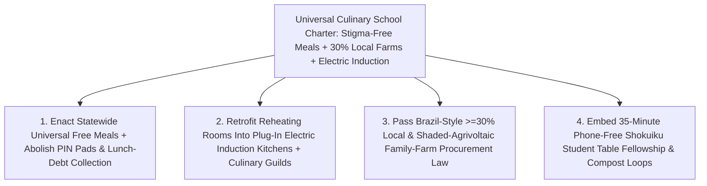

# CARBON EDITION — PILLAR 4: SCRATCH-COOKED & STIGMA-FREE
## How Brazil, Japan, Copenhagen & 8+ U.S. States Reinvented the Public School Table

> **Executive Framing & Reimagining Childhood Nourishment as Civic Infrastructure:**
> * **The Cynic's Belief:** *"Public school cafeterias are doomed to reheat plastic-wrapped ultra-processed nuggets on Styrofoam trays while shaming working-class kids at the cash register over unpaid lunch debt—because serving fresh, organic, scratch-cooked meals free to every child is fiscally impossible."*
> * **The Empirical Counter-Reality:** Four continents have already proven that excuse completely backward. **Brazil's National School Feeding Program (*Programa Nacional de Alimentação Escolar* / PNAE)** feeds **~40 million public-school students (~50 million free meals every single school day)**, and under landmark **Federal Law 11.947/2009** legally mandates that **at least 30% of federal food funds purchase fresh ingredients directly from local family farms, agroecological cooperatives, and Indigenous and *Quilombola* growers**—slashing child malnutrition while anchoring rural livelihoods. **Japan's universal *Shokuiku* ("food and nutrition education") school lunch** serves seasonal, nutritionist-designed scratch meals across **~99% of elementary schools** with zero vending machines, where children don crisp white aprons to serve classmates and tidy together—holding Japanese childhood obesity among the **lowest in the OECD (<4%–5%)**. **Copenhagen's *Københavns Madhus* (House of Food)** transitioned **900+ municipal school, daycare, and elder kitchens to ~90% certified organic, scratch-cooked food with ZERO increase in total food budget** simply by eliminating factory-packaged waste, baking daily sourdough, cooking seasonal legumes and roots, and retraining cafeteria workers as proud culinary professionals. And **8+ U.S. states** (**California, Maine, Colorado, Minnesota, New Mexico, Vermont, Michigan, and Massachusetts**) enacted permanent **Universal Free School Meals**, abolishing "lunch-debt shaming" overnight while lifting attendance, test scores, and family grocery budgets by **~\$1,000+ per child per year**!
> * **The Social Norm Shift:** Public schools abolish means-tested cash-register PIN pads and ultra-processed "heat-and-serve" pouches forever—pairing **universal free scratch-cooked culinary kitchens, student table fellowship, and 30%+ local farm compacts** with **shaded agrivoltaic produce farms** and **fume-free commercial electric induction kitchens**.
> * **Anchor Voice:** *"We did not get to ninety percent organic, scratch-cooked public meals by begging politicians for a bigger food budget—we got there by throwing away the plastic-bagged factory products, cutting food waste in half, and restoring the dignity of real chefs in public kitchens."* — ***Københavns Madhus* (Copenhagen House of Food) & Chef Ann Cooper**, Founder of the *Chef Ann Foundation* ([Visual Storyboard](./STORYBOARD.md))

---

## ACT I: THE LIVED HUMAN REALITY — TUESDAY AT 11:45 AM IN MINNEAPOLIS, TOKYO & MINAS GERAIS (2028)
### Why Tearing Out the Swipe-Card Register and the Box Cutter Transforms the Entire School Day

It is 11:45 AM on a brisk October Tuesday inside **Roosevelt Community Elementary** in **Minneapolis, Minnesota**—and simultaneously across sister public kitchens from **Copenhagen** and **Setagaya Ward, Tokyo** to **Belo Horizonte, Minas Gerais, Brazil**.

Five years ago, lunchtime in thousands of North American schools was a 22-minute industrial indignity: "kitchen staff" armed with box cutters slit open frozen plastic bags of ultra-processed, high-sodium breaded patties and corn-syrup fruit cups for reheating in roaring gas ovens; kids waited twelve minutes in a swipe-pad line where any nine-year-old whose parents were **\$18 behind on their lunch account** had their hot tray publicly confiscated and replaced with a cold cheese-slice "stigma sandwich"; and **35% to 45% of all food went straight into plastic trash bags** while restless, blood-sugar-spiking classrooms derailed 1:00 PM math lessons.

Watch what happens at 11:45 AM inside Denise Carter's reinvented Minneapolis school kitchen—weaving **Minnesota's Universal Free School Meals law**, **Chef Ann Foundation / Copenhagen culinary craft**, **Brazil's local farm compact**, and **Japan's *Shokuiku* fellowship**:

1. **Cool, Fume-Free Electric Induction & Real Culinary Pride:**
   Step behind the serving line at 9:30 AM and the air isn't 98°F choked with indoor nitrogen dioxide (NO₂) gas-burner exhaust—it is cool, quiet, and fragrant with roasting garlic and rosemary. Under a clean-school retrofit, roaring gas ranges were replaced by **90%-efficient commercial electric induction tilt-skillets and combi-ovens** that transfer energy directly into steel pans, cutting kitchen HVAC and cooking energy bills by **48%**. Retrained through a **Københavns Madhus / Chef Ann Foundation** culinary apprenticeship, Kitchen Lead **Denise Carter** and her four salaried school chefs bake warm whole-grain honey focaccia from regional wheat, simmer smoky black-bean and sweet-corn chili, and roast honeycrisp apples and butternut squash harvested thirty miles away beneath a **shaded county agrivoltaic solar-farm canopy**.
2. **Zero PIN Pads, Zero Lunch Debt, 100% Equal Table Fellowship:**
   When the 11:50 AM bell rings, **nobody taps a poverty-coded PIN number**—just like textbooks, library books, and school buses, midday nourishment is unconditionally free for the surgeon's child and the warehouse worker's child alike. Taking a page from **Japan's *Shokuiku* classroom lunch**, rotating fourth-grade "table stewards" in cheerful washable aprons wheel warm stainless tureens to family-style wooden tables, read a 45-second card thanking farmer **Elena Vasquez's** nearby solar-shaded orchard for today's apples, serve real ceramic bowls alongside steel spoons, and sit down for **35 unhurried, phone-free minutes** alongside their teacher!
3. **Empty Compost Buckets, Calm Afternoon Brains & \$1,200 Back in Family Pockets:**
   Because scratch-cooked focaccia and roasted squash actually taste delicious—and kids helped serve it—**plate waste plunges from 41% down below 11%**, entirely offsetting the raw-ingredient upgrade inside the district's existing per-meal reimbursement! Behavioral referrals after 12:30 PM drop by **nearly half**, chronic absenteeism falls, and every working two-child family in the district keeps **~\$2,000 to \$2,400 a year** in after-tax grocery relief without filling out a single humiliating income affidavit.

---

## ACT II: REIMAGINING THE RULES — FOUR COUNTRIES THAT PROVED THE "IMPOSSIBLE" BUDGET MATH
### Why Ultra-Processed Factory Pouches Were Secretly Wasting Half the Food Dollar All Along

```mermaid
flowchart LR
    subgraph ProcessedTrap["Legacy Heat-and-Serve & Lunch-Debt Cafeteria"]
        P1["Ultra-Processed Plastic Pouches Eat Budget on Factory Packaging"]
        P2["Means-Tested PIN Pads Trigger Lunch-Debt Shaming & Stigma"]
        P3["35%–45% Plate Waste + Roaring Gas Fumes + Afternoon Sugar Crashes"]
    end
    subgraph CulinaryEngine["Global Universal Scratch-Kitchen & Farm Architecture"]
        C1["Universal Free Meals (8+ US States, Brazil PNAE & Japan Shokuiku)"]
        C2["Copenhagen Madhus Zero-Extra-Budget Organic Craft + Waste Cut"]
        C3["Brazil >=30% Local Family/Agrivoltaic Farm Law + Electric Induction"]
    end
    subgraph NourishedDividend["Audited Health, Learning & Rural Outcomes"]
        N1["~90% Organic Scratch Meals at USD 0 Added Food Budget (Copenhagen)"]
        N2["OECD-Lowest <4%–5% Child Obesity (Japan) & 50M Daily Meals (Brazil)"]
        N3["USD 1,000+/Child Family Savings + Higher Test Scores & Clean Air"]
    end
    ProcessedTrap ==> CulinaryEngine ==> NourishedDividend
```

### 1. Copenhagen's Accounting Bombshell: 90% Organic Scratch Cooking With \$0 Extra Food Budget
Whenever a school superintendent says, *"We'd love fresh organic food, but we only have \$4.50 per meal reimbursement,"* hand them the audited ledger of **Copenhagen's *Københavns Madhus* (House of Food)** documented by **C40 Cities**. Starting in 2001, Copenhagen's City Council set an audacious target: transition **more than 900 municipal kitchens**—serving **~70,000 meals every day** across public schools, nurseries, and elder centers—to **90% certified organic ingredients** *without raising the municipal food procurement budget by a single Danish krone*!

How did **Københavns Madhus** hit **~88%–90% certified organic across all 900+ kitchens** inside flat budgets? They uncovered a massive hidden subsidy inside industrial food: **when a school buys pre-cooked, pre-diced, frozen factory nuggets and peeled potatoes in plastic bags, 40% to 55% of the invoice pays for factory processing, corporate marketing, cold-chain plastic, and inevitable plate trash—not nutrition!** By training **1,300+ kitchen workers** in six-week hands-on culinary bootcamps, Copenhagen flipped five levers simultaneously:
* **Cutting Plate & Prep Waste From ~35% to <10%:** Using whole root vegetables (roasting stems and skins into rich stocks), baking fresh organic sourdough in-house every morning, and serving family-style bowls rather than oversized plastic trays saved **15%–25% of total food spend** immediately.
* **Seasonal Plant-Forward Culinary Craft:** Shifting menus from cheap processed meat patties toward **seasonal field vegetables, hearty legumes, whole grains, and smaller portions of high-welfare meat/fish** equalized organic unit prices penny-for-penny while cutting municipal food carbon emissions by **>25%**.

### 2. Brazil's Law 11.947/2009 (50 Million Daily Meals) & Japan's *Shokuiku* (<5% Child Obesity)
While Copenhagen proved the urban kitchen budget math, **Brazil** and **Japan** proved national scale and lifelong metabolic transformation:
1. **Brazil's PNAE & The 30% Family-Farm Law:** Administered by **FNDE**, Brazil's **Programa Nacional de Alimentação Escolar** is one of humanity's greatest public-health achievements—serving **~50 million free meals every school day to ~40 million students** across **5,570 municipalities**. Under **Article 14 of Federal Law 11.947 (2009)**, every municipality is legally required to spend **at least 30% of federal FNDE school-meal transfers directly on fresh food from local family farmers (*agricultura familiar*)**, using simplified **public calls (*chamadas públicas*)** rather than corporate lowest-bidder tenders that lock out small growers, and prioritizing **certified organic/agroecological cooperatives, agrarian-reform settlements, and Indigenous and *Quilombola* communities**. Simultaneously, PNAE bans sugary sodas and strictly caps ultra-processed products (<15%–20%), turning national school lunch budgets into a multi-billion-real guaranteed local-farm engine!
2. **Japan's *Basic Law on Shokuiku* (2005) & School Lunch Act (1954):** Across **~99% of Japanese elementary schools** and **~90% of junior highs** (~10 million children daily), school lunch (*kyūshoku*) is legally part of **education, never a outsourced commercial food court**. Licensed school diet/nutrition teachers (*eiyō kyōyu*) craft seasonal menus from scratch on site; ultra-processed snacks and soda machines are non-existent; and children spend 15 joyful minutes in white caps and smocks serving each other, thanking the cooks (*"Itadakimasu!"*), sorting compost/milk cartons, and wiping tables together. Result: **Japan maintains <4%–5% childhood obesity** (versus **~20% in the United States**) and near-universal vegetable literacy into adulthood!
3. **The 8+ U.S. State Universal Free Meals Wave:** Following **California and Maine (2022)**, **Colorado, Minnesota, New Mexico, Vermont, Michigan, and Massachusetts** enacted permanent **Healthy School Meals for All**—tracked by the **Food Research & Action Center (FRAC)** and NBER/Brookings economists—proving universal free access **boosts participation 20%–35%**, raises math and reading scores across *both* low- and middle-income students, cuts school suspensions, eliminates **100% of administrative debt-collection bureaucracy**, and saves families **~\$1,000+ per child annually**.

### 3. Intertwining Clean Energy + Agro-Abundance With Humane Kitchens: Agrivoltaics + Electric Induction
When we connect PNAE, *Shokuiku*, and *Københavns Madhus* to 2026 clean-energy abundance, the economics grow stronger still:
* **Shaded County Agrivoltaic Farm Compacts (**[`agrivoltaics-shaded-harvests`](../../01-abundant-energy/agrivoltaics-shaded-harvests/REPORT.md)**):** Pairing Brazil-style **30% local school-food purchasing contracts** with elevated rural **agrivoltaic solar arrays** gives family growers *dual guaranteed revenues*—clean megawatts sold to the school district's utility meter plus crisp, frost- and heatwave-protected greens, berries, tomatoes, and tubers delivered straight to school loading docks **20%–30% water-leaner**!
* **Clean Commercial Electric Induction Kitchens:** Retrofitting school cafeterias from unvented 1980s gas boilers and fryers to **commercial induction ranges, heat-pump dishwashers, and electric combi-ovens** eliminates indoor **NO₂, carbon monoxide, and ultrafine particulate plumes** (protecting kitchen staff and asthmatic kids), drops summer kitchen ambient temperatures by **10°F–15°F**, and slashes kitchen utility bills **40%–50%** when timed to midday solar peaks!

| School Table Dimension | Heat-and-Serve & Means-Tested Status Quo | Universal Culinary Kitchen + Agrivoltaics + Induction (Carbon Standard) | Verified Empirical Outcome |
| :--- | :--- | :--- | :--- |
| **Eligibility & Register Experience** | Income forms, swipe PINs & **lunch-debt shaming** for working families | **100% Universal Free School Meals** (8+ U.S. states, Brazil PNAE) | **~\$1,000+/child/yr** family grocery savings; zero stigma |
| **Food Quality & Net Budget Impact** | Frozen plastic-bagged ultra-processed nuggets; **35%–45% plate waste** | **Scratch-cooked seasonal & ~90% organic** (*Københavns Madhus* / *Chef Ann*) | **\$0 food-budget increase** in Copenhagen via waste cuts |
| **Supply Chain & Rural Link** | Giant national conglomerate tenders; pennies reach local growers | **≥30% direct local family & agrivoltaic farm mandate** (Brazil Law 11.947) | Anchors **~40M-student** Brazil supply chain & rural incomes |
| **Kitchen Tech & Child Health** | Hot NO₂ gas fumes; 18-min rushed trays; **~20% U.S. child obesity** | **Electric induction kitchens** + **35-min *Shokuiku* student table service** | **<4%–5% OECD-best child obesity** (Japan); -48% kitchen energy |

---

## ACT III: GLOBAL ADAPTATION & PHASED ROLLOUT ROADMAP (2026–2032)
### Turning "Heat-and-Serve" Reheating Rooms Back Into Real Kitchens Without Breaking District Budgets

Over half of U.S. and UK public schools built between 1975 and 2010 were constructed without real stoves or floor drains—just walk-in freezers and cardboard-box warmers! Fortunately, the **Chef Ann Foundation** (*Healthy School Food Pathway*, active across hundreds of districts including California's landmark **\$750M+ Kitchen Infrastructure and Training [KIT]** investment) and **Copenhagen's central/satellite bakery-and-prep hubs** have mapped the exact 3-step physical and financial conversion for any district on Earth:

| Implementation Horizon | Statutory & Procurement Unlock | Kitchen & Farm Technical Deployment | Audited Student, Farm & Budget Outcome |
| :--- | :--- | :--- | :--- |
| **Phase 1 (Months 1–9): Abolish Lunch Debt + Waste Audit** | States/districts enact **Universal Free School Meals** (maximizing federal CEP matches + modest high-earner tax/sugar-levy) and **simplified *chamada pública* farm bids**. | Run **Chef Ann Foundation / Madhus** 8-week culinary bootcamps; install drop-in **240V/480V commercial induction skillets** eliminating expensive gas-line trenching. | Lunch participation jumps **25%–35%** overnight; **100% of lunch debt erased**; early scratch recipes cut plate waste in half within two semesters. |
| **Phase 2 (Years 1–3): 30% Agrivoltaic Farm Compacts + Central Scratch Hubs** | Enact **Brazil Law 11.947-style ≥30% local family-farm floor** (+5¢–10¢/meal state local-food incentive like Michigan, NY, and Colorado). | Pair tiny urban schools without space via **1 neighborhood scratch-commissary bakery per 8 schools**; contract local **[`agrivoltaics-shaded-harvests`](../../01-abundant-energy/agrivoltaics-shaded-harvests/REPORT.md)** growers. | Kitchens hit **65%–80% scratch-cooked fresh share** inside existing per-meal food budgets; millions flow directly into county family farms. |
| **Phase 3 (Years 3–6): 90% Regenerative Kitchens & *Shokuiku* Culture** | Protect **minimum 35-minute seated lunch periods** by education statute alongside **[`two-sigma-guild-education`](../two-sigma-guild-education/REPORT.md)** afternoon mastery blocks. | Blend local seasonal harvests with clean **[`precision-fermentation-rewilding`](../../03-bioscience-regeneration/precision-fermentation-rewilding/REPORT.md)** dairy/culinary ingredients and **[`iceland-planet-youth-belonging`](../iceland-planet-youth-belonging/REPORT.md)** after-school cooking guilds. | Kitchens reach **85%–90%+ organic/regenerative scratch meals**; pediatric metabolic syndrome, afternoon suspensions, and kitchen gas emissions plummet. |

---

## ACT IV: ANSWERING THE SKEPTIC & THE HUMANE HORIZON
### Solving Labor Shortages, "Picky Eaters," and Why Giving Free Lunch to Rich Kids Actually Saves Money

### Addressing the Top 3 Institutional Objections
1. **"Why should taxpayers buy free school lunch for an affluent suburban doctor's kid instead of targeting free meals strictly to low-income families?"**
   * *Empirical Answer:* Means-testing school lunch is a classic **penny-wise, pound-foolish trap**! Running income-verification paperwork, auditing millions of forms, and policing delinquent lunch accounts wastes **hundreds of millions of administrative dollars**, while **stigma drives 25%–40% of eligible working-poor teenagers to skip lunch hungry rather than stand in the "poor kids' line."** Worse, low participation starves school kitchens of per-meal volume economies! Just as we don't put tollbooths on public school classrooms or drinking fountains—and progressive taxes already ask affluent doctors to pay far more in April—**making the table 100% universal raises volume, lowers unit cost per meal, and erases shame forever**.
2. **"If we switch from chicken nuggets and chocolate milk to seasonal roasted vegetables, beans, and sourdough, won't picky kids dump it in the trash?"**
   * *Empirical Answer:* **Copenhagen, Tokyo, and Boulder Valley (Chef Ann Cooper's pioneer U.S. district)** proved why kids reject soggy *canned* peas—not real chef-cooked food! When trained school chefs roast caramelized local carrots with herbs, bake warm whole-grain bread, run rainbow salad bars, and involve students via **Japan's *Shokuiku* serving rituals and garden taste-tests**, **vegetable consumption doubles and plate waste drops below 12%** within a single school year.
3. **"School districts already struggle to hire cafeteria workers at \$15/hour—how can they staff scratch-cooked kitchens?"**
   * *Empirical Answer:* Nobody dreams of spending thirty years slitting plastic bags with a box cutter in a 98°F gas-fume room—which is why "heat-and-serve" cafeterias suffer chronic 35% vacancies! When **Copenhagen** and **California KIT districts** converted hot gas reheating rooms into cool **electric induction kitchens**, renamed roles **School Culinary Apprentices & Chefs**, and paid skilled guild wages funded partly by eliminating factory-processed food markups, **local restaurant chefs flooded applicant pools** eager for family-friendly 6:30 AM–2:30 PM school schedules with summers and weekends home!

### Fast-Track Governor, School Board & Agriculture Minister Activation Checklist

| Sprint Reform Step | Proven Real-World Precedent | Months to Launch | Budget & Quality Guardrail |
| :--- | :--- | :--- | :--- |
| **1. Universal Free School Meals Act** | 8+ U.S. States (MN, MA, CO, CA, ME, MI) | **4 Months** | Zero PIN pads, zero debt collection; pairs fully with federal meal funds |
| **2. 6-Week Culinary Staff Guilds** | *Københavns Madhus* (1,300+ chefs trained) | **3 Months** | Cuts plate/prep waste from 35%+ to <12% to keep food budgets neutral |
| **3. ≥30% Local Family-Farm Law** | Brazil Law 11.947/2009 (*Chamada Pública*) | **6 Months** | Simplified farm bids exempt from corporate lowest-unit-price traps |
| **4. Electric Induction Kitchen Grants** | California \$750M+ KIT + Clean School Funds | **6 Months** | Zero indoor NO₂ fumes; -48% kitchen energy timed to solar midday |
| **5. 35-Minute *Shokuiku* Seated Lunch** | Japan 1954/2005 *Shokuiku* National Standard | **2 Months** | Phone-free family-style tables + rotating student apron hospitality |

### Why Both Rural Farm Coalitions and Urban Parent/Teacher Unions Cheer Together
* **Why Family Farmers, Rural Lawmakers & Fiscal Hawks Love It:** Redirects **30%+ of guaranteed institutional food dollars** straight out of multinational ultra-processed conglomerates into county ranchers, orchardists, and **agrivoltaic family farms** while keeping municipal food budgets flat via waste elimination.
* **Why Parents, Pediatricians & Teachers Love It:** Saves working families **~\$1,000+/child/year**, ends lunch-debt humiliation forever, clears NO₂ gas fumes out of schools, and delivers calm, nourished afternoon learners.

### Cross-Pillar Synergies & The Bottom Line
Woven together with **[`agrivoltaics-shaded-harvests`](../../01-abundant-energy/agrivoltaics-shaded-harvests/REPORT.md)**, **[`precision-fermentation-rewilding`](../../03-bioscience-regeneration/precision-fermentation-rewilding/REPORT.md)**, **[`iceland-planet-youth-belonging`](../iceland-planet-youth-belonging/REPORT.md)**, and **[`two-sigma-guild-education`](../two-sigma-guild-education/REPORT.md)**, **Universal Culinary School Kitchens** prove that plastic-wrapped nuggets and lunch-debt shaming were never economic necessities—they were failures of imagination. Put real chefs behind cool electric induction skillets, source crisp harvests from shaded local family farms, and welcome every child equally around a joyful 35-minute table, and **every single school day holds a feast worthy of our children**.

---

## References & Verified Sources

* **Brazil's 50-Million-Meal Daily System & 30% Family-Farm Law:** [Brazil FNDE — *Programa Nacional de Alimentação Escolar (PNAE)* & Federal Law 11.947/2009 Official Architecture](https://www.gov.br/fnde/pt-br/acesso-a-informacao/acoes-e-programas/programas/pnae)
* **Japan's Universal *Shokuiku* School Lunch & Copenhagen's Budget-Neutral Organic Kitchens:** [Japan Ministry of Education (MEXT) — *Shokuiku* Food & Nutrition Education School Lunch Program](https://www.mext.go.jp/en/) · [C40 Knowledge Hub — Case Study: How Copenhagen Transitioned 900+ Public Kitchens to ~90% Organic Within Existing Budgets](https://www.c40knowledgehub.org/)
* **U.S. Universal Free School Meals & Scratch-Kitchen Conversions:** [Food Research & Action Center (FRAC) — *Healthy School Meals for All* 8+ State Legislative & Outcome Tracker](https://frac.org/programs/national-school-lunch-program/free-school-meals-for-all) · [Chef Ann Foundation — Scratch-Cooked U.S. School Kitchen Transitions & Culinary Workforce Pathways](https://www.chefannfoundation.org/)
* **Connected Carbon Pathways:** [Double Harvests Under the Sun: Shaded Agrivoltaics Saving Water & Boosting Yields](../../01-abundant-energy/agrivoltaics-shaded-harvests/REPORT.md) · [Brewing Abundance, Rewilding Continents: Precision Fermentation & Cellular Agriculture](../../03-bioscience-regeneration/precision-fermentation-rewilding/REPORT.md) · [Iceland's "Planet Youth" Miracle: Slashing Teen Addiction Through Belonging](../iceland-planet-youth-belonging/REPORT.md) · [Bloom's Two-Sigma Mastery + Afternoon Human Guilds](../two-sigma-guild-education/REPORT.md)
