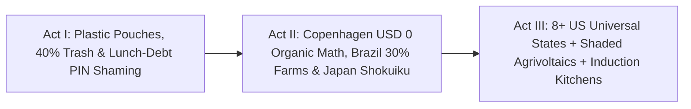

# STORYBOARD & CREATIVE PRODUCTION GUIDE: SCRATCH-COOKED & STIGMA-FREE ([`universal-culinary-school-kitchens`](./REPORT.md))
## *"How Copenhagen Hit 90% Organic on Zero Extra Food Budget, Brazil Linked 40 Million Kids to Family Farms, and 8+ U.S. States Ended Lunch Debt Forever"*

> **Production Purpose:** This vibrant, mouth-watering 4:15 documentary storyboard shatters the myth that public schools can only afford plastic-wrapped ultra-processed nuggets and lunch-debt cash registers—taking viewers inside **Copenhagen's 900 budget-neutral organic kitchens**, **Brazil's 50-million-meal/day PNAE family-farm compact**, **Japan's *Shokuiku* classroom fellowship**, and **electrified U.S. universal-meal kitchens**.

---

## PART 1: THREE ALTERNATIVE NARRATIVE OPENINGS (DIRECTOR'S OPTIONS)

### Option A: "Trading the Box Cutter for the Chef's Knife — At \$0 Extra Food Cost" *(Sensory Culinary Reveal)*
* **Visual Hook:** Split-screen at 9:15 AM inside two public school kitchens. Left (`Heat-and-Serve Status Quo`): A sweating worker in a 96°F gas-heated room slits open grey cardboard cases of frozen plastic-wrapped nuggets with a utility box cutter; 40% lands in a black trash bag at 12:15 PM. Right (`Copenhagen / Minneapolis Scratch Standard`): Cool, fume-free **commercial electric induction skillets** sizzle with local rosemary squash while **Chef Denise** pulls golden whole-grain focaccia from the oven—stamped on screen: **TOTAL FOOD BUDGET INCREASE: \$0.00**.
* **Voiceover Core:** *"Politicians swore fresh, organic scratch-cooked school lunches would bankrupt city budgets. Then Copenhagen threw away the factory plastic bags, cut food waste in half, trained cafeteria workers as real chefs—and hit ninety percent organic without adding a single cent to the food budget."*
* **Best For:** Mainstream family audiences, school-board town halls, and viral culinary media.

### Option B: "Unplugging the PIN Pad That Shamed Nine-Year-Olds" *(Emotional Justice Hook)*
* **Visual Hook:** Close-up on an anxious third-grader's trembling finger hovering over a cafeteria PIN pad displaying **ACCOUNT BALANCE: -\$18.40**—suddenly a maintenance electrician unscrews the entire terminal, drops it in a recycling bin, and hangs a hand-painted wooden sign across a sunny Minnesota serving counter: **`HEALTHY SCHOOL MEALS FOR ALL — COME TO THE TABLE`**.
* **Voiceover Core:** *"We never put swipe cards on third-grade math books or school buses. Eight American states finally asked why we were shaming hungry nine-year-olds at noon—and saved working families a thousand dollars per child every year."*
* **Best For:** State legislative campaigns, parent-teacher coalitions, and public-health broadcasts.

### Option C: "50 Million Meals a Day From Family Farms to Tokyo Aprons" *(Global Scale Pan)*
* **Visual Hook:** Kinetic morning match-cut across three continents: an agroecological farmer in **Minas Gerais, Brazil** loading crates of ripe papayas and manioc under **Law 11.947's 30% family-farm mandate** → fourth-graders in **Tokyo** tying crisp white *Shokuiku* aprons to ladle seasonal miso soup for classmates → a **shaded county agrivoltaic farm** delivering honeycrisp apples to a solar-powered Colorado school.
* **Voiceover Core:** *"Every day, Brazil feeds forty million students from local family farms, and Japan holds child obesity under five percent by turning lunch into joyful education. The blueprint for every child on Earth is already cooking."*
* **Best For:** Global food-systems summits, rural farm coalitions, and climate-health documentaries.

---

## PART 2: VISUAL NARRATIVE ARC & MODULAR 3-ACT STORYBOARD TABLE (12 SCENES)

| Act / Beat | Visual & Camera Concept | Data & Metric Callout Overlay | Sample Narration / Voiceover Script |
| :--- | :--- | :--- | :--- |
| **ACT I — Beat 1:** The Box-Cutter Cafeteria | Overhead shot of plastic-wrapped frozen patties, corn-syrup cups, and roaring unvented gas ovens—followed by kids dumping half-eaten Styrofoam trays into overflowing bins. | **Legacy Heat-and-Serve Waste:** **35%–45% Plate Trash** + Factory Packaging Markup | "When schools traded real stoves for plastic-wrapped factory pouches, nearly half the food budget ended up in the garbage can." |
| **ACT I — Beat 2:** The \$18 Lunch-Debt Stigma | Quiet, heartbreaking POV of a child watching their warm lunch replaced at the register over an unpaid \$18 balance while teenagers skip lunch altogether out of shame. | **Means-Testing Trap:** High Admin Red Tape + **25%–40% Eligible Teens Skip Meals** | "And policing unpaid lunch balances humiliated working-class kids while costing districts fortunes in paperwork." |
| **ACT I — Beat 3:** Copenhagen's Bold Dare (2001) | Sunlit aerial of Copenhagen rooftops cutting inside **Københavns Madhus**, where master chefs welcome municipal kitchen staff into a joyous 6-week sourdough and seasonal bootcamp. | **Copenhagen *Københavns Madhus*:** **900+ Public Kitchens** \| **1,300+ Chefs Trained** | "Copenhagen tried something radical: instead of begging for more money, they trained thirteen hundred public kitchen workers as real scratch chefs." |
| **ACT II — Beat 4:** How \$0 Extra Bought 90% Organic | Tactile tabletop breakdown: stripping away factory processing fees, baking bread in-house, cooking seasonal legumes/roots, and cutting waste from 35% to <10% balances the ledger. | **C40 Audited Result:** **~90% Certified Organic** With **\$0 Total Food Budget Increase** | "By baking their own bread, cooking seasonal roots and beans, and slashing waste below ten percent, nine hundred kitchens hit ninety percent organic inside existing budgets." |
| **ACT II — Beat 5:** Brazil's 50-Million-Meal Giant | Vibrant harvest montage in **Minas Gerais & Bahia**: family, Indigenous, and *Quilombola* co-ops delivering fresh greens and beans directly to town schools under **Law 11.947**. | **Brazil PNAE & Law 11.947/2009:** **~50M Meals/Day** \| **≥30% Direct Family-Farm Mandate** | "In Brazil, PNAE serves fifty million free meals every school day—legally guaranteeing at least thirty percent of funds go straight to local family farms." |
| **ACT II — Beat 6:** Japan's *Shokuiku* White Aprons | Warm 35mm classroom scene in **Tokyo**: 10-year-olds in white smocks ladle scratch vegetable curry into ceramic bowls, thank the school nutritionist, and tidy together. | **Japan Universal *Shokuiku*:** **~99% Elementary Coverage** \| **<4%–5% OECD Child Obesity** | "Across Japan, lunch is a daily class in gratitude and fellowship—no soda machines, scratch seasonal menus, and the lowest child obesity in the developed world." |
| **ACT II — Beat 7:** 8+ U.S. States Tear Out the PIN Pads | Map of **CA, ME, CO, MN, NM, VT, MI & MA** lighting up emerald green as **Chef Ann Foundation** fellows replace heat-and-serve freezers with scratch prep tables. | **8+ U.S. Universal Free Meal States:** **~\$1,000+/Child/Yr** Saved \| +25%–35% Participation | "Now eight American states have made universal free school meals permanent—wiping out lunch debt overnight and saving families over a thousand dollars per child." |
| **ACT II — Beat 8:** Cool Electric Induction Revolution | Thermal-camera split view: roaring red 1985 gas burners spewing NO₂ plumes vs. cool blue **90%-efficient commercial electric induction tilt-skillets** boiling stock in half the time. | **Clean Induction Kitchens:** **Zero Indoor NO₂ Fumes** \| **-48% Kitchen HVAC & Cooking Energy** | "Swapping roaring gas ranges for commercial electric induction clears toxic fumes out of school air, cools kitchens fifteen degrees, and halves energy bills." |
| **ACT III — Beat 9:** Shaded Agrivoltaic School Harvests | Drone shot gliding beneath elevated county **agrivoltaic solar panels** where local farmers pick crisp lettuce and apples shaded from heatwaves—powering the school meter too. | **Agrivoltaics + 30% Farm Compact:** Clean School Megawatts + **25% Water-Leaner Produce** | "Thirty miles away, county agrivoltaic farms grow crisp greens in the cool shade beneath solar panels—selling clean power and fresh harvests to the same school district." |
| **ACT III — Beat 10:** Restaurant Chefs Come Home to Schools | Smiling former restaurant line cooks clocking into Minneapolis school kitchens at 6:30 AM and walking out into 2:30 PM sunshine to pick up their own kids. | **Dignified Culinary Guilds:** Family-Friendly Hours Solve Cafeteria Staffing Shortages | "Turn reheating rooms into real induction kitchens with chef titles, and burned-out restaurant cooks line up for school hours with evenings and summers home." |
| **ACT III — Beat 11:** The 1:15 PM Calm Classroom Dividend | Sunny afternoon math guild: nourished fourth-graders lean into problem-solving with steady focus—cutting post-lunch behavioral referrals nearly in half. | **NBER / FRAC Verified Gains:** Higher Math & Reading Scores + Fewer Afternoon Suspensions | "With real food in every belly and thirty-five unhurried minutes at the table, afternoon classrooms grow calmer, kinder, and sharper." |
| **ACT III — Beat 12:** Closing Bookend — *"Come to the Table"* | Joyful family-style wooden school table in Minneapolis: kids of every income rung pass warm honey focaccia and roasted agrivoltaic apples beside their smiling teacher. | **Scratch-Cooked & Stigma-Free:** Good Food for Every Child Within the Budgets We Have | "Good food for every child was never too expensive—wasting food in plastic bags was. Pull up a chair: every child belongs at the table." |

---

## PART 3: VISUAL METAPHOR BANK & PRODUCTION DESIGN

* **1. "The Melting Styrofoam Tray Into Ceramic & Sourdough":**
  * *Visual:* Stop-motion tabletop morph where a shrink-wrapped plastic nugget tray and red **-\$18.40** receipt dissolve into a warm ceramic bowl of roasted root-vegetable chili, fresh focaccia, and a crisp local honeycrisp apple—while the price tag stays locked at **\$4.50 PER MEAL**.
  * *Emotional Takeaway:* Proves Copenhagen's budget-neutral waste-elimination math visually in four seconds.
* **2. "Thermal Vision: Red Gas Plume vs. Cool Blue Induction":**
  * *Visual:* Infrared camera sweep showing wasted heat and NO₂ exhaust billowing around a sweating cafeteria worker, snapping cleanly into cool, precision magnetic induction heating only the steel soup pot.
  * *Emotional Takeaway:* Links clean electrification directly to worker comfort and child respiratory health.
* **3. "One Sun, Double School Harvest":**
  * *Visual:* Sunlight hits a tilted rural agrivoltaic panel—half flows down copper wire to power the school's induction ovens, while dappled shade below ripens sweet red strawberries for tomorrow's breakfast bar.
  * *Emotional Takeaway:* Connects Pillar 1 energy abundance directly to Pillar 4 childhood nourishment.

---

## PART 4: SOUND DESIGN, INTERACTIVE DISTRICT CALCULATOR & VERIFIED CONTINUITY

* **Color & Acoustic Arc:** Shifts from buzzing fluorescent cafeteria lines, ripping plastic pouches, and error beeps (Act I) to sizzling olive oil on steel induction pans, crackling sourdough crusts, cheerful Tokyo *"Itadakimasu!"* choruses, and warm acoustic Brazilian guitar and marimba (Acts II–III).
* **Interactive Documentary Companion ("Balance Your School District's Scratch-Kitchen Budget"):**

| School Food Model | Plate Waste & Admin Drag | Local Farm & Energy Impact | Net Food Cost & Child Outcome |
| :--- | :--- | :--- | :--- |
| **Heat-and-Serve + Means Testing** | **35%–45% trash** \| High debt red tape | <3% local farms \| Hot NO₂ gas burners | **100% Baseline** \| Stigma & sugar crashes |
| **+ Universal Free + *Madhus* Craft** | **<11% trash** \| **\$0 debt bureaucracy** | Seasonal whole ingredients & sourdough | **\$0 food-budget hike** \| +25%–35% meals |
| **+ 30% Agrivoltaic + Induction** | **-48% kitchen energy** \| Zero NO₂ | **≥30% county family-farm revenue** | **~\$1,000+/child family relief** & <5% obesity trajectory |

* **Verified Sources & Connected Carbon Pathways:** Anchored in [Brazil FNDE / PNAE](https://www.gov.br/fnde/pt-br/acesso-a-informacao/acoes-e-programas/programas/pnae), [FRAC](https://frac.org/programs/national-school-lunch-program/free-school-meals-for-all), [Japan MEXT *Shokuiku*](https://www.mext.go.jp/en/), [C40 Knowledge Hub (Copenhagen)](https://www.c40knowledgehub.org/), and [Chef Ann Foundation](https://www.chefannfoundation.org/); pairs directly with [`agrivoltaics-shaded-harvests`](../../01-abundant-energy/agrivoltaics-shaded-harvests/REPORT.md), [`precision-fermentation-rewilding`](../../03-bioscience-regeneration/precision-fermentation-rewilding/REPORT.md), [`iceland-planet-youth-belonging`](../iceland-planet-youth-belonging/REPORT.md), and [`two-sigma-guild-education`](../two-sigma-guild-education/REPORT.md).
