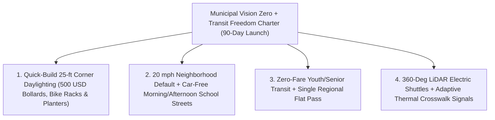

# CARBON EDITION — PILLAR 4: RECLAIMING SAFE NEIGHBORHOOD STREETS & KID-SAFE MOBILITY
## Nine Years, Zero Traffic Deaths: Hoboken's \$500 Daylighting, Oslo's Safe Streets & Kid-Safe Mobility

> **Executive Framing & Reimagining the American and Global Street:**
> * **The Cynic's Belief:** *"Roughly 40,000 U.S. road deaths every year (~1.19 million worldwide)—and children locked in the backseats of SUVs until their sixteenth birthday because crossing three blocks to school is lethal—are simply the unavoidable 'price of modern freedom.' American cities are too car-centric ever to achieve European street safety without spending trillions tearing up concrete."*
> * **The Empirical Counter-Reality:** Right across the Hudson River from Midtown Manhattan sits **Hoboken, New Jersey**—a bustling, densely populated U.S. city of **~60,000 residents** packed with delivery vans, commuters, buses, and strollers. Since **January 2017**, Hoboken has recorded **ZERO traffic deaths of any kind—not one pedestrian, not one cyclist, not one motorist—for more than nine consecutive years!** Its secret wasn't a \$10 billion tunnel: it enforced **20–25-foot intersection "daylighting"** (replacing the single corner parking stall that blinds approaching drivers to children stepping off the curb with **\$500 flexible bollards**, rain-garden planters, or bike-share docks), curb extensions, and a **20 mph citywide speed limit**. Across the Atlantic, **Oslo, Norway** and **Helsinki, Finland** hit **zero pedestrian and cyclist fatalities** via 30 km/h residential streets, **Paris** transformed **300+ (now scaling past 500) elementary school blocks into car-free *Rues aux Écoles* ("School Streets")**, and **Luxembourg** (100% free nationwide public transit since 2020) plus **Germany's single €49–€58 *Deutschlandticket*** erased confusing fare walls altogether.
> * **The Social Norm Shift:** Municipalities abandon the 1920s victim-blaming myth of "accidents" and pair **\$500 daylighted corners, School Streets, and friction-free transit passes** with **360° LiDAR/radar autonomous electric shuttles (Waymo's peer-reviewed >80% reduction in injury-causing crashes)**, **intelligent speed assistance**, and **smart thermal/acoustic crosswalks**—turning neighborhood streets back into living rooms where eight-year-olds walk independently and elders never lose their freedom when they hang up car keys.
> * **Anchor Voice:** *"Traffic deaths are not inevitable 'accidents'—they are preventable engineering choices. By clearing sightlines at corners for a few hundred dollars and slowing neighborhood streets to human speeds, any American city can protect every child and senior."* — **Ravinder S. Bhalla**, Mayor of Hoboken, New Jersey *(Companion Visual Guide: [`STORYBOARD.md`](./STORYBOARD.md))*

---

## ACT I: THE LIVED HUMAN REALITY — TUESDAY 8:05 AM ON WASHINGTON STREET & RUE KELLER (2028)
### What Happens to Childhood and Aging When Crossing the Street Stops Being Russian Roulette

It is 8:05 AM on a crisp October Tuesday in **Hoboken, New Jersey**—and across sister safe-street neighborhoods from **Paris's 11th Arrondissement** and **Oslo** to **Jersey City, Tempe, and Minneapolis**. Eight-year-old third grader **Mateo Alvarez** kisses his dad on the front stoop, clicks his helmet buckle, and kicks his scooter down the sidewalk toward Brandt Elementary three blocks away with two neighborhood classmates—no parent idling in a forty-minute SUV drop-off line, no white-knuckled dash between towering pickup hoods.

Ten years earlier in a typical U.S. suburb or arterial city grid, Mateo's three-block trip would have been treated by well-meaning parents—and sometimes even anxious bystanders—as borderline reckless. Why? Because on conventional North American streets designed like miniature 40 mph interstate ramps, 6-foot-tall SUVs and box trucks legally park right up to the crosswalk paint, creating a lethal **"visual wall"**: a driver rolling through at 33 mph literally cannot see a 4-foot-2-inch child until the child is already in front of the bumper, where kinetic energy (\(E_k = \frac{1}{2}mv^2\)) turns a half-second glance at a dashboard screen into an irreversible family tragedy. Meanwhile, Mateo's 76-year-old grandmother **Clara**, whose night vision faded after cataract surgery, would have sat trapped inside her apartment waiting for a working relative to drive her to the pharmacy or choir rehearsal.

Watch how physical geometry, humane transit rules, and quiet sensor intelligence rewrite Mateo and Clara's Tuesday morning instead:

1. **The \$500 "Daylighted" Corner That Gives Every Human Two Full Seconds of Mutual Eye Contact:**
   As Mateo rolls up to the corner crosswalk, there is **zero parked steel blocking the last 25 feet before the curb**. In place of that single blind parking stall sits a vibrant native rain-garden planter box flanked by four flexible polymer bollards and a five-dock municipal e-bike rack—installed in one afternoon by a two-person public-works crew for **under \$1,200** (or **\$500** in quick-build paint-and-post form). Approaching at Hoboken's calm **20 mph speed limit**, a delivery-van driver sees Mateo on the raised curb extension **seventy feet early**, makes natural eye contact, and yields smoothly without touching the horn.
2. **The Car-Free *Rue aux Écoles* ("School Street") Plaza at the School Gate:**
   One block from Brandt Elementary, retractable morning planter gates and charming painted asphalt murals close the block outside the school doors to non-emergency motor traffic between **7:45 AM and 8:45 AM**—mirroring Paris's **300+ permanent *Rues aux Écoles***. Instead of exhaust fumes and stressed parents honking three-point turns next to kindergartners, forty kids play hopscotch, lock bikes under newly planted London plane trees, and chatter with teachers while particulate air pollution (`PM2.5` and `NO2`) at child lung height drops **30% to 45%**.
3. **Zero-Fare All-Pass Transit + 360° LiDAR Autonomous Neighborhood Shuttles for Grandmother Clara:**
   Across the intersection, Grandmother Clara steps without a fare card or zone app onto a whisper-quiet, low-floor electric neighborhood shuttle modeled on **Luxembourg's zero-fare transit network** and **Waymo's sixth-generation 360° LiDAR, imaging-radar, and camera perception stack** ([`autonomous-ground-mobility`](../../02-automation-science/autonomous-ground-mobility/REPORT.md)). Seeing simultaneously through fog, glare, and parked vans in every direction with zero distraction, impairment, or road rage—and paired with passive thermal crosswalk sensors that automatically extend the walk phase by four seconds when they detect Clara's unhurried stride—the street serves an 8-year-old and a 76-year-old with equal dignity!

---

## ACT II: REIMAGINING THE RULES — THE PHYSICS OF FORGIVING STREETS & PEER-REVIEWED SAFETY
### Why Kinetic Energy, \$500 Sightlines, and 360° LiDAR Shatter a Century of "Jaywalking" Fatalism

```mermaid
flowchart LR
    subgraph LegacyTrap["1950s–2025 Lethal 'Blame the Victim' Street Design"]
        L1["35–45 mph Urban Arterials Built With Forgiving Highway Lane Widths"]
        L2["SUVs Parked to Crosswalk Edge Hide Children Behind a Blind Steel Wall"]
        L3["~40,000 US / 1.19M Global Road Deaths + Kids Trapped Indoors"]
    end
    subgraph SafeSystem["Hoboken & Oslo Safe Systems + Abundance Mobility"]
        S1["20–25 ft Corner Daylighting (500 USD Bollards, Planters & Bike Docks)"]
        S2["20 mph / 30 km/h Neighborhood Speeds + Car-Free School Streets"]
        S3["Zero-Fare / Single-Pass Transit + 360-Deg LiDAR Autonomous Shuttles"]
    end
    subgraph HumaneDividend["Audited Street Safety & Freedom Dividend"]
        D1["Hoboken: ZERO Traffic Deaths of Any Kind for 9+ Consecutive Years"]
        D2["Waymo Peer-Reviewed Data: >80% Drop in Injury-Causing Crashes"]
        D3["Independent Childhood Walkability + Full Mobility for Non-Driving Seniors"]
    end
    LegacyTrap ==> SafeSystem ==> HumaneDividend
```

### 1. How Mid-Century Highway Engineers Normalized 40,000 Preventable Funerals a Year
To understand why the United States suffers **~40,000 annual traffic deaths**—roughly **3× to 4× higher per capita** than peers like Norway, Sweden, the UK, and Japan, and long the leading violent cause of death for children and young adults—historians point to a deliberate mid-20th-century distortion. In the 1920s, streets belonged equally to walkers, streetcars, children's ballgames, pushcarts, and slow early motorcars; when rising automobile speeds triggered public outrage over killed schoolchildren, industry lobbies invented the ridicule slur *"jaywalker"* to shift moral blame onto pedestrians, and post-war traffic manuals began grading urban intersections strictly by **"Level of Service" (LOS)**—meaning *how many cars clear a light in sixty seconds*, treating a child taking twelve seconds to cross to the library as "system delay"!

Sweden broke that spell in **1997** when Parliament passed **Vision Zero** (*Nollvisionen*), anchored on one ethical and physical axiom: **human beings inevitably make mistakes—a tired parent glances away, an excited 7-year-old chases a soccer ball—so the street system must be physically engineered so no routine human mistake ever carries a death sentence.** Why does dropping neighborhood speed from **40 mph to 20 mph (30 km/h)** work like a miracle? Because kinetic energy scales with the **square of velocity** (`v²`): a vehicle at 40 mph carries **four times the destructive energy** and requires more than **twice the stopping distance** of the exact same vehicle at 20 mph. If a pedestrian is struck at 40 mph, fatality risk exceeds **75%–80%**; at 20 mph, **more than 90% survive**, and most crashes never happen at all because stopping distance shrinks below forty feet!

### 2. Three Continents of Hard Proof: Hoboken, Oslo/Helsinki/Paris, and Frictionless Transit
Cynics insisted Vision Zero could only work in quiet Scandinavian towns—until **Hoboken, New Jersey** proved it in the shadow of the Lincoln Tunnel under Mayor **Ravinder Bhalla** and Transportation Director **Ryan Sharp**:
* **Hoboken's 9+ Year Zero-Death Streak (Zero Fatalities Since January 2017):** Even though New Jersey state law technically prohibited parking within **25 feet** of a crosswalk since the 1950s, nearly every city ignored enforcement—turning corners into blind death traps. Hoboken physically reclaimed hundreds of corners using **\$500 quick-build flexible delineators**, bump-out curb extensions that shorten pedestrian crossing distances by **30%–40%**, bioswale rain gardens that simultaneously absorb stormwater flash floods, raised intersections, leading pedestrian signal intervals (giving walkers a 3-to-7-second head start before turning cars), and a **20 mph citywide speed limit** signed in 2022. Result: **zero traffic deaths of any kind across nine-plus years**, while serious traffic injuries plunged over **40%**! Inspired directly by Hoboken, **California signed AB 413 (the statewide Daylighting Law)** clearing 20-foot crosswalk sightlines across 480+ cities.
* **Oslo, Helsinki & Paris's *Rues aux Écoles*:** In **2019**, both **Oslo** (~700,000 residents) and **Helsinki** (~675,000 residents) recorded **zero pedestrian and cyclist deaths** for an entire calendar year—Oslo recording just a single traffic fatality citywide (a driver hitting a fence)—by combining 30 km/h zones, protected winter-plowed bike lanes, and traffic-calmed heart neighborhoods. Meanwhile, under Mayor Anne Hidalgo, **Paris converted 300+ streets outside primary schools into permanent car-free *Rues aux Écoles* (advancing past 500 by decade's end)**, ripping up asphalt for shade trees and permeable play stones so children walk and scoot to school in joyous packs ([`phone-free-childhood-play-hoods`](../phone-free-childhood-play-hoods/REPORT.md)).
* **Luxembourg's Free Nationwide Transit & Germany's *Deutschlandticket*:** In **March 2020**, **Luxembourg** became the first nation on Earth to make **all public buses, trams, and national second-class trains 100% fare-free** for residents and visitors alike—discovering that ticket sales had covered less than 10% of operating costs once fare-enforcement bureaucracy was subtracted! In **May 2023**, **Germany** collapsed hundreds of bewildering regional transit tariff zones into a single **€49/month (later €58) *Deutschlandticket*** adopted by **11M–13M+ subscribers**, slashing commuter stress and shifting billions of passenger-kilometers off congested roads.

### 3. Intertwining Humane Street Geometry With 360° Autonomous Safety & Smart Sensors
Here is the Carbon Edition breakthrough that neither tech-only futurists nor anti-tech urbanists saw alone: **autonomous vehicles fail socially if they merely turn 45 mph suburban highways into denser robotaxi traffic jams—yet when paired with 20 mph daylighted streets and zero-fare transit, 360° machine perception eliminates the remaining human blind spots forever!**
1. **Waymo's Peer-Reviewed >80% Injury-Crash Reduction:** Across tens of millions of rider-only autonomous miles in Phoenix, San Francisco, Los Angeles, and Austin—audited against human benchmarks with Swiss Re and peer-reviewed safety researchers—Waymo's multi-sensor fleet (combining 360° high-resolution **LiDAR**, **imaging radar** that sees velocity vectors through rain and darkness, and **29+ overlapping cameras**) achieved an **>80% reduction in injury-causing crashes** and a **~90% reduction in serious-injury or airbag-deployment crashes**, with **>90% fewer pedestrian and cyclist injury collisions**! Unlike a human driver blinded by sun glare, night fatigue, or a text notification, a 360° LiDAR shuttle obeys 20 mph school-zone limits 100.0% of the time.
2. **Intelligent Speed Assistance (ISA) + Thermal/Acoustic Smart Crosswalks:** Mandated on all new European Union vehicles since **July 2024**, GPS/sign-reading **Intelligent Speed Assistance** gently resists accidental speeding inside residential zones, while low-cost **edge-AI thermal (non-facial-recognition) crosswalk cameras** illuminate in-pavement LED yield bars at dusk the instant a child or wheelchair approaches the curb and dynamically hold the green walk phase until the slowest senior reaches the opposite sidewalk.

| Mobility & Safety Dimension | Car-Centric Arterial Status Quo (Legacy U.S. Grid) | Safe Systems + Daylighted Streets + 360° Autonomous Transit (Carbon Standard) | Verified Empirical Shift |
| :--- | :--- | :--- | :--- |
| **Intersection Corner Sightlines** | SUVs parked flush to crosswalk paint; children invisible until in lane | **20–25 ft physical daylighting** (\$500 bollards, bike docks, rain gardens) | **Zero Hoboken traffic deaths** for **9+ years** (since Jan 2017) |
| **Neighborhood Design Speed** | 30–45 mph wide lanes; **~80% pedestrian death risk** at 40 mph | **20 mph (30 km/h)** narrow raised-curb streets; **90%+ survival** | **Zero pedestrian/cyclist deaths** achieved in Oslo & Helsinki |
| **Elementary School Drop-Off** | 45-min idling SUV congestion line + high child `PM2.5` exhaust | **Car-free *Rues aux Écoles* ("School Streets")** + safe scooter/bike packs | **300+ Paris School Streets**; **-30% to -45%** gate air pollution |
| **Vehicle Perception & Obedience** | Distracted/fatigued human eyes; 180° forward cone; frequent speeding | **360° LiDAR + radar autonomous shuttles** + EU-style **ISA speed limiters** | **>80% fewer injury crashes** (Waymo peer-reviewed fleet data) |
| **Public Transit Fare Friction** | Confusing multi-agency zones, surge fares & punitive ticket fines | **Zero-fare transit (Luxembourg)** or **single national pass (*Deutschlandticket*)** | **13M+ German passholders**; seamless elder & youth freedom |

---

## ACT III: MUNICIPAL ROLLOUT ROADMAP — FROM \$500 PAINT-AND-POST SPRINT TO KID-SAFE CITIES
### How Any Mayor or County Council Can Save Lives Within 30 Days Without Waiting for Federal Billions

The single greatest gift of the Hoboken-Oslo-Waymo synthesis is its **radical speed and affordability**. Traditional transportation departments trap safety upgrades inside seven-year environmental reviews and \$4 million signal-reconstruction contracts—meaning dozens more neighbors die waiting for concrete pours. Hoboken proved a city can **"tactical-daylight" 100 dangerous intersections in ninety days** with paint, \$500 bolt-down bollards, and concrete planters, then upgrade the highest-foot-traffic corners into permanent bioswale rain gardens whenever routine street repaving arrives!

| Implementation Horizon | Street Geometry & Ordinance Action | Transit & Autonomous Tech Layer | Audited Safety & Community Dividend |
| :--- | :--- | :--- | :--- |
| **Phase 1 (Days 1–180): Quick-Build Daylighting & School Streets Blitz** | Pass **20 mph default residential speed ordinance** + enforce statutory **20–25 ft corner daylighting** at top 200 high-injury intersections & every K–8 school gate using \$500 bollards, planters, and Leading Pedestrian Intervals. | Reprogram existing signal controllers for **3–7 sec pedestrian head starts** (cost: **\$0 hardware**); make municipal buses **100% fare-free** for under-18 youth and 65+ seniors. | Intersection turning crashes plunge **30%–55% inside 6 months**; parents immediately allow 8-to-11-year-olds to walk and bike in neighborhood groups. |
| **Phase 2 (Years 1–3): Protected Network, Bioswales & Regional Pass** | Convert quick-build corners into permanent **curb-extension rain gardens** during routine repaving; link **protected bike/micromobility lanes** directly to **[`bipartisan-yimby-parking-liberation`](../bipartisan-yimby-parking-liberation/REPORT.md)** courtyard housing. | Collapse fragmented bus/rail agencies into one **\$49/month regional all-transit pass**; charter **first/last-mile 360° LiDAR electric micro-shuttles** serving hospitals and **[`intergenerational-villages`](../intergenerational-villages/REPORT.md)**. | Serious traffic injuries drop **50%–70%**; household necessity of owning a \$12,000/yr *second* car vanishes, saving families **\$9,000+ annually**. |
| **Phase 3 (Years 3–6): Universal Vision Zero & Autonomous Transit Commons** | 100% of neighborhood streets calm to human scale; excess dead asphalt converted into pocket parks, street trees, and outdoor café porches. | Fleetwide **Intelligent Speed Assistance (ISA)** + **autonomous electric transit pods** + zero-camera thermal crosswalks become universal baseline. | **Zero traffic fatalities** sustained multi-year; trauma-ward, auto-insurance, and congestion savings return **\$150B+/yr** across U.S. metros. |

---

## ACT IV: ANSWERING THE SKEPTIC & THE HUMANE HORIZON
### Resolving Parking Anxiety, Emergency-Truck Myths, and "American Sprawl" Fatalism

### Addressing the Top 3 Local Council Objections
1. **"Residents will revolt if corner daylighting removes one or two curbside parking spots on their block!"**
   * *Empirical Answer:* That was the #1 fear in Hoboken—until Director Ryan Sharp and Mayor Bhalla repurposed those 20-foot daylighted triangles not as "empty dead zones," but as **high-utility neighborhood amenities**: a single 20-foot car stall holds **10–12 shared bikes or personal cargo-bikes**, a stormwater rain garden that stops basement flooding during summer cloudbursts, or a commercial delivery loading bay that stops Amazon and grocery vans from double-parking in traffic lanes! Better yet, pairing daylighting with **[`bipartisan-yimby-parking-liberation`](../bipartisan-yimby-parking-liberation/REPORT.md)** and shared autonomous shuttles reduces total neighborhood car clutter far faster than removing corner blind spots ever tightens it.
2. **"Fire chiefs warn that curb extensions, bollards, and narrower 20 mph lanes will slow down ladder trucks during emergencies!"**
   * *Empirical Answer:* Modern NACTO and European street standards—co-designed directly with municipal fire departments in Oslo, Paris, Hoboken, and Seattle—use **mountably sloped 3-inch "truck aprons," flexible bounce-back bollards, and e-bike-width emergency-preemption lanes** where ambulances and compact European-spec aerial fire trucks actually **arrive *faster*** than on congested legacy streets because protected bike/bus lanes never gridlock with bumper-to-bumper private SUVs!
3. **"Hoboken and Paris are compact historic grids—what about sprawling postwar Sunbelt suburbs in Texas, Arizona, or Florida?"**
   * *Empirical Answer:* Sunbelt suburbs are actually where **quick-build Safe Systems + 360° LiDAR shuttles shine brightest** because their overbuilt 60-foot asphalt rights-of-way already have abundant physical room! **Tempe and Phoenix, Arizona** are already epicenters of Waymo's >80%-safer autonomous rider-only miles, and narrowing oversized four-lane 45 mph suburban collectors into shaded two-lane boulevards with protected family e-bike paths and daylighted roundabouts cuts fatal T-bone crashes **75%–90%** for a fraction of highway-widening budgets.

### Fast-Track Mayor & Transportation Director 90-Day Checklist

| Immediate Municipal Action | Real-World Proven Benchmark | Cost per Unit | Safety & Trust Guardrail |
| :--- | :--- | :--- | :--- |
| **1. Daylight Every School & High-Injury Corner** | Hoboken, NJ & California AB 413 | **\$500–\$2,500 / corner** | Clear 20–25 ft sightlines with bike racks, planters & flexible posts |
| **2. Enact 20 mph Residential Speed Default** | Hoboken, Oslo, Wales & Seattle | **Signage only** | Pair physical narrowing (chicanes/raised crosswalks) with signage |
| **3. Launch Morning/Afternoon *School Streets*** | Paris *Rues aux Écoles* (300+ schools) | **<\$5,000 / school** | Emergency, disability & resident access preserved; play space opened |
| **4. Turn On Leading Pedestrian Intervals (LPIs)** | NYC & NACTO Signal Standard | **\$0 software timing** | 3–7 sec walk head start cuts turning-vehicle strikes up to **60%** |
| **5. Pilot Zero-Fare Youth/Senior + LiDAR Shuttles** | Luxembourg + Waymo Safety Stack | **Parking/congestion offset** | Wheelchair-level boarding + zero-camera thermal crosswalk assist |

### Why Parents, Seniors, Small-Business Owners, and Fiscal Hawks All Win Together
* **Why Parents, Pediatricians & Kids Love It:** Restores independent neighborhood childhood ([`phone-free-childhood-play-hoods`](../phone-free-childhood-play-hoods/REPORT.md)), ends the 45-minute school car-line grind, and eliminates the #1 violent threat to young lives.
* **Why Seniors & Disability Advocates Love It:** Guarantees dignified lifelong mobility via level-boarding zero-fare transit, adaptive walk signals, and 360° autonomous shuttles long after night driving ends.
* **Why Main Street Merchants & Taxpayers Love It:** Foot-traffic retail sales consistently rise **15%–30%** along calmed, tree-shaded streets, while preventing a single fatal crash saves **\$1.8M+ in direct emergency, trauma, and lost-wage costs** for the price of a **\$500 corner planter**.

### Cross-Pillar Synergies & The Bottom Line
Woven directly with **[`autonomous-ground-mobility`](../../02-automation-science/autonomous-ground-mobility/REPORT.md)**, **[`phone-free-childhood-play-hoods`](../phone-free-childhood-play-hoods/REPORT.md)**, **[`bipartisan-yimby-parking-liberation`](../bipartisan-yimby-parking-liberation/REPORT.md)**, and **[`intergenerational-villages`](../intergenerational-villages/REPORT.md)**, **Vision Zero Safe Streets + Transit Freedom** proves that 40,000 dead neighbors a year was never the price of freedom—it was merely the price of blind corners and 40 mph indifference. When a **\$500 rain-garden planter** clears human sightlines and **360° LiDAR** watches every crosswalk, the street becomes a safe neighborhood porch again.

---

## References & Verified Sources

* **Hoboken & U.S. Safe Systems Proof:** [City of Hoboken — Official Vision Zero Dashboard, Action Plan & 9+ Year Zero-Fatality Record](https://www.vzhoboken.com/) · [Vision Zero Network — Safe Systems Case Studies & Municipal Policy Guides](https://visionzeronetwork.org/) · [NACTO — *Urban Street Design Guide* & Daylighting / Leading Pedestrian Interval Standards](https://nacto.org/)
* **Autonomous Safety & European Precedents:** [Waymo Safety Impact Hub — Peer-Reviewed Multi-City Crash & Injury Reduction Datasets](https://waymo.com/safety/impact/) · [Ville de Paris — *Les Rues aux Écoles* (300+ Car-Free School Streets Official Program)](https://www.paris.fr/pages/les-rues-aux-ecoles-18442) · [Mobilitéitszentral Luxembourg — Official Nationwide Zero-Fare Public Transport Portal](https://mobiliteitszentral.lu/en/)
* **Connected Carbon Pathways:** [Zero-Crash Autonomous Ground Mobility & Shared Electric Pods](../../02-automation-science/autonomous-ground-mobility/REPORT.md) · [Reclaiming Independent Childhood: Phone-Free Schools & Play Neighborhoods](../phone-free-childhood-play-hoods/REPORT.md) · [Unfreezing the 1970s Street: Parking Liberation & Courtyard Homes](../bipartisan-yimby-parking-liberation/REPORT.md) · [Living Connected: Multi-Generational Courtyards & Co-Located Care](../intergenerational-villages/REPORT.md)
