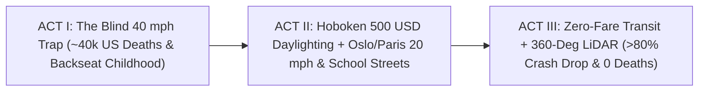

# STORYBOARD & CREATIVE PRODUCTION GUIDE: VISION ZERO STREETS & TRANSIT FREEDOM ([`vision-zero-streets-transit-freedom`](./REPORT.md))
## *"Nine Years, Zero Funerals — How Hoboken's \$500 Daylighted Corners, Paris's School Streets & 360° LiDAR Give Streets Back to Kids and Elders"*

> **Production Purpose:** This cinematic, visceral visual storyboard equips documentary directors, mayors, parent coalitions, and transit engineers to dismantle fatalism around **~40,000 U.S. (~1.19M global) annual road deaths**—showing at child-eye level how **Hoboken, New Jersey** achieved **9+ consecutive years with ZERO traffic fatalities** using **\$500 intersection daylighting** and **20 mph limits**, paired with **Oslo/Paris safe streets**, **Luxembourg zero-fare transit**, and **Waymo's >80%-safer 360° LiDAR perception**.

---

## PART 1: THREE ALTERNATIVE NARRATIVE OPENINGS (DIRECTOR'S OPTIONS)

### Option A: "4-Foot-2 Child Eye-Level Behind a Parked Pickup Hood" *(Visceral Geometry Reveal)*
* **Visual Hook:** Camera rigged at **48 inches off the pavement**—the exact eye height of an 8-year-old third grader (**Mateo**) standing at a conventional suburban crosswalk behind a legally parked 6-foot-tall pickup truck. Left screen (`Blind Corner`): Approaching driver's dashcam at 35 mph shows **zero child** until 0.4 seconds before impact; freeze-frame before tragedy. Right screen (`Hoboken \$500 Daylighted Corner`): The single corner parking stall dissolves into a native rain-garden planter and 10-bike rack; driver at **20 mph** sees Mateo **70 feet early**, waves warmly, and stops smoothly.
* **Voiceover Core:** *"For seventy years, whenever a car struck a child at a corner, newspapers called it a tragic 'accident.' Then a dense city across the river from Manhattan removed one parked car per corner for five hundred dollars—and hasn't lost a single human life in over nine years."*
* **Best For:** Mainstream parent audiences, municipal council hearings, and viral civic campaigns.

### Option B: "Paris 8:15 AM — From Exhaust Gridlock to 300 Hopscotch Plazas" *(Joyful Urban Transformation)*
* **Visual Hook:** Archival 2018 clip outside a Paris primary school: honking bumpers, stressed parents yelling through rolled-down windows, smoke curling at stroller height. Whip-pan match-cut to the exact same gate today as a **Paris *Rue aux Écoles* ("School Street")**: shade trees, chalk hopscotch squares, and forty 7-year-olds rolling in together on scooters and bikes while birdsong replaces horns.
* **Voiceover Core:** *"Children didn't stop playing outside because they fell in love with screens—we locked them indoors when we turned neighborhood streets into forty-mile-per-hour highways. Open the school block, and childhood floods back overnight."*
* **Best For:** Education reformers, pediatric health summits, and **[`phone-free-childhood-play-hoods`](../phone-free-childhood-play-hoods/REPORT.md)** audiences.

### Option C: "Grandmother Clara's Keys vs. 360° LiDAR + Zero-Fare Freedom" *(Intergenerational Dignity Hook)*
* **Visual Hook:** Close-up on 76-year-old **Clara** placing her old car keys into a kitchen drawer—not in tears of isolation, but smiling as she steps onto a zero-fare **Luxembourg-style** electric neighborhood shuttle wrapped in **360° spinning LiDAR point-cloud vision** that sees simultaneously through rain, night glare, and parked vans.
* **Voiceover Core:** *"In a car-dependent town, losing your eyesight at seventy-five feels like house arrest. Pair zero-fare transit with autonomous shuttles that cut injury crashes over eighty percent, and growing older means gaining a chauffeur, never losing your life."*
* **Best For:** Aging-in-place advocates, autonomous-mobility engineers, and transit equity coalitions.

---

## PART 2: VISUAL ARC DIAGRAM & MODULAR 3-ACT STORYBOARD TABLE (12 SCENES)

| Act / Beat | Visual & Camera Concept | Data & Metric Callout Overlay | Sample Narration / Voiceover Script |
| :--- | :--- | :--- | :--- |
| **ACT I — Beat 1:** The 45-Minute SUV Car Line | Drone shot over an American elementary school at 8:00 AM: 140 idling SUVs snaked half a mile because parents are terrified to let kids cross two 40 mph roads. | `~40,000 US / 1.19M Global Road Deaths Yearly \| <11% Kids Walk to School` | "Every morning, millions of parents sit in forty-minute drop-off lines—because crossing three blocks to school feels like crossing a racetrack." |
| **ACT I — Beat 2:** The Physics of Velocity Squared | Slow-motion test-track graphic comparing stopping cones and kinetic energy (\(E_k = \frac{1}{2}mv^2\)) of identical sedans at **40 mph** vs **20 mph**. | `40 mph = 4x Kinetic Energy (~80% Death Risk) \| 20 mph = 90%+ Survival` | "Double a car's speed from twenty to forty, and you don't double destructive force—physics quadruples it, turning tiny human mistakes into funerals." |
| **ACT I — Beat 3:** Across the Hudson to Hoboken | Helicopter shot sweeping west from Midtown Manhattan skyscrapers over the Hudson River directly onto compact, bustling **Hoboken, New Jersey**. | `Hoboken, NJ (~60,000 Residents): 0 Traffic Deaths Since January 2017` | "Cynics swore dense American cities could never match Scandinavian street safety. They forgot to look one mile across the Hudson River." |
| **ACT II — Beat 4:** The \$500 Daylighting Crew | Two Hoboken public-works crew members bolt flexible bollards and set a native bioswale planter into the 25-foot corner zone in forty minutes flat. | `20–25 ft Corner Daylighting \| Quick-Build Cost: \$500–\$2,500 / Corner` | "Hoboken's secret weapon wasn't a billion-dollar tunnel—it was clearing the twenty-five-foot blind parking spot at corners for five hundred dollars." |
| **ACT II — Beat 5:** Rain Gardens + 10 Bikes per Car | Overhead top-down shot: one 20-foot car stall transforms into 12 locked family bikes and a lush rain garden soaking up a summer downpour. | `1 Car Space = 10–12 Bikes + Flood-Absorbing Bioswale + Clear Sightlines` | "Instead of empty asphalt, that cleared corner parks twelve bikes, stops basement flash floods, and gives drivers and kids two seconds of eye contact." |
| **ACT II — Beat 6:** Oslo & Helsinki Hit Zero | Crisp Nordic winter montage: families biking on heated/plowed protected lanes in **Oslo** and **Helsinki** beside 30 km/h streets. | `Oslo & Helsinki Benchmark: 0 Pedestrian & Cyclist Fatalities` | "Across the ocean, Oslo and Helsinki proved the exact same physics even in snow—recording zero pedestrian and cyclist deaths across whole cities." |
| **ACT II — Beat 7:** Paris's 300+ *Rues aux Écoles* | Joyous morning sequence on Rue Keller, Paris: planter barrier swings shut at 8:00 AM; Mateo's peers scoot and play under newly planted trees. | `Paris Rues aux Écoles: 300+ Car-Free School Streets \| -30%–45% Gate NO2` | "Paris closed over three hundred elementary school streets to through-traffic, cutting lung-height exhaust nearly in half and unleashing scooter packs." |
| **ACT II — Beat 8:** Luxembourg & *Deutschlandticket* | Seamless travel montage: teens and seniors step onto gleaming **Luxembourg** trams with zero fare gates and flash Germany's single **€58 *Deutschlandticket***. | `Luxembourg: 100% Free Nationwide Transit \| Germany: 13M+ Flat-Pass Riders` | "Meanwhile, Luxembourg erased transit fares nationwide and Germany replaced hundreds of confusing fare zones with one simple monthly ticket." |
| **ACT III — Beat 9:** Inside 360° LiDAR Vision | Split-screen night rainstorm: left shows human windshield glare; right shows **Waymo's 360° LiDAR + imaging radar** painting a cyclist in crystal 3D 150 meters away. | `Waymo Peer-Reviewed Data: >80% Fewer Injury Crashes vs Human Drivers` | "Now add machine perception that never texts, drinks, speeds, or loses sight in night rain—cutting injury-causing crashes by more than eighty percent." |
| **ACT III — Beat 10:** Thermal Smart Crosswalk for Clara | Grandmother Clara steps toward a dusk crosswalk; edge-AI thermal sensor lights amber curb LEDs and adds 4 gentle seconds to her walk countdown. | `Zero-Camera Thermal Crosswalk + Leading Pedestrian Interval (-60% Strikes)` | "Adaptive thermal sensors give elders four unhurried extra seconds to cross—with zero facial-recognition surveillance." |
| **ACT III — Beat 11:** Fire-Truck Apron Proof | Compact aerial fire truck glides effortlessly down a protected mobility lane past calm traffic and rolls smoothly over a 3-inch mountable corner apron. | `NACTO Emergency Co-Design: Faster Response Without Congested Gridlock` | "Co-designed mountable curb aprons and clear mobility lanes actually get paramedics and fire crews to emergencies faster than gridlocked four-lane roads." |
| **ACT III — Beat 12:** Closing Bookend — Mateo & Clara Wave | Golden 8:15 AM sunlight: Mateo rolls safely into his School Street gate and waves across the daylighted rain-garden corner to Clara aboard her electric shuttle. | `\$500 Sightlines + 20 mph + 360° LiDAR = Zero Preventable Funerals` | "Forty thousand funerals a year was never the price of freedom. Clear the corner, calm the speed, and give the neighborhood street back to life." |

---

## PART 3: VISUAL METAPHOR BANK

### 1. "Daylight Flooding the Blind Corner"
* **Visual Concept:** A dark grey shadow cast across a crosswalk by a parked SUV literally peels away into golden morning sunlight the instant a \$500 planter box replaces the bumper—visualizing why urbanists call it *"daylighting."*
* **Camera / Animation Cue:** Child-eye-level 48-inch lens push-in as natural warm sunlight opens 70 feet of sightline.
* **Emotional Takeaway:** Makes the life-saving geometry of Hoboken's 9+ year zero-death streak instantly unforgettable.

### 2. "Four Stacked Crushing Weights (`v²`)"
* **Visual Concept:** Dropping four kinetic blocks onto a 40 mph hood versus one feather-light stop at 20 mph illustrates quadratic speed physics (\(E_k = \frac{1}{2}mv^2\)) in three seconds.
* **Camera / Animation Cue:** Slow-motion tactile split-screen with synchronized stopping-distance cones.
* **Emotional Takeaway:** Explains without lecturing why 20 mph / 30 km/h neighborhood streets forgive human mistakes.

### 3. "The Protective 360° Halo"
* **Visual Concept:** Soft cyan LiDAR and radar waves wrapping gently around cyclists, strollers, and wheelchairs in dark rain without ever storing a human face.
* **Camera / Animation Cue:** Seamless transition from glare-blinded human windshield to crystal 3D autonomous point cloud.
* **Emotional Takeaway:** Shows how 360° machine perception protects human vulnerability rather than surveilling it.

---

## PART 4: SOUND DESIGN, COLOR ARC & INTERACTIVE STREET SIMULATOR

* **Color & Lighting Progression:**
  * *Act I (Arterial Trap):* Harsh brake-light reds, exhaust haze, glaring headlights on wet four-lane asphalt.
  * *Acts II–III (Hoboken, Paris & Autonomous Calm):* Rain-garden sage greens, warm Hudson brick, dappled London plane tree sunlight, soft amber dusk curb LEDs.
* **Casting & Documentary Voices:**
  * Feature Hoboken Mayor **Ravinder Bhalla** & Transportation Director **Ryan Sharp**, Paris *Rue aux Écoles* elementary parents, **Waymo** safety researchers, and non-driving seniors in Luxembourg and Tempe.
* **Musical & Foley Architecture:**
  * Shifts from diesel idle rumble, blaring horns, and anxious heartbeat pulse to children's laughter, scooter wheels on stone, quiet electric shuttle hum, and warm acoustic guitar with cello.
* **Interactive Documentary Companion ("Daylight Your Block in 60 Seconds"):**

| Neighborhood Street Layer | Legacy Arterial Baseline | + Hoboken \$500 Daylighting & 20 mph | + School Streets, Free Pass & 360° LiDAR |
| :--- | :--- | :--- | :--- |
| **Crosswalk Sightline & Speed** | 0 ft buffer \| 35–40 mph | **25 ft clear sightline** \| **20 mph** | **100% speed compliance** + adaptive walk timer |
| **Injury & Fatality Risk** | ~12.4 deaths / 100k (~80% lethal at 40 mph) | **0 Hoboken deaths (9+ yrs)** \| -40%+ serious injury | **>80% further crash drop** via 360° perception |
| **Family Cost & Kid Freedom** | Mandatory \$12k/yr 2nd car + 45-min car line | Independent K–8 walk/bike packs | **\$9,000+/yr household savings** + lifelong elder mobility |

* **Director's Closing Frame On-Screen Text:**
  > *"Nine years. Sixty thousand neighbors. Zero traffic deaths. Five hundred dollars of clear daylight at the corner changes who gets to grow up—and who gets to grow old in freedom."*
