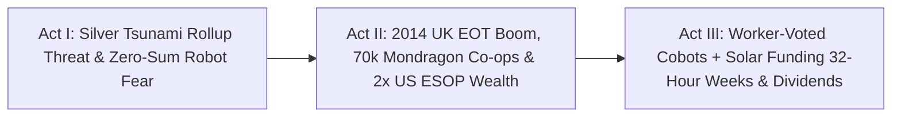

# STORYBOARD & CREATIVE PRODUCTION GUIDE: SILVER TSUNAMI TO WORKER WEALTH ([`worker-ownership-trusts-mondragon`](./REPORT.md))
## *"When the Machinists Own the Shop, a New Welding Cobot Doesn't Mean Pink Slips — It Means Friday Afternoon Off at Full Pay"*

> **Production Purpose:** This punchy, big-hearted 4:15 documentary storyboard flips the fearful narrative around AI, robotics, and retiring Baby Boomer small-business owners—showing viewers how **2,200–2,800+ UK Employee Ownership Trusts (~548,000 worker-owners)**, **Spain's 70,000-worker Mondragon Federation**, and **10.7 million U.S. ESOP employee-owners** turn automation and the "Silver Tsunami" into **>2× worker retirement wealth** and **4-day, 32-hour workweeks**.

---

## PART 1: THREE ALTERNATIVE NARRATIVE OPENINGS (DIRECTOR'S OPTIONS)

### Option A: "Why Forty-Eight Machinists Cheered When the Robot Rolled Off the Truck" *(Counter-Intuitive Hook)*
* **Visual Hook:** Loading bay of **Hallamshire Precision Tooling** in Sheffield, England. A flatbed forklift lowers two gleaming **vision-guided tending cobots** onto the shop floor. Instead of grim silence or union pickets, 48 machinists in steel-toe boots erupt in applause—cutting to CNC lead **Nadia Kowalski** flipping the shop wall calendar to **`NEW STANDARD: 4-DAY / 32-HOUR WEEK — 100% PAY + £4,200 DIVIDEND`**.
* **Voiceover Core:** *"Every headline says robots and workers are mortal enemies. Yet in this Sheffield machine shop, the machinists voted to buy two robots themselves—because they own a hundred percent of the company in trust, and the robots just gave everyone Friday off at full pay."*
* **Best For:** Mainstream audiences, future-of-work documentaries, and viral economic explainers.

### Option B: "Two Envelopes on a 67-Year-Old Founder's Desk" *(High-Stakes Human Drama)*
* **Visual Hook:** Quiet evening inside a 40-year-old Michigan HVAC and sheet-metal shop. Retiring founder **Gareth** stares at two offers on his scarred oak desk. Left: a glossy **Private-Equity Rollup** binder promising fast cash via heavy junk debt and "30% headcount rationalization." Right: a **Turnkey Employee Ownership Trust** charter transferring 100% of shares to his veteran crew using future shop profits, tax-free founder relief, and **\$0 worker home mortgages**.
* **Voiceover Core:** *"Nearly three million Baby Boomer business owners are retiring right now. Whether they hand the keys to distant debt strippers or to the neighbors who built the company will decide the fate of Main Street."*
* **Best For:** Chambers of commerce, retiring business owners, state governors, and heartland broadcasts.

### Option C: "From Five Basque Engineers in 1956 to 70,000 Worker-Owners" *(Global Industrial Wonder)*
* **Visual Hook:** Sweeping drone shot over green Basque valleys in **Mondragon, Spain**, gliding past high-tech **Danobatgroup** robotics halls, solar microgrids, and **Mondragon University**—dissolving from a 1956 archival photo of five young engineers and a parish priest into 70,000 modern worker-owners voting one-person, one-vote.
* **Voiceover Core:** *"Think worker co-ops only work for tiny organic bakeries? Meet Mondragon: eighty high-tech Basque cooperatives, seventy thousand worker-owners, fourteen R&D labs, six-to-one pay solidarity, and near-zero recession layoffs."*
* **Best For:** Industrial-policy summits, engineering schools, and labor-economics audiences.

---

## PART 2: VISUAL NARRATIVE ARC & MODULAR 3-ACT STORYBOARD TABLE (12 SCENES)

| Act / Beat | Visual & Camera Concept | Data & Metric Callout Overlay | Sample Narration / Voiceover Script |
| :--- | :--- | :--- | :--- |
| **ACT I — Beat 1:** The Silver Tsunami Wave | Montage of "Established 1984" signs on Main Street machine shops, bakeries, plumbing fleets, and clinics as silver-haired founders lock up at dusk. | **Project Equity Audit:** Millions of Retiring Boomer Firms Risk Closure or Rollup | "Across America and Europe, millions of retiring Baby Boomer owners have no family heir—putting tens of millions of local jobs up for grabs." |
| **ACT I — Beat 2:** The Private-Equity Strip-Mine | Cold motion graphic: an absentee leveraged buyout loads a thriving 50-person shop with debt, hikes service prices, sells the land, and shutters the doors. | **Extractive Rollup Playbook:** High Debt Covenants + Asset Stripping + Local Layoffs | "When distant rollups buy Main Street firms on borrowed debt, communities lose their best employers within five years." |
| **ACT I — Beat 3:** Britain's 2014 Legal Spark | Crisp legislative graphic of the **UK Finance Act 2014** unlocking **Employee Ownership Trusts (EOTs)**—watching a curve rocket past **2,500+ British businesses**. | **UK EOA Verified Boom:** **2,200–2,800+ EOT Firms** \| **~548,000 Employee-Owners** | "In 2014, Britain passed a simple trust law letting founders sell to their workforce tax-advantaged—paid out of future profits with zero worker personal debt." |
| **ACT II — Beat 4:** Richer Sounds to Precision Shops | Joyful documentary clips from **Richer Sounds** store teams celebrating £1,000/yr-of-service buyout bonuses alongside **Arup** engineers and Sheffield toolmakers. | **UK EOT Track Record:** **+8%–12% Higher Productivity** \| **-73% Lower Staff Turnover** | "From Richer Sounds to eighteen thousand engineers at Arup, over half a million British workers now co-own their workplaces—and turnover plunged." |
| **ACT II — Beat 5:** Inside Mondragon's 80 Co-ops | Dynamic floor tour in **Mondragon, Basque Country**: worker-owners testing industrial lasers, voting at annual general assembly, and redeploying smoothly across co-ops. | **Mondragon Federation:** **~70,000 Worker-Owners** \| **80+ Co-ops** \| **~6:1 Pay Solidarity** | "In Spain's Basque Country, seventy thousand Mondragon worker-owners run eighty robotics and clean-tech co-ops—sharing downturns instead of firing neighbors." |
| **ACT II — Beat 6:** Rutgers & NCEO Open the U.S. Data | Side-by-side wealth bars from **Rutgers & NCEO** tracking **~10.7 million U.S. ESOP participants** across recessions: >2× retirement nest eggs and half the layoffs. | **Rutgers / NCEO Audits (~6,500 ESOPs):** **>2× Retirement Wealth** \| **<50% Layoff Rate** | "And across ten million American ESOP workers, Rutgers proved employee-owners build more than double the retirement wealth with less than half the layoffs." |
| **ACT II — Beat 7:** Gareth Hands Over the Keys | Emotional shop-floor ceremony: retiring founder Gareth signs the EOT deed beside Nadia and 48 cheering colleagues—staying on two mornings a week as mentor. | **Zero-Mortgage Seller Note + CDFI Tranche:** Fair Founder Payout, Forever Local Lock | "Gareth gets a fair, tax-relieved retirement payout, nobody mortgages their house, and a constitutional lock keeps the shop in Sheffield forever." |
| **ACT II — Beat 8:** The Cobot & Solar Vote | Around a lunchroom whiteboard, Nadia's elected worker council votes `YES (45–3)` to install two night-shift tending cobots, AI scheduling, and rooftop solar. | **220 kW Solar (-68% Power Bill)** + **2 Night-Shift Cobots (+24% Shop Margin)** | "Six months later, the workers vote to install rooftop solar, AI scheduling, and two night-shift cobots to take over dusty midnight pallet runs." |
| **ACT III — Beat 9:** Where the Margin Boost Goes | Animated pie split of the +24% automation surplus: 1/3 pays off Gareth's note 14 months early, 1/3 funds annual worker bonuses, 1/3 unlocks **32-hour full-pay weeks**. | **Automation Dividend:** **32-Hour / 4-Day Workweek at 100% Pay** + Tax-Free Bonuses | "Because workers own the trust, the cobots don't trigger pink slips—they pay off the buyout early, boost annual bonuses, and fund a four-day week at full pay." |
| **ACT III — Beat 10:** Bipartisan U.S. State Wave | Map lighting up **Colorado, California, Massachusetts, Washington**, and **WORK Act** hubs offering **50% conversion tax credits** and revolving loan guarantees. | **Bipartisan Main Street Shield:** CO, CA, MA, WA State Hubs + Federal WORK Act | "Now Republicans and Democrats from Colorado to Massachusetts are funding turnkey conversion credits and loan pools so any 25-person shop can follow." |
| **ACT III — Beat 11:** Regional Microfactory Guilds | Montage of 40 local worker-owned HVAC, timber, and CNC shops pooling health benefits, apprentice training, and R&D labs on the Mondragon federation blueprint. | **Inter-Trust Solidarity:** Shared R&D, Apprentice Guilds & Recession Safety Nets | "Linked into regional Mondragon-style guilds, small local shops gain big-company R&D muscle without surrendering an ounce of independence." |
| **ACT III — Beat 12:** Closing Bookend — Friday Kickoff | Bright Friday 2:00 PM sunshine: Nadia coaches her son's youth football team while, back at the sunlit solar-powered shop, the Thursday–Sunday crew runs smoothly. | **Own the Machines Together:** **2× Worker Wealth, Zero Rollups, Friday Afternoons Home** | "Workers never feared better tools—they feared losing their future. Let the people who build our towns own the machines, and everyone wins Friday back." |

---

## PART 3: VISUAL METAPHOR BANK & PRODUCTION DESIGN

* **1. "The Cobot Arm Handing Over the Friday House Key":**
  * *Visual:* Precision six-axis cobot finishes deburring a gleaming heat-pump valve at 5:00 PM Thursday, powers into calm night-tending mode, and match-cuts to Nadia hanging up her shop safety glasses beside a sunny Friday family picnic basket.
  * *Emotional Takeaway:* Viscerally reframes industrial robotics from job destroyer to working-class time liberator.
* **2. "The Constitutional Anchor vs. The Vulture Crane":**
  * *Visual:* Architectural miniature of a Main Street bakery and machine shop anchored deep into local bedrock by a golden `PERPETUAL EMPLOYEE OWNERSHIP TRUST` root system while a storm of leveraged-debt paper blows harmlessly past.
  * *Emotional Takeaway:* Makes the legal permanence of UK/Canadian-style EOT trusts tangible in seconds.
* **3. "The 6:1 Solidarity Ladder":**
  * *Visual:* Clean physical workshop step-stool in Mondragon showing six modest oak steps from apprentice machinist to cooperative general manager—contrasted against a 300-story skyscraper spire.
  * *Emotional Takeaway:* Shows how high-tech global competitiveness coexists with deep blue-collar fairness.

---

## PART 4: SOUND DESIGN, INTERACTIVE SUCCESSION CALCULATOR & VERIFIED CONTINUITY

* **Color & Acoustic Arc:** Moves from cold fluorescent boardroom blues and metallic shutter slams (Act I) to warm brass CNC sparks, sunny rooftop solar arrays, Basque choral warmth blended with upbeat Sheffield acoustic guitar, and Friday park laughter (Acts II–III).
* **Interactive Documentary Companion ("Simulate Your 50-Person Shop's EOT + Cobot Transition"):**

| Ownership & Tech Path | Founder Payout & Debt Risk | 10-Yr Worker Wealth & Turnover | Automation Impact on Crew |
| :--- | :--- | :--- | :--- |
| **Absentee PE Rollup** | Fast cash via **heavy shop debt** | **\$0 equity** \| >20% annual churn | **15%–30% layoffs** + frozen hourly pay |
| **Turnkey EOT / ESOP Alone** | Tax-relieved note + **40%–60% Day-1 bank tranche** | **>2× retirement wealth** \| **-73% churn** | **<50% recession layoff rate** (Rutgers) |
| **EOT + Cobots + Rooftop Solar** | Buyout note paid **14 mos early** | **+\$4k–\$9k/yr dividends** + capital stake | **32-hr / 4-day week at 100% pay**, 0 layoffs |

* **Verified Sources & Connected Carbon Pathways:** Grounded in [UK Employee Ownership Association](https://employeeownership.co.uk/), [Mondragon Corporation](https://www.mondragon-corporation.com/en/), [NCEO](https://www.nceo.org/), [Project Equity](https://project-equity.org/), and [Rutgers SMLR](https://smlr.rutgers.edu/); pairs directly with [`universal-capital-dividends`](../universal-capital-dividends/REPORT.md), [`post-labor-meaning`](../post-labor-meaning/REPORT.md), [`local-microfactories`](../../02-automation-science/local-microfactories/REPORT.md), and [`displaced-worker-bridge`](../displaced-worker-bridge/REPORT.md).
