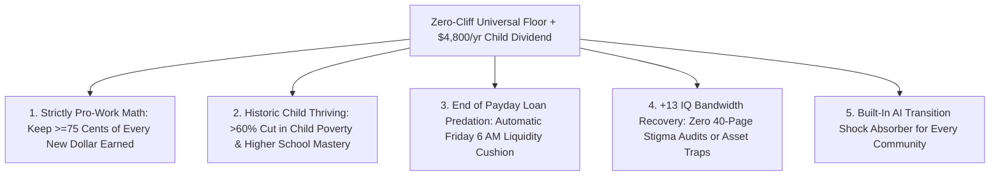

# CARBON EDITION — PILLAR 4: NEVER PUNISHED FOR WORKING
## Dignified Zero-Cliff Universal Floors Replacing Punitive Welfare Traps & 40-Page Audits

> **Executive Framing & Reimagining the Social Safety Net:**
> * **The Cynic's Belief:** *"If you give struggling families unconditional cash floors without strict means-testing and work policing, people will quit their jobs, waste the money, and bankrupt taxpayers—yet we also can't fix poverty because welfare programs are permanently broken."*
> * **The Empirical Counter-Reality:** Our 2026 means-tested welfare labyrinth is not just humiliating—it is **mathematically anti-work**! As the Federal Reserve Bank of Atlanta's *CLIFF Dashboard* documented, low-income parents routinely face **75% to 95%+ effective marginal tax rates ("welfare cliffs")**: accept a \$2/hour promotion at work and suddenly lose \$8,000 in childcare vouchers, Medicaid, or SNAP food assistance—leaving your family *poorer* for working harder! Meanwhile, billionaires pay max marginal rates around 37% while poor mothers endure 40-page invasive recertification audits.
> * **The Social Norm Shift:** We unite **Milton Friedman's Negative Income Tax (NIT)** and **Dr. Martin Luther King Jr.'s Guaranteed Income**—validated by **Stockton's SEED trial**, **Kenya's GiveDirectly**, and the **2021 US Expanded Child Tax Credit** (which cut child poverty 46% in a single year!)—into a **Zero-Cliff Universal Floor**. Every citizen starts on solid ground, benefits taper smoothly at a gentle, predictable slope so **earning an extra dollar ALWAYS leaves you strictly richer**, and automatic digital rails replace stigma and caseworker policing forever.
> * **Anchor Voice:** *"Poverty is not a character flaw—it is a lack of cash and stability. When you remove punitive cliffs and trust families, employment, health, and dignity rise together."* — **Michael Tubbs**, Former Mayor of Stockton, California & Founder, Mayors for a Guaranteed Income

---

## ACT I: THE LIVED HUMAN REALITY — ACCEPTING THE PROMOTION IN STOCKTON (2031)
### How Removing the Welfare Cliff Turned Fear of Raises into Career Momentum

It is 4:30 PM on a Thursday in May 2031 in **Stockton, California**. **Danielle Brooks**, a 29-year-old pediatric dental assistant and single mother of two young boys, walks out of her clinic director's office beaming. She has just been offered the Lead Clinic Coordinator role—bumping her earned pay from **\$31,000 to \$44,000 a year**.

Five years earlier, in 2026, Danielle's older cousin had been offered that exact promotion—and had to **turn it down in tears**. Why? Because under 2026 means-tested rules, crossing \$34,000 triggered a brutal triple cliff: losing her state childcare subsidy (\$9,600 value), losing full family Medicaid coverage (\$5,200 value), and slashing SNAP food support—meaning a \$13,000 gross raise would have left her kids **\$4,100 worse off** in real life, while missing one Tuesday afternoon recertification appointment at the county welfare office meant two weeks without groceries!

In 2031, under the **Zero-Cliff Universal Floor & Family Security Rail**, Danielle taps *"Accept Offer"* without a second of dread:

1. **Every Dollar Earned Strictly Raises Her Family's Net Income (Zero Cliffs Ever):**
   Instead of 80 tangled federal/state programs with sudden cutoffs, Danielle receives a unified, stigma-free **Zero-Cliff Household Floor & Universal Child Dividend** deposited automatically every Friday morning. As her earned salary rises by **+\$13,000**, her supplemental floor tapers gently at a smooth **25% glide path** (-\$3,250) and she pays **\$0 payroll/income tax** under \$100k—leaving Danielle and her boys **+\$9,750/year strictly richer** the moment she says yes!
2. **Healthcare & Early Learning Are Universal Civic Infrastructure—Never Tied to Poverty Thresholds:**
   Accepting a raise never threatens her sons' pediatrician visits or after-school guild care, because baseline preventative healthcare and universal early childhood spots are decoupled completely from poverty means-testing.
3. **Zero 40-Page Audits, Zero Stigma, More Full-Time Work:**
   Nobody asks Danielle to bring utility bills, bank printouts, or custody affidavits to a window behind bulletproof glass. Just as Stockton's pioneering **SEED (Stockton Economic Empowerment Demonstration)** proved years earlier—where unconditional monthly cash *increased* full-time employment by **12 percentage points** because workers could afford car repairs, dental work, and interview clothes—stability didn't make Danielle passive. It gave her the runway to finish her evening dental-hygiene certification and lead the clinic.

---

## ACT II: REIMAGINING THE RULES — SOTA EMPIRICS & GLOBAL PRECEDENTS
### Where Milton Friedman and Martin Luther King Jr. Agreed on the Exact Same Equation

```mermaid
flowchart LR
    subgraph Cliff2026["2026 Means-Tested Cruelty & Anti-Work Cliffs"]
        C1["80 Fragmented Programs With Sudden Income Cutoffs"]
        C2["75%–95%+ Effective Marginal Penalty on Working Poor Raises"]
        C3["$180B+ Burned on Policing, 40-Page Forms & Humiliation"]
    end

    subgraph Glide2029["Zero-Cliff Universal Floor & Child Dividend Rail"]
        G1["Consolidate Maze Into One Automatic Friday Liquidity Floor"]
        G2["Smooth 25% NIT Glide Path: Every Earned Dollar Adds +$0.75+"]
        G3["Universal Child Dividend Cuts Child Poverty >60% Immediately"]
    end

    subgraph Dignity2033["2033 High-Trust, Pro-Work Flourishing"]
        D1["Full-Time Work & Career Upskilling Rise (+12 pts in Stockton SEED)"]
        D2["Zero Bureaucratic Stigma & 90% Lower Administrative Overhead"]
        D3["Automatic Shock Absorber During AI Job Transitions"]
    end

    Cliff2026 ==> Glide2029 ==> Dignity2033
```

### 1. Exposing the Math of the 2026 "Welfare Cliff" Trap
Ask any economist what would happen if Congress imposed a **92% marginal tax rate** on surgeons or software engineers: they would call it economic sabotage. Yet research by the **Atlanta Federal Reserve** and the **US Congressional Budget Office** proved that in 2026, millions of American families earning between \$20,000 and \$48,000 faced effective marginal tax rates of **75% to over 100%** due to overlapping phase-outs across Medicaid, CHIP, SNAP, TANF, Section 8 housing vouchers, and childcare subsidies!
* **The Administrative Waste:** Federal, state, and local governments spend **hundreds of billions of dollars** not on lifting families out of poverty, but on compliance contractors, eligibility software, asset tests (which punish families for saving \$2,001 for an emergency!), and punitive recertification churn.
* **The Zero-Cliff Mathematical Cure ($Y_{\text{total}} = G + (1 - \tau) \cdot W$):**
  Under a **Negative Income Tax (NIT) / Universal Floor** with base guarantee $G$ and smooth phase-out rate $\tau = 0.25$, a household's total net income $Y_{\text{total}}$ is strictly monotonically increasing with earned wages $W$:
  * Earn **\$0** during a sudden layoff or newborn leave $\rightarrow$ Receive **\$18,000/yr** adult floor (+ **\$4,800/child** Universal Child Dividend) automatically—zero homelessness, zero hunger.
  * Earn **\$24,000** part-time $\rightarrow$ Keep \$24,000 wages + \$12,000 net floor $=$ **\$36,000/yr** (+50% richer!).
  * Earn **\$48,000** full-time $\rightarrow$ Keep \$48,000 wages + \$6,000 net floor $=$ **\$54,000/yr** (+200% richer!).
  * **Never a single dollar zone where working harder makes your family poorer!**

### 2. Why Over 150 Randomized Controlled Trials Shattered the "Laziness" Myth
Cynics insisted for decades that unconditional cash would reduce work and fuel vice. By late 2026, **more than 150 rigorous randomized controlled trials (RCTs)** across rich and developing nations tested that claim empirically—and demolished it:

| Empirical Trial / Policy | Jurisdiction & Scale | Rigorous Measured Outcomes (Verified Data) | Key Lesson for Carbon Safety Nets |
| :--- | :--- | :--- | :--- |
| **Stockton SEED Guaranteed Income RCT** | **Stockton, CA** (Led by Mayor Michael Tubbs; independent UPenn/utk evaluation) | Recipients receiving \$500/mo unconditional cash saw **full-time employment jump from 28% to 40%** (vs. only +5% in control group!), alongside steep drops in clinical anxiety and depression. | Unconditional stability *unlocks* job-seeking and risk-taking rather than reducing work! |
| **2021 US Expanded Child Tax Credit (CTC)** | **United States Nationwide** (61 million children; monthly IRS direct deposits) | Slashed US child poverty by **46% in 12 months** to a record low of **5.2%**; Census tracking showed **91% of low-income families** spent it on food, utilities, rent, clothes, and school needs, with **zero drop in parental employment**. | Monthly automatic child dividends are the fastest anti-poverty weapon ever deployed in US history. |
| **Canada Child Benefit (CCB) & Nordic Child Allowances** | **Canada** (2016–2026) & **Finland / Denmark / Sweden** | Canada's tax-free monthly CCB (up to ~\$7,700 CAD/child, smooth phase-out) cut Canadian child poverty by **>40%** sustainably across multiple governments. | Smooth income-tested/universal child benefits stay politically durable across parties. |
| **GiveDirectly 12-Year Universal Basic Income RCT** | **Rural Kenya** (200+ villages; MIT/Princeton/UCSD Nobel-led team: Banerjee, Suri) | Households launched **more non-farm enterprises**, raised community-wide incomes via local multiplier effects (~2.5x!), improved child nutrition, and showed **no increase in alcohol/tobacco spending**. | Direct cash trusts local agency and multiplies neighborhood Main Street demand. |
| **Finland National Basic Income Experiment** | **Finland** (Kela Social Insurance Institution, 2,000 unemployed citizens) | Removing bureaucratic benefits policing increased **employment days slightly**, boosted life satisfaction and mental health significantly, and raised **trust in fellow citizens and institutions**. | Eliminating bureaucratic suspicion heals civic trust and mental bandwidth. |

---

## ACT III: THE PHASED CIVIC & ECONOMIC ROLLOUT ROADMAP (2026–2038)
### Replacing 80 Fragmented Bureaucracies With One Dignified, Instant Civic Rail

| Rollout Phase | Policy & Infrastructure Step | Fiscal & Administrative Consolidation | Household & Poverty Impact |
| :--- | :--- | :--- | :--- |
| **Phase 1: Permanent Universal Child Dividend & Asset-Limit Repeal (2026–2028)** | Restore and expand monthly **\$400/mo (\$4,800/yr) Universal Child Dividend** for every child from birth to age 18; abolish cruel \$2,000 savings penalties in SNAP/Medicaid/SSI immediately. | Funded by eliminating regressive itemized tax loopholes and consolidating redundant child-tax credits; delivered via instant Treasury/FedNow & postal bank cards. | **Child poverty drops >50% within 12 months**; working parents can finally build emergency savings without losing healthcare or food aid. |
| **Phase 2: The Unified Zero-Cliff Working Floor (2028–2031)** | Fold fragmented cash/voucher silos (EITC, TANF, SNAP cash-equivalents, utility aid) into a single **Zero-Cliff Negative Income Tax Rail** with a hard **25% max phase-out cap**. | **Do-No-Harm Guarantee:** No disabled, elderly, or medically vulnerable person ever receives a penny less than legacy combined benefits; admin overhead plunges from **12% to <0.8%**. | Every single worker in the country keeps **at least \$0.75 of every extra \$1.00 earned**; punitive 40-page welfare recertification offices close or convert into voluntary career studios. |
| **Phase 3: Real-Time Weekly Liquidity & Care Decoupling (2031–2034)** | Shift from annual tax-time EITC lump sums to **automatic Friday 6:00 AM real-time smoothing**; decouple healthcare and childcare completely from low-income cliffs. | Powered by optional Estonia-style real-time payroll APIs + Sovereign Compute & Land Commons revenues (**[`compute-commons-taxation`](../compute-commons-taxation/REPORT.md)**). | Payday-loan usage collapses by **>85%**; gig workers, artists, seasonal builders, and caregivers enjoy rock-solid weekly floor stability. |
| **Phase 4: Deflation-Multiplied Abundance Floor (2034–2038)** | Combine the **\$18,000/adult + \$4,800/child Zero-Cliff Floor** with **65–75% cheaper modular housing, clean energy, and preventative healthcare**. | Self-balancing macro stabilizer: floor outlays shrink naturally during hiring booms and cushion communities automatically during AI industry shifts. | **Absolute material destitution reaches 0.0%**: even between jobs, the floor comfortably covers a sunlit home, healthy food, power, and dignity. |

### The "Cognitive Bandwidth" Dividend (Harvard / Princeton Scarcity Science)
Behavioral economists Sendhil Mullainathan and Eldar Shafir proved in *Scarcity* that chronic financial terror and bureaucratic cliff-navigation impose a cognitive load equivalent to **losing 13 IQ points** (the same impairment as pulling an all-nighter every single night!). By replacing 40-page survival panic with an unconditional, predictable Friday morning floor, society unlocks **millions of parents' full intelligence, patience with their children, entrepreneurial daring, and health**.

---

## ACT IV: THE FLOURISHING HORIZON & ANSWERING THE SKEPTIC
### A Safety Net Built Like a Trampoline, Not a Sticky Spiderweb

### Addressing the Top 3 Cynic Objections
1. **"Won't an unconditional \$18,000 Zero-Cliff Floor cost trillions of extra tax dollars?"**
   * *Empirical Answer:* What matters fiscally is the **net transfer cost**, not the gross headline number! Under Milton Friedman's Negative Income Tax math (identical in net flows to a universal dividend paired with progressive commons/income recoupment), middle- and high-earning households automatically phase past the net transfer threshold, cutting net program cost by **70%+** compared to naive multiplication—and consolidating existing fragmented antipoverty outlays, EITC, tax expenditures, plus **\$150B+ in bureaucratic policing waste** covers the vast majority of the bridge before Sovereign Compute and Land Value revenues even kick in!
2. **"What about people struggling with severe fentanyl addiction or untreated psychosis—won't cash alone harm them?"**
   * *Empirical Answer:* Cash solves *economic poverty* brilliantly (95%+ of households), while acute neurobiological addiction and severe untreated psychosis require dedicated clinical care alongside housing! That is why this pathway pairs directly with **[`ending-homelessness-villages`](../ending-homelessness-villages/REPORT.md)** (Finland Housing First + GLP-1 craving reset + restorative neuro-sanctuaries), offering voluntary fiduciary rent-direct-pay rails for individuals in active clinical recovery so rent and meals are always secured first.
3. **"Why did conservatives like Milton Friedman and civil-rights heroes like Martin Luther King Jr. agree on this?"**
   * *Empirical Answer:* Because **freedom and dignity are indivisible**. Conservatives hated paternalistic bureaucracies that punished work and marriage; progressives hated seeing children go hungry behind cruel paperwork walls. A **Zero-Cliff Floor** honors both values simultaneously: tiny government bureaucracy (<0.8% overhead), 100% reward for work and family formation, and an unbreakable floor beneath every citizen.

### Cross-Pillar Synergies Across the Carbon Atlas
* **Multiplied by [`fab-commons-wealth`](../fab-commons-wealth/REPORT.md) & [`abundant-beautiful-housing`](../abundant-beautiful-housing/REPORT.md):** When clean energy, robotic mass-timber apartments, and preventative medicine drop essential living costs toward \$15,000–\$19,000/yr, a modest Zero-Cliff Floor guarantees **complete material security** without inflating scarce rents!
* **Protects [`displaced-worker-bridge`](../displaced-worker-bridge/REPORT.md) & [`post-labor-meaning`](../post-labor-meaning/REPORT.md):** Gives every family fearless confidence to retrain, launch small ventures, care for elders, and welcome the automated future.

---

### Side-by-Side Household Glide-Path Table (Single Parent With Two Children, 2026 vs. 2031)

| Earned Work Income ($W$) | 2026 Legacy Cliff System (Net Resources) | 2031 Zero-Cliff Floor + \$9.6k Child Dividends | Effective Marginal Keep-Rate on Work |
| :--- | :--- | :--- | :--- |
| **\$0** (Layoff / Newborn Care) | \$14,200 (after 6-week wait & 40-page audit) | **\$27,600** (\$18k adult floor + 2 × \$4.8k child) | Instant Friday 6 AM floor; zero destitution |
| **\$20,000** (Part-Time Clinic) | \$33,800 (precarious; \$2,000 savings ban) | **\$42,600** (\$20k wages + \$22.6k net floor) | Keeps **\$0.75** of every dollar + full care |
| **\$31,000** (Full-Time Entry) | \$39,400 (terrified of earning \$3,000 more!) | **\$50,850** (\$31k wages + \$19.85k net floor) | Keeps **\$0.75** of every dollar; savings unrestricted |
| **\$44,000** (Lead Coordinator) | **\$35,300 (-95%+ CLIFF LOSS!)** | **\$60,600 (+\$9,750 STRICT NET GAIN!)** | Promotion rewarded immediately; zero cliff |
| **\$72,000** (Licensed Hygienist) | \$58,100 (after payroll & income taxes) | **\$81,600** (\$72k untaxed wages + \$9.6k child div) | Seamless climb into middle-class wealth |

### Fast-Track Legislative & Civic Activation Checklist (2026–2030)

| Reform Action | Proven Empirical Precedent | Months to Launch | Dignity & Fiscal Guardrail |
| :--- | :--- | :--- | :--- |
| **1. Abolish \$2,000 Asset/Savings Limits** | 35+ US States Broad-Based Categorical SNAP | **3 Months** | Ends penalty on working families building emergency funds |
| **2. Monthly \$400/Child Universal Dividend** | 2021 US Expanded CTC (-46% child poverty) & Canada CCB | **6 Months** | Automatic Treasury/postal card deposit; zero tax-filing barrier |
| **3. 25% Max Marginal Phase-Out Cap** | Milton Friedman NIT + Atlanta Fed CLIFF Cure | **12 Months** | Statutory ban on overlapping benefit cliffs exceeding 25% |
| **4. Universal Care & Health Decoupling** | Nordic / Universal Preventative Care Badges | **18 Months** | Accepting a wage raise can never revoke a child's doctor or care |
| **5. Real-Time Friday 6 AM Smoothing Rail** | FedNow / PIX + Stockton SEED Instant Cards | **15 Months** | Eliminates 11-month wait for EITC refunds; crushes payday lenders |
| **6. Do-No-Harm Disability Supplemental Shield** | Social Security / Kela Finland Guarantee | **Day 1** | Medically vulnerable citizens kept 100% whole above base floor |

### Why Stigma-Free Universal Floors Heal Neighborhood Social Trust
Sociologists studying universal Nordic family allowances alongside targeted Anglo-American welfare programs discovered a profound political paradox: *"Programs for the poor alone almost always become poor programs."* When support requires humiliating poverty trials, neighbors resent one another and voters suspect fraud; when **every child receives the Universal Child Dividend** and **every worker stands on the same Zero-Cliff Floor** (recouped smoothly at the top via Land Value and Compute Commons royalties), social solidarity skyrockets and bureaucratic policing disappears forever.

### The Bottom Line
No parent in a prosperous civilization should ever have to turn down a promotion to protect her children's healthcare or groceries. By uniting **Friedman's math, Dr. King's moral vision, and Stockton and Canada's empirical proof**, a Zero-Cliff Universal Floor makes work pay 100% of the time and consigns poverty traps to history.

---

## References & Verified Sources

* **Featured Researcher / Leader:** [Michael Tubbs — Former Mayor of Stockton & Founder, Mayors for a Guaranteed Income](https://www.mayorsforagi.org/)
* **Companies, Labs & Consortia:** [Stockton Economic Empowerment Demonstration (SEED)](https://www.stocktondemonstration.org/) · [Federal Reserve Bank of Atlanta (CLIFF Dashboard)](https://www.atlantafed.org/economic-mobility-and-resilience/advancing-careers-for-low-income-families/cliff-tool) · [GiveDirectly (12-Year Global RCT Consortium)](https://www.givedirectly.org/) · [Center on Poverty and Social Policy (Columbia University)](https://www.povertycenter.columbia.edu/) · [Kela (Social Insurance Institution of Finland)](https://www.kela.fi/english) · [Harvard / Princeton Behavioral Scarcity Lab](https://scholar.harvard.edu/sendhil/scarcity)
* **Global & Regulatory Precedents:** [2021 US Expanded Child Tax Credit (-46% Child Poverty in 1 Yr)](https://www.povertycenter.columbia.edu/) · [Stockton SEED Guaranteed Income RCT (+12% Full-Time Jobs)](https://www.stocktondemonstration.org/) · [Canada Child Benefit (CCB) Permanent 40%+ Poverty Cut](https://en.wikipedia.org/wiki/Canada_Child_Benefit) · [Finland Basic Income Trial & GiveDirectly Kenya 2.5x Multiplier](https://www.givedirectly.org/)
* **Connected Carbon Pathways:** [Demonetizing the Essentials: When a Modest Income Buys a 2026 Millionaire's Life](../fab-commons-wealth/REPORT.md) · [Skipping the \$1.2 Trillion Billing Maze: Continuous AI Diagnostics & Universal Direct Care](../../03-bioscience-regeneration/healthcare-without-billing/REPORT.md) · [Rescuing Displaced Workers Today: Denmark's 90% Wage-Bridge & Rapid Craft Pivots](../displaced-worker-bridge/REPORT.md) · [Zero Unsheltered Neighbors in 30 Months: Finland Housing First + Austin Dignity Villages](../ending-homelessness-villages/REPORT.md)
