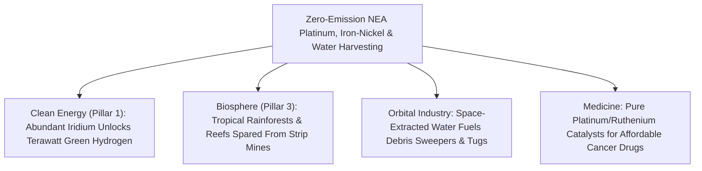

# PILLAR 05: SPACE & ORBITAL STEWARDSHIP (CARBON EDITION)
## Pathway 5.5: Trillions of Tons Without Cutting Down a Single Tree — Asteroid Metals & Water Propellant

> **The Cynic's Cliché:**
> *"Asteroid mining is pure sci-fi billionaire greed! Spending billions to chase rocks in deep space for platinum or gold will either bankrupt investors or crash commodity markets while communities on Earth need clean energy metals right now!"*
>
> **The Nov 2026 Orbital Breakthrough:**
> Look honestly at where terrestrial clean-energy and catalyst metals come from today: to electrify the planet and build hydrogen electrolyzers, cancer drugs, and AI chips, humanity is gouging mile-deep open-pit nickel, cobalt, copper, and platinum scars into Indonesian rainforests, Congolese watersheds, and sacred indigenous lands—moving **200 tons of toxic acid tailings for a single ounce of platinum**. Meanwhile, floating in Near-Earth Orbits easier to reach in $\Delta v$ than the surface of the Moon are **metallic M-type and carbonaceous C-type asteroids** holding trillions of tons of pure, unoxidized siderophile metals and bound water—where **zero blades of grass, zero birds, and zero rivers exist to harm**. Led in 2025–2026 by **AstroForge**, **Karman+**, **TransAstra**, and proven by **JAXA's *Hayabusa2*** and **NASA's *OSIRIS-REx*** sample returns, space resource harvesting is the ultimate ecological gift to Earth's living biosphere.

> *"Every ounce of platinum-group metal we refine cleanly in deep space is a toxic open-pit mine we never have to dig into Earth's living ecosystems."*
> — **Matt Gialich**, Co-Founder & CEO, AstroForge

---

## ACT I: THE HUMAN REALITY — HEALING THE SCARS OF TERRESTRIAL EXTRACTION
### A Rewilded Watershed in Sulawesi and a Green-Hydrogen Port in Rotterdam, 2036

Stand on a mist-wrapped ridge in Central Sulawesi, Indonesia—or beside the Merensky Reef in South Africa—on a bright morning in **2036**.

In the mid-2020s, red laterite mud from strip-mined nickel hills choked coral reefs below, while miners two miles underground in 50-degree-Celsius South African shafts blasted tens of millions of tons of rock to scrape out trace platinum-group metals (PGMs: platinum, iridium, palladium, rhodium, osmium, ruthenium) desperately needed for PEM water electrolyzers, fuel cells, and chemotherapy drugs. Ten years later, two profound shifts have changed the landscape:

1. **Catalyst Metals Delivered from Lifeless Space Rocks:**
   Down at the Port of Rotterdam, a clean hydrogen gigafactory coats proton-exchange membranes with ultra-pure **iridium and platinum** that arrived inside a compact, suitcase-sized **AstroForge** reentry capsule. That single one-ton metallic return from a Near-Earth Asteroid carried as much platinum-group metal as tearing up **300,000 tons of living Earth crust**—refined in deep space using pure sunlight and hard vacuum with zero cyanide, zero sulfuric acid ponds, and zero diesel haul trucks.

2. **Orbital Gas Stations Filled from Carbonaceous Asteroid Water:**
   Four hundred kilometers above Earth, an orbital debris-sweeping tug and a sun-synchronous AI compute barge top up their tanks at a **Karman+** propellant depot. Not a kilogram of that water or steam propellant rode a rocket through Earth's atmosphere; it was baked gently out of hydrated clay minerals on a dark carbonaceous Near-Earth Asteroid where water makes up **10% to 20% of the rock's mass**.

3. **Rainforests Paid to Regrow Instead of Strip-Mine:**
   Because abundant space-refined PGMs collapsed the bottleneck cost of green hydrogen, ammonia fertilizer catalysts, and solid-state electronics without expanding terrestrial strip mines, conservation trusts and local communities in Sulawesi and the Congo Basin are actively reforesting retired mine pits into thriving biodiversity corridors.

4. **Structural Iron & Nickel Kept Upstairs for Space Megastructures:**
   Even better, 99% of asteroid iron, nickel, and cobalt never needs to reenter Earth's atmosphere—it stays in cislunar space to build gigawatt clean solar power satellites and spinning orbital habitats without launching millions of tons of steel out of Earth's deep gravity well.

5. **The Skeptic's Honest Question:**
   Wait—aren't asteroids hundreds of millions of kilometers away past Mars, and didn't early 2010s asteroid-mining startups (*Planetary Resources*, *Deep Space Industries*) fail because spacecraft cost \$500 million apiece? What changed by 2026?

---

## ACT II: THE CONVERGENCE BRIDGE & NOV 2026 STATE OF THE ART
### Siderophile Geochemistry, Low-$\Delta v$ Near-Earth Orbits, and \$20M Micro-Probes

### 1. Three Scientific Facts That Shatter the "Too Far, Too Expensive" Myth
* **1. Why Earth's Crust Is Poor in Platinum While M-Type Asteroids Are Rich:**
  Four and a half billion years ago, when infant Earth was a molten magma ocean, heavy *siderophile* ("iron-loving") elements—platinum, iridium, gold, osmium, cobalt, and nickel—sank straight into Earth's inaccessible core $2,900\text{ km}$ beneath our feet. Metallic **M-type asteroids** are the shattered iron-nickel cores of ancient protoplanets! Ground-truth meteorite assays show pristine metallic asteroids contain **$10\times\text{ to }100\times$ higher PGM concentrations** than the richest terrestrial ores ($50\text{–}200\text{ ppm}$ vs. $2\text{–}5\text{ ppm}$), sitting right at the surface in unoxidized zero-gravity rubble piles.

* **2. Near-Earth Asteroids Are Closer in $\Delta v$ Than the Lunar Surface:**
  You do not go to the Main Asteroid Belt past Mars. Over **36,000 cataloged Near-Earth Asteroids (NEAs)** cross or hug Earth's solar orbit! By the Tsiolkovsky rocket equation ($\Delta v = v_e \ln(m_0/m_f)$), landing on and returning from the Moon requires $\Delta v \approx 9.0\text{ km/s}$ from LEO—whereas thousands of low-inclination NEAs (such as *1998 KY26*, *2000 SG344*, and *Nereus*) require **only $\Delta v \approx 3.8\text{ to }4.8\text{ km/s}$ round-trip**, with virtually **zero gravity ($10^{-4}g$)** to fight upon departure!

* **3. 100× Cheaper Rideshare Spacecraft (`$500M` $\rightarrow$ `<$25M`):**
  In 2014, building a custom deep-space probe required \$400M and a dedicated Atlas V rocket. In 2025–2026, commercial rideshare slots on Falcon 9 / Starship, off-the-shelf Hall-effect solar-electric thrusters, and compact optical navigation let startups fly deep-space asteroid missions for **\$15M to \$35M**.

### 2. Verified 2024–2026 Pioneers & Ground-Truth Sample Returns

| Pioneer / Mission | Target Resource & Tech | Verified 2024–2026 Milestone | Ecological & Industrial Payoff |
| :--- | :--- | :--- | :--- |
| **NASA *OSIRIS-REx* & JAXA *Hayabusa2*** | Carbonaceous NEAs (*Bennu* & *Ryugu*) sample returns | Returned pristine multi-gram regolith caches to Earth; confirmed abundant **hydrated clay minerals (10%+ bound water), carbon, and iron-nickel sulfides**—plus proved microgravity touch-and-go collection. | Eliminated geological guesswork: we know the exact mineralogy and rubble-pile mechanics of C-type NEAs. |
| **AstroForge** | M-type metallic NEAs & zero-emission vacuum PGM refining | Flew *Brokkr-1* orbital refinery test, launched *Odin* deep-space scout (2025), and advancing *Vestri* asteroid docking & in-space vacuum fractional distillation. | Selective volatilization refines PGMs in hard vacuum with zero acid leaching, returning ton-scale PGM capsules to Earth. |
| **Karman+** | Carbonaceous water-rich NEAs for in-space propellant | Raised **\$20M seed (2025–2026)** developing autonomous microgravity regolith excavators & solar-thermal water extraction for cislunar steam/chemical tugs. | Supplies orbital satellite servicing & debris sweepers at a fraction of Earth-launch propellant cost. |
| **TransAstra** | *Omnivore* optical solar concentrator & *Capture Bag* + *Worker Bee* | Ground-tested **optical mining** (focused sunlight spalling & vaporizing asteroid volatiles inside an inflatable enclosure without mechanical drill wear) + Sutter telescope NEA discovery network. | Zero-moving-part extraction of clean $\text{H}_2\text{O}$, $\text{CO}_2$, and $\text{CH}_4$ feed gases straight into cryo-traps. |
| **ESA *Ramses* / *Hera* & NASA *Psyche*** | Metallic world *16 Psyche* & binary NEA *Didymos/Dimorphos* | **ESA *Hera*** arriving at *Dimorphos* in **late 2026** with radar tomography CubeSats; **NASA *Psyche*** en route to the solar system's largest metallic protoplanet core. | Maps internal porosity, magnetic fields, and anchoring mechanics across binary & metallic asteroids. |

---

## ACT III: PHASED ROLLOUT ROADMAP (2026 $\rightarrow$ 2042) & BIOSPHERE ARITHMETIC

### 1. From Suitcase PGM Capsules to Thousand-Ton Cislunar Depots

| Era & Step | Target & Spacecraft Class | Material Extracted & Returned | Terrestrial & Orbital Impact |
| :--- | :--- | :--- | :--- |
| **2025–2027 (Live SOTA)** *Scout & Assay Runs* | **200 kg** rideshare probes (**AstroForge *Odin/Vestri***, **ESA *Hera***) + Sutter optical NEA surveys. | High-res hyperspectral PGM/water assays; first microgravity vacuum refining & anchoring demonstrations. | De-risks private resource claims under the U.S. Commercial Space Launch Competitiveness Act & Luxembourg Space Resources Law. |
| **2028–2031** *First Commercial Returns* | **1–3 ton** solar-electric smelter & water-harvester craft (**AstroForge Gen-2**, **Karman+**). | **500 kg – 2,000 kg** high-purity platinum/iridium Earth capsules + **10–50 tons** orbital water propellant. | First commercial space-refined iridium powers gigawatt terrestrial PEM green-hydrogen electrolyzers. |
| **2032–2036** *Depot & Catalyst Scale* | Fleet of **Starship-deployed** solar-thermal *Capture Bag* & carbonyl-refining tugs across 15 low-$\Delta v$ NEAs. | **20+ tons/yr PGMs** to Earth; **2,000+ tons/yr** water, $\text{CH}_4$ & carbonyl nickel/iron to cislunar depots. | Halts expansion of new deep-shaft PGM & tropical laterite nickel mines; orbital tugs run 100% on space water. |
| **2037–2042** *Post-Extractive Biosphere* | Autonomous solar/fusion-electric tug loops returning multi-thousand-ton pre-refined ingots to Earth-Moon $L_1$. | Bulk zero-impurity Fe-Ni-Co structural coils, gold/PGM wafers, and carbon volatiles in orbit. | **Zero new wilderness strip-mining required** to sustain global clean energy and cislunar construction. |

### 2. Digging Into Living Earth vs. Harvesting Lifeless Space Rocks

| Environmental & Economic Metric | Terrestrial Open-Pit / Deep-Shaft PGM Mining | Near-Earth Asteroid Vacuum Refining | Planetary Stewardship Dividend |
| :--- | :--- | :--- | :--- |
| **Rock & Soil Disturbed per kg of Platinum** | **~300,000 to 500,000 kg** of living crust blasted | **~5,000 to 15,000 kg** of sterile asteroid regolith | **>95% Less Ore Processed** |
| **Freshwater Polluted & Acid Tailings** | Millions of liters + cyanide / $\text{SO}_2$ / sulfuric tailings | **0 Liters** (100% dry solar-vacuum distillation) | **Zero Watershed or Reef Contamination** |
| **Living Species & Communities Displaced** | Tropical forests, rivers, coral reefs, & mine hazards | **0.0** (dead irradiated rubble in interplanetary vacuum) | **Pure Ecological Preservation** |
| **Energy Source for Smelting** | Coal-heavy grids & diesel haul trucks | **24/7 Unfiltered Interplanetary Solar Mirrors** | **100% Zero-Carbon Refining** |

### 3. Preventing "Market Crash" Myths, Safe Microgravity Anchoring & Legal Norms
Harvesting Near-Earth Asteroids cleanly and responsibly rests on four practical pillars:

* **Why Space PGMs Accelerate Clean Tech Instead of "Crashing Economies":**
  Today, terrestrial iridium (~9 tons/year global supply!) and rhodium are so bottlenecked that scaling proton-exchange-membrane (PEM) green hydrogen to replace fossil fuels hits a hard physical wall. Returning 20 to 50 tons per year of clean space iridium and platinum doesn't cause economic chaos—it unlocks **terawatts of cheap green hydrogen, clean ammonia fertilizer, and affordable platinum-based cancer drugs**, while legacy mining towns partner in high-margin catalyst manufacturing and ecological restoration.

* **Gentle Enclosures Over Clumsy Harpoons (Zero Debris Risk):**
  Because sample returns from *Bennu* and *Ryugu* proved many asteroids are low-cohesion rubble piles, modern harvesters (**TransAstra**, **Karman+**) never blast rocks into loose shrapnel. Instead, spacecraft use counter-rotating brush augers and sealed inflatable capture skirts that contain 100% of dust and pebbles inside closed manifolds.

* **Mond Carbonyl & Solar-Vacuum Refining (Zero Acid Ponds):**
  In deep space, unoxidized iron, nickel, cobalt, and PGMs separate cleanly via closed-loop **gaseous Mond carbonyl refining** ($\text{Ni} + 4\text{CO} \leftrightarrow \text{Ni(CO)}_4$) at mild temperatures ($50\text{–}180^\circ\text{C}$) or fractional solar-vacuum distillation—recycling 99.9% of working gas with zero liquid tailings.

* **Transparent International Resource Frameworks:**
  Operating under the **Artemis Accords**, the U.S. Commercial Space Launch Competitiveness Act, Japan's Space Resources Act, and Luxembourg's legal framework—paired with open UN COPUOS orbital trajectory registries—ensures every mission operates far from Earth impact corridors with full planetary-defense transparency.

---

## ACT IV: THE SYNERGY UNLOCK & CLOSING ANSWER TO THE CYNIC

Lifting resource extraction off our thin, living crust and moving it onto sterile tumbling boulders in sunlight unlocks five extraordinary wins:

1. **Green Hydrogen Without a Catalyst Bottleneck:**
   Breaking the 9-ton-per-year terrestrial iridium ceiling lets humanity manufacture cheap proton-exchange electrolyzers by the gigawatt—decarbonizing shipping, aviation, green steel, and clean ammonia fertilizer worldwide.

2. **A Permanent Truce With Earth's Forests and Oceans:**
   We never have to bulldoze another hectare of Indonesian or Congolese rainforest—or scrape ancient polymetallic nodules off deep-sea abyssal ecosystems—to obtain nickel, cobalt, copper, or platinum-group metals.

3. **Self-Refueling Orbital Highways:**
   Water baked gently out of carbonaceous asteroids turns Low Earth Orbit and cislunar space into a clean, circular maritime network where satellites and debris sweepers are refueled rather than discarded.

4. **Structural Megastructures Without Earth Launch Smoke:**
   Keeping 99% of asteroid iron and nickel upstairs in zero gravity provides millions of tons of clean structural metal for orbital solar power stations and sunlit spinning habitats without burning rocket fuel from Earth's surface.

5. **The Warm Truth for the Cynic:**
   There isn't a single tree, songbird, coral polyp, or trout stream on metallic asteroid *1986 DA*—refining our toughest metals out in deep space is how we finally let Earth heal into a garden.

---

## References & Verified Sources

* **Featured Researcher / Leader:** [Matt Gialich — Co-Founder & CEO, AstroForge](https://www.astroforge.com/)
* **Companies, Labs & Consortia:** [AstroForge (Odin & Vestri)](https://www.astroforge.com/) · [Karman+](https://karmanplus.com/) · [TransAstra (Omnivore & Capture Bag)](https://www.transastra.com/) · [NASA OSIRIS-REx (Bennu) & Psyche](https://science.nasa.gov/mission/osiris-rex/) · [JAXA Hayabusa2 (Ryugu)](https://www.hayabusa2.jaxa.jp/en/) · [ESA Hera](https://www.esa.int/Space_Safety/Hera) · [Colorado School of Mines Space Resources](https://space.mines.edu/)
* **Global & Regulatory Precedents:** [JAXA Hayabusa2 & NASA OSIRIS-REx Pristine Asteroid Sample Returns](https://science.nasa.gov/mission/osiris-rex/) · [U.S., Luxembourg, UAE & Japan Peaceful Space Resources Legal Frameworks](https://spaceresources.public.lu/en.html) · [Artemis Accords Transparent ISRU Non-Interference Provisions](https://www.nasa.gov/artemis-accords/)
* **Connected Carbon Pathways:** [Turning Thin Air into Jet Fuel, Green Steel & Stone](../../01-abundant-energy/synthetic-sky-fuels/REPORT.md) · [White Geologic Hydrogen, Blue Osmotic & Ambient Harvesters](../../01-abundant-energy/geologic-hydrogen-harvesters/REPORT.md) · [Zoning Earth as a Garden Park: Graduating Heavy Refining Above the Biosphere](../heavy-industry-off-earth/REPORT.md) · [The Billion-Hectare Rewilding: Solar Proteins, Vertical Orchards & Returning Half the Earth to Wild Nature](../../03-bioscience-regeneration/precision-fermentation-rewilding/REPORT.md)
