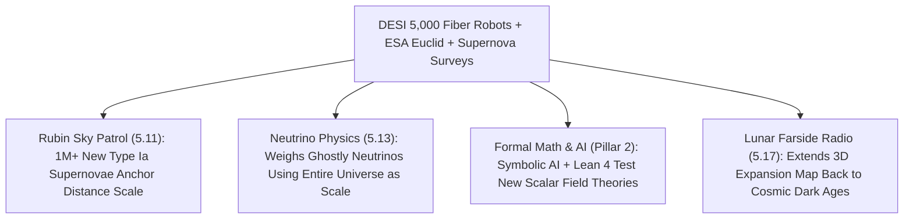

# PILLAR 05: SPACE & ORBITAL STEWARDSHIP (CARBON EDITION)
## Pathway 5.12: A Living, Evolving Cosmos — DESI 3D Galaxy Maps, Euclid & the Dynamical Dark Energy Breakthrough

> **The Cynic's Cliché:**
> *"Modern cosmology already solved the big picture and it's utterly bleak: 68% of the universe is a frozen, unchanging 'cosmological constant' doomed to rip every galaxy apart into a cold, dead, static heat-death void forever. Fundamental physics has been stuck for fifty years!"*
>
> **The 2025–2026 Observational Breakthrough:**
> Far from being stuck or frozen, fundamental physics just cracked wide open! Atop Kitt Peak in Arizona, the **Dark Energy Spectroscopic Instrument (DESI)**—wielding **5,000 tiny robotic fiber-optic eyes** to map **15 to 40+ million galaxies and quasars across 11 billion years of cosmic time**—joined forces with **ESA's *Euclid* space telescope**, Planck CMB maps, and the *Union3* / *DESY5* supernova catalogs to deliver **~$3\sigma\text{ to }4.2\sigma$ evidence that dark energy is NOT static**. Instead of Einstein's frozen cosmological constant ($\Lambda$, $w = -1$), dark energy appears to be **dynamically evolving and weakening over cosmic epochs** ($w_0 > -1, w_a < 0$)! Overnight, fatalism about an immutable cosmic heat-death gave way to the most exhilarating observational physics revolution since the 1998 discovery of cosmic acceleration.

> *"What we are seeing across multiple independent cosmic rulers is deeply intriguing—the universe may not be governed by a simple, static cosmological constant after all, opening a brand-new window into fundamental physics."*
> — **Prof. Mustapha Ishak-Boushaki**, Astrophysicist, UT Dallas & Co-Chair, DESI Cosmological Parameter Estimation Working Group

---

## ACT I: THE HUMAN REALITY — WHEN FIVE THOUSAND ROBOTIC EYES REWROTE COSMIC DESTINY
### Kitt Peak National Observatory (Tohono O'odham Nation Land), ESA ESOC & Physics Seminars Worldwide, 2026–2030

Step inside the control room of the **Nicholas U. Mayall 4-Meter Telescope** on Iolkam Du'ag (Kitt Peak, Arizona)—leased in respectful partnership with the **Tohono O'odham Nation**—or into a buzzing undergraduate physics lecture hall in Zurich, São Paulo, or Berkeley in **late 2026**.

For a quarter-century after 1998, textbooks taught students a neat, slightly melancholy cosmic recipe called **$\Lambda\text{CDM}$**: 5% ordinary atoms, 27% cold dark matter, and 68% unchanging vacuum energy ($\Lambda$) pushing galaxies apart faster and faster into eternal isolation. Then five thousand pencil-thin robotic positioners whirred in unison every twenty minutes:

1. **Catching Ancient Sound Waves Frozen in Galaxy Rings:**
   Every 20 minutes all night long, 5,000 piezoelectric fiber robots inside DESI pivot with **sub-5-micron precision**, each locking onto a specific distant galaxy or luminous quasar up to 11 billion light-years away. Splitting that ancient starlight into rainbows (spectra) measures exact 3D redshifts—revealing gigantic $500\text{-million-light-year}$ spherical ripples called **Baryon Acoustic Oscillations (BAO)**, frozen sound waves from the infant plasma of the Big Bang!

2. **The Cosmic Ruler That Didn't Match a Static Vacuum:**
   Using those $500\text{-million-light-year}$ sound spheres as a precision "standard ruler" across seven distinct slices of cosmic history—and cross-checking them against **ESA *Euclid*'s** razor-sharp space weak-lensing maps and 2,000+ Type Ia supernovae (*DESY5* & *Union3*)—cosmologists watched the expansion rate subtly **decelerate relative to $\Lambda\text{CDM}$ in recent billions of years**. Whatever dark energy is, it appears to be a **living, dynamical quantum scalar field** whose push is relaxing!

3. **Reigniting Golden-Age Curiosity in Young Physicists:**
   Walk into any university physics lounge in November 2026 and the decades-old lament that *"all the big discoveries happened in the 1920s"* is gone. Theorists, string/quantum-gravity researchers, and AI simulation teams are racing to test quintessence fields, neutrino mass bounds ($\sum m_\nu < 0.07\text{ eV}$), and modified gravity against free, open petabyte maps of 40 million galaxies.

4. **The Skeptic's Honest Question:**
   How on Earth can astronomers measure whether an invisible cosmic force changed strength *four billion years ago*, and why did it take both ground robots (DESI) and space mirrors (Euclid + Roman) to see it?

---

## ACT II: THE CONVERGENCE BRIDGE & NOV 2026 STATE OF THE ART
### Baryon Acoustic Rulers, the $w_0\text{--}w_a$ Equation of State, and Space Weak Lensing

```mermaid
flowchart LR
    subgraph FrozenDogma["1998-2023 Static LCDM Orthodoxy"]
        F1["Assumed Fixed Vacuum Constant (w = -1 Forever)"]
        F2["Small 3D Galaxy Samples (<2M Spectra in 20 Yrs)"]
        F3["Cosmic 'Heat Death' Treated as Settled Fate"]
    end
    subgraph SOTA2026["Verified 2025-2026 3D Survey Leap"]
        D1["DESI DR1/DR2: 5,000 Fiber Bots -> 15M-40M Spectra"]
        D2["ESA Euclid Space Telescope Wide Weak-Lensing Map"]
        D3["DESY5 + Union3 Supernovae + Planck CMB Cross-Check"]
    end
    subgraph LivingCosmos["Dynamical Dark Energy Era"]
        L1["3-to-4.2 Sigma Signal: Dark Energy Weakening (w0 > -1)"]
        L2["Sum of Neutrino Masses Pinned (<0.07 eV Bound)"]
        L3["New Quantum Field Physics + Open 3D Sky Atlases"]
    end
    FrozenDogma --> SOTA2026
    SOTA2026 ==> LivingCosmos
```

### 1. Three Precision Cosmic Yardsticks Converging at Once
* **1. The Chevallier-Polarski-Linder ($w_0\text{--}w_a$) Dynamical Equation of State:**
  In Einstein's General Relativity, a fluid's gravitational push or pull depends on its equation-of-state ratio $w = P / \rho c^2$ between pressure $P$ and energy density $\rho c^2$. A pure cosmological constant demands $w = -1$ identically across all scale factors $a(t) = 1/(1+z)$. Testing dynamical evolution parameterizes $w(a)$ as:
  $$w(a) = w_0 + w_a (1 - a) = w_0 + w_a \left(\frac{z}{1 + z}\right)$$
  Across DESI Data Releases 1 & 2 combined with CMB and *DESY5* / *Union3* supernovae, data favor **$w_0 \approx -0.75\text{ to }-0.83$ and $w_a \approx -0.7\text{ to }-1.0$** over static $(w_0 = -1, w_a = 0)$ at **$3.1\sigma\text{ to }4.2\sigma$ significance**—meaning dark energy was stronger in the past and is easing off today!

* **2. 5,000-Robot Multiplexed Spectroscopy & Lyman-$\alpha$ Quasar Backlights (*DESI*):**
  Managed by **DOE's Lawrence Berkeley National Laboratory** with 900+ researchers across 70+ global institutions, DESI captures **100,000+ galaxy spectra on a clear night**—accomplishing in weeks what the pioneering Sloan Digital Sky Survey needed a decade to collect! Beyond galaxies, DESI shines 420,000+ ultra-distant **quasar "flashlights"** through intergalactic hydrogen clouds (the Lyman-$\alpha$ forest) to map cosmic expansion 11 billion years ago.

* **3. Diffraction-Limited Space Shear & Infrared Depth (*ESA Euclid* & *NASA Roman*):**
  Ground telescopes blur slightly through Earth's shimmering air. Orbiting $1.5\text{ million kilometers}$ out at Sun–Earth **Lagrange Point L2**, **ESA's *Euclid*** (600-megapixel VIS + NISP infrared instruments) measures subtle gravitational light-bending (**cosmic shear**) across **1.5 billion galaxies** over a third of the sky—Soon joined by **NASA's *Nancy Grace Roman Space Telescope*** with a Hubble-sharp field of view **$100\times$ wider than Hubble**!

### 2. Verified 2024–2026 Cosmic Cartography Milestones

| Survey / Mission | Instrument Architecture | Verified 2024–2026 Milestone | Breakthrough Contribution |
| :--- | :--- | :--- | :--- |
| **DESI (Dark Energy Spectroscopic Instrument)** | 5,000 robotic fiber positioners + 10 3-channel spectrographs on Mayall 4m | **Largest 3D map of the universe ever built** (15M+ DR1/DR2 objects marching past 40M+ galaxies/quasars); **~$3\sigma\text{--}4.2\sigma$ dynamical dark energy** preference with SNe + CMB. | Measures cosmic expansion to **<0.5% precision** across 11 billion years; open public data releases. |
| **ESA *Euclid* Space Telescope (at L2)** | 1.2m Korsch space telescope + 600-MP VIS optical + NISP near-IR spectrometer | **First Early Release Observations & Wide Survey Q1 catalogs (2024–2026)** mapping millions of galaxies, rogue planets, and strong Einstein rings from L2. | Eliminates atmospheric blur to weigh dark-matter web growth alongside cosmic expansion. |
| **Dark Energy Survey (*DESY5*) & *Union3*** | 570-MP DECam (Chile) + unified global calibrated Type Ia supernova compilations | **DES 5-Year sample (1,635 photometrically/host-verified SNe)** + **Union3 (2,087 SNe)** independently reinforcing $w_0 > -1$ trend when paired with DESI BAO. | Anchors recent-epoch ($z < 1$) cosmic distance-luminosity scale with unprecedented rigor. |
| **Simons Observatory & ACT / SPT CMB** | High-altitude Atacama millimeter polarization arrays ($5,200\text{ m}$) | Ultra-crisp early-universe sound-horizon ($r_d$) calibration locking down the exact physical size of DESI's BAO standard ruler at age 380,000 years. | Closes systematic loopholes between early-universe plasma physics and late-time galaxy clustering. |

---

## ACT III: PHASED ROLLOUT ROADMAP (2026 $\rightarrow$ 2038) & FUNDAMENTAL PHYSICS DIVIDEND

### 1. Crossing the $5\sigma$ Gold Standard of Cosmic Discovery

| Cosmology Phase | Combined Survey Arsenal | Galaxy & Supernova Scale | Fundamental Physics Unlock |
| :--- | :--- | :--- | :--- |
| **2025–2026 (Live SOTA)** *The $3\sigma\text{--}4\sigma$ Earthquake* | **DESI DR1/DR2** + **Euclid Early Survey** + **DESY5 / Union3** + **Planck/ACT**. | **15M–40M 3D galaxy/quasar spectra**; ~2,000 precision Type Ia supernovae. | First multi-probe $3\sigma+$ indication of **weakening dynamical dark energy**; tightest neutrino mass sum bound. |
| **2027–2029** *The $5\sigma$ Verdict* | **DESI-II** upgrade + **Euclid Full Wide Survey** + **Vera Rubin LSST** + **NASA *Roman*** launch. | **>50M 3D spectra** + **1.5B Euclid shapes** + **1,000,000+ Rubin/Roman Type Ia supernovae**. | Crosses definitive **$5\sigma+$ discovery threshold**, distinguishing scalar quintessence fields from modified gravity. |
| **2030–2034** *High-Redshift Frontier* | **Spec-S5 (Stage-5 Spectroscopic Survey, >25,000 fibers)** + **CMB-S4** + **Roman High-Latitude**. | **100M–200M spectra** reaching cosmic noon ($z = 2\text{--}4.5$). | Maps primordial inflation non-Gaussianity and pins down exact individual neutrino mass hierarchy. |
| **2035–2040** *21-cm & Gravitational Synergies* | Coupled with **Lunar Farside 21-cm arrays** (`lunar-farside-radio-cosmology`) & **LISA** space gravitational waves. | Continuous 4D map from the **Cosmic Dark Ages ($z=30$)** to today. | Unifies quantum vacuum field theory with observational gravitation across 13.8 billion years. |

### 2. Static Textbook Dogma vs. 2026 Precision Cosmic Cartography

| Metric | Early-2000s $\Lambda\text{CDM}$ Era | 2026 DESI + Euclid + Rubin/Roman Era | Intellectual & Technical Dividend |
| :--- | :--- | :--- | :--- |
| **3D Galaxy Redshift Speed** | ~500 hand-plugged brass-plate fibers/night | **5,000 Robotic Positioners (>100,000/night)** | **$100\times$ Faster Cosmic 3D Mapping** |
| **Expansion Rate Precision** | $\pm 5\%\text{ to }10\%$ at high redshift | **Sub-0.5% Precision Across 11 Billion Yrs** | **Detects Subtle Vacuum Field Evolution** |
| **Cosmic Destiny Outlook** | Assumed frozen, eternal exponential runaway | **Living, Evolving Vacuum Open to New Laws** | **Shatters Existential "Dead Cosmos" Fatalism** |
| **Spin-Off Hardware Tech** | Niche astronomical optics | **Micron Piezo-Robots, Ultra-Low-Noise Sensors & Open AI Pipelines** | **Flows Into Medical Endoscopy & Chip Lithography** |

### 3. Open Global Science & Indigenous Mountain Stewardship
* **Zero-Gatekeeping Global Data Releases:**
  Following LBNL and ESA open-archive mandates, DESI and Euclid publish calibrated 3D catalogs and Jupyter analysis pipelines openly—letting students in any nation test new gravity equations on the exact same footing as Ivy League teams.
* **Respectful Tohono O'odham Partnership on Iolkam Du'ag:**
  DESI operates on sacred Tohono O'odham land under long-standing cultural, dark-sky, and educational partnerships—reminding science that looking 11 billion years into the heavens begins with honoring neighbors on the mountain below.

---

## ACT IV: THE SYNERGY UNLOCK & CLOSING ANSWER TO THE CYNIC

Step outside under the winter constellations and take in what DESI and Euclid just handed the human spirit:

1. **The Universe Is Still Surprising Us—And Physics Is Wide Open:**
   Every generation has voices claiming science is "nearly finished." Finding that 68% of the cosmos may be a dynamic, changing field rather than a static constant hands today's kids a mystery every bit as thrilling as relativity and quantum mechanics were in 1905.

2. **Dissolving Cosmic Fatalism:**
   Even our grandest philosophical metaphors shift when data speaks: we do not inhabit a rigid, clockwork tomb locked into frozen vacuum runaway, but an evolving, dynamic universe whose deepest chapters remain unwritten.

3. **Weighing the Lightest Particles With the Largest Structures:**
   By watching how 40 million galaxies cluster over 11 billion years, DESI acts as a cosmic scale sensitive enough to weigh subatomic neutrinos—proving how space telescopes and particle physics form one seamless quest.

4. **The Ultimate Answer to the Cynic:**
   Next time someone sighs that *"fundamental science has stalled and the cosmos is just a dead frozen void,"* point five thousand tiny fiber-optic eyes at the Arizona sky: **eleven billion years of ancient starlight say the universe is alive, evolving, and just getting interesting.**

---

## References & Verified Sources

* **Featured Researcher / Leader:** [Prof. Mustapha Ishak-Boushaki — DESI Working Group Co-Chair & Astrophysicist, UT Dallas](https://www.desi.lbl.gov/)
* **Companies, Labs & Consortia:** [Dark Energy Spectroscopic Instrument (DESI — Lawrence Berkeley National Lab)](https://www.desi.lbl.gov/) · [ESA Euclid Space Telescope Consortium](https://www.esa.int/Science_Exploration/Space_Science/Euclid) · [NSF Kitt Peak National Observatory / NOIRLab](https://noirlab.edu/) · [Dark Energy Survey (DESY5 Collaboration)](https://www.darkenergysurvey.org/) · [NASA Nancy Grace Roman Space Telescope](https://roman.gsfc.nasa.gov/) · [Simons Observatory](https://simonsobservatory.org/)
* **Global & Regulatory Precedents:** [DESI DR1 & DR2 3D Cosmic Map & Dynamical Dark Energy BAO Results (2024–2026)](https://www.desi.lbl.gov/the-desi-survey/) · [ESA Euclid First Early Release & Q1 Wide-Survey Catalogs from Lagrange Point L2](https://www.esa.int/Science_Exploration/Space_Science/Euclid) · [NSF / Tohono O'odham Nation Kitt Peak Cultural & Scientific Stewardship Partnership](https://noirlab.edu/)
* **Connected Carbon Pathways:** [Filming the Cosmic Time-Lapse: Vera C. Rubin LSST & Citizen Sky Patrols](../rubin-citizen-sky-patrol/REPORT.md) · [2026 Physics Nobel: Cubic-Kilometer Polar Ice Telescopes & Multi-Messenger Tomography](../icecube-neutrino-multimessenger/REPORT.md) · [The Quietest Ear in the Solar System: Lunar Farside Radio Arrays](../lunar-farside-radio-cosmology/REPORT.md) · [Hallucination-Free Proof Engines: Lean 4 & Formal Mathematics](../../02-automation-science/ai-formal-mathematics/REPORT.md)
