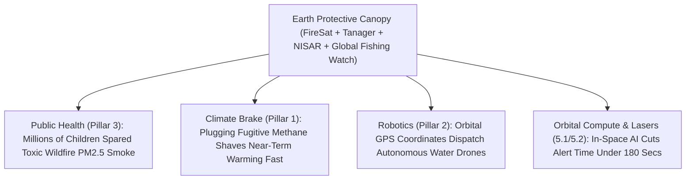

# PILLAR 05: SPACE & ORBITAL STEWARDSHIP (CARBON EDITION)
## Pathway 5.10: Earth's Protective Canopy — Catching Wildfires in 3 Minutes & Plugging Methane Leaks from Orbit

> **The Cynic's Cliché:**
> *"Don't talk to me about satellites when California, Canada, the Mediterranean, and the Amazon are choking on wildfire smoke and invisible methane leaks are cooking the climate! Space money should stay right here on the ground fighting climate disasters!"*
>
> **The Nov 2026 Orbital Breakthrough:**
> How do you guard 4 billion hectares of remote forest, 5 million kilometers of gas pipelines, and 360 million square kilometers of open ocean from the ground? You *can't*—until a wildfire is already an unstoppable wall of flame! One of the most heartwarming breakthroughs of **2025–2026** lives 500 kilometers overhead: **Earth Fire Alliance and Muon Space's *FireSat* constellation** (backed by Google.org and the Moore Foundation) scans the globe in multispectral infrared to spot nascent lightning sparks the size of a **classroom ($5\times 5\text{ meters}$) within 3 to 20 minutes**, dispatching crews or autonomous water drones before a megafire ever begins! Simultaneously, **Carbon Mapper (*Tanager-1*)**, **GHGSat**, and **MethaneSAT** data pinpoint invisible super-emitter gas leaks down to individual valves, while **NASA-ISRO *NISAR*** radar, **Planet Labs**, and **Global Fishing Watch** expose illegal rainforest logging and dark-fleet pirate trawlers through clouds and night.

> *"When orbital infrared sensors spot a wildfire while it's still the size of a backyard campfire, we stop catastrophic megafires before forests, towns, and lungs are ever harmed."*
> — **Brian Collins**, Executive Director, Earth Fire Alliance

---

## ACT I: THE HUMAN REALITY — THE SUMMER THE ORANGE SKIES CLEARED
### A Sierra Nevada Firehouse, a Permian Gas Valve, and a Marine Sanctuary, 2031

Step onto the porch of a volunteer fire station in California's Sierra Nevada foothills—or into a pediatric asthma clinic in Toronto, or aboard a coast-guard patrol boat off the Galápagos—on a dry August afternoon in **2031**.

In the early 2020s, families across North America, southern Europe, Australia, and South America dreaded "smoke season"—weeks when orange, $\text{PM}_{2.5}$-choked air trapped children indoors while runaway crown fires incinerated whole towns like Paradise and Lahaina and dumped billions of tons of $\text{CO}_2$ into the sky. Less than six years later, an invisible orbital nervous system has given Earth's biosphere real-time reflexes:

1. **The 180-Second Spark Stop:**
   At 14:03 local time, dry lightning strikes a Ponderosa pine snag twenty miles up a roadless canyon. In 2023, legacy weather satellites had coarse $2\text{-kilometer}$ pixels or 12-hour revisit gaps, missing the smoldering tree until winds whipped it into a 10,000-acre inferno. Today, at **14:06—just three minutes after ignition**—an overhead **FireSat** spacecraft catches the $750\text{ K}$ mid-wave infrared pinpoint across a **$5\times 5\text{-meter}$ patch**, runs onboard AI physics against live wind/fuel moisture maps, and beams exact GPS coordinates via Direct-to-Cell link to an autonomous electric VTOL water-dropper. By **14:17**, two hundred gallons of biodegradable mist douse the snag. Zero homes burn. Zero children wheeze.

2. **Turning a Wrench on Invisible Climate Super-Emitters:**
   The same morning in Central Asia and West Texas, hyperspectral imaging spectrometers aboard the **Carbon Mapper (*Tanager*)** and **GHGSat** fleets spot three invisible plumes of methane ($\text{CH}_4$, $80\times$ more potent than $\text{CO}_2$ over 20 years) streaming from stuck storage-tank thief hatches. Publicly posted on an open portal with sub-25-meter precision, field technicians tighten the hatches by noon—capturing valuable fuel while shaving measurable tenths of a degree off near-term global warming!

3. **Nowhere Left to Hide for Illegal Loggers or Pirate Trawlers:**
   Over the Peruvian Amazon and Indonesian marine reserves, **NASA-ISRO *NISAR*** and commercial synthetic-aperture radar (SAR) satellites pierce right through thick monsoon clouds and midnight darkness. The moment an illegal logging bulldozer clears two trees or a "dark-fleet" industrial trawler switches off its transponder inside a protected reef, indigenous forest guardians and marine rangers receive an instant smartphone alert with hull-level imagery.

4. **The Skeptic's Honest Question:**
   Wait—weather satellites have flown since the 1960s! Why couldn't GOES or MODIS stop megafires and plug methane valves decades ago, and what physics changed in 2025–2026?

---

## ACT II: THE CONVERGENCE BRIDGE & NOV 2026 STATE OF THE ART
### Wien's Infrared Law, Hyperspectral Absorption Lines, and Cloud-Piercing SAR

```mermaid
flowchart LR
    subgraph BlindSpot["Pre-2025 Planetary Blindness"]
        B1["GEO Sats = Coarse 2 km Pixels; LEO = 12-Hr Gaps"]
        B2["Methane Is Odorless & Invisible to Normal Cameras"]
        B3["Clouds & Night Hide Illegal Logging & Dark Trawlers"]
    end
    subgraph SOTA2026["Verified 2025-2026 Canopy Pioneers"]
        S1["Earth Fire Alliance & Muon Space FireSat (5x5m IR)"]
        S2["Carbon Mapper Tanager-1 & GHGSat Valve-Scale CH4"]
        S3["NASA-ISRO NISAR Radar + Planet + Global Fishing Watch"]
    end
    subgraph LivingShield["Real-Time Biosphere Immune System"]
        L1["3-to-20 Min Wildfire Detection + Drone Extinguish"]
        L2["50%+ Global Fugitive Methane Leaks Plugged Fast"]
        L3["24/7 All-Weather Rainforest, Aquifer & Reef Defense"]
    end
    BlindSpot --> SOTA2026
    SOTA2026 ==> LivingShield
```

### 1. Three Sensor Breakthroughs That Gave Earth 20/20 Vision
* **1. Wien's Displacement Law & Custom cooled MWIR/LWIR Arrays (*FireSat*):**
  Geostationary weather satellites ($35,786\text{ km}$ away) smear heat across $4,000,000\text{ m}^2$ pixels, drowning out a small campfire, while high-res polar satellites only passed overhead twice a day. By flying a **50+ satellite LEO constellation** equipped with wide-swath ($1,500\text{ km}$) cooled infrared sensors tuned precisely to **Wien's fire-temperature peak ($\lambda_{\text{peak}} = b/T \approx 3.8\text{ }\mu\text{m}$ for $750\text{ K}$ wood combustion)** versus $10\text{ }\mu\text{m}$ warm sun-baked rocks:
  $$\lambda_{\text{fire}} \approx \frac{2,898\text{ }\mu\text{m}\cdot\text{K}}{750\text{ K}} \approx 3.86\text{ }\mu\text{m} \quad \text{vs.} \quad \lambda_{\text{ground}} \approx 9.6\text{ }\mu\text{m}$$
  **Muon Space's *FireSat*** distinguishes a **$5\times 5\text{-meter}$ nascent blaze** from hot parking lots or solar panels with near-zero false alarms!

* **2. Shortwave-Infrared Hyperspectral Spectroscopy (*Tanager* & *GHGSat*):**
  Methane and $\text{CO}_2$ are 100% transparent to human eyes, yet they absorb razor-sharp vibrational fingerprints in shortwave infrared sunlight ($1,650\text{ nm}$ and $2,300\text{ nm}$). NASA JPL's **Imaging Spectrometer** tech aboard **Carbon Mapper's *Tanager*** splits each pixel into hundreds of spectral channels—painting invisible gas plumes in vivid color down to individual equipment valves.

* **3. Dual-Band Interferometric SAR (*NISAR* & *Capella / ICEYE*):**
  Active L-band ($24\text{ cm}$) and S-band ($10\text{ cm}$) microwave radar bounces right through smoke, storm clouds, and forest leaves—measuring aquifer subsidence, dam stability, and glacier motion to **millimeter accuracy** day or night!

### 2. Verified 2024–2026 Operational Canopy Constellations

| Constellation / Alliance | Sensor Modality | Verified 2024–2026 Milestone | Immediate Gift to Earth |
| :--- | :--- | :--- | :--- |
| **Earth Fire Alliance & Muon Space (*FireSat*)** | 50+ LEO multispectral MWIR/LWIR thermal constellation | Backed by **Google.org & Moore Foundation**; **FireSat pathfinder launched in early 2025**, validating classroom-sized ($5\times 5\text{ m}$) fire physics ahead of full 20-minute global revisit shell. | Catches wildfires inside the Golden 15 Minutes before crown-fire transition; cuts fire $\text{CO}_2$ & asthma smoke. |
| **Carbon Mapper (*Tanager-1*+) & Planet Labs** | NASA JPL 400+ channel hyperspectral SWIR + daily $3\text{ m}$ optical Earth scan | **Tanager-1 launched (Aug 2024–2026 ops)** publishing thousands of verified methane & $\text{CO}_2$ super-emitter plumes on an open public portal alongside **Planet's** daily global land scan. | Turns invisible oil/gas, coal, and landfill methane leaks into actionable same-week repair tickets. |
| **GHGSat & EDF *MethaneSAT* Initiative** | High-resolution Fabry-Pérot & wide-swath basin methane monitors | **GHGSat** commercial fleet (>12 sats) monitoring millions of industrial sites at $25\text{ m}$ resolution, guiding documented leak shutoffs saving millions of tons of $\text{CO}_2\text{e}$. | Enforces global methane import standards (EU/US/Japan) with indisputable physics from space. |
| **NASA-ISRO *NISAR* & ESA *Copernicus Sentinel*** | Dual-frequency L/S-band SAR + open multi-spectral climate sentinels | **NISAR** ($12\text{ m}$ gold-mesh radar reflector) + expanded **Sentinel-1/2/5P** fleets delivering free, open millimeter-scale crust, forest-biomass, and $\text{NO}_2$ data to every nation. | Predicts landslide/levee failures, tracks groundwater depletion for farmers, and audits reforestation. |
| **Global Fishing Watch** *(SkyTruth, Google & Space SAR)* | Orbital AIS radio + SAR dark-vessel radar + machine learning | Mapped **75% of the world's previously hidden industrial offshore fishing vessels & wind/oil structures** in *Nature*—live public map used by 20+ coastal nations. | Stops illegal "dark fleet" plunder of marine sanctuaries and West African/Pacific artisanal fisheries. |

---

## ACT III: PHASED ROLLOUT ROADMAP (2026 $\rightarrow$ 2038) & MEGACATASTROPHE SAVINGS

### 1. Weaving a Sub-5-Minute Planetary Digital Twin

| Deployment Step | Constellation Cadence | Detection Latency & Resolution | Ecological & Human Health Breakthrough |
| :--- | :--- | :--- | :--- |
| **2025–2026 (Live SOTA)** *Pathfinders & Plume Maps* | **FireSat Protoflight/Block-1**, **Tanager-1/2**, **GHGSat**, **NISAR** live. | Twice-daily to hourly fire passes ($5\text{ m}$); weekly global super-emitter methane audits. | Thousands of fugitive gas leaks capped; live fire perimeter maps guide evacuations through thick smoke. |
| **2027–2029** *The 20-Minute Fire Shield* | Full **50+ *FireSat* shell** + **Carbon Mapper** constellation linked via **Starlink / Kuiper** optical lasers. | **<20-minute global fire revisit** (<3–5 mins in peak fire zones); daily global valve-level methane scan. | **50%+ of remote lightning/utility fires extinguished under 1 acre**; global oil/gas fugitive methane cut 60%. |
| **2030–2034** *3-Minute Drone Loop* | **200+ thermal/SAR/hyperspectral VLEO nodes** + orbital AI GPUs (**Starcloud**) + autonomous VTOL fire drones. | **<180-second spark-to-dispatch** anywhere on Earth; hourly all-weather SAR forest & ocean guard. | Catastrophic smoke seasons & illegal industrial rainforest clear-cutting collapse by **>80%** globally. |
| **2035–2040** *Living Digital Twin* | Continuous geostationary + VLEO hyperspectral/lidar canopy coupled to exascale climate AI (**NVIDIA Earth-2**). | Real-time meter-scale soil moisture, crop stress, reef bleaching, & watershed digital twin for every village. | Precision irrigation cuts farm water waste 40%; verified soil/forest carbon payments flow directly to local stewards. |

### 2. Waiting on the Ground vs. The Orbital Protective Canopy (ROI Math)

| Planetary Protection Metric | Pre-2025 Reactive Disaster Model | 2030 Orbital Canopy (*FireSat* + *Tanager* + *SAR*) | Human & Biosphere Dividend |
| :--- | :--- | :--- | :--- |
| **Wildfire Size at First Confirmed Dispatch** | **10 to 500+ Acres** (spotted after smoke column rises) | **$25\text{ m}^2$ ($5\times 5\text{ m}$ classroom spark)** | **Stopped With 200 Gal Water vs. \$1B Siege** |
| **Annual US/Global Wildfire Economic Toll** | **\$390B–\$890B/yr** in US damages & smoke mortality alone | **<\$500M constellation cost** cuts megafires by 70%+ | **>500× Return on Civic Investment** |
| **Methane Super-Emitter Detection** | Infrequent ground truck checks miss 90% of intermittent leaks | **Continuous independent orbital proof** down to single tanks | **Fastest-Acting Brake on Near-Term Warming** |
| **Illegal Logging & Dark-Fleet Enforcement** | Months after forest is burned or reef is stripped | **Same-hour cloud-piercing SAR alert** to local rangers | **Protects Indigenous Lands & Fish Stocks** |

### 3. Open Civic Data, Privacy-by-Physics & Indigenous Guardianship
Ensuring Earth's orbital canopy empowers communities without ever sliding into personal surveillance rests on four clear design commitments:

* **Privacy-by-Physics (Ecosystems & Plumes, Never Faces):**
  Environmental canopy sensors are engineered specifically around *thermal, molecular, and ecological wavelengths*—$5\text{-meter}$ wildfire infrared (**FireSat**), $25\text{-meter}$ methane absorption lines (**Carbon Mapper**), and $10\text{-meter}$ L-band radar (**NISAR**). It is physically impossible for those sensors to identify a human face or license plate, while industrial gas leaks, illegal trawlers, and forest sparks stand out like floodlights!

* **No-Paywall Alerts for Firefighters & Indigenous Stewards:**
  Anchored by philanthropic and civic coalitions (**Earth Fire Alliance**, **Carbon Mapper**, **Global Fishing Watch**, **Google.org**, and **Moore Foundation**), life-saving spark alerts and deforestation maps flow free of charge in native languages directly to volunteer rural firehouses, developing-world ministries, and indigenous Amazonian/Bornean land defenders.

* **Closing the Loop With Autonomous Ground & Air Suppression:**
  Spotting a $5\times 5\text{-meter}$ spark in 3 minutes reaches full power when paired with pre-positioned solar-charged VTOL water/retardant gliders (Pillar 2) and Direct-to-Cell 5G firefighter radios (Pathway 5.1)—extinguishing remote lightning strikes safely without risking smokejumper lives in steep canyons at night.

* **Verifiable Nature Credits Without Greenwashing:**
  Continuous millimeter-accurate *NISAR* forest-biomass radar and hyperspectral soil carbon scans replace sketchy paper carbon offsets with tamper-proof physical telemetry—sending fair, direct biosphere stewardship payments straight to smallholder farmers and forest communities.

---

## ACT IV: THE SYNERGY UNLOCK & CLOSING ANSWER TO THE CYNIC

Look up at the twilight sky and realize how every strand of Pillar 5 weaves together to heal our home:

1. **Forests, Towns & Children's Lungs Saved Together:**
   Every megafire prevented while it is still a five-meter spark saves ancient redwoods and eucalyptus groves, spares thousands of families the trauma of losing their homes, and keeps millions of tons of toxic $\text{PM}_{2.5}$ smoke out of children's lungs and Earth's atmosphere.

2. **The Fastest Climate Lever on Earth:**
   Because methane warms the planet eighty times harder than carbon dioxide in the short term—and breaks down in a decade once stopped—using orbital spectrometers to help workers tighten leaky valves and cap landfills is the single fastest cooling gift available in the 2020s.

3. **Truth Without Borders for Oceans and Rainforests:**
   Open, physics-verified satellite maps end plausible deniability for illegal deforestation and high-seas overfishing, rewarding honest farmers, artisanal fishers, and conservationists worldwide.

4. **Saving Trillions in Disaster Losses & Home Insurance:**
   Halting runaway megafires restores affordable homeowner insurance across fire-prone regions and saves hundreds of billions of dollars annually in emergency suppression and hospital bills.

5. **The Ultimate Answer to the Cynic:**
   Next time someone asks *"Why put anything in space when Earth is burning?"*, smile and tell them the truth: **a five-hundred-kilometer vantage point is how we catch the spark in three minutes so Earth doesn't burn.**

---

## References & Verified Sources

* **Featured Researcher / Leader:** [Brian Collins — Executive Director, Earth Fire Alliance](https://www.earthfirealliance.org/)
* **Companies, Labs & Consortia:** [Earth Fire Alliance & Muon Space (FireSat)](https://www.earthfirealliance.org/) · [Carbon Mapper & NASA JPL (Tanager-1)](https://carbonmapper.org/) · [GHGSat & EDF MethaneSAT](https://www.methanesat.org/) · [Planet Labs](https://www.planet.com/) · [NASA-ISRO NISAR & ESA Copernicus Sentinel](https://nisar.jpl.nasa.gov/) · [Global Fishing Watch](https://globalfishingwatch.org/) · [Google.org & Gordon and Betty Moore Foundation](https://www.google.org/)
* **Global & Regulatory Precedents:** [Muon Space / Earth Fire Alliance 2025–2026 FireSat Pathfinder Launch](https://www.earthfirealliance.org/) · [Carbon Mapper Tanager-1 Open Public Methane Plume Portal (Thousands Detected)](https://carbonmapper.org/) · [Global Fishing Watch Nature Study Exposing 75% of Hidden Dark-Fleet Vessels](https://globalfishingwatch.org/)
* **Connected Carbon Pathways:** [Zero Dead Zones on Earth: Direct-to-Cell & Vacuum Optical Laser Backbones](../orbital-laser-mesh/REPORT.md) · [Cooling AI in the Deep Freeze of Space: Orbital Solar-Radiative Data Centers](../orbital-radiative-compute/REPORT.md) · [Symphonic Swarms: Chemical-Free Farms, Ocean & Wildfire Rescue Bots](../../02-automation-science/specialized-swarm-robotics/REPORT.md) · [The Billion-Hectare Rewilding: Solar Proteins, Vertical Orchards & Returning Half the Earth to Wild Nature](../../03-bioscience-regeneration/precision-fermentation-rewilding/REPORT.md)
