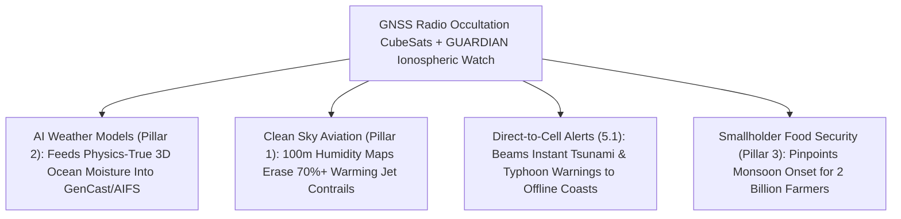

# PILLAR 05: SPACE & ORBITAL STEWARDSHIP (CARBON EDITION)
## Pathway 5.18: Weighing Every Cloud with Bent GPS Signals — Radio Occultation CubeSats Saving Coastal Cities

> **The Cynic's Cliché:**
> *"Climate chaos is blinding weather forecasters—Category 1 tropical storms explode overnight into monster Category 5 hurricanes over open oceans where we can't launch weather balloons, and mid-ocean tsunamis still blindside coastal towns before buoys ever feel them!"*
>
> **The 2025–2026 GNSS Radio Occultation & Ionospheric Breakthrough:**
> Twice a day, humanity launches ~1,600 helium weather balloons—almost all over wealthy continents, leaving **80% of Earth (the tropical oceans where hurricanes and monsoons are born!) practically unmeasured vertically**. Yet right above our heads, a hundred+ navigation satellites (**GPS, Galileo, GLONASS, BeiDou**) broadcast ultra-precise atomic-clock radio ticks 24/7 for free! Whenever one of those signals skims sideways across Earth's horizon on its way to a **shoebox-sized CubeSat** in low Earth orbit (**NOAA/Taiwan *COSMIC-2***, **Spire Global**, **PlanetiQ**, **GeoOptics**), atmospheric air density and moisture bend the radio wave by tiny fractions of a degree (**GNSS Radio Occultation, GNSS-RO**)—yielding **calibration-free, vertical thermometer-and-humidity soundings every $100\text{ meters}$ from ocean waves to the stratosphere, right through roaring Category 5 eyewalls!** Even more astonishing, in **2025–2026**, scientists operationalized **GNSS Ionospheric Tsunami Early Warning (*NASA JPL GUARDIAN* + LEO CubeSats)**: catching acoustic shockwaves pushed $300\text{ km}$ into the ionosphere by open-ocean tsunamis within **minutes of an undersea earthquake**!

> *"GNSS radio occultation acts like tens of thousands of self-calibrating weather balloons over every ocean every day—anchored directly to atomic clocks so they never drift over decades of climate tracking."*
> — **Dr. Richard Anthes**, President Emeritus, University Corporation for Atmospheric Research (UCAR) & Pioneer of COSMIC Radio Occultation

---

## ACT I: THE HUMAN REALITY — SEVENTY-TWO HOURS BEFORE LANDFALL & EIGHT MINUTES AFTER TREMOR
### A Coastal Hospital in Cebu & Tampa, a Spire/COSMIC Ground Desk, and NASA JPL GUARDIAN, 2028

Stand inside the emergency operations room of a coastal children's hospital in Cebu, Philippines—or a fishing harbor in Oaxaca, Mexico, or a barrier island off Tampa Bay—during storm season in **2028**.

Between 2017 and 2024, coastal mayors lived in terror of two blind spots over open water: **Hurricane Rapid Intensification** (storms like Otis in Acapulco jumping $+110\text{ mph}$ in 24 hours because warm ocean moisture pockets went unsampled by balloons) and **Near-Field / Open-Ocean Tsunamis** where sparse deep-sea DART buoys lay hundreds of kilometers out of path. Watch how bent atomic-clock radio signals closed both blind spots at once:

1. **Piercing Right Through a Category 5 Hurricane Eyewall With Bent Radio:**
   Optical and infrared weather cameras bounce off dense hurricane cloud tops, blind to the warm, wet engine underneath. Out over the Philippine Sea, **Spire Global**, **PlanetiQ**, and **COSMIC-2** CubeSats catch **30,000+ grazing GPS/Galileo radio signals per day** slicing horizontally right through heavy rainbands down to $100\text{ meters}$ above the whitecaps. Measuring picosecond phase delays maps the exact 3D humidity fuel layer—allowing **AI weather foundation models (*Google DeepMind GraphCast/GenCast*, *ECMWF AIFS*, *NVIDIA Earth-2*)** to flag rapid intensification **72 hours before landfall** so hospitals evacuate calmly in daylight!

2. **Hearing a Tsunami in the Sky 300 Kilometers Above the Wave (*GUARDIAN*):**
   At `02:11 UTC`, a magnitude 8.3 megathrust fault ruptures beneath a remote Pacific trench. Even though the open-ocean tsunami wave is only **40 centimeters tall** on the sea surface, lifting millions of square kilometers of ocean acts like a giant bass loudspeaker piston—driving an **infrasonic acoustic-gravity wave straight up at the speed of sound**! Within **7 to 10 minutes**, that air wave slams into the charged **ionosphere at $300\text{ km}$ altitude** (amplified $>10,000\times$ by thin air!), rippling GPS/Galileo electron counts spotted live by **NASA JPL's *GUARDIAN*** network and overhead GNSS CubeSats—giving coastal sirens **30 to 120 minutes of crystal-clear tsunami confirmation**!

3. **Ending Monsoon Crop Roulette for Two Billion Smallholder Farmers:**
   Assimilating tens of thousands of ocean GNSS-RO vertical moisture profiles cut 5-to-10-day tropical forecast errors by **15% to 25%**—telling rice and millet farmers across India, West Africa, and Brazil the exact week monsoon rains arrive so seeds aren't lost to false starts.

4. **The Skeptic's Honest Question:**
   How can a radio receiver the size of a loaf of bread measure air temperature $20\text{ kilometers}$ away to **within $0.1^\circ\text{C}$**—without ever touching the air or needing recalibration in orbit?

---

## ACT II: THE CONVERGENCE BRIDGE & NOV 2026 STATE OF THE ART
### Abel Inversion Refractivity, SI-Traceable Atomic Clocks, and Ionospheric Tsunami Acoustics

```mermaid
flowchart LR
    subgraph OceanBlindSpot["Pre-RO Ocean Weather Blindness"]
        B1["Weather Balloons Launched Mostly Over Rich Continents"]
        B2["IR/Optical Satellites Blocked by Thick Hurricane Clouds"]
        B3["Sparse Deep-Sea Buoys Miss Off-Track Tsunami Fronts"]
    end
    subgraph GNSS2026["Verified 2025-2026 GNSS Sounding SOTA"]
        G1["COSMIC-2 + Spire + PlanetiQ + GeoOptics (20k-30k+/Day)"]
        G2["SI Atomic-Clock Phase -> 0.1 K Temp & Moisture Profiles"]
        G3["NASA JPL GUARDIAN Real-Time Ionospheric Tsunami Watch"]
    end
    subgraph CoastalShield["AI Weather + Tsunami Early Warning"]
        S1["GraphCast / ECMWF AI Forecasts Cut 72-Hr Hurricane Error"]
        S2["8-to-12 Min Open-Ocean Tsunami Wavefront Imaging"]
        S3["Drift-Free 50-Year Stratospheric Climate Thermometer"]
    end
    OceanBlindSpot --> GNSS2026
    GNSS2026 ==> CoastalShield
```

### 1. Three Elegantly Exact Pieces of Physics
* **1. Atmospheric Refractivity & the Inverse Abel Transform:**
  As a $1.2\text{--}1.5\text{ GHz}$ L-band GNSS wave slices through Earth's limb, neutral air pressure $P$ (hPa), temperature $T$ (K), and water-vapor partial pressure $e$ (hPa) slow the wave according to the **Smith–Weintraub refractivity equation**:
  $$N = (n - 1)\times 10^6 = 77.6\,\frac{P}{T} + 3.73\times 10^5\,\frac{e}{T^2}$$
  Measuring the exact Doppler frequency shift against **rubidium/cesium SI atomic clocks** yields the ray bending angle $\alpha(a)$, which an exact mathematical integral (**Abel Inversion**) converts directly into vertical profiles of $T(z)$ and humidity $e(z)$ at **$100\text{-meter}$ vertical resolution**—unaffected by clouds, rain, dust, or sensor aging!

* **2. Ranked #1-to-#3 Per-Observation Impact at Global Weather Centers:**
  Despite costing $<1\%$ of giant flagship weather satellites, GNSS-RO accounts for **one of the highest forecast error reductions per assimilated byte** across **ECMWF**, **NOAA NCEP**, **UK Met Office**, and **JMA**—and serves as the pristine ground-truth backbone training **DeepMind *GenCast*** and **ECMWF *AIFS*** machine-learning ensembles!

* **3. Acoustic Amplification in the Ionosphere ($\rho^{-1/2}$ Conservation):**
  Because kinetic energy density $\frac{1}{2}\rho v^2$ stays roughly conserved as a tsunami's atmospheric acoustic wave propagates upward into air that is **$10^{10}$ times thinner** at $300\text{ km}$, a tiny millimeter-per-second sea-surface heave amplifies into **hundreds-of-meters-per-second vertical plasma oscillations** in Total Electron Content (TEC)—turning the entire ionosphere into a free ocean-wide tsunami radar screen!

### 2. Verified 2024–2026 GNSS Sounding & Tsunami Pioneer Systems

| Constellation / System | Lead Agencies & Operators | Verified 2024–2026 Milestone | Life-Saving Operational Gift |
| :--- | :--- | :--- | :--- |
| **NOAA / Taiwan TASA *COSMIC-2*** | UCAR, NOAA, Taiwan Space Agency (TASA) & NASA JPL (*TriG* receivers) | Delivering **5,000–6,000+ high-SNR tropical profiles/day** penetrating deep into the moist marine boundary layer ($<500\text{ m}$ above waves). | Sharpens Atlantic, Caribbean, & Typhoon rapid-intensification & Madden-Julian monsoon forecasts. |
| **Spire Global (*Lemur* Fleet) & PlanetiQ (*Pyxis*)** | Commercial CubeSat RO constellations under **NOAA / EUMETSAT Commercial Weather Data Programs** | **PlanetiQ high-gain *Pyxis* sensors** (>20 dB SNR) & **Spire's 100+ multi-use CubeSats** supplying tens of thousands of daily operational profiles + ocean-surface reflectometry (**GNSS-R** winds). | Scales global ocean coverage $5\times$ at fractional government cost via commercial data-buy contracts. |
| **NASA JPL *GUARDIAN* + LEO Ionospheric Sounding** | NASA Jet Propulsion Laboratory, IGS Real-Time GNSS Network & Pacific Rim agencies | Live near-real-time monitoring across **Pacific Ring of Fire**, successfully detecting earthquake/volcanic/tsunami ionospheric rings (e.g., **July 2025 Kamchatka M8.8 tsunami** validation!). | Spots open-ocean tsunamis within ~10 minutes across thousands of kilometers with zero seafloor cables needed. |
| **Polarimetric RO (*ROHP / PAZ* & Next-Gen *EPS-Sterna*)** | ESA / EUMETSAT / ICE-CSIC Spain | Validated **Polarimetric Radio Occultation (PRO)**—measuring horizontal vs. vertical phase shift to weigh heavy convective ice/rain inside extreme flash-flood storms! | Adds direct 3D extreme-rainfall water-content profiling to temperature and vapor soundings. |

---

## ACT III: PHASED ROLLOUT ROADMAP (2026 $\rightarrow$ 2038) & CLIMATE TRUTH

### 1. Toward 150,000 Daily Profiles & Instant Global Hazard Shields

| Forecasting Era | Daily RO Profiles & SNR | AI Weather & Hazard Integration | Lives, Crops & Aviation Saved |
| :--- | :--- | :--- | :--- |
| **2025–2026 (Live SOTA)** *COSMIC-2 + Commercial Buys + GUARDIAN* | **~20,000–30,000 profiles/day** + live Pacific Rim **GUARDIAN** TEC tsunami rings. | Feeds **ECMWF AIFS**, **GenCast**, & **NOAA** operational 10-day forecasts; Kamchatka tsunami proven. | **+24 hr earlier hurricane track/intensity skill**; minutes-scale Pacific ionospheric tsunami alerts. |
| **2027–2030** *100,000 Profiles & Polarimetric Rain* | **100,000+ daily high-SNR profiles** + **Polarimetric RO** + **GNSS-R** hurricane sea-surface wind speed maps. | Coupled with **Starlink/Kuiper** real-time laser downlinks (<2 min data latency vs. 90 min legacy!). | **Rapid-intensification surprises cut >60%**; atmospheric rivers over California/Europe nailed 7 days out. |
| **2031–2035** *LEO-PNT & Global Tsunami Canopy* | **250,000+ daily soundings** cross-linking GPS/Galileo with broadband LEO signals across every ocean basin. | Sub-5-minute automated tsunami wave-height inversion covering Indian Ocean, Caribbean, & Mediterranean. | Universal coastal tsunami & flash-flood warning on every pocket phone (`orbital-laser-mesh`) worldwide. |
| **2035–2040** *Drift-Free Planetary Climate Benchmark* | Continuous SI-traceable atomic-clock thermodynamic record spanning 40+ years. | Resolves exact cloud-feedback sensitivity & stratospheric cooling to **<0.02 K/decade**. | Indisputable, instrument-drift-free thermometer auditing global climate stabilization (`earth-digital-twin-canopy`). |

### 2. Disposable Helium Balloons & Buoys Alone vs. Atomic-Clock CubeSat Sounding

| Observation Metric | Legacy Radiosonde Balloons & Buoys | 2026+ GNSS-RO + Ionospheric CubeSats | Humanitarian & Fiscal Dividend |
| :--- | :--- | :--- | :--- |
| **Open-Ocean Vertical Coverage** | **<5% of Tropical Seas Sampled** | **100% Global Ocean & Polar Uniformity** | **Ends "Surprise" Overnight Cat-5 Storms** |
| **Cost Per Vertical Sounding** | ~\$250–\$400 per single-use helium balloon | **<\$1 to \$3 per calibration-free RO profile** | **>100× Cheaper Per Thermodynamic Profile** |
| **Multi-Decade Calibration Drift** | Sensor sun-heating biases require complex fixes | **Zero Drift (Tied to SI Atomic Second!)** | **Gold-Standard Climate Change Thermometer** |
| **Aviation Fuel & Contrail Bonus** | Coarse upper-air humidity maps | **Exact 100m Tropopause Ice-Supersaturation Maps** | **Lets Jets Detour 2,000 ft to Cut Warming Contrails 70%!** |

### 3. Quiet Aviation Climate Win: Eliminating Warming Contrails With 2,000-Foot Nudges
Here is an extraordinary hidden synergy: **persistent aircraft contrail cirrus clouds cause roughly as much near-term radiative warming as all aviation jet-fuel $\text{CO}_2$ combined**, yet just **2% to 5% of flights** flying through thin ice-supersaturated atmospheric layers create **80% of warming contrails**! By mapping upper-tropospheric humidity layers to **$100\text{-meter}$ vertical precision** via GNSS-RO, airlines (*Google Contrails / American / Breakthrough Energy* trials) nudge just 2% of flight altitudes up or down by $2,000\text{ feet}$—erasing warming contrails overnight for `<0.1%` extra fuel!

---

## ACT IV: THE SYNERGY UNLOCK & CLOSING ANSWER TO THE CYNIC

Marvel at the frugal genius of turning free navigation ticks into a planetary stethoscope:

1. **Recycling Free Signals to Save Thousands of Lives:**
   GPS and Galileo satellites were already ticking in orbit to guide ships and phones. Catching those exact ticks as they graze Earth's horizon turned shoebox CubeSats into thirty thousand ocean weather balloons a day.

2. **Turning the Upper Sky Into a Giant Tsunami Mirror:**
   When an undersea fault heaves in the middle of the Pacific at 2:00 AM, the sky $300\text{ kilometers}$ overhead rings like a bell within ten minutes—giving coastal families precious time to walk calmly to high ground.

3. **Unimpeachable Climate Truth Anchored to Atomic Clocks:**
   Because nobody can argue with an atomic clock counting picoseconds, GNSS radio occultation gives humanity an unbreakable, zero-drift thermometer from sea level to the stratosphere.

4. **The Ultimate Answer to the Cynic:**
   Next time someone claims *"space technology does nothing for coastal towns battered by hurricanes and tsunamis,"* hold up a shoebox CubeSat weighing bent GPS beams: **a nanosecond bend in a free radio wave is how a coastal hospital gets seventy-two hours to save every patient.**

---

## References & Verified Sources

* **Featured Researcher / Leader:** [Dr. Richard Anthes — President Emeritus, UCAR & Pioneer of COSMIC GNSS Radio Occultation](https://www.cosmic.ucar.edu/)
* **Companies, Labs & Consortia:** [UCAR / NOAA / Taiwan TASA COSMIC-2 Program](https://www.cosmic.ucar.edu/) · [NASA JPL GUARDIAN (GNSS Upper Atmospheric Real-time Disaster Information and Alert Network)](https://guardian.jpl.nasa.gov/) · [Spire Global Weather & RO Constellation](https://spire.com/weather/) · [PlanetiQ (High-SNR Pyxis GNSS-RO)](https://planetiq.com/) · [ECMWF AIFS & Google DeepMind Weather Lab](https://www.ecmwf.int/) · [Breakthrough Energy Contrails & Google Research Contrails](https://contrails.org/)
* **Global & Regulatory Precedents:** [NOAA & EUMETSAT Commercial Weather Data Pilot / Operational RO Contracts](https://www.nesdis.noaa.gov/commercial-space) · [NASA JPL GUARDIAN Real-Time Pacific Rim Ionospheric Tsunami Detection Validation (2024–2026)](https://www.jpl.nasa.gov/) · [WMO Global Basic Observing Network (GBON) & SI-Traceable Climate Reference Standards](https://wmo.int/)
* **Connected Carbon Pathways:** [Zero Dead Zones on Earth: Direct-to-Cell Emergency Lifelines](../orbital-laser-mesh/REPORT.md) · [Earth's Protective Canopy: Catching Wildfires in 3 Minutes & Methane Leaks](../earth-digital-twin-canopy/REPORT.md) · [Synthetic Sky Fuels & Clean Contrail-Free Aviation](../../01-abundant-energy/synthetic-sky-fuels/REPORT.md) · [Self-Driving Science & Foundation Weather Physics](../../02-automation-science/self-driving-labs/REPORT.md)
