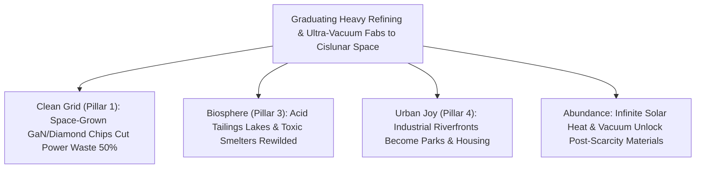

# PILLAR 05: SPACE & ORBITAL STEWARDSHIP (CARBON EDITION)
## Pathway 5.6: Zoning Earth as a Garden Park — Graduating Heavy Refining Above the Biosphere

> **The Cynic's Cliché:**
> *"Moving heavy industry into space is an absurd pipe dream! You'll never launch blast furnaces and cement plants on rockets—space enthusiasts just invent green-sounding excuses while ignoring real industrial pollution down here."*
>
> **The Nov 2026 Orbital Breakthrough:**
> Nobody proposes launching dirty 19th-century coal blast furnaces into orbit! Instead, **graduating heavy industry above the biosphere** means building *next-generation* energy- and vacuum-intensive refining right where the raw space ore, infinite hard vacuum, and 24/7 unfiltered sunlight already sit. Earth's paper-thin, 10-kilometer living atmosphere is the worst place in the solar system to boil toxic rare-earth acids, pump fluorinated greenhouse etching gases, and burn gigawatts of grid electricity—whereas cislunar space offers **infinite ultra-high vacuum ($10^{-12}\text{ Torr}$ behind a simple wake shield)**, continuous $1,361\text{ W/m}^2$ solar thermal mirrors, and zero rivers, lungs, or topsoil to poison. Following a grounded **2026–2042 economic ladder**—from **Space Forge** vacuum semiconductor wafers and **Starcloud** AI compute to **AstroForge / Blue Alchemist** zero-acid metal refining—humanity can steadily re-zone Earth as a lush residential, cultural, and wild ecological sanctuary.

> *"We have sent robotic probes to every planet in this solar system, and Earth is the best one by a huge margin—heavy industry belongs in space so Earth can be zoned residential and light industry, preserved as the gem that it is."*
> — **Jeff Bezos**, Founder, Blue Origin

---

## ACT I: THE HUMAN REALITY — WHEN SMOKESTACKS GRADUATE TO SUNLIGHT
### Walking Former Refinery Riverfronts in Baotou, Ruhr, and the Gulf Coast, 2040

Stroll along a willow-shaded riverfront park in Inner Mongolia—or beside kayak-filled marshes in coastal Texas or Germany's Ruhr Valley—on a crisp autumn Saturday in **2040**.

Twenty years ago, producing the neodymium magnets for wind turbines, the ultra-pure silicon and gallium nitride for solar grids, and the platinum catalysts for clean fuels forced communities to live beside boiling hydrofluoric-acid tailings lakes and \$20 billion semiconductor mega-fabs fighting over scarce river water and gigawatt power lines. By 2040, the most energy-hungry, vacuum-hungry, and chemically harsh upstream steps have graduated cleanly above the Kármán line:

1. **Infinite Hard Vacuum Without \$10 Billion Cryo-Pumps:**
   On Earth, semiconductor fabs spend billions of dollars and hundreds of megawatts running turbo-molecular pumps just to fight $101\text{ kPa}$ of wet, dusty air inside tiny stainless-steel chambers. In Low Earth Orbit, a free-flying **Wake-Shield Epitaxy Fab** cruises through space pushing residual atoms aside—creating a sterile, oil-free **$10^{-12}\text{ Torr}$ ultra-high vacuum** a thousand times purer than any lab on Earth, growing thousand-layer wide-bandgap power chips with near-zero atomic defects.

2. **Solar-Mirror Metallurgy With Zero Tailings Ponds:**
   Further out in cislunar orbit, lightweight aluminized Kapton mirrors a hundred meters wide focus raw sunlight onto asteroid and lunar ore inside closed carbonyl and electrolysis chambers—heating crucibles to $2,500^\circ\text{C}$ for free, separating pure nickel, cobalt, rare earths, and platinum-group metals without a single drop of sulfuric acid or a single smokestack plume in Earth's sky.

3. **Finished Clean Components Gliding Down, Heavy Slag Kept Up:**
   Only compact, high-value, non-toxic finished wafers, magnet alloys, and catalyst ingots glide gently back to Earth inside reusable lifting bodies—weighing less than 1% of the raw ore that would otherwise have been dug, crushed, and acid-leached inside living terrestrial watersheds.

4. **Zoning Our Home Planet as a Living Garden:**
   Just as 20th-century cities moved slaughterhouses and coal foundries out of downtown neighborhoods so families could breathe clean air in central parks, 21st-century civilization is moving heavy primary refining off our fragile blue oasis altogether.

5. **The Skeptic's Honest Question:**
   That sounds inspiring for 2100—but how does a real, profit-making company bridge from 2026 launch prices to heavy off-Earth industry without going bankrupt along the way?

---

## ACT II: THE CONVERGENCE BRIDGE & NOV 2026 STATE OF THE ART
### Wake-Shield Ultra-Vacuum, Solar Concentrators, and the 4-Rung Value Ladder

### 1. Three First-Principles Advantages of Space Over Terrestrial Fabs
Why did physicist **Gerard K. O'Neill** (*The High Frontier*) and **Jeff Bezos** argue that space isn't a harsh backup planet, but the *natural home* of heavy industry?

* **1. The Wake-Shield Ultra-Vacuum Bonus ($10^{-12}\text{ to }10^{-14}\text{ Torr}$):**
  A hemisphere moving at orbital velocity ($7.7\text{ km/s}$, roughly $7\times$ faster than thermal gas molecules) sweeps out a molecular "shadow" behind itself where virtually no ambient oxygen or nitrogen atoms can catch up:
  $$P_{\text{wake}} \approx P_{\text{ambient}} \cdot \exp\!\left(-\frac{m v_{\text{orb}}^2}{2 k_B T}\right) \ll 10^{-12}\text{ Torr}$$
  Pioneered by NASA's *Wake Shield Facility* and commercialized in the late 2020s by **Space Forge**, open-vacuum molecular beam epitaxy (MBE) deposits crystal-pure semiconductor layers without chamber wall outgassing or PFAS/fluorocarbon pump oils.

* **2. Weightless Containerless Smelting (Zero Crucible Contamination):**
  On Earth, melting reactive titanium, zirconium, or superalloys at $2,000^\circ\text{C}$ dissolves trace impurities right out of the ceramic crucible walls. In microgravity, acoustic or electromagnetic levitation holds molten metal spheres suspended in pure vacuum—producing ultra-clean alloys impossible in $1g$.

* **3. Free 24/7 Megawatt Solar Thermal Mirrors (`<0.5 kg/kW`):**
  Focusing sunlight in space requires no heavy glass heliostats fighting windstorms: whisper-thin $5\text{-micron}$ reflective polymer membranes held taut by gentle spin focus megawatts of $2,500^\circ\text{C}$ process heat round the clock.

### 2. Verified 2025–2026 Industrial Pathfinders Climbing the Ladder

| Pioneer / Initiative | Industrial Graduation Rung | Verified 2025–2026 Milestone | Terrestrial Pollution Eliminated |
| :--- | :--- | :--- | :--- |
| **Space Forge (*ForgeStar*)** | Rung 1: Orbital ultra-vacuum wide-bandgap semiconductors ($\text{GaN}$, $\text{SiC}$, diamond) | Operating microgravity/vacuum crystal furnaces & *Pridwen* reusable high-temp alloy reentry heat shield (no ablative burn-off!). | Slashes terrestrial mega-fab vacuum power & cuts global grid/EV switching heat losses by up to 50%. |
| **Starcloud & Axiom ODC** | Rung 2: Gigawatt-scale AI training & radiative thermal workloads | Launching dawn-dusk solar-radiative GPU nodes cooled directly to $3\text{ K}$ deep space (Pathway 5.2). | Spares billions of liters of municipal river water and avoids fossil-peaker grid strain. |
| **AstroForge & Karman+** | Rung 3: Deep-space zero-acid PGM & volatile extraction | *Odin / Vestri* metallic asteroid vacuum distillation & autonomous carbonaceous water harvesting (Pathway 5.5). | Eliminates cyanide/sulfuric acid tailings lakes & 300,000-ton-per-kg terrestrial strip mines. |
| **Blue Origin (*Blue Alchemist* & *New Glenn*)** | Rung 4: Zero-chemical Molten Regolith Electrolysis & heavy reusable lift | End-to-end solar cell, wire, iron, and $\text{O}_2$ smelting from raw regolith + **New Glenn** reusable methalox heavy-lift flights. | Blueprint for heavy cislunar silicon, aluminum, and steel mills that emit zero $\text{CO}_2$ into Earth's air. |
| **ThinkOrbital & Redwire** | In-space electron-beam welding, 3D truss printing & robotic recycling | Validated autonomous vacuum electron-beam welding & *Archinaut* multi-meter orbital additive manufacturing. | Builds large structures directly in space instead of roaring them through Earth's atmosphere. |

---

## ACT III: THE 4-RUNG GRADUATION ROADMAP (2026 $\rightarrow$ 2045) & BIOSPHERE MATH

### 1. How Off-Earth Industry Pays Its Way Rung by Rung

| Graduation Rung & Window | Value-per-kg Threshold | Core Off-Earth Processes | What Graduates Off Earth's Biosphere |
| :--- | :--- | :--- | :--- |
| **Rung 1 (2025–2029)** *Ultra-Pure Wafers & Pharma* | **\$500,000 – \$10M / kg** (Works at `<$1,000/kg` launch) | **Space Forge** $\text{GaN}$/diamond boules, **Varda** biologics, **ZBLAN** optical fibers. | Toxic high-purity crystal growth & specialty fluorinated glass drawing. |
| **Rung 2 (2028–2033)** *Exascale Compute & Catalysts* | **\$20,000 – \$200,000 / kg** (Works at `<$150/kg` Starship lift) | **Starcloud** 100 MW+ AI clusters; **AstroForge** vacuum-refined platinum/iridium ingots. | Hyperscale water-guzzling server farms & new deep-shaft PGM / tropical laterite mines. |
| **Rung 3 (2033–2039)** *Cislunar Silicon & Magnet Alloys* | **\$1,000 – \$10,000 / kg** (Works with Lunar/NEA ISRU) | **Blue Alchemist** cislunar solar-cell foundries; rare-earth magnet refining at Earth-Moon $L_1$. | Acid-leaching rare-earth refineries & coal-powered polysilicon furnaces. |
| **Rung 4 (2040–2050)** *Gigawatt Heavy Metallurgy* | **<\$200 / kg in orbit** (100% space ore + solar mirrors) | Multi-megaton carbonyl iron/nickel rolling mills & orbital solar-power satellite shipyards. | **Heavy primary smelting & bulk refining begin sunsetting across Earth's watersheds.** |

### 2. Biosphere Impact Comparison: Terrestrial Mega-Refinery vs. Cislunar Solar Foundry

| Industrial Metric | Terrestrial Primary Refinery / Mega-Fab | Cislunar Solar-Vacuum Foundry | "Earth as Garden" Dividend |
| :--- | :--- | :--- | :--- |
| **Operating Vacuum Purity** | $10^{-8}\text{ Torr}$ (consumes MWs of grid pumps) | **$10^{-12}\text{–}10^{-14}\text{ Torr}$** (free wake shield) | **10,000× Cleaner Atomic Deposition** |
| **Process Heat Source ($2,000^\circ\text{C}+$)** | Coking coal, natural gas, or strained city grids | **Unfiltered 24/7 Solar Concentrator Foil** | **Zero Atmospheric $\text{CO}_2$ or $\text{SO}_x/\text{NO}_x$** |
| **Toxic Liquid Effluents & Tailings** | Millions of tons of acidic sludge & PFAS rinse water | **Zero** (dry closed-loop vacuum distillation) | **Zero Groundwater or Ocean Runoff** |
| **Atmospheric Launch Burden** | 100% of raw ore dug & hauled through living ecosystems | **99% of ore sourced from Moon/NEAs; <1% glides down** | **Minimal Reentry Traffic; Clean Gliders** |

### 3. Guarding the Stratosphere, Circular Slag Use & Just Worker Transitions
Graduating primary refining off Earth is guided by four strict environmental and social guardrails:

* **Protecting the Ozone Layer During the Transition:**
  Critics rightly ask whether frequent rocket launches could harm the stratosphere. That is why the Carbon Edition pairs off-Earth industry with **clean carbon-neutral methalox and green $\text{LH}_2/\text{LOX}$ boosters** (zero chlorine, zero black carbon soot, zero alumina particles—unlike legacy solid-fuel or kerosene rockets), **non-ablative alloy heat shields** (*Space Forge Pridwen* and stainless steel that shed zero toxic silica dust), and shifting 99% of bulk mass flow to **airless lunar and asteroid electric tugs** in the 2030s!

* **Turning Refining Slag Into Radiation Armor Upstairs:**
  On Earth, silicate and iron slag left over after extracting rare earths or PGMs piles up in toxic mountains. In cislunar space, inert silicate slag is cast directly into 2-meter radiation-shield tiles wrapping **spinning orbital habitats** and **data vaults**—achieving 100% circular mass utilization.

* **High-Skill Tele-Metallurgy Guilds for Industrial Towns:**
  Terrestrial refinery and foundry workers never get discarded—they transition into tele-operating cislunar robotic smelters and electron-beam welders from clean, air-conditioned control studios in Pittsburgh, Essen, Port Talbot, and Baotou, paired with local brownfield park restoration.

---

## ACT IV: THE SYNERGY UNLOCK & CLOSING ANSWER TO THE CYNIC

Zoning heavy primary refining upstairs where the sun never sets and no lungs breathe the exhaust unlocks five civilizational transformations:

1. **Ending "Sacrifice Zones" Forever:**
   No low-income town, indigenous watershed, or rural province ever again has to accept boiling rare-earth acid ponds or smoggy smelters as the hidden price of global clean technology.

2. **Semiconductors That Supercharge Clean Energy:**
   Defect-free diamond and gallium-nitride power wafers grown inside orbital wake-shield ultra-vacuum slash electricity conversion losses across every EV, train, heat pump, and solar microgrid on Earth.

3. **Industrial Riverfronts Returned to Families:**
   Millions of acres of former heavy-refining brownfields along rivers and coastlines transform into walkable mass-timber neighborhoods, kayaking wetlands, and public parks.

4. **Unlimited Clean Energy Materials Without Guilt:**
   Cislunar solar-mirror foundries supply abundant permanent magnets, catalysts, and solar silicon without colliding with terrestrial biodiversity limits.

5. **The Warm Truth for the Cynic:**
   Moving heavy refining off Earth isn't abandoning our planet—it is the ultimate act of environmental zoning, treating Earth's thin blue atmosphere like the irreplaceable botanical garden it truly is.

---

## References & Verified Sources

* **Featured Researcher / Leader:** [Jeff Bezos — Founder, Blue Origin](https://www.blueorigin.com/)
* **Companies, Labs & Consortia:** [Blue Origin (Blue Alchemist & New Glenn)](https://www.blueorigin.com/) · [Space Forge (ForgeStar & Pridwen)](https://www.spaceforge.com/) · [ThinkOrbital](https://www.thinkorbital.com/) · [Redwire Space](https://redwirespace.com/) · [AstroForge](https://www.astroforge.com/) · [Starcloud](https://www.starcloud.com/) · [Space Studies Institute (O'Neill Legacy)](https://ssi.org/)
* **Global & Regulatory Precedents:** [NASA Wake Shield Facility Ultra-Vacuum Epitaxy Flights](https://en.wikipedia.org/wiki/Wake_Shield_Facility) · [Space Forge Orbital Semiconductor & Reusable Alloy Shield Missions](https://www.spaceforge.com/) · [Ruhr Valley (Emscher Park) Industrial-to-Ecological Riverfront Rebirth](https://en.wikipedia.org/wiki/Ruhr)
* **Connected Carbon Pathways:** [Lossless HTS Superhighways & Autonomous Microgrids](../../01-abundant-energy/superconducting-grids/REPORT.md) · [Trillions of Tons Without Cutting Down a Single Tree: Asteroid Metals & Water Propellant](../asteroid-cislunar-resources/REPORT.md) · [The Shackleton Peak-of-Eternal-Light Base: Humanity's First Cislunar Commons](../lunar-south-pole/REPORT.md) · [Rescuing Displaced Workers Today: Denmark's 90% Wage-Bridge & Rapid Craft Pivots](../../04-social-norms/displaced-worker-bridge/REPORT.md)
