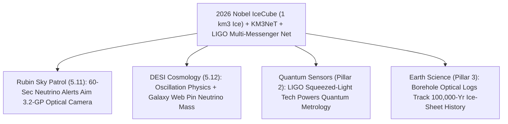

# PILLAR 05: SPACE & ORBITAL STEWARDSHIP (CARBON EDITION)
## Pathway 5.13: 2026 Physics Nobel — Cubic-Kilometer Polar Ice Telescopes & Multi-Messenger Cosmic Tomography

> **The Cynic's Cliché:**
> *"Particle physics is hitting a dead end—building ever-pricier concrete colliders just to chase tiny decimal places while the universe's most extreme black-hole engines sit forever hidden behind impenetrable walls of cosmic dust and magnetic fields!"*
>
> **The Oct 2026 Nobel Breakthrough:**
> Instead of pouring fifty billion dollars of concrete, **2026 Nobel Prize in Physics laureate Prof. Francis Halzen** (University of Wisconsin–Madison) asked a breathtakingly audacious question: *what if Earth already built a billion-ton crystal-clear particle detector at the South Pole for free?* By melting 86 deep vertical shafts $1.5\text{ to }2.5\text{ kilometers}$ down into ultra-pure Antarctic glacial ice and lowering **5,160+ Basketball-sized Digital Optical Modules**, the **IceCube Neutrino Observatory** turned **one full cubic kilometer of polar ice** into a telescope for ghostly **high-energy astrophysical neutrinos**—honored by the Royal Swedish Academy of Sciences in **October 2026**! Paired today with **KM3NeT** deep beneath the Mediterranean Sea, **LIGO-Virgo-KAGRA (O4/O5)** gravitational-wave interferometers, and **Vera Rubin / space gamma-ray monitors**, humanity now watches supermassive black holes and colliding neutron stars simultaneously in **three cosmic senses: light, spacetime ripples, and neutrinos**!

> *"Neutrinos reach us straight from the hearts of the most violent cosmic accelerators in the universe without being stopped by dust or bent by magnetic fields—Antarctic ice gave humanity a brand-new eye on the cosmos."*
> — **Prof. Francis Halzen**, 2026 Nobel Laureate in Physics & Principal Investigator of IceCube, University of Wisconsin–Madison

---

## ACT I: THE HUMAN REALITY — WHEN THE SOUTH POLE ICE FLASHED BLUE AT 2,000 METERS DEEP
### Amundsen–Scott South Pole Station, Abyssal Mediterranean Waters & Global Alert Rooms, 2026–2031

Step out onto the $-55^\circ\text{C}$ polar plateau at **Amundsen–Scott South Pole Station** under shimmering green aurora australis—then ride imagination two kilometers straight down beneath your boots into pressure-compressed glacial ice clearer than cathedral glass.

For all of human history until our lifetime, astronomy had only **one sense—photons (light)**. Yet high-energy photons get absorbed by dust clouds, scattered by cosmic background radiation, and blocked inside dense stellar cores, while charged cosmic-ray protons get scrambled into random spaghetti loops by galactic magnetic fields. Enter the **neutrino**—and the 2026 Nobel revolution:

1. **The Ghost Particle That Walks Through Lead Walls Like Air:**
   Every second, a hundred trillion low-energy solar neutrinos pass harmlessly through your thumb. Because neutrinos carry **zero electric charge** and barely interact with matter, a PeV ($10^{15}\text{ eV}$) neutrino shot out of a supermassive black hole jet **four billion light-years away** flies in a laser-straight line right through dust shrouds, intergalactic magnetic fields, and planets—pointing directly back to its cosmic engine!

2. **Catching a Faster-Than-Ice-Light Blue Sonic Boom:**
   Almost every neutrino slips right through Earth—except roughly *one in a million* high-energy astrophysical neutrinos that smashes head-on into an atomic nucleus deep inside Antarctic ice. That rare collision spawns a relativistic muon or particle cascade racing through the ice **faster than light travels in ice ($c/n \approx 0.76\,c$)**, unleashing a brilliant cone of sapphire-blue **Cherenkov radiation**! Across a cubic kilometer of pitch-black depth, IceCube's **5,160+ optical sensors** time each nanosecond photon flash to reconstruct the neutrino's exact sky direction within minutes.

3. **Three Cosmic Senses Firing Together (Multi-Messenger Symphony):**
   When a distant supermassive **blazar (like TXS 0506+056)** or shrouded **active galactic nucleus (NGC 1068)** fires a relativistic particle jet—or two neutron stars spiral together shaking spacetime in **LIGO-Virgo-KAGRA**—IceCube and Mediterranean **KM3NeT** broadcast instant coordinates so **Vera Rubin LSST** (`rubin-citizen-sky-patrol`) and space X-ray/gamma telescopes slew onto the exact spot within 60 seconds!

4. **The Skeptic's Honest Question:**
   Wait—if Antarctica has cosmic rays raining down on its surface constantly, how does IceCube tell a true deep-space black-hole neutrino apart from ordinary atmospheric clutter?

---

## ACT II: THE CONVERGENCE BRIDGE & NOV 2026 STATE OF THE ART
### Cherenkov Cones, Using Earth Itself as a Filter, and Cubic-Kilometer Scale

```mermaid
flowchart LR
    subgraph OneSense["Photon-Only Astronomy Limits"]
        P1["Dust & Dense Cores Block High-Energy Gamma Rays"]
        P2["Magnetic Fields Scramble Charged Cosmic-Ray Paths"]
        P3["PeV-EeV Cosmic Accelerators Remained a 100-Yr Mystery"]
    end
    subgraph Nobel2026["Oct 2026 Nobel Multi-Messenger SOTA"]
        N1["Francis Halzen & IceCube: 1 km3 Antarctic Ice (5,160+ DOMs)"]
        N2["KM3NeT Abyssal Mediterranean Sea (~220 PeV Record Event)"]
        N3["LIGO-Virgo-KAGRA O4/O5 Spacetime Ripples + SNEWS 2.0"]
    end
    subgraph CosmicTomography["3-Sense Cosmic Tomography (2030s)"]
        T1["IceCube-Gen2 (8 km3 Optical + 500 km2 Radio Array)"]
        T2["Live Black-Hole Core & Supernova Neutrino Early Warning"]
        T3["Earth Core Tomography + PeV Particle Physics Free from Sky"]
    end
    OneSense --> Nobel2026
    Nobel2026 ==> CosmicTomography
```

### 1. Three Clever Physics Insights Honored by the 2026 Nobel Prize
* **1. Nature's Free Billion-Ton Ultrapure Crystal ($1\text{ km}^3$ Deep Ice):**
  Building a billion-ton tank of purified water in a mine would bankrupt science. Two kilometers under the South Pole, millennia of snow compression squeeze out every microscopic air bubble—creating **ultra-transparent polar ice** where blue Cherenkov light travels over $100\text{ meters}$ unimpeded! Hot-water drills melted 86 boreholes in ~40 hours each, freezing **5,160+ Digital Optical Modules (DOMs)** permanently into a 3D optical grid.

* **2. Cherenkov Geometry & Using the Whole Planet Earth as a Shield:**
  When a neutrino-induced muon moves at $v \approx c > c/n_{\text{ice}}$ ($n_{\text{ice}} \approx 1.31$), it emits blue Cherenkov light at angle:
  $$\cos\theta_C = \frac{1}{n_{\text{ice}}\,\beta} \approx \frac{1}{1.31} \implies \theta_C \approx 40.5^\circ$$
  Even better: to block downward-raining atmospheric muons, IceCube often looks *straight down through the floor*—using **12,742 kilometers of solid Earth rock and iron core as a giant shield** that stops every known particle except upward-going neutrinos arriving from the Northern sky!

* **3. First Neutrino Portrait of Our Own Milky Way & Record 220-PeV Seas:**
  Beyond distant blazars (**TXS 0506+056**) and obscured Seyfert galaxies (**NGC 1068**), IceCube applied machine learning to unveil the **first-ever neutrino image of our own Milky Way galaxy**—proving our galactic plane glows in ghostly particles, not just starlight! Meanwhile, Europe's **KM3NeT (*ARCA* & *ORCA*)** anchored $3.5\text{ km}$ underwater off Sicily and France caught an astonishing **~220-PeV ultra-high-energy cosmic neutrino**—over $10,000\times$ higher energy than humanity's largest particle collider (CERN's LHC)!

### 2. Verified 2024–2026 Multi-Messenger Observatory Network

| Observatory / Network | Medium & Scale | Verified 2024–2026 Milestone | Unique Cosmic Superpower |
| :--- | :--- | :--- | :--- |
| **IceCube Neutrino Observatory (+ Upgrade)** | $1\text{ km}^3$ Antarctic ice ($1.5\text{--}2.5\text{ km}$ deep), 5,160+ DOMs + 7 new dense upgrade strings | **Prof. Francis Halzen awarded the Oct 2026 Nobel Prize in Physics**; mapped **TXS 0506+056**, **NGC 1068**, and the first **Milky Way neutrino portrait**; **2025/2026 IceCube Upgrade** deployed. | 99%+ uptime 24/7 whole-sky neutrino monitor & cosmic-ray PeV particle laboratory. |
| **KM3NeT (*ARCA* & *ORCA*) & Baikal-GVD** | Deep-sea Mediterranean Cherenkov strings ($2.5\text{--}3.5\text{ km}$ depth) | **Detected record ~220 PeV ultra-high-energy neutrino (*Nature*, 2025)** with sub-degree angular resolution in liquid seawater; rapid string expansion through 2026. | Crisp Southern-sky & Galactic-Center angular pointing complementary to South Pole view. |
| **LIGO, Virgo & KAGRA (O4 / O5 Runs)** | $3\text{--}4\text{ km}$ quantum-squeezed laser interferometers (US, Italy, Japan) | **Hundreds of black-hole & neutron-star mergers** logged in O4 (via frequency-dependent quantum light squeezing), streaming live public multi-messenger alerts. | Hears pure spacetime curvature ripples from totally dark black-hole collisions. |
| **SNEWS 2.0 (SuperNova Early Warning System)** | Global linked ring of IceCube, Super-K/Hyper-K, KM3NeT & Borexino/JUNO | Sub-minute automated coincidence network ready for the next Milky Way core-collapse supernova. | Neutrinos escape a dying star's core **hours before light breaks out**—giving optical telescopes early warning! |

---

## ACT III: PHASED ROLLOUT ROADMAP (2026 $\rightarrow$ 2038) & EARTH-CORE SPINOFFS

### 1. Scaling to *IceCube-Gen2* and Space Gravitational Ears

| Multi-Messenger Era | Detector Expansion | Energy & Volume Reach | Breakthrough Scientific Payoff |
| :--- | :--- | :--- | :--- |
| **2025–2026 (Nobel SOTA)** *IceCube Upgrade & KM3NeT* | **IceCube (86 + 7 dense strings)**, **KM3NeT**, **JUNO** (China), **LIGO O4/O5**. | $1\text{ km}^3$ polar ice; GeV oscillations up to **220 PeV** cosmic events. | **2026 Physics Nobel**; pinpoints hidden AGN black-hole coronae & tests precision neutrino oscillations. |
| **2027–2030** *Hyper-Kamiokande & Radio Arrays* | **Hyper-Kamiokande** (Japan, 260 kiloton water) + **RNO-G** Greenland radio neutrino pathfinder + **Rubin LSST**. | $10\times$ supernova neutrino statistics; EeV ($10^{18}\text{ eV}$) cosmogenic radio hunt begins. | Routine live kilonova gold/platinum-factory captures in simultaneous gravity + neutrinos + light. |
| **2031–2035** *IceCube-Gen2 ($8\text{ km}^3$)* | **IceCube-Gen2**: 120 new optical strings (**$8\text{ km}^3$ ice!**) + **$500\text{ km}^2$ shallow radio array**. | **$10\times$ astrophysical neutrino rate**; reaches $10^{18}\text{--}10^{20}\text{ eV}$ GZK frontier. | Resolves hundreds of individual cosmic-ray PeVatron factories & tests Lorentz invariance at Planck scales. |
| **2035–2040** *Cosmic Explorer, Einstein Telescope & LISA* | $40\text{ km}$ ground interferometers + **ESA/NASA *LISA*** ($2.5\text{ million km}$ space laser triangle). | Every stellar black-hole merger in the **entire observable universe** heard live! | Complete 3-sense cosmic tomography from Earth's inner iron core out to the first black holes. |

### 2. Concrete Mega-Colliders Alone vs. Nature's Free Cosmic Accelerators

| Physics Metric | Human-Built Collider Limit (LHC) | IceCube / KM3NeT Cosmic Neutrinos | Scientific & Fiscal Dividend |
| :--- | :--- | :--- | :--- |
| **Peak Particle Energy** | ~$14\text{ TeV}$ ($0.014\text{ PeV}$) center-of-mass | **$1\text{ PeV}\text{ to }220+\text{ PeV}$ ($>10,000\times$ Higher!)** | **Probes Extreme Physics No Earth Ring Can Reach** |
| **Detector Medium Cost** | Billions in mined caverns & magnets | **\$0 Natural Antarctic Ice & Deep Ocean Water** | **Cubic-Kilometer Scale for ~\$300M–\$400M** |
| **Planetary Bonus Science** | Purely subatomic lab collisions | **Neutrino Absorption X-Rays Earth's Outer/Inner Core** | **Direct Measure of Deep Earth Density & Glaciology** |

### 3. Surprising Earthly Gifts: X-Raying Earth's Core & Antarctic Climate Archives
* **Neutrino Tomography of Earth's Deep Iron Core:**
  At multi-TeV energies, Earth becomes partially opaque to neutrinos! By counting exactly how many upward neutrinos get absorbed passing through Earth's mantle versus its liquid and solid iron core, IceCube acts like a **planetary medical CT scanner**—independently weighing Earth's core mass without relying solely on earthquake waves!
* **100,000-Year Polar Paleoclimate Dust Logs:**
  IceCube's optical dust loggers mapped volcanic ash and glacial layers down $2.5\text{ km}$ at millimeter resolution, gifting climate scientists one of the cleanest paleoclimate timelines in Antarctica while adhering strictly to **Antarctic Treaty** zero-pollution environmental stewardship.

---

## ACT IV: THE SYNERGY UNLOCK & CLOSING ANSWER TO THE CYNIC

Pause and marvel at the sheer human poetry of the **2026 Nobel Prize in Physics**:

1. **Turning Frozen Wilderness Into a Window on Black Holes:**
   Without harming a single penguin or scarring a mountain, humanity hung strings of glass pearls two kilometers down in ancient polar ice—and caught particles forged inside supermassive black holes four billion years ago.

2. **Three Cosmic Senses Are Better Than One:**
   Imagine experiencing a thunderstorm your whole life with earplugs in and eyes half-shut—and suddenly hearing thunder (gravitational waves), seeing lightning (Rubin optical), and feeling the wind (neutrinos) all at once. That is 2026 multi-messenger astronomy.

3. **Free Particle Accelerators a Million Light-Years Wide:**
   Nature's spinning black holes accelerate particles ten thousand times harder than any machine humans could afford to build—and beam the results to Antarctica free of charge.

4. **The Ultimate Answer to the Cynic:**
   Next time someone grumbles that *"fundamental particle physics is too expensive and out of clever ideas,"* point south to **Francis Halzen's** cubic kilometer of sunlit-blue polar ice: **imagination turned Antarctica itself into a telescope, and ghosts from the edge of time lit it up.**

---

## References & Verified Sources

* **Featured Researcher / Leader:** [Prof. Francis Halzen — 2026 Nobel Laureate in Physics & IceCube Principal Investigator, UW–Madison](https://icecube.wisc.edu/)
* **Companies, Labs & Consortia:** [IceCube Neutrino Observatory (UW–Madison & NSF South Pole)](https://icecube.wisc.edu/) · [Royal Swedish Academy of Sciences — 2026 Nobel Prize in Physics](https://www.nobelprize.org/prizes/physics/2026/summary/) · [KM3NeT Abyssal Mediterranean Neutrino Telescope](https://www.km3net.org/) · [LIGO-Virgo-KAGRA Gravitational-Wave Collaboration](https://www.ligo.caltech.edu/) · [SuperNova Early Warning System (SNEWS 2.0)](https://snews2.org/) · [Hyper-Kamiokande Collaboration](https://www.hyperk.org/)
* **Global & Regulatory Precedents:** [2026 Nobel Prize in Physics Citation for IceCube & Astrophysical Neutrinos](https://www.nobelprize.org/prizes/physics/2026/summary/) · [IceCube Blazar TXS 0506+056, NGC 1068 & First Milky Way Neutrino Map (*Science*)](https://icecube.wisc.edu/news/) · [KM3NeT Detection of Record ~220-PeV Ultra-High-Energy Cosmic Neutrino (*Nature*, 2025)](https://www.km3net.org/) · [Antarctic Treaty System Environmental Protocol](https://www.ats.aq/)
* **Connected Carbon Pathways:** [Filming the Cosmic Time-Lapse: Vera C. Rubin LSST & Citizen Sky Patrols](../rubin-citizen-sky-patrol/REPORT.md) · [A Living, Evolving Cosmos: DESI 3D Galaxy Maps & Dynamical Dark Energy](../desi-dynamical-dark-energy/REPORT.md) · [Fault-Tolerant Quantum Simulation](../../02-automation-science/quantum-logical-simulation/REPORT.md) · [The Quietest Ear in the Solar System: Lunar Farside Radio Arrays](../lunar-farside-radio-cosmology/REPORT.md)
