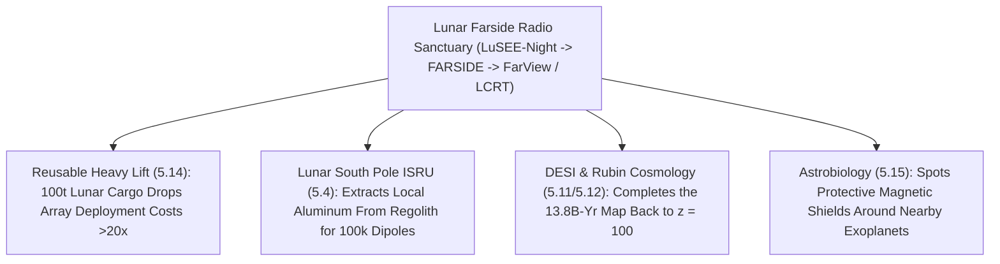

# PILLAR 05: SPACE & ORBITAL STEWARDSHIP (CARBON EDITION)
## Pathway 5.17: The Quietest Ear in the Solar System — Lunar Farside Radio Arrays Listening to the Cosmic Dawn

> **The Cynic's Cliché:**
> *"Every square inch of cosmic history has already been photographed—and even if faint signals from before the first stars existed, human radio chatter, FM stations, TV towers, and mega-constellations have drowned out the radio sky forever!"*
>
> **The 2025–2026 Lunar Farside Breakthrough:**
> There is one entire cosmic epoch—the **first 100 million years after the Big Bang ("The Cosmic Dark Ages")**, before a single star or galaxy ignited—that **neither Hubble nor the James Webb Space Telescope can ever see**, because there was no starlight yet! That missing chapter of Genesis is written exclusively in ultra-long, stretched **$21\text{-centimeter}$ neutral hydrogen radio waves** redshifted down below $30\text{ MHz}$ ($10\text{-meter+}$ wavelengths)—frequencies that Earth's ionosphere reflects like a tin roof and human FM/radar chatter drowns a million times over. Fortunately, nature placed the **single most radio-quiet sanctuary in the inner solar system** just three days away: the **far side of the Moon**, permanently shielded from Earth by **3,474 kilometers of solid silicate rock**! Following **NASA/Intuitive Machines' *ROLSES*** lunar radio firsts and China's farside relays, **DOE (Brookhaven & LBNL) and NASA's *LuSEE-Night* (*Lunar Surface Electromagnetics Experiment - Night*)**—engineered to survive brutal $-170^\circ\text{C}$ 14-day lunar nights aboard **Firefly Aerospace's *Blue Ghost Mission 2*** with **ESA's *Lunar Pathfinder*** relay—is opening humanity's pristine farside ear, while the **ITU works to protect the Moon's Shielded Zone (SZM)** as a permanent scientific sanctuary!

> *"The far side of the Moon is the only place in the inner solar system truly shielded from Earth's radio noise and ionosphere—allowing us to listen to the universe before the very first stars turned on."*
> — **Dr. Anže Slosar**, Cosmologist, Brookhaven National Laboratory & LuSEE-Night Science Collaboration Lead

---

## ACT I: THE HUMAN REALITY — FOURTEEN DAYS OF ABSOLUTE SILENCE IN CRATER SHADOW
### Brookhaven Cryogenic Test Chamber, Lunar Farside Latitude $23^\circ\text{ S}$, and ITU Geneva, 2026–2033

Imagine standing in the center of a flat dusty plain on the **far side of the Moon** just after the Sun sinks below the jagged crater rim, ushering in **336 consecutive hours (14 Earth days) of pitch-black lunar night**.

Earth never rises in this sky—ever. Beneath your boots sit **3,474 kilometers of dense lunar rock**, blocking **99.999999%+ ($>80\text{--}90\text{ dB}$ attenuation)** of every FM radio station, air-traffic radar, cell tower, and LEO satellite broadcast from eight billion humans back home. And when the Sun sets behind the Moon too, even solar radio bursts fall silent. Watch what **LuSEE-Night** and its successor arrays hear in that sacred quiet:

1. **Beating the $-170^\circ\text{C}$ Night Without Nuclear Heaters (*LuSEE-Night* Engineering):**
   Previously, almost every non-nuclear lunar lander froze to death within hours of sunset as surface temperatures plunged from $+120^\circ\text{C}$ to **$-170^\circ\text{C}$ ($100\text{ K}$)**. Built by **DOE's Brookhaven and Lawrence Berkeley National Labs** with UC Berkeley's Space Sciences Lab and NASA, **LuSEE-Night** pairs a super-insulated thermal cocoon and high-energy-density **45 kg lithium battery pack** with precision gold-plated thermal louvers and four $6\text{-meter}$ stacer monopole antennas on a motorized turntable—listening through the dead of the lunar night across **$0.5\text{ to }50\text{ MHz}$** and beaming clean spectra up to **ESA's *Lunar Pathfinder*** orbiter!

2. **Reading the Missing Baby Pages of our 13.8-Billion-Year Photo Album:**
   Imagine owning a family photo album where pages 2 through 40 are completely blank—jumping straight from a newborn ultrasound (the **Cosmic Microwave Background** at 380,000 years) to kindergarten (JWST's first galaxies at ~300 million years). During those missing **Dark Ages**, cool neutral hydrogen atoms ($\text{H\,\scriptstyle I}$) filled space, occasionally flipping their electron spin ($1,420\text{ MHz}$ rest frame) and absorbing background photons. Stretched $30\times$ to $100\times$ by cosmic expansion into **$10\text{ to }45\text{ MHz}$ low-frequency radio**, that pristine signal encodes pure primordial inflation physics untouched by messy stars or black holes!

3. **Catching Exoplanet Magnetic Shields That Protect Alien Oceans:**
   Bonus superpower: when stellar wind slams into a rocky exoplanet's protective **magnetosphere** (the exact magnetic shield that keeps Earth's atmosphere and oceans from being stripped away!), electrons spiral out low-frequency **auroral cyclotron radio waves ($<15\text{ MHz}$)** completely blocked by Earth's ionosphere. Lunar farside arrays can *hear* whether nearby habitable-zone exoplanets possess life-shielding magnetic fields!

4. **The Skeptic's Honest Question:**
   Wait—if our own Milky Way galaxy hisses loudly with foreground synchrotron radio static that is **$10,000\times$ to $100,000\times$ brighter** than the faint Dark Ages hydrogen whisper, how can four antennas on the Moon ever separate the signal from galactic static?

---

## ACT II: THE CONVERGENCE BRIDGE & NOV 2026 STATE OF THE ART
### Redshifted 21-cm Spin-Flip Physics, Turntable Calibration, and Wire-Mesh Crater Dishes

```mermaid
flowchart LR
    subgraph EarthDeafness["Why Earth Is Deaf Below 30 MHz"]
        E1["Earth Ionosphere Plasma Reflects <10-15 MHz Waves"]
        E2["Human FM / Radar / Satellites Drown Sky by >1,000,000x"]
        E3["First 100M Years ('Cosmic Dark Ages') Completely Unseen"]
    end
    subgraph Farside2026["Verified 2025-2026 Lunar Radio Pioneers"]
        L1["NASA ROLSES-1 First Lunar Radio Spectrum + Chang'e Relays"]
        L2["DOE / NASA LuSEE-Night Built for -170C Night (Blue Ghost 2)"]
        L3["ESA Lunar Pathfinder Relay + ITU Shielded Zone (SZM) Push"]
    end
    subgraph DarkAgesOpen["2030s Cosmic Dawn & Exoplanet Ear"]
        D1["FARSIDE / FarView 100,000-Dipole Rolled-Foil Arrays"]
        D2["1 km Lunar Crater Radio Telescope (LCRT) Robotic Mesh"]
        D3["Pristine Inflation Test + Exoplanet Magnetosphere Detection"]
    end
    EarthDeafness --> Farside2026
    Farside2026 ==> DarkAgesOpen
```

### 1. Three Breakthroughs Turning Dusty Regolith Into a Precision Cosmology Lab
* **1. Redshifted 21-cm Hyperfine Physics ($\nu_{\text{obs}} = 1420\text{ MHz}/(1+z)$):**
  Neutral hydrogen's proton-electron spin-flip transition emits or absorbs at rest frequency $\nu_{21} = 1,420.4\text{ MHz}$ ($\lambda = 21.1\text{ cm}$). Across the **Cosmic Dark Ages ($z \approx 30\text{ to }150$)** and **Cosmic Dawn ($z \approx 15\text{ to }30$)**, cosmic expansion stretches those waves down to:
  $$\nu_{\text{obs}} = \frac{1,420.4\text{ MHz}}{1 + z} \approx 9\text{ MHz to } 50\text{ MHz} \quad (\lambda \approx 6\text{ m to } 33\text{ m})$$
  Unlike galaxy surveys (`desi-dynamical-dark-energy`) limited to tens of millions of bright galaxies, the 3D Dark Ages 21-cm field contains **trillions of independent linear-regime Fourier modes**—over **$1,000\times$ more cosmological information** than the entire Cosmic Microwave Background!

* **2. Precision Motorized Turntable & Smooth-Spectrum Foreground Subtraction (*LuSEE-Night*):**
  Milky Way synchrotron emission follows an ultra-smooth power law across frequency ($T_{\text{gal}} \propto \nu^{-2.5}$), whereas the cosmological 21-cm Dark Ages trough creates a distinctive **curved spectral dip**. By mounting its four crossed $6\text{-meter}$ beryllium-copper antennas on a **precision motorized azimuth turntable**, *LuSEE-Night* rotates against the sky and lunar soil dielectric to self-calibrate beam chromaticity down to parts per hundred thousand!

* **3. Rover-Unrolled Kapton Foil Arrays (*FARSIDE* / *FarView*) & Crater Wire Dishes (*LCRT*):**
  Because $10\text{-meter}$ radio waves are huge, farside telescopes don't need polished glass! Rovers unroll paper-thin **Kapton polyimide ribbons printed with copper dipole antennas** across $10\text{ km}$ of flat regolith (**JPL/CU Boulder *FARSIDE***), or **in-situ manufacturing (`lunar-south-pole`)** extracts metallic aluminum/iron right out of lunar regolith (***FarView***) while climbing **DuAxel** bots drape a **$1\text{-kilometer}$ wire mesh inside a natural farside bowl crater (*NASA NIAC LCRT*)**—dwarfing Arecibo!

### 2. Verified 2024–2026 Lunar Radio & Quiet-Zone Milestones

| Mission / Initiative | Lead Institutions | Verified 2024–2026 Milestone | Scientific & Governance Role |
| :--- | :--- | :--- | :--- |
| **DOE / NASA *LuSEE-Night*** | Brookhaven National Lab, LBNL, UC Berkeley SSL, Univ. of Minnesota & NASA CLPS | Flight payload completed & integrated (**2025–2026**) for **Firefly Aerospace *Blue Ghost Mission 2*** farside landing ($23.8^\circ\text{ S}, 182.3^\circ\text{ E}$) paired with **ESA *Lunar Pathfinder***. | First precision cosmology receiver built to survive multiple 14-day $-170^\circ\text{C}$ farside nights ($0.5\text{--}50\text{ MHz}$). |
| **NASA *ROLSES-1 & ROLSES-2*** | NASA Goddard, CU Boulder, Caltech/JPL & Intuitive Machines | **ROLSES-1 achieved NASA's first lunar-surface radio observations (Feb 2024)** on *Odysseus*, mapping Earth's technosignature leakage ahead of upgraded **ROLSES-2**. | Measures lunar photoelectron sheath & benchmarks Earth as an exoplanet technosignature. |
| **NCLE / Chang'e Low-Frequency Pathfinders** | Radboud Univ. / ASTRON (Netherlands) & CNSA Farside Relay Missions | Demonstrated space-based very-low-frequency antenna deployment in cislunar/farside shadow environments. | Validates farside radio-quiet noise floor and international low-frequency calibration. |
| **ITU Shielded Zone of the Moon (SZM) & IAU Working Group** | International Telecommunication Union (**ITU-R RA.479** / WRC-27 agenda) & **IAU** | Active global treaty preparation ahead of **WRC-27** to keep incoming lunar navigation/comms satellites (`LunaNet` / `Moonlight`) from polluting $<2\text{ GHz}$ & $<50\text{ MHz}$ farside bands! | Preserves the solar system's only radio-quiet sanctuary before cislunar traffic scales. |

---

## ACT III: PHASED ROLLOUT ROADMAP (2026 $\rightarrow$ 2040) & TREATY STEWARDSHIP

### 1. From Single-Crater Pathfinder to 100,000-Dipole Cosmology Engine

| Lunar Radio Phase | Surface Hardware Scale | Frequency & Sky Resolution | Breakthrough Cosmic Unlock |
| :--- | :--- | :--- | :--- |
| **2026–2027 (Pathfinder SOTA)** *LuSEE-Night & ROLSES-2* | **4 crossed 6m monopoles** on motorized turntable (*Blue Ghost 2*) + **ESA *Lunar Pathfinder***. | $0.5\text{--}50\text{ MHz}$ global sky spectrum across multiple lunar nights. | First pristine measurement of the $<30\text{ MHz}$ farside radio sky; bounds exotic dark-matter cooling! |
| **2028–2031** *128-Antenna FARSIDE Array* | Commercial/Starship lander + telerobotic rover unrolling **$10\text{ km}$ Kapton antenna petals** (128 nodes). | $0.1\text{--}40\text{ MHz}$ imaging interferometer (1,000+ baselines). | **First direct detection of habitable-zone exoplanet magnetospheres** + solar coronal mass ejection tracking! |
| **2032–2036** *FarView & LCRT Crater Dish* | **100,000 dipoles** manufactured from local lunar regolith metals + **$1\text{ km}$ crater wire-mesh dish**. | Full 3D tomography of **Cosmic Dawn ($z=15\text{--}30$)** & **Dark Ages ($z=30\text{--}80$)**. | Films the exact moment the universe's **first Pop III stars ignited** and heated primordial hydrogen! |
| **2037–2042** *Trillion-Mode Inflation Lab* | $200\text{ km}^2$ farside autonomous dipole carpet powered by sodium/regenerative fuel-cell night storage. | Probes primordial non-Gaussianity $f_{\text{NL}} \ll 0.01$ at $100\times$ CMB precision. | Direct experimental window into **Grand Unified Energy ($10^{16}\text{ GeV}$) Cosmic Inflation**! |

### 2. Protecting the Sanctuary: The ITU Shielded Zone of the Moon (SZM)
This pathway embodies a profound Carbon Edition lesson: **acting early with wise governance costs pennies; fixing pollution afterward costs trillions.**

* **Locking In ITU Recommendation RA.479 at WRC-27:**
  As NASA (*LunaNet*), ESA (*Moonlight*), JAXA, CNSA, and ISRO deploy lunar GPS and communications orbiters around the Moon, farside radio astronomers and space agencies are co-designing **mandatory "radio-off" geofencing and protected frequency notches** whenever an orbiter passes over the **Shielded Zone of the Moon (SZM)**—just like Earth's National Radio Quiet Zone around Green Bank, West Virginia, scaled to a planetary sanctuary!

* **Zero-Debris Regolith In-Situ Manufacturing (*FarView* Architecture):**
  Instead of shipping hundreds of tons of copper cable from Earth, next-generation farside arrays extract metallic aluminum and oxygen directly from local lunar regolith soil (`lunar-south-pole`)—printing thin dipole traces onto lunar glass substrates so a single lander seeds a $200\text{ km}^2$ observatory with minimal mass imported from Earth.

* **Solar Storm Early Warning Bonus for Earth's Power Grids:**
  Tracking low-frequency Type II and Type III solar radio bursts ($0.5\text{--}30\text{ MHz}$) generated as coronal mass ejections plow outward from the Sun gives terrestrial grid operators earlier, sharper trajectories of incoming geomagnetic storms!

---

## ACT IV: THE SYNERGY UNLOCK & CLOSING ANSWER TO THE CYNIC

Gaze up at a full Moon tonight—knowing we only ever see its near face—and appreciate the gift waiting on its hidden side:

1. **Opening the Final Unread Chapter of Cosmic History:**
   Behind 3,474 kilometers of quiet lunar stone, the whispers of the first hundred million years after the Big Bang have waited patiently for 13.8 billion years until a species grew clever enough to come listen.

2. **Finding Magnetic Shields Around Alien Earths:**
   Before we point next-generation optical telescopes at nearby rocky exoplanets to sniff oxygen, farside radio arrays can tell us which worlds hold protective magnetic fields shielding liquid oceans from stellar storms.

3. **Proving Humanity Can Protect Commons Before Spoiling Them:**
   Enshrining the Moon's Shielded Zone through the ITU proves spacefaring nations can cooperate peacefully to guard a shared scientific heritage for our great-grandchildren.

4. **The Ultimate Answer to the Cynic:**
   Next time someone sighs that *"humanity's noisy gadgets ruined the radio sky forever,"* smile at the Moon: **Earth came with a three-thousand-kilometer rock noise-canceling headphone right next door, and we just plugged in the microphone.**

---

## References & Verified Sources

* **Featured Researcher / Leader:** [Dr. Anže Slosar — Cosmologist & LuSEE-Night Science Collaboration Lead, Brookhaven National Laboratory](https://www.bnl.gov/newsroom/news.php?a=121137)
* **Companies, Labs & Consortia:** [DOE Brookhaven National Lab & Lawrence Berkeley National Lab (LuSEE-Night)](https://www.bnl.gov/) · [UC Berkeley Space Sciences Laboratory](https://www.ssl.berkeley.edu/) · [NASA Commercial Lunar Payload Services (CLPS) & ROLSES](https://www.nasa.gov/commercial-lunar-payload-services/) · [Firefly Aerospace (Blue Ghost Mission 2) & ESA Lunar Pathfinder](https://fireflyspace.com/missions/blue-ghost-mission-2/) · [NASA NIAC Lunar Crater Radio Telescope (LCRT) & FarView](https://www.jpl.nasa.gov/) · [ITU Radiocommunication Sector (ITU-R Shielded Zone of the Moon)](https://www.itu.int/)
* **Global & Regulatory Precedents:** [ITU-R Recommendation RA.479: Protection of Frequencies for Radioastronomical Measurements in the Shielded Zone of the Moon](https://www.itu.int/rec/R-REC-RA.479/) · [NASA ROLSES-1 First Lunar Surface Radio Astronomy Observations (2024)](https://science.nasa.gov/) · [IAU Working Group on Astronomy from the Moon](https://www.iau.org/)
* **Connected Carbon Pathways:** [A Living, Evolving Cosmos: DESI 3D Galaxy Maps & Dynamical Dark Energy](../desi-dynamical-dark-energy/REPORT.md) · [Mechazilla & the \$50/kg Sky Railroad: Rapidly Reusable Super-Heavy Lift](../reusable-starship-heavy-lift/REPORT.md) · [Peaks of Eternal Light: Lunar Ice & In-Situ Resource Utilization](../lunar-south-pole/REPORT.md) · [Searching Living Subsurface Oceans: Astrobiology Probes](../ocean-worlds-astrobiology-probes/REPORT.md)
