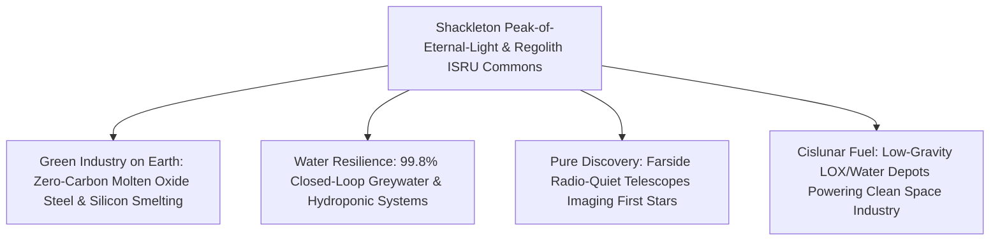

# PILLAR 05: SPACE & ORBITAL STEWARDSHIP (CARBON EDITION)
## Pathway 5.4: The Shackleton Peak-of-Eternal-Light Base — Humanity's First Cislunar Commons

> **The Cynic's Cliché:**
> *"Going back to the Moon is just nostalgic Cold War flag-planting on a dead grey rock! Spending billions to haul bottled water, oxygen tanks, and tin cans 384,000 kilometers away does nothing for humanity on Earth."*
>
> **The Nov 2026 Orbital Breakthrough:**
> Apollo visited the scorching, bone-dry lunar equator for seventy-two hours. In the late 2020s, humanity is settling a completely different geological miracle: the **Lunar South Pole's Shackleton Connecting Ridge**, where towering peaks bathe in **85% to 90%+ continuous sunlight** right next door to permanently shadowed craters holding **hundreds of millions of tons of ancient water ice**. Even more remarkably, lunar dirt (*regolith*) is **42% pure oxygen by weight** bound to silicon, iron, aluminum, and titanium! Powered by **Intuitive Machines** and **Firefly Aerospace (*Blue Ghost*)** commercial landings, **SpaceX Starship HLS** and **Blue Origin *Blue Moon*** heavy cargo ships, **ICON's *Project Olympus*** 3D-sintered vaults, and **Blue Alchemist's** zero-chemical solar-cell manufacturing from raw Moon dirt, humanity is building a self-sustaining **Antarctic-style peaceful science and clean-tech commons** under the **Artemis Accords**.

> *"Learning to live off the land at the lunar south pole—turning regolith and ice into oxygen, power, and shelter—transforms the Moon into humanity's stepping stone to the solar system."*
> — **Dr. Bhavya Lal**, Former NASA Associate Administrator for Technology, Policy, and Strategy

---

## ACT I: THE HUMAN REALITY — AN ANTARCTIC MCMURDO AMONG THE STARS
### Morning Shift at Shackleton Ridge Commons, 2036

Stand inside the sunlit geodesic greenhouse dome of **Shackleton Station** on the Connecting Ridge ($89.5^\circ\text{S}$) on a crisp morning in **2036**.

Through triple-paned fused-regolith windows, Earth hangs like a luminous blue-and-white marble just above the jagged horizon—never rising, never setting, forever watching from the exact same spot in the black sky. Inside, researchers from twenty-eight Artemis Accords nations share fresh espresso in one-sixth gravity ($0.165g$) while robotic rovers work silently down the crater rim:

1. **Breathing the Rocks & Drinking Ancient Comets:**
   Not a single liter of the water misting the station's hydroponic strawberries or the crisp oxygen filling the commons was launched from Florida. Just four kilometers downslope inside Shackleton Crater's $40\text{ Kelvin}$ shadow, heated-auger harvesters sublime pristine water ice into liquid $\text{H}_2\text{O}$ and split it into clean $\text{LH}_2/\text{LOX}$ rocket propellant. Up on the sunlit ridge, **Molten Regolith Electrolysis** reactors melt grey Moon dust at $1,600^\circ\text{C}$—bubbling off **pure breathing oxygen** while pouring cast iron, aluminum beams, and **locally grown silicon solar panels**.

2. **Vaulted Safely Under Sintered Lunar Stone:**
   Nobody lives inside fragile foil cans exposed to cosmic rays. Autonomous **ICON *Olympus*** gantry robots have microwave- and laser-sintered local regolith into graceful, cathedral-like vaulted arches two meters thick—blocking 100% of solar particle storms and micrometeoroids while holding cozy $21^\circ\text{C}$ shirtsleeve air inside.

3. **Earth's Ultimate Clean-Tech Crucible & Farside Telescope:**
   Every closed-loop water recycler ($99.8\%$ recovery), zero-carbon electrochemical iron smelter, and autonomous microgrid perfected under Shackleton's strict resource discipline has already been licensed back to drought-stricken towns and green-steel mills on Earth. Meanwhile, over the horizon on the **Lunar Farside**—the only place in the inner solar system shielded by 3,474 kilometers of solid rock from Earth's radio chatter—low-frequency radio arrays image the universe's very first stars from the cosmic Dark Ages.

4. **Peaceful Cooperative Governance Modeled on McMurdo:**
   Just as Antarctica's **McMurdo Station** turned icy geopolitical rivalry into sixty-five years of shared glaciology, open rescue protocols, and demilitarized science, Shackleton operates under transparent **Artemis Accords safety zones, open scientific data sharing, and heritage preservation**.

5. **The Skeptic's Honest Question:**
   How did we leap from brief, fragile robotic hops in 2024–2025 to turning raw grey dust into oxygen, glass, steel, and solar arrays without shipping factories' worth of chemicals from Earth?

---

## ACT II: THE CONVERGENCE BRIDGE & NOV 2026 STATE OF THE ART
### Polar Illumination Geometry, Molten Regolith Electrolysis, and Heavy Cargo Landers

### 1. Three Physical Gifts Waiting at $89^\circ\text{ South}$
* **1. The $1.54^\circ$ Axial Tilt Miracle (Peaks of Eternal Light Beside Cryo-Traps):**
  Because the Moon's spin axis is tilted just $1.54^\circ$ (versus Earth's $23.5^\circ$), mountain rims around **Shackleton, de Gerlache, and Malapert** stand in grazing sunlight **85% to 92% of the entire year**—requiring only modest vertical solar towers—while crater floors two kilometers below haven't seen a single photon in two billion years, trapping **hundreds of millions of metric tons of water ice** confirmed by NASA's *LCROSS*, *LRO*, and Chandrayaan-1/3.

* **2. Molten Regolith Electrolysis (42% of the Moon Is Oxygen!):**
  Lunar highland and mare regolith consists of metal oxides ($\text{SiO}_2, \text{Al}_2\text{O}_3, \text{FeO}, \text{MgO}, \text{CaO}, \text{TiO}_2$). Passing direct solar electric current through molten regolith at $1,600^\circ\text{C}$ without any consumable chemical reagents splits those bonds cleanly:
  $$2\,\text{MO}_{\text{(molten regolith)}} \xrightarrow{\text{Solar DC Electrolysis}} 2\,\text{M}_{\text{(pure Si, Fe, Al)}} + \text{O}_2\uparrow$$
  Every **100 tons of lunar dirt yields ~35–42 tons of pure $\text{O}_2$** for astronauts and rocket oxidizer, plus high-purity (>99.999%) **silicon for solar cells**, structural iron, andslag glass!

* **3. The $22\times$ Gravity Gravity-Well Discount ($v_{\text{esc}} = 2.38\text{ km/s}$):**
  Launching oxygen, water propellant, or radiation shielding off Earth fights $11.2\text{ km/s}$ escape velocity and thick atmospheric drag; lifting that same mass off the airless Moon requires **~$22\times$ less kinetic energy per kilogram**, turning Shackleton into the gas station for all cislunar orbital industry.

### 2. Verified 2024–2026 Commercial & Agency Milestones

| Pioneer / Program | Lunar Capability | Verified 2024–2026 Milestone | Role in the Shackleton Commons |
| :--- | :--- | :--- | :--- |
| **Firefly Aerospace (*Blue Ghost*) & Intuitive Machines** | NASA CLPS commercial robotic lunar landers | **2024–2026:** Intuitive Machines (*IM-1 / IM-2*) reached lunar south polar region; **Firefly *Blue Ghost M1*** achieved flawless upright lunar landing & full 14-day surface operations (March 2025). | Routine, sub-\$100M commercial FedEx-style delivery of polar drills, spectrometers, and laser beacons. |
| **SpaceX (*Starship HLS*) & Blue Origin (*Blue Moon*)** | Fully reusable heavy-cargo & crew lunar landers | Parallel NASA Artemis human & cargo lander contracts advancing cryogenic orbital propellant transfer and **15-ton to 100-ton** single-landing surface payload bays. | Drops entire pre-integrated nuclear/solar power plants, pressurized rovers, and habitats in one flight. |
| **Blue Origin (*Blue Alchemist*)** | Zero-chemical Molten Regolith Electrolysis (MRE) | Demonstrated end-to-end fabrication of **working radiation-resistant solar cells, cover glass, transmission wire, and pure $\text{O}_2$** from simulated lunar regolith with zero toxic chemicals. | Enables self-replicating megawatt lunar solar farms without shipping panels from Earth. |
| **ICON (*Project Olympus*)** | Autonomous 3D regolith laser/microwave construction | NASA-backed multi-million-dollar development & vacuum chamber validation of vitrified lunar landing pads, blast berms, roads, and radiation vaults using local dust. | Eliminates supersonic lander dust-ejecta hazards and builds permanent radiation-proof dwellings. |
| **Westinghouse / Rolls-Royce / NASA *Fission Surface Power*** | $40\text{ kWe–100 kWe}$ compact micro-reactors + Vertical Solar | NASA **VSAT** (10m vertical polar solar arrays by Astrobotic/Lockheed) + compact uranium/TRISO fission units completing design milestones for eclipse survival. | Guarantees 100% uninterrupted life-support and smelter heat through brief polar shadow periods. |
| **Artemis Accords & International Partners** | Peaceful multilateral lunar governance & hardware | **45+ signatory nations** across 6 continents; **JAXA/Toyota *Lunar Cruiser*** pressurized rover (30-day shirt-sleeve range) & **ESA *Argonaut*** cargo lander in build. | Establishes McMurdo-style mutual aid, non-interference safety zones, and open science norms. |

---

## ACT III: PHASED ROLLOUT ROADMAP (2026 $\rightarrow$ 2042) & TERRESTRIAL SPINOFFS

### 1. Four-Step Buildout from Robotic Scouts to Self-Growing Polar Village

| Phase & Window | Landed Tonnage & Infrastructure | In-Situ Resource Utilization (ISRU) | Science & Earth-Benefit Payoff |
| :--- | :--- | :--- | :--- |
| **Phase 1: Polar Prospectors** *(2025–2027)* | **CLPS landers** (*Firefly*, *Intuitive Machines*, *Astrobotic*) + polar ice drills & mass spectrometers. | Ground-truth 3D mapping of Shackleton/Connecting Ridge ice purity and pilot oxygen-extraction demos. | Validates ultra-compact autonomous soil-chemistry labs & micro-drills for remote terrestrial geology. |
| **Phase 2: Heavy Cargo & Sintered Pads** *(2028–2031)* | **Starship HLS & Blue Moon** land 20–100t payloads; first **ICON** vitrified landing pads & VSAT solar towers. | **10–50 tons/yr** regolith-derived $\text{O}_2$ & water; JAXA pressurized rover enables multi-week human exploration. | Zero-chemical **Molten Oxide Electrolysis** spun back to Earth for carbon-free green steelmaking! |
| **Phase 3: Shackleton Permanent Station** *(2032–2036)* | Vaulted regolith habitats for **25–50 international researchers** year-round; $100\text{ kW+}$ hybrid solar/fission grid. | **Blue Alchemist** prints megawatts of local lunar solar arrays; **500+ tons/yr** $\text{LOX}/\text{LH}_2$ cislunar depot fuel. | First **Lunar Farside Radio Array** opens a noiseless window into early-universe cosmology & exoplanet magnetospheres. |
| **Phase 4: Cislunar Shipyard & Commons** *(2037–2042)* | **200+ person** multi-dome research village, hydroponic gardens, and electromagnetic/tether export tugs. | Lunar aluminum, basalt fiber, glass, and silicon feed orbital solar power sats & spinning habitats at $1/20\text{th}$ Earth launch energy. | Closed-loop $99.8\%$ water/nutrient bioreactors deployed across arid towns and refugee settlements on Earth. |

### 2. Earth-Supplied Outpost vs. ISRU Shackleton Commons (Economics & Mass Math)

| Outpost Metric (50-Person Station) | Legacy "Bring Everything From Earth" | Shackleton ISRU ("Live Off the Land") | Efficiency & Sustainability Leap |
| :--- | :--- | :--- | :--- |
| **Landed Cost of 1 Ton of Water / Oxygen** | **\$5M – \$25 Million / ton** hauled from Earth | **<\$150,000 / ton** (local crater ice & regolith MRE) | **>95% Operational Cost Collapse** |
| **Radiation & Meteoroid Shielding Mass** | Impossible to launch 500 tons of lead/polyethylene | **Free local sintered regolith** ($2\text{ m}$ vaults over domes) | **Cosmic-Ray Safe (<Earth Lab Dose)** |
| **Solar Power Expansion Cost** | Every new megawatt requires heavy Earth launches | **Self-bootstrapping silicon** smelted from local dust | **Exponential Clean Energy Growth** |
| **Legal & Cultural Operating Model** | Exclusive national military outposts | **Antarctic McMurdo / Artemis Accords Commons** | **Peaceful Multilateral Cooperation** |

### 3. Protecting Lunar Dust Health, Power Continuity & Historic Heritage
Building a permanent polar commons means solving the Moon's sharpest practical hazards cleanly:

* **Electrostatic Dust Shields & Rear-Entry Suitlocks:**
  Unweathered lunar regolith grains are jagged like crushed volcanic glass. At Shackleton, dust never enters living quarters: crews step out of **rear-entry suitports** mounted directly on pressurized rover and habitat bulkheads while transparent **Electrodynamic Dust Shields (EDS)** sweep 99.5% of clinging grains off visors, solar glass, and radiators using silent multi-phase AC electric fields.

* **Bridging the Brief Polar Shadows (Solar + Micro-Fission + Regen Fuel Cells):**
  Even along Connecting Ridge's 90%-sunlit peaks, occasional 48-to-96-hour terrain eclipses occur during lunar winter. Pairing 10-meter vertical solar towers (**NASA VSAT**) with compact **40–100 kWe TRISO/sodium-heat-pipe fission units** and regenerative $\text{H}_2/\text{O}_2$ fuel cells guarantees 100% uninterrupted warmth and smelter power year-round.

* **Closed-Loop Bioregenerative Greenhouses ($99.8\%$ Water Loop):**
  Guided by ESA *MELiSSA* and controlled-environment agriculture breakthroughs, lunar greenhouses recycle nearly every molecule of transpired humidity, greywater, and plant biomass—turning barren basalt vaults into fragrant gardens of dwarf wheat, leafy greens, and berries.

* **Heritage Parks & Non-Interference Safety Zones:**
  Under **Artemis Accords** transparency norms, historic Apollo, Luna, Surveyor, and Chang'e touchdowns are preserved as untouchable planetary monuments, while **ICON** sintered landing pads stop rocket exhaust from contaminating polar ice traps or farside radio telescopes.

---

## ACT IV: THE SYNERGY UNLOCK & CLOSING ANSWER TO THE CYNIC

Learning to turn barren grey dust and shadowy ice into air, water, solar glass, and stone vaults delivers four lasting gifts to human civilization:

1. **Green Steel & Zero-Waste Water for Earth:**
   The exact **Molten Oxide Electrolysis** physics used to make oxygen and iron on the Moon (parallel to Boston Metal on Earth) eliminates coal coking from terrestrial steelmaking—cutting up to 8% of global $\text{CO}_2$ emissions—while lunar closed-loop water purifiers bring drought resilience to arid communities worldwide.

2. **A Peaceful Global Campfire Like Antarctica:**
   Working shoulder-to-shoulder at Shackleton Station gives engineers, botanists, and students from forty-five+ nations a shared, inspiring frontier rooted in mutual rescue protocols and open scientific data rather than zero-sum terrestrial conflict.

3. **Unblinding Deep-Time Astronomy:**
   Shielded behind 3,474 km of solid Moon rock, farside low-frequency telescopes hear faint 21-centimeter hydrogen whispers from before the first galaxies ignited—answering fundamental human questions about our cosmic origins.

4. **The Low-Gravity Stepping Stone for Orbital Stewardship:**
   Supplying water, oxygen, silicon, and radiation shielding from the Moon's shallow $2.38\text{ km/s}$ gravity well cuts the mass Earth must launch for clean orbital solar arrays and industrial parks by more than 90%.

5. **The Warm Truth for the Cynic:**
   Shackleton is not an escape hatch for the few—it is humanity's shared Antarctic research station in the sky, teaching us how to recycle every molecule cleanly so both Earth and our future among the stars can thrive.

---

## References & Verified Sources

* **Featured Researcher / Leader:** [Dr. Bhavya Lal — Former NASA Associate Administrator for Technology, Policy, and Strategy](https://www.nasa.gov/)
* **Companies, Labs & Consortia:** [SpaceX (Starship HLS)](https://www.spacex.com/) · [Blue Origin (Blue Moon & Blue Alchemist)](https://www.blueorigin.com/) · [Firefly Aerospace (Blue Ghost)](https://fireflyspace.com/) · [Intuitive Machines](https://en.wikipedia.org/wiki/Intuitive_Machines) · [ICON (Project Olympus)](https://www.iconbuild.com/) · [JAXA & Toyota (Lunar Cruiser)](https://global.jaxa.jp/) · [NASA Artemis & ESA Argonaut](https://www.nasa.gov/humans-in-space/artemis/)
* **Global & Regulatory Precedents:** [Antarctic Treaty & McMurdo Cooperative Research Station (65+ Years)](https://www.ats.aq/) · [Artemis Accords (45+ Signatory Nations Across 6 Continents)](https://www.nasa.gov/artemis-accords/) · [Firefly Blue Ghost & Intuitive Machines Commercial CLPS Landings](https://fireflyspace.com/)
* **Connected Carbon Pathways:** [Orbital Sunlight: 24/7 Space-Based Solar Beams](../../01-abundant-energy/space-solar-power/REPORT.md) · [Designing Matter Backwards: AI Super-Materials Without Rare-Earth Scars](../../02-automation-science/inverse-materials-design/REPORT.md) · [Ending Drought Forever: Sub-Penny Desalination & Continental New Rivers](../../01-abundant-energy/aquifer-rivers-desalination/REPORT.md) · [Zoning Earth as a Garden Park: Graduating Heavy Refining Above the Biosphere](../heavy-industry-off-earth/REPORT.md)
