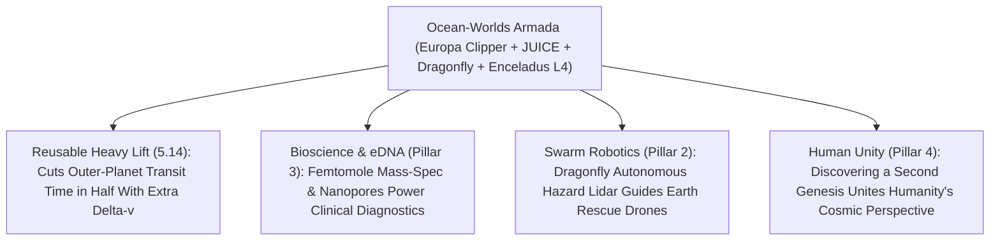

# PILLAR 05: SPACE & ORBITAL STEWARDSHIP (CARBON EDITION)
## Pathway 5.15: Searching Living Subsurface Oceans — Europa Clipper, Dragonfly & Single-Cell Plume Mass Spectrometers

> **The Cynic's Cliché:**
> *"Finding alien life is pure sci-fi daydreaming—any living microbes in the outer solar system are locked beneath twenty kilometers of rock-hard glacial ice! We'd need impossible billion-dollar nuclear ice-drills for fifty years before we ever knew if we're alone!"*
>
> **The 2025–2026 Astrobiology Armada Breakthrough:**
> We don't have to drill through twenty kilometers of ice—**the ocean moons sneeze their oceans straight into space for us!** Right now in late 2026, humanity's greatest astrobiology armada is already cruising across the solar system or in final flight integration: **NASA's *Europa Clipper*** (launched October 2024, completing its Mars gravity-assist and cruising toward 49 low-altitude flybys of Jupiter's icy moon Europa) carries the **SUDA (*Surface Dust Analyzer*)** impact-ionization mass spectrometer—**proven in peer-reviewed laboratory hypervelocity beam tests (*Science Advances*) to detect a single bacterial cell fragment (`<0.1` cell!) hiding inside one microscopic ejected ice grain at $4.5\text{ km/s}$ without ever landing!** Simultaneously, **ESA's *JUICE*** is en route to Ganymede, Callisto, and Europa, while **NASA & Johns Hopkins APL's nuclear-powered *Dragonfly* octocopter** advances toward a 2028 heavy-lift launch to fly across the organic dunes and impact-melt craters of Saturn's hazy moon **Titan**.

> *"Even if only a tiny fraction of one single cell is trapped inside an individual ice grain, SUDA can identify its fatty acids and amino acids as Europa Clipper flies right through it."*
> — **Dr. Fabian Klenner**, Astrobiologist, University of Washington & Europa Clipper SUDA Science Team Collaborator

---

## ACT I: THE HUMAN REALITY — CATCHING AN OCEAN WHISPER AT 25 KILOMETERS ALTITUDE
### NASA JPL Mission Operations (Pasadena), Johns Hopkins APL Rotor Tunnel & Jupiter Orbit, 2030–2034

Step onto the glass gallery above Space Flight Operations at **NASA's Jet Propulsion Laboratory** in Pasadena—or peer inside the cryogenic Titan atmospheric wind tunnel at **Johns Hopkins Applied Physics Laboratory** in Maryland—as humanity asks its oldest philosophical question with real laboratory steel: *Is life a one-in-a-trillion Earth fluke, or a cosmic imperative wherever liquid water touches warm rock?*

For centuries, astronomers assumed life required a cozy "Goldilocks" orbit bathed in warm sunshine—ruling out 99% of our outer solar system. Then Voyager, Galileo, and Cassini shattered that prejudice forever by uncovering **dark, tide-warmed subsurface oceans containing $2\times$ to $3\times$ more liquid water than all of Earth's oceans combined**:

1. **Tasting Europa's Salty Sea Without Touching the Ground (*Europa Clipper*):**
   Beneath Europa's fractured, rust-streaked ice shell sloshes a global saltwater ocean **60 to 150 kilometers deep**, kept warm by Jupiter's relentless tidal flexing over a rocky seafloor rich in hydrothermal vents—just like the pitch-black ocean vents where early life thrived on Earth! Micrometeorite impacts and cryovolcanic plumes loft microscopic droplets of that salty water $25\text{ kilometers}$ above the ice. Swooping just **$25\text{ km}$ above Europa's ridges at $4.5\text{ km/s}$**, *Europa Clipper's* bucket-shaped **SUDA** detector catches single $1\text{-micron}$ ice grains, vaporizes them on impact, and reads out unmistakable biosignature ratios—homochiral amino acids, cell-membrane lipids, and salt chemistry!

2. **An Nuclear-Powered Octocopter Hopping Across Titan's Prebiotic Lab (*Dragonfly*):**
   Out at Saturn, hazy golden **Titan** hosts lakes of liquid methane, rainstorms of complex organic molecules (*tholins*), and a deep subsurface water ocean. Because Titan's nitrogen atmosphere is **$4\times$ denser than Earth's** and its gravity is just **$1/7\text{th}$ Earth's ($1.35\text{ m/s}^2$)**, flying is **nearly $40\times$ aerodynamically easier** than on Earth! Powered day and night by an **MMRTG radioisotope battery**, the car-sized **Dragonfly** dual-quadcopter leaps kilometers at a time into **Selk Crater**—where ancient liquid water once mixed directly with rich organic sand—drilling samples into its onboard **DraMS** mass spectrometer!

3. **Two Independent Genesis Trees in One Solar System:**
   If *Europa Clipper*, *JUICE*, an **Enceladus Orbilander**, or *Dragonfly* finds microbial chemistry built on a *second, independent origin of life* inside our very own solar system, statistics flip instantaneously: the Milky Way isn't an empty desert—it is a **living garden teeming with billions of inhabited ocean worlds**.

4. **The Skeptic's Honest Question:**
   Wait—if *Europa Clipper* slams into fragile organic molecules at **16,000 kilometers per hour ($4.5\text{ km/s}$)**, why doesn't the violent impact smash every cell fragment into unrecognizable atomic ash?

---

## ACT II: THE CONVERGENCE BRIDGE & NOV 2026 STATE OF THE ART
### Ice-Matrix Shielding, Tidal Heating Physics, and Rotorcraft Aerodynamics on Titan

### 1. Three Breakthrough Discoveries Powering the 2026 Armada
* **1. Water-Ice Matrix Shielding at $4.5\text{ km/s}$ (*Science Advances* Lab Proof):**
  How can an organic fatty acid survive slamming into **SUDA's** rhodium target at $4.5\text{ km/s}$? Using a cryogenic liquid-water micro-beam blasted by an infrared laser in vacuum (*Klenner, Postberg et al., Science Advances*), researchers fired real *Sphingopyxis alaskensis* marine bacteria (ultra-tiny oligotrophic microbes adapted to cold, nutrient-poor oceans) into an exact flight-analog detector. The surrounding water molecules absorb the shock via rapid vaporization (**matrix-assisted impact ionization**), keeping intact **cellular fatty acids, lipids, and amino acids** intact—even when only **0.1 of a single cell's mass** resides inside one micron-scale ice grain!

* **2. Ice-Penetrating Dual-Frequency Radar & Organic Sniffers (*REASON* + *MASPEX*):**
  Alongside SUDA, *Europa Clipper* carries **REASON** (dual $9\text{ MHz} / 60\text{ MHz}$ radar mounted on its $30\text{-meter}$ solar wings) to see **up to $30\text{ km}$ straight down through Europa's ice**, pinpointing perched liquid-water lakes just below the surface, while **MASPEX** achieves mass-spectrometry resolution **$50\times$ finer than Cassini**—separating carbon monoxide ($\text{CO}$) from molecular nitrogen ($\text{N}_2$) to audit metabolic chemical disequilibrium!

* **3. Hover Power Scaling on Titan ($\rho_{\text{Titan}} = 4.4\rho_\oplus, g_{\text{Titan}} = 0.14g_\oplus$):**
  Minimum aerodynamic power to hover a rotorcraft of mass $m$ scales with gravity $g$ and atmospheric density $\rho$ as:
  $$P_{\text{hover}} \propto \frac{(m g)^{3/2}}{\sqrt{\rho A_{\text{rotor}}}}$$
  Plug in Titan's thick nitrogen sky ($\rho \approx 5.3\text{ kg/m}^3$) and gentle gravity ($1.35\text{ m/s}^2$), and hovering **Dragonfly's ~875 kg lander** takes **38 times less power** than hovering the same mass on Earth—allowing nuclear MMRTG heat to both warm the cabin against $-179^\circ\text{C}$ cold and recharge lithium batteries for multi-kilometer flights every Titan day!

### 2. Verified 2024–2026 Ocean-World Missions & Milestones

| Mission / Spacecraft | Lead Agencies & Labs | Verified 2024–2026 Milestone | Astrobiology Superpower |
| :--- | :--- | :--- | :--- |
| **NASA *Europa Clipper*** | NASA JPL, Johns Hopkins APL, CU Boulder (SUDA), SwRI (MASPEX), UT Austin (REASON) | **Launched Oct 14, 2024 on Falcon Heavy**; completed **March 2025 Mars flyby** (testing E-THEMIS thermal imager) & **Dec 2026 Earth gravity-assist** toward April 2030 Jupiter arrival! | 49 low flybys (down to $25\text{ km}$); single-cell ice-grain mass spec + $30\text{ km}$ ice-penetrating radar. |
| **ESA *JUICE* (Jupiter Icy Moons Explorer)** | ESA, Airbus, ASI, DLR, CNES & NASA/JAXA partners | Executed **world-first lunar-Earth double gravity assist (Aug 2024)** & **Aug 2025 Venus flyby** cruising toward 2031 Jovian tour & **first-ever orbit around an alien moon (Ganymede)**. | Compares three ocean moons (**Ganymede, Callisto, Europa**) via RIME radar & laser altimetry. |
| **NASA *Dragonfly* Rotorcraft Lander** | Johns Hopkins APL, NASA Goddard, Penn State & Lockheed Martin | **Passed NASA Confirmation & Critical Design milestones (2024–2026)**, secured **SpaceX Falcon Heavy** launch contract (targeting July 2028 launch $\rightarrow$ 2034 Titan arrival), rotor/DraMS testing complete. | Mobile 8-rotor flying chemistry lab sampling dozens of organic dune & ancient liquid-water sites on Titan. |
| **Enceladus *Orbilander* & ESA *L4* Flagship** | NASA Decadal #2 Flagship Priority & **ESA Voyage 2050 Large-Class L4 Selection** | **ESA formally selected Enceladus plume/surface lander** as top L4 flagship priority alongside NASA Orbilander life-detection instrument maturation. | Flies through & lands directly beside Saturn's moon Enceladus's active south-pole geysers ($\text{H}_2$, $\text{PO}_4^{3-}$ confirmed!). |

---

## ACT III: PHASED ROLLOUT ROADMAP (2026 $\rightarrow$ 2042) & EARTH BIOTECH SPINOFFS

### 1. From Cruise Phase to Direct Biosignature Confirmation

| Exploration Window | Active Milestones | Target Worlds Sampled | Scientific & Philosophical Leap |
| :--- | :--- | :--- | :--- |
| **2025–2026 (Live Cruise)** *Gravity Assists & Flight Build* | **Europa Clipper** Mars/Earth flybys; **JUICE** Venus/Earth flybys; **Dragonfly** flight hardware assembly. | Mars & Venus calibration targets en route to outer planets. | Flight validation of *REASON* radar, *E-THEMIS* thermal mapping, & single-cell *SUDA* spectral libraries. |
| **2028–2031** *Jovian Arrival & Titan Launch* | **Dragonfly launches (2028)**; **Europa Clipper arrives at Jupiter (April 2030)**; **JUICE arrives (July 2031)**. | **Europa** (49 flybys), **Ganymede**, & **Callisto**. | First direct taste of Europa's fresh plume/sputtered ice grains + 3D radar maps of subsurface water pockets! |
| **2034–2036** *Flight Over Titan & Ganymede Orbit* | **Dragonfly parachutes & flies across Titan (2034)**; **JUICE enters low Ganymede orbit**. | **Titan** (*Shangri-La* dunes & *Selk Crater*) + **Ganymede's** intrinsic magnetosphere. | Tests prebiotic-to-biotic chemistry in water-organic melt deposits; maps Ganymede's deep ocean salt content. |
| **2038–2045** *Enceladus Surface & Cryobot Era* | **ESA L4 / NASA Enceladus Orbilander** (launched faster via `<\$100/kg` heavy lift, Pathway 5.14) + **TRIDENT** Neptune/Triton. | **Enceladus** south-pole "Tiger Stripes" + **Triton** plumes. | Nanopore single-molecule sequencing directly on freshly fallen alien ocean snow! |

### 2. Why Care Here on Earth? Extreme-Sensor & Deep-Ocean Spinoffs

| Space Instrument Tech | Built For Outer Moons | Direct Earthly Spinoff (2026–2032) | Benefit to Human Health & Ecology |
| :--- | :--- | :--- | :--- |
| **SUDA & MASPEX Ultra-High-Res Mass Spec** | Spotting trace femtomole lipids & isotopes in vacuum | **Portable hospital breath-biopsy & trace water-toxin analyzers** | Detects early cancer volatiles & sub-ppt industrial water pollutants (`forever-chemical-cleanup`). |
| **Radiation-Hardened Jovian Electronics** | Surviving Jupiter's $20,000\times$-Earth radiation belts inside titanium vault | **Fault-tolerant medical linear accelerators, fusion reactor diagnostics (`fusion-power`), & grid relays** | Zero-crash reliability in extreme radiation & electromagnetic environments. |
| **REASON Ice-Penetrating Radar** | Measuring Europa's ice shell & sub-glacial brine lenses | **Antarctic & Greenland sub-glacial basal melt radar mapping** | Sharpens coastal sea-level projections for every port city on Earth. |

### 3. Strict Planetary Protection: Looking Without Contaminating
Under **COSPAR Planetary Protection Category IV/III standards**, *Europa Clipper*, *JUICE*, and *Dragonfly* uphold rigorous bioburden sterilization and end-of-mission disposal plans (for example, *Europa Clipper* is scheduled to dispose harmlessly into Callisto/Ganymede rather than ever crashing into pristine Europa)—ensuring that if we discover ocean life, it is **100% native**, never a hitchhiker from Florida!

---

## ACT IV: THE SYNERGY UNLOCK & CLOSING ANSWER TO THE CYNIC

Look up at bright, steady Jupiter tonight—visible even from a city sidewalk—and feel what is cruising toward it right now:

1. **The Ocean Moons Came Halfway to Meet Us:**
   Nature spared us from drilling through twenty kilometers of ice: geysers and micrometeorite plumes toss microscopic bottles of alien seawater into space, and human ingenuity built a catcher's mitt sensitive enough to spot a tenth of a single microbe inside one frozen drop.

2. **Expanding What "Home" Means in the Universe:**
   Because icy ocean moons outnumber warm Earth-like rocky planets ten-to-one—even around dim red dwarf stars and rogue worlds—proving life thrives in dark tidal oceans multiplies the cosmic habitats for biology tenfold overnight.

3. **Uniting Eight Billion Earthlings:**
   Nothing shrinks petty human tribalism faster than learning whether Earth's DNA tree has cousins swimming beneath Europa's ice or chemistry stirring on Titan's dunes.

4. **The Ultimate Answer to the Cynic:**
   Next time someone shrugs that *"alien life is untestable sci-fi locked under twenty miles of ice,"* point to **Europa Clipper** hurtling past Earth's gravity assist right now in late 2026: **the ships are already built, they are already flying, and one microscopic grain of ice is all they need.**

---

## References & Verified Sources

* **Featured Researcher / Leader:** [Dr. Fabian Klenner — Astrobiologist, University of Washington & Europa Clipper SUDA Science Collaborator](https://europa.nasa.gov/)
* **Companies, Labs & Consortia:** [NASA Jet Propulsion Laboratory — Europa Clipper Mission](https://europa.nasa.gov/) · [Johns Hopkins Applied Physics Laboratory — Dragonfly Titan Mission](https://dragonfly.jhuapl.edu/) · [ESA JUICE (Jupiter Icy Moons Explorer)](https://www.esa.int/Science_Exploration/Space_Science/Juice) · [CU Boulder LASP (SUDA Surface Dust Analyzer)](https://lasp.colorado.edu/) · [Southwest Research Institute (MASPEX)](https://www.swri.org/) · [COSPAR Panel on Planetary Protection](https://cosparhq.cnes.fr/)
* **Global & Regulatory Precedents:** [Klenner et al., *Science Advances* (2024): How to Identify Cell Material in a Single Ice Grain Emitted From Enceladus or Europa](https://www.science.org/doi/10.1126/sciadv.adl0849) · [NASA Europa Clipper Launch (Oct 2024), Mars Flyby (2025) & Earth Gravity Assist (Dec 2026)](https://science.nasa.gov/mission/europa-clipper/) · [NASA Confirmation of Dragonfly Nuclear Rotorcraft Mission to Titan](https://dragonfly.jhuapl.edu/)
* **Connected Carbon Pathways:** [Mechazilla & the \$50/kg Sky Railroad: Rapidly Reusable Super-Heavy Lift](../reusable-starship-heavy-lift/REPORT.md) · [Symphonic Swarms: Autonomous Rescue & Environmental Bots](../../02-automation-science/specialized-swarm-robotics/REPORT.md) · [Destroying Forever Chemicals & Ultra-Trace Water Sensors](../../03-bioscience-regeneration/forever-chemical-cleanup/REPORT.md) · [The Amateur Golden Age: Open Satellites, eDNA & AI Swarms](../../06-synergy-horizons/citizen-science-ai-renaissance/REPORT.md)
